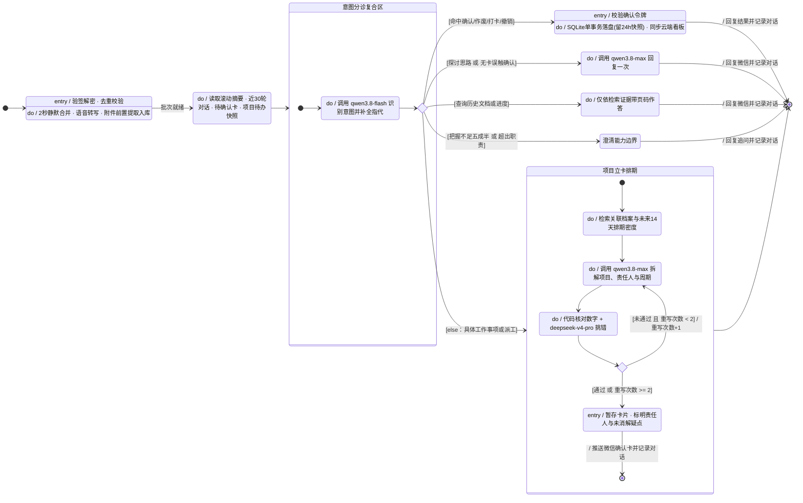

# LangGraph × OMG UML 2.5 状态机图精确映射与样式手册

## 一、 LangGraph 概念与 UML 2.5 标准图元 1:1 映射表

| LangGraph / 智能体运行机制 | 标准 UML 2.5 状态机元素 | 图形画法与标签规则 | 常见错误画法（严禁 ❌） |
| :--- | :--- | :--- | :--- |
| `START` / `set_entry_point` | **Initial Pseudostate（初始伪状态）** | 实心黑圆 `●`，唯一出边指向首状态 | 画成胶囊框写“开始”或标 `[guard]` |
| `END` | **Final State（终止状态）** | 牛眼双圆 `◉`（黑心圆 + 外环），零出边 | 画成普通框写“结束”且后面还引虚线 |
| 普通 Node（纯代码节点） | **Simple State（简单状态）** | 圆角矩形；标题写状态名，分隔线下方写 `do / 确定性动作` | 画成直角流程图矩形 |
| 调 LLM / 工具的 Node | **Simple State（带内部活动）** | 圆角矩形；隔间写 `do / 调用 <模型名>：<业务目的>` | 画成双竖线子程序框或六边形 |
| `add_edge(A, B)` | **Completion Transition（完成迁移）** | 实线单向箭头 `A ──▶ B`（A 的 `do` 活动完成后自动触发，可标 `/ 副作用`） | 随意用虚线连接正常状态流 |
| `add_conditional_edges` | **Choice Pseudostate（选择伪状态 `◇`）** | `A ──▶ ◇`，从空心小菱形 `◇` 引出多条实线，每条必标 `[条件]` 含 `[else]` | 在菱形里写长段问题，出边只写“是/否”不写方括号 `[条件]` |
| 反思重写回环（Producer ↔ Critic） | **Guarded Loop Transition（受监护回边）** | 从审核后的 `◇` 引回边：`[未通过 且 重写次数 < 2] / 重写次数+1` | 画一条红虚线不标计数器变化与跳出上限 |
| SQLite / OneDrive 读写、发微信 | **Internal Activity 或 Transition Effect** | 写在状态隔间 `entry /`、`do /`、`exit /` 内，或在迁移线上写 `/ 发送确认卡并存档` | 在状态图里画绿圆柱体“SQLite”或平行四边形“微信”跟状态框连线 |
| 待人类回复确认卡（跨消息挂起） | **Wait State（等待状态）或本轮 `◉` 终止** | 若画单轮状态机：`/ 发出确认卡` ──▶ `◉`；若画全生命周期状态机：停在 `等待确认中` 状态，由外部事件 `收到用户回复 [回复=="1"]` 触发迁移 | 用无触发条件箭头把“出卡”和“落盘”直接连死，看不出需要人工签字 |
| 12s 心跳监控 / 每日定时唤醒 | **Orthogonal Region（正交并发区域）** | 在外层复合状态内用**贯穿虚线**切分出独立并发泳道（Region），各自拥有独立的 `●` 起点与定时触发器 `after(12s)` / `at(08:30)` | 把定时器跟单次消息主干混画在同一平面互相交叉 |

---

## 二、 Mermaid `stateDiagram-v2` 标准写法模板

在 Markdown 文档或汇报中绘制状态机时，严格采用以下 `stateDiagram-v2` 语法（绝不用 `flowchart`）：

---

## 三、 Draw.io (`mxGraph` XML) 标准 UML 2.5 样式常量速查

使用 Python 脚本生成 `.drawio` 图纸时，必须使用以下标准 UML 2.5 图元样式，禁止使用普通流程图形状：

1. **初始伪状态 `●`（`30x30`）**：
   `ellipse;html=1;shape=startState;fillColor=#000000;strokeColor=#000000;`
2. **终止状态 `◉`（`34x34`）**：
   `ellipse;html=1;shape=endState;fillColor=#000000;strokeColor=#000000;`
3. **简单状态框（圆角两栏泳道框 `swimlane`，上栏状态名，下栏 `entry / do / exit`）**：
   - 外框：`swimlane;fontStyle=1;align=center;verticalAlign=top;childLayout=stackLayout;horizontal=1;startSize=32;horizontalStack=0;resizeParent=1;resizeLast=1;collapsible=0;marginBottom=0;rounded=1;arcSize=12;fillColor=#f8fafc;strokeColor=#1e40af;strokeWidth=2;fontSize=15;`
   - 内栏活动文本：`text;strokeColor=none;fillColor=none;align=left;verticalAlign=top;spacingLeft=10;spacingRight=10;spacingTop=6;overflow=hidden;rotatable=0;points=[[0,0.5],[1,0.5]];portConstraint=eastwest;whiteSpace=wrap;html=1;fontSize=13;`
4. **选择伪状态 `◇`（`36x36` 空心小菱形，内部不写长句，条件全标在出边上）**：
   `rhombus;whiteSpace=wrap;html=1;fillColor=#fffbeb;strokeColor=#b45309;strokeWidth=2;`
5. **复合状态容器（圆角大容器，顶部实线标题栏；并发正交区用 `line;strokeWidth=1.5;dashed=1;` 水平或垂直分割）**：
   `swimlane;startSize=36;rounded=1;arcSize=6;fillColor=#f8f9fa;strokeColor=#64748b;strokeWidth=2;fontSize=16;fontStyle=1;`
6. **状态迁移有向实线（开放箭头 `endArrow=open;endFill=0;` 或实心块箭头，正交走线）**：
   `edgeStyle=orthogonalEdgeStyle;rounded=0;orthogonalLoop=1;jettySize=auto;html=1;endArrow=open;endFill=0;endSize=10;strokeWidth=2;fontSize=13;labelBackgroundColor=#ffffff;`
