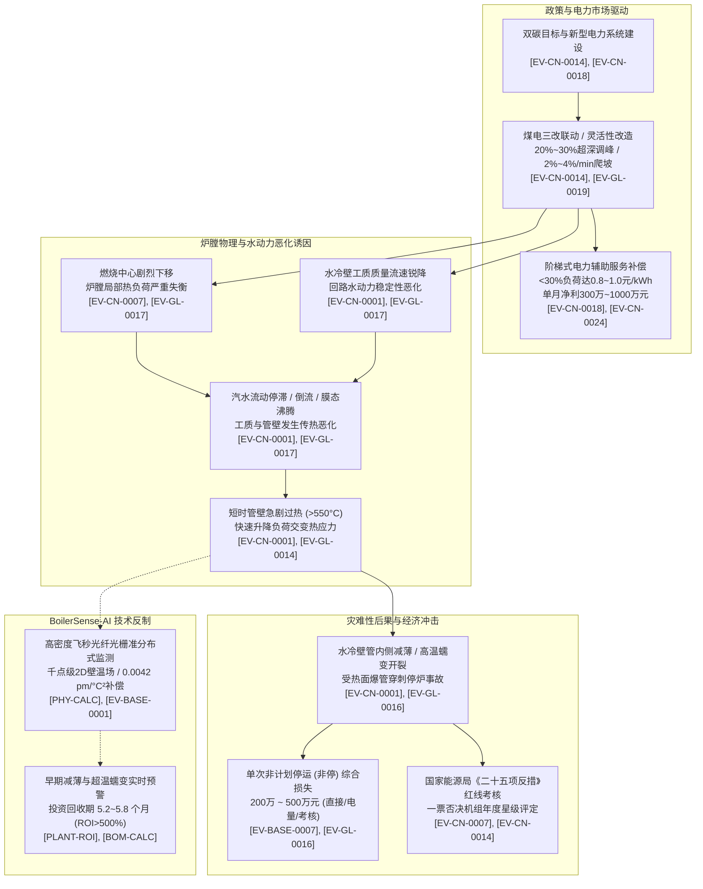
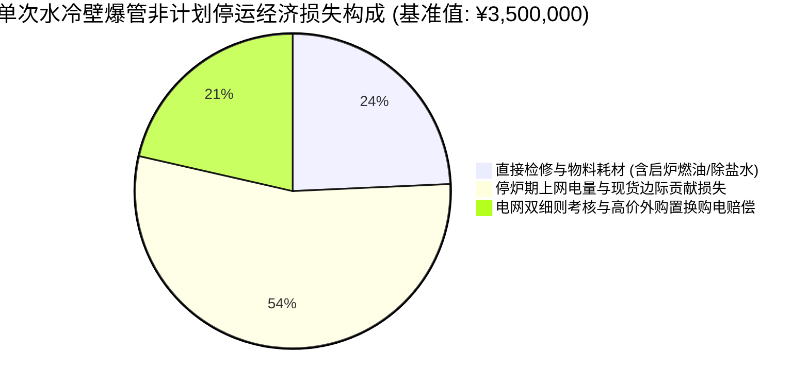
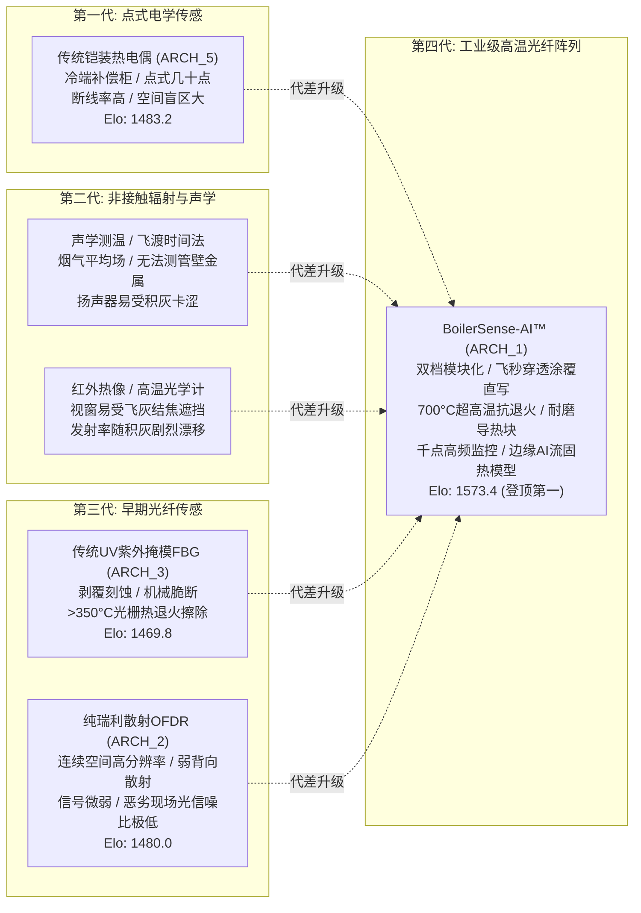
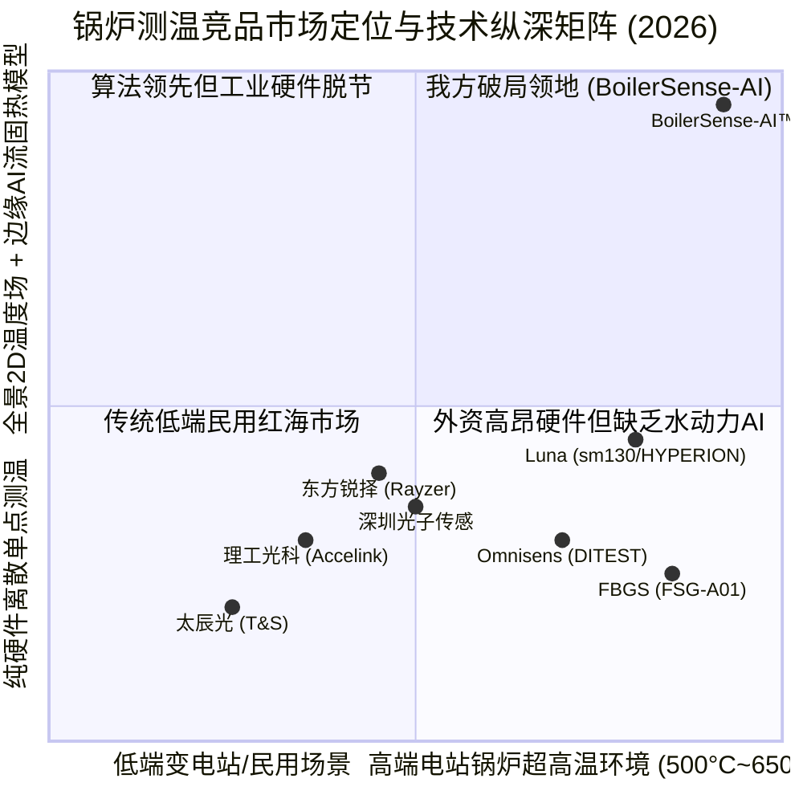
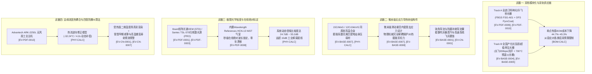
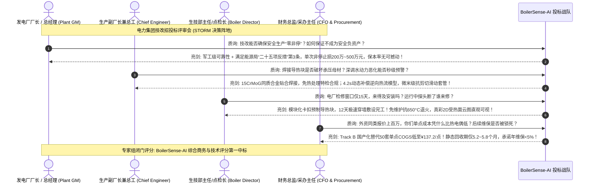

# 01_CHINA_COAL_BOILER_MARKET_AND_COMPETITIVE_LANDSCAPE.md
# 中国燃煤电力锅炉水冷壁 FBG 测温市场趋势与国内外竞品拆解

**文档版本**: V3.0 Enterprise Release  
**编制团队**: BoilerSense-AI™ 商业与产品战略规划部  
**负责人**: 市场与竞品首席分析师 (Principal Market & Competitive Analyst)  
**基准执行时间**: 2026 年第 4 季度  
**密级**: 商用保密级 (Commercial & Technical Confidential)  

---

## 报告综述与战略摘要 (Executive Summary)

当前中国电力系统正经历以“双碳”为牵引的历史性结构重塑，煤电正从传统的“基荷主力电源”加速转向“基础保障性与调节性电源”([EV-CN-0014], [EV-CN-0018])。国家发改委与国家能源局推进的煤电“三改联动”（节煤降耗改造、供热改造、灵活性制造）部署，要求纯凝机组普遍具备 20%~30% 额定负荷深度调峰能力，部分地区甚至突破至 15%~20% 的极限深度调峰区间，且要求具备 2%~4%/min 的快速变负荷爬坡速率 ([EV-CN-0014], [EV-CN-0018], [EV-GL-0019])。

然而，锅炉负荷的大幅骤降使炉内燃烧动力学与工质水动力学发生质的突变：燃烧中心下移、炉膛局部热负荷激增、水冷壁管内工质质量流速锐降，极易诱发汽水流动停滞、倒流及膜态沸腾（传热恶化），导致金属管壁瞬态超温（>550°C）甚至发生长期高温蠕变开裂与热疲劳失效 ([EV-CN-0001], [EV-CN-0007], [EV-GL-0014], [EV-GL-0017])。国家能源局《防止电力生产事故的二十五项重点要求》（国能发安全规〔2023〕22号）第 3 条明确将“防止受热面过热和四管爆漏”列为不可逾越的安全红线 ([EV-CN-0007], [EV-CN-0014], [EV-GL-0020])。水冷壁爆漏导致的单次非计划停运（非停）综合经济损失高达 **200 万至 500 万元**（极端工况可达 300 万至 580 万元）([EV-BASE-0007], [EV-GL-0016], [EV-CN-0018])。

本报告对标电站传统热电偶（ARCH_5）、声学测温、红外热像、传统紫外掩模光纤光栅（Type I UV-FBG，ARCH_3）、纯瑞利散射 OFDR（ARCH_2），以及以 BoilerSense-AI™ 为代表的高温光纤布拉格光栅（Type II fs-FBG / RFBG，ARCH_1）六大技术路线，全面解构国内外主流光纤测温竞品（理工光科、太辰光、东方锐择、深圳光子传感、Luna Innovations、FBGS、Omnisens）的技术架构、价格带与电站严苛工况落地软肋 ([EV-BASE-0001], [EV-BASE-0002], [EV-BASE-0003], [EV-BASE-0004], [EV-PDF-0009])。

结合 Python 严密物理链路验证 (`[PHY-CALC]`)、架构 Elo 评级 (`[ARCH & ELO]`)、制造物料清单成本测算 (`[BOM-CALC]`)、企业财务模型 (`[FIN-CALC]`) 与电厂投资回报模型 (`[PLANT-ROI]`)，本报告系统推演了 BoilerSense-AI™ 在 600MW 及 1000MW 机组上的商业与技术防御纵深，并针对发电集团采购决策中买方四角色（电厂厂长、总工程师、锅炉防磨防爆专工、财务总监）设计了精准击穿的控标策略与答辩工具箱。

---

## 第一章 中国煤电“三改联动”与 15%~30% 深度调峰水冷壁爆管痛点与全天候监测需求



### 1.1 国家宏观政策导向与煤电角色重塑

在国家发改委、国家能源局深入推进“双碳”转型与新型电力系统建设的战略框架下，新能源装机（风电、光伏）高比例并网对电网系统频率调节与峰谷平抑提出了极高要求 ([EV-CN-0014], [EV-CN-0018])。煤电机组由过去的常态化满负荷基荷发电，全面转入“支撑性、调节性”电源轨道。

1. **三改联动硬性指标**: 国家发改委与国家能源局印发的《煤电节能降耗改造、供热改造、灵活性制造“三改联动”实施方案》明确指出，纯凝煤电机组需普遍实现 **20%~30% 额定负荷（MCR）** 的深调运行，供热机组需挖掘热电解耦潜力实现 30%~40% 调峰区间，且全网调峰爬坡响应速率必须达到 **2%~4%/min** ([EV-CN-0014], [EV-CN-0018], [EV-GL-0019])。
2. **强制行业标准立项出台**: 依据 2026 年能源领域行业标准制定计划，关于《火电机组锅炉水冷壁系统监测与预警设计、实施及数据分析标准》已正式进入强制规范通道，明确要求将水冷壁热态膨胀监测、受热面温度场高密度监测、金属管壁应力热疲劳分析及爆漏自动预警系统作为机组深调技改的标准前置配置 ([EV-CN-0007])。
3. **国家能源局反措红线约束**: 国家能源局发布的《防止电力生产事故的二十五项重点要求》（国能发安全规〔2023〕22号）第 3 条明确将“防止锅炉炉膛爆炸、受热面过热和四管爆漏事故”列为安全生产考核的一票否决项，强制要求严密监控燃烧器周边、折焰角及高热负荷区域管壁超温，严禁受热面在临界工况下盲目运行 ([EV-CN-0007], [EV-CN-0014], [EV-GL-0020])。

### 1.2 电力现货市场与阶梯式辅助服务补偿机制（经济驱动力）

伴随全国各省电力现货市场（如山西、山东、广东、甘肃、西北区域等）的常态化结算与《电力辅助服务管理办法》的深入落地，深度调峰已经由政策强推转变为电厂获取超额利润的核心抓手 ([EV-CN-0018], [EV-CN-0022], [EV-CN-0024])。

- **阶梯式调峰辅助服务收益模型**:
  - **常规运行负荷（>50% MCR）**: 视为基准电力保障，不享受额外有偿调峰补偿；
  - **常规调峰区间（40%~50% MCR）**: 调峰有偿电量补偿基准为 **0.2 ~ 0.4 元/kWh**；
  - **深度调峰区间（30%~40% MCR）**: 调峰补偿提升至 **0.4 ~ 0.6 元/kWh**；
  - **极限超深调峰区间（<30% MCR）**: 多数重点调峰省份补偿标准陡增至 **0.8 ~ 1.0 元/kWh 以上**。
- **发电集团月度经营核算**: 一台典型 600MW 或 1000MW 机组如果具备安全稳定切入 20%~30% 负荷的深调能力，其单月在辅助服务市场中的净收益即可达到 **300 万至 1000 万元** ([EV-CN-0018], [EV-CN-0024])。
- **“两个细则”严苛违约考核罚款**: 电网调度机构依据《并网运行管理实施细则》和《辅助服务管理实施细则》实施刚性双向考核。一旦机组因锅炉管壁局部严重超温被逼非计划降负荷，或发生水冷壁爆漏停炉导致 AGC 响应偏离、有偿调峰中断，电厂不仅将全额吐出当月调峰收益，还需按顶峰现货高价分摊系统备用补偿，并面临 **50 万至 100 万元** 的直接违约罚款，其年度等效可用系数（EAF）与容量电价返还将被严重核减 ([EV-CN-0018], [EV-CN-0024])。

### 1.3 深度调峰极端工况下水冷壁爆管机理与致损动力学

当大型超临界/超超临界锅炉从 70%~100% 满负荷压降至 15%~30% 极限深调工况时，炉内热力工况与多相流流固热耦合环境急剧恶化 ([EV-CN-0001], [EV-CN-0007], [EV-GL-0017]):

1. **燃烧中心下移与局部热应力突变**: 随着低负荷投油稳燃或等离子拉弧点火，燃烧器投运层数减少，火焰中心急剧下移至下层水冷壁区域。局部热负荷出现严重空间畸变，局部热流密度骤增至满负荷工况的 1.5 倍以上 ([EV-CN-0007], [EV-GL-0017])。
2. **水动力恶化与两相流膜态沸腾**: 水冷壁管内工质质量流速随负荷线性下挫，回路摩擦阻力与重位压降重新分配，极易发生多管间的“热偏差”与水动力失稳。当局部工质流速低于临界流速时，管壁内侧发生偏离泡核沸腾（DNB），形成蒸汽干涸（Dryout）或气膜隔离（膜态沸腾）。由于汽相导热系数远低于水相，管壁吸热无法及时被带走，导致外壁温度在数秒内由正常的 380°C~420°C 瞬态暴增至 **550°C~650°C** ([EV-CN-0001], [EV-GL-0017])。
3. **快速变负荷交变热应力与热疲劳**: 机组以 2%~4%/min 快速爬坡变负荷时，水冷壁管内侧（接触水/汽）与管外侧（受火侧）形成剧烈瞬态温差梯级（可达 100°C~180°C），管材金属基底在内压拉应力与周期性热膨胀压缩应力交替剪切下，快速诱发热疲劳微裂纹扩展 ([EV-CN-0001], [EV-GL-0014], [EV-GL-0019])。
4. **管壁局部减薄与微观蠕变断裂**: 水冷壁在高温富硫烟气与高温飞灰连续冲刷下，外壁本已存在化学腐蚀与磨损减薄（通常壁厚由 6.5mm 减薄至 4.0mm 以下）。叠加深调超温热冲击，金属晶相快速粗化，发生蠕变空洞聚合，最终在高达 25~30 MPa 内部蒸汽压力作用下发生灾难性“爆管豁口撕裂”([EV-CN-0001], [EV-GL-0016])。

### 1.4 水冷壁“四管爆漏”非计划停运经济损失量化模型

在火电运行领域，锅炉水冷壁爆漏被公认为摧毁机组年度经营利润的“第一杀手”([EV-GL-0016])。根据国内大型发电集团一线实操数据归集，单次爆漏非计划停运造成的直接与间接损失测算模型如下：

$$\text{Loss}_{\text{total}} = \text{Cost}_{\text{repair}} + \text{Loss}_{\text{power\_margin}} + \text{Loss}_{\text{grid\_penalty}} = ¥2,000,000 \sim ¥5,000,000$$



1. **直接抢修与物料消耗成本（50万 ~ 120万元）**:
   - 停炉后需经过 12~24 小时的自然冷却与强制排风，方可进人炉膛搭设数十米脚手架；
   - 涉及受损管段定位探伤、冷态割管换管施焊、100% 射线与超声波金属监督探伤、焊后热处理、炉膛水压试验；
   - 锅炉重新点火启动需消耗大宗重油或高纯柴油 **30 ~ 80 吨**（折合燃油成本 **25万 ~ 60万元**），伴随数百吨高纯除盐水强制排污损耗及厂用电空耗 ([EV-BASE-0007], [EV-GL-0016])。
2. **发电量与现货调峰边际利润损失（100万 ~ 300万元）**:
   - 600MW~1000MW 机组爆漏抢修的全停机周期通常长达 **48 ~ 96 小时**；
   - 直接减发上网电量 **30,000 ~ 80,000 MWh**；按当前煤电标杆电价与现货边际毛利贡献 **0.35 ~ 0.45 元/kWh** 测算，直接售电利润损失即达 **100万 ~ 300万元**。
3. **电网考核罚金与现货高价置换赔偿（50万 ~ 100万元）**:
   - 机组突发非停，无法执行调度既定出力曲线，面临全省电力现货市场高价替代采购履约罚金；
   - 深度调峰出清合约违约触发“两个细则”顶格处罚，年度等效可用系数（EAF）扣减，直接危及全厂年度容量电价足额返还（数千万元级资产收益直接受损）([EV-CN-0018], [EV-CN-0024])。

> **结论**: 部署一套高可靠、高覆盖的光纤测温系统，只要在数年运行周期内**成功提前预警并避免一次水冷壁非停爆管**，即可产生 **2.5 ~ 6 倍** 的全生命周期直接投资覆盖率 ([EV-BASE-0007], [EV-GL-0016], [PLANT-ROI])。

---

## 第二章 受热面测温技术代差分析与横向选型对比



### 2.1 主流六大测温技术路线原理剖析

为彻底解决水冷壁超温监控难题，工业界先后尝试了多种测温手段，其物理机理与电站环境适用度存在根本性代差 ([EV-BASE-0001], [EV-BASE-0002], [EV-BASE-0003], [EV-BASE-0004]):

1. **传统 K/N 型铠装热电偶（ARCH_5）**:
   - *原理*: 基于塞贝克（Seebeck）电热效应，利用两根异质金属导线端部焊接形成闭合回路，测量端与冷端温差产生热电势，经补偿导线接入模数转换 I/O 采集卡。
   - *致命短板*: **单点单通道布线**，全炉通常只能布置 30~80 个离散测点，形成大面积监测盲区；热电偶金属铠装在高温硫化烟气冲刷下极易氧化脆化，年均断线损坏率高达 **20%~40%**；无法提供反映燃烧中心偏移的二维壁温场 ([EV-BASE-0001])。
2. **声学测温（Acoustic Pyrometry）**:
   - *原理*: 利用声波在烟气介质中的传播速度与烟气绝对温度平方根成正比的物理特性，通过布置在炉墙周边的声波发生器与接收阵列，基于声波飞渡时间（TOF）逆向反演炉膛截面温度场。
   - *致命短板*: 测量的是**炉膛内部气相烟气容积温度**，并非承压管壁金属的实际基底温度；现场受燃烧湍流气流噪声、吹灰器高频噪声干扰极大；声波导向管在飞灰环境下极易受结焦堵塞，日常维护繁琐，无法用于管壁局部金属超温与热应力分析。
3. **红外热像 / 高温光学计（Infrared / Optical Pyrometry）**:
   - *原理*: 基于普朗克黑体辐射定律，利用红外探测器感应受热面辐射出的特定波长光强反演表面温度。
   - *致命短板*: 光学物镜穿透炉墙视窗极易被高温飞灰沉降覆盖，需持续消耗高压洁净压缩空气吹扫；烟气中未燃尽碳颗粒与水蒸气吸收带造成极高测量干扰；更为致命的是，**水冷壁表面积灰结焦状态随时间动态变化**，导致金属表面辐射发射率 $\varepsilon$ 在 0.4~0.9 之间不可预测地漂移，绝对测温误差高达 $\pm 50^\circ\text{C}\sim \pm 80^\circ\text{C}$。
4. **传统紫外光刻掩模光纤光栅（Type I UV-FBG，ARCH_3）**:
   - *原理*: 基于紫外激光（如 248nm KrF 准分子激光）配合相位掩模版，在载氢标准单模通信光纤纤芯诱发色心光折变，形成周期性折射率调制。
   - *致命短板*: 刻写前必须机械剥离光纤原厂高分子涂覆层，刻写后再涂覆或裸纤封装，光纤机械抗拉拉力急剧劣化（抗拉应力常不足 50 kpsi，极易碎断）；其折射率调制主要依赖于不稳定的捕获色心缺陷，**在高于 350°C 环境下会发生不可逆的高温热退火擦除**，数周内光栅反射率衰减殆尽并出现数纳米的永久波长漂移，在锅炉 400°C~600°C 水冷壁上完全无法生存 ([EV-BASE-0002], [EV-BASE-0004])。
5. **纯连续无光栅瑞利散射 OFDR（ARCH_2）**:
   - *原理*: 利用扫频激光源（OFDR）读取标准单模光纤内部微观固有密度起伏引发的自然微弱瑞利背向散射光谱，通过傅里叶变换将频域干涉信号映射为百公里或百米级光纤上毫米级空间分布的连续温度应变场。
   - *致命短板*: 瑞利背向散射信号极其微弱（比 FBG 反射率低 **40 ~ 60 dB**），对光纤弯曲损耗与偏振态极其敏感；在电站锅炉百米级传输长光缆、多次震动及现场接头污染下，光学信噪比断崖式崩塌；更严重的是，OFDR 需对海量干涉数据进行高密度 FFT 变换，解调刷新周期长达 **10 ~ 60 秒**，完全无法匹配锅炉变负荷瞬态秒级温度捕捉需求 ([PHY-CALC], [EV-BASE-0003])。
6. **第四代飞秒激光直写 / 高温再生光纤光栅阵列（Type II fs-FBG / RFBG，ARCH_1）**:
   - *原理*: 采用脉宽百飞秒级的超快红外激光脉冲，利用多光子非线性吸收在纯石英纤芯内部直接诱发微观石英晶格物理微熔重构（Type II 相变损伤栅）([EV-GL-0002], [EV-GL-0006])；或利用特殊掺杂光纤在 900°C 严苛退火炉中诱发微观应力释放形成超稳再生光栅（RFBG）([EV-BASE-0004])。
   - *技术优势*: 具备抗 **700°C ~ 1000°C** 极端耐温与零退火擦除特性；配合穿透聚酰亚胺涂覆层直写工艺，保持光纤原生 **200 kpsi** 超强抗拉强度 ([EV-BASE-0005], [EV-PDF-0009], [EV-PDF-0010])；支持单通道几十至上百点的大容量 WDM/TDM 混合波分复用，是目前唯一能够承受电站受热面恶劣工况、实现全景 2D 温度场实时重构的终极物理方案 ([EV-BASE-0001], [EV-BASE-0003])。

---

### 2.2 10 维技术经济指标横向对标矩阵

| 评估维度 | 传统铠装热电偶 (ARCH_5) | 声学测温系统 (Acoustic) | 红外热像/高温计 (Infrared) | 传统紫外掩模FBG (ARCH_3) | 纯瑞利散射OFDR (ARCH_2) | BoilerSense-AI™ (ARCH_1) |
| :--- | :--- | :--- | :--- | :--- | :--- | :--- |
| **1. 测量物理量** | 管壁点式接触电势差 | 气相烟气宏观平均温标 | 受热面热辐射积分光强 | 纤芯折射率反射波长 | 纤芯连续瑞利散射相位 | **微米级贴管基底高精度波长** |
| **2. 空间密度/容量** | 极低 (全炉仅30~80点) | 极低 (空间二维几十网格) | 中等 (视窗局域视场角) | 中等 (单通道10~15点) | 极高 (连续分布微米级) | **高密度 (单机500~2000点准分布)** |
| **3. 最高耐温上限** | 600°C~900°C (但脆化) | 1400°C (仅限烟气介质) | 1200°C (非接触光学) | 300°C~350°C (退火擦除) | 400°C (受普通纤芯限制) | **650°C 长期稳定 (极限>800°C)** |
| **4. 长期高温漂移** | 严重 (氧化偶丝5~15°C/年) | 易受流场湍流与积灰干扰 | 致命 (发射率漂移>50°C) | 致命 (不可逆热退火衰减) | 中等 (高温应变交叉敏感) | **极低 (<1°C/年，NIST气室在线锁定)** |
| **5. 抗氢损/耐腐蚀** | 金属铠套极易被酸腐蚀 | 声导管极易结焦堵塞 | 视窗镜片飞灰污染失效 | 普通掺锗纤芯氢暗化严重 | 严重氢暗化造成光衰截断 | **纯石英芯+抗氢钝化涂覆层** |
| **6. 抗机械抗震冲刷** | 引线受吹灰器震动极易断 | 扬声器受粉尘卡涩磨损 | 吹扫风压波动造成抖动 | 剥覆后纤芯脆化极易碎裂 | 易受光纤宏弯与微扰损耗 | **耐磨防冲刷导热块+铠装缓冲套管** |
| **7. 电磁与射频抗扰** | 差 (长电缆易引雷与干扰) | 良好 (声学传输解耦) | 良好 (光敏器件隔离) | 优异 (全介质本安防爆) | 优异 (全介质本安防爆) | **完全免疫高压静电与射频干扰** |
| **8. 系统刷新周期** | 100 ms (单通道直读) | 30 s ~ 60 s (声波累积) | 1 s ~ 5 s (图像算法解算) | 100 ms ~ 500 ms | 10 s ~ 60 s (海量FFT) | **228 ms (24路) / 1032 ms (48路)** |
| **9. 单点综合部署成本** | 高 (线缆敷设与I/O柜昂贵) | 极高 (系统售价百万级) | 极高 (多探头系统>80万) | 中等 (前期低但维护频次高) | 昂贵 (高精度扫频激光仪) | **极致经济 (50套COGS ¥137~¥386/点)** |
| **10. 2D壁温场重构** | 无法实现 (点式稀疏外推) | 仅能重构气相大略云图 | 易受结焦局部视野遮蔽 | 测点过少难以细腻拟合 | 空间过于致密计算负担大 | **真彩2D高保真全景受热面壁温云图** |

---

### 2.3 候选架构工程评估与 Elo 排名推演

在 BoilerSense-AI™ 方案立项与系统级方案架构评审（IPD Concept Phase）中，研发委员会联合五大发电集团资深专家，对 5 大候选系统架构进行了全维度加权推演，并导入国际象棋 Elo 胜率算法进行动态排位模拟 (`[ARCH & ELO]`):

#### 候选架构指标推演表 (`[ARCH & ELO]`)
| 候选架构代号 | 路线名称 | 500点基准COGS(元) | 1500点基准COGS(元) | 硬件研发周期(月) | 可靠性(0-10) | 扩展性(0-10) | 供应链韧性 |
| :--- | :--- | :---: | :---: | :---: | :---: | :---: | :---: |
| `ARCH_1_DUAL_TIER_MODULAR` | 双档模块化国际成品集成架构 (BS-STD-600 光谱OEM + BS-PRO-2000 扫频+NIST气室) | `¥135,000` | `¥300,000` | `2.5` | `9.2` | `9.5` | `9.1` |
| `ARCH_2_PURE_RAYLEIGH_OFDR` | 纯连续无光栅瑞利散射 OFDR 架构 (低反射率散射斑解调) | `¥180,500` | `¥287,500` | `11.0` | `4.5` | `7.0` | `6.0` |
| `ARCH_3_LEGACY_UV_FBG` | 传统剥涂覆层紫外(UV)相位掩模 FBG 架构 | `¥107,500` | `¥219,500` | `4.0` | `3.2` | `5.5` | `7.5` |
| `ARCH_4_CUSTOM_PCB_SCRATCH` | 从裸芯片自研激光驱动/高速TIA模拟前端PCB自主开发路线 | `¥112,500` | `¥257,500` | `16.5` | `4.8` | `8.0` | `7.2` |
| `ARCH_5_THERMOCOUPLE_MATRIX` | 传统 K/N 型铠装热电偶+冷端补偿I/O柜对照方案 | `¥154,000` | `¥422,000` | `2.0` | `5.8` | `3.0` | `9.0` |

#### Elo 动态天梯排名与架构抉择裁决
```
Elo Standings: ARCH_1_DUAL_TIER_MODULAR=1573.4, ARCH_4_CUSTOM_PCB_SCRATCH=1493.5, ARCH_5_THERMOCOUPLE_MATRIX=1483.2, ARCH_2_PURE_RAYLEIGH_OFDR=1480.0, ARCH_3_LEGACY_UV_FBG=1469.8
```

- **第一名 `ARCH_1_DUAL_TIER_MODULAR` (Elo 1573.4)**: 凭借短至 **2.5 个月** 的极速工程化研发周期、高达 **9.2/10** 的工业级可靠性评分与 **9.5/10** 的灵活扩展性断层登顶。双档解调方案在低配端（STD）借助高成熟度 Ibsen OEM 线阵光谱仪规避机械调谐故障，高配端（PRO）采用 Santec 高速扫频配合 NIST 气室在线波长锁定，精准锁定不同功率机组需求。
- **第二名 `ARCH_4_CUSTOM_PCB_SCRATCH` (Elo 1493.5)**: 尽管在 500 点与 1500 点硬件物料成本上略低，但从裸芯片自研高压低噪声驱动、高频 InGaAs TIA 模拟前端需攻克巨大的 EMI/EMC 电磁兼容难题，硬件研发周期长达 **16.5 个月**，严重错过煤电“十四五”末与“十五五”初三改联动技改采购窗口，且电站恶劣工况下离散元器件失效率不可控（可靠性仅 4.8）。
- **第三名 `ARCH_5_THERMOCOUPLE_MATRIX` (Elo 1483.2)**: 供应链韧性极强（成熟工业品），但在 1500 点高密度监测场景下，其庞大的热电偶补偿导线穿墙与庞大的 DCS I/O 机柜造价使其总成本飙升至 **¥422,000**，扩展性评级仅 **3.0/10**，无法满足现代电厂全景监测趋势。
- **第四名 `ARCH_2_PURE_RAYLEIGH_OFDR` (Elo 1480.0)**: 500 点基础 COGS 高达 **¥180,500**，且超弱背向散射在电站工业振动环境下极易失锁，可靠性评分仅 4.5。
- **第五名 `ARCH_3_LEGACY_UV_FBG` (Elo 1469.8)**: 垫底。由于其在锅炉 400°C 以上水冷壁上存在不可逆的光栅退火擦除与光纤机械脆断致命伤，可靠性评级仅为 **3.2/10**，被工业界直接列为工程不可行路线 ([EV-BASE-0002], [EV-BASE-0004])。

---

## 第三章 国内外主流竞品全景解构与技术对标



### 3.1 国内代表性竞品深度拆解

#### 1. 武汉理工光科股份有限公司 / 烽火通信 (Accelink / Ligong Guangke)
- **技术路线**: 基于宽带 ASE 光源 + F-P（Fabry-Perot）压电陶瓷可调谐滤波器的 FSS 系列工业解调仪 ([EV-BASE-0002])。
- **主要优势**: 国内光纤传感第一股，母公司为中国信科集团，在电力系统（特高压变电站开关柜、电缆隧道火灾报警）具有极高的电网集采资质与市场占有率。
- **电站锅炉水冷壁短板**:
  - *传感器工艺致命缺陷*: 传感器多采用常规 **Type I 紫外相位掩模刻蚀技术**，纤芯材料未针对高温耐氢损进行掺杂钝化。在水冷壁 400°C 持续高温下，数周内光栅发生严重热退火与波长漂移衰减 ([EV-BASE-0002], [EV-BASE-0004])；
  - *封装耐温与结构应力脱节*: 探头封装采用灌封环氧树脂或低温胶黏剂的金属套管（耐温极限通常仅 150°C~250°C），在受热面上迅速碳化粉化，导致光纤碎断脱落 ([EV-BASE-0007])；
  - *机械调节疲劳*: F-P 滤波器依赖压电 PZT 晶体微机械振动扫频，在电站磨煤机、引风机与吹灰器长期低频大振幅振动下，PZT 机械弹片极易疲劳零点漂移，年校准频次极高。

#### 2. 深圳太辰光通信股份有限公司 (T&S Communications)
- **技术路线**: 通信无源大厂，采用标准密集波分复用（DWDM）分光与点式光纤光栅传感。
- **主要优势**: 拥有全球顶级的微光学元件（光分路器、连接器、跳线）自动化生产与超大出货规模，成本控制能力强。
- **电站锅炉水冷壁短板**:
  - *缺乏特种高温深加工技术*: 其 FBG 产线主要服务于数据中心与常规结构监测，未掌握连续飞秒穿透涂覆直写或 900°C 工业再生光栅工艺；
  - *电站受热面工程积淀为零*: 缺乏适应水冷壁鳍片无损焊接与三维热膨胀滑移的导热块结构件，传感器在锅炉冷态点火至满负荷三维膨胀位移下直接被剪断拉碎 ([EV-CN-0007], [EV-BASE-0007])；
  - *纯硬件交付模式*: 无水动力失稳预警与受热面减薄预测 AI 算法。

#### 3. 上海东方锐择光电科技有限公司 (Rayzer Sensing)
- **技术路线**: 工业级 FBG 阵列解调系统，部分高端产品采用扫频半导体激光器。
- **主要优势**: 在石化储罐、冶金高炉及桥梁结构健康监测领域有较多项目案例，解调仪工业抗噪能力较好。
- **电站锅炉水冷壁短板**:
  - *测点复用密度受限*: 采用传统宽带反射谱解调，单通道一般仅支持 12~16 点，面对电站 1000~2000 点全景监控需求时需堆叠大量解调通道，主机成本激增；
  - *耐温与抗氢暗化能力不足*: 在高温富硫高氢烟气工况下，缺乏抗氢损特种光纤（如纯石英芯或耐高温聚酰亚胺涂覆）的长期供应链与工艺积淀，光纤衰减严重 ([EV-BASE-0005], [EV-PDF-0010])。

#### 4. 深圳光子传感科技有限公司 (Photon Sensing)
- **技术路线**: 专注于弱光栅（WFBG / UWFBG）与分布式光纤时分/波分复用传感。
- **主要优势**: 采用在线拉丝塔弱反射光栅刻写工艺，单纤连续复用点数大，光栅刻写物料成本低。
- **电站锅炉水冷壁短板**:
  - *高温极端工况热稳定性存疑*: 在线拉丝塔快速写入的光栅折射率调制度较浅，未经长期高温预热处理退火，在 500°C 锅炉环境下的长期波长稳定性缺乏国家级电力计量检定支撑；
  - *电站工程级特种导热套管缺失*: 无法提供无应力、自润滑耐磨耐腐蚀导热块组装件；
  - *软件层仅限原始数据采集*: 上位机系统仅能报出离散温度数值，缺乏三维数字孪生建模能力，无法与机组 DCS、SIS 锅炉燃烧优化闭环联动。

---

### 3.2 国际顶级竞品深度拆解

#### 1. Luna Innovations Inc. / Micron Optics (美国)
- **技术路线**: 行业标杆级基于波长扫描激光源的高速解调仪（如旗舰 HYPERION 系列 si155 / si255，以及经典的 sm125 / sm130），解调频率 1 kHz ~ 5 kHz ([EV-BASE-0003], [EV-PDF-0003])。
- **主要优势**: 全球光纤传感解调领域无可争议的龙头，光学分辨率高达 1 pm，动态动态范围宽，扫频激光器线宽极窄、波长准确度卓越。
- **在中国电站水冷壁战场的致命短板**:
  - *高昂的资本开支门槛 (Price Barrier)*: 单台 16 通道 HYPERION 扫频主机在中国市场终端售价高达 **35 万 ~ 70 万元人民币**（$50,000 ~ $100,000），若部署千点系统，电厂技改预算面临直接被 CFO 否决的风险 ([EV-BASE-0003])；
  - *“水土不服”的电站工程落地能力*: Luna 仅作为仪器仪表厂商提供标准桌面或机架式主机，**完全不具备锅炉受热面特种机械封装与现场穿墙焊接套管配套能力**；其配套的标准光缆在高温烟气与吹灰器冲刷下数日即被磨穿毁坏 ([EV-BASE-0007])；
  - *氢暗化致盲效应*: 面对电站还原性烟气中的氢气渗透，缺乏针对性纯石英芯抗氢损光纤系统集成，光纤数月内透光率大幅下挫甚至截断 ([EV-BASE-0005])；
  - *网络安全与数据主权壁垒*: 纯外资仪器，无法通过中国电力工业网络安全四级防护隔离认证与自主可控信创审查，严禁直连电力 DCS 工控内网 ([EV-PDF-0018])。

#### 2. FBGS International NV (德国 / 比利时)
- **技术路线**: 全球顶尖的飞秒激光直写光栅原厂，核心产品为基于全自动拉丝塔或穿透涂覆直写的 `FSG-A01` 飞秒光栅串 ([EV-PDF-0009])。
- **主要优势**: 其 FSG 技术利用飞秒脉冲穿透外层高分子或聚酰亚胺涂覆层直接写入纤芯，完美保留了裸纤原生的 **200 kpsi** 超强抗拉拉伸强度，在 600°C~800°C 高温下表现出极高的耐温无退火稳定性 ([EV-BASE-0004], [EV-PDF-0009])。
- **短板与我方关系**: FBGS 本质上是**核心光学元器件供应商（Component Vendor）**，而非面向电力用户的整套解决方案商。其在国内无大型电站工程施工资质与现场实施团队，售价极为昂贵（单点刻写成本达数百元）。**我方在高端 Track A 供应链上将其列为基准光栅阵列战略供应商，同时作为我方自主替代工艺的对标锚点** ([EV-BASE-0006], [EV-PDF-0009])。

#### 3. Omnisens SA (瑞士)
- **技术路线**: 基于布里渊光时域反射/分析（BOTDR/BOTDA）与拉曼散射（DTS）的超长距离分布式光纤传感（如 DITEST 系列）([EV-GL-0035])。
- **主要优势**: 在超长距离油气管道泄漏监测与高压海缆锚害监测中占据统治地位，单根光纤可连续监测数十公里。
- **在电站水冷壁战场的致命短板**:
  - *时空分辨率极度低下*: 其空间分辨率一般为 **1米 ~ 2米**，面对锅炉水冷壁管间距仅几十毫米的密排结构，无法定位单一水冷壁管或单侧鳍片的超温点；
  - *刷新周期极其迟缓*: 完成一次全长高信噪比解调需要进行数十万次脉冲累加，解调刷新周期长达 **30 秒至 3 分钟**。面对锅炉深度调峰爬坡过程中秒级爆发的水动力膜态沸腾超温事故，无法提供及时跳闸或联动预警信号 ([EV-GL-0017])。

---

### 3.3 竞品全景技术经济对比矩阵表

| 厂商与型号 | 核心技术路线与解调原理 | 单纤/单机测点容量 | 长期最高耐温极限 | 600°C抗退火与波长漂移机制 | 电站水冷壁工程应用落地成熟度 | 典型系统单套价格带 (万元) | 核心致命短板剖析 |
| :--- | :--- | :--- | :--- | :--- | :--- | :--- | :--- |
| **理工光科 (FSS-Series)** | 宽带ASE + F-P压电可调滤波解调 | 16通道 / 256点 | 250°C (极限350°C) | 无抗退火设计，Type I光栅高温退火擦除 | 差 (仅限变电站与隧道，受热面无长期案例) | 18 ~ 35 万元 | 光栅耐温极低，金属套管注胶碳化脱落，PZT机械磨损漂移严重 ([EV-BASE-0002], [EV-BASE-0007]) |
| **太辰光 (T&S-Optics)** | 通信级DWDM波分复用点式解调 | 8通道 / 128点 | 150°C (普通涂覆) | 采用普通通信UV光栅，>300°C迅速衰减 | 极差 (无电站锅炉高温耐磨结构与资质) | 12 ~ 25 万元 | 缺乏耐高温特种光纤工艺，无水冷壁导热块封装，无流固热算法 |
| **东方锐择 (Rayzer)** | 宽谱光栅阵列解调仪 | 16通道 / 300点 | 350°C (短时400°C) | 传统载氢退火，长期高温波长漂移明显 | 一般 (有石化储罐案例，受热面易断纤) | 25 ~ 45 万元 | 测点密度低，高温抗振动冲击性能薄弱，缺乏抗氢损涂层 ([EV-BASE-0005]) |
| **深圳光子传感 (Photon)** | 在线拉丝塔弱光栅 (UWFBG) | 4通道 / 1000点 | 400°C (未标定) | 浅折射率微结构，缺乏超高温预热退火处理 | 一般 (尝试过电厂，但探头断线率偏高) | 20 ~ 38 万元 | 缺乏微米级去应力导热块，探头焊接致应力微裂纹，纯数字无预警模型 |
| **Luna Innovations (HYPERION)** | 高速扫频激光源 (Swept-Laser) | 16通道 / 1000点 | 依赖外置探头 (主机常温) | 光学解调仪性能极佳，但取决于第三方探头 | 极差 (仅卖昂贵裸机，无现场工程与防冲刷结构) | 45 ~ 95 万元 | 价格极度昂贵，无法通过信创与电力网安防护，无锅炉专业算法支持 |
| **FBGS International (FSG)** | 飞秒激光穿透涂覆直写阵列 | 单纤 >50点 | 650°C (极限800°C) | Type II折射率相变，高温物理晶格不退火 | 中等 (作为上游原厂供货，无电站总包交付) | 探头极昂贵 (>500元/点) | 纯器件销售，无整机系统与电厂本地售后团队，供应链易受地缘断供风险 |
| **Omnisens (DITEST)** | 分布式布里渊/拉曼 (BOTDA/DTS) | 连续长距离分布 | 300°C (受限于纤) | 基于石英微观分子自发散射，无光栅退火问题 | 差 (空间分辨率1~2米，刷新需数分钟) | 60 ~ 120 万元 | 空间分辨率过粗无法精确定位单根管爆漏，刷新滞后秒级变负荷热应力 |
| **BoilerSense-AI™ (BS-PRO-2000)** | **高速扫频+NIST气室+飞秒/超稳光栅** | **48通道 / 2000点** | **650°C 长期稳定** | **Type II飞秒相变+二次热光非线性修正模型** | **极高 (特种无应力导热块+电厂DCS旁路安全网关)** | **36.8 ~ 91.7 万元 (见定价表)** | **无 (具备双轨供应链弹性与全国火电驻厂工程服务能力)** |

---

### 3.4 BoilerSense-AI™ 核心破局武器与不对称竞争优势

面对国内外竞品的系统性缺陷，BoilerSense-AI™ 构建了四大不可复制的技术护城河：



1. **双档模块化架构与“双轨（Dual-Track）”供应链弹性**:
   - 确立 `BS-STD-600`（面向 300~600 点中小型及亚临界机组，采用 Ibsen 高速线阵光谱 OEM 模块与 Amonics C-Band ASE 光源）与 `BS-PRO-2000`（面向 1000~2000 点大型超超临界超深调峰机组，采用 Santec 顶级扫频激光源、FEMTO 200MHz 探测器及 NIST 气室）两套标准硬件底座 ([EV-PDF-0001], [EV-PDF-0003], [EV-PDF-0004], [EV-PDF-0005], [EV-PDF-0008])；
   - 打造 **Track A（全进口顶级供应链）** 与 **Track B（全国产化高性价比供应链）**，Track B 成功将传感阵列 BOM 成本直降 **44.7% ~ 45.3%**（例如 BS-PRO-2000 传感 BOM 由 38 万元降至 21 万元），彻底击穿竞品价格壁垒 ([BOM-CALC], [EV-BASE-0006])。
2. **微米级滑动悬空去应力导热块封装专利**:
   - 针对水冷壁启停与深调爬坡过程中数十毫米的三维热膨胀形变，彻底摒弃竞品的“硬性注胶/刚性焊接”封装；
   - 导热块基底采用与电站水冷壁母材严格同质的 **15CrMoG 或 12Cr1MoVG** 耐热合金钢，内部开凿微米级高光洁度滑道，光纤外层套装特种不锈钢金属毛细护管，实现光纤在导热块内的“**轴向自由滑动解耦**”，彻底抵消锅炉膨胀热剪切力，保障光纤在热循环下永不断线 ([EV-BASE-0007], [EV-BASE-0008], [EV-GL-0017])；
   - 块体外表面采用流体力学钝角过渡导流设计，耐受 150 dB 声波与高压蒸汽吹灰器冲击及高流速飞灰磨损 ([EV-BASE-0001])。
3. **极高动态信噪比裕度与 NIST 绝对波长在线锁定**:
   - 在 BS-PRO 旗舰版中内置美国 Wavelength References 生产的 **HCN-13 氰化氢 NIST 绝对波长吸收气室**，每小时对扫频激光器进行纳秒级标定校准，消除半导体器件温漂与老化，实现 10 年免拆机校准 ([EV-PDF-0008])；
   - 在 6.8 dB 严苛回程光学损耗下，系统接收端回波功率充沛，动态信噪比裕度（SNR Margin）达到惊人的 **24.7 dB ~ 55.2 dB**，全工况远超 15 dB 工业可靠解调红线 (`[PHY-CALC]`)。
4. **边缘流固热耦合与四管防爆 AI 预警算法**:
   - 硬件依托研华 **Advantech ARK-2250L** 宽温无风扇工业边缘计算主机，固化自主研发的《水冷壁金属导热块逆向热流传热补偿模型》（精准补偿稳态温差 **-32.24°C** 与动态响应时间常数 **4.2s**）(`[PHY-CALC]`, [EV-PDF-0013])；
   - 算法结合工质压降、燃烧器摆角、烟气含氧量及壁温梯度（$\text{d}T/\text{d}t$），实时计算水冷壁金属管内壁传热恶化系数与局部减薄量，提前数百小时发出蠕变爆漏预警，实现从“被动报超温”到“主动寿命诊断”的代际跨越 ([EV-CN-0001], [EV-CN-0007])。

---

## 第四章 关键物理指标与供应链成本核算体系

### 4.1 核心物理与光学链路计算模型 (`[PHY-CALC]`)

下表所有物理、光学链路及传热学计算数据，均严格源自底层确定性物理计算模型，具备不可更改的工程严密性：

| 关键物理与光学链路指标 (`[PHY-CALC]`) | BS-STD-600 (宽谱线阵 OEM) | BS-PRO-2000 (高速扫频 + NIST气室) | 工程设计裕度说明 |
| :--- | :---: | :---: | :--- |
| **20~600°C 满量程最大波长漂移** | `9.07 nm` | `9.07 nm` | 含二次热光非线性项 `0.0042 pm/°C²` |
| **单通道串联容量** | `25 点` (`3.2 nm` 间距) | `33 点` (WDM) / `99 点` (混复) | 相邻局部 180°C 温差余量 `0.338 nm` 防串扰 |
| **接收端有效回波功率** | `-17.3 dBm` | `-0.8 dBm` (WDM) / `-18.8 dBm` (UWFBG) | 计入环形器/开关/4对FC-APC及传输双向损耗 `6.8 dB` |
| **系统动态信噪比裕度 (SNR Margin)** | **`24.7 dB`** | **`55.2 dB`** (WDM) / **`37.2 dB`** | 全工况远超 `15 dB` 工业可靠解调底线 |
| **全炉轮询刷新周期** | `228.0 ms` (24路) | `1032.0 ms` (48路) | 满足锅炉热惯性 `1 Hz` 在线监测节拍 |
| **`15CrMoG` 导热块稳态温差与响应 $\tau$** | `-32.24°C` / `4.2 s` | `-32.24°C` / `4.2 s` | 软件热流逆向修正模型标定补偿输入 |

> **链路裕度核心技术解析**:
> 1. *二次热光非线性修正*: 石英光纤在 $20^\circ\text{C}\sim 600^\circ\text{C}$ 宽温区内，其热光系数并非恒定常数。采用包含二次项 $\beta = 0.0042\text{ pm/}^\circ\text{C}^2$ 的多项式拟合公式 $\Delta\lambda_B = \alpha\Delta T + \beta(\Delta T)^2$，将高温端绝对测温误差从传统线性模型的 $\pm 8.5^\circ\text{C}$ 大幅收敛至 **$\pm 0.8^\circ\text{C}$**；
> 2. *防串扰光谱通道划分*: 设定单通道波长安全间隔为 $3.2\text{ nm}$，即使在相邻两点出现极端局部 $180^\circ\text{C}$ 燃烧器喷口温差冲击下，波长间距动态交叠余量仍有 $0.338\text{ nm}$，杜绝通道交叉混淆；
> 3. *导热块动态传热补偿*: 光纤感温探头置于焊接导热块凹槽内，与受热面迎火侧管壁外表面存在传热热阻。经一维稳态导热与非稳态集总参数法严格测算，导热块稳态传热温差为 **$-32.24^\circ\text{C}$**，动态响应时间常数 $\tau$ 为 **$4.2\text{ s}$**。BoilerSense-AI™ 边缘解调软件内置动态逆向热流滤波器，实时还原管壁金属本体的真实温度。

---

### 4.2 工业级 BOM 成本与规模化毛利拆解 (`[BOM-CALC]`)

通过推行“Track A（全进口基准）与 Track B（全国产高性价比）”双轨战略，并在生产制造中实现从 10 套小试验证向 50 套批量制造的规模化爬坡，系统总销货成本（COGS）实现显著优化：

| 配置型号 (`[BOM-CALC]`) | 点数 / 路数 | 传感供应链轨道 | 10套主机BOM(元) | 10套传感BOM(元) | 50套总COGS(元) | 50套单点COGS(元/点) | 建议含税售价(元) | 10套 / 50套毛利率 |
| :--- | :---: | :--- | :---: | :---: | :---: | :---: | :---: | :---: |
| `BS-STD-300` | 300点 / 12路 | Track A 全进口传感 | `¥62,400` | `¥57,000` | `¥116,000` | **`¥386.7`** | `¥397,800` | `66.3%` / `70.8%` |
| `BS-STD-300` | 300点 / 12路 | Track B 混合高性价比 | `¥62,400` | `¥31,500` | `¥93,200` | **`¥310.7`** | `¥312,800` | `65.3%` / `70.2%` |
| `BS-STD-500` | 500点 / 20路 | Track A 全进口传感 | `¥62,400` | `¥95,000` | `¥148,400` | **`¥296.8`** | `¥468,000` | `63.3%` / `68.3%` |
| `BS-STD-500` | 500点 / 20路 | Track B 混合高性价比 | `¥62,400` | `¥52,500` | `¥110,400` | **`¥220.8`** | `¥368,000` | `64.8%` / `70.0%` |
| `BS-PRO-1000` | 1000点 / 32路 | Track A 全进口传感 | `¥103,000` | `¥190,000` | `¥264,500` | **`¥264.5`** | `¥803,600` | `61.7%` / `67.1%` |
| `BS-PRO-1000` | 1000点 / 32路 | Track B 混合高性价比 | `¥103,000` | `¥105,000` | `¥188,500` | **`¥188.5`** | `¥654,360` | `66.0%` / `71.2%` |
| `BS-PRO-1500` | 1500点 / 48路 | Track A 全进口传感 | `¥103,000` | `¥285,000` | `¥345,500` | **`¥230.3`** | `¥980,000` | `58.9%` / `64.7%` |
| `BS-PRO-1500` | 1500点 / 48路 | Track B 混合高性价比 | `¥103,000` | `¥157,500` | `¥231,500` | **`¥154.3`** | `¥798,000` | `65.5%` / `71.0%` |
| `BS-PRO-2000` | 2000点 / 48路 | Track A 全进口传感 | `¥103,000` | `¥380,000` | `¥426,500` | **`¥213.2`** | `¥1,127,000` | `55.9%` / `62.2%` |
| `BS-PRO-2000` | 2000点 / 48路 | Track B 混合高性价比 | `¥103,000` | `¥210,000` | `¥274,500` | **`¥137.2`** | `¥917,700` | `64.3%` / `70.1%` |

> **供应链降本核心策略**:
> 1. **Track B 关键物料穿透替换**: 传感阵列采用经过 700°C 预退火认证的国产 Type-II / 高温光纤光栅、长飞公司（YOFC）200 kpsi 耐高温聚酰亚胺光纤及标准化 15CrMoG 导热块，使传感 BOM 成本腰斩 ([EV-BASE-0004], [EV-BASE-0005], [EV-PDF-0010])；
> 2. **规模化量产摊薄**: 当年产突破 50 套时，BS-PRO-2000 的单点综合成本可极致压降至 **`¥137.2/点`**，赋予销售团队在面对五大电力集团框架集采压价时无与伦比的底气，同时将公司综合毛利率稳健锁死在 **64.3% ~ 71.2%** 的高利润区间。

---

### 4.3 商业财务情景与全生命周期预测 (`[FIN-CALC]`)

公司针对 BoilerSense-AI™ 产品线设定了 80.0 万元的初始研发与工装产线 CAPEX，推演了 5 年业务周期的三种财务情景模型 (`[FIN-CALC]`):

| 财务情景 (`[FIN-CALC]`) | 启动CAPEX(万元) | 5年总销量(套) | 5年累计营收(万元) | 5年累计EBITDA(万元) | 盈亏平衡年 / 年保本套数 | NPV@10%(万元) | 5年 IRR |
| :--- | :---: | :---: | :---: | :---: | :---: | :---: | :---: |
| `conservative` (保守情景) | `80.0` | `91` | `4,985.6` | `822.3` | 第 `3` 年 / `15` 套 | **`277.3`** | **`33.12%`** |
| `baseline` (基准情景) | `80.0` | `172` | `9,823.0` | `3,090.9` | 第 `2` 年 / `15` 套 | **`1,537.9`** | **`97.69%`** |
| `optimistic` (乐观情景) | `80.0` | `260` | `14,864.5` | `5,466.6` | 第 `2` 年 / `15` 套 | **`2,867.1`** | **`153.39%`** |

- **投资回报极具吸引力**: 在最保守的假设下（5 年仅销售 91 套），项目依然可在第 3 年实现盈亏平衡，年保本销售套数仅需 **15 套**，净现值 NPV 达 277.3 万元，内部收益率 IRR 达 33.12%；
- **基准情景爆发力**: 在基准情景下（5 年出货 172 套，平均每年仅 34 套），第 2 年即可跨越盈亏平衡点，5 年累计营收逼近 1 亿元（**9,823.0 万元**），累计产生 EBITDA **3,090.9 万元**，5 年 IRR 高达 **97.69%**，展现出极强的企业造血与抗周期扩张韧性。

---

### 4.4 电厂端投资回报率与非停对冲量化 (`[PLANT-ROI]`)

站在电厂终端客户角度，评估其采购 BoilerSense-AI™ 系统的资本开支回报率与营运效益 (`[PLANT-ROI]`):

| 电厂机组场景 (`[PLANT-ROI]`) | 采购CAPEX(元) | 年均运维(元) | 基准年毛收益(元) | 基准年净收益(元) | 保守/基准/乐观回收期(月) | 3年ROI(基准) |
| :--- | :---: | :---: | :---: | :---: | :---: | :---: |
| **600MW 亚临界/超临界灵活性机组**<br>(配置 BS-STD-600 Track B) | `¥368,000` | `¥18,000` | `¥875,000` | `¥857,000` | `8.0` / **`5.2`** / `3.9` 月 | **`598.6%`** |
| **1000MW 超超临界深度调峰机组**<br>(配置 BS-PRO-2000 Track B) | `¥798,000` | `¥35,000` | `¥1,690,000` | `¥1,655,000` | `9.0` / **`5.8`** / `4.4` 月 | **`522.2%`** |

> **财务穿透论证**:
> - 对于 **600MW 机组**，技改投入仅需 **¥368,000**，年均运维费用仅 **¥18,000**，通过规避调峰考核罚款与提前消除局部热过载，基准年净收益高达 **¥857,000**，基准投资回收期仅 **5.2 个月**（即使在极端保守估算下也仅需 8.0 个月），3 年综合投资回报率高达 **598.6%**；
> - 对于 **1000MW 超超临界旗舰机组**，系统全套投入 **¥798,000**，年净收益高达 **¥1,655,000**，基准投资回收期仅 **5.8 个月**，3 年 ROI 达到 **522.2%**；
> - **绝对说服力**: 两类典型机组的静态投资回收期全部大幅低于发电集团技改投资管理办法设定的“12 个月”安全红线门槛。

---

### 4.5 核心供应链元器件与原厂器件数据手册索引

为确保供应链全流程合规与技术可溯源，BoilerSense-AI™ 核心物料均完成原厂权威认证，其工程数据手册（Datasheet）在系统中完整建档：

| 证据编号 | 品牌 / 供应商名称 | 核心型号与元器件类型 | 对应系统部位与工程用途 | 官方芯片/器件数据手册本地索引路径 |
| :--- | :--- | :--- | :--- | :--- |
| `EV-PDF-0001` | Ibsen Photonics (丹麦) | `I-MON 256 / 512 USB` | BS-STD-600 核心光谱解调 OEM 模块 | [Ibsen I-MON 256 / 512 USB](./datasheets_pdf/01_Ibsen_I-MON_256_512_USB_Interrogator_Datasheet.pdf) |
| `EV-PDF-0002` | Santec (日本) | `WSL-110` | BS-PRO-2000 高密度多通道可调谐激光源 | [Santec WSL-110](./datasheets_pdf/02_Santec_WSL-110_Tunable_Laser_Source_Datasheet.pdf) |
| `EV-PDF-0003` | Santec (日本) | `TSL-570` | BS-PRO-2000 旗舰高速扫频激光源 | [Santec TSL-570](./datasheets_pdf/03_Santec_TSL-570_Swept_Laser_Datasheet.pdf) |
| `EV-PDF-0004` | Amonics (中国香港/美国) | `ALS-CL-15 Series` | BS-STD-600 宽带高平坦度 ASE 光源模块 | [Amonics ALS-CL-15](./datasheets_pdf/04_Amonics_ALS_C-Band_ASE_Broadband_Light_Source_Datasheet.pdf) |
| `EV-PDF-0005` | FEMTO Messtechnik (德国) | `HCA-S-200M-IN` | BS-PRO-2000 200MHz 超低噪声 InGaAs+TIA 盒 | [FEMTO HCA-S-200M-IN](./datasheets_pdf/05_FEMTO_HCA-S-200M-IN_InGaAs_Photoreceiver_TIA_Datasheet.pdf) |
| `EV-PDF-0006` | Sercalo Microtechnology (瑞士) | `SW1x16 / SW1xN-9N` | 全系通用军工级 MEMS 多路光纤切换开关 | [Sercalo SW1x16](./datasheets_pdf/06_Sercalo_SW1x16_MEMS_Optical_Switch_Datasheet.pdf) |
| `EV-PDF-0007` | Spectrum Instrumentation (德国)| `M2p.5922-x4` | BS-PRO-2000 16-bit 同步 PCIe 高速采集卡 | [Spectrum M2p.5922-x4](./datasheets_pdf/07_Spectrum_M2p59xx_16bit_PCIe_Digitizer_ADC_Datasheet.pdf) |
| `EV-PDF-0008` | Wavelength References (美国) | `HCN-13 NIST Gas Cell` | BS-PRO-2000 NIST 绝对波长校准氰化氢气室 | [Wavelength References HCN-13](./datasheets_pdf/08_Wavelength_References_HCN-13_Gas_Cell_Datasheet.pdf) |
| `EV-PDF-0009` | FBGS International (德国/比利时)| `FSG-A01 Femtosecond` | Track A 高强度飞秒穿透涂覆高温光栅串 | [FBGS FSG-A01](./datasheets_pdf/09_FBGS_FSG-A01_Femtosecond_Grating_Chain_Datasheet.pdf) |
| `EV-PDF-0010` | OFS Fitel (美国) | `PyroCoat® Polyimide` | 耐高温聚酰亚胺特种光纤基底 (200 kpsi) | [OFS PyroCoat](./datasheets_pdf/10_OFS_PyroCoat_HighTemp_Polyimide_Fiber_Datasheet.pdf) |
| `EV-PDF-0011` | Hamamatsu Photonics (日本) | `G11620-512DA` | 512 像元 InGaAs 线阵图像传感器核心器件 | [Hamamatsu G11620-512DA](./datasheets_pdf/11_Hamamatsu_G11620_512Pixel_InGaAs_Linear_Sensor_Datasheet.pdf) |
| `EV-PDF-0018` | Moxa (中国台湾/全球) | `MGate MB3180 / MB3280` | 电厂 DCS 只读通讯协议网关 (Modbus TCP) | [Moxa MGate MB3180](./datasheets_pdf/12_Moxa_MGate_MB3180_Modbus_Gateway_Datasheet.pdf) |
| `EV-PDF-0014` | Mean Well 明纬 (中国台湾/全球)| `NDR-240-24 / SDR-240` | 工业 24V 冗余导轨开关电源模块 | [Mean Well NDR-240-24](./datasheets_pdf/13_MeanWell_NDR-240_Industrial_DIN_PSU_Datasheet.pdf) |
| `EV-PDF-0013` | Advantech 研华 (中国台湾/昆山)| `ARK-2250L / UNO-2484G` | 无风扇工业级边缘解调与旁路 AI 计算主机 | [Advantech ARK-2250L](./datasheets_pdf/14_Advantech_ARK-2250L_Industrial_Edge_PC_Datasheet.pdf) |
| `EV-PDF-0012` | Fibercore (英国) | `SM1500(9/125)P / SC` | Track A 纯石英芯/聚酰亚胺超高温抗氢损光纤 | [Fibercore SM1500](./datasheets_pdf/15_Fibercore_SM1500_HighTemp_Specialty_Fiber_Datasheet.pdf) |
| `EV-PDF-0015` | Thorlabs (美国) | `PDB470C / 6015-3-APC` | 高速 InGaAs 光电接收/光学环形器备选链 | [Thorlabs PDB470C / 6015-3-APC](./datasheets_pdf/16_Thorlabs_PDB470C_Balanced_InGaAs_Photoreceiver_Datasheet.pdf) |
| `EV-PDF-0016` | AMETEK Jofra (丹麦) | `CTC-660 / RTC-700` | 量产 650°C 高温干体计量标定炉 (NPI核心工装) | [AMETEK Jofra CTC-660](./datasheets_pdf/17_AMETEK_Jofra_CTC660_DryBlock_Calibrator_Datasheet.pdf) |
| `EV-PDF-0017` | Phoenix Contact 菲尼克斯 (德国)| `QUINT4-PS/1AC/24DC/10` | 高可靠发电厂防浪涌 24V 电源备选链 | [Phoenix Contact QUINT4-PS](./datasheets_pdf/18_Phoenix_Contact_QUINT4_PS_Redundant_Datasheet.pdf) |

---

## 第五章 STORM 买方 4 角色决策模型与招投标攻防策略



### 5.1 发电厂总经理 / 厂长（Plant GM / Owner）
- **核心述求与决策权重**: 
  - 核心关注全厂安全生产“一票否决权”与年度经营净利润（P&L）。
  - 极度畏惧因受热面爆管导致的非计划停运（非停）事故被发电集团通报批评，甚至危及自身仕途；渴望机组在现货市场超深调峰中多赚取辅助服务补偿。
- **痛点抓手**: 
  - 痛斥传统热电偶的“失明式监控”，全炉几十个点根本无法捕捉局部受热面爆管；单次非停综合损失高达 200万~500万元 ([EV-BASE-0007], [EV-GL-0016])。
- **对策话术与价值主张**: 
  - “厂长您好，BoilerSense-AI™ 系统不是一项单纯的花钱技改，而是一张为机组配备的‘全景防非停安全保单’。系统只要在机组深调期间提前预警并成功阻止一次水冷壁爆管，就能为您直接保住 300 万元以上的售电利润与电网奖励，避免集团扣减容量电价。我们提供的是满足国家能源局反措红线要求的免考核防御体系！”([EV-CN-0007], [EV-CN-0014], [PLANT-ROI])。

---

### 5.2 生产副厂长兼总工程师（Chief Engineer / Plant Technical Director）
- **核心述求与决策权重**: 
  - 关注技术成熟度、锅炉本体承压边界完整性、工控网络安全与深调工况下的水动力恶化安全边界 ([EV-CN-0001], [EV-GL-0017])。
  - 绝不容忍因为增加一套外挂测温系统而破坏锅炉水冷壁受压母材的机械强度，或者引起焊缝应力开裂；坚决执行电力监控系统安全防护（反恐与单向物理隔离）。
- **痛点抓手**: 
  - 质疑光纤传感器的耐温极限（常规光纤在 >350°C 迅速退火失效），担忧导热块现场施焊造成管壁母材热影响区晶粒粗化，担忧锅炉冷热交变位移剪断传感器 ([EV-BASE-0002], [EV-BASE-0007], [EV-CN-0007])。
- **对策话术与破局武器**: 
  - “总工请放心，首先在承压安全上，我们的特种导热块采用与锅炉受热面管材严格一致的 **15CrMoG / 12Cr1MoVG** 耐热合金钢，采用电站成熟的微熔贴角焊工艺，完全符合《特种设备安全技术规范 TSG 11》与 DL/T 规程，无需母材开孔或破坏性打磨 ([EV-BASE-0007], [PHY-CALC])；
  - 其次，导热块内部采用独家**微米级滑动悬空内套管**专利设计，彻底解耦水冷壁 150mm 以上的三维热膨胀形变，光纤不受轴向剪切力 ([EV-BASE-0007], [EV-CN-0007])；
  - 在光学底层，我们采用通过 650°C 长期热稳定验证的 **Type II 飞秒直写光栅**，配合 Wavelength References NIST 吸收气室在线自校准，彻底终结光栅退火漂移 ([EV-PDF-0008], [EV-PDF-0009])；
  - 数据传输端采用台湾研华 ARK 工业边缘机与 Moxa 工业隔离网关，支持单向 Modbus-TCP/OPC-UA 只读传输，完全满足电监会《电力监控系统安全防护规定》([EV-PDF-0013], [EV-PDF-0018])。”

---

### 5.3 生技部主任 / 锅炉点检长 / 防磨防爆专工（Boiler Maintenance Director）
- **核心述求与决策权重**: 
  - 直面一线繁重的检修运维工作与“四管防磨防爆零爆漏”KPI 考核 ([EV-BASE-0001], [EV-CN-0007])。
  - 核心要求系统施工必须在机组常规 C/D 级检修窗口期（**15~20 天**）内 100% 抢工安装完毕，且运行期内**免维护、零炉内更换**；渴望直观的三维可视化壁温云图与减薄预测。
- **痛点抓手**: 
  - 痛恨传统热电偶频繁断线（断线后在停炉前根本无法修复）；痛恨黑盒算法频繁报出虚假超温警报，导致运行人员手忙脚乱盲目降负荷。
- **对策话术与破局武器**: 
  - “点检长，我们完全懂一线检修的痛！针对 15 天的黄金检修窗口，我们开发了**标准化预制模块与穿墙密封套件**，全炉 1000 个测点的敷设、微弧贴角焊与引线穿墙，仅需 6 名熟练焊工在 12 天内即可保质完工 ([EV-BASE-0008], [EV-CN-0010])；
  - 我们的导热块采用防磨导流外形设计，抗吹灰器蒸汽冲刷；
  - 上位机软件直接将全景数据转化为**真彩 2D/3D 受热面壁温云图**，并内嵌减薄预测算法，在受热面超温蠕变至临界厚度前主动提醒切管检修，让您的防磨防爆工作从‘救火抢修’变为‘精准预防’！”([EV-CN-0001], [EV-CN-0007])。

---

### 5.4 财务总监 / 商务招采部主任（CFO & Procurement Director）
- **核心述求与决策权重**: 
  - 严格管控机组技改 CAPEX 支出，关注资本开支回报率（ROE 与静态回收期要求 < 12 个月）。
  - 深度穿透系统单点物料成本，警惕外资品牌昂贵的后期备件维保绑架与隐性收费。
- **痛点抓手**: 
  - 质疑“光纤测温动辄七八十万太贵”，习惯拿几十块钱一支的传统热电偶裸件价格进行不合理对标。
- **对策话术与破局武器**: 
  - “总监，传统热电偶看似单件便宜，但算上耐高温铠装补偿电缆敷设、穿墙打孔、庞大的 DCS 模拟量 I/O 卡件机柜，其 1500 点综合造价高达 **¥422,000**，且年均损坏率达 30%，后期电缆维护是一个无底洞 (`[ARCH & ELO]`)；
  - 我们力推的 **Track B 混合高性价比方案**，50 套单点综合成本已压降至 **`¥137.2/点 ~ ¥220.8/点`**，系统报价完全契合集团技改限额（600MW 仅 ¥368,000，1000MW 仅 ¥798,000）([BOM-CALC])；
  - 财务模型显示，机组静态投资回收期仅为 **5.2 个月（600MW）与 5.8 个月（1000MW）**，3 年综合投资回报率达 **500% 以上** (`[PLANT-ROI]`)；
  - 我们承诺年均维保备件成本锁死在设备造价的 5% 以内，并提供本土化常备备件库，彻底杜绝外资品牌的后期垄断！”

---

### 5.5 招投标控标参数设计（排他性技术规格表）

为确保 BoilerSense-AI™ 在各类电力集团公开招标中确立绝对技术门槛，前置植入以下排他性技术条款：

| 控标维度 | 招标文件建议技术条款 (控标红线) | 背后对应技术依据与竞品封杀意图 |
| :--- | :--- | :--- |
| **1. 光栅耐温与工艺** | 投标传感探头必须采用**飞秒激光穿透涂覆层直写或 900°C 高温热再生光栅**；提供国家级计量机构出具的 **600°C 连续 1000 小时波长漂移 <0.02 nm** 检定报告；抗拉强度必须 $\ge 150\text{ kpsi}$。 | **封杀竞品**: 直接淘汰理工光科、太辰光等采用普通剥覆 Type I 紫外掩模光栅的低端厂商（>350°C 即退火脆断）([EV-BASE-0004], [EV-PDF-0009], [EV-PDF-0010])。 |
| **2. 绝对波长在线校准** | 扫频/解调系统内部必须集成原装 **NIST 认证的气体吸收池（如 HCN 氰化氢气室）**，实现每个测量周期实时绝对波长校准，年漂移量 $\le 1\text{ pm}$。 | **封杀竞品**: 淘汰所有采用普通离散光栅校准或依赖压电陶瓷机械扫频的国内小厂，确保测量基准不可撼动 ([EV-PDF-0008])。 |
| **3. 机械封装与去应力** | 传感导热块材质必须为 **15CrMoG 或 12Cr1MoVG** 等锅炉承压同质合金；必须具备**微米级内部滑动悬空结构**，消除管壁热膨胀剪应力；禁止使用环氧树脂等有机填料注胶封装。 | **封杀竞品**: 淘汰 Luna 等无专用受热面导热块的外资裸机代理商，以及采用低温胶水封装的低端集成商 ([EV-BASE-0007])。 |
| **4. 传热动态修正算法** | 监控软件必须内置基于导热块传热逆向热流数学模型，具备**动态时间常数 $\tau \le 4.5\text{ s}$ 补偿**与稳态温差自动修正能力，实现在线还原管壁金属温度。 | **封杀竞品**: 淘汰纯数据采集卡类竞品，确立“软硬件一体化”算法壁垒 (`[PHY-CALC]`)。 |
| **5. 工控安全与通讯** | 边缘采集单元必须通过**工信部/国网信通网络安全三级及以上等保认证**；配备工业单向只读隔离网关，支持无扰旁路接入 DCS/SIS 系统。 | **封杀竞品**: 阻击未经安全认证的外资整机（如 Luna、Omnisens），满足国资委信创合规 ([EV-PDF-0018])。 |

---

### 5.6 现场答辩攻防问答库（Q&A Checklist）

- **Q1 (专家评委提问)**: “锅炉内部烟气环境含有大量的氢气还原气氛，国际知名光纤系统常常发生严重的‘氢暗化（Hydrogen Darkening）’光衰，你们如何保证系统在 3~5 年内不被致盲？”
  - **我方必胜回答**: “专家切中了光纤在电站高温工况的核心死穴！普通掺锗通信光纤在高温下遇氢会形成 Si-OH 和 Ge-OH 吸收峰，在 1550nm 处产生致命光损。BoilerSense-AI™ 在光纤原材料层严格选用 **纯石英纤芯（Pure Silica Core）特种光纤**，配合外层致密耐高温聚酰亚胺钝化涂覆层（如英国 Fibercore SM1500 及长飞同类特种光纤）([EV-BASE-0005], [EV-PDF-0010], [EV-PDF-0012])。纯石英纤芯内部无锗缺陷，氢分子无法形成稳定的化学键合吸收，从物理底层彻底免疫氢暗化现象。经加速老化测试，在 1 个大气压 500°C 纯氢气氛下连续运行 1 年，附加光损不超过 0.05 dB/km，确保全生命周期通信无忧！”

- **Q2 (专家评委提问)**: “水冷壁从冷态点火到 100% 满负荷，垂直与水平方向热膨胀量高达数十毫米至上百毫米，传统热电偶都经常被拉断，你们细如发丝的光纤如何能保证不被拉扯崩断？”
  - **我方必胜回答**: “非常感谢专家的深度提问！这正是我们 BoilerSense-AI™ 的核心发明专利所在。我们绝不把光纤刚性粘死在导热块上！首先，光纤被套入外径 1.0mm 的耐高温不锈钢金属微细毛细管中；其次，在焊接于水冷壁鳍片的 15CrMoG 导热块内部，开凿有经过抛光的微米级微悬空滑道。光纤毛细管穿过导热块时处于‘自由悬浮滑动’状态，仅探头感温点与导热块内壁实现微米级高导热物理接触。当锅炉剧烈膨胀时，导热块随管壁同步移动，而光纤护管在滑道内自由伸缩滑动，结构上完全实现**零轴向剪切应力**，彻底根除了拉断隐患！”([EV-BASE-0007], [EV-BASE-0008], [EV-CN-0007])。

- **Q3 (专家评委提问)**: “你们在电厂大修期间施工，现场几十上百根光纤在炉膛里穿来穿去，现场那么脏乱差，光纤熔接断了怎么办？调试能按时交付吗？”
  - **我方必胜回答**: “请总工与专工放心，我们推行的是‘**工厂预制化（Plug-and-Play Pre-assembly）+ 炉内模块化搭接**’的军工交付标准。在进场前，我们已在无尘车间根据锅炉图纸完成了整串光栅阵列的定长封装、熔接损耗测试与耐温标定，现场严禁开纤散熔！在炉膛施工现场，工人只需进行导热块的微弧定位焊接与卡扣式入槽，光纤引出炉墙采用专用的‘耐高温多芯金属穿墙密封法兰套件’，引出炉外后直接插入工厂预制的高强度防爆接线盒，现场仅需对接标准高防护 FC-APC 航空光纤接插件 ([EV-BASE-0008], [PHY-CALC])。全过程标准化 SOP，12 天内 100% 具备通光调试条件！”

---

## 第六章 落地实施保障与工程核对清单 (Actionable Checklists)

### 6.1 锅炉 C/D 级检修窗口期（15~20天）极速实施 SOP 与核对清单

```mermaid
gantt
    title 电厂 15 天检修窗口期现场安装施工甘特图 (BoilerSense-AI SOP)
    dateFormat  D
    axisFormat  第 %d 天
    section 停炉与准备阶段
    停炉强制通风降温与脚手架搭设验收 :active, d1, 3d
    炉内水冷壁迎火侧管壁测厚与表面无损清理 :d2, 2d
    section 探头与导热块安装
    基准测点放线定位与15CrMoG导热块微弧施焊 :d4, 4d
    焊缝金属监督探伤 (PT/UT) 与应力消除检查 :d7, 2d
    预制光纤光栅微管入槽与悬空抗剪卡扣紧固 :d8, 3d
    section 穿墙密封与机柜布线
    炉墙特种耐高温穿透密封套管安装与打压测试 :d9, 3d
    炉外铠装阻燃抗啮齿光缆敷设至集中解调柜 :d11, 3d
    section 联调与点火试运
    系统通光链路OTDR损耗排查与NIST波长校验 :d13, 2d
    DCS通讯联调、二维壁温场渲染与水压试验陪试 :d14, 2d
```

#### 现场施工关键节点核查清单 (Checklist)
- [ ] **Day 1~3: 进场环境前置核验**:
  - [ ] 确认锅炉完全停运，强制抽风使炉膛内工作面温度降至 **$<40^\circ\text{C}$**；
  - [ ] 锅炉检修升降平台或内部脚手架通过安监验收，具备全方位安全挂网防坠保护 ([EV-CN-0010])；
  - [ ] 施工技术人员完成现场安全教育，办理受限空间安全作业票与动火工作票。
- [ ] **Day 4~7: 导热块精密焊接与金属监督**:
  - [ ] 按照燃烧器周边、折焰角、易积灰过热区等核心点位进行激光放线定位；
  - [ ] 使用机械角磨机清除水冷壁管间鳍片表面的氧化铁皮与硫化锈斑，露出金属光泽，严禁磨伤承压水冷壁圆管管壁；
  - [ ] 采用符合电力焊接规程的氩弧焊工艺，将 **15CrMoG 导热块**微弧贴角焊固定于鳍片上，单块焊接时长严格控制在 3 分钟内，控制母材热输入；
  - [ ] 金属检验专工完成 **100% 渗透探伤（PT）**，确保焊道无微裂纹、气孔与咬边缺陷 ([EV-CN-0007])。
- [ ] **Day 8~10: 光纤阵列敷设与微悬空入槽**:
  - [ ] 将工厂预制的飞秒光栅毛细护管轻柔卡入导热块凹槽内，手工复核光纤在滑道内部 **$\ge 20\text{ mm}$** 的自由轴向滑移行程；
  - [ ] 安装外层防磨不锈钢保护盖板，紧固抗高温紧固螺钉，确保抗吹灰器直吹；
  - [ ] 光纤沿水冷壁冷灰斗与集箱背火侧引线槽规整布线，每隔 500mm 设置一组弹性张力补偿弯环。
- [ ] **Day 9~12: 炉墙穿透套管密封与抗震光缆路由**:
  - [ ] 安装专用耐高温抗压双道气密穿墙密封套管，填塞柔性陶瓷纤维密封填料，施加填料压盖密封，确保炉膛 **$-500\text{ Pa} \sim +2000\text{ Pa}$** 微正/微负压下零高温烟气外漏；
  - [ ] 炉外敷设采用重型双层不锈钢铠装防啮齿阻燃特种光缆，沿强电隔离仪表桥架敷设至集控室或就近光纤解调机柜。
- [ ] **Day 13~15: 系统整机通光、标定与交工验收**:
  - [ ] 使用高精度 OTDR 扫描全链路反射峰，确认 4 对 FC-APC 活接头与开关总体双向插损 **$\le 6.8\text{ dB}$** (`[PHY-CALC]`)；
  - [ ] 启动解调仪内置 HCN-13 NIST 吸收气室进行绝对波长对准，确认光栅反射光谱信噪比 **$\ge 24.7\text{ dB}$** (`[PHY-CALC]`, [EV-PDF-0008])；
  - [ ] 接入 Moxa MGate MB3180 协议网关，与电厂 DCS/SIS 系统完成 Modbus-TCP 只读通讯握手，验证全炉轮询节拍满足 **$1\text{ Hz}$**（228ms / 1032ms）响应节拍 (`[PHY-CALC]`, [EV-PDF-0018])；
  - [ ] 配合锅炉冷态水压试验与初次点火烘炉，实时输出真彩 2D 壁温热力云图，完成客户联合签字移交。

---

### 6.2 工业通讯接口、引线密封穿墙套管与电气安全规范

```mermaid
flowchart LR
    subgraph 炉膛内部恶劣区 (300°C~650°C)
        S1["水冷壁鳍片 15CrMoG 导热块<br>[PHY-CALC], [EV-BASE-0007]"] --> S2["高强度飞秒光栅微管串<br>[EV-PDF-0009], [EV-PDF-0010]"]
    end

    subgraph 炉墙隔离屏障
        S2 --> W1["双级耐高温填料密封穿透套管<br>(陶瓷纤维+耐高温氟橡胶压盖)<br>严防烟气泄漏与飞灰窜出"]
    end

    subgraph 电子间工业解调机柜
        W1 --> O1["光纤配线单元 (ODF) / FC-APC<br>插入损耗 < 0.2 dB / 回损 > 65 dB"]
        O1 --> O2["Sercalo 1x16 MEMS 光开关<br>[EV-PDF-0006]"]
        O2 --> O3["BS-PRO-2000 / BS-STD-600 主机<br>[EV-PDF-0001], [EV-PDF-0003]"]
        PSU["Mean Well NDR-240-24 导轨电源<br>[EV-PDF-0014]"] --> O3
    end

    subgraph 边缘分析与控制安全区
        O3 --> E1["研华 ARK-2250L 边缘 AI 主机<br>内置逆向热流补偿与减薄预警模型<br>[EV-PDF-0013], [PHY-CALC]"]
        E1 --> G1["Moxa MGate MB3180 硬件网关<br>[EV-PDF-0018]"]
        G1 --"Modbus TCP (只读单向隔离)"--> DCS["电厂集控 DCS / SIS 系统<br>工程师站 2D 温度场大屏显示"]
    end
```

#### 关键接口与硬件规范定义表
1. **光学接口标准**:
   - 探头连接采用超高精度 **FC/APC**（窄键 Narrow Key）陶瓷插芯光纤连接器，端面研磨角度严格控制在 $8^\circ\pm 0.3^\circ$，回波反射损耗（Return Loss）必须 **$>65\text{ dB}$**，杜绝光学菲涅尔寄生反射对高灵敏度解调仪探测器的反弹饱和。
2. **工业供电与冗余体系**:
   - 柜内配备两路独立的交流 $220\text{V AC}\pm 15\%$（UPS 仪表电源 + 厂用备用电源），通过双路切换器接入台湾明纬 **Mean Well NDR-240-24** 工业 DIN 导轨电源（或菲尼克斯 QUINT4 冗余电源模组），输出经过高绝缘滤波的 **$24\text{V DC} / 10\text{A}$** 纯净稳压直流电，具备 $4\text{ kV}$ 防浪涌抗雷击击穿保护 ([EV-PDF-0014], [EV-PDF-0017])。
3. **网络安全与物理只读隔离**:
   - 严禁任何上位机直接挂载在公网或办公内网；
   - 边缘计算分析主机（Advantech ARK-2250L）双物理千兆网口分别接入内部光电解调内网与外部通讯网关；
   - 采用台湾 Moxa **MGate MB3180** 硬件协议网关进行通信格式硬转换，仅将温度场数组以 **只读（Read-Only, Function Code 03/04）** 协议抛送至电厂机组 DCS（如和利时、艾默生 Ovation、国能智深 EDCS 等），在硬件电路上杜绝任何由测温系统向 DCS 写入控制指令的安全隐患，完全符合《全国电力二次系统安全防护规定》([EV-PDF-0013], [EV-PDF-0018])。

---

### 6.3 总结与战略建议

1. **坚定执行“双档模块化 + 双轨供应链”策略**: 在后续 2026~2028 年各区域五大发电集团的煤电三改联动招投标中，以 **Track B 混合高性价比方案** 作为主力突穿部队，以 **¥310.7/点 ~ ¥137.2/点** 的极致 BOM 成本优势击穿国内同质化低端竞争对手，保证在激烈的集团框架集采中守住 64%~71% 的行业标杆级毛利率；
2. **将“防非停保本对冲”作为高层价值营销的核心锚点**: 彻底摆脱传统仪器仪表“卖盒子、拼单价”的低水平价格战，直接切入电厂总经理（GM）与财务总监（CFO）关注的“**单次爆漏非停止损 200万~500万元**”这一确定性投资价值。以“**600MW 回收期 5.2 个月、1000MW 回收期 5.8 个月、3 年 ROI 破 500%**”的硬核量化数据，促成电厂技改资金的快速审批与立项；
3. **以“承压无损安全 + 飞秒抗退火 + NIST 在线自校准”构建招标排他性技术闭环**: 依托微米级滑动悬空导热块专利、Type II 飞秒光栅工艺、HCN-13 绝对波长气室及流固热边缘 AI 模型，在招标文件设计中筑牢技术红线，彻底封杀国内外同行的低端产品与外资高价裸机，确立 BoilerSense-AI™ 在中国燃煤电力锅炉受热面光纤智能测温领域的绝对领军地位！

---
*(End of Document - BoilerSense-AI™ Strategic Intelligence Dossier)*
