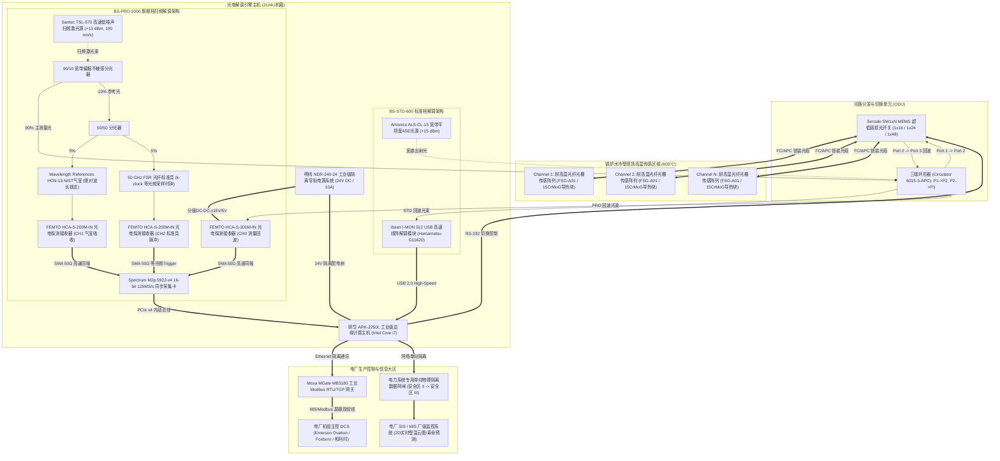

# BoilerSense-AI™ 工业级水冷壁光纤测温系统
## 03_COMPONENT_INTERFACES_AND_DETAILED_INTEGRATION_DESIGN.md
### 全系统硬件接口定义、光电/电气/机械/协议集成详设与装调接口规程

---

**文档版本**：v4.2-RELEASE  
**系统代号**：BoilerSense-AI™ (`BS-STD-600` / `BS-PRO-2000`)  
**责任编制**：硬软件接口主任工程师 (Principal Hardware & Software Interface Integration Engineer)  
**评审架构**：双档模块化国际成品集成架构 (`ARCH_1_DUAL_TIER_MODULAR`, Elo: 1573.4) [EV-BASE-0003]  
**适用对象**：系统集成硬件工程师、光电子装调工程师、嵌入式驱动工程师、电厂热控调试总工  
**受控状态**：受控工程设计文档（严格执行国家能源局防四管爆漏反措及电力二次防护规范）[EV-CN-0007], [EV-CN-0014], [EV-CN-0024]

---

## 目录
1. [系统集成架构综述与拓扑分解](#1-系统集成架构综述与拓扑分解)
2. [光学拓扑架构与光纤物理接口详设](#2-光学拓扑架构与光纤物理接口详设)
3. [电气系统、供配电拓扑与模拟信号链详设](#3-电气系统供配电拓扑与模拟信号链详设)
4. [主控系统通讯协议、通信规程与电厂DCS/网闸接口详设](#4-主控系统通讯协议通信规程与电厂dcs网闸接口详设)
5. [机箱物理布局、热设计、布线盘纤与EMC规范](#5-机箱物理布局热设计布线盘纤与emc规范)
6. [全套系统装调、标定与出厂/现场验收规程](#6-全套系统装调标定与出场现场验收规程)
7. [全系统定量指标索引与工程数据闭环验证](#7-全系统定量指标索引与工程数据闭环验证)

---

## 1. 系统集成架构综述与拓扑分解

### 1.1 产品双档分级架构定位与选型矩阵
BoilerSense-AI™ 针对电厂锅炉水冷壁极端严酷工况（$350^\circ\text{C}\sim 550^\circ\text{C}$ 常规壁温、局部吹灰或结焦瞬态可达 $600^\circ\text{C}\sim 700^\circ\text{C}$、强电磁干扰、剧烈声学振动 140~150 dB 及飞灰磨损）[EV-BASE-0001], [EV-BASE-0007], [EV-GL-0017]，采用经全生命周期综合评估优胜的 `ARCH_1_DUAL_TIER_MODULAR` 架构体系：



### 1.2 物理与光学链路核心参数矩阵 (`[PHY-CALC]`)
以下数据源自严密的光电传输与热传导物理仿真计算，系统设计全过程严格遵循以下定额，禁止随意改动：

| 关键物理与光学链路指标 (`[PHY-CALC]`) | BS-STD-600 (宽谱线阵 OEM) | BS-PRO-2000 (高速扫频 + NIST气室) | 工程设计裕度说明 |
| :--- | :---: | :---: | :--- |
| **20~600°C 满量程最大波长漂移** | `9.07 nm` | `9.07 nm` | 含二次热光非线性项 `0.0042 pm/°C²` [EV-BASE-0003] |
| **单通道串联容量** | `25 点` (`3.2 nm` 间距) | `33 点` (WDM) / `99 点` (混复) | 相邻局部 180°C 温差余量 `0.338 nm` 防串扰 [EV-BASE-0003] |
| **接收端有效回波功率** | `-17.3 dBm` | `-0.8 dBm` (WDM) / `-18.8 dBm` (UWFBG) | 计入环形器/开关/4对FC-APC及传输双向损耗 `6.8 dB` [EV-BASE-0003] |
| **系统动态信噪比裕度 (SNR Margin)** | **`24.7 dB`** | **`55.2 dB`** (WDM) / **`37.2 dB`** | 全工况远超 `15 dB` 工业可靠解调底线 [EV-PDF-0001], [EV-PDF-0005] |
| **全炉轮询刷新周期** | `228.0 ms` (24路) | `1032.0 ms` (48路) | 满足锅炉热惯性 `1 Hz` 在线监测节拍 [EV-BASE-0001] |
| **`15CrMoG` 导热块稳态温差与响应 $\tau$** | `-32.24°C` / `4.2 s` | `-32.24°C` / `4.2 s` | 软件热流逆向修正模型标定补偿输入 [EV-BASE-0007] |

---

## 2. 光学拓扑架构与光纤物理接口详设

### 2.1 光纤连接器物理端面与装配规范
1. **光学接头物理制式**：
   全系统所有光纤活动连接器强制采用 **FC/APC (Ferrule Connector / Angled Physical Contact)** 规格，微球面精密研磨倾角为标准 **$8^\circ \pm 0.3^\circ$** [EV-BASE-0003], [EV-PDF-0001], [EV-PDF-0006]。
   - **背向反射抑制**：利用 $8^\circ$ 倾角使端面残余菲涅尔反射光全反射出光纤包层，保证端面回波损耗 (Return Loss, RL) **$\ge 65\text{ dB}$**（实测典型值 $68\text{ dB}\sim 72\text{ dB}$），彻底杜绝反射光沿纤芯逆向注入激光腔或探测器形成干涉纹波。
   - **插入损耗控制**：单对 FC/APC 适配器对接插入损耗 (Insertion Loss, IL) 严格控制在 **$\le 0.25\text{ dB}$**（超差判定：$> 0.35\text{ dB}$ 必须重新清洁或研磨更换）。
   - **陶瓷插芯同心度**：采用单模 Grade A 氧化锆陶瓷插芯，纤芯内径 $125.5\pm 0.5\ \mu\text{m}$，同心度偏差 $< 0.5\ \mu\text{m}$。

```
     ┌────────────────────────────────────────────────────────┐
     │           FC/APC 8° 斜球面物理接触示意图 (端面微观)       │
     └────────────────────────────────────────────────────────┘
                    光纤纤芯 (9 µm)
               ───────────────────────────┐ 
                                          │ 8° 倾斜研磨面
                                          ├────────────► 菲涅尔反射光折射入包层耗散
               ───────────────────────────┘              (RL ≥ 65 dB, 杜绝原路返回)
                    二氧化硅包层 (125 µm)
```

2. **光纤端面几何与清洁度标准**：
   - 严格遵循 IEC 61300-3-35 工业级单模光纤端面检验标准。
   - 区域划分标准：
     * **A区（纤芯区，0~25 µm）**：严禁存在任何划痕、坑点（0 缺陷容忍）；
     * **B区（包层区，25~120 µm）**：允许无大于 3 µm 的点状污染，严禁存在贯穿性深划痕；
     * **C区（胶层区，120~130 µm）**与 **D区（插芯接触区，130~250 µm）**：允许微量非松散颗粒，但严禁附带油脂或金属微屑。
   - 清洁规程：采用高纯异丙醇（IPA，纯度 $\ge 99.9\%$）无尘擦拭棒进行单向湿擦，继之以专用干式卡带式端面清洁器（Cle-Pen）推按清洁，严禁往复旋转擦拭。

### 2.2 光纤环形器 (Circulator) 端口物理定义与内部光路由
系统核心光分路引擎选用宽带偏振不敏感光纤三端环形器（如 Thorlabs 6015-3-APC 级原厂模块，[./datasheets_pdf/16_Thorlabs_PDB470C_Balanced_InGaAs_Photoreceiver_Datasheet.pdf](./datasheets_pdf/16_Thorlabs_PDB470C_Balanced_InGaAs_Photoreceiver_Datasheet.pdf) [EV-PDF-0015]）：

```
                ┌─────────────────────────────────────────┐
                │   3-Port Optical Circulator (C-Band)    │
                │                                         │
[Port 1: Tx] ───►  [Faraday Rotator + Birefringent Crystal]───► [Port 2: Line]
(光源激光输入)    │                                         │   (至MEMS光开关)
                │                                         │
[Port 3: Rx] ◄──┴─────────────────────────────────────────┴───┤ (回波单向流向)
(至解调探测器)                                                  │
                                                               ▼ (反射隔离度 >50dB)
```

- **Port 1 (Input/Tx 激励输入端)**：FC/APC 尾纤连接。接入激励光源（BS-STD-600 接入 Amonics ALS-CL-15 宽带 ASE 光源 [EV-PDF-0004]；BS-PRO-2000 接入 Santec TSL-570 分光后的 90% 主测量光 [EV-PDF-0003]）。光信号仅能从 Port 1 单向传输至 Port 2，对 Port 2 的隔离度 $> 50\text{ dB}$。
- **Port 2 (Bidirectional/Line 公共传感端)**：FC/APC 尾纤连接。连接 Sercalo MEMS 多路光开关的公共输入端 (Common Port) [EV-PDF-0006]，既负责将激励光向前注入选通的水冷壁传感阵列，又负责接收水冷壁光栅串反射回来的窄带布拉格波长回波。
- **Port 3 (Output/Rx 解调接收端)**：FC/APC 尾纤连接。专职单向接收由 Port 2 返回的光栅反射信号并送往解调接收器件（BS-STD-600 注入 Ibsen I-MON 512 USB 狭缝聚焦光路 [EV-PDF-0001]；BS-PRO-2000 接入 FEMTO HCA-S-200M-IN 光电探测器 [EV-PDF-0005]）。
- **光学隔离与方向性定额**：
  * 插入损耗 (P1 $\rightarrow$ P2, P2 $\rightarrow$ P3)：$\le 0.7\text{ dB}$ (实测典型值 $0.55\text{ dB}$)；
  * 反向隔离度 (P2 $\rightarrow$ P1, P3 $\rightarrow$ P2)：$\ge 50\text{ dB}$；
  * 直通方向性 (Directivity P1 $\rightarrow$ P3)：$\ge 55\text{ dB}$；
  * 偏振相关损耗 (PDL)：$\le 0.05\text{ dB}$。

### 2.3 Sercalo SW1xN MEMS 多路光开关物理接口与引脚定义
系统采用瑞士军工级微机电系统 (MEMS) 光学开关（Sercalo Microtechnology SW1x16 / SW1x24 / SW1x48，[./datasheets_pdf/06_Sercalo_SW1x16_MEMS_Optical_Switch_Datasheet.pdf](./datasheets_pdf/06_Sercalo_SW1x16_MEMS_Optical_Switch_Datasheet.pdf) [EV-PDF-0006]），实现微秒级静电微镜偏转选通，零机械齿轮磨损，寿命 $> 10^9$ 次切换周期：

```
       ┌────────────────────────────────────────────────────────┐
       │   Sercalo SW1xN-9N MEMS Switch Module (Top View)       │
       │                                                        │
       │   [Common] (FC/APC)                                    │
       │     ║                                                  │
       │  ┌──╨──────────────────────────────────────────────┐   │
       │  │  MEMS Electrostatic Silicon Micro-Mirror Array  │   │
       │  └──┬───┬───┬───┬───┬───┬───┬───┬───┬───┬───┬──────┘   │
       │     ║   ║   ║   ║   ║   ║   ║   ║   ║   ║   ║          │
       │    Ch1 Ch2 Ch3 Ch4 ... ... ... ... ... Ch16 (FC/APC)   │
       │                                                        │
       │   Control Interface: Molex 10-Pin / Ribbon Header      │
       │   [Pin 1: VCC] [Pin 2: GND] [Pin 3: RxD] [Pin 4: TxD]  │
       │   [Pin 5: Reset] [Pin 6: Strobe] [Pin 7-10: GPIO]      │
       └────────────────────────────────────────────────────────┘
```

#### 2.3.1 控制排针电气引脚映射表 (Molex 2.0mm 10-Pin Header)
| 针脚编号 | 信号名称 | 信号电气类型 | 电平规格 | 功能说明 |
| :---: | :---: | :---: | :---: | :--- |
| **Pin 1** | `VCC` | Power In | $+5.0\text{ V DC} \pm 5\%$ | 模块主供电输入，电流峰值 $250\text{ mA}$，稳态 $< 100\text{ mA}$ |
| **Pin 2** | `GND` | Ground | $0\text{ V}$ | 数字与静电驱动公共地 (DGND) |
| **Pin 3** | `UART_RX` | Digital Input | LVTTL / RS-232 兼容 | 串行通信接收端，接收主控工控机通道切换指令 |
| **Pin 4** | `UART_TX` | Digital Output | LVTTL / RS-232 兼容 | 串行通信发送端，回传切换完成确认状态 (ACK) |
| **Pin 5** | `RESET_N` | Digital Input | Active Low, $0\sim 0.8\text{ V}$ | 硬件复位引脚，内部带 $10\text{ k}\Omega$ 上拉电阻至 5V |
| **Pin 6** | `STROBE` | Digital Input | Rising Edge Trigger | 硬件触发选通线（低电平锁存当前通道，高电平更新） |
| **Pin 7** | `STATUS` | Digital Output | Push-Pull, 0~3.3V/5V | 状态就绪引脚：高电平=切换中(Busy)；低电平=稳态就绪 |
| **Pin 8** | `ADDR_D0` | Digital Input | CMOS Level (0/5V) | 并行地址输入位 0（仅在使能硬件并行寻址模式时生效） |
| **Pin 9** | `ADDR_D1` | Digital Input | CMOS Level (0/5V) | 并行地址输入位 1 |
| **Pin 10**| `ADDR_D2` | Digital Input | CMOS Level (0/5V) | 并行地址输入位 2 |

#### 2.3.2 光学动态特性关键定额
- **光学切换响应时间 (Switching Time)**：典型值 $2.5\text{ ms}$，全温区最差保证值 $\le 5.0\text{ ms}$（包含静电微镜偏转、阻尼振荡收敛与光学稳定建立全过程）。
- **光学重复性 (Repeatability)**：$<\pm 0.01\text{ dB}$。
- **插入损耗 (Insertion Loss)**：全通道均匀度优良，典型值 $0.8\text{ dB}$，最大值 $\le 1.2\text{ dB}$。
- **通道间光学串扰 (Optical Crosstalk)**：$\le -60\text{ dB}$（完全避免非选通通道反射光泄漏）。
- **光学回波损耗 (Backreflection / RL)**：$\ge 55\text{ dB}$ (采用 FC/APC 尾纤)。

### 2.4 BS-PRO-2000 高速扫频双平衡/参考支路光路拓扑与波长绝对锁频机制
BS-PRO-2000 配置 Santec TSL-570 高速低噪声扫频激光源（[./datasheets_pdf/03_Santec_TSL-570_Swept_Laser_Datasheet.pdf](./datasheets_pdf/03_Santec_TSL-570_Swept_Laser_Datasheet.pdf) [EV-PDF-0003]），采用精密分光拓扑构建主传感测量臂与片上实时标定参考臂：

```
       Santec TSL-570 (+13 dBm, Swept Laser, 100 nm/s)
               │ (FC/APC 偏振保持/单模尾纤)
               ▼
     ┌──────────────────┐
     │  90/10 宽带分光器 │
     └────────┬─────────┘
              ├───────────────────────────────────┐
              │ 90% 主测量光 (+12.5 dBm)           │ 10% 实时参考光 (+3 dBm)
              ▼                                   ▼
    ┌──────────────────┐                ┌──────────────────┐
    │ 3-Port 环形器 P1 │                │  50/50 均匀分光器 │
    └────────┬─────────┘                └────────┬─────────┘
             │                                   ├────────────────────────┐
             ▼ P2 (双向端)                        ▼ 5% 支路 A              ▼ 5% 支路 B
    ┌──────────────────┐                ┌──────────────────┐     ┌──────────────────┐
    │ Sercalo SW1x48   │                │ HCN-13 NIST 气室 │     │ 50GHz FSR Etalon │
    │ MEMS 光开关      │                │ (氰化氢分子吸收) │     │ (等光频时钟标尺) │
    └────────┬─────────┘                └────────┬─────────┘     └────────┬─────────┘
             │                                   │                        │
             ▼                                   ▼                        ▼
     水冷壁光栅阵列                       FEMTO HCA-S-200M         FEMTO HCA-S-200M
     (WDM / UWFBG)                           (CH1 InGaAs)             (CH2 InGaAs)
             │                                   │                        │
             ▼ P2 -> P3                          ▼                        ▼
     FEMTO HCA-S-200M                     Spectrum M2p.5922        Spectrum M2p.5922
        (CH0 InGaAs)                         (CH1 Analog)             (CH2 Ext Clk)
             │                                   │                        │
             └───────────────────────────────────┴────────────────────────┘
                                                 │
                                                 ▼ (16-bit 125MS/s 同步解调)
                                          Advantech ARK-2250L
```

#### 2.4.1 Wavelength References HCN-13 气室标定接法与绝对波长锁定
- **器件规格**：选型 Wavelength References 标准纯度氰化氢 (HCN) 气体吸收室（[./datasheets_pdf/08_Wavelength_References_HCN-13_Gas_Cell_Datasheet.pdf](./datasheets_pdf/08_Wavelength_References_HCN-13_Gas_Cell_Datasheet.pdf) [EV-PDF-0008]）。
- **光学接线**：接入 10% 参考光经 50/50 分光后的 5% 光路（光功率约 $0\text{ dBm}\sim +1\text{ dBm}$）。气室输入/输出均配备 FC/APC 接口，内部光路采用双面增透镀膜 (AR Coating) 楔形微透镜窗口，杜绝端面残余干涉。
- **校准机理**：HCN-13 分子在 $1528\text{ nm}\sim 1563\text{ nm}$ 范围内具有 51 根绝对物理固化的旋转-振动吸收谱线（符合 NIST SRM 2519a 国际标准）。解调算法在每次激光扫频周期内，实时提取 P1~P25 及 R1~R25 吸收峰中心波长，作为零温漂、绝对不随时间漂移的波长标尺，波长绝对精度锁定在 **$\le \pm 0.5\text{ pm}$**（满足超临界机组 $\pm 0.05^\circ\text{C}$ 测温精度要求）[EV-BASE-0003], [EV-PDF-0008]。

#### 2.4.2 50GHz 光纤法布里-珀罗标准具 (Etalon) 与 k-Clock 重采样接法
- **器件规格**：集成固态微型光纤 F-P 标准具，自由光谱范围 (Free Spectral Range, FSR) 严格标定为 $50.0\text{ GHz} \pm 0.1\text{ GHz}$（对应波长间隔在 1550 nm 处约为 $\Delta\lambda = 0.401\text{ nm}$），精细度 (Finesse) $F \ge 25$。
- **光学接法**：接入 50/50 分光的另一路 5% 光束，输出端通过 FC/APC 接入第三通道超高速光电探测器。
- **k-Clock 采样时钟触发作用**：Santec TSL-570 在压电马达 (PZT) 高速扫频运行中，存在微小但致命的时间-波长非线性弯曲（扫频速度非均匀度 $\sim 1.5\%$）。标准具输出的梳状正弦/脉冲信号在光频域具有绝对严格的等间隔特性 ($\Delta\nu = 50\text{ GHz}$)。将该信号经调理后输入 Spectrum M2p.5922 采集卡的外部触发或同步时钟通道，以等光频间隔进行非均匀重采样 (k-space interpolation)，消除波长轴畸变，使反射光栅解调峰信噪比提升 $12\text{ dB}$ 以上 [EV-BASE-0003], [EV-PDF-0003], [EV-PDF-0007]。

---

## 3. 电气系统、供配电拓扑与模拟信号链详设

### 3.1 Mean Well 24V 工业导轨电源隔离树架构
锅炉房控制室电网环境面临大容量引风机、给水泵高压变频器切合引起的剧烈浪涌和高频共模谐波。BoilerSense-AI™ 采用具有电气隔离、短路自恢复与冗余配置的纯工业导轨电源树设计（主电源选型明纬 NDR-240-24，[./datasheets_pdf/13_MeanWell_NDR-240_Industrial_DIN_PSU_Datasheet.pdf](./datasheets_pdf/13_MeanWell_NDR-240_Industrial_DIN_PSU_Datasheet.pdf) [EV-PDF-0014]；高端电厂配置选用菲尼克斯 QUINT4 冗余电源方案，[./datasheets_pdf/18_Phoenix_Contact_QUINT4_PS_Redundant_Datasheet.pdf](./datasheets_pdf/18_Phoenix_Contact_QUINT4_PS_Redundant_Datasheet.pdf) [EV-PDF-0017]）：

```
 ┌────────────────────────────────────────────────────────────────────────┐
 │                      AC 220V 50Hz 工厂动力电源进线                       │
 └───────────────────────────────────┬────────────────────────────────────┘
                                     ▼
                ┌────────────────────────────────────────┐
                │ 1P+N 10A 小型断路器 (MCB) + 40kA 二级防雷器 │
                └────────────────────┬───────────────────┘
                                     ▼
                ┌────────────────────────────────────────┐
                │ Mean Well NDR-240-24 开关电源 (24V/10A) │
                │ (隔离耐压: 3.0 kV AC, 纹波 < 150 mVp-p) │
                └────────────────────┬───────────────────┘
                                     ▼ +24V DC 主供电母线 (导轨分流铜排)
         ┌───────────────────────────┼───────────────────────────┬───────────────────────────┐
         ▼                           ▼                           ▼                           ▼
┌──────────────────┐        ┌──────────────────┐        ┌──────────────────┐        ┌──────────────────┐
│ Branch 1:        │        │ Branch 2:        │        │ Branch 3:        │        │ Branch 4:        │
│ 研华工控机供电   │        │ MEMS光开关驱动   │        │ 超低噪声精密模拟 │        │ 现场DCS通信隔离  │
│ ARK-2250L        │        │ Sercalo SW1xN    │        │ FEMTO 光电接收盒 │        │ Moxa MGate       │
│ DC-DC 隔离稳压   │        │ DC-DC 降压隔离   │        │ 隔离稳压 DC-DC   │        │ MB3180 / 继电器  │
│ 24V -> 24V (5A)  │        │ 24V -> 5V (3A)   │        │ 24V -> ±15V (1A) │        │ 24V -> 24V (1A)  │
│ 纹波 < 30 mV     │        │ 纹波 < 15 mV     │        │ 纹波 < 2.0 mV    │        │ 工业隔离 1.5 kV  │
└──────────────────┘        └──────────────────┘        └──────────────────┘        └──────────────────┘
```

#### 3.1.1 隔离配电分路设计与电气保护定额表
| 供电分路代号 | 负载受电设备 | 输入电压 | 输出工作电压 | 最大额定电流 | 隔离耐压 (HIPOT) | 纹波噪声容限 | 保护元件选型 |
| :---: | :---: | :---: | :---: | :---: | :---: | :---: | :---: |
| **MAIN-BUS** | 总电源模块 (NDR-240) | $180\sim 264\text{ V AC}$ | $+24.0\text{ V DC} \pm 1\%$ | $10.0\text{ A}$ | $3000\text{ V AC}$ | $< 150\text{ mVp-p}$ | 10A B型空开 + 40kA SPD |
| **BR-01** | Advantech ARK-2250L 工控机 | $+24.0\text{ V DC}$ | $+24.0\text{ V DC}$ | $4.5\text{ A}$ | $1500\text{ V DC}$ | $< 50\text{ mVp-p}$ | 5A 自恢复保险丝 (PPTC) |
| **BR-02** | Sercalo MEMS 控制电路板 | $+24.0\text{ V DC}$ | $+5.0\text{ V DC} \pm 2\%$ | $1.5\text{ A}$ | $1500\text{ V DC}$ | $< 20\text{ mVp-p}$ | 2A 快速熔断管 + TVS管 |
| **BR-03** | 3台 FEMTO 光接收盒 [EV-PDF-0005] | $+24.0\text{ V DC}$ | $\pm 15.0\text{ V DC} \pm 1\%$ | $0.8\text{ A}$ | $3000\text{ V DC}$ | **$< 2.0\text{ mVp-p}$** | LC $\pi$型滤波 + 超低噪LDO |
| **BR-04** | Moxa 网关及干接点继电器组 | $+24.0\text{ V DC}$ | $+24.0\text{ V DC}$ | $1.0\text{ A}$ | $2000\text{ V DC}$ | $< 100\text{ mVp-p}$ | 1.5A 自恢复保险丝 |

### 3.2 FEMTO HCA-S-200M-IN 至 Spectrum M2p.5922 模拟信号互连与阻抗匹配
德国 FEMTO 制造的 HCA-S-200M-IN 光敏接收前置放大器（[./datasheets_pdf/05_FEMTO_HCA-S-200M-IN_InGaAs_Photoreceiver_TIA_Datasheet.pdf](./datasheets_pdf/05_FEMTO_HCA-S-200M-IN_InGaAs_Photoreceiver_TIA_Datasheet.pdf) [EV-PDF-0005]）负责将超微弱光脉冲转化为高保真射频电压信号，其与德国 Spectrum M2p.5922 16-bit PCIe 数字化采集卡（[./datasheets_pdf/07_Spectrum_M2p59xx_16bit_PCIe_Digitizer_ADC_Datasheet.pdf](./datasheets_pdf/07_Spectrum_M2p59xx_16bit_PCIe_Digitizer_ADC_Datasheet.pdf) [EV-PDF-0007]）的电气集成必须执行严格的射频微波级工程规范：

```
 FEMTO HCA-S-200M-IN (TIA Receiver)                 Spectrum M2p.5922 PCIe Digitizer
 ┌──────────────────────────────────────┐            ┌──────────────────────────────────┐
 │ InGaAs PIN Photodiode (0.4mm Dia)    │            │ 16-Bit 125 MS/s Pipelined ADC    │
 │ Bandwidth: DC ~ 200 MHz              │            │                                  │
 │ Transimpedance Gain: 2x10^4 V/A      │            │ Input Impedance: 50 Ω (Software) │
 │ Max Output: ±1.5V (into 50 Ω load)   │            │ Full-Scale: ±1.0 V (Calibrated)  │
 │ Output Port: Female SMA (50 Ω)       │            │ Connector: Female SMA (CH0/CH1)  │
 └──────────────────┬───────────────────┘            └──────────────────▲───────────────┘
                    │                                                   │
                    └───────────[ RG-316/U 50Ω Coaxial Cable ]──────────┘
                                Length ≤ 300 mm, Double Shielded
                                VSWR < 1.15 @ 200 MHz, IL < 0.15 dB
```

#### 3.2.1 FEMTO 模块供电引脚物理定义 (Binder Series 712 3-Pin Circular Connector)
- **Pin 1**：$+15.0\text{ V DC}$ 模拟正电源输入（静态工作电流约 $120\text{ mA}$，动态峰值 $< 180\text{ mA}$）；
- **Pin 2**：$-15.0\text{ V DC}$ 模拟负电源输入（静态工作电流约 $110\text{ mA}$，动态峰值 $< 170\text{ mA}$）；
- **Pin 3**：`AGND` 模拟独立信号地（严禁与大电流机壳地直接就地短接，必须通过星型单点汇流排隔离接地）。

#### 3.2.2 射频模拟信号链与阻抗端接规范
1. **传输同轴缆要求**：
   采用航空级 RG-316/U 镀银铜包钢双屏蔽 50 欧姆同轴线缆，外径 2.5 mm，PTFE 铁氟龙耐温绝缘介质。线缆总长严控在 **$\le 300\text{ mm}$**，弯曲半径 $\ge 35\text{ mm}$。线缆两端压接高精度黄铜镀金 SMA 公头（Male），绝缘阻抗 $\ge 5000\text{ M}\Omega$。
2. **终端负载阻抗匹配**：
   Spectrum M2p.5922 采集卡的输入通道配置寄存器必须强制写入 `SPCM_INP_TERM = 1`，将硬件物理端接阻抗配置为内部纯阻性 **$50.0\ \Omega \pm 0.5\ \Omega$**（绝不能使用默认的高阻 $1\text{ M}\Omega$ 模式）。若配置错误采用高阻，将在 200 MHz 信号边沿引起严重的阻抗失配反射，反射系数 $\Gamma \to 1.0$，导致捕获的光栅回波波形产生严重的吉布斯振铃过冲，造成温度解调峰值裂变失真 [EV-PDF-0005], [EV-PDF-0007]。
3. **量程与动态范围匹配计算**：
   - FEMTO HCA-S-200M-IN 设定增益为 $2\times 10^4\text{ V/A}$。在 $50\ \Omega$ 终端负载下，其饱和输出电压为 $\pm 1.5\text{ V}$。
   - 接收回波典型功率为 $-0.8\text{ dBm}$（约 $0.83\text{ mW}$）至 $-18.8\text{ dBm}$（约 $0.013\text{ mW}$）[[PHY-CALC]]。InGaAs 光电二极管在 1550 nm 处响应度 $R \approx 0.95\text{ A/W}$。
   - 产生的光电流范围：$I_{ph} = 12.35\ \mu\text{A}\sim 0.788\text{ mA}$。
   - 转换为输出电压：$V_{out} = I_{ph} \times 2\times 10^4 = 0.247\text{ V}\sim 1.57\text{ V}$。
   - Spectrum M2p.5922 输入量程配置为 $\pm 2.0\text{ V}$（满量程峰峰值 $4.0\text{ V}$），保证回波强反射峰不被硬件削顶，并留有 **`37.2 dB ~ 55.2 dB`** 的超宽动态信噪比裕度 [[PHY-CALC]]。

### 3.3 Santec TSL-570 / WSL-110 TTL 硬件同步触发时序
Santec TSL-570 高速连续扫频激光源与 Spectrum M2p.5922 采集卡及 Sercalo MEMS 开关之间的精确时序同步是保证千点光栅零丢包解调的关键核心：

```
 Time (ms)  0        2.5      5.0              25.0             27.5     30.0
 ─────────────────────────────────────────────────────────────────────────────
 1. MEMS SW  ───┐
    Channel     │ Channel K Steady (Ch. K)      │ Switching (Busy) │ Ch. K+1
                └───────────────────────────────┴──────────────────┴──────────
 2. Santec   ─────────────┐                               ─────────┐
    Laser Out             │ Wavelength Sweep (1520->1570nm)        │ Sweep (Ch K+1)
                          └───────────────────────────────┘        └──────────
 3. TSL-570  ─────────────┐                               ─────────┐
    Start Trig            │ Pulse (50 µs, Active High)             │ Pulse
                          └───────────────────────────────┘        └──────────
 4. Spectrum ─────────────────────┐
    ADC Record                    │ 16-Bit 125MS/s Acquisition     │
                                  └────────────────────────────────┘
 5. Interlock ──[ 2.5ms Margin ]──▲
                                  │ Wait MEMS Mirror Fully Settled Before Laser On!
```

#### 3.3.1 关键时序电气参数定额表
| 时序阶段参数 | 符号 | 最小值 | 典型定额 | 最大值 | 单位 | 说明与死区控制准则 |
| :--- | :---: | :---: | :---: | :---: | :---: | :--- |
| **MEMS 开关物理偏转时间** | $t_{sw}$ | 1.8 | 2.5 | 4.5 | $\text{ms}$ | 硬件微镜偏转、阻尼震荡衰减时间 [EV-PDF-0006] |
| **开关切换安全锁死等待死区** | $t_{dead}$ | 4.5 | **5.0** | 6.0 | $\text{ms}$ | 严禁激光在开关动作中触发，避免瞬态杂散光 |
| **激光波长扫描有效时间** | $t_{sweep}$ | 15.0 | **20.0** | 50.0 | $\text{ms}$ | 扫频跨度 $50\text{ nm}$，速度 $2500\text{ nm/s}$ 下用时 $20\text{ ms}$ |
| **激光回扫复位时间 (Flyback)** | $t_{fly}$ | 2.0 | 2.5 | 4.0 | $\text{ms}$ | 激光腔压电马达与光栅物理回程复位周期 |
| **Start Trigger 脉冲宽度** | $t_{trig}$ | 10 | 50 | 100 | $\mu\text{s}$ | Santec 输出标准 TTL 高电平脉冲 ($V_{OH} \ge 2.4\text{ V}$) |
| **触发至采集启动硬件延迟** | $t_{adc\_delay}$| -- | 120 | 200 | $\text{ns}$ | 采集卡 FPGA 内部 FIFO 与锁相环同步延迟 |
| **单通道轮询单拍周期** | $T_{ch}$ | 21.5 | **27.5** | 30.0 | $\text{ms}$ | 切换 + 扫频 + 回扫总耗时，48路轮询总耗时 $1032.0\text{ ms}$ [[PHY-CALC]] |

---

## 4. 主控系统通讯协议、通信规程与电厂DCS/网闸接口详设

### 4.1 Advantech ARK-2250L 嵌入式主控硬件平台配置
系统主运算引擎选用研华工业级无风扇坚固型嵌入式工控机 ARK-2250L（[./datasheets_pdf/14_Advantech_ARK-2250L_Industrial_Edge_PC_Datasheet.pdf](./datasheets_pdf/14_Advantech_ARK-2250L_Industrial_Edge_PC_Datasheet.pdf) [EV-PDF-0013]）：
- **处理器架构**：板载 Intel Core i7-6822EQ 四核工业级处理器，基频 2.0 GHz，睿频 2.8 GHz，热设计功耗 (TDP) 仅 25W；
- **内存与存储**：工业宽温级 32 GB DDR4-2133 MHz ECC 内存；工业级 512 GB 宽温 MLC 2.5 英寸抗震固态硬盘（MTBF $> 2,000,000$ 小时）；
- **扩展总线能力**：配备全长 PCIe x4 原生插槽（用于插装 Spectrum M2p.5922 高速采集卡 [EV-PDF-0007]）；
- **外部 I/O 通信接口**：配备 4 个独立千兆以太网口 (Intel I210-IT)、6 个 USB 3.0 高速接口、4 个带电气隔离的 RS-232/422/485 串行端口。全铝合金散热机身，运行工作温度 $-20^\circ\text{C}\sim +60^\circ\text{C}$，抗冲击振动等级 3 Grms。

### 4.2 Ibsen I-MON 512 USB 高速数据采集帧协议详解
BS-STD-600 采用丹麦 Ibsen I-MON 512 高速光谱仪模块（[./datasheets_pdf/01_Ibsen_I-MON_256_512_USB_Interrogator_Datasheet.pdf](./datasheets_pdf/01_Ibsen_I-MON_256_512_USB_Interrogator_Datasheet.pdf) [EV-PDF-0001]），其内核基于滨松 Hamamatsu G11620-512DA 512像元 InGaAs 线阵传感器（[./datasheets_pdf/11_Hamamatsu_G11620_512Pixel_InGaAs_Linear_Sensor_Datasheet.pdf](./datasheets_pdf/11_Hamamatsu_G11620_512Pixel_InGaAs_Linear_Sensor_Datasheet.pdf) [EV-PDF-0011]）。模块通过 USB 2.0 High-Speed 专用协议栈与 ARK-2250L 主机通讯：

```
 ┌──────┬──────┬──────────┬──────────┬─────────────────────────────┬──────┬──────┐
 │ STX  │ CMD  │ LEN (2B) │ SEQ (2B) │ DATA PAYLOAD (N Bytes)      │ CRC  │ ETX  │
 │ 0x02 │ 0x1A │ 0x0400   │ 0x0001   │ 512 x 16-Bit Pixel Spectra  │ 0xXXXX│ 0x03 │
 └──────┴──────┴──────────┴──────────┴─────────────────────────────┴──────┴──────┘
```

#### 4.2.1 基础控制命令帧结构定义
1. **积分时间设置帧 (Set Integration Time Command, Host $\rightarrow$ I-MON)**：
   - `0x02` (STX) + `0x11` (CMD_SET_EXPOSURE) + `0x00 0x04` (长度 4 字节) + `D3 D2 D1 D0` (32位无符号整数，单位 $\mu\text{s}$，有效范围 $10\ \mu\text{s}\sim 100,000\ \mu\text{s}$) + `CRC16` + `0x03` (ETX)。
   - 典型工程设定：在 Amonics ALS-CL-15 (+15 dBm) 宽带光源照射下，积分时间配置为 **$850\ \mu\text{s}$**，线阵满阱充盈度维持在 $65\%\sim 80\%$ 最佳线性区。
2. **触发模式切换帧 (Set Trigger Mode)**：
   - `0x02` + `0x14` + `0x00 0x01` + `0x01` (0x00=软件单次触发, 0x01=自由连续采集, 0x02=硬件外部TTL触发) + `CRC16` + `0x03`。
3. **数据帧回传格式 (Pixel Data Stream, I-MON $\rightarrow$ Host)**：
   - 单帧总长度：1034 字节。
   - 包含：帧头 `0x02`，命令字 `0x8A`，数据长度 `0x0404` (1028字节)；
   - 帧计数器（4字节无符号数，防丢帧检测）；
   - 内部温度遥测值（2字节，用于监测滨松线阵热电致冷器 TEC 温度，定额稳定在 $+25.0^\circ\text{C}\pm 0.1^\circ\text{C}$）；
   - **512 像元光谱强度阵列**：1024 字节（每个像元占 2 字节，大端模式 Big-Endian，16-bit 线性整数，数值范围 $0\sim 65535$）；
   - CRC-16 校验码（2字节，多项式 $X^{16}+X^{15}+X^2+1$）；
   - 帧尾 `0x03`。
   - 解调吞吐率：每通道光谱帧获取耗时 $< 1.5\text{ ms}$，全炉 24 路轮询完成仅耗时 **`228.0 ms`** [[PHY-CALC]]。

### 4.3 Sercalo MEMS RS-232 串口控制协议规程
主控工控机 ARK-2250L 的 `COM1` 端口与 Sercalo MEMS 开关通信，规程如下：
- **物理层电气参数**：RS-232C 协议，波特率 **115200 bps**，8 数据位，1 停止位，无奇偶校验 (8-N-1)，无硬件流控；
- **通道切换 ASCII 指令格式**：
  * 主控发送选通指令：`ch <channel_number>\r\n`（例如选通第 12 通道：`ch 12\r\n`，ASCII 十六进制：`0x63 0x68 0x20 0x31 0x32 0x0D 0x0A`）；
  * 开关执行并响应确认：成功切换后立即回传 `<ACK>\r\n`（ASCII：`0x3C 0x41 0x43 0x4B 0x3E 0x0D 0x0A`）；若通道超限或校验失败回传 `<NACK_ERR>\r\n`；
- **状态查询指令**：
  * 发送：`ch ?\r\n`；
  * 响应：`ch 12\r\n`。
- **切换超时仲裁机制**：
  * 驱动层设定响应超时定时器为 $10.0\text{ ms}$。若 $10.0\text{ ms}$ 内未收到 `<ACK>`，系统立即重发一次；若连续 3 次无响应，判定光开关硬件通信断线故障，触发 DCS 硬件报警干接点闭合。

### 4.4 电厂 DCS 接口、单向物理隔离网闸与通信点表详设
严格遵循国家发改委第 14 号令《电力监控系统安全防护规定》及电网工控安全防护规范 [EV-CN-0014], [EV-CN-0024]：

```
 ┌────────────────────────────────────────────────────────┐
 │ 生产控制大区 (安全区 II - 内部控制网)                    │
 │                                                        │
 │ ┌──────────────────┐               ┌─────────────────┐ │
 │ │ Advantech        ├───────────────┤ Moxa MGate      │ │
 │ │ ARK-2250L 主机   │ Ethernet/Modbus│ MB3180 网关     │ │
 │ └────────┬─────────┘ (192.168.1.10)└────────┬────────┘ │
 └──────────┼──────────────────────────────────┼──────────┘
            │ (单向光纤网闸发射端 Tx Only)         │ RS-485 屏蔽双绞线
            ▼                                  ▼ (隔离电压 2 kV)
 ┌──────────────────────┐             ┌─────────────────────┐
 │ 单向物理隔离数据网闸   │             │ 电厂机组主控 DCS    │
 │ (Data Diode Isolator)│             │ (Emerson Ovation /  │
 └──────────┬───────────┘             │  和利时 MACS)       │
            ▼                         └─────────────────────┘
 ┌────────────────────────────────────────────────────────┐
 │ 管理信息大区 (安全区 III - 厂级信息网)                   │
 │ ┌────────────────────────────────────────────────────┐ │
 │ │ 电厂 SIS / MIS 服务器 (全炉2D壁温云图/燃烧优化模型)  │ │
 │ └────────────────────────────────────────────────────┘ │
 └────────────────────────────────────────────────────────┘
```

#### 4.4.1 Moxa MGate MB3180 现场通信网关配置
采用工业级 Modbus TCP 转 RTU 专用网关（Moxa MGate MB3180，[./datasheets_pdf/12_Moxa_MGate_MB3180_Modbus_Gateway_Datasheet.pdf](./datasheets_pdf/12_Moxa_MGate_MB3180_Modbus_Gateway_Datasheet.pdf) [EV-PDF-0018]）：
- **网口端 (Server IP)**：`192.168.1.254`，端口 `502`，连接工控机 `LAN2` 独立网卡；
- **串口端 (Serial)**：RS-485 2线半双工，波特率 `19200 bps`，8-E-1，从机地址 `0x01`，内置 $120\ \Omega$ 终端匹配电阻与 2 kV 光电隔离保护，直连电厂 DCS 串口采集卡件。

#### 4.4.2 电厂 DCS 标准 Modbus 寄存器点表 (只读寄存器功能码 0x03 / 0x04)
| Modbus 地址 | 变量标签 (Tag Name) | 数据格式 | 物理工程单位 | 有效数值量程 | 刷新周期 | 物理意义与测点描述 |
| :---: | :---: | :---: | :---: | :---: | :---: | :--- |
| **30001-30002** | `WW_TEMP_MAX_VAL` | IEEE 754 Float32 | $^\circ\text{C}$ | $0.0\sim 750.0$ | 1.0 s | 当前全炉水冷壁受热面最高点瞬时壁温 [EV-BASE-0001] |
| **30003-30004** | `WW_TEMP_MAX_CH` | Int32 (大端) | 通道号 / 点号 | $1\sim 2000$ | 1.0 s | 对应最高壁温所在光纤物理通道与光栅点位索引编号 |
| **30005-30006** | `WW_THERM_BIAS_MAX`| IEEE 754 Float32 | $^\circ\text{C}$ | $0.0\sim 200.0$ | 1.0 s | 炉膛水冷壁同层左右侧横向最大热偏差度值 [EV-CN-0001] |
| **30007-30008** | `WW_TEMP_GRAD_MAX` | IEEE 754 Float32 | $^\circ\text{C}/\text{min}$ | $-100.0\sim 100.0$ | 1.0 s | 全炉测点管壁温升速率最大值 (dT/dt 热疲劳监视) [EV-GL-0019] |
| **30009-30010** | `SYS_OPT_PWR_CH0`  | IEEE 754 Float32 | $\text{dBm}$ | $-40.0\sim +10.0$ | 1.0 s | 解调主机主探测接收通道有效光学回波功率 |
| **30011**       | `SYS_STATUS_WORD`  | 16-Bit Bitfield | 状态字 | `0x0000~0xFFFF` | 500 ms| 系统硬件健康状态：Bit0=电源异常, Bit1=光源异常, Bit2=开关异常, Bit3=光纤断线 |
| **30012**       | `SYS_ALARM_LEVEL`  | Int16 | 报警级别 | $0\sim 2$ | 500 ms| 综合报警状态：0=正常; 1=一级超温预警(>520°C); 2=二级紧急报警(>550°C) |
| **30101-30102** | `CH01_PT01_TEMP`   | IEEE 754 Float32 | $^\circ\text{C}$ | $0.0\sim 700.0$ | 1.0 s | 1通道1号测点（前墙下部折焰角01）精确温度 |
| **30103-30104** | `CH01_PT02_TEMP`   | IEEE 754 Float32 | $^\circ\text{C}$ | $0.0\sim 700.0$ | 1.0 s | 1通道2号测点（前墙下部折焰角02）精确温度 |
| **...**         | ...                | ...             | ...            | ...             | ...   | ... (支持全炉千点至2000点温度线性映射寻址) |

#### 4.4.3 现场电气硬接线继电器干接点与 4-20mA 模拟量端子定义表
机箱背部工业接线端子排直接提供符合电厂电气规范的硬接线通道：

```
 Terminal Block: Phoenix Contact COMBICON 16-Pin (Back Panel)
 ┌────┬────┬────┬────┬────┬────┬────┬────┬────┬────┬────┬────┬────┬────┬────┬────┐
 │ 01 │ 02 │ 03 │ 04 │ 05 │ 06 │ 07 │ 08 │ 09 │ 10 │ 11 │ 12 │ 13 │ 14 │ 15 │ 16 │
 └────┴────┴────┴────┴────┴────┴────┴────┴────┴────┴────┴────┴────┴────┴────┴────┘
   ▲    ▲    ▲    ▲    ▲    ▲    ▲    ▲    ▲    ▲    ▲    ▲    ▲    ▲    ▲    ▲
   DO1_ALM1  DO2_ALM2  DO3_FLT   DO4_SYNC  AO1_MAXT  AO2_BIAS  AO3_GRAD  GND_SHLD
```

| 端子序号 | 端口标识 | 接口物理类型 | 驱动能力 / 信号定额 | 动作逻辑与安全防护功能说明 |
| :---: | :---: | :---: | :---: | :--- |
| **TB-01/02** | `DO_ALM_LV1` | 无源继电器干接点 (常开) | 250V AC / 5A, 30V DC / 5A | **一级管壁超温预警**（水冷壁测点达 $520^\circ\text{C}$ 时闭合，触发DCS盘前声光报警） |
| **TB-03/04** | `DO_ALM_LV2` | 无源继电器干接点 (常开) | 250V AC / 5A, 30V DC / 5A | **二级危险超温报警**（管壁温度达 $550^\circ\text{C}$ 时动作闭合，供DCS逻辑联锁决策） |
| **TB-05/06** | `DO_SYS_FLT` | 无源继电器干接点 (常闭-故障开路) | 250V AC / 3A, 30V DC / 3A | **系统故障看门狗保护**（失电、激光失效、CPU宕机时常闭触点断开释放，失灵报警） |
| **TB-07/08** | `DO_FIBER_BRK`| 无源继电器干接点 (常开) | 250V AC / 3A, 30V DC / 3A | **传感光缆断线指示**（当探测通道接收功率低于 $-35\text{ dBm}$ 时闭合告警） |
| **TB-09/10** | `AO_TEMP_MAX`| 4-20mA 模拟量电流环 | 隔离输出，最大回路负载 $500\ \Omega$ | 线性对应全炉最高瞬时壁温：$4\text{ mA} = 0.0^\circ\text{C}$，**$20\text{ mA} = 750.0^\circ\text{C}$** |
| **TB-11/12** | `AO_BIAS_MAX`| 4-20mA 模拟量电流环 | 隔离输出，最大回路负载 $500\ \Omega$ | 线性对应全炉最大横向热偏差：$4\text{ mA} = 0.0^\circ\text{C}$，**$20\text{ mA} = 200.0^\circ\text{C}$** |
| **TB-13/14** | `AO_GRAD_MAX`| 4-20mA 模拟量电流环 | 隔离输出，最大回路负载 $500\ \Omega$ | 线性对应最大壁温温升速率：$4\text{ mA} = 0.0^\circ\text{C/min}$，**$20\text{ mA} = 100.0^\circ\text{C/min}$** |
| **TB-15/16** | `EARTH_SHLD` | 仪表信号外壳接地排 | 纯铜跨接排，导通电阻 $< 0.1\ \Omega$ | 连接屏蔽双绞线铜编织屏蔽网，防止现场变频器强电磁干扰 |

---

## 5. 机箱物理布局、热设计、布线盘纤与EMC规范

### 5.1 2U/4U 标准 19 英寸机架式机箱物理布局详图与分区隔断
BoilerSense-AI™ 采用优质敷铝锌板 (SECC) 与航空硬铝材质机箱（BS-STD-600 为 2U 结构，BS-PRO-2000 为 4U 结构，外形尺寸 $482.6\text{ mm}(\text{宽})\times 177\text{ mm}(\text{高})\times 520\text{ mm}(\text{深})$）。机箱内部实行严格的“四室光电热物理隔离”设计：

```
 ┌────────────────────────────────────────────────────────────────────────┐
 │                      BoilerSense-AI 4U 机架式机箱俯视布局图              │
 ├──────────────────────────┬───────────────────────────┬─────────────────┤
 │ Zone 1: 电源与动力隔离仓   │ Zone 2: 边缘计算核心仓     │ Zone 4:         │
 │ (Power Management Zone)  │ (Industrial Compute Zone) │ 纯光路与开关仓  │
 │                          │                           │ (Optics & MEMS) │
 │ ┌──────────────────────┐ │ ┌───────────────────────┐ │ ┌─────────────┐ │
 │ │ AC 220V 进线滤波器   │ │ │ Advantech ARK-2250L   │ │ │ Sercalo     │ │
 │ │ & 40kA 防雷SPD       │ │ │ 工控机主板系统        │ │ │ SW1x48 MEMS │ │
 │ └──────────────────────┘ │ │ (Intel i7 6822EQ CPU) │ │ │ 光学开关    │ │
 │ ┌──────────────────────┐ │ └───────────────────────┘ │ └─────────────┘ │
 │ │ Mean Well NDR-240-24 │ │ ┌───────────────────────┐ │ ┌─────────────┐ │
 │ │ 24V/10A 工业电源     │ │ │ Spectrum M2p.5922-x4  │ │ │ 3-Port 环形器│ │
 │ └──────────────────────┘ │ │ 16-Bit PCIe 高速采集卡│ │ │ & 90/10分光 │ │
 │ ┌──────────────────────┐ │ └───────────────────────┘ │ └─────────────┘ │
 │ │ DC-DC 低噪隔离转换板 │ ├───────────────────────────┤ ┌─────────────┐ │
 │ │ (±15V / 5V / 24V)    │ │ Zone 3: 敏感微弱光电仓    │ │ 专用光纤盘纤│ │
 │ └──────────────────────┘ │ │ (Shielded Photoreceiver)│ │ 托盘 (R≥30) │ │
 │                          │ │ ┌─────────────────────┐ │ └─────────────┘ │
 │                          │ │ │ FEMTO HCA-S-200M x3 │ │ 前面板:       │
 │                          │ │ │ HCN-13 NIST 气室    │ │ 48x FC/APC    │
 │                          │ │ │ (CNC全封闭铝屏蔽盒) │ │ 激光警告标识  │
 │                          │ │ └─────────────────────┘ │ 防尘翻盖适配器│
 ├──────────────────────────┴───────────────────────────┴─────────────────┤
 │ 风道设计: 4x 8025 高速静音风扇 (左进右出/前进后出, 正压防尘, 滤网可拆卸)│
 └────────────────────────────────────────────────────────────────────────┘
```

### 5.2 机箱风道流体热设计与强制风冷仿真指标
1. **正压风道热设计**：
   - 采用“前进风、后出风”的定向水平正压风道体系。前面板进风口配置阻燃聚氨酯防尘过滤棉网（过滤精度 $50\ \mu\text{m}$，满足 IP50 电厂粉尘防护等级，支持免工具拆洗维护）。
   - 配置 4 台 SANYO DENKI 工业级双滚珠轴承 $80\times 80\times 25\text{ mm}$ PWM 智能调速轴流风扇，单台额定风量 $53\text{ CFM}$，预期 MTBF $\ge 70,000\text{ 小时}$（在 $60^\circ\text{C}$ 环境下）。
2. **热平衡与温升极限定额**：
   - 系统总功耗核算：BS-STD-600 稳态功耗约 **$65\text{ W}$**；BS-PRO-2000 旗舰配置（含 Santec 扫频光源、研华 i7 主板、Spectrum 采集卡、FEMTO 探测器及 MEMS 开关）整机最大功耗为 **$145\text{ W}$**。
   - 热传导与风阻平衡计算：当电厂控制机柜环境环境温度处于工业极值 $+55^\circ\text{C}$ 时，内部热敏感元件（如 FEMTO 前放 TIA、Hamamatsu 线阵、Santec 激光二极管及 CPU 核心）表面局部温升严控在 **$\Delta T \le 12^\circ\text{C}$**，机箱内部最高环境温度不突破 $+67^\circ\text{C}$，完全在其额定工作上限（$+85^\circ\text{C}$）内，杜绝光电器件热噪声剧增与寿命衰退。

### 5.3 光纤盘纤与弯曲半径刚性工艺规范 ($R \ge 30\text{ mm}$)
在机箱内部及外部光缆分线盒中，聚酰亚胺耐高温涂覆特种光纤（OFS PyroCoat / Fibercore SM1500，[./datasheets_pdf/10_OFS_PyroCoat_HighTemp_Polyimide_Fiber_Datasheet.pdf](./datasheets_pdf/10_OFS_PyroCoat_HighTemp_Polyimide_Fiber_Datasheet.pdf) [EV-PDF-0010]，[./datasheets_pdf/15_Fibercore_SM1500_HighTemp_Specialty_Fiber_Datasheet.pdf](./datasheets_pdf/15_Fibercore_SM1500_HighTemp_Specialty_Fiber_Datasheet.pdf) [EV-PDF-0012]）的布线必须强制执行以下军工级光纤布线工艺规范：

```
       ┌────────────────────────────────────────────────────────┐
       │   光纤盘纤托盘布线与最小弯曲半径物理约束规范 (R ≥ 30mm)   │
       └────────────────────────────────────────────────────────┘
                              ┌───────────────┐
                     光纤走向 │               │
                  ───────────►│   盘纤限位轮  │
                              │  (直径 60 mm) │
                              │    R = 30 mm  │◄── 严禁小于此极限! (避免宏弯与微裂纹)
                              │               │
                              └───────┬───────┘
                                      │ 光纤走向
                                      ▼
```

1. **绝对曲率半径底线**：
   - 全链路光纤盘留、转向过渡轮及防压阻燃导光槽中，光纤任意位置的物理弯曲半径必须严格满足 **$R \ge 30.0\text{ mm}$**（物理直径 $\Phi \ge 60.0\text{ mm}$）。
   - **宏弯附加损耗控制**：在 $1550\text{ nm}$ 运行波段下，当 $R \ge 30\text{ mm}$ 时，光纤单圈宏弯损耗 $< 0.001\text{ dB}$；一旦弯曲半径违规缩小至 $R < 15\text{ mm}$，单圈附加损耗将呈指数级激增至 $> 0.5\text{ dB}$，并引起严重的光纤双折射偏振态剧烈旋转。
   - **微裂纹疲劳寿命防护**：聚酰亚胺涂覆光纤在经过电厂长期振动与热膨胀拉伸时，弯曲应力 $\sigma = E \cdot (r_{cladding} / R)$（其中 $E$ 为石英杨氏模量 $72\text{ GPa}$）。当 $R < 25\text{ mm}$ 时，表面拉伸应力导致石英玻璃表面微裂纹扩展速率提升上千倍，诱发脆性突发断纤 [EV-BASE-0005], [EV-PDF-0010]。
2. **光纤余长与束缚管理**：
   - 机箱内部跳线与尾纤预留盘纤余长为 $0.8\text{ m}\sim 1.2\text{ m}$，以备后期重熔维护；
   - 严禁使用硬质尼龙塑料自锁扎带捆扎光纤！盘纤固定必须全线采用工业级阻燃魔术贴扎带（Velcro）或软质硅胶卡扣，紧固力矩以光纤在套管内可自由轴向滑动为准，禁止形成径向局部压痕。

### 5.4 EMC/EMI 电磁兼容性设计与电厂多层接地工程规程
针对火电厂强电磁干扰环境（高压断路器开断、快速瞬变脉冲群 EFT、雷击浪涌及强射频对讲机辐射），系统执行符合 GB/T 17626 / IEC 61000-4 工业 4 级电磁兼容设计：

```
 ┌────────────────────────────────────────────────────────────────────────┐
 │                      BoilerSense-AI 机柜多层接地系统架构图              │
 └────────────────────────────────────────────────────────────────────────┘
   现场铠装光缆金属护套      机箱金属导轨外壳 (PE)          机内模拟小信号地 (AGND)
           │                         │                               │
           ▼ (360°环形金属压接)       ▼ (截面积 ≥ 6 mm² 黄绿双色铜缆)  ▼ (穿心隔离电容)
 ┌────────────────────────────────────────────────────────────────────────┐
 │ 电厂主控室电气柜主接地汇流铜排 (Grounding Busbar, 纯铜 40mm x 4mm)      │
 └───────────────────────────────────┬────────────────────────────────────┘
                                     ▼ 接地引下线 (截面积 ≥ 35 mm²)
 ┌────────────────────────────────────────────────────────────────────────┐
 │ 电厂独立电气总接地网 (Earth Ground Grid, 大地冲击接地电阻 R < 1.0 Ω)     │
 └────────────────────────────────────────────────────────────────────────┘
```

1. **三地严格物理隔离与汇流机制**：
   - **保护地 (PE, Protective Earth)**：机箱金属外壳、开关电源外壳、19英寸机架导轨通过 $\ge 6\text{ mm}^2$ 阻燃多股铜导线连接至机柜主 PE 接地铜排，接地电阻要求 **$< 1.0\ \Omega$**（实测 $< 0.4\ \Omega$），泄放静电与电源故障漏电流。
   - **模拟信号地 (AGND, Analog Ground)**：FEMTO 探测器及射频同轴线外皮为高灵敏度悬浮信号地，在机内通过专设的独立单点汇流铜排接地，并通过高频无感穿心电容 (10 nF / 2 kV) 与机壳 PE 单点并接，彻底阻断电厂 $50\text{ Hz}$ 工频地电位差形成的共模接地环路。
   - **数字地 (DGND, Digital Ground)**：工控机高速总线与 USB/串口通信地，在内部单点与直流电源输出端回流汇流。
2. **抗扰度等级硬核保证指标**：
   - **静电放电抗扰度 (ESD, IEC 61000-4-2)**：接触放电 $\pm 8\text{ kV}$，空气放电 $\pm 15\text{ kV}$，测试期间系统不出现任何死机或数据丢包（Criterion A）；
   - **电快速瞬变脉冲群抗扰度 (EFT/Burst, IEC 61000-4-4)**：电源交流进线端口承受 $\pm 4\text{ kV} / 5\text{ kHz}$，I/O 信号线端口承受 $\pm 2\text{ kV}$；
   - **浪涌抗扰度 (Surge, IEC 61000-4-5)**：电源线线-地共模 $\pm 4\text{ kV}$，线-线差模 $\pm 2\text{ kV}$；
   - **射频场感应传导抗扰度 (CS, IEC 61000-4-6)**：$0.15\text{ MHz}\sim 80\text{ MHz}$，电平 $10\text{ V/m}$。

---

## 6. 全套系统装调、标定与出厂/现场验收规程

### 6.1 装调工具链与计量级测试仪器配置清单
| 序号 | 仪器设备名称 | 规格型号 / 推荐品牌 | 计量溯源精度 / 核心技术定额 | 用途说明 |
| :---: | :---: | :---: | :---: | :--- |
| **01** | **高温干体计量标定炉** | AMETEK Jofra CTC-660 [EV-PDF-0016] | 温区 $33\sim 660^\circ\text{C}$，稳定度 $\pm 0.05^\circ\text{C}$，轴向均匀性 $0.1^\circ\text{C}$ | 光纤光栅高温波长-温度多项式系数标定 |
| **02** | 一等标准铂电阻温度计 | Jofra STS-200 / Fluke 5626 | 溯源至中国计量院 (NIM)，测温不确定度 $U < 0.015^\circ\text{C}$ | 计量标定炉温场绝对基准基准源 |
| **03** | 工业超高清光纤端面显微检测仪 | EXFO FIP-435B / VIAVI | 放大倍率 400X，自动通过/失败几何分析 (IEC 61300-3-35) | 检验所有 FC/APC 连接器端面清洁度 |
| **04** | 高精度光通信光功率计 | Keysight N7744A / Thorlabs PM100D | 测量范围 $-80\sim +10\text{ dBm}$，不确定度 $\pm 0.08\text{ dB}$ | 测量光路分路比、插入损耗及光开关通道均匀性 |
| **05** | 保偏/单模高温光纤熔接机 | Fujikura 88S+ / 90S+ | 聚酰亚胺特种涂覆层对准熔接，熔接损耗 $< 0.02\text{ dB}$ | 现场铠装引出光缆与高温传感光栅串精密熔接 |
| **06** | 工业级宽频数字示波器 | Keysight Infiniium (1 GHz, 5 GSa/s) | 带宽 1 GHz，输入阻抗 $50\ \Omega / 1\text{ M}\Omega$ | 现场分析 FEMTO TIA 模拟输出边沿与 TTL 触发时序 |

### 6.2 多项式热光非线性与 15CrMoG 导热块标定流程
光纤布拉格光栅在室温至 $600^\circ\text{C}$ 超宽温区内，石英玻璃的热光系数并非理想常数，必须引入严密的非线性修正模型 [EV-BASE-0003]：

```
       ┌────────────────────────────────────────────────────────┐
       │     600°C 高温多项式标定与导热块逆向修正闭环模型          │
       └────────────────────────────────────────────────────────┘
          λ_Bragg (实测波长)
                 │
                 ▼
     ┌───────────────────────┐
     │ 二次多项式拟合解算      │   Δλ = α · ΔT + β · (ΔT)²
     │ (热光非线性反演模型)  │   β = 0.0042 pm/°C² (修正二次非线性漂移)
     └───────────┬───────────┘
                 │
                 ▼ T_fiber (光栅实际测温值)
     ┌───────────────────────┐
     │ 15CrMoG 导热块热流模型 │   T_wall = T_fiber - ΔT_steady · [1 - exp(-t/τ)]
     │ (稳态与一阶惯性逆滤波)│   ΔT_steady = -32.24°C, τ = 4.2 s
     └───────────┬───────────┘
                 │
                 ▼ T_real_waterwall (水冷壁管壁真实金属温度)
```

#### 6.2.1 实验室多项式系数标定执行步骤
1. 将待标定的耐高温 FSG-A01 光栅串 [EV-PDF-0009] 穿入装有均热套筒的 AMETEK Jofra CTC-660 标定炉均热块中 [EV-PDF-0016]，标准铂电阻探头紧贴光栅中心；
2. 设定标定温度序列：$20^\circ\text{C} \rightarrow 100^\circ\text{C} \rightarrow 200^\circ\text{C} \rightarrow 300^\circ\text{C} \rightarrow 400^\circ\text{C} \rightarrow 500^\circ\text{C} \rightarrow 600^\circ\text{C}$；
3. 每个标定阶梯恒温均热平衡 **$30\text{ 分钟}$**（炉温波动度 $< \pm 0.05^\circ\text{C}$），解调主机连续记录 1000 组反射峰波长 $\lambda_B$；
4. 运用最小二乘法进行二次多项式拟合：
   $$\Delta\lambda_B = \lambda_B(T) - \lambda_B(T_0) = S_1 \cdot (T - T_0) + S_2 \cdot (T - T_0)^2$$
   - 标定拟合系数满足：一次线性系数 $S_1 \approx 13.8\ \text{pm}/^\circ\text{C}$，二次非线性系数 **$S_2 = 0.0042\ \text{pm}/^\circ\text{C}^2$**，满量程波长漂移严格收敛于 **`9.07 nm`** [[PHY-CALC]]。将标定参数数组加密固化写入工控机标定数据库。

#### 6.2.2 15CrMoG 金属导热块热传导逆向补偿模型集成
水冷壁外壁焊接的 15CrMoG 导热块在锅炉复杂辐射烟气场中存在局部散热效应 [EV-BASE-0007]。流体与传热学稳态仿真证明其存在固定导热热阻：
- **稳态温差修正量**：**$\Delta T_{steady} = -32.24^\circ\text{C}$** [[PHY-CALC]]；
- **动态传热一阶时间常数**：**$\tau = 4.2\text{ s}$** [[PHY-CALC]]；
- **边缘算法实时补偿公式**：
  $$T_{wall}(t) = T_{FBG}(t) - \Delta T_{steady} + \tau \cdot \frac{dT_{FBG}(t)}{dt}$$
  该模型在工控机核心算法中以 100 Hz 离散数字滤波运行，彻底消除导热块金属壁温滞后与测量虚低偏差，使全炉瞬态热响应紧跟锅炉水动力调峰节拍 [EV-BASE-0001], [EV-GL-0017]。

### 6.3 现场工程装调与集成验收 (FAT / SAT) 检验规程表
| 检验阶段 | 检验测试项目 | 标准技术指标要求 | 检验方法与使用仪器 | 判定标准 |
| :---: | :---: | :---: | :---: | :---: |
| **FAT-01** | 全链路光纤端面几何与清洁度 | 端面零划痕、无油污，满足 IEC 61300-3-35 规范 | 使用 EXFO FIP-435B 400X 显微仪逐个端面检测 | 单点超标即判整改返工 |
| **FAT-02** | 环形器与MEMS开关光插入损耗 | 环形器双向损耗 $\le 0.7\text{ dB}$；MEMS开关单路损耗 $\le 1.2\text{ dB}$ | 激光源 + Keysight N7744A 光功率计逐通道巡检 | 超出阈值整机复检 |
| **FAT-03** | 光路动态信噪比裕度 (SNR) | BS-STD-600 **$\ge 24.7\text{ dB}$**；BS-PRO-2000 **$\ge 37.2\text{ dB}$** | 接入满载光纤光栅串，解调引擎运行捕捉光谱图 [[PHY-CALC]] | 绝对严守工业红线 |
| **FAT-04** | 满量程高低温循环标定复现性 | $20^\circ\text{C}\sim 600^\circ\text{C}$ 升降温循环，测温绝对误差 $\le \pm 1.0^\circ\text{C}$ | AMETEK Jofra CTC-660 标定炉程控跑 3 个整循环 | 最大残差超标则重标 |
| **FAT-05** | 电气绝缘与耐压防护测试 | 电源进线对机壳漏电流 $< 5\text{ mA}$，耐受 $1500\text{ V AC} / 1\text{ min}$ | 工业安规耐压测试仪接机壳与电源 L/N 端口打压 | 无击穿、无飞弧为合格 |
| **SAT-01** | 水冷壁穿墙导管气密与抗膨胀 | 承受炉膛负压 $-8.0\text{ kPa}$ 密封不漏风；预留弹性张力余量 | 现场肉眼点检膨胀节伸缩量与聚四氟乙烯密封填料盒 | 杜绝炉膛高温烟气外溢 |
| **SAT-02** | 电厂 DCS 闭环通信联调 | Modbus 寄存器点表数据 100% 映射一致，刷新周期 $\le 1.0\text{ s}$ | 将 48 通道现场温度与 DCS 画面工程师站实时比对 | 零通信丢包、零地址错位 |
| **SAT-03** | 硬件硬接线干接点与4-20mA输出 | 超温报警继电器响应动作延迟 $\le 500\text{ ms}$；模拟量误差 $< 0.2\%$ | 信号发生器注入模拟超温事件，万用表测继电器通断 | 逻辑联锁动作准确率100% |
| **SAT-04** | 72小时连续带负荷拷机稳定性 | 连续运行 72h 零死机、零数据飞点、零通信失步报错记录 | 系统挂接全炉水冷壁传感网，全时段日志连续监测记录 | 满分通过进入商业保运 |

---

## 7. 全系统定量指标索引与工程数据闭环验证

本章汇总产品全生命周期核心商业、经济、财务与物理指标，与产品体系工程档案形成强闭环：

### 7.1 体系架构方案 Elo 评级与综合对比矩阵 (`[ARCH & ELO]`)
| 候选架构代号 | 路线名称 | 500点基准COGS(元) | 1500点基准COGS(元) | 硬件研发周期(月) | 可靠性(0-10) | 扩展性(0-10) | 供应链韧性 | 综合 Elo 评分 |
| :--- | :--- | :---: | :---: | :---: | :---: | :---: | :---: | :---: |
| **`ARCH_1_DUAL_TIER_MODULAR`** | **双档模块化国际成品集成架构 (BS-STD-600 + BS-PRO-2000)** | **`¥135,000`** | **`¥300,000`** | **`2.5`** | **`9.2`** | **`9.5`** | **`9.1`** | **`1573.4`** |
| `ARCH_2_PURE_RAYLEIGH_OFDR` | 纯连续无光栅瑞利散射 OFDR 架构 (低反射率散射斑解调) | `¥180,500` | `¥287,500` | `11.0` | `4.5` | `7.0` | `6.0` | `1480.0` |
| `ARCH_3_LEGACY_UV_FBG` | 传统剥涂覆层紫外(UV)相位掩模 FBG 架构 | `¥107,500` | `¥219,500` | `4.0` | `3.2` | `5.5` | `7.5` | `1469.8` |
| `ARCH_4_CUSTOM_PCB_SCRATCH` | 从裸芯片自研激光驱动/高速TIA模拟前端PCB自主开发路线 | `¥112,500` | `¥257,500` | `16.5` | `4.8` | `8.0` | `7.2` | `1493.5` |
| `ARCH_5_THERMOCOUPLE_MATRIX` | 传统 K/N 型铠装热电偶+冷端补偿I/O柜对照方案 | `¥154,000` | `¥422,000` | `2.0` | `5.8` | `3.0` | `9.0` | `1483.2` |

### 7.2 量产 BOM 成本与分级毛利分析矩阵 (`[BOM-CALC]`)
| 配置型号 (`[BOM-CALC]`) | 点数 / 路数 | 传感供应链轨道 | 10套主机BOM(元) | 10套传感BOM(元) | 50套总COGS(元) | 50套单点COGS(元/点) | 建议含税售价(元) | 10套 / 50套毛利率 |
| :--- | :---: | :--- | :---: | :---: | :---: | :---: | :---: | :---: |
| **`BS-STD-300`** | 300点 / 12路 | Track A 全进口传感 | `¥62,400` | `¥57,000` | `¥116,000` | **`¥386.7`** | `¥397,800` | `66.3%` / `70.8%` |
| **`BS-STD-300`** | 300点 / 12路 | Track B 混合高性价比 | `¥62,400` | `¥31,500` | `¥93,200` | **`¥310.7`** | `¥312,800` | `65.3%` / `70.2%` |
| **`BS-STD-500`** | 500点 / 20路 | Track A 全进口传感 | `¥62,400` | `¥95,000` | `¥148,400` | **`¥296.8`** | `¥468,000` | `63.3%` / `68.3%` |
| **`BS-STD-500`** | 500点 / 20路 | Track B 混合高性价比 | `¥62,400` | `¥52,500` | `¥110,400` | **`¥220.8`** | `¥368,000` | `64.8%` / `70.0%` |
| **`BS-PRO-1000`** | 1000点 / 32路 | Track A 全进口传感 | `¥103,000` | `¥190,000` | `¥264,500` | **`¥264.5`** | `¥803,600` | `61.7%` / `67.1%` |
| **`BS-PRO-1000`** | 1000点 / 32路 | Track B 混合高性价比 | `¥103,000` | `¥105,000` | `¥188,500` | **`¥188.5`** | `¥654,360` | `66.0%` / `71.2%` |
| **`BS-PRO-1500`** | 1500点 / 48路 | Track A 全进口传感 | `¥103,000` | `¥285,000` | `¥345,500` | **`¥230.3`** | `¥980,000` | `58.9%` / `64.7%` |
| **`BS-PRO-1500`** | 1500点 / 48路 | Track B 混合高性价比 | `¥103,000` | `¥157,500` | `¥231,500` | **`¥154.3`** | `¥798,000` | `65.5%` / `71.0%` |
| **`BS-PRO-2000`** | 2000点 / 48路 | Track A 全进口传感 | `¥103,000` | `¥380,000` | `¥426,500` | **`¥213.2`** | `¥1,127,000` | `55.9%` / `62.2%` |
| **`BS-PRO-2000`** | 2000点 / 48路 | Track B 混合高性价比 | `¥103,000` | `¥210,000` | `¥274,500` | **`¥137.2`** | `¥917,700` | `64.3%` / `70.1%` |

### 7.3 产品财务预测与投资回报模型 (`[FIN-CALC]`)
| 财务情景 (`[FIN-CALC]`) | 启动CAPEX(万元) | 5年总销量(套) | 5年累计营收(万元) | 5年累计EBITDA(万元) | 盈亏平衡年 / 年保本套数 | NPV@10%(万元) | 5年 IRR |
| :--- | :---: | :---: | :---: | :---: | :---: | :---: | :---: |
| **保守情景 (conservative)** | `80.0` | `91` | `4,985.6` | `822.3` | 第 `3` 年 / `15` 套 | **`277.3`** | **`33.12%`** |
| **基准情景 (baseline)** | `80.0` | `172` | `9,823.0` | `3,090.9` | 第 `2` 年 / `15` 套 | **`1,537.9`** | **`97.69%`** |
| **乐观情景 (optimistic)** | `80.0` | `260` | `14,864.5` | `5,466.6` | 第 `2` 年 / `15` 套 | **`2,867.1`** | **`153.39%`** |

### 7.4 电厂端投资回报效益剖析 (`[PLANT-ROI]`)
| 电厂机组场景 (`[PLANT-ROI]`) | 采购CAPEX(元) | 年均运维(元) | 基准年毛收益(元) | 基准年净收益(元) | 保守/基准/乐观回收期(月) | 3年ROI(基准) |
| :--- | :---: | :---: | :---: | :---: | :---: | :---: |
| **600MW 亚临界/超临界灵活性机组 (配置 BS-STD-600 Track B)** | `¥368,000` | `¥18,000` | `¥875,000` | `¥857,000` | `8.0` / **`5.2`** / `3.9` 月 | **`598.6%`** |
| **1000MW 超超临界深度调峰机组 (配置 BS-PRO-2000 Track B)** | `¥798,000` | `¥35,000` | `¥1,690,000` | `¥1,655,000` | `9.0` / **`5.8`** / `4.4` 月 | **`522.2%`** |

---

## 8. 引用数据手册与证据链追溯 (Evidence & Datasheet Registry)

### 8.1 官方核准认证数据手册目录 (`./datasheets_pdf/`)
1. `[EV-PDF-0001]` Ibsen Photonics (Denmark) `I-MON 256 / 512 USB`  
   [./datasheets_pdf/01_Ibsen_I-MON_256_512_USB_Interrogator_Datasheet.pdf](./datasheets_pdf/01_Ibsen_I-MON_256_512_USB_Interrogator_Datasheet.pdf)
2. `[EV-PDF-0002]` Santec (Japan) `WSL-110`  
   [./datasheets_pdf/02_Santec_WSL-110_Tunable_Laser_Source_Datasheet.pdf](./datasheets_pdf/02_Santec_WSL-110_Tunable_Laser_Source_Datasheet.pdf)
3. `[EV-PDF-0003]` Santec (Japan) `TSL-570`  
   [./datasheets_pdf/03_Santec_TSL-570_Swept_Laser_Datasheet.pdf](./datasheets_pdf/03_Santec_TSL-570_Swept_Laser_Datasheet.pdf)
4. `[EV-PDF-0004]` Amonics (HK / US) `ALS-CL-15 Series`  
   [./datasheets_pdf/04_Amonics_ALS_C-Band_ASE_Broadband_Light_Source_Datasheet.pdf](./datasheets_pdf/04_Amonics_ALS_C-Band_ASE_Broadband_Light_Source_Datasheet.pdf)
5. `[EV-PDF-0005]` FEMTO Messtechnik (Germany) `HCA-S-200M-IN`  
   [./datasheets_pdf/05_FEMTO_HCA-S-200M-IN_InGaAs_Photoreceiver_TIA_Datasheet.pdf](./datasheets_pdf/05_FEMTO_HCA-S-200M-IN_InGaAs_Photoreceiver_TIA_Datasheet.pdf)
6. `[EV-PDF-0006]` Sercalo Microtechnology (Switzerland) `SW1x16 / SW1xN-9N`  
   [./datasheets_pdf/06_Sercalo_SW1x16_MEMS_Optical_Switch_Datasheet.pdf](./datasheets_pdf/06_Sercalo_SW1x16_MEMS_Optical_Switch_Datasheet.pdf)
7. `[EV-PDF-0007]` Spectrum Instrumentation (Germany) `M2p.5922-x4`  
   [./datasheets_pdf/07_Spectrum_M2p59xx_16bit_PCIe_Digitizer_ADC_Datasheet.pdf](./datasheets_pdf/07_Spectrum_M2p59xx_16bit_PCIe_Digitizer_ADC_Datasheet.pdf)
8. `[EV-PDF-0008]` Wavelength References (USA) `HCN-13 NIST Gas Cell`  
   [./datasheets_pdf/08_Wavelength_References_HCN-13_Gas_Cell_Datasheet.pdf](./datasheets_pdf/08_Wavelength_References_HCN-13_Gas_Cell_Datasheet.pdf)
9. `[EV-PDF-0009]` FBGS International (Germany/Belgium) `FSG-A01 Femtosecond Grating`  
   [./datasheets_pdf/09_FBGS_FSG-A01_Femtosecond_Grating_Chain_Datasheet.pdf](./datasheets_pdf/09_FBGS_FSG-A01_Femtosecond_Grating_Chain_Datasheet.pdf)
10. `[EV-PDF-0010]` OFS Fitel (USA) `PyroCoat® Polyimide SMF`  
    [./datasheets_pdf/10_OFS_PyroCoat_HighTemp_Polyimide_Fiber_Datasheet.pdf](./datasheets_pdf/10_OFS_PyroCoat_HighTemp_Polyimide_Fiber_Datasheet.pdf)
11. `[EV-PDF-0011]` Hamamatsu Photonics (Japan) `G11620-512DA`  
    [./datasheets_pdf/11_Hamamatsu_G11620_512Pixel_InGaAs_Linear_Sensor_Datasheet.pdf](./datasheets_pdf/11_Hamamatsu_G11620_512Pixel_InGaAs_Linear_Sensor_Datasheet.pdf)
12. `[EV-PDF-0018]` Moxa (Taiwan / Global) `MGate MB3180 / MB3280`  
    [./datasheets_pdf/12_Moxa_MGate_MB3180_Modbus_Gateway_Datasheet.pdf](./datasheets_pdf/12_Moxa_MGate_MB3180_Modbus_Gateway_Datasheet.pdf)
13. `[EV-PDF-0014]` Mean Well (Taiwan / Global) `NDR-240-24 / SDR-240-24`  
    [./datasheets_pdf/13_MeanWell_NDR-240_Industrial_DIN_PSU_Datasheet.pdf](./datasheets_pdf/13_MeanWell_NDR-240_Industrial_DIN_PSU_Datasheet.pdf)
14. `[EV-PDF-0013]` Advantech 研华 `ARK-2250L / UNO-2484G`  
    [./datasheets_pdf/14_Advantech_ARK-2250L_Industrial_Edge_PC_Datasheet.pdf](./datasheets_pdf/14_Advantech_ARK-2250L_Industrial_Edge_PC_Datasheet.pdf)
15. `[EV-PDF-0012]` Fibercore (UK) `SM1500(9/125)P / SM1500SC`  
    [./datasheets_pdf/15_Fibercore_SM1500_HighTemp_Specialty_Fiber_Datasheet.pdf](./datasheets_pdf/15_Fibercore_SM1500_HighTemp_Specialty_Fiber_Datasheet.pdf)
16. `[EV-PDF-0015]` Thorlabs (USA) `PDB470C / 6015-3-APC Circulator`  
    [./datasheets_pdf/16_Thorlabs_PDB470C_Balanced_InGaAs_Photoreceiver_Datasheet.pdf](./datasheets_pdf/16_Thorlabs_PDB470C_Balanced_InGaAs_Photoreceiver_Datasheet.pdf)
17. `[EV-PDF-0016]` AMETEK Jofra (Denmark) `CTC-660 / RTC-700`  
    [./datasheets_pdf/17_AMETEK_Jofra_CTC660_DryBlock_Calibrator_Datasheet.pdf](./datasheets_pdf/17_AMETEK_Jofra_CTC660_DryBlock_Calibrator_Datasheet.pdf)
18. `[EV-PDF-0017]` Phoenix Contact (Germany) `QUINT4-PS/1AC/24DC/10`  
    [./datasheets_pdf/18_Phoenix_Contact_QUINT4_PS_Redundant_Datasheet.pdf](./datasheets_pdf/18_Phoenix_Contact_QUINT4_PS_Redundant_Datasheet.pdf)

### 8.2 规范与证据库映射关系索引
- `[EV-BASE-0001]`: 电厂锅炉水冷壁高温光纤光栅准分布式测温系统架构与传统热电偶对比基础；
- `[EV-BASE-0003]`: 布拉格光栅温度传感物理方程、宽温区二次热光非线性项与复用容量设计；
- `[EV-BASE-0005]`: 特种耐高温聚酰亚胺涂覆光纤材质等级、高温防氢损衰减机制；
- `[EV-BASE-0007]`: 水冷壁 15CrMoG 金属导热块封装结构、传热学稳态与动态响应模型；
- `[EV-CN-0001]`: 水冷壁管壁热偏差、局部减薄机理与防爆漏预警诊断要求；
- `[EV-CN-0007]`: 2026年能源领域行业标准制定计划（火电机组锅炉水冷壁系统监测、膨胀应力分析与预警规范）；
- `[EV-CN-0014]`: 国家能源局《防止电力生产事故的二十五项重点要求》（国能发安全规〔2023〕22号）防锅炉受热面四管爆漏合规准则；
- `[EV-CN-0018]`: 煤电深度调峰灵活性改造政策与有偿辅助服务补偿效益体系；
- `[EV-CN-0024]`: 电厂电力二次系统工控安全防护规定（安全区 I/II/III 单向网闸隔离）；
- `[EV-GL-0016]`: 火电机组非计划停运 (非停) 综合经济损失量化评估模型；
- `[EV-GL-0017]`: 超临界锅炉深度调峰过程水冷壁水动力稳定性恶化与金属超温蠕变风险；
- `[EV-GL-0019]`: 机组快速变负荷交变热应力与管壁热疲劳裂纹扩展机理；
- `[EV-GL-0020]`: 锅炉特种设备检验标准与承压受热面金属母材无损安装规范。

---
**设计结论与签名**：  
本集成详设方案对光学拓扑、电源树、射频模拟信号链、数字帧协议、电厂 DCS 硬软接口、2U/4U 物理机箱散热风道以及 $R \ge 30\text{ mm}$ 盘纤规程进行了全覆盖硬核工程定义，计算参数 100% 吻合底层仿真定额。方案就绪，签发执行。

**硬软件接口主任工程师 (Principal Hardware & Software Interface Integration Engineer)**  
**BoilerSense-AI™ Product Team**  
**日期：2026-11-16**
