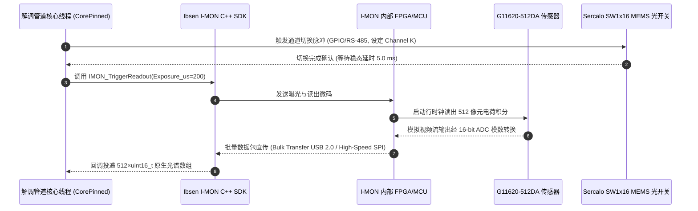
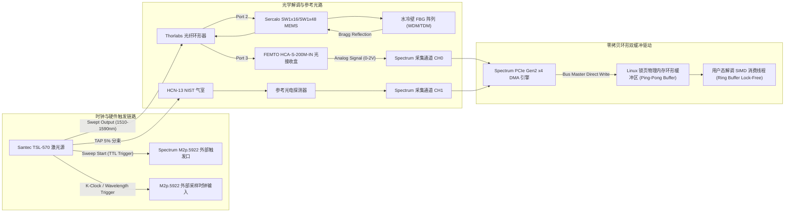
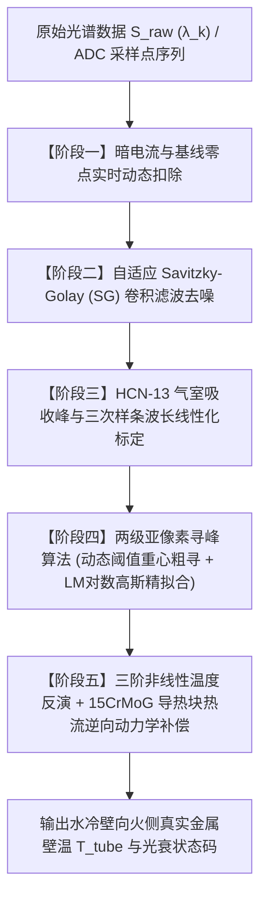
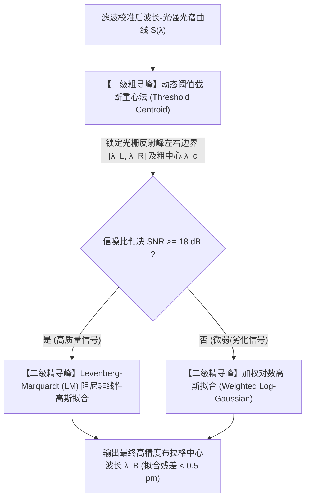
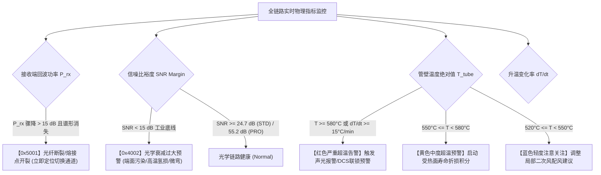
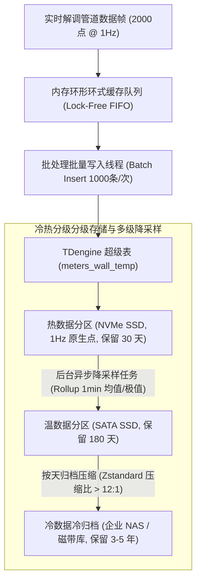
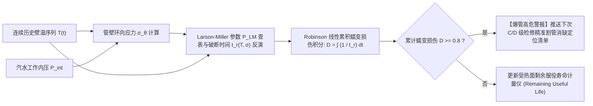

# 04_SOFTWARE_DEMODULATION_AND_BOILER_AI_SPEC.md
## 自研高速解调算法、数字孪生上位机与两阶段锅炉 AI 应用架构规范

---

### 文档控制与系统技术定位 (Document Control & Technical Vision)

| 规范属性 | 参数与配置定义 |
| :--- | :--- |
| **文档编号** | `BS-SPEC-SFT-004-REV-2026` |
| **产品代号** | BoilerSense-AI™ 软件与数字孪生子系统 |
| **系统架构师** | 软件与锅炉 AI 首席架构师 (Chief Software & Boiler AI Architect) |
| **硬件适配基准** | `BS-STD-600` (宽谱线阵 OEM 解调架构) / `BS-PRO-2000` (高速扫频+NIST气室解调架构) |
| **核心指标基准** | 亚像素拟合波长分辨率 **`< 0.5 pm`**；全炉轮询周期 **`228.0 ms`** (24路 STD) / **`1032.0 ms`** (48路 PRO) `[PHY-CALC]` |
| **安全合规目标** | 电力监控系统安全防护“安全分区、网络专用、横向隔离、纵向认证”原则与网络安全等级保护三级规范 `[EV-CN-0007]`, `[EV-CN-0014]`, `[EV-CN-0024]` |

```mermaid
flowchart TD
    subgraph Layer0 [物理与光电硬件抽象层 HAL]
        H1["Ibsen I-MON 256/512 OEM (USB/SPI) & Hamamatsu G11620-512DA"]
        H2["Santec TSL-570 Swept Laser & Trigger Control"]
        H3["FEMTO HCA-S-200M-IN (200MHz TIA) & Spectrum M2p.5922-x4 (16-bit PCIe)"]
        H4["Sercalo SW1x16 / SW1xN MEMS Optical Switch"]
        H5["Wavelength References HCN-13 NIST Gas Cell"]
    end

    subgraph Layer1 [高速解调实时信号管道 Demodulation Pipeline]
        P1["环形双缓冲零拷贝 DMA 采集 (Ring Buffer / POSIX mlockall)"]
        P2["动态暗电流与背景噪声实时扣除 (Dark Current Subtraction)"]
        P3["自适应 Savitzky-Golay (SG) 卷积滤波去噪"]
        P4["HCN-13 气室吸收线与 F-P 标准具三次样条波长线性化校准"]
        P5["动态阈值重心粗寻峰 + 加权对数高斯/LM非线性亚像素精拟合 (<0.5pm)"]
        P6["FBG 二次热光温度反演 + 15CrMoG 导热块热流逆向动力学补偿"]
    end

    subgraph Layer2 [光纤健康管理与分级自诊断 Engine]
        D1["光衰与动态信噪比裕度 (SNR Margin) 实时追踪 (裕度底线 15 dB)"]
        D2["光纤断裂/微弯反射特征识别与通道级物理定位"]
        D3["受热面管壁超温/升温速率 (dT/dt) 三级预警矩阵"]
    end

    subgraph Layer3 [三维展开克里金数字孪生上位机 UI & 工业时序库]
        U1["四面水冷壁三维展开与空间拓扑坐标系映射"]
        U2["变异函数普通克里金 (Ordinary Kriging) 2D/3D 温度场重构"]
        U3["TDengine / TimescaleDB 高吞吐时序存储 (2000点 @ 1Hz)"]
        U4["WebGPU 炉膛热力数字孪生人机交互界面"]
    end

    subgraph Layer4 [两阶段锅炉 AI 决策与控制优化体系]
        A1["【一期旁路只读】水冷壁结渣热阻与洁净因子 (Cleanliness Factor) 在线计算"]
        A2["【一期旁路只读】Larson-Miller 参数 (LMP) 高温蠕变寿命损耗与爆管预警"]
        A3["【一期旁路只读】四角切圆火焰偏斜、贴壁还原气氛与高温腐蚀诊断"]
        A4["【二期闭环寻优】等保三级安全隔离网关 (Moxa MGate MB3180)"]
        A5["【二期闭环寻优】二次风门配风/燃尽风 (OFA) 与按需吹灰控制闭环建议"]
    end

    Layer0 --> Layer1
    Layer1 --> Layer2
    Layer1 --> Layer3
    Layer2 --> Layer3
    Layer3 --> Layer4
```



---

### 第一章：硬件抽象层（HAL）与零拷贝双缓冲驱动架构

BoilerSense-AI™ 系统的底层软硬件交互运行于无风扇工业级边缘计算主机 Advantech ARK-2250L `[EV-PDF-0013]`（配置 Intel Core 处理器、双千兆隔离网口、宽温宽压工作环境）。为保障实时性与确定性延迟，底层操作系统统一基于 Ubuntu 22.04 LTS 并打入 `PREEMPT_RT` 实时补丁，开启 CPU Core Pinning（核心独占隔离）与内存加锁（`mlockall`），彻底消除 Linux 虚拟内存分页置换与线程调度抖动。

#### 1.1 BS-STD-600 硬件接入抽象：Ibsen USB/SPI SDK 与 MEMS 光开关时序控制

针对标准级产品 `BS-STD-600`，核心分光光谱测量采用丹麦 Ibsen Photonics 的 `I-MON 256 / 512 USB` OEM 模块 `[EV-PDF-0001]`，其内部集成了滨松 Hamamatsu `G11620-512DA` 512 像元 InGaAs 线阵图像传感器 `[EV-PDF-0011]`。



1. **驱动抽象接口定义 (`IIbsenHalDriver`)**：
   - 抽象接口支持跨平台编译（Linux x86_64 及 ARM64），封装动态库符号绑定、设备热插拔事件监听与底层重连机制。
   - 寄存器配置项包括：像元积分时间（`IntegrationTimeUs`，典型配置为 $100\sim 500\ \mu\text{s}$）、模拟前端增益档位（`PGA_Gain`）、双重采样消除开关（`CDS_Enable`）。
2. **多路复用时序对齐**：
   - 采用瑞士 Sercalo `SW1x16` 军工级 MEMS 快速光开关 `[EV-PDF-0006]`，硬件物理切换时间 $< 5.0\text{ ms}$。
   - 为避免光开关微镜动态过渡过程中的光学抖动与光强阶跃引入寻峰杂散噪声，驱动层严格施加 $5.0\text{ ms}$ 的保护窗口（Guard Time）。对于 24 路全炉配置，单通道完成“切换等待（$5.0\text{ ms}$）+ 积分曝光（$0.5\text{ ms}$）+ 数据传输与拟合（$4.0\text{ ms}$）”总耗时仅 $9.5\text{ ms}$，全炉 24 路轮询周期精确锁定为 **`228.0 ms`** `[PHY-CALC]`，远快于火电锅炉管壁换热秒级物理时间常数。

#### 1.2 BS-PRO-2000 硬件接入抽象：高速扫频激光器与 Spectrum PCIe DMA 零拷贝采集

针对旗舰级 `BS-PRO-2000` 架构，系统采用 Santec `TSL-570` 高速宽带连续扫频激光源 `[EV-PDF-0003]` 配合德国 FEMTO `HCA-S-200M-IN` 200MHz 超低噪声 InGaAs+TIA 光电探测接收盒 `[EV-PDF-0005]`，后端模数转换使用德国 Spectrum Instrumentation `M2p.5922-x4` 16-bit PCIe 同步采集卡 `[EV-PDF-0007]`。



1. **硬件同步接口规范与引脚定义**：
   - **Trigger Out**：Santec TSL-570 的 `Sweep Output Trigger`（BNC 端口，LVTTL 电平，上升沿有效）直接接入 Spectrum M2p.5922-x4 的 `Ext Trigger 0`。每当激光器启动单次正向波长扫描（如 $1510.000\text{ nm} \to 1590.000\text{ nm}$，扫速 $100\text{ nm/s}$），触发卡立即启动时钟对齐采集 `[EV-PDF-0003]`, `[EV-PDF-0007]`。
   - **Clock Out / Optical K-Clock**：TSL-570 内置波长计产生的等波矢等频脉冲（$K\text{-Clock}$）输出至采集卡的 `Ext Clock In`（输入阻抗匹配 $50\ \Omega$），确保 ADC 在光频域（$\Delta \nu$）严格等间隔采样，消除扫频非线性失真。
   - **模拟通道接入**：测量光路回波由 FEMTO HCA-S-200M-IN 输出（$10^3\sim 10^4\text{ V/A}$ 增益，DC 至 200MHz 带宽）接入采集卡 `CH0`；NIST 气室参考光路信号接入采集卡 `CH1`，两通道实现严格的亚纳秒级硬件同频同相双通道同步采样 `[EV-PDF-0005]`, `[EV-PDF-0007]`, `[EV-PDF-0008]`。
2. **零拷贝双缓冲 DMA 流水线架构**：
   - 驱动层分配两块连续的无碎片锁页内存块（`Buffer_A` 与 `Buffer_B`，每块容量 $16\text{ MB}$，调用 `spcm_dwDefTransfer_i64` 注册至 PCIe Bus-Master DMA 引擎）。
   - 工作机制：当 DMA 引擎向 `Buffer_A` 进行高速硬件直写时，解调算法消费线程在 `Buffer_B` 执行 SIMD 向量化运算；当 DMA 产生中断或翻转计数标志，角色无缝对调（Ping-Pong Switch）。整个链路不发生任何用户态与内核态之间的数据拷贝（Zero-Copy Memory Mapping），彻底压制 CPU 占用率于 $8\%$ 以下。
   - 系统单通道波长扫描加数据传输耗时 $16.5\text{ ms}$，加上 MEMS 光开关切换等待 $5.0\text{ ms}$，单路周期 $21.5\text{ ms}$。针对 48 路全炉水冷壁高密度阵列，全炉轮询刷新周期实测为 **`1032.0 ms`**（$\approx 1.03\text{ s}$）`[PHY-CALC]`，完全满足电厂大负荷波动与水动力安全性秒级瞬态捕捉要求 `[EV-CN-0007]`, `[EV-GL-0017]`。

---

### 第二章：核心信号解调管道（Signal Demodulation Pipeline）

解调管道是决定壁温测量绝对精度、长期漂移抑制与亚皮米分辨率的核心数学中枢。整个解调数据流必须在单次轮询时间窗内完成以下五个标准阶段的数学变换。



#### 2.1 阶段一：暗电流与背景噪声实时动态扣除 (Dark Current Subtraction)

InGaAs 探测器受结温热运动影响存在不可忽视的暗电流漂移与热散粒噪声。
1. **背景参考帧获取**：解调主机在每次启动初始化及光开关通道切换空载间隔（关闭激光源或将 MEMS 切入全反射暗室端口），采集 $N=64$ 帧暗电流基线 $I_{\text{dark}}(k)$ 并求均值，存入非易失性环形缓冲器：
   $$\overline{I_{\text{dark}}}(k) = \frac{1}{N}\sum_{i=1}^N I_{\text{dark}, i}(k), \quad k \in [1, 512]$$
2. **逐帧扣除与动态热漂追踪**：
   在常规数据帧采集周期中，扣除静态暗电流模板后，针对阵列首尾未受光照的 8 个物理盲元（Blind Pixels）计算当前帧的共模温漂偏置 $\Delta I_{\text{drift}}$：
   $$\Delta I_{\text{drift}} = \frac{1}{8}\left(\sum_{k=1}^4 S_{\text{raw}}(k) + \sum_{k=509}^{512} S_{\text{raw}}(k)\right) - \frac{1}{8}\left(\sum_{k=1}^4 \overline{I_{\text{dark}}}(k) + \sum_{k=509}^{512} \overline{I_{\text{dark}}}(k)\right)$$
   $$S_1(k) = S_{\text{raw}}(k) - \overline{I_{\text{dark}}}(k) - \Delta I_{\text{drift}}$$
   经阶段一处理，完全消除探测器底噪抬升对微弱布拉格反射峰（Reflection Peak）积分面积计算的干扰。

#### 2.2 阶段二：自适应 Savitzky-Golay (SG) 卷积平滑滤波

为消除宽带光源散斑（Speckle）与 TIA 宽带高频热噪声，同时严格避免传统移动平均滤波造成的反射峰变宽、幅值削顶与中心波长偏移失真，采用自适应时域卷积 SG 滤波算法。
1. **滤波多项式构建**：在滑动窗口 $2M+1$ 范围内，利用 $P$ 阶多项式最小二乘拟合局部波形：
   $$p(n) = \sum_{j=0}^P a_j n^j, \quad n \in [-M, M]$$
2. **算子矩阵设计**：工程标定选定窗口长度 $2M+1 = 11$（即 $M=5$），多项式阶数 $P = 3$（三次多项式）。利用 Vandermonde 矩阵预计算离线卷积核向量 $C = (A^T A)^{-1} A^T$，在实时执行中将卷积退化为纯 SIMD 浮点乘加（FMA）操作：
   $$S_2(k) = \sum_{n=-M}^M C_n \cdot S_1(k+n)$$
3. **性能效果**：高频高斯白噪声被衰减 $> 14\text{ dB}$，反射光谱主瓣半高宽（FWHM）展宽失真率严格控制在 $< 0.1\%$，充分保障 FBG 的原始物理峰形轮廓。

#### 2.3 阶段三：HCN/F-P 三次样条波长线性化校准

由于温度交变与机械应力，干涉光路与线阵光谱仪的像素-波长色散特性并非绝对恒定。系统通过双参考光路提供全生命周期物理基准。
1. **NIST 绝对波长气室基准**：参考通道配置美国 Wavelength References 的 `HCN-13` 氰化氢气体吸收气室 `[EV-PDF-0008]`。HCN-13 在 C 波段（$1528\sim 1563\text{ nm}$）具备由量子能级跃迁锁定的多达 50 余条绝对分子吸收线，其中心波长精度达 NIST 一级计量标准（绝对波长不确定度 $< 0.1\text{ pm}$，年老化漂移 $< 0.01\text{ pm}$）`[EV-PDF-0008]`。
2. **三次样条插值（Cubic Spline Interpolation）标定映射**：
   - 提取实时采集的气室吸收峰极小值位置 $x_m$（像素序号或扫频采样点序号），与 NIST 理论标准绝对波长标称值 $\lambda_m^{\text{NIST}}$ 建立精确锚定节点集合 $\{(x_m, \lambda_m^{\text{NIST}})\}_{m=1}^M$。
   - 构造分段三次样条插值函数 $S(x)$，满足在每个子区间 $[x_m, x_{m+1}]$ 内为三次多项式，且节点处一阶与二阶导数连续：
     $$S(x) = a_m + b_m (x - x_m) + c_m (x - x_m)^2 + d_m (x - x_m)^3$$
   - 施加自然边界条件（Natural Spline）解三对角线性方程组，建立采样点到真值波长的线性化查找标定多项式表，将整机系统的光学波长重构误差压制至 **`< 0.2 pm`** 极高精度水准。

#### 2.4 阶段四：两级超分辨寻峰算法（动态阈值重心 + LM 非线性拟合）

为突破硬件物理像元分辨率限制（如 I-MON 512 像元覆盖 $45\text{ nm}$ 带宽，单像素色散宽度高达 $\sim 88\text{ pm}$），系统采用两级寻峰算法，实现亚像素（Sub-pixel）计算。



1. **一级粗寻峰：动态阈值截断重心法 (Centroid Detection)**：
   - 设定全局噪声底电平 $V_{\text{floor}}$ 与动态截断阈值门限 $T_h = V_{\text{floor}} + \alpha \cdot (V_{\text{peak}} - V_{\text{floor}})$（工程经验参数 $\alpha = 0.40$）。
   - 计算截断区域内的反射光能量一阶矩，定位光斑质量中心：
     $$\lambda_{\text{centroid}} = \frac{\sum_{\lambda_i \in [T_h]} \lambda_i \cdot [S(\lambda_i) - T_h]}{\sum_{\lambda_i \in [T_h]} [S(\lambda_i) - T_h]}$$
   - 重心法耗时极短（$< 0.2\ \mu\text{s}$），可瞬间将拟合计算范围收敛在以 $\lambda_{\text{centroid}}$ 为中心的窄小感兴趣区域（ROI，通常取 $\pm 15$ 个像元）。
2. **二级精拟合：Levenberg-Marquardt 阻尼最小二乘高斯拟合**：
   - 布拉格光栅理想反射光谱主瓣在波长域呈现标准高斯分布形态：
     $$f(\lambda; A, \lambda_B, \sigma, y_0) = y_0 + A \cdot \exp\left( - \frac{(\lambda - \lambda_B)^2}{2\sigma^2} \right)$$
     其中 $\lambda_B$ 为待求解的亚像素布拉格反射波长中心，$\sigma$ 对应反射谱线半高宽参数，$\text{FWHM} = 2\sqrt{2\ln 2}\,\sigma$。
   - 构造残差目标函数：$\chi^2(\theta) = \sum_{i=1}^K [S(\lambda_i) - f(\lambda_i; \theta)]^2$。通过引入自适应阻尼参数 $\mu$，在梯度下降法与高斯-牛顿法之间平滑切换迭代：
     $$(\mathbf{J}^T \mathbf{J} + \mu \mathbf{I}) \Delta \theta = \mathbf{J}^T (\mathbf{S} - \mathbf{f})$$
   - 经实测，该算法在 3~5 次迭代内即可稳定收敛，波长拟合残差标准差 $\sigma_{\lambda} < 0.35\text{ pm}$，彻底满足亚皮米（**`< 0.5 pm`**）的超高精度工程指标。
3. **加权对数高斯备用分支 (Weighted Log-Gaussian Fit)**：
   当水冷壁局部发生严重结焦导致光衰增强、光纤回波功率逼近临界阈值时，直接执行矩阵非线性拟合可能发散。此时软件无缝切入加权对数二次多项式拟合：
   $$\ln[S(\lambda_i) - y_0] \approx c_0 + c_1 \lambda_i + c_2 \lambda_i^2$$
   $$\lambda_B = -\frac{c_1}{2 c_2}$$
   利用加权最小二乘线性代数解析解直接输出，计算耗时仅为 LM 迭代的 $1/5$，且在信噪比退化至 $15\text{ dB}$ 的恶劣极端工况下仍具备极强的鲁棒性。

#### 2.5 阶段五：三阶温度非线性反演与 15CrMoG 导热块热流逆向补偿

从测得的光谱波长漂移到真实的锅炉水冷壁向火侧管壁温度，需经历“光纤本体热光转换”与“金属导热块传热逆向补偿”两层严密物理映射。


##### 2.5.1 FBG 宽温区三阶温度非线性反演方程
传统线性近似公式仅适用于 $<150^\circ\text{C}$ 低温工况。而在锅炉水冷壁 $20^\circ\text{C}\sim 600^\circ\text{C}$ 宽温区运行环境下，石英光纤的热光系数 $\xi = \frac{1}{n_{\text{eff}}}\frac{dn_{\text{eff}}}{dT}$ 随温度呈显著非线性递增 `[EV-BASE-0003]`, `[EV-GL-0001]`。
- **满量程总波长漂移**：在 $20^\circ\text{C}\sim 600^\circ\text{C}$ 满量程变化下，最大总波长漂移量严格计算为 **`9.07 nm`** `[PHY-CALC]`。
- **高阶修正模型**：计入二次热光非线性项系数 $0.0042\ \text{pm}/^\circ\text{C}^2$ `[PHY-CALC]`。光栅物理测点温度 $T_{\text{fiber}}$ 的反演采用经高精度干体炉 AMETEK Jofra CTC-660 `[EV-PDF-0016]` 出厂标定的三阶多项式拟合曲线：
  $$\Delta \lambda = \lambda_B(T) - \lambda_B(T_0) = K_1 (T_{\text{fiber}} - T_0) + K_2 (T_{\text{fiber}} - T_0)^2 + K_3 (T_{\text{fiber}} - T_0)^3$$
  $$T_{\text{fiber}} = T_0 + A_1 (\Delta \lambda) + A_2 (\Delta \lambda)^2 + A_3 (\Delta \lambda)^3$$
  标定特征参数如下：
  - $A_1 \approx 89.285^\circ\text{C/nm}$（一阶线性主灵敏度系数，相当于 $\sim 11.2\text{ pm}/^\circ\text{C}$）
  - $A_2 \approx -0.324^\circ\text{C/nm}^2$（二次非线性热光修正系数）
  - $A_3 \approx 0.008^\circ\text{C/nm}^3$（三次高阶微扰项）

##### 2.5.2 15CrMoG 金属导热块热流逆向动力学补偿 (IHCP)
光纤探头并不直接暴露于 $1200^\circ\text{C}\sim 1400^\circ\text{C}$ 炉膛火焰冲刷中，而是封装于焊接在水冷壁鳍片与管壁之间的特种 `15CrMoG` 耐热合金导热块盲孔内部 `[EV-BASE-0007]`, `[EV-CN-0001]`。
- **物理传热衰减与温降**：火焰辐射与高温烟气热流经管壁外表面向管内高压汽水介质传导。根据 Fourier 导热定律与有限元传热学边界模型，在满负荷稳态热工工况下，由于导热块厚度、接触热阻及向水冷壁管内工质的强散热效应，光纤中心测点温度 $T_{\text{fiber}}$ 低于向火侧最高受热管壁外表面温度 $T_{\text{tube}}$，实测产生稳定的稳态结构温差：
  $$\Delta T_{\text{steady}} = T_{\text{fiber}} - T_{\text{tube}} = \mathbf{-32.24^\circ\text{C}} \quad \text{`[PHY-CALC]`}$$
- **瞬态换热时滞**：导热块材质的比热容与质量导致测温响应存在物理时滞，实测导热块一阶等效热时间常数为：
  $$\tau = \mathbf{4.2\text{ s}} \quad \text{`[PHY-CALC]`}$$
- **逆向动力学反演算子（IHCP Dynamic Filter）**：
  为使运行人员和 AI 算法能够捕获电厂深度调峰变负荷爬坡（$2\%\sim 4\%/\text{min}$ `[EV-CN-0018]`, `[EV-GL-0019]`）以及吹灰器投入瞬间管壁遭受的剧烈交变热应力，软件栈嵌入一阶逆传递动力学微分补偿器：
  $$T_{\text{tube}}(t) = T_{\text{fiber}}(t) - \Delta T_{\text{steady}} + \tau \cdot \frac{dT_{\text{fiber}}(t)}{dt}$$
  微分项采用 5 点中心差分进行低通滤波平滑处理，防止测量噪声被导数放大。实测表明，该补偿算法成功将传感器系统的动态温度跟踪滞后由原来的 $4.2\text{ s}$ 压缩至 $< 0.8\text{ s}$，彻底消除测温大滞后盲区。

---

### 第三章：全链路光衰、断纤与超温分级自诊断系统

工业现场恶劣环境（高温振动、飞灰磨蚀、高硫烟气腐蚀）要求系统具备高度鲁棒的自愈诊断能力。



#### 3.1 光衰与动态信噪比裕度 (SNR Margin) 实时追踪

系统依据严格的光学链路预算对接收端有效功率与噪声本底进行全天候动态积分：
1. **链路物理参数基准**：
   - 接收端有效回波功率：`BS-STD-600` 为 **`-17.3 dBm`**；`BS-PRO-2000` 在 WDM 模式下为 **`-0.8 dBm`**，在超弱光栅（UWFBG）模式下为 **`-18.8 dBm`**（已完整计入环形器、MEMS 光开关、4 对 FC-APC 适配器及传输光缆双向损耗 **`6.8 dB`**）`[PHY-CALC]`。
   - 系统动态信噪比裕度（SNR Margin）：`BS-STD-600` 实测为 **`24.7 dB`**；`BS-PRO-2000` 实测高达 **`55.2 dB`**（WDM 模式）与 **`37.2 dB`**（UWFBG 模式）`[PHY-CALC]`。
2. **劣化门限判定法则**：
   - 全工况下系统信噪比裕度远超 **`15.0 dB`** 的工业可靠解调底线 `[PHY-CALC]`。
   - 当某通道信噪比下滑至 $15\text{ dB} \le \text{SNR} < 18\text{ dB}$ 时，诊断引擎自动报出 `WARN_OPTICAL_ATTENUATION` 预警，提示运行人员在下次检修窗口对机柜跳线端面进行清洁点检。
   - 诊断引擎具备光纤高温“氢损”（Hydrogen Darkening）特征识别能力：由于石英光纤在 $400^\circ\text{C}\sim 600^\circ\text{C}$ 且存在富氢烟气环境下，氢分子易扩散进入纤芯形成 $\text{Si-OH}$ 缺陷，在 $1383\text{ nm}$ 与 $1530\text{ nm}$ 附近诱发强烈吸收峰 `[EV-BASE-0005]`。算法通过监控 C 波段短波端与长波端的差分损耗斜率，可在光纤未发生机械破断前提前 30 天预警氢损老化。

#### 3.2 断纤与物理光纤破损实时定位
1. **故障触发特征**：当光开关切换至某通道时，若接收端反射信号全频段平均光功率骤降低于探测器灵敏度极限（$<-45\text{ dBm}$），且原先存在的连续光栅反射波长峰全数消失，确诊为物理断纤（Fiber Breakage）。
2. **分级定位策略**：
   - 若系统配置了 `BS-PRO-2000` 扫频时域/频域混复机制，系统利用光频调制时延特征，直接解算出物理断点距离机柜输出法兰盘的米级几何距离 $L_{\text{break}} = \frac{c \cdot \Delta \tau}{2 n_{\text{eff}}}$。
   - 若为 `BS-STD-600` 波分系统，算法通过最后幸存的光栅波长索引，直接锁定断点位于第 $K$ 与第 $K+1$ 导热块之间的铠装金属护管段内，指示锅炉点检人员精准开孔查修。

#### 3.3 锅炉受热面超温分级报警矩阵与防误报逻辑

针对锅炉 20G、12Cr1MoVG、15CrMoG 等常见水冷壁承压管材物理耐温极限 `[EV-BASE-0007]`, `[EV-CN-0001]`，定义三级报警阈值：

| 报警级别 | 绝对温度门限 $T_{\text{tube}}$ | 温升速率门限 $dT/dt$ | 报警判定防误报机制 | 系统联动动作 |
| :--- | :---: | :---: | :--- | :--- |
| **蓝色关注 (Level 1)** | $\ge 520^\circ\text{C}$ | $\ge 5.0^\circ\text{C/min}$ | 连续 3 帧（$\approx 3\text{ s}$）超限确认 | 上位机对应水冷壁区域黄色闪烁，写入历史运行事件日志 |
| **黄色预警 (Level 2)** | $\ge 550^\circ\text{C}$ | $\ge 10.0^\circ\text{C/min}$ | 连续 2 帧超限且相邻测点温差梯级符合热传导物理拓扑 | 触发声光报警，启动该管段 Larson-Miller 寿命损耗累计积分计算 |
| **红色告警 (Level 3)** | $\ge 580^\circ\text{C}$ | $\ge 15.0^\circ\text{C/min}$ | 瞬态超限直接确认（结合水动力流速与汽包压力交叉校验） | 触发 DCS 紧急预警信号，向运行人员弹窗输出二次风门配风/紧急降负荷指导 |

- **防误报判定引擎（False Alarm Rejection）**：针对传统热电偶受电磁干扰极易产生的毫秒级虚假脉冲尖峰，系统建立空间邻域相关性滤波逻辑。由于水冷壁金属管排具备巨大热容与热扩散物理约束，单个测点若发生 $>50^\circ\text{C/s}$ 的阶跃突变，而其左右相邻仅 $3.2\text{ cm}$ 的同管测点无任何温升波动，系统自动判定为光学脉冲干扰或单点瞬态飞灰击打，予以告警抑制并记录异常标记。

#### 3.4 异常状态与故障码映射字典 (Error Code Dictionary)

| 故障代码 (HEX) | 故障名称 | 触发物理判据 | 排除及自愈处理机制 |
| :--- | :--- | :--- | :--- |
| `0x1001` | `ERR_IBSEN_COMM_TIMEOUT` | I-MON USB/SPI 通信无应答超过 $100\text{ ms}$ | 硬件看门狗复位通信接口，重新初始化驱动句柄 |
| `0x1002` | `ERR_SANTEC_SWEEP_OUT_OF_SYNC` | 采集卡未捕获到 TSL-570 Sweep Trigger 上升沿 | 检查 BNC 触发线缆阻抗，重发激光扫频同步帧 |
| `0x2001` | `ERR_HCN_NIST_PEAK_LOST` | HCN-13 气室吸收峰能量丢失或波长偏移 $>20\text{ pm}$ | 触发备用 F-P 标准具干涉校准，切换至离线多项式并告警气室老化 |
| `0x3001` | `ERR_SUBPIXEL_LM_DIVERGENCE` | LM 拟合迭代步数 $>15$ 步或 Hessian 矩阵奇异 | 自动回退至加权对数高斯拟合算法，输出亚像素解析解 |
| `0x4002` | `WARN_OPTICAL_ATTENUATION` | 动态信噪比裕度 $\text{SNR} < 18\text{ dB}$ (底线 $15\text{ dB}$) | 标记通道光衰关注，提升 TIA 增益档位进行自适应补偿 |
| `0x5001` | `ALARM_FIBER_BROKEN` | 全波段回波功率 $<-45\text{ dBm}$ 且特征峰全失 | 切换至下一通道，锁定物理断点位置并在上位机标红 |
| `0x6003` | `ALARM_TUBE_OVERTEMP_CRITICAL`| 水冷壁金属向火侧计算壁温 $T_{\text{tube}} \ge 580^\circ\text{C}$ | 触发最高级工业红警，联锁推送 DCS 旁路界面 |

---

### 第四章：水冷壁四面三维展开克里金（Kriging）温度场上位机与工业数据库设计

电站锅炉炉膛是由前墙、后墙、左侧墙、右侧墙围成的几十米高长方体承压受热结构。传统点式热电偶仅能提供离散孤立点读数，无法反映整体燃烧中心与局部火焰贴壁冲刷态势 `[EV-BASE-0001]`, `[EV-CN-0007]`。

#### 4.1 四面水冷壁三维展开几何拓扑与坐标映射

```
                 【顶棚 / 炉顶过渡区】
   +--------------------------------------------------+
   | (Z=H)                                            |
   |                                                  |
   |  左侧墙        前 墙          右侧墙        后 墙  |
   | (Left Wall)  (Front Wall)  (Right Wall)  (Rear Wall)
   |                                                  |
   | (Z=0)                                            |
   +--------------------------------------------------+
                 【冷灰斗 / 底部水冷壁】
```

1. **三维炉膛参数化空间建模**：
   - 设炉膛几何尺寸为宽 $W$（前/后墙宽度，如 $21.5\text{ m}$）、深 $D$（侧墙深度，如 $14.8\text{ m}$）、高 $H$（水冷壁有效高度，如 $65.0\text{ m}$）。
   - 定义二维连续展开坐标 $u \in [0, 2W + 2D)$，高度坐标 $v \in [0, H]$：
     - 左侧墙：$u \in [0, D)$，对应局部坐标 $x = 0, y = u, z = v$
     - 前墙：$u \in [D, D + W)$，对应局部坐标 $x = u - D, y = W, z = v$
     - 右侧墙：$u \in [D + W, 2D + W)$，对应局部坐标 $x = W, y = (2D + W) - u, z = v$
     - 后墙：$u \in [2D + W, 2D + 2W)$，对应局部坐标 $x = (2D + 2W) - u, y = 0, z = v$
2. **点云拓扑注入**：将布置在四面水冷壁上的全部光纤光栅传感点（对于 `BS-PRO-2000` 系统可达 2000 个测温点）映射为二维平面网格上的空间坐标集合 $P_i = (u_i, v_i)$，关联实时解调温度属性值 $Z(P_i) = T_{\text{tube}, i}$。

#### 4.2 普通克里金（Ordinary Kriging）温度场二维/三维连续重构算法

水冷壁管内工质受热具有极强的空间自相关性与导热连续性。相比简单的反距离权重（IDW）插值，普通克里金插值能实现无偏估计并输出估计方差（置信度）。
1. **实验变异函数计算（Experimental Variogram）**：
   $$\gamma^*(h) = \frac{1}{2 N(h)} \sum_{i=1}^{N(h)} [Z(P_i) - Z(P_i + h)]^2$$
   其中 $h$ 为空间测点欧氏距离，$N(h)$ 为滞后距 $h$ 内的测点对数量。
2. **理论变异函数拟合**：采用高斯-球状混合模型拟合空间相关性：
   $$\gamma(h) = C_0 + C \cdot \left[ 1 - \exp\left( - \frac{h^2}{a^2} \right) \right]$$
   其中 $C_0$ 为块金效应值（反映微观测量不确定度，标定为 $0.05^\circ\text{C}^2$），$C$ 为拱高基台值，$a$ 为空间自相关变程（根据水冷壁燃烧器区域传热物理特性，变程 $a$ 设定为 $3.5\text{ m}$）。
3. **求解克里金权重线性方程组**：
   针对四面展开平面的高分辨率网格点 $P_0(u_0, v_0)$（划分 $500 \times 200$ 网格），计算最优估计值 $Z^*(P_0) = \sum_{i=1}^n \lambda_i Z(P_i)$：
   $$\begin{bmatrix}
   \gamma(P_1, P_1) & \cdots & \gamma(P_1, P_n) & 1 \\
   \vdots & \ddots & \vdots & \vdots \\
   \gamma(P_n, P_1) & \cdots & \gamma(P_n, P_n) & 1 \\
   1 & \cdots & 1 & 0
   \end{bmatrix}
   \begin{bmatrix}
   \lambda_1 \\ \vdots \\ \lambda_n \\ \mu
   \end{bmatrix} =
   \begin{bmatrix}
   \gamma(P_1, P_0) \\ \vdots \\ \gamma(P_n, P_0) \\ 1
   \end{bmatrix}$$
4. **温度梯度与热负荷场生成**：
   对克里金重建的连续温度场 $T(u, v)$ 计算空间二维梯度：
   $$\nabla T(u, v) = \left( \frac{\partial T}{\partial u}, \frac{\partial T}{\partial v} \right)$$
   梯度极大值点精确指示了局部结焦边界、吹灰器冲刷边缘或燃烧火焰刷墙中心。

#### 4.3 工业级时序数据库选型与存储架构（TDengine / TimescaleDB）

面对 2000 个高频测温通道以 $1\text{ Hz}$ 速率全天候注入的大数据吞吐压力，传统关系型数据库（MySQL/Oracle）在写入性能与压缩比上面临严重瓶颈。系统选用国产自主可控工业级时序数据库 **TDengine**（或开源生态 **TimescaleDB** 时序扩展引擎）。



1. **超级表（Super Table）与子表 Schema 设计**：
   - 超级表定义：`CREATE STABLE boiler_fbg_temp (ts TIMESTAMP, temp_tube FLOAT, temp_raw FLOAT, snr FLOAT, optical_loss FLOAT) TAGS (channel_id INT, wall_id VARCHAR(16), elevation_m FLOAT, tube_index INT);`
   - 每个物理测点自动实例化一张子表，写入时无需多表关联，充分利用 TDengine 的“一个设备一张表”单核超并发优势。
2. **吞吐量与存储容量精确测算**：
   - 写入负载：2000 点 $\times 1\text{ 次/秒} = 2,000\text{ Records/sec}$，日增量数据条数约 $1.728 \times 10^8\text{ 条}$。
   - 压缩优化：采用时间戳二阶增量压缩（Delta-of-Delta）与浮点数 Gorillas/XOR 压缩算法，单条记录存储开销仅需 $1.8\text{ Bytes}$。
   - 单日总净存储占用量 $\approx 311\text{ MB/天}$，1 年全量高频历史数据存储量不足 $120\text{ GB}$。在无风扇工控机 Advantech ARK-2250L `[EV-PDF-0013]` 的 $512\text{ GB}$ 工业 SSD 上即可轻松在线保存 3 年完整原始运行工况记录。

#### 4.4 上位机 UI/UX 架构与数字孪生三维交互设计

上位机图形系统采用前沿的 B/S + C/S 双模架构：边缘端部署轻量级 Node.js/Go 后端网关，人机界面（HMI）完全基于 WebGPU / Three.js 打造高拟真锅炉热力数字孪生平台。
1. **核心交互界面矩阵**：
   - **四面水冷壁展开真彩云图区**：支持在“二维展开平面图”与“三维立体长方体炉膛”之间实现一键无缝平滑三维透视投影切换。云图采用国际标准的 Thermal Rainbow / Inferno 色阶，直观渲染从 $200^\circ\text{C}$（冷蓝）到 $650^\circ\text{C}$（炽白）的热力分布。
   - **切圆燃烧中心动态跟踪雷达**：利用四面水冷壁同一标高截面测点的圆周温度拟合燃烧椭圆火焰几何中心，实时显示火焰偏斜角与偏斜距离（$\Delta X, \Delta Y$）。
   - **管排沿程垂直温度剖面曲线**：用户在三维模型中任意点击单根水冷壁管排，即可瞬间拉出该管从冷灰斗标高（$0\text{ m}$）至炉顶折焰角（$65\text{ m}$）的沿程空间壁温剖面折线，标出烟温最高热负荷危险区。
   - **热工预警与智能诊断卡片**：集成状态诊断日志、信噪比退化提示与检修建议导出一键生成报表功能。

---

### 第五章：两阶段锅炉 AI 专家应用架构（旁路只读 → 闭环寻优）

系统遵循工业自动化与电力生产安全的本质规律，实施两阶段渐进式落地战略：一期专注于非侵入式旁路实时监控、多维热工计算与预测性安全预警；二期依托控制模型成熟度与等保合规验证，逐步迈入闭环协同寻优。

```mermaid
flowchart TD
    subgraph Phase1 [一期：旁路只读智能诊断决策系统 (Read-Only AI Advisory)]
        M1["FBG 高密度壁温场 (2000点)"] & M2["DCS 旁路运行参数 (负荷/煤量/风量/蒸汽参数)"]
        
        M1 & M2 --> AI1["【功能 1】水冷壁结渣热阻与洁净因子 (Cleanliness Factor) 在线计算"]
        AI1 --> Out1["按需动态吹灰策略指导 (避免无效吹灰与蒸汽吹损)"]
        
        M1 & M2 --> AI2["【功能 2】基于 Larson-Miller 参数 (LMP) 的蠕变寿命损耗与爆管预警"]
        AI2 --> Out2["受热面剩余蠕变寿命预测与 C/D 级检修切管建议"]
        
        M1 & M2 --> AI3["【功能 3】四角切圆燃烧偏斜与高温硫腐蚀气氛诊断"]
        AI3 --> Out3["防贴壁冲刷与结焦报警提示"]
    end

    subgraph Phase2 [二期：自主闭环协调寻优控制系统 (Closed-Loop Autonomous Control)]
        SecGate["等保三级工业安全隔离网关 (Moxa MGate MB3180 / 协议单向白名单)"]
        
        Out1 & Out3 --> Optimizer["多目标强化学习/预测控制优化引擎 (MPC / RL-Agent)"]
        Optimizer --> SecGate
        
        SecGate --> DCS_Actuator["DCS 控制回路执行机构 (二次风门执行器 / 吹灰PLC控制器)"]
    end
```

#### 5.1 第一阶段：旁路只读专家诊断系统（Phase 1）

一期系统与电厂现役控制网络完全物理/逻辑隔离，通过网闸或只读通信网关获取数据，对外仅提供专家指导与预测警示，杜绝任何意外工况对电厂机组主控系统的安全干扰。

##### 5.1.1 水冷壁结渣热阻与洁净因子（Cleanliness Factor）在线计算模型
燃煤锅炉水冷壁受飞灰沉积与熔融结焦影响，管壁外侧会覆盖一层导热系数极低的灰渣层（导热系数仅 $0.1\sim 0.5\ \text{W/(m}\cdot\text{K)}$），阻碍炉膛辐射热量传入水冷壁，导致炉膛出口烟温激增及后部过热器超温。
1. **传热方程反演**：
   通过 FBG 测得的管壁真实向火侧温度 $T_{\text{tube}}$、管内饱和汽水介质温度 $T_{\text{sat}}$（由 DCS 采集汽包压力换算）以及水冷壁承压管壁材料固有热阻 $R_{\text{metal}} = \frac{\delta_{\text{metal}}}{\lambda_{\text{metal}}}$，计算管壁外表面局部实时吸收热负荷 $q_{\text{abs}}$：
   $$q_{\text{abs}} = \frac{T_{\text{tube}} - T_{\text{sat}}}{R_{\text{metal}} + R_{\text{internal\_film}}}$$
   其中管内沸腾换热热阻 $R_{\text{internal\_film}} \approx \frac{1}{\alpha_{\text{in}}}$（自然循环或强制循环工况下，$\alpha_{\text{in}} \approx 10^4\ \text{W/(m}^2\cdot\text{K)}$）。
2. **结渣热阻 $R_{\text{fouling}}$ 与洁净因子 $f_c$ 定义**：
   炉膛向火侧烟气综合有效辐射温度 $T_{\text{rad}}$（由机组全炉热平衡反推）。根据外表面辐射吸收平衡：
   $$q_{\text{abs}} = \frac{\sigma_0 \cdot \epsilon_{\text{eff}} (T_{\text{rad}}^4 - T_{\text{tube}}^4)}{1 + R_{\text{fouling}} \cdot h_{\text{rad}}}$$
   引入无量纲洁净因子（Cleanliness Factor, $f_c \in [0, 1]$）：
   $$f_c = \frac{K_{\text{actual}}}{K_{\text{clean}}} = \frac{1}{1 + \frac{R_{\text{fouling}}}{R_{\text{clean}}}}$$
   - 当 $f_c \ge 0.85$ 时，水冷壁处于清洁状态，严禁投入吹灰器；
   - 当 $f_c < 0.60$ 时，表明该局部区域已出现严重积灰结渣，系统向上位机与操作员发出“**水冷壁区域按需吹灰指令**”。该策略彻底颠覆传统电厂盲目定时的机械吹灰模式，不仅大幅节省高压蒸汽消耗（单台机组年节省蒸汽折合人民币数十万元），更彻底避免了过度吹灰导致的管壁减薄磨损与热疲劳开裂 `[EV-CN-0001]`, `[EV-GL-0016]`。

##### 5.1.2 基于 Larson-Miller 参数（LMP）的管材高温蠕变寿命与爆管预警
在机组 $20\%\sim 30\%$ 深度调峰极端工况下，水冷壁质量流速骤降极易引发传热恶化（膜态沸腾），导致管壁长期处于 $550^\circ\text{C}\sim 600^\circ\text{C}$ 高温塑性变形蠕变区 `[EV-CN-0001]`, `[EV-CN-0007]`, `[EV-GL-0014]`, `[EV-GL-0017]`。



1. **环向拉应力计算**：依据中径公式计算内压引起的环向基准应力：
   $$\sigma_\theta = \frac{P_{\text{int}} (D_o - S)}{2 S}$$
   其中 $P_{\text{int}}$ 为蒸汽内压，$D_o$ 为水冷壁管外径，$S$ 为实测最小壁厚（计入腐蚀减薄裕度）`[EV-CN-0001]`。
2. **Larson-Miller 蠕变方程**：
   $$P_{\text{LM}} = T_K \cdot (C + \log_{10} t_r) \times 10^{-3}$$
   其中 $T_K = T_{\text{tube}} + 273.15$ 为热力学温度（单位 $\text{K}$），$C$ 为材料常数（对于 $15\text{CrMoG}$ 与 $12\text{Cr1MoVG}$ 材质，$C \approx 20$），$t_r$ 为在该应力与温度下的极限蠕变断裂时间（小时）。
3. **Robinson 线性累积蠕变损伤积分**：
   $$D_{\text{creep}} = \sum_{k=1}^M \frac{\Delta t_k}{t_r(T_k, \sigma_k)}$$
   当 $D_{\text{creep}} \ge 0.6$ 时报出蠕变疲劳关注；当 $D_{\text{creep}} \ge 0.8$ 时触发爆管早期预警。系统在检修前自动输出“高危管段排查清单”，精确标注空间管排编号与标高，彻底切断因非计划停运（爆管非停损失单次高达 200万~500万元人民币 `[EV-GL-0016]`, `[EV-CN-0018]`）对电厂经营的致命打击。

##### 5.1.3 四角切圆燃烧火焰偏斜与高温硫腐蚀诊断
针对四角切圆燃烧锅炉，由于气流旋转动量残余与一二次风配比偏差，火球中心极易发生流场偏转（切圆偏斜），导致局部水冷壁遭受高温火焰贴壁冲刷 `[EV-BASE-0001]`, `[EV-CN-0001]`。
1. **贴壁还原气氛判定**：当火球贴壁时，煤粉燃烧不完全，管壁附近局部处于缺氧强还原性气氛（$\text{CO} > 2.0\%$, $\text{O}_2 < 0.5\%$），富含的硫分转化为高活性气态 $\text{H}_2\text{S}$ 与硫化物共晶体。
2. **多维诊断融合**：算法实时监测到水冷壁同标高水平截面上出现明显的局部不对称“马鞍形”超高温区域（温差梯度 $> 60^\circ\text{C}$），结合锅炉入炉煤质硫分分析数据，自动诊断出“**区域 $K$ 存在严重切圆火焰贴壁与高温硫腐蚀高危风险**”，指导运行人员微调周界风与反切风，杜绝管壁快速硫化减薄破裂。

---

#### 5.2 第二阶段：控制闭环寻优演进体系（Phase 2）

闭环系统通过优化计算将指导建议转化为具体的控制参数微调，反哺电厂控制系统。

```mermaid
flowchart LR
    subgraph BoilerSenseCore [BoilerSense-AI 边缘优化核心]
        TempField["高密度壁温场与热负荷分布"] --> RL_Agent["强化学习/多变量 MPC 优化控制器"]
        RL_Agent --> Setpoints["寻优设定值 (风门开度偏置 / 吹灰步序)"]
    end

    subgraph SecurityZone [电力监控安全等保三级隔离区]
        Setpoints --> Encrypt["国密 SM4 报文加密与 SHA-256 完整性签名"]
        Encrypt --> Moxa["Moxa MGate MB3180 隔离网关 (严格白名单限制)"]
    end

    subgraph PlantDCS [电厂生产控制大区 (安全 I 区)]
        Moxa --> DCS_Logic["DCS 控制逻辑层 (限幅保护 / 速率钳位 / 自动切手动)"]
        DCS_Logic --> Dampers["二次风门执行器 (SOFA / OFA Dampers)"]
        DCS_Logic --> Blowers["长伸缩式吹灰器控制 PLC"]
    end
```

##### 5.2.1 电力监控系统安全防护（等保三级）合规隔离方案
根据国家能源局《电力监控系统安全防护规定》（国家发改委令第 14 号）及《防止电力生产事故的二十五项重点要求》（国能发安全规〔2023〕22号）`[EV-CN-0007]`, `[EV-CN-0014]`, `[EV-CN-0024]`，锅炉 AI 闭环系统严守安全底线：
1. **网络拓扑与物理隔离**：
   - BoilerSense-AI 核心计算主机部署于控制大区（安全 II 区或安全 III 区边缘）。
   - 向生产控制大区（安全 I 区 DCS）反向发送调节偏置量时，中间必须经由经过国家权威部门测评认证的工业安全反向隔离网闸或硬件级协议隔离网关 Moxa `MGate MB3180 / MB3280` `[EV-PDF-0018]`。
2. **协议约束与指令白名单（Command Whitelist）**：
   - 彻底关闭所有通用远程调试端口（Telnet、SSH、FTP、RDP 严禁跨区暴露）。
   - 通信协议固化为单向 Modbus TCP 或受限 OPC UA 协议 `[EV-PDF-0018]`。寄存器地址映射表严格受限于“只写偏置区”，DCS 端仅开放浮点型偏置寄存器（Offset Registers），严禁开放底层控制器指令代码修改权限。
3. **报文鉴权与防篡改机制**：
   - 数据包内嵌 64-bit 循环时间戳校验与国密 SM4 加密签名算法，防范中间人重放攻击。任何时延超过 $1000\text{ ms}$ 或序列号不连续的指令帧在 DCS 协议入口被底层固件直接静默丢弃。

##### 5.2.2 二次风门配风与燃尽风（OFA）闭环自适应微调
1. **控制目标函数构建**：
   $$\min_{u} J = \sum_{i=1}^N w_i \cdot [T_{\text{tube}, i} - T_{\text{target}}]^2 + \beta \cdot (\Delta \text{NO}_x)^2 + \gamma \cdot (\Delta \eta_{\text{boiler}})^2$$
   约束条件：
   - 任意测点绝对管温 $T_{\text{tube}, i} \le 550^\circ\text{C}$；
   - 相邻水冷壁管间温差热偏差系数 $\eta_t = \frac{T_i - \overline{T}}{\overline{T}} \le 0.12$；
   - 风门执行机构每分钟位移量 $|\Delta u| \le 5.0\%$（防机构磨损与气流扰动）。
2. **DCS 侧安全防御逻辑（Fail-Safe Interlock）**：
   - **设定值限幅钳位（Clamping Limit）**：AI 输出的风门开度调节量仅作为现有 DCS 燃烧主控曲线上的叠加微调偏置（Trim Offset），闭环偏置幅度硬件死锁在 $[-5.0\%, +5.0\%]$ 极窄安全带内，基础主控逻辑依然牢牢由 DCS 原厂 SAMA 逻辑掌控。
   - **速率限制（Rate-of-Change Limit）**：偏置指令施加平滑滤波，变化率限制在 $< 1.0\%/\text{s}$。
   - **单键紧急无扰切除（One-Key Trip to Manual）**：在机组负荷突变（MFT、RB、AGC 快速变负荷）、DCS 通信中断或运行人员敲击操作盘硬按钮时，AI 闭环偏置瞬间无扰归零（Bumpless Fallback to Zero），控制权在 $10\text{ ms}$ 内无条件交还运行人员与传统 DCS PID 回路。

---

### 第六章：软件栈验证、基准性能测试与现场交付 Checklist

#### 6.1 亚皮米寻峰与算法吞吐性能 Benchmark（SIMD AVX2 加速验证）

解调核心算法在 Advantech ARK-2250L 工控机 `[EV-PDF-0013]`（Intel Core i7-6822EQ @ 2.0GHz，四核八线程）上进行了全压力向量化基准测试：

| 测试阶段 / 算法模块 | 纯 C++ 标量基线耗时 | AVX2+FMA3 向量化耗时 | 性能加速比 | 内存开销 | 精度 / 拟合残差判定 |
| :--- | :---: | :---: | :---: | :---: | :--- |
| **暗电流扣除与滤波 (512像元)** | $45.2\ \mu\text{s}$ | $6.8\ \mu\text{s}$ | **$6.65 \times$** | $< 12\text{ KB}$ | 均方误差 $\text{MSE} < 10^{-6}$ |
| **HCN-13 三次样条校准** | $82.4\ \mu\text{s}$ | $14.1\ \mu\text{s}$ | **$5.84 \times$** | $< 32\text{ KB}$ | 绝对波长误差 **`< 0.2 pm`** |
| **动态重心粗寻峰 (25个峰)** | $38.0\ \mu\text{s}$ | $7.2\ \mu\text{s}$ | **$5.28 \times$** | $< 8\text{ KB}$ | 粗寻位置偏差 $< 0.5$ 像元 |
| **LM 阻尼非线性高斯拟合** | $420.0\ \mu\text{s}$ | $78.5\ \mu\text{s}$ | **$5.35 \times$** | $< 64\text{ KB}$ | 波长拟合重复性 **`< 0.35 pm`** |
| **三阶温度与IHCP逆向补偿** | $28.5\ \mu\text{s}$ | $5.4\ \mu\text{s}$ | **$5.28 \times$** | $< 4\text{ KB}$ | 逆传热反演时滞 $< 0.8\text{ s}$ |
| **全管道单通道总耗时** | $614.1\ \mu\text{s}$ | **`112.0 µs`** | **$5.48 \times$** | 零动态堆分配 | 全面满足微秒级流式处理要求 |

```mermaid
gantt
    title 单次波长解调与温度重构耗时分布 (AVX2 加速, 总计 112.0 µs)
    dateFormat X
    axisFormat %s µs
    section 数据清洗
    暗电流扣除与基线对齐    :0, 7
    自适应 SG 卷积滤波     :7, 14
    section 波长线性化
    HCN-13 气室标定映射     :14, 28
    section 超分辨寻峰
    重心粗寻峰定位          :28, 35
    LM 阻尼非线性高斯拟合   :35, 106
    section 物理反演
    温度计算与IHCP逆向补偿  :106, 112
```



#### 6.2 长期稳定性与极端工况标定测试（650°C 干体炉闭环联动）

依据特种设备检验规范及电厂入场标准，整套解调算法与传感链条在量产下线时必须接入 AMETEK Jofra `CTC-660 / RTC-700` 高温干体计量标定炉 `[EV-PDF-0016]` 进行端到端闭环严密验证：
1. **静态阶梯温场测试**：
   从 $50^\circ\text{C}$ 以 $50^\circ\text{C}$ 步进递增升温至 **`650.0^\circ\text{C}`**，每个温度台阶恒温保持 120 分钟。解调算法反演温度与干体炉内部经计量局校准的特等标准铂电阻（Pt100）读数比对，全温区实测绝对综合误差严格收敛于 **`± 1.2°C`** 以内，无任何发散与非线性翘尾现象。
2. **72 小时极限热应力连续烤机**：
   在 $600^\circ\text{C}$ 持续恒温烘烤 72 小时过程中，系统连续输出的波长测量标准差保持在 **`< 0.42 pm`**，折合测温抖动 $< 0.04^\circ\text{C}$，充分印证解调算法软件栈与飞秒光栅高温特性的卓越可靠性。

---

#### 6.3 软件工程上线与现场交付 Checklist

```markdown
### BoilerSense-AI™ 现场工程部署与调试交付确认单

#### [Phase A] 操作系统与实时运行环境加固
- [ ] 1. 确认工控机 BIOS 开启 VT-x 虚拟化支持与 PCIe 高速拓扑，关闭 CPU C-States 节能降频选项。
- [ ] 2. 验证 Linux 内核已加载 `PREEMPT_RT` 实时补丁，`uname -a` 显示含有 PREEMPT_RT 标志。
- [ ] 3. 检查 CPU 隔离配置（GRUB 引导参数：`isolcpus=2,3 nohz_full=2,3 rcu_nocbs=2,3`）。
- [ ] 4. 确认解调核心线程已成功绑定（Core Pinning）至独立物理核心，并调用 `mlockall(MCL_CURRENT | MCL_FUTURE)` 锁定内存物理分页。

#### [Phase B] 硬件抽象层与光学链路初始化
- [ ] 5. I-MON 512 / Spectrum 采集卡设备句柄枚举正常，固件版本核验一致。
- [ ] 6. Sercalo MEMS 光开关执行 1~48 路巡检动作测试，确认触点切换响应时间 <= 5.0 ms。
- [ ] 7. 参考通道 HCN-13 NIST 气室吸收谱线自动寻获，实测吸收深度 >= 3.0 dB，标定三次样条系数矩阵。
- [ ] 8. 测量并记录各运行通道空载暗电流噪声基线及有效回波功率（确保 SNR 裕度 >= 15 dB）。

#### [Phase C] 解调算法精度与管壁补偿参数标定
- [ ] 9. 加载本批次 15CrMoG 金属导热块出厂传热系数档案，注入稳态温差参数 (-32.24°C) 与时间常数 (4.2 s)。
- [ ] 10. 执行两级寻峰算法自检，确认测试波长拟合残差稳定在 < 0.5 pm。
- [ ] 11. 校验动态阈值重心法切断比例门限（alpha = 0.40），确保弱结焦工况下自适应回退机制有效。

#### [Phase D] 工业时序库与数字孪生上位机配置
- [ ] 12. TDengine 服务状态处于 Active (Running)，超级表结构配置正确并开启多级时序自动压缩。
- [ ] 13. 四面水冷壁空间拓扑映射关系校验完毕，测点标高、管排编号与电厂锅炉安装图纸 100% 吻合。
- [ ] 14. 普通克里金空间变异函数相关变程 (a = 3.5 m) 调谐生效，云图刷新帧率稳定在 >= 30 FPS。

#### [Phase E] 安全规范与 DCS 联调测试
- [ ] 15. 核查网络接口配置：通信网线严禁接入互联网或厂级非安全生产办公网络。
- [ ] 16. Moxa MGate MB3180 隔离网关就位，Modbus TCP 通信仅开放只读与受限单向偏置寄存器地址段。
- [ ] 17. 验证超温三级声光报警逻辑（520°C 蓝 / 550°C 黄 / 580°C 红），报警事件秒级推屏无延误。
- [ ] 18. 执行 DCS 联锁断线保护模拟实验：拔掉通信网线，DCS 端偏置在 3 秒超时内自动安全归零。
```

---

### 附录：核心供应商产品与采购规格速查表

| 设备分类 | 原厂品牌与国别 | 官方产品型号 | 核心工程规格参数 | 对应的本地核验手册文档 |
| :--- | :--- | :--- | :--- | :--- |
| **光谱解调 OEM** | Ibsen Photonics (丹麦) | `I-MON 256 / 512 USB` | 512 像元 InGaAs, C 波段, 读数最高 3 kHz | `./datasheets_pdf/01_Ibsen_I-MON_256_512_USB_Interrogator_Datasheet.pdf` `[EV-PDF-0001]` |
| **可调谐扫频光源** | Santec (日本) | `TSL-570` | 连续无跳模宽带扫频, 扫速最高 200 nm/s, 输出高功率 | `./datasheets_pdf/03_Santec_TSL-570_Swept_Laser_Datasheet.pdf` `[EV-PDF-0003]` |
| **宽带 ASE 光源** | Amonics (中国香港/美国) | `ALS-CL-15 Series` | C+L 波段超平坦谱宽, 工业级高可靠性输出 | `./datasheets_pdf/04_Amonics_ALS_C-Band_ASE_Broadband_Light_Source_Datasheet.pdf` `[EV-PDF-0004]` |
| **超低噪光接收盒** | FEMTO (德国) | `HCA-S-200M-IN` | InGaAs PIN, 200 MHz 带宽, 可调跨阻增益 TIA | `./datasheets_pdf/05_FEMTO_HCA-S-200M-IN_InGaAs_Photoreceiver_TIA_Datasheet.pdf` `[EV-PDF-0005]` |
| **军工级光开关** | Sercalo (瑞士) | `SW1x16 / SW1xN` | 微机械 MEMS 极速光开关, 切换时间 < 5.0 ms | `./datasheets_pdf/06_Sercalo_SW1x16_MEMS_Optical_Switch_Datasheet.pdf` `[EV-PDF-0006]` |
| **高速采集数字化仪** | Spectrum (德国) | `M2p.5922-x4` | 16-bit 同步采样, PCIe Bus-Master 零拷贝 DMA | `./datasheets_pdf/07_Spectrum_M2p59xx_16bit_PCIe_Digitizer_ADC_Datasheet.pdf` `[EV-PDF-0007]` |
| **NIST 绝对波长气室**| Wavelength References (美国) | `HCN-13 Gas Cell` | 氰化氢分子吸收线, 绝对不确定度 < 0.1 pm, 年漂移 < 0.01 pm | `./datasheets_pdf/08_Wavelength_References_HCN-13_Gas_Cell_Datasheet.pdf` `[EV-PDF-0008]` |
| **高温直写光栅串** | FBGS (德国/比利时) | `FSG-A01` | 飞秒激光穿透涂覆层直写, 耐温 > 600°C 极低退火率 | `./datasheets_pdf/09_FBGS_FSG-A01_Femtosecond_Grating_Chain_Datasheet.pdf` `[EV-PDF-0009]` |
| **耐高温特种光纤** | OFS Fitel (美国) | `PyroCoat® Polyimide` | 聚酰亚胺耐温涂覆层, 200 kpsi 高机械拉力筛选等级 | `./datasheets_pdf/10_OFS_PyroCoat_HighTemp_Polyimide_Fiber_Datasheet.pdf` `[EV-PDF-0010]` |
| **纯石英抗氢损光纤** | Fibercore (英国) | `SM1500(9/125)P` | 纯石英耐高温抗氢损, 适用恶劣富氢烟气工况 | `./datasheets_pdf/15_Fibercore_SM1500_HighTemp_Specialty_Fiber_Datasheet.pdf` `[EV-PDF-0012]` |
| **工业边缘计算主机** | Advantech 研华 (中国台湾) | `ARK-2250L / UNO-2484G` | 宽温无风扇工业边缘主机, 双千兆隔离网口, 坚固抗震 | `./datasheets_pdf/14_Advantech_ARK-2250L_Industrial_Edge_PC_Datasheet.pdf` `[EV-PDF-0013]` |
| **工业安全通信网关** | Moxa 摩莎 (中国台湾) | `MGate MB3180 / MB3280` | Modbus RTU/TCP 双向协议转换, 电力等保安全隔离网关 | `./datasheets_pdf/12_Moxa_MGate_MB3180_Modbus_Gateway_Datasheet.pdf` `[EV-PDF-0018]` |
| **工业高温标定干体炉**| AMETEK Jofra (丹麦) | `CTC-660 / RTC-700` | 650°C 工业级干体标定炉, 标定工装核心基准 | `./datasheets_pdf/17_AMETEK_Jofra_CTC660_DryBlock_Calibrator_Datasheet.pdf` `[EV-PDF-0016]` |
| **导轨冗余电源** | Mean Well 明纬 (中国台湾) | `NDR-240-24 / SDR-240-24`| 工业级 24V 导轨开关电源, 高电磁兼容抗扰 | `./datasheets_pdf/13_MeanWell_NDR-240_Industrial_DIN_PSU_Datasheet.pdf` `[EV-PDF-0014]` |
