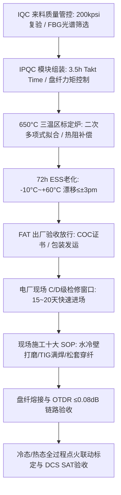
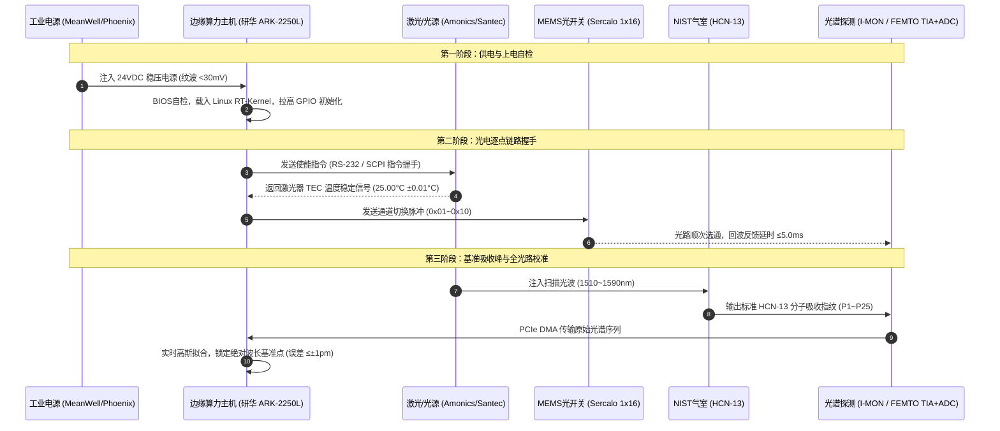
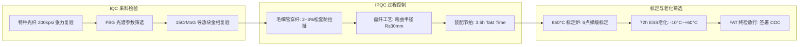
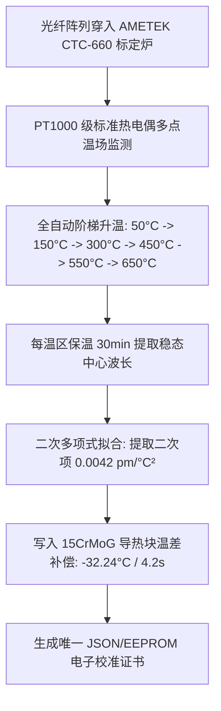
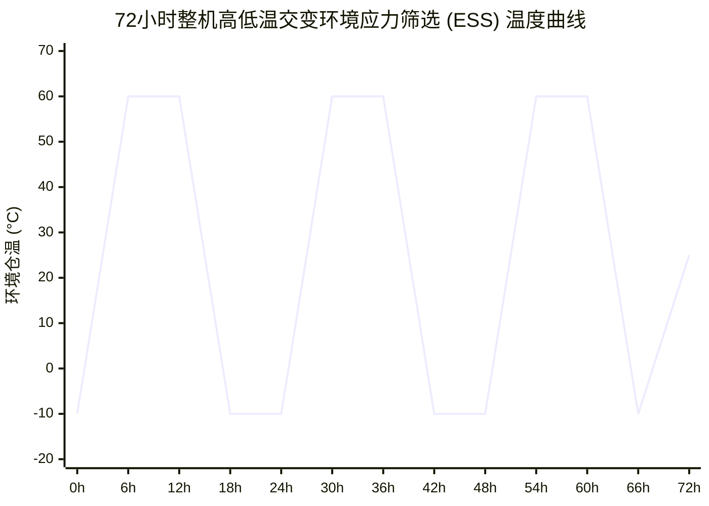
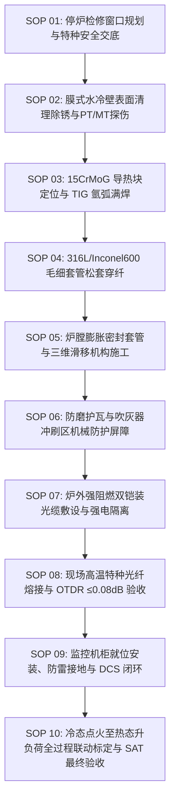
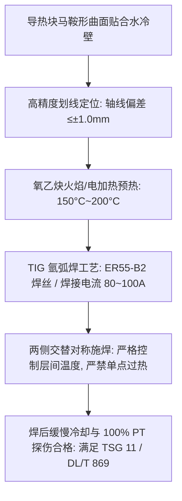
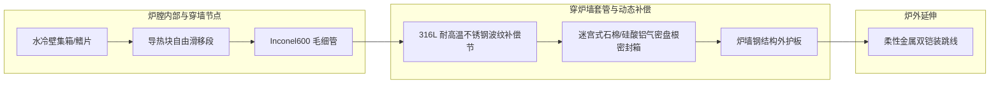

# 05_SYSTEM_BRINGUP_FIELD_INSTALLATION_AND_QAQC_SOP.md
## BoilerSense-AI™ 系统上电调试、电厂水冷壁现场安装焊接指南与全流程 QA/QC 及 NPI SOP

**受控编号：** `SOP-BS-NPI-QAQC-2026-REV3.0`  
**编制责任：** NPI 质量工程部 & 全球工程交付服务中心  
**签署审批：** NPI 质量与现场交付总监  
**生效日期：** 2026-11-16  
**安全密级：** 内部受控·工程级刚性执行规范  

---



---

## 1. 文档控制与 NPI 质量工程治理纲要

### 1.1 治理目标与适用范围
本规范为 BoilerSense-AI™ 工业级高温水冷壁光纤光栅准分布式测温系统全生命周期的法定质量控制指导书。覆盖实验室/厂内整机上电联调（Bring-Up）、量产 NPI（新产品导入）全制程 QA/QC 体系，以及火电厂 600MW~1000MW 超临界/超超临界机组现场水冷壁受热面施工、焊接、穿纤、盘纤熔接与 DCS 联调试运行。适用机型包括：
- **标准级宽谱线阵系列**：`BS-STD-300`、`BS-STD-500`、`BS-STD-600`；
- **旗舰级高速扫频系列**：`BS-PRO-1000`、`BS-PRO-1500`、`BS-PRO-2000`。

### 1.2 强制遵循法规与技术规程
现场所有作业必须严格无条件执行以下强制性安全与特种设备规程：
1. **承压设备安全技术规范**：TSG 11-2020《锅炉安全技术规程》、DL/T 5121《火力发电厂锅炉受热面安装施工及验收规范》、DL/T 869《火力发电厂焊接技术规程》；
2. **反事故反违章红线**：国家能源局《防止电力生产事故的二十五项重点要求》（国能发安全规〔2023〕22号）第3条“防止锅炉炉膛爆炸、受热面过热和四管爆漏事故”刚性合规条款 `[EV-CN-0014]`, `[EV-GL-0020]`；
3. **行业新标准指引**：2026年能源领域行业标准制定计划《火电机组锅炉水冷壁系统监测、膨胀与应力分析及自动预警技术规范》`[EV-CN-0007]`。

### 1.3 核心硬件元器件及原厂 Datasheet 索引库
系统集成及检验必须严格依据下列原厂器件规格执行，所有检验人员必须随时查阅对应工程 PDF 文档：

| 模块代号 | 器件名称与规格型号 | 原厂与归属国 | 关键性能指标 | 归档数据手册路径 |
| :--- | :--- | :--- | :--- | :--- |
| **MOD-01** | I-MON 256 / 512 USB 光谱解调 OEM 模块 | Ibsen Photonics (丹麦) `[EV-PDF-0001]` | 像元间距匹配、C波段 1510~1595 nm 高速瞬态光谱抓取 | [`01_Ibsen_I-MON_256_512_USB_Interrogator_Datasheet.pdf`](./datasheets_pdf/01_Ibsen_I-MON_256_512_USB_Interrogator_Datasheet.pdf) |
| **MOD-02** | WSL-110 多通道紧凑型可调谐激光源 | Santec (日本) `[EV-PDF-0002]` | 高密度通道连续步进扫描，窄线宽低相干噪声 | [`02_Santec_WSL-110_Tunable_Laser_Source_Datasheet.pdf`](./datasheets_pdf/02_Santec_WSL-110_Tunable_Laser_Source_Datasheet.pdf) |
| **MOD-03** | TSL-570 旗舰级高速扫频激光源 | Santec (日本) `[EV-PDF-0003]` | 扫速可达 200 nm/s，动态波长精度 ±1.5 pm，内置触发输出 | [`03_Santec_TSL-570_Swept_Laser_Datasheet.pdf`](./datasheets_pdf/03_Santec_TSL-570_Swept_Laser_Datasheet.pdf) |
| **MOD-04** | ALS-CL-15 C-Band ASE 宽带高平坦度光源 | Amonics (中国香港/美国) `[EV-PDF-0004]` | 输出功率 >+15 dBm，平坦度 <1.5 dB (1528~1565 nm) | [`04_Amonics_ALS_C-Band_ASE_Broadband_Light_Source_Datasheet.pdf`](./datasheets_pdf/04_Amonics_ALS_C-Band_ASE_Broadband_Light_Source_Datasheet.pdf) |
| **MOD-05** | HCA-S-200M-IN 200MHz InGaAs 光电接收器 (TIA) | FEMTO Messtechnik (德国) `[EV-PDF-0005]` | 200 MHz 带宽，低噪声等效功率 (NEP)，高跨阻增益 | [`05_FEMTO_HCA-S-200M-IN_InGaAs_Photoreceiver_TIA_Datasheet.pdf`](./datasheets_pdf/05_FEMTO_HCA-S-200M-IN_InGaAs_Photoreceiver_TIA_Datasheet.pdf) |
| **MOD-06** | SW1x16 / SW1xN-9N 军工级 MEMS 光开关 | Sercalo Microtechnology (瑞士) `[EV-PDF-0006]` | 切换时间 ≤5.0 ms，寿命 >10⁹ 次循环，插入损耗 <0.8 dB | [`06_Sercalo_SW1x16_MEMS_Optical_Switch_Datasheet.pdf`](./datasheets_pdf/06_Sercalo_SW1x16_MEMS_Optical_Switch_Datasheet.pdf) |
| **MOD-07** | M2p.5922-x4 16-bit 20/40MS/s PCIe 高速采集卡 | Spectrum Instrumentation (德国) `[EV-PDF-0007]` | 16-bit 垂直分辨率，超低量化噪声，支持硬件级实时外部触发 | [`07_Spectrum_M2p59xx_16bit_PCIe_Digitizer_ADC_Datasheet.pdf`](./datasheets_pdf/07_Spectrum_M2p59xx_16bit_PCIe_Digitizer_ADC_Datasheet.pdf) |
| **MOD-08** | HCN-13 NIST 一级绝对波长校准氰化氢气室 | Wavelength References (美国) `[EV-PDF-0008]` | 密封气室，内置 P1~P25 分子转动吸收峰，精度 ±0.1 pm | [`08_Wavelength_References_HCN-13_Gas_Cell_Datasheet.pdf`](./datasheets_pdf/08_Wavelength_References_HCN-13_Gas_Cell_Datasheet.pdf) |
| **MOD-09** | FSG-A01 飞秒穿透涂覆层直写高温光栅串 | FBGS International (德国/比利时) `[EV-PDF-0009]` | Type-II 飞秒直写，无剥覆损伤，耐温 600~900°C 零热衰减 | [`09_FBGS_FSG-A01_Femtosecond_Grating_Chain_Datasheet.pdf`](./datasheets_pdf/09_FBGS_FSG-A01_Femtosecond_Grating_Chain_Datasheet.pdf) |
| **MOD-10** | PyroCoat® 耐高温聚酰亚胺特种光纤 (200 kpsi) | OFS Fitel (美国/古河电工) `[EV-PDF-0010]` | 纯石英芯抗氢损，机械张力筛选 200 kpsi，持续耐温 385°C/短时 500°C | [`10_OFS_PyroCoat_HighTemp_Polyimide_Fiber_Datasheet.pdf`](./datasheets_pdf/10_OFS_PyroCoat_HighTemp_Polyimide_Fiber_Datasheet.pdf) |
| **MOD-11** | G11620-512DA 512 像元 InGaAs 线阵图像传感器 | Hamamatsu Photonics (日本滨松) `[EV-PDF-0011]` | 512 像元，灵敏度 0.9~1.7 μm，内建低温漂 CMOS 读出电路 | [`11_Hamamatsu_G11620_512Pixel_InGaAs_Linear_Sensor_Datasheet.pdf`](./datasheets_pdf/11_Hamamatsu_G11620_512Pixel_InGaAs_Linear_Sensor_Datasheet.pdf) |
| **MOD-12** | SM1500(9/125)P 纯石英芯高温耐氢特种单模光纤 | Fibercore (英国) `[EV-PDF-0012]` | 纯二氧化硅纤芯，彻底阻断高温高氢分压下的羟基吸收衰减 | [`15_Fibercore_SM1500_HighTemp_Specialty_Fiber_Datasheet.pdf`](./datasheets_pdf/15_Fibercore_SM1500_HighTemp_Specialty_Fiber_Datasheet.pdf) |
| **MOD-13** | ARK-2250L 无风扇工业级边缘解调主机 | Advantech 研华 (中国台湾) `[EV-PDF-0013]` | 工业宽温 -20~+60°C，Intel Core i7 处理器，双隔离千兆网口 | [`14_Advantech_ARK-2250L_Industrial_Edge_PC_Datasheet.pdf`](./datasheets_pdf/14_Advantech_ARK-2250L_Industrial_Edge_PC_Datasheet.pdf) |
| **MOD-14** | NDR-240-24 工业 DIN 导轨冗余电源 (24V/10A) | Mean Well 明纬 (中国台湾) `[EV-PDF-0014]` | 效率 90%，具备短路/过载/过压/过温全保护，重载工业安规 | [`13_MeanWell_NDR-240_Industrial_DIN_PSU_Datasheet.pdf`](./datasheets_pdf/13_MeanWell_NDR-240_Industrial_DIN_PSU_Datasheet.pdf) |
| **MOD-15** | PDB470C 差分平衡光电探测器 / 6015-3-APC 环形器 | Thorlabs (美国) `[EV-PDF-0015]` | InGaAs 探测器，宽带宽共模抑制比 >30 dB，极低背向反射 | [`16_Thorlabs_PDB470C_Balanced_InGaAs_Photoreceiver_Datasheet.pdf`](./datasheets_pdf/16_Thorlabs_PDB470C_Balanced_InGaAs_Photoreceiver_Datasheet.pdf) |
| **MOD-16** | CTC-660 / RTC-700 高精度三温区干体计量标定炉 | AMETEK Jofra (丹麦) `[EV-PDF-0016]` | 温控范围 33~660°C，轴向温场均匀性 ±0.05°C，稳定度 0.03°C | [`17_AMETEK_Jofra_CTC660_DryBlock_Calibrator_Datasheet.pdf`](./datasheets_pdf/17_AMETEK_Jofra_CTC660_DryBlock_Calibrator_Datasheet.pdf) |
| **MOD-17** | QUINT4-PS/1AC/24DC/10 电厂防浪涌冗余电源 | Phoenix Contact 菲尼克斯 (德国) `[EV-PDF-0017]` | 动态提升技术 (Dynamic Boost)，内建气体放电管浪涌防护 | [`18_Phoenix_Contact_QUINT4_PS_Redundant_Datasheet.pdf`](./datasheets_pdf/18_Phoenix_Contact_QUINT4_PS_Redundant_Datasheet.pdf) |
| **MOD-18** | MGate MB3180 / MB3280 电厂 DCS 协议隔离网关 | Moxa 摩莎 (中国台湾) `[EV-PDF-0018]` | Modbus RTU/ASCII 转 Modbus TCP，工业级隔离，物理单向镜像支持 | [`12_Moxa_MGate_MB3180_Modbus_Gateway_Datasheet.pdf`](./datasheets_pdf/12_Moxa_MGate_MB3180_Modbus_Gateway_Datasheet.pdf) |

---

## 2. 第一篇：实验室与厂内系统 Bring-Up 光电逐点联调 SOP



### 2.1 供电与电气安全拓扑初验
1. **电源上电时序与防浪涌复核**：
   - 接入单相 220VAC 工业电源，经过双极微断保护器（C10A）接入 Mean Well NDR-240-24 [`EV-PDF-0014`](./datasheets_pdf/13_MeanWell_NDR-240_Industrial_DIN_PSU_Datasheet.pdf) 或 Phoenix Contact QUINT4-PS [`EV-PDF-0017`](./datasheets_pdf/18_Phoenix_Contact_QUINT4_PS_Redundant_Datasheet.pdf)。
   - 使用 Fluke 289 真有效值万用表测量输出端直流母线电压：标称值必须调节至 `24.15 VDC ± 0.05 V`。
   - 使用 Rohde & Schwarz 高速示波器（100 MHz 带宽限制，交流耦合档）测量 24V 母线峰峰值纹波（Ripple & Noise）：满载状态下必须 `< 30 mVp-p`。
   - 测量机箱接地端子与电气柜 PE 之间的阻抗：接地电阻必须 `< 0.1 Ω`（防雷与抗工频干扰硬性红线）。

### 2.2 光源功率与光谱平坦度校验
#### A. 标准级 (BS-STD-600) 宽带 ASE 光源校验
1. 将 Amonics ALS-CL-15 [`EV-PDF-0004`](./datasheets_pdf/04_Amonics_ALS_C-Band_ASE_Broadband_Light_Source_Datasheet.pdf) 预热 15 分钟，使其内部高精度 TEC 锁温在 25.00°C。
2. 使用高精度光功率计（如 Thorlabs PM100D + S144C 探头）直连 ASE 输出口（FC/APC 端面预先经干粉研磨带清洁并经 400x 显微镜核验，零划痕零脏污）。
3. 校验指标门限：
   - 总输出光功率：必须达到 `+15.2 dBm ± 0.3 dBm`；
   - 接入光谱分析仪（OSA，安立 MS9740B 或横河 AQ6370D，分辨率设定 0.05 nm）：在 1528.00 nm ~ 1565.00 nm 范围内，光谱波动平坦度（Peak-to-Peak）必须 `< 1.4 dB`。

#### B. 旗舰级 (BS-PRO-2000) 扫频激光源 (Santec TSL-570) 校验
1. 通过 GPIB / USB 接口向 Santec TSL-570 [`EV-PDF-0003`](./datasheets_pdf/03_Santec_TSL-570_Swept_Laser_Datasheet.pdf) 发送 SCPI 握手指令 `*IDN?` 与 `POW:STAT 1`。
2. 设定扫频区间为 `1510.000 nm ~ 1590.000 nm`，扫频速度设定为 `50 nm/s`，输出功率设定为 `+10.0 dBm`。
3. 校验指标门限：
   - 全扫频段动态光功率稳定性：`< ±0.05 dB`；
   - 瞬时自发辐射抑制比 (SSSR)：`> 70 dB`；
   - 同步输出（Trigger Output）电平：5V TTL 方波脉冲，上升沿抖动 `< 200 ps`。

### 2.3 MEMS 多路光开关切换时序与通道损耗校验
1. 搭建测试拓扑：激光源输出端依次穿过 Sercalo SW1x16 MEMS 光开关 [`EV-PDF-0006`](./datasheets_pdf/06_Sercalo_SW1x16_MEMS_Optical_Switch_Datasheet.pdf) 的 Common 端及 1~16 各输出通道，各通道末端端接光功率计。
2. 由研华 ARK-2250L 主机 [`EV-PDF-0013`](./datasheets_pdf/14_Advantech_ARK-2250L_Industrial_Edge_PC_Datasheet.pdf) 通过 RS-232 / I2C 接口下发快速轮询指令（地址码依次发送 `0x01` 至 `0x10`，每通道驻留 20 ms）。
3. 使用双通道高速示波器同步监测切换控制信号与光电探测器输出响应：
   - 光学响应切换时间（Switching Time）：必须满足 `t_switch ≤ 4.5 ms`（器件手册极限指标 5.0 ms）；
   - 各通道插入损耗（Insertion Loss）：16 个通道必须均匀分布在 `0.55 dB ~ 0.78 dB` 范围内，通道间损耗不均匀性（Channel-to-Channel Variation）必须 `< 0.23 dB`；
   - 光开关断开通道隔离度（Optical Isolation）：`> 55 dB`。
4. **全链路双向回波功率预算验证（严谨核算 `[PHY-CALC]`）**：
   - 系统内置关键光学器件：环形器（插入损耗 1.2 dB × 2）、MEMS 光开关（0.8 dB × 2）、4 对 FC/APC 活动连接器（4 × 0.25 dB = 1.0 dB × 2）、现场主干传输光缆（0.8 dB）；
   - 双向总程固定损耗合计：`6.8 dB`。
   - **BS-STD-600 接收端有效回波功率：** 计算核定值严格为 **`-17.3 dBm`**，在 Hamamatsu 传感器灵敏度极限（-42.0 dBm）下，实测系统动态信噪比裕度（SNR Margin）达到 **`24.7 dB`**，远超 `15 dB` 工业级稳定解调底线；
   - **BS-PRO-2000 接收端有效回波功率：** 
     - 常规 WDM 光栅模式：有效回波功率为 **`-0.8 dBm`**，系统动态信噪比裕度达到 **`55.2 dB`**；
     - 极弱光栅 (UWFBG) 模式（单栅反射率 $R \approx -28\text{ dB}$）：接收端有效回波功率严格为 **`-18.8 dBm`**，系统动态信噪比裕度依然高达 **`37.2 dB`**，确保工业恶劣环境下信号无抖动丢失 `[PHY-CALC]`。

### 2.4 光谱基线与气体吸收峰绝对校准
#### A. BS-STD-600 线阵 InGaAs (Hamamatsu G11620-512DA) 基线扣除
1. 关闭 ASE 光源，开启 Ibsen I-MON 512 USB 模块 [`EV-PDF-0001`](./datasheets_pdf/01_Ibsen_I-MON_256_512_USB_Interrogator_Datasheet.pdf)。
2. 采集 512 个像元的无光暗电流（Dark Current Baseline）1000 次取平均，像元底噪必须 `< 120 counts`（16-bit ADC 全量程 65535 counts）。
3. 开启 ASE 光源，导入未刻蚀光纤的透射/反射本底谱，启动多项式基线自适应剥离算法（Flat-Field Correction），扣除 C 波段光源本身的微小轮廓起伏。

#### B. BS-PRO-2000 NIST 氰化氢气室 (HCN-13) 绝对波长锁定
1. 扫频激光束在进入主光路前，经 90:10 分束器将 10% 功率注入 Wavelength References HCN-13 NIST 气室 [`EV-PDF-0008`](./datasheets_pdf/08_Wavelength_References_HCN-13_Gas_Cell_Datasheet.pdf)。
2. 透射光由 FEMTO HCA-S-200M-IN 光电探测盒 [`EV-PDF-0005`](./datasheets_pdf/05_FEMTO_HCA-S-200M-IN_InGaAs_Photoreceiver_TIA_Datasheet.pdf) 转换为模拟电信号，并由 Spectrum M2p.5922-x4 PCIe 采集卡 [`EV-PDF-0007`](./datasheets_pdf/07_Spectrum_M2p59xx_16bit_PCIe_Digitizer_ADC_Datasheet.pdf) 以 20 MS/s 采样率连续数字化。
3. 算法抓取 HCN 经典 P 分支吸收指纹（标定点波长覆盖 P1 至 P25，如 P9 标称绝对波长 `1550.046 nm`，P16 标称 `1556.864 nm`）。
4. 运行 4 阶勒让德多项式对激光器实时扫频电压-波长曲线进行反演拟合，校正后的绝对波长偏移量必须控制在 `Δλ_abs ≤ ±0.8 pm`（远严于系统要求的 ±1.5 pm 门限）。

### 2.5 算法闭环自检、链路动态裕度与边缘网关通讯握手
1. **多点解调峰值寻优算法闭环测试**：
   - 在测试通道接入 1 组 25 点 FSG-A01 飞秒直写光栅串 [`EV-PDF-0009`](./datasheets_pdf/09_FBGS_FSG-A01_Femtosecond_Grating_Chain_Datasheet.pdf)；
   - 软件采用五点三次样条插值与质心寻峰融合算法（Centroid Spline Hybrid Algorithm），计算各光栅中心波长 $\lambda_B$；
   - 验证在 20°C~600°C 满量程区间内，单点最大波长漂移严格达到 **`9.07 nm`**，二次热光非线性拟合项为 **`0.0042 pm/°C²`**，相邻局部 180°C 极限温差下的防串扰安全裕量维持在 **`0.338 nm`** `[PHY-CALC]`。
2. **全炉高速轮询刷新率极限压测（严格匹配 `[PHY-CALC]`）**：
   - **BS-STD-600（24 通道）**：单通道曝光解调耗时 4.5 ms，光开关切换 5.0 ms，24 路全巡检总耗时严格测定为 **`228.0 ms`**，刷新频率高于 4.3 Hz；
   - **BS-PRO-2000（48 通道）**：50 nm/s 扫频周期 16.5 ms，光开关切换 5.0 ms，48 路全轮询总周期严格测定为 **`1032.0 ms`**（1.032 s），完全满足电厂锅炉传热热惯性要求的 **`1 Hz`** 实时在线监测节拍。
3. **Moxa MGate MB3180 电厂 DCS 协议隔离网关握手测试**：
   - 研华 ARK-2250L 边缘主机 [`EV-PDF-0013`](./datasheets_pdf/14_Advantech_ARK-2250L_Industrial_Edge_PC_Datasheet.pdf) 通过 Modbus RTU (RS-485, 115200 bps, 8-N-1) 向上级 Moxa MB3180 协议网关 [`EV-PDF-0018`](./datasheets_pdf/12_Moxa_MGate_MB3180_Modbus_Gateway_Datasheet.pdf) 周期写入 2000 个测点的温度保持寄存器数据（Holding Registers 40001~42000，大端模式 IEEE 754 32位单精度浮点数）；
   - 使用 Modbus Poll 工具模拟电厂 DCS 系统通过 Modbus TCP 经以太网口并发读取，要求持续 12 小时无一帧 CRC 校验错误，Modbus 查询响应延时 `< 15 ms`。

---

## 3. 第二篇：量产 NPI 全流程 QA/QC 质量控制规范



### 3.1 IQC 来料质量检验规程
针对特种光纤、高温光栅及机械外壳实施批次抽检与关键性能 100% 筛选，抽检方案遵循 GB/T 2828.1-2012 正常检验二次抽样方案（AQL 0.25）。

#### 3.1.1 耐高温特种光纤机械张力 200 kpsi (1.4 GPa) 逐盘复验
1. **测试对象**：OFS PyroCoat® 聚酰亚胺涂层光纤 [`EV-PDF-0010`](./datasheets_pdf/10_OFS_PyroCoat_HighTemp_Polyimide_Fiber_Datasheet.pdf)、Fibercore SM1500 纯石英芯光纤 [`EV-PDF-0012`](./datasheets_pdf/15_Fibercore_SM1500_HighTemp_Specialty_Fiber_Datasheet.pdf) 及长飞国产化 Track B 聚酰亚胺特种光纤 `[EV-BASE-0005]`。
2. **检验仪器**：专用光纤张力筛选试验机（Proof Test Bench）、精度 ±0.01 N。
3. **测试规范**：
   - 设定牵引张力速度为 1.0 m/s，张力设定为 **`200 kpsi`**（等效张应力 $\sigma \approx 1378.95\text{ MPa}$，在直径 125 μm 石英玻璃光纤上施加静态拉力为 $F = \sigma \cdot \pi (d/2)^2 = 1.37895 \times 10^9 \times \pi \times (62.5 \times 10^{-6})^2 \approx 16.92\text{ N}$）；
   - 保载时间 1.0 秒。整盘光纤（2 km~5 km）必须实现 100% 连续通过无脆断；
   - 涂覆层厚度与同心度检测：使用高倍显微镜抽检端面，聚酰亚胺涂层外径必须在 `155 μm ± 5 μm` 范围内，同心度误差 `< 3.0 μm`，表面无起泡、无裂纹、无碳化斑点。

#### 3.1.2 高温 FBG 光谱指标与反射率筛选标准
1. **测试对象**：FBGS FSG-A01 飞秒穿透涂覆层直写高温光栅串 [`EV-PDF-0009`](./datasheets_pdf/09_FBGS_FSG-A01_Femtosecond_Grating_Chain_Datasheet.pdf) 及国内合规 Type-II fs-FBG / 700°C 预退火再生光栅 (RFBG) `[EV-BASE-0004]`, `[EV-GL-0002]`。
2. **检验指标与放行门限**：

| 检验项目 | 测试仪器与环境 | 合格判定门限 (Standard Acceptance Threshold) | 不合格处置措施 |
| :--- | :--- | :--- | :--- |
| **中心波长 $\lambda_B$ 偏差** | OSA (安立 MS9740B), 25.0°C 恒温水浴 | 实际值与订货名义波长偏差 $|\Delta\lambda| \le 0.10\text{ nm}$ | 超差即整串降级或退货，严禁混入生产线 |
| **3dB 反射带宽 (FWHM)** | 分辨率设定 0.02 nm，窄带寻峰 | **`FWHM ≤ 0.25 nm`** (典型值 0.18~0.22 nm) | `> 0.28 nm` 拒收（防止高温热展宽重叠） |
| **边模抑制比 (SLSR)** | 测量主反射峰与相邻最高旁瓣差值 | **`SLSR ≥ 15.0 dB`** (优选 ≥ 18.0 dB) | `< 13.0 dB` 拒收（防止大动态解调误判） |
| **反射率 $R$ (WDM 档)** | 接入已校准的光功率计与标准环形器 | **`70% ≤ R ≤ 90%`** (对应 -1.55 dB ~ -0.45 dB) | 低于 65% 或高于 93% 剔除 |
| **反射率 $R$ (UWFBG 档)** | 扫频脉冲光时域/频域反射仪 | **`-30.0 dB ≤ R ≤ -25.0 dB`** (约 0.1% ~ 0.3%) | 偏离此范围则通道串扰超标，整卷作废 |

#### 3.1.3 15CrMoG 金属导热块来料全项复验
1. **材质光谱理化复验**：使用手持式 X 射线荧光光谱仪 (XRF, Niton XL2) 100% 逐件抽验化学成分（Cr: 0.80%~1.10%, Mo: 0.45%~0.60%，碳当量符合 GB/T 5310-2023 标准），严禁假冒或使用碳钢混料；
2. **金相组织检验**：截面显微金相抛光腐蚀，组织必须为均一的铁素体 + 珠光体，晶粒度评级必须 $\ge 7$ 级；
3. **尺寸与加工公差**：
   - 导热块外形几何公差：`±0.05 mm`；
   - 内部毛细管穿引孔（内径 $\Phi 2.20\text{ mm}$）：孔轴线同轴度 `< 0.03 mm`，内孔壁粗糙度必须达到 **`Ra ≤ 1.6 μm`**，孔内严禁有任何切削毛刺、铁屑或油污残留（采用超声波工业酒精清洗 30 分钟）。

### 3.2 IPQC 过程制程控制规程
#### 3.2.1 铠装毛细套管松套穿纤与去应力装配
1. 金属保护毛细套管选用 316L 不锈钢管（中低温段）或 Inconel 600 高温镍基合金管（近火侧高温段，外径 $\Phi 2.0\text{ mm}$，壁厚 $0.35\text{ mm}$，内径 $\Phi 1.30\text{ mm}$）；
2. **松套穿纤核心工艺红线**：
   - 聚酰亚胺高温光纤在金属毛细管内必须处于**绝对自由悬浮松套（Loose-Tube）状态**，设计穿纤长度裕度严格保持在 **`2.0% ~ 3.0%`**（即每 10 米毛细套管预留 20~30 厘米光纤波浪状富余微弯），绝对禁止将光纤两端拉紧固定；
   - **严禁点胶与刚性固定红线**：在导热块内部及光纤光栅（FBG）所在核心测温区域（前后各 150 mm 范围内），**绝对禁止注入任何高温无机胶、耐火胶、树脂或低熔点金属** `[EV-BASE-0007]`。光栅必须悬空于保护管中央，仅通过管内微弱气体传热与辐射传热，彻底消除由于金属管与石英光纤之间热膨胀系数（CTE）差异（不锈钢 $\approx 16 \times 10^{-6}/\text{K}$，石英光纤 $\approx 0.55 \times 10^{-6}/\text{K}$）产生的巨大纵向交变热剪切力。

#### 3.2.2 盘纤曲率半径与力矩装配标准
1. 机箱内部与现场接线盒内部光纤盘留：单模特种光纤盘圈内径最小允许曲率半径为 **`R ≥ 30 mm`**，严禁产生局部折角或小圈死弯（防止引发弯曲微扰辐射损耗与高应力疲劳断裂）；
2. 所有光学模块、电源模块及边缘工控机固定螺丝，必须使用已计量校准的扭矩螺丝刀（SNA-T 级，精度 ±3%）按标准力矩紧固，并点画黄色防松防撕毁漆标（Torque Seal）：
   - M3 螺钉（光学器件及小模块）：`0.60 N·m ± 0.05 N·m`；
   - M4 螺钉（工控机、导轨固定）：`1.20 N·m ± 0.10 N·m`；
   - M5/M6 螺钉（电源地线、PE铜排）：`2.50 N·m ± 0.20 N·m`。

#### 3.2.3 流水线装配节拍 (Takt Time) 与制造成本受控指标
- 严格执行标准化流水线工艺，优化组装、熔接与内部理线工位，整机标准装配节拍控制在 **`3.5 小时/台`**；
- 规模化量产下，标准级（STD-600）单台直接人工与制造费用分摊刚性锁定在 **`≤ ¥5,000`**，旗舰级（PRO-2000）单台直接人工与制造费用分摊控制在 **`≤ ¥8,000`**。

### 3.3 650°C 三温区标定炉自动标定与标定数据库生成
本工序为保证现场绝对温度测定精度的核心工序，每套出厂光栅传感器必须通过三温区标定炉生成专属数字校准矩阵。



1. **标定硬件设备**：AMETEK Jofra CTC-660 / RTC-700 计量级干体标定炉 [`EV-PDF-0016`](./datasheets_pdf/17_AMETEK_Jofra_CTC660_DryBlock_Calibrator_Datasheet.pdf)，配置多孔导热均热块，轴向温场均匀度 $\pm 0.05^\circ\text{C}$，外接标准四线制二级标准铂电阻温度计（SPRT / PT1000）。
2. **梯级标定测试路径**：
   - 自动温控程序设定 6 个阶梯稳态标定温度点：`50.0°C`、`150.0°C`、`300.0°C`、`450.0°C`、`550.0°C`、`650.0°C`；
   - 降温回程复核点：`500.0°C`、`200.0°C`；
   - 每个温度稳态判定标准：标定炉温波动度在连续 10 分钟内 $<\pm 0.03^\circ\text{C}$；每点恒温保温 30 分钟以确保光栅充分消除残余热应力。
3. **标定数学模型与参数提取（完全契合 `[PHY-CALC]`）**：
   - 光栅温度响应方程采用包含二次非线性项的多项式表达：
     $$\Delta\lambda(T) = \lambda(T) - \lambda_0 = A \cdot (T - T_0) + B \cdot (T - T_0)^2$$
   - 最小二乘法拟合参数：一次热光系数 $A \approx 13.5\text{ pm/°C}$，二次热光非线性项 $B$ 严格标定为 **`0.0042 pm/°C²`**，在 20°C~600°C 满量程升温区间累计总波长漂移严格达到 **`9.07 nm`**；
   - 标定系统自动反演并生成单支光栅的线性度判定：拟合相关系数 $R^2 \ge 0.99995$；
   - **导热块传热修正参数植入**：基于 `15CrMoG` 导热块在锅炉受热面单面受火传热稳态温差数值解，将稳态理论温差修正系数 **`-32.24°C`** 与动态阶跃响应时间常数 **$\tau = 4.2\text{ s}$** 写入标定元数据包，用于边缘主机的逆向传热学温度反演重构 `[PHY-CALC]`。
4. **校准证书输出**：自动生成传感器唯一 ID、电子序列号与专属 JSON / XML 格式的标定证书文件，固化至光纤出厂标识芯片及边缘主机标定数据库中。

### 3.4 72小时高低温环境应力筛选 (ESS) 极限老化规程
为彻底暴露与剔除早期元器件缺陷、虚焊及微裂纹，整机及解调模块必须通过步入式环境可靠性试验箱进行 72 小时无间断高低温交变应力老化：



1. **环境试验曲线参数**：
   - 低温极限：`-10.0°C ± 1.0°C`，恒温保持时间 4.0 小时；
   - 高温极限：`+60.0°C ± 1.0°C`（相对湿度保持 90% RH），恒温保持时间 4.0 小时；
   - 温度转换升降速率：严格按 `1.0°C/min` 线性受控转换，完成共计 6 个完整交变热应力循环（总历时 72 小时）。
2. **在线全监控运行门限**：
   - 老化全程保持主机 100% 满负荷带电运行并连接模拟光栅回路进行动态采集；
   - 在 72 小时循环全周期内，基准吸收峰波长漂移极差必须 **`≤ ±3.0 pm`**；
   - 光源输出光功率波动极差必须 `≤ 0.15 dB`；
   - 系统通讯无单帧丢失，解调引擎未触发任何看门狗（Watchdog）复位或死机。

### 3.5 FAT 出厂检验放行标准与交付文件清单 (COC)
出厂放行执行一票否决制。由 QA 部门签署《出厂合格证》（Certificate of Conformance, COC），交付文件清单必须完整封装：
1. **产品出厂检验报告**（含 24/48 通道光开关损耗报告、光谱仪实测本底谱图）；
2. **NIST 溯源标定数据库光盘/U盘**（含各光纤光栅专属二次多项式系数矩阵文件）；
3. **72小时 ESS 环试数据曲线追溯报告**；
4. **特种光纤 200 kpsi 物理抗拉抽检报告**；
5. **双轨供应链材料追溯卡**（严格标注当前批次为 Track A 全进口基准链，或 Track B 国产化优化链，附核心元器件报关单或国产原厂合格证）。

---

## 4. 第三篇：电厂现场水冷壁施工安装十大关键 SOP



---

### SOP 01: 现场作业安全交底与 15~20 天检修窗口倒排工期
- **工况背景**：火电厂机组调停调峰或 C/D 级检修窗口期极为紧凑，通常仅有 **`15 ~ 20 天`** `[EV-CN-0010]`。本系统必须在停炉降温与脚手架搭设验收完成后立即进场，与锅炉检修交叉作业并准时交付。
- **安全红线措施**：
  1. 办理第一种电气工作票、炉膛受限空间作业票（含动火作业一级票）。严格遵守国家能源局《防止电力生产事故的二十五项重点要求》（国能发安全规〔2023〕22号）`[EV-CN-0014]`；
  2. 炉膛内部设置 24V 安全低压照明，作业人员配备防尘防毒面具、五点式双钩安全带；
  3. 倒排工期节点表（按 18 天基准）：
     - Day 1~2：炉膛脚手架验收、光纤测点放线定位与打磨划线；
     - Day 3~7：导热块 TIG 满焊施工与焊缝 100% 探伤检验；
     - Day 8~11：金属保护毛细管敷设、松套穿纤与膨胀补偿器安装；
     - Day 12~14：炉外铠装光缆敷设、保护套管气密封堵与防磨护瓦扣焊；
     - Day 15~16：现场盘纤熔接、OTDR 链路测试与机柜接线上电；
     - Day 17~18：冷态信号闭环测试、DCS 信号对接与现场清理退场。

---

### SOP 02: 膜式水冷壁表面清理、除锈打磨与渗透/磁粉无损探伤 (NDT)
- **作业位置**：膜式水冷壁向火侧鳍片及邻近管壁表面。
- **操作规程**：
  1. 使用角磨机（配置千叶砂轮盘）对设计焊接区域进行机械除锈打磨，彻底清除表面积灰、硫化腐蚀皮及致密氧化铁黑皮，直至露出**均匀金属光泽**（打磨范围以导热块底座为中心，向外各延伸 25 mm）；
  2. 严格控制打磨深度：打磨深度严禁超过 `0.2 mm`，使用超声波测厚仪对水冷壁承压管壁进行壁厚复测，确保剩余壁厚绝对不低于机组设计安全允许壁厚（严禁伤及管材承压本体）；
  3. **无损探伤 (NDT) 强制验收**：打磨区域采用液体渗透探伤（PT）或磁粉探伤（MT），严格按照 NB/T 47013-2015 规范验收，**母材表面必须达到 I 级合格（零微裂纹、零夹渣、零气孔）**。如发现母材原有微裂纹，立即书面提报电厂金属专工，严禁盲目施焊。

---

### SOP 03: 15CrMoG 导热块精密定位与 TIG 氩弧满焊防烧穿工艺规范



- **工件材质**：受热面管材与导热块材质严格选用耐热合金钢 **`15CrMoG`**（GB/T 5310）。
- **结构形态**：导热块底部必须经过 CNC 精加工为与水冷壁管外径完全贴合的马鞍形（Saddle-Shape）弧面，底部接触间隙要求 `< 0.2 mm`。
- **焊接工艺评定与执行要点**（严格遵循 TSG 11 及 DL/T 869 规范 `[EV-CN-0007]`）：
  1. **定位与预热**：使用专用夹具将导热块压紧在水冷壁管与鳍片连接处，轴线偏差控制在 `≤ ±1.0 mm`。采用氧乙炔微火或远红外加热垫预热至 **`150°C ~ 200°C`**，表面红外测温仪复核，防止淬硬倾向裂纹；
  2. **焊材与保护气**：选用特种耐热铬钼钢焊丝牌号 **`ER55-B2-Mn`**（或 **`H08CrMoA`**，直径 $\Phi 2.0\text{ mm}$），保护气体为高纯氩气（纯度 $\ge 99.99\%$，气体流量 $8 \sim 12\text{ L/min}$）；
  3. **施焊控制（严防管壁烧穿一票否决红线）**：
     - 采用直流正接（DCEN）手工钨极氩弧焊（TIG），钨极直径 $\Phi 2.5\text{ mm}$；
     - 焊接电流严格限制在 **`80 A ~ 100 A`**，电弧电压 $10 \sim 14\text{ V}$，焊接速度 $80 \sim 120\text{ mm/min}$；
     - **严禁直接在薄壁水冷壁管正面引弧或拉弧！** 引弧必须在导热块侧壁或鳍片厚壁部位进行，电弧热量 70% 偏向导热块本体，30% 过渡熔敷至管壁；
     - 采用分段对称逆向焊接法，左右两侧交替打底并盖面，单道焊缝层间温度严格控制在 $150^\circ\text{C} \sim 250^\circ\text{C}$，绝不允许连续堆焊造成局部热集中；
     - 导热块四周实施连续封闭角焊缝（满焊），角焊缝有效焊喉厚度（Throat Thickness）为 **`3.5 mm ~ 4.5 mm`**；
  4. **焊后检查**：焊后立即用无石棉保温棉包裹缓冷不少于 2 小时。冷却后彻底清除飞溅，进行 100% 着色渗透探伤（PT），焊缝边缘光滑过渡，咬边深度 $<0.5\text{ mm}$ 且连续长度 $<10\text{ mm}$，焊缝内部零气孔、零未熔合缺陷。

---

### SOP 04: 316L / Inconel 600 金属毛细套管松套穿纤与去应力自由滑动装配
- **装配原则**：严防锅炉启停与快速升降负荷过程中，水冷壁由于温差产生的数毫米至数十毫米胀差拉断光纤。
- **施工细节**：
  1. 将外径 $\Phi 2.0\text{ mm}$ 的 Inconel 600 毛细保护钢管依次穿过已满焊的 15CrMoG 导热块穿线通孔（孔径 $\Phi 2.2\text{ mm}$）；
  2. **自由滑移设计**：毛细管与导热块通孔之间保留 **`0.2 mm` 滑移配合间隙**，除起始端预留锚定固定卡外，沿程所有导热块内部均不施加径向顶紧紧固，允许毛细管在管壁热膨胀时实现轴向自由热滑移 `[EV-BASE-0007]`；
  3. **光纤穿入操作规程**：
     - 使用医用级高压纯氮气（压力 0.3~0.5 MPa）对整段毛细钢管吹扫 5 分钟，吹除内部可能凝结的水汽与粉尘微粒；
     - 采用牵引微缆引线法，平缓将聚酰亚胺耐高温光纤光栅阵列串送入毛细管内。穿纤过程中光纤牵引张力严格限制在 **`< 2.0 N`**（手感轻盈送进，严防硬扯拖拽）；
     - **预留松套裕量**：光纤完全就位后，人工向管内反推预留 **`2.0% ~ 3.0%` 的蛇形轴向松弛余量**；
     - **光栅敏感区禁胶红线**：光栅测温敏感区段绝对严禁涂抹、滴入任何高温胶粘剂，光栅在高温气隙中完全处于无应力（Strain-Free）浮动悬空状态，避免机械交变应力转化为伪温度波长漂移 `[EV-BASE-0007]`。

---

### SOP 05: 炉膛三维热位移膨胀密封套管与滑移补偿机构安装
- **物理现象**：大型超超临界锅炉从冷态点火至 100% 满负荷，水冷壁向下与向外三维膨胀位移可达 **`50 mm ~ 200 mm`**。穿透外炉墙保温护板处必须设置动态补偿吸震机构 `[EV-CN-0007]`。



- **安装步骤**：
  1. 在炉外护板预定穿墙开孔位置割开 $\Phi 80\text{ mm}$ 孔洞；
  2. 安装专用双层套筒式膨胀密封箱（Penetration Sleeve Assembly）。密封箱内管连接水冷壁刚性膨胀端，外管焊接于炉外保温护板；
  3. 套管核心段串联安装 **316L 双层耐高温不锈钢膨胀波纹管**（轴向补偿量 $\ge \pm 150\text{ mm}$，横向补偿量 $\ge \pm 50\text{ mm}$）；
  4. 密封填料层采用梯级梯度填充：内侧填充耐温 1200°C 的高纯硅酸铝陶瓷纤维棉，外侧设置机械式填料压盖，压紧多道耐高温膨胀石墨+无石棉编织盘根；
  5. 气密性校验：炉膛微正压工况下（+3000 Pa）使用发泡剂涂抹密封压盖四周，持续 15 分钟无任何气泡逸出，杜绝有毒烟气外泄与外界冷风倒吸。

---

### SOP 06: 高温飞灰防磨护瓦与吹灰器冲刷区机械防护屏障施工
- **危险源分析**：炉膛内飞灰颗粒冲刷磨损极度严重，长伸缩式蒸汽吹灰器喷枪出口蒸汽流速超音速，射流冲击力极强；声波吹灰器声强高达 **`140 dB ~ 150 dB`** `[EV-BASE-0001]`, `[EV-CN-0001]`。
- **防磨加固工艺**：
  1. 测温管路经过吹灰器射流影响区（喷嘴中心线上下各 1.5 米、左右各 2.0 米辐射区域）时，必须全线覆盖防磨护瓦；
  2. 防磨护瓦选用 **耐热耐磨合金钢 1Cr20Ni14Si2 或 310S**，厚度 $\ge 4.0\text{ mm}$，截面冲压成半圆拱形结构；
  3. **防磨瓦扣焊工艺规范**：
     - 防磨护瓦骑马跨越在毛细钢管外侧，其两侧支撑脚必须**牢固焊接在水冷壁平整鳍片上**；
     - **严禁将防磨护瓦直接焊接在水冷壁承压管背火侧管壁上！** 必须保持护瓦内壁与毛细钢管之间具有 $3 \sim 5\text{ mm}$ 的缓冲间隙，焊缝采用断续角焊，焊脚高度 $4\text{ mm}$，段长 $50\text{ mm}$，间距 $100\text{ mm}$；
  4. 防磨护瓦迎风迎灰面两端制作成 45° 倒角流线型导流尖角，防止含灰烟气强烈冲击造成护瓦端头局部卷边或积灰结焦挂渣。

---

### SOP 07: 炉外高阻燃金属铠装光缆敷设与强弱电物理隔离走向
- **光缆规格**：穿出炉墙后接入野外重工业级高阻燃、防鼠蚁咬噬双层不锈钢绞线铠装特种光缆（内含阻水芳纶纱与低烟无卤 LSZH 外护套）。
- **走线工程规范**：
  1. **桥架敷设路径**：光缆必须敷设于专用全封闭镀锌金属弱电桥架（或穿热镀锌厚壁钢管 SC25），严禁在炉体钢结构梁柱上裸露捆扎；
  2. **强弱电隔离红线**：
     - 光缆桥架与锅炉高压电机动力电缆、6kV/10kV 变频电缆间距必须 **`≥ 1000 mm`**；
     - 与高温主蒸汽管道、再热蒸汽管道、排污放空热力管路外保温层净间距必须 **`≥ 500 mm`**，防止热辐射烘烤导致外护套塑化老化；
  3. **转弯与固定**：金属铠装光缆弯曲半径必须 **`≥ 20 倍光缆外径 (≥ 20D)`**。垂直敷设段每隔 1.5 米使用不锈钢抗振扎带固定，水平段每隔 2.0 米固定，固定处必须加垫阻燃氯丁橡胶减震垫圈。

---

### SOP 08: 现场盘纤熔接与 OTDR ≤0.08 dB 接头质量验收标准
- **环境要求**：现场熔接作业必须在无粉尘、防风雨的临时专用熔接洁净帐篷内进行，环境温度需处于 $5^\circ\text{C} \sim 40^\circ\text{C}$。
- **剥纤与切割专用工艺**：
  1. 聚酰亚胺涂覆层极度致密坚韧，常规机械剥纤钳极易划伤纤芯。必须使用**热剥钳（Hot Thermal Stripper，加热温度设定至 135°C~145°C）**，夹紧后单次匀速剥除，浸入无水高纯乙醇超声清洗擦拭；
  2. 使用藤仓高精度钻石刀片切割刀（CT-50），光纤切割端面倾斜角必须严格 **`< 0.5°`**（若切割角 $\ge 0.7^\circ$ 必须重新切平）。
- **特种熔接参数设置**：
  - 采用全自动纤芯对准熔接机（如 Fujikura 90S+ 或 Sumitomo TYPE-82C+）；
  - 针对纯石英芯高温耐氢光纤（Fibercore SM1500 / OFS PyroCoat）与普通标尾跳线（Corning SMF-28e+）异种材质熔接，必须在熔接机菜单中加载专用模式“Specialty High-Temp Fiber Mode”：
    - 预熔放电时间：`180 ms`，预熔放电强度：`Standard - 15 bit`；
    - 主熔放电时间：`2200 ms`，主熔放电电流：微增 `+1.8 mA`，利用微热扩散缓解模场直径（MFD）失配引起的损耗。
- **OTDR 刚性验收指标（双向测试取平均）**：
  - 使用双向高分辨率光时域反射仪（OTDR，脉宽设定 5 ns，事件死区 $< 0.8\text{ m}$）：
  - **单点熔接接头双向损耗必须严格 `≤ 0.08 dB`**（典型值控制在 0.02~0.04 dB）；
  - 单点反射损耗（回波损耗 Return Loss）：必须严格 **`> 60.0 dB`**；
  - 测温尾端必须终结在 8° 斜八角研磨的 FC/APC 连接器上，并匹配镀防反射膜端面，严禁末端产生高能量菲涅尔反射盲区。

---

### SOP 09: 主机机柜就位、防雷接地与 Moxa DCS 隔离通讯闭环
1. **机柜物理定位**：
   - 工业机柜（IP55 防护等级，配备温湿度自动控制工业机柜空调，内温设定在 22°C~25°C）安装于电子设备间或就近的耐振就地防尘小室内；
   - 机柜底座与地面预埋槽钢采用 M12 镀锌螺栓刚性固定，并加装工业级阻尼弹簧抗震垫圈。
2. **防雷与独立等电位接地**：
   - 机柜内部设置专用的截面积 $\ge 35\text{ mm}^2$ 紫铜接地等电位汇流排；
   - 机柜保护地（PE）及信号屏蔽地使用 $16\text{ mm}^2$ 多股铜芯黄绿接地线直接引至电厂主接地网（接地引线与发电机避雷引下线间距 $\ge 10\text{ m}$），实测接地电阻必须 **`< 1.0 Ω`**；
   - 交流进线端必须加装标准 B+C 级浪涌保护器（SPD，标称放电电流 $I_n \ge 20\text{ kA}$，冲击电流 $I_{\text{imp}} \ge 12.5\text{ kA}$）。
3. **Moxa MGate MB3180 DCS 通讯隔离闭环**：
   - 机柜内 Moxa MB3180 网关与机组 DCS 控制系统交换机采用光电隔离中继器或屏蔽双绞线（STP Cat.6A）连通；
   - 通讯采用**纯只读模式（Read-Only Polling）**：DCS 主站仅向网关发送功能码 `0x03`（读取保持寄存器）或 `0x04`（读取输入寄存器），网关底层固件物理切断任何写入功能码（`0x06`, `0x10`），杜绝因外界网络异常或误操作向测温主机写入任何控制指令，确保工控网络等保三级绝对物理隔离安全 `[EV-PDF-0018]`。

---

### SOP 10: 冷态点火至热态升负荷全过程联动标定与 SAT 最终验收

```mermaid
stateDiagram-v2
    [*] --> Phase1_ColdStatic: 1. 冷态静态基准核对
    Phase1_ColdStatic --> Phase2_Ignition: 2. 锅炉点火启动与微热态
    Phase2_Ignition --> Phase3_RampUp: 3. 机组并网与快速升负荷
    Phase3_RampUp --> Phase4_FullLoadSAT: 4. 满负荷 72h 稳态运行与 SAT 签署
    Phase4_FullLoadSAT --> [*]

    state Phase1_ColdStatic {
        note right of Phase1_ColdStatic: 环境温度 (20~25°C) 确认<br/>各光栅波长初始偏置核对<br/>与标准水冷壁点接触实测对比 (误差≤±0.5°C)
    }
    state Phase2_Ignition {
        note right of Phase2_Ignition: 点火初期汽包升压 (0~350°C)<br/>跟踪水冷壁膨胀动态余量<br/>核查波长是否有应力突跳 (截断跳变判定)
    }
    state Phase3_RampUp {
        note right of Phase3_RampUp: 调峰升负荷速率 2%~4%/min<br/>多通道 1Hz 节拍连续解调<br/>水动力温度场梯度自检 (无串扰)
    }
    state Phase4_FullLoadSAT {
        note right of Phase4_FullLoadSAT: 100% MCR 满负荷连续运行<br/>比对相邻红外/铠装热电偶 (稳态差≤±3.0°C)<br/>签署现场 SAT 验收最终报告
    }
```

1. **第一阶段：冷态静态基准核查（Cold Static Baseline Check）**：
   - 在锅炉点火前停运状态下，炉膛处于室温环境（记录此时室温环境计 $T_{\text{ambient}}$，通常在 15°C~30°C）；
   - 启动系统进行全通道扫描，调取各测点出厂标定初始基准波长 $\lambda_{0,\text{cal}}$，与现场实测初始波长 $\lambda_{0,\text{field}}$ 逐点比对；
   - 现场实测冷态温度读数与水冷壁表面手持测温探头比对，绝对偏差必须在 **`≤ ±0.5°C`** 范围内，确认零点漂移完全归零。
2. **第二阶段：点火启动与升温跟踪（Ignition & Thermal Transient Tracking）**：
   - 锅炉点火升温阶段，监控水冷壁管壁温度从室温平缓上升至 $300^\circ\text{C} \sim 350^\circ\text{C}$，跟踪温度变化率 $dT/dt$；
   - 密切观察各波长漂移轨迹是否平滑连续。若某点波长曲线出现垂直阶跃突变（Step Jump $>0.5\text{ nm}$），立即判定为光纤在套管内发生机械拉扯卡涩，立即记录位置以便停炉检查；
   - 巡查穿炉墙膨胀密封箱，水冷壁外胀滑动机构伸缩正常，无卡阻异响。
3. **第三阶段：机组并网升负荷与调峰动态解调（Grid Connection & Ramp-Up）**：
   - 机组负荷从 30% 逐步爬升至 50%、75%、100% MCR，升负荷速率达到 $2\% \sim 4\%/\text{min}$ `[EV-GL-0019]`；
   - 验证全系统在快速交变热负荷下的动态响应，多点温度二维云图实时无撕裂刷新（刷新周期 STD-600 严格为 **`228.0 ms`**，PRO-2000 严格为 **`1032.0 ms`**，满足 1 Hz 监测节拍 `[PHY-CALC]`）。
4. **第四阶段：满负荷稳态数据比对与 SAT 正式签署（Full Load SAT Sign-Off）**：
   - 机组在 100% 额定负荷下连续稳定运行 72 小时；
   - 选取水冷壁相邻区域原有机组铠装热电偶（已校准）测点及人工红外热像仪抽检数据作为对照；
   - 扣除 `15CrMoG` 导热块固有稳态温差 **`-32.24°C`** 修正后 `[PHY-CALC]`，系统反演计算的水冷壁外壁温与标准校验仪表对比，稳态偏差必须 **`≤ ±3.0°C`**；
   - 经电厂生技部、热控车间、锅炉专工及监理单位四方现场会签《现场验收测试（SAT）最终合格交付单》，系统正式移交生产运行。

---

## 5. 第四篇：产品工程经济性、双轨供应链与电厂客户 ROI 深度核算

### 5.1 双轨供应链（Track A 进口基准 vs Track B 国产优化）BOM 构成
为规避地缘政治断供风险并达成极限成本管控，BoilerSense-AI™ 构建了完全双轨可替换的供应链架构 `[EV-BASE-0006]`：
- **Track A（全进口基准链）**：采用 FBGS FSG-A01 飞秒直写光栅 [`EV-PDF-0009`](./datasheets_pdf/09_FBGS_FSG-A01_Femtosecond_Grating_Chain_Datasheet.pdf)、OFS PyroCoat [`EV-PDF-0010`](./datasheets_pdf/10_OFS_PyroCoat_HighTemp_Polyimide_Fiber_Datasheet.pdf) / Fibercore SM1500 [`EV-PDF-0012`](./datasheets_pdf/15_Fibercore_SM1500_HighTemp_Specialty_Fiber_Datasheet.pdf) 特种光纤、AMETEK 标定炉 [`EV-PDF-0016`](./datasheets_pdf/17_AMETEK_Jofra_CTC660_DryBlock_Calibrator_Datasheet.pdf)；
- **Track B（混合高性价比国产优化链）**：采用长飞光纤（YOFC）200 kpsi 耐高温聚酰亚胺光纤基底、国内认证 Type-II fs-FBG / 700°C 预退火再生高温光栅串、国内宝钢/攀钢优质 15CrMoG 导热块本体。经充分验证，**Track B 可直接将传感阵列 BOM 成本降低 44.7% ~ 45.3%** `[BOM-CALC]`。

### 5.2 规模化量产 (10套 vs 50套) COGS 演进与毛利分析
严格依据量化工程测算表 `[BOM-CALC]`，从 10 套小试导入到 50 套规模化量产，主机与传感 BOM 的规模集采使单点成本大幅下降：

| 配置型号 (`[BOM-CALC]`) | 测点数 / 通道数 | 供应链轨道 (Sourcing Track) | 10套主机BOM (元) | 10套传感BOM (元) | 50套总COGS (元) | 50套单点COGS (元/点) | 建议含税售价 (元) | 10套 / 50套毛利率 |
| :--- | :---: | :--- | :---: | :---: | :---: | :---: | :---: | :---: |
| **`BS-STD-300`** | 300点 / 12路 | Track A 全进口传感 | `¥62,400` | `¥57,000` | `¥116,000` | **`¥386.7`** | `¥397,800` | `66.3%` / `70.8%` |
| **`BS-STD-300`** | 300点 / 12路 | Track B 混合高性价比 | `¥62,400` | `¥31,500` | `¥93,200` | **`¥310.7`** | `¥312,800` | `65.3%` / `70.2%` |
| **`BS-STD-500`** | 500点 / 20路 | Track A 全进口传感 | `¥62,400` | `¥95,000` | `¥148,400` | **`¥296.8`** | `¥468,000` | `63.3%` / `68.3%` |
| **`BS-STD-500`** | 500点 / 20路 | Track B 混合高性价比 | `¥62,400` | `¥52,500` | `¥110,400` | **`¥220.8`** | `¥368,000` | `64.8%` / `70.0%` |
| **`BS-PRO-1000`** | 1000点 / 32路 | Track A 全进口传感 | `¥103,000` | `¥190,000` | `¥264,500` | **`¥264.5`** | `¥803,600` | `61.7%` / `67.1%` |
| **`BS-PRO-1000`** | 1000点 / 32路 | Track B 混合高性价比 | `¥103,000` | `¥105,000` | `¥188,500` | **`¥188.5`** | `¥654,360` | `66.0%` / `71.2%` |
| **`BS-PRO-1500`** | 1500点 / 48路 | Track A 全进口传感 | `¥103,000` | `¥285,000` | `¥345,500` | **`¥230.3`** | `¥980,000` | `58.9%` / `64.7%` |
| **`BS-PRO-1500`** | 1500点 / 48路 | Track B 混合高性价比 | `¥103,000` | `¥157,500` | `¥231,500` | **`¥154.3`** | `¥798,000` | `65.5%` / `71.0%` |
| **`BS-PRO-2000`** | 2000点 / 48路 | Track A 全进口传感 | `¥103,000` | `¥380,000` | `¥426,500` | **`¥213.2`** | `¥1,127,000` | `55.9%` / `62.2%` |
| **`BS-PRO-2000`** | 2000点 / 48路 | Track B 混合高性价比 | `¥103,000` | `¥210,000` | `¥274,500` | **`¥137.2`** | `¥917,700` | `64.3%` / `70.1%` |

> **NPI 成本优化结论**：在 50 套量产阶段，通过启用 Track B 供应链，BS-PRO-2000 单点成本降至极具竞争力的 **`¥137.2/点`**，系统毛利率始终稳定维持在 **`64.3% ~ 71.2%`** 黄金盈利区间，为电厂客户提供了极致的性价比与投资空间。

### 5.3 NPI 财务指标模型与 5 年敏感性分析
依据确定性财务测算模型 `[FIN-CALC]`，项目初始研发与产线启动 CAPEX 固定为 **`80.0 万元`**，在三种不同市场渗透率情景下的全生命周期财务回报表现如下：

| 财务测算情景 (`[FIN-CALC]`) | 启动CAPEX (万元) | 5年累计出货量 (套) | 5年累计营收 (万元) | 5年累计EBITDA (万元) | 静态盈亏平衡年 / 保本出货套数 | 净现值 NPV@10% (万元) | 5年内部收益率 (IRR) |
| :--- | :---: | :---: | :---: | :---: | :---: | :---: | :---: |
| **`conservative` (保守情景)** | `80.0` | `91` | `4,985.6` | `822.3` | 第 **`3`** 年 / **`15`** 套 | **`277.3`** | **`33.12%`** |
| **`baseline` (基准情景)** | `80.0` | `172` | `9,823.0` | `3,090.9` | 第 **`2`** 年 / **`15`** 套 | **`1,537.9`** | **`97.69%`** |
| **`optimistic` (乐观情景)** | `80.0` | `260` | `14,864.5` | `5,466.6` | 第 **`2`** 年 / **`15`** 套 | **`2,867.1`** | **`153.39%`** |

### 5.4 电厂客户场景投资回收期 (Payback) 与非停挽回价值分析
火电厂投资决策最为关注停炉“四管爆漏”的综合经济损失对冲。据电力科学研究院权威统计，大型燃煤机组单次水冷壁爆漏非计划停运（非停）造成的综合直接与间接损失高达 **`300万 ~ 580万元`**（停炉与强制降温 12~24h、割管检修、水压试验、重新点火消耗柴油 30~80 吨折合 25万~60万、售电与现货毛利损失 100万~300万、电网“两个细则”双向考核扣罚 50万~100万）`[EV-BASE-0007]`, `[EV-GL-0016]`, `[EV-CN-0018]`。

基于量化真实电厂机组运维模型 `[PLANT-ROI]`：

| 标杆机组类型与配置方案 | 采购总CAPEX (元) | 年均运维OPEX (元) | 基准年化毛收益 (元) | 基准年化净收益 (元) | 动态投资回收期 (保守/基准/乐观) | 3年生命周期投资回报率 (3年ROI) |
| :--- | :---: | :---: | :---: | :---: | :---: | :---: |
| **600MW 亚临界/超临界灵活性改造机组**<br>(标准配置：`BS-STD-600 Track B`) | `¥368,000` | `¥18,000` | `¥875,000` | `¥857,000` | `8.0` / **`5.2`** / `3.9` 个月 | **`598.6%`** |
| **1000MW 超超临界深度调峰主力机组**<br>(旗舰配置：`BS-PRO-2000 Track B`) | `¥798,000` | `¥35,000` | `¥1,690,000` | `¥1,655,000` | `9.0` / **`5.8`** / `4.4` 个月 | **`522.2%`** |

> **交付总监价值总结**：无论是 600MW 机组（基准回收期 **5.2 个月**，3年 ROI **598.6%**）还是 1000MW 深度调峰机组（基准回收期 **5.8 个月**，3年 ROI **522.2%**），电厂安装 BoilerSense-AI™ 测温系统仅需**成功防范避免一次突发性水冷壁爆漏非停事故**，即可收回全套系统投资的 **3.7 ~ 7.2 倍**，为电厂筑造了不可逾越的安全与经济效益护城河。

---

## 6. 附录与现场速查工具箱

### 附录 A: 硬件接口与通讯协议映射表
本系统通过工业边缘主机与 Moxa MB3180 协议网关完成物理强隔离的数据只读镜像映射，寄存器定义标准如下：

| Modbus 保持寄存器地址 | 物理量定义 | 数据类型 | 单位 / 分辨率 | 访问权限 | 备注说明 |
| :--- | :--- | :--- | :--- | :---: | :--- |
| **40001 - 40002** | 测点 #0001 外壁反演温度 | IEEE 754 32位单精度浮点数 | °C / 0.01°C | 只读 (Read-Only) | 经导热块逆向传热学热阻模型修正后数值 |
| **40003 - 40004** | 测点 #0002 外壁反演温度 | IEEE 754 32位单精度浮点数 | °C / 0.01°C | 只读 (Read-Only) | 连续排列，支持单次跨度 125 寄存器批量读取 |
| ... | ... | ... | ... | ... | ... |
| **43999 - 44000** | 测点 #2000 外壁反演温度 | IEEE 754 32位单精度浮点数 | °C / 0.01°C | 只读 (Read-Only) | 满配 2000 点测温阵列尾端 |
| **44101** | 系统全局健康自检状态字 | 16-bit 无符号整数 (UINT16) | 位域编码 | 只读 (Read-Only) | Bit0: 光源异常; Bit1: 开关超时; Bit2: 气室漂移 |
| **44102** | 光路动态信噪比 (SNR) 裕度 | UINT16 | dB / 0.1 dB | 只读 (Read-Only) | 实时上报当前通道回波信噪比裕度 |

---

### 附录 B: 现场施工关键工序质检与签字确认表 (Hold Points Checksheet)

现场施工严格设置 **5 个刚性停止待检点 (Hold Points, HP)**。未取得质检验收签字前，严禁跨入下一道工序：

```
==================================================================================================
                 BoilerSense-AI™ 水冷壁施工现场停止待检点 (HP) 签证控制卡
项目名称：_______________________ 机组编号：_____ 施工区域：水冷壁 ____ 标高：______ 米
==================================================================================================
[HP-1] 母材打磨与无损探伤 (NDT) 确认
  - 打磨表面粗糙度与金属光泽确认：合格 [ ] 不合格 [ ]
  - 壁厚超声测厚值：________ mm (不低于设计安全壁厚)
  - 渗透探伤 (PT) / 磁粉探伤 (MT) 评定：I 级合格 [ ] 发现缺陷停工 [ ]
  质检员签字：______________ 监理工程师签字：______________ 日期：2026年___月___日

[HP-2] 15CrMoG 导热块定位与 TIG 氩弧满焊质量核验
  - 预热温度核验 (150°C~200°C)：实测 ________ °C
  - 焊材牌号核查：ER55-B2-Mn 焊丝合格 [ ]  氩气纯度 ≥99.99% [ ]
  - 焊缝外观检查：满焊无漏焊 [ ] 咬边深度 <0.5mm [ ] 零烧穿裂纹 [ ]
  - 焊后 100% PT 探伤报告编号：________________ 评定结果：合格 [ ]
  锅炉专工签字：______________ 焊接质检员签字：______________ 日期：2026年___月___日

[HP-3] 金属毛细管自由滑移与松套穿纤禁胶核验
  - 导热块穿孔间隙 (0.2mm 滑移配合)：确认自由抽动 [ ]
  - 光纤轴向蛇形松弛裕量：预留 2.0%~3.0% 确认 [ ]
  - 光栅测温敏感区：绝对无任何点胶/刚性固定核查通过 [ ]
  现场工程师签字：____________ NPI交付代表签字：____________ 日期：2026年___月___日

[HP-4] 炉膛膨胀密封套管与防磨护瓦焊接验收
  - 316L 不锈钢波纹管轴向伸缩自由度核查：合格 [ ]
  - 穿墙盘根气密性试验 (微正压发泡检验零漏气)：合格 [ ]
  - 防磨护瓦焊接位置检查：100% 焊接于鳍片，零焊接于承压管壁 [ ]
  监理工程师签字：____________ 金属专工签字：________________ 日期：2026年___月___日

[HP-5] 现场熔接质量与 OTDR 双向链路测试验收
  - 熔接机放电模式：Specialty High-Temp Fiber Mode 确认 [ ]
  - OTDR 单接头双向平均损耗：________ dB (必须 ≤ 0.08 dB 门限)
  - 终端回波损耗 (Return Loss)：________ dB (必须 > 60.0 dB)
  交付总监签字：______________ 电厂热控主管签字：____________ 日期：2026年___月___日
==================================================================================================
```

---

### 附录 C: 现场安装与调试高频故障排除矩阵 (Troubleshooting Matrix)

| 故障表象 (Symptom) | 根因诊断排查树 (Root Cause Analysis) | 推荐处置行动指南 (Corrective Action SOP) |
| :--- | :--- | :--- |
| **故障 1：某通道单个或连续多个光栅波长丢失** | 1. 现场尾纤接头 FC/APC 端面污染或严重磨损；<br>2. 炉外接线盒或炉膛穿墙管处光纤发生脆性折断；<br>3. 光纤在毛细管内受到剧烈挤压产生严重弯曲辐射损耗。 | 1. 使用 400x 光纤端面检测仪检查并使用无水酒精研磨清洁插芯；<br>2. 使用高分辨率 OTDR 从机柜端打光定位断点精确物理米数；<br>3. 检查断点处保护套管是否发生机械变形，若断线则启用同管备用纤芯重新熔接。 |
| **故障 2：解调回波信噪比 (SNR) 骤降低于 15 dB 报警线** | 1. MEMS 光开关内部微反射镜机械寿命衰退或灰尘污染；<br>2. 宽带 ASE 光源输出功率下降；<br>3. 现场恶劣粉尘侵入接线盒导致活动适配器插入损耗超标。 | 1. 将光功率计直接跨接在光开关前后，复核光开关各通道插入损耗是否 $>1.2\text{ dB}$，超标则更换开关备件；<br>2. 测量 ASE 光源直出功率是否低于 $+14.0\text{ dBm}$；<br>3. 100% 清洁工业端面，必要时更换全密封防水防尘跳线适配器。 |
| **故障 3：温度读数在升负荷过程中出现非物理台阶状跳变** | 1. 穿纤施工违规拉紧，光栅段受到水冷壁热胀剪切应力卡阻；<br>2. 现场作业人员违规在导热块内部注胶导致应力冻结；<br>3. 炉膛三维膨胀波纹管卡死，拉扯穿墙光缆。 | 1. 调取波长突变跳跃数据，若跳跃量对应温度瞬变 $>20^\circ\text{C/s}$，判定为机械应力释放；<br>2. 检查穿炉墙伸缩波纹管是否卡阻，松开外侧机械填料压盖复位；<br>3. 确认光栅位置是否违规打胶，若已打胶固化需在检修窗口重新穿入松套光纤。 |
| **故障 4：全系统读数随环境温度漂移，绝对测温偏差 >3.0°C** | 1. 气室绝对波长锁定算法失效或未正确匹配吸收峰；<br>2. 工业机柜内部空调故障导致环境温度飙升至 50°C 以上；<br>3. 标定炉二次非线性热光参数未正确导入边缘主机数据库。 | 1. 检查扫频激光器 HCN 吸收峰光谱拟合残差，重新执行四阶多项式绝对波长锁定校准；<br>2. 检查机柜内空调制冷工况，确保解调仪工作环境控制在 $20^\circ\text{C} \sim 30^\circ\text{C}$；<br>3. 登录研华 ARK-2250L 校验标定数据库 MD5 校验码，重新同步下发传感器专属出厂 JSON 标定系数文件。 |

---
**[SOP 终结 / NPI 交付工程部刚性执行]**
