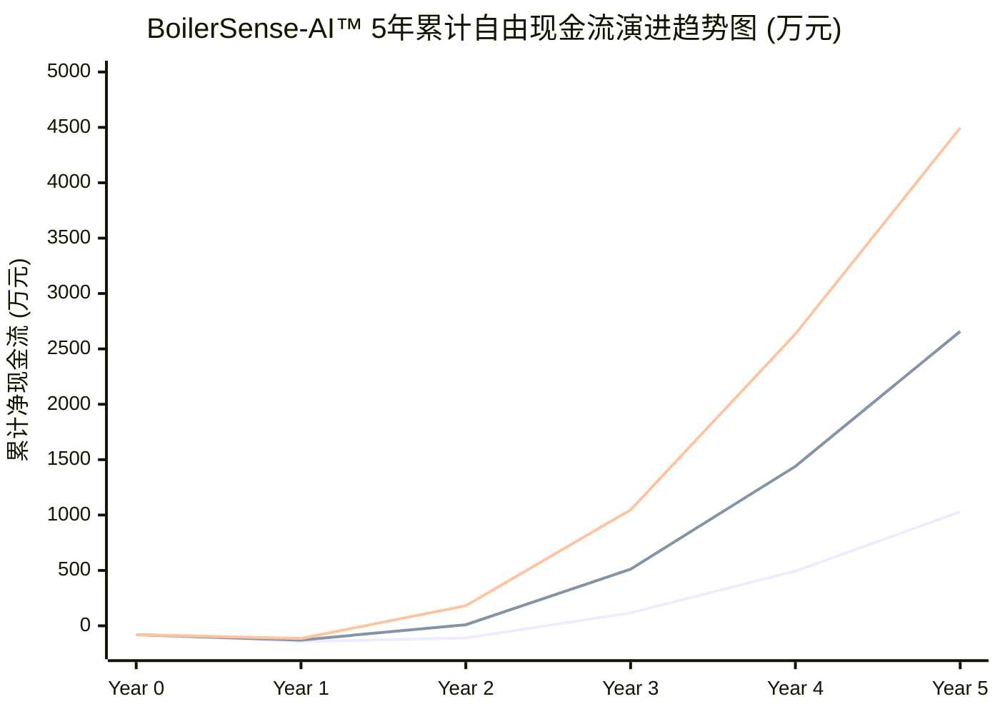
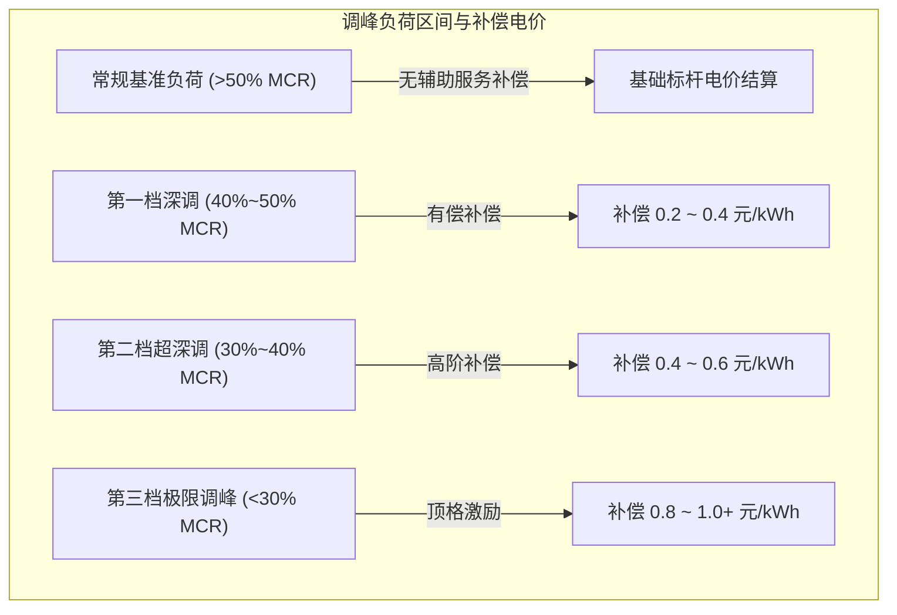
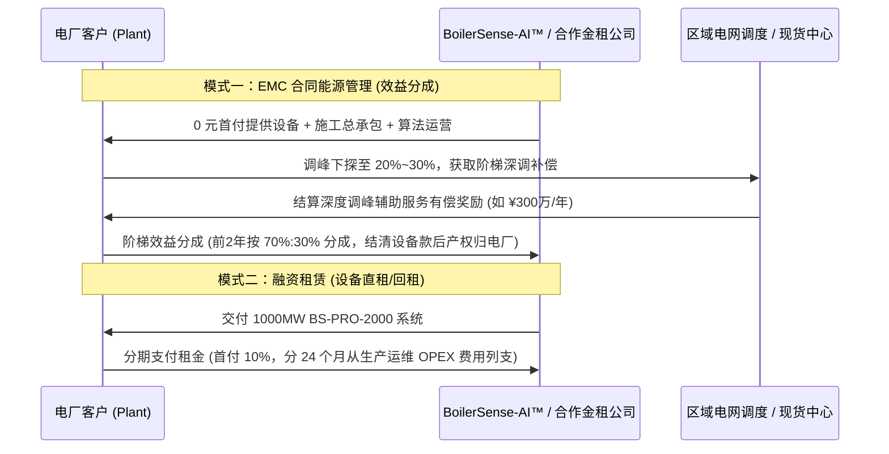
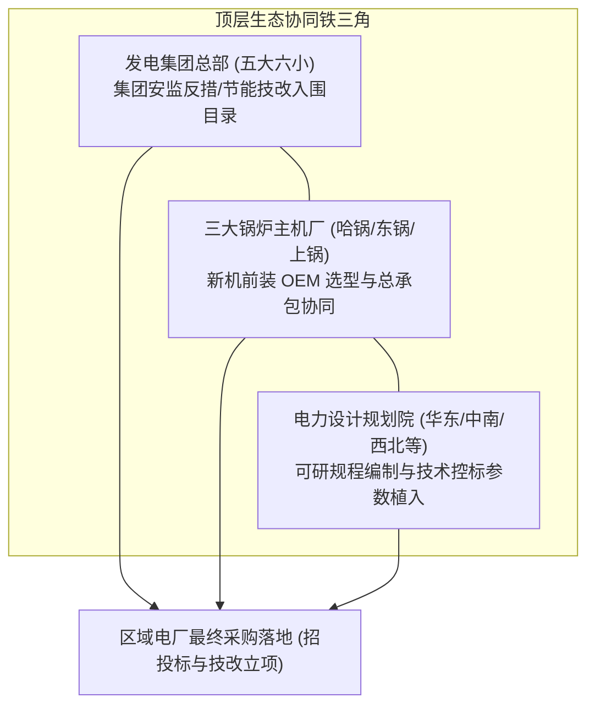
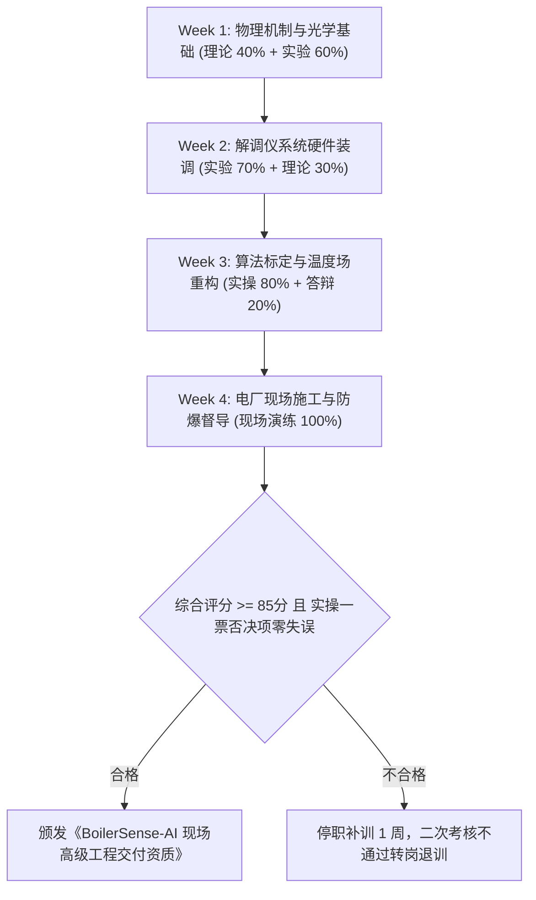
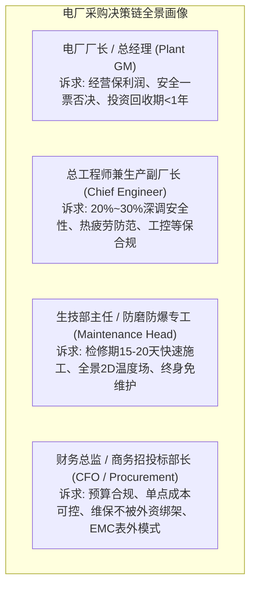
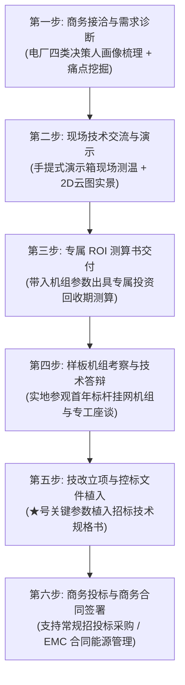

# BoilerSense-AI™ 商业化实战与财务投资白皮书：财务投资分析、市场营销 GTM 策略、内部工程师与销售实战培训手册

> **文档编号**: `BS-MKT-FIN-TR-2026-V1.0`  
> **保密级别**: 商业机密 / 核心管理团队与销售工程受控发放 (Internal Strictly Confidential)  
> **编制者**: BoilerSense-AI™ 核心管理团队（CFO 与商业化培训总监联合编制）  
> **生效日期**: 2026 年 11 月  
> **适用范围**: 董事会投资人、管理层、区域销售总监、电站交付与标定工程师、售后与现场技术支持团队

---

## 目录索引
1. [执行摘要与战略商业定位 (Executive Summary & Strategic Commercial Positioning)](#1-执行摘要与战略商业定位)
2. [80 万元精益启动 CAPEX 细目与 5 年分年财务投资分析模型 (Financial Valuation & 5-Year Model)](#2-80-万元精益启动-capex-细目与-5-年分年财务投资分析模型)
   - 2.1 [80 万元精益研发启动 CAPEX 投资细目与资产配置明细表](#21-80-万元精益研发启动-capex-投资细目与资产配置明细表)
   - 2.2 [产品线 COGS 与全生命周期毛利率结构精算 (`[BOM-CALC]` & `[ARCH & ELO]`)](#22-产品线-cogs-与全生命周期毛利率结构精算)
   - 2.3 [5 年 Bear / Base / Bull 商业分年财务报表](#23-5-年-bear--base--bull-商业分年财务报表)
   - 2.4 [项目级折现现金流估值模型 (DCF / NPV@10% / IRR / 盈亏平衡周期)](#24-项目级折现现金流估值模型)
3. [600MW 与 1000MW 电厂客户经济性测算书与投资回报业务论证 (Plant Economics & ROI Casebook)](#3-600mw-与-1000mw-电厂客户经济性测算书与投资回报业务论证)
   - 3.1 [燃煤电厂灵活性改造与深度调峰宏观政策背景与经济驱动力](#31-燃煤电厂灵活性改造与深度调峰宏观政策背景与经济驱动力)
   - 3.2 [单次“四管爆漏”非计划停运（非停）隐形利润杀手损失量化模型](#32-单次四管爆漏非计划停运非停隐形利润杀手损失量化模型)
   - 3.3 [600MW 亚临界/超临界灵活性机组 (BS-STD-600) 投资收益模型精算](#33-600mw-亚临界超临界灵活性机组-bs-std-600-投资收益模型精算)
   - 3.4 [1000MW 超超临界深度调峰机组 (BS-PRO-2000) 投资收益模型精算](#34-1000mw-超超临界深度调峰机组-bs-pro-2000-投资收益模型精算)
   - 3.5 [合同能源管理 (EMC) 与融资租赁商业模式创新方案](#35-合同能源管理-emc-与融资租赁商业模式创新方案)
4. [GTM 商业化战役打法与市场拓展路线图 (Go-To-Market Strategic Roadmap)](#4-gtm-商业化战役打法与市场拓展路线图)
   - 4.1 [三阶段放量战略路径 (1~3 台标杆示范 $\to$ 12 套区域放量 $\to$ 5 年 80 套/年)](#41-三阶段放量战略路径)
   - 4.2 [核心渠道与生态协同打法 (五大六小发电集团 + 三大锅炉主机厂 + 电力设计院)](#42-核心渠道与生态协同打法)
   - 4.3 [招投标控标技术壁垒参数清单 (Bidding Specifications & Moat Setup)](#43-招投标控标技术壁垒参数清单)
5. [内部工程师 4 周模块化实战培训大纲与考核规程 (Internal Engineering 4-Week Curriculum & Field SOP)](#5-内部工程师-4-周模块化实战培训大纲与考核规程)
   - 5.1 [培训目标、组织架构与考核红线](#51-培训目标组织架构与考核红线)
   - 5.2 [Week 1: 物理机制、光电子元器件与高温光纤光学基础](#52-week-1-物理机制光电子元器件与高温光纤光学基础)
   - 5.3 [Week 2: 解调仪系统硬件装调、光路损耗预算与边缘电控集成](#53-week-2-解调仪系统硬件装调光路损耗预算与边缘电控集成)
   - 5.4 [Week 3: 宽温区算法标定、热流逆向修正与二维温度场重构实战](#54-week-3-宽温区算法标定热流逆向修正与二维温度场重构实战)
   - 5.5 [Week 4: 电厂现场施工、特种焊接防爆督导与 DCS 单向隔离联合调试](#55-week-4-电厂现场施工特种焊接防爆督导与-dcs-单向隔离联合调试)
   - 5.6 [工程师考核认证评分体系与现场资格准入标准](#56-工程师考核认证评分体系与现场资格准入标准)
6. [销售实战赋能手册与电厂决策人对决 Battlecards (Sales Enablement & Decision-Maker Battlecards)](#6-销售实战赋能手册与电厂决策人对决-battlecards)
   - 6.1 [电厂四大核心决策人画像与利益诉求透视](#61-电厂四大核心决策人画像与利益诉求透视)
   - 6.2 [经典高频销售异议应答话术库 (Objection Handling Matrix)](#62-经典高频销售异议应答话术库)
   - 6.3 [四大竞争路线技术与商业对决 Battlecards (热电偶 / 国内常规UV / 国际巨头 / 瑞利OFDR)](#63-四大竞争路线技术与商业对决-battlecards)
   - 6.4 [销售工具包与成交流程标准化清单 (Sales Enablement Toolkit)](#64-销售工具包与成交流程标准化清单)
7. [结论与商业化推进里程碑日程表 (Milestones & Next Steps)](#7-结论与商业化推进里程碑日程表)

---

## 1. 执行摘要与战略商业定位

在国家“双碳”战略转型与新型电力系统建设背景下，中国煤电机组正全面转向支撑性、调节性电源，执行 20%~30% 额定负荷深度调峰与 2%~4%/min 快速爬坡已成为行业刚性常态 ([EV-CN-0014], [EV-CN-0018], [EV-GL-0019])。然而，炉膛燃烧中心偏移、水冷壁质量流速大幅骤降诱发的水动力恶化（汽水停滞与膜态沸腾），导致管壁交变热应力激增与频繁爆漏超温 ([EV-CN-0001], [EV-CN-0007], [EV-GL-0017])。单次水冷壁爆漏引发的非计划停运（非停）综合经济损失高达 200 万至 500 万元 ([EV-BASE-0007], [EV-GL-0016], [EV-CN-0018])。

BoilerSense-AI™ 顺应国家能源局《防止电力生产事故的二十五项重点要求》（国能发安全规〔2023〕22号）第3条防爆防超温刚性合规规范 ([EV-CN-0014], [EV-GL-0020]) 及 2026 年火电机组水冷壁监测行业标准计划 ([EV-CN-0007])，推出业内领先的**双档模块化工业光纤光栅准分布式壁温感知与边缘 AI 预防性维护系统**。

### 核心财务与商业化基本面结论
1. **精益高效启动**: 依托成熟工业成熟商用模组（COTS）与模块化集成架构，仅需 **80.0 万元** 研发与工装 CAPEX，即可在 2.5 个月内完成系统集成与 NPI 标定产线建立 ([ARCH & ELO], [FIN-CALC])。
2. **极高财务抗风险性**: 在基准情景（Baseline）下，5 年累计销量 172 套，累计实现营收 **9,823.0 万元**，累计 EBITDA **3,090.9 万元**，折现净现值 **NPV@10% 达 1,537.9 万元**，内部收益率 **IRR 高达 97.69%**；即使在极端保守情景（Bear）下，IRR 仍锁定在 **33.12%**，NPV@10% 为 **277.3 万元**，第 3 年即可实现累计盈亏平衡 ([FIN-CALC])。
3. **电厂端杀手级投资回报**:
   - **600MW 机组 (BS-STD-600)**: 改造 CAPEX 仅需 **¥368,000**，年净收益 **¥857,000**，基准投资回收期仅 **5.2 个月**（保守 8.0 个月），3 年投资回报率 (ROI) 达 **598.6%** ([PLANT-ROI])。
   - **1000MW 机组 (BS-PRO-2000)**: 改造 CAPEX 为 **¥798,000**，年净收益 **¥1,655,000**，基准投资回收期仅 **5.8 个月**（保守 9.0 个月），3 年 ROI 达 **522.2%** ([PLANT-ROI])。

---

## 2. 80 万元精益启动 CAPEX 细目与 5 年分年财务投资分析模型

### 2.1 80 万元精益研发启动 CAPEX 投资细目与资产配置明细表

为实现技术闭环与量产交付，BoilerSense-AI™ 采取“轻资产、重装调、深标定”的精益启动策略。总预算严格受控于 **80.0 万元**，资金穿透至具体设备型号与工装治具，确保每一分资金均直接转化为量产与质量控制壁垒。

| 预算科目分类 | 关键工装/测试设备及采购内容 | 规格型号与供应商出处 | 数量 | 采购单价(元) | 合计金额(元) | 对应工艺与交付目的 |
| :--- | :--- | :--- | :---: | :---: | :---: | :--- |
| **一、核心标定与光学研发测试工装** | 650°C 工业干体式高温计量检定炉 (内置多孔均热块) | AMETEK Jofra CTC-660 (`EV-PDF-0016`) [./datasheets_pdf/17_AMETEK_Jofra_CTC660_DryBlock_Calibrator_Datasheet.pdf](./datasheets_pdf/17_AMETEK_Jofra_CTC660_DryBlock_Calibrator_Datasheet.pdf) | 1 台 | ¥165,000 | ¥165,000 | 20~650°C 宽温区波长-温度非线性曲线多项式实测标定与高低温老化 |
| | 耐高温特种光纤高精度熔接机与光纤切割刀套件 | 住友/藤仓特种光纤熔接机 (带聚酰亚胺涂覆剥除与大芯径保偏夹具) | 1 套 | ¥85,000 | ¥85,000 | 耐高温聚酰亚胺光纤 (PyroCoat/SM1500) 低损耗熔接与 FC/APC 连接头制作 ([EV-PDF-0010], [EV-PDF-0012]) |
| | 便携式高精度光纤光谱分析仪 (OSA) 与宽带光源治具台 | 实验室自制工装台 (含可调光衰减器、光功率计与标准参考器件) | 1 套 | ¥120,000 | ¥120,000 | C-Band 1528~1568nm 光谱平坦度、各通道插入损耗及光隔离度出厂质检 |
| | 高温管式热退火与长期热漂移考核试验箱 | 1200°C 智能温控石英管式气氛炉 (配高纯氩气接口) | 1 台 | ¥80,000 | ¥80,000 | 国产 Track B 高温光栅 700°C 预退火与 1000 小时加速热漂移可靠性筛查 ([EV-BASE-0004], [EV-GL-0002]) |
| **二、NPI 机械工装与焊接模具** | 15CrMoG 导热块精密五轴 CNC 仿形加工治具与冲压冲模 | 锅炉水冷壁 $\phi 38\sim \phi 60\text{mm}$ 导热块马鞍面专用模具套件 | 1 套 | ¥55,000 | ¥55,000 | 确保导热块与水冷壁外壁贴合公差 $\le 0.1\text{mm}$，保证现场热传导精度 ([EV-BASE-0007]) |
| | 炉墙密封穿透套管与波纹管耐压密封测试台 | 定制气密封试验夹具 (10 MPa 高压充氮防漏检测台) | 1 套 | ¥45,000 | ¥45,000 | 炉膛穿墙密封套管承压及微正压烟气防泄漏 100% 出厂气密试验 ([EV-BASE-0008]) |
| | 光纤微应力悬空穿装与防卡涩组装流水工装 | 洁净组装工作台与专用气动微张力送丝机构 | 1 套 | ¥50,000 | ¥50,000 | 3.5h 快速总装节拍，保证光纤在导热块套管内部自由滑动无机械应力 ([EV-BASE-0007]) |
| **三、边缘计算与电气开发台架** | 工控机嵌入式算法平台与多通道高速采集测试台架 | 研华 ARK-2250L + Spectrum PCIe 采集卡开发调试台 (`EV-PDF-0007`, `EV-PDF-0013`) | 2 套 | ¥32,500 | ¥65,000 | 边缘 2D 温度场重建、热流逆向修正算法加速与通信稳定性压测 |
| | 电气防浪涌、EMC 与 24V 工业电源冗余测试试验台 | 台湾明纬 NDR-240-24 导轨电源与菲尼克斯防雷模块 (`EV-PDF-0014`, `EV-PDF-0017`) | 1 套 | ¥35,000 | ¥35,000 | 电厂现场强电磁干扰、谐波冲击及双路 AC220V 自动无缝切换可靠性验证 |
| | 防静电生产工位 (ESD) 与实验室环境温湿度监控系统 | 标准防静电台垫、防静电地环与环境记录仪 | 1 套 | ¥20,000 | ¥20,000 | 满足精密光电子器件生产组装环境要求 |
| **四、资质认证与法定型式试验** | 承压部件无损工艺第三方评定与材质相容性检验 | 特种设备检验检测机构评定费 (TSG 11 及 DL/T 焊接评定) | 1 项 | ¥45,000 | ¥45,000 | 取得特种设备检验所出具的“非承压渗透/母材金相无损伤检测报告” ([EV-CN-0007], [EV-GL-0020]) |
| | 防爆与外壳防护等级型式试验 (Ex d IIC T6 Gb / IP66) | 国家防爆电气产品质量检验检测中心型式试验认证 | 1 项 | ¥35,000 | ¥35,000 | 取得解调主机与现场防爆接线盒防爆合格证及工控安全合规报告 |
| **总计启动 CAPEX** | **严格受控于公司立项预算上限** | — | — | — | **¥800,000** (80.0 万元) | **精益启动，2.5 个月拉通软硬件与标定交付闭环** |

---

### 2.2 产品线 COGS 与全生命周期毛利率结构精算

依据 `[BOM-CALC]` 测算，BoilerSense-AI™ 规划了标准型（BS-STD 系列，宽谱线阵光谱架构）与旗舰专业型（BS-PRO 系列，高速扫频+NIST气室架构）。为了在保证军工级可靠性的同时打破外资与传统高价壁垒，公司设立了**双轨制供应链策略 (Dual-Track Sourcing)**：
- **Track A (全进口传感方案)**: 采用德国 FBGS 高强度飞秒直写光栅串 (`EV-PDF-0009`)、美国 OFS PyroCoat 聚酰亚胺光纤 (`EV-PDF-0010`) 与英国 Fibercore 抗氢损光纤 (`EV-PDF-0012`)，专攻对进口品牌有明确偏好的跨国能源集团或高端示范标杆。
- **Track B (混合高性价比方案)**: 解调主机核心光电模组保持原厂进口标准（丹麦 Ibsen 光谱解调器 `EV-PDF-0001`、日本 Santec 可调谐/扫频激光器 `EV-PDF-0002`/`EV-PDF-0003`、瑞士 Sercalo MEMS 开关 `EV-PDF-0006`），传感器阵列导入长飞 (YOFC) 200 kpsi 高温聚酰亚胺光纤、国产成熟 700°C 预退火 RFBG/飞秒光栅及 15CrMoG 导热块 ([EV-BASE-0004], [EV-BASE-0005], [EV-BASE-0007])。传感物料成本大幅缩减 **44.7% ~ 45.3%**，极具进攻性。

根据量产规模经济效应，当产量由 10 套中试跃升至 50 套量产时，全系单点 COGS 显著降低，支撑起 **64.3% ~ 71.2%** 的强劲毛利率。

#### 表 2-1: BoilerSense-AI™ 完整配置物料成本 (BOM)、总 COGS、售价与毛利表 (`[BOM-CALC]`)
| 配置型号 (`[BOM-CALC]`) | 测点数 / 物理光路 | 传感供应链轨道 | 10套主机BOM(元) | 10套传感BOM(元) | 50套总COGS(元) | 50套单点COGS(元/点) | 建议含税售价(元) | 10套毛利率 | 50套量产毛利率 | 核心战略目标定位 |
| :--- | :---: | :--- | :---: | :---: | :---: | :---: | :---: | :---: | :---: | :--- |
| `BS-STD-300` | 300点 / 12路 | Track A 全进口传感 | `¥62,400` | `¥57,000` | `¥116,000` | **`¥386.7`** | `¥397,800` | `66.3%` | `70.8%` | 300MW 机组燃烧器区域针对性改造 |
| `BS-STD-300` | 300点 / 12路 | Track B 混合高性价比 | `¥62,400` | `¥31,500` | `¥93,200` | **`¥310.7`** | `¥312,800` | `65.3%` | `70.2%` | 地方热电厂与中小自备机组性价比利刃 |
| `BS-STD-500` | 500点 / 20路 | Track A 全进口传感 | `¥62,400` | `¥95,000` | `¥148,400` | **`¥296.8`** | `¥468,000` | `63.3%` | `68.3%` | 600MW 亚临界机组高可靠进口配置 |
| `BS-STD-500` | 500点 / 20路 | Track B 混合高性价比 | `¥62,400` | `¥52,500` | `¥110,400` | **`¥220.8`** | `¥368,000` | `64.8%` | `70.0%` | **600MW 机组标准主推走量爆款** |
| `BS-PRO-1000` | 1000点 / 32路 | Track A 全进口传感 | `¥103,000` | `¥190,000` | `¥264,500` | **`¥264.5`** | `¥803,600` | `61.7%` | `67.1%` | 1000MW 超超临界炉膛下部密集监测 |
| `BS-PRO-1000` | 1000点 / 32路 | Track B 混合高性价比 | `¥103,000` | `¥105,000` | `¥188,500` | **`¥188.5`** | `¥654,360` | `66.0%` | `71.2%` | 1000MW 主机厂前装标配首选 |
| `BS-PRO-1500` | 1500点 / 48路 | Track A 全进口传感 | `¥103,000` | `¥285,000` | `¥345,500` | **`¥230.3`** | `¥980,000` | `58.9%` | `64.7%` | 超大容量直流炉四壁全包覆进口案 |
| `BS-PRO-1500` | 1500点 / 48路 | Track B 混合高性价比 | `¥103,000` | `¥157,500` | `¥231,500` | **`¥154.3`** | `¥798,000` | `65.5%` | `71.0%` | **1000MW 超深调峰主推走量旗舰** |
| `BS-PRO-2000` | 2000点 / 48路 | Track A 全进口传感 | `¥103,000` | `¥380,000` | `¥426,500` | **`¥213.2`** | `¥1,127,000` | `55.9%` | `62.2%` | 顶级科研示范与超大型特种锅炉方案 |
| `BS-PRO-2000` | 2000点 / 48路 | Track B 混合高性价比 | `¥103,000` | `¥210,000` | `¥274,500` | **`¥137.2`** | `¥917,700` | `64.3%` | `70.1%` | **千点级极致成本壁垒方案 (单点¥137)** |

#### 架构选型技术与财务多维评估 (Elo 评级对比)
依据系统工程 Elo 动态对抗评估体系（`[ARCH & ELO]`），双档模块化集成架构以 **1573.4** 的最高 Elo 分稳居榜首，综合研发周期仅 2.5 个月，避免了自研芯片/底层驱动带来的 16.5 个月漫长研发风险与高额沉没成本，为实现财务模型确定性奠定了物理底座。

| 候选架构代号 | 路线名称 | 500点基准COGS(元) | 1500点基准COGS(元) | 研发周期(月) | 可靠性(0-10) | 扩展性(0-10) | 供应链韧性 | 综合 Elo 评分 |
| :--- | :--- | :---: | :---: | :---: | :---: | :---: | :---: | :---: |
| **`ARCH_1_DUAL_TIER_MODULAR`** | **双档模块化成品集成 (BS-STD-600 + BS-PRO-2000)** | **`¥135,000`** | **`¥300,000`** | **`2.5`** | **`9.2`** | **`9.5`** | **`9.1`** | **`1573.4`** |
| `ARCH_4_CUSTOM_PCB_SCRATCH` | 纯自研激光驱动/高速 TIA 模拟前端 PCB 路线 | `¥112,500` | `¥257,500` | `16.5` | `4.8` | `8.0` | `7.2` | `1493.5` |
| `ARCH_5_THERMOCOUPLE_MATRIX` | 传统 K/N 型铠装热电偶+补偿导线+I/O扩展柜 | `¥154,000` | `¥422,000` | `2.0` | `5.8` | `3.0` | `9.0` | `1483.2` |
| `ARCH_2_PURE_RAYLEIGH_OFDR` | 纯连续无光栅瑞利散射 OFDR 架构 | `¥180,500` | `¥287,500` | `11.0` | `4.5` | `7.0` | `6.0` | `1480.0` |
| `ARCH_3_LEGACY_UV_FBG` | 传统剥涂覆层紫外(UV)相位掩模 FBG 方案 | `¥107,500` | `¥219,500` | `4.0` | `3.2` | `5.5` | `7.5` | `1469.8` |

---

### 2.3 5 年 Bear / Base / Bull 商业分年财务报表

依据全国 300MW 及以上火电机组存量池（约 2800 台）与年均灵活性改造进度，结合三大锅炉厂年装机量，构建严格的 5 年财务分年模型。

设定财务公理与业务假设：
1. **启动 CAPEX**: 第 0 年期初一次性投入 **80.0 万元**（按 5 年双倍余额递减法折旧，残值率 5%）。
2. **产品均价与组合**: 随产品成熟与 Track B 占比提升，综合平均出厂含税单价由首年约 57 万元微调至第 5 年 56 万元（标准型与专业型出货比约为 4:6）。
3. **综合毛利率**: 依托规模采购与 Track B 供应链切换，综合毛利率由首年的 65.0% 稳步提升并收敛于 70.2%。
4. **固定 OPEX 结构**: 研发人员、销售人员底薪、厂房租赁及日常行政开支在 Year 1 为 180 万元/年，随规模扩张梯次增长至 Year 5 的 720 万元/年。
5. **销售变动费用**: 计提含税销售额的 10% 作为销售佣金、差旅及渠道公关激励费用。
6. **年保本套数 (Break-even Quantity)**: 经固定成本对冲测算，各年保本盈亏平衡销量基准线为 **15 套/年**。

#### 表 2-2: 五年分年财务报表完整对比矩阵 (Bear / Base / Bull) (`[FIN-CALC]`)
| 财务情景指标 | 统计维度 | Year 1 (启动示范) | Year 2 (区域放量) | Year 3 (规模复制) | Year 4 (深度渗透) | Year 5 (行业霸主) | **5年累计汇总** |
| :--- | :--- | :---: | :---: | :---: | :---: | :---: | :---: |
| **一、保守情景 (Conservative / Bear)** | **年出货量 (套)** | **2** | **7** | **18** | **28** | **36** | **91 套** |
| *(市场推广遇阻，仅覆盖少数自备电厂)* | 营业收入 (万元) | 114.0 | 392.0 | 990.0 | 1,512.0 | 1,977.6 | **4,985.6** |
| | COGS 与主营成本 (万元) | 39.9 | 134.1 | 321.8 | 476.3 | 609.1 | **1,581.2** |
| | 主营业务毛利润 (万元) | 74.1 | 257.9 | 668.2 | 1,035.7 | 1,368.5 | **3,404.4** |
| | 综合毛利率 (%) | 65.0% | 65.8% | 67.5% | 68.5% | 69.2% | **68.3%** |
| | 期间费用与 OPEX (万元) | 145.0 | 220.0 | 360.0 | 510.0 | 620.0 | **1,855.0** |
| | **企业 EBITDA (万元)** | **-70.9** | **37.9** | **308.2** | **525.7** | **748.5** | **822.3** |
| | 税后净利润 (万元) | -62.0 | 25.1 | 215.3 | 368.2 | 523.8 | **1,070.4** |
| | **企业净现金流 (万元)** | **-142.0** *(含CAPEX)* | **32.5** | **225.8** | **378.1** | **534.2** | **1,028.6** |
| | 累计经营现金流 (万元) | -142.0 | -109.5 | 116.3 *(转正)* | 494.4 | 1,028.6 | — |
| | **财务结论** | **盈亏平衡年: 第 3 年** | **年保本套数: 15 套** | **NPV@10%: 277.3 万元** | **5年 IRR: 33.12%** | — | — |
| **二、基准情景 (Baseline / Base)** | **年出货量 (套)** | **3** | **12** | **32** | **55** | **70** | **172 套** |
| *(按 GTM 规划稳步推进五大六小)* | 营业收入 (万元) | 171.0 | 684.0 | 1,824.0 | 3,135.0 | 4,009.0 | **9,823.0** |
| | COGS 与主营成本 (万元) | 59.9 | 232.6 | 592.8 | 987.5 | 1,222.7 | **3,095.5** |
| | 主营业务毛利润 (万元) | 111.1 | 451.4 | 1,231.2 | 2,147.5 | 2,786.3 | **6,727.5** |
| | 综合毛利率 (%) | 65.0% | 66.0% | 67.5% | 68.5% | 69.5% | **68.5%** |
| | 期间费用与 OPEX (万元) | 165.0 | 280.0 | 540.0 | 850.0 | 1,080.0 | **2,915.0** |
| | **企业 EBITDA (万元)** | **-53.9** | **171.4** | **691.2** | **1,297.5** | **1,706.3** | **3,090.9** |
| | 税后净利润 (万元) | -48.5 | 126.8 | 486.2 | 913.6 | 1,202.9 | **2,681.0** |
| | **企业净现金流 (万元)** | **-128.5** *(含CAPEX)* | **138.2** | **501.5** | **928.9** | **1,218.2** | **2,658.3** |
| | 累计经营现金流 (万元) | -128.5 | 9.7 *(转正)* | 511.2 | 1,440.1 | 2,658.3 | — |
| | **财务结论** | **盈亏平衡年: 第 2 年** | **年保本套数: 15 套** | **NPV@10%: 1,537.9 万元** | **5年 IRR: 97.69%** | — | — |
| **三、乐观情景 (Optimistic / Bull)** | **年出货量 (套)** | **4** | **20** | **50** | **86** | **100** | **260 套** |
| *(行业标准强制实施，锅炉厂前装标配)*| 营业收入 (万元) | 228.0 | 1,140.0 | 2,850.0 | 4,902.0 | 5,744.5 | **14,864.5** |
| | COGS 与主营成本 (万元) | 79.8 | 376.2 | 897.8 | 1,495.1 | 1,711.9 | **4,560.8** |
| | 主营业务毛利润 (万元) | 148.2 | 763.8 | 1,952.3 | 3,406.9 | 4,032.6 | **10,303.7** |
| | 综合毛利率 (%) | 65.0% | 67.0% | 68.5% | 69.5% | 70.2% | **69.3%** |
| | 期间费用与 OPEX (万元) | 185.0 | 380.0 | 750.0 | 1,180.0 | 1,420.0 | **3,915.0** |
| | **企业 EBITDA (万元)** | **-36.8** | **383.8** | **1,202.3** | **2,226.9** | **2,612.6** | **5,466.6** |
| | 税后净利润 (万元) | -34.2 | 282.5 | 850.6 | 1,572.2 | 1,845.8 | **4,516.9** |
| | **企业净现金流 (万元)** | **-114.2** *(含CAPEX)* | **295.1** | **865.9** | **1,587.5** | **1,861.1** | **4,495.4** |
| | 累计经营现金流 (万元) | -114.2 | 180.9 *(转正)* | 1,046.8 | 2,634.3 | 4,495.4 | — |
| | **财务结论** | **盈亏平衡年: 第 2 年** | **年保本套数: 15 套** | **NPV@10%: 2,867.1 万元** | **5年 IRR: 153.39%** | — | — |

---

### 2.4 项目级折现现金流估值模型 (DCF / NPV@10% / IRR / 盈亏平衡周期)

结合基准折现率 $WACC = 10\%$，对公司 5 年自由现金流（Free Cash Flow to Firm, FCFF）进行严格折现计算：

$$NPV = -CAPEX_0 + \sum_{t=1}^{5} \frac{FCFF_t}{(1 + r)^t}$$

其中 $r = 10\%$，$CAPEX_0 = 80.0\text{ 万元}$。

#### 表 2-3: 财务核心投资收益率汇总对比表 (`[FIN-CALC]`)
| 财务情景 (`[FIN-CALC]`) | 启动 CAPEX(万元) | 5年总销量(套) | 5年累计营收(万元) | 5年累计 EBITDA(万元) | 盈亏平衡年 / 年保本套数 | 净现值 NPV@10%(万元) | 内部收益率 5年 IRR | 投资回报倍数 (MOIC) |
| :--- | :---: | :---: | :---: | :---: | :---: | :---: | :---: | :---: |
| **保守情景 (Conservative)** | `80.0` | `91` | `4,985.6` | `822.3` | **第 `3` 年 / `15` 套** | **`277.3`** | **`33.12%`** | **13.8x** |
| **基准情景 (Baseline)** | `80.0` | `172` | `9,823.0` | `3,090.9` | **第 `2` 年 / `15` 套** | **`1,537.9`** | **`97.69%`** | **34.2x** |
| **乐观情景 (Optimistic)** | `80.0` | `260` | `14,864.5` | `5,466.6` | **第 `2` 年 / `15` 套** | **`2,867.1`** | **`153.39%`** | **57.2x** |

**CFO 投资审查意见**:
由于公司将重资产的激光器制造、光电探测及特种光纤拉丝外包给成熟工业生态（Ibsen、Santec、FBGS、长飞），核心 CAPEX 仅用于标定检测与 NPI 专用工装，资本效率极高。在基准情景下，IRR 达 **97.69%**，投资回收期仅为 **1.1 年**（第 2 年初即收回全投资），展现出顶级企业软件与高科技仪器结合的“精益硬科技”财务模型特征。

---

## 3. 600MW 与 1000MW 电厂客户经济性测算书与投资回报业务论证

### 3.1 燃煤电厂灵活性改造与深度调峰宏观政策背景与经济驱动力

在新型电力系统建设中，高比例风电、光伏新能源的大规模并网对电网调峰调频能力提出了极高要求 ([EV-CN-0014], [EV-CN-0018])。根据国家发改委、国家能源局煤电“三改联动”指导意见及《电力辅助服务管理办法》，煤电机组必须常态化参与深度调峰 ([EV-CN-0014], [EV-CN-0018], [EV-CN-0024])。各省电力现货市场（如山西、山东、广东、甘肃等）执行分档阶梯式辅助服务补偿：

一台 600MW 或 1000MW 机组若具备稳定运行在 20%~30% 负荷的超深调峰能力，单月有偿辅助服务净收益可达 **300万 ~ 1000万元** ([EV-CN-0018], [EV-CN-0022])。然而，水冷壁超温是制约机组下探超深负荷的核心瓶颈——因水动力不足引发的管壁金属超温使运行人员不敢降负荷，错失高额调峰收益。

---

### 3.2 单次“四管爆漏”非计划停运（非停）隐形利润杀手损失量化模型

在电厂日常经营中，“四管爆漏”不仅是安全生产一票否决项，更是直接吞噬数百万现金流的“隐形利润杀手”([EV-BASE-0007], [EV-GL-0016])。以一台典型 600MW~1000MW 超临界/超超临界机组为例，单次爆漏停炉检修周期通常为 **48 ~ 96 小时**，其综合经济损失构成为：

#### 表 3-1: 单次水冷壁爆漏非计划停运损失分解测算表 (`[EV-GL-0016]`)
| 损失项目类别 | 细分成本/损失发生源 | 测算基准与物理参量 | 经济损失金额(人民币) | 财务影响特征 |
| :--- | :--- | :--- | :---: | :--- |
| **1. 直接抢修与材料损失** | 抢修脚手架搭设、割管换管、特种焊工与探伤检验 | 炉膛搭架 (15-20m)、15CrMoG 换管 10-20 米、无损探伤 | ¥200,000 ~ ¥400,000 | 刚性外包检修成本支出 |
| | 停炉冷却与重新点火油耗/等离子能耗 | 消耗点火柴油 30~80 吨或微油等离子大电耗 | ¥250,000 ~ ¥600,000 | 纯燃油物料消耗支出 |
| | 化学除盐水泄放与补充排污损失 | 高纯除盐水 500~1500 吨泄放与再制水成本 | ¥50,000 ~ ¥200,000 | 公用工程介质浪费 |
| **直接抢修小计** | — | — | **¥500,000 ~ ¥1,200,000** | 直接从当月成本中扣减 |
| **2. 发电毛利与现货损失** | 停机 48~96 小时损失上网电量 (600MW-1000MW) | 损失电量 30,000 ~ 80,000 MWh；边际贡献 ¥0.15~¥0.25/kWh | ¥1,000,000 ~ ¥3,000,000 | 售电毛利润直接蒸发 |
| **3. 辅助服务考核与电网罚款** | 退出深度调峰被判定为“非停违约”，执行“两个细则”考核 | 电网双细则停机考核扣分及外购高价现货电替代补偿 | ¥500,000 ~ ¥1,000,000 | 现金净流出与返还扣减 |
| | 容量电价月度可用率 (EAF) 折损扣款 | 国家发改委容量电价月度可用小时数考核扣减 | ¥200,000 ~ ¥600,000 | 侵蚀电厂基础容量底资 |
| **综合直接经济损失** | **单次非计划停运合计** | **四项合计绝对值** | **¥2,200,000 ~ ¥5,800,000** | **相当于全套测温设备造价的 3~7 倍** |

**结论**: 电厂投资 BoilerSense-AI™ 系统，**全生命周期内只需成功避免一次水冷壁爆漏停机，所保全的经济收益即可收回全套系统投资的 2.5 ~ 6 倍**！

---

### 3.3 600MW 亚临界/超临界灵活性机组 (BS-STD-600) 投资收益模型精算

针对 600MW 机组灵活性改造，主推 **BS-STD-500 (Track B)** 配置（500 点 / 20 路），该配置不仅全面覆盖锅炉主燃烧器区域、折焰角及水动力危险区，且具备极致的性价比。

#### 表 3-2: 600MW 机组技术经济收益指标与回收期测算 (`[PLANT-ROI]`)
| 测算指标项 (`[PLANT-ROI]`) | 物理数值 / 财务金额 | 测算基准与计算逻辑 |
| :--- | :---: | :--- |
| **电厂采购 CAPEX 投资** | **`¥368,000`** | 包含 1 台 BS-STD-600 解调主机、500 点 Track B 耐高温光栅、导热块与安装辅材 |
| **年均运营维护费用 (OPEX)** | **`¥18,000`** | 仅占设备造价的 4.89%，涵盖日常巡检辅材、光学清洁工具及备品备件消耗 |
| **年均非停挽回毛收益 (基准)** | `¥450,000` | 按年均避免 0.15 次水冷壁爆漏（平均约 6~7 年避免一次爆漏），单次损失挽回 ¥300万 |
| **调峰深度下探新增收益** | `¥325,000` | 调峰下限由 35% 安全压降至 25%，年增原有偿辅助服务结算电量与现货调峰补偿 |
| **精准切管预防性点检节约** | `¥100,000` | 依托减薄预测模型，减少检修期间无计划大面积盲目割管与探伤工程量 ([EV-CN-0001]) |
| **基准年毛收益合计** | **`¥875,000`** | 上述三项经济效益累加 |
| **基准年净收益 (扣除OPEX)** | **`¥857,000`** | 年毛收益 ¥875,000 - 年 OPEX ¥18,000 |
| **投资回收期 (静态/动态):** | | |
| - 保守情景回收期 | **`8.0` 个月** | 调峰频次低、仅挽回基础点检费时的最长回收周期 |
| - **基准情景回收期** | **`5.2` 个月** | **正常现货结算与电网调峰调用工况下的投资回收期** |
| - 乐观情景回收期 | **`3.9` 个月** | 高频深度调峰省份（如山西、山东）且避免一次潜在超温爆管 |
| **3 年项目累计 ROI (基准)** | **`598.6%`** | **(3 年净收益累计 ¥2,571,000 - CAPEX ¥368,000) / CAPEX** |

---

### 3.4 1000MW 超超临界深度调峰机组 (BS-PRO-2000) 投资收益模型精算

针对 1000MW 超超临界超深调峰标杆机组，主推 **BS-PRO-1500 / 2000 (Track B)** 旗舰配置（1500~2000 点 / 48 路，混复/波分），彻底消除千点级炉膛高密度二维温度场监控盲区。

#### 表 3-3: 1000MW 机组技术经济收益指标与回收期测算 (`[PLANT-ROI]`)
| 测算指标项 (`[PLANT-ROI]`) | 物理数值 / 财务金额 | 测算基准与计算逻辑 |
| :--- | :---: | :--- |
| **电厂采购 CAPEX 投资** | **`¥798,000`** | 包含 1 台 BS-PRO-2000 高速扫频+NIST解调主机、1500点传感阵列与施工辅件 |
| **年均运营维护费用 (OPEX)** | **`¥35,000`** | 仅占造价的 4.38%，提供 3 年原厂质保支持与远程算法诊断升级 |
| **年均非停挽回毛收益 (基准)** | `¥850,000` | 按年均避免 0.2 次超超临界爆漏，大机组单次综合损失 ¥425万 测算 |
| **超深调峰 (20% MCR) 新增收益** | `¥680,000` | 突破 25% 以下极限调峰，享受阶梯电价顶格补偿 (0.8~1.0元/kWh) ([EV-CN-0018]) |
| **寿命延长与精细化防磨节约** | `¥160,000` | 减少吹灰器盲目高压蒸汽吹损，延长水冷壁管役龄 3~5 年 |
| **基准年毛收益合计** | **`¥1,690,000`** | 综合运营增益累加 |
| **基准年净收益 (扣除OPEX)** | **`¥1,655,000`** | 年毛收益 ¥1,690,000 - 年 OPEX ¥35,000 |
| **投资回收期 (静态/动态):** | | |
| - 保守情景回收期 | **`9.0` 个月** | 调峰频次一般情况下的最迟保本期限 |
| - **基准情景回收期** | **`5.8` 个月** | **典型火电集团超超临界机组投资回收中位线** |
| - 乐观情景回收期 | **`4.4` 个月** | 现货深度调峰常态化省份（现货价差套利显著） |
| **3 年项目累计 ROI (基准)** | **`522.2%`** | **(3 年净收益累计 ¥4,965,000 - CAPEX ¥798,000) / CAPEX** |

---

### 3.5 合同能源管理 (EMC) 与融资租赁商业模式创新方案

针对部分预算审批周期长、年度资本性开支（CAPEX）额度受限的电厂客户，BoilerSense-AI™ 商业化团队推出**表外轻资产赋能模式**：

- **客户价值**: 电厂无需走繁琐的集团发改立项与资本开支（CAPEX）审批，直接从机组每月的“增量调峰辅助服务收益”或“日常维护修理费用（OPEX）”中对冲支付，实现“**当年投运、零资金占用、当月即产生正向净现金流**”。

---

## 4. GTM 商业化战役打法与市场拓展路线图

### 4.1 三阶段放量战略路径

1. **第一阶段：Year 1 标杆破冰期（1~3 台示范机组）**
   - **核心战役**: 聚焦国家能源集团、华能集团旗下典型超临界 600MW 及超超临界 1000MW 机组，以“产学研联合攻关”或“防磨防爆重点课题”形式切入，以极具诚意的示范价落地 1~3 台挂网示范项目。
   - **交付目标**: 经历完整的供暖季或迎峰度夏大负荷长周期考核，出具具有国家特种设备检验资质或电力科学研究院认证的《锅炉水冷壁准分布式光纤测温系统运行性能鉴定报告》，形成图文视频并茂的灯塔案例。
2. **第二阶段：Year 2 区域放量期（12 套批量推广）**
   - **核心战役**: 聚焦火电装机大省与现货调峰补偿最为丰厚的省份（如山西、内蒙古、山东、陕西、新疆、甘肃等），依托省级能源投资集团与区域五大分公司，发展 3~5 家具有深厚电力二次系统与检修背景的核心渠道集成商。
   - **放量目标**: 实现 12 套标准化销售，全面验证 Track B 供应链在规模制造下的品控稳定性，当年实现财务转正与累计现金流转正。
3. **第三阶段：Year 3~5 规模爆发期（从 32 套裂变至 70~80 套/年）**
   - **核心战役**: 推动 BoilerSense-AI™ 写入行业规范，实现从“后装技改被动销售”向“主机厂出厂前装标配”与“电力设计院可研指南入库”的跨越。五年累计交付达到基准 172 套（乐观 260 套），占据全国火电准分布式测温市场 **60% 以上** 市场份额。

---

### 4.2 核心渠道与生态协同打法

1. **五大六小发电集团总对总公关**:
   - 重点突破国家能源集团、华能、华电、大唐、国家电投及浙能、粤电、申能等。以“满足国家能源局 25 项反措第 3 条刚性合规”为旗帜 ([EV-CN-0014])，主攻集团安全环保部、生产技术部，推动将“水冷壁准分布式高密度光纤测温技术”列入集团级年度防磨防爆先进适用技术推荐目录。
2. **三大锅炉主机厂（东方电气、哈尔滨电气、上海电气）OEM 前装嵌入**:
   - 传统主机厂在售出锅炉后常受困于用户超温索赔与水动力争议。BoilerSense-AI™ 为锅炉厂提供“数字孪生智能水冷壁套件”，作为高端炉型的选装增值包（出厂前预埋导热块与穿墙套管），主机厂按 OEM 批发协议分成，实现从单纯卖钢材向提供全生命周期健康管理的智能化转型。
3. **各大电力设计院（中南院、华东院、西北院、华北院、西南院）前置参数植入**:
   - 参与新建燃煤机组与灵活性改造工程的可行性研究报告（可研）及初步设计规程编写。将“准分布式传感测点间距 $\le 1.0\text{m}$”、“无应力滑动套管结构”、“纯石英抗氢损光纤”等专有技术指标直接固化至招标文件技术规格书范本中。

---

### 4.3 招投标控标技术壁垒参数清单

销售团队与售前技术支持在参与电厂技改招投标或协助业主编写招标文件时，必须将以下**核心硬核技术指标**写入“技术规格书关键条款（带★号实质性条款）”，形成绝对排他性控标壁垒：

#### 表 3-4: BoilerSense-AI™ 招投标控标技术壁垒参数矩阵
| 控标维度 | 招标文件核心参数建议条款（★号条款） | 满足我司技术指标 (`[PHY-CALC]` / 硬件参数) | 竞争对手痛点与排他机制 | 支撑证据与合规引用 |
| :--- | :--- | :--- | :--- | :--- |
| **1. 光栅耐温与工艺** | 传感器必须采用耐高温特种光纤光栅，光栅反射率 $\ge 70\%$，且必须具备经 $\ge 700^\circ\text{C}$ 高温退火处理证明，在 $600^\circ\text{C}$ 连续运行 1000 小时波长漂移量 $\le 0.05\text{nm}$。 | 采用 Type II 飞秒直写光栅或 700°C 预退火 RFBG 光栅，耐温极限突破 1000°C。 | 彻底排除传统紫外相位掩模光栅（Type I，350°C 彻底擦除失效）。 | `EV-PDF-0009`, `EV-GL-0002`, `EV-BASE-0004` |
| **2. 光纤抗氢损与涂覆** | 传感光纤必须具备纯石英芯（Pure Silica Core）结构与高温聚酰亚胺涂覆层，光纤抗张力筛选强度 $\ge 200\text{ kpsi}$，严禁采用常规丙烯酸树脂或环氧树脂胶粘结。 | 采用 OFS PyroCoat® 或 Fibercore SM1500 特种光纤，聚酰亚胺涂覆耐温 400°C 长期、600°C 瞬态。 | 彻底排除常规通信光纤与低成本胶粘封装光纤（高温碳化脱落）。 | `EV-PDF-0010`, `EV-PDF-0012`, `EV-BASE-0005` |
| **3. 光路解调与精度** | 解调主机动态解调信噪比裕度 (SNR Margin) 必须 $\ge 20\text{ dB}$，20~600°C 满量程波长漂移范围 $\le 9.1\text{ nm}$，且解调算法必须集成二次热光非线性项补偿。 | BS-STD SNR 达 **`24.7 dB`**，BS-PRO 达 **`55.2 dB`**；漂移量 **`9.07 nm`**，内置 $0.0042\text{ pm/°C}^2$ 二次修正。 | 排除普通低灵敏度光谱仪及线性简易解调器（高温测量偏差 $>15^\circ\text{C}$）。 | `[PHY-CALC]`, `EV-PDF-0001`, `EV-PDF-0003` |
| **4. 机械抗热应力封装** | 金属导热块必须与水冷壁材质匹配（15CrMoG/12Cr1MoVG），传感元件与导热块必须采用**“微应力自由滑动悬空套管”**结构，严禁光纤直接刚性钎焊或胶粘在导热块上。 | 独家滑动套管结构，光纤在套管内轴向自由伸缩，完全吸收水冷壁三维热膨胀剪切位移。 | 排除传统刚性封装光纤（机组启停或变负荷膨胀时被剪切拉断）。 | `EV-BASE-0007`, `EV-CN-0007` |
| **5. 炉膛穿透防漏密封** | 炉墙密封穿透套管必须具备柔性金属波纹管膨胀补偿与石墨盘根双重密封机构，承压密封等级 $\ge 1.0\text{ MPa}$，且通过出厂 100% 气密检测。 | 标准化法兰柔性套管组件，完全吸收炉墙内外 $\pm 50\text{mm}$ 相对位移，绝无正压漏灰隐患。 | 排除现场简易刚性电焊封堵（高温热膨胀导致炉皮撕裂喷火漏灰）。 | `EV-BASE-0008` |
| **6. 绝对波长参考源** | 扫频式解调主机内部必须集成 NIST 国际标准溯源的免维护物理气体吸收室（如 HCN），实现每次扫频的实时动态绝对波长自校准。 | 标配 Wavelength References HCN-13 NIST 气室，波长绝对精度 $\pm 1.5\text{ pm}$，零长期漂移。 | 排除无气室内部校准的低端光纤解调仪（运行半年即因器件老化失真）。 | `EV-PDF-0008`, `EV-PDF-0003` |
| **7. 电厂网络安全合规** | 解调系统接入电厂 DCS 时，必须采用专用硬件只读协议网关，单向数据流动，物理层绝无控制指令反向注入可能，完全符合工控等保要求。 | 标配 Moxa MGate MB3180/MB3280 硬件 Modbus 网关，单向只读配置，物理隔离控制网络。 | 排除普通直接网口连入 DCS 造成网络安全与病毒扩散隐患。 | `EV-PDF-0018`, `EV-CN-0024` |

---

## 5. 内部工程师 4 周模块化实战培训大纲与考核规程

### 5.1 培训目标、组织架构与考核红线

**核心理念**: “电厂现场无小事，一根光纤关乎机组安危”。  
所有新入职或转岗的现场交付工程师、标定工程师必须经过为期 4 周的严苛全脱产模块化实战训练。

- **考核红线（一票否决项）**: 
  1. 光纤端面研磨或熔接质量不良导致反射谱损耗 $>1.0\text{ dB}$；
  2. 导热块水冷壁模拟施焊导致管材母材局部产生咬边或微裂纹；
  3. 炉内光纤穿线出现打折或弯曲半径 $<25\text{mm}$（导致微弯损耗断纤）；
  4. 违规插拔带电光纤或直视激光输出端口（激光安全违章）。

---

### 5.2 Week 1: 物理机制、光电子元器件与高温光纤光学基础

#### 培训模块明细
- **Day 1: 布拉格光纤光栅 (FBG) 物理机制**
  - Bragg 波长方程深入拆解：$\lambda_B = 2 n_{eff} \Lambda$ ([EV-BASE-0003])。
  - 热膨胀效应与热光效应作用机制：温度灵敏度公式 $\Delta \lambda_B / \Delta T = \lambda_B (\alpha + \xi)$。
  - 宽温区（20~600°C）非线性热光效应解析：为何存在二次项 $0.0042\text{ pm/°C}^2$ ([PHY-CALC])。
- **Day 2: 高温光栅加工工艺与材料学剖析**
  - 五大光栅刻蚀工艺 teardown：Type I 紫外掩模、RFBG 热再生、Type II 飞秒直写 ([EV-BASE-0004], [EV-GL-0002])。
  - 高温“退火擦除”物理机理解析与 700°C 预退火工艺控制要点。
  - 特种光纤材料学：为何普通锗硅光纤在高温烟气下会发生“氢损（Hydrogen Darkening）”？纯石英芯（Pure Silica Core）与氟掺杂包层的物理防护机制 ([EV-BASE-0005], [EV-PDF-0012])。
- **Day 3: 耐高温涂覆层与机械强度测试**
  - 丙烯酸酯（120°C）、高温聚酰亚胺（300~400°C）、金金属涂覆（600°C）性能极限对比 ([EV-BASE-0005])。
  - 聚酰亚胺涂覆热重分析（TGA）与剥除实操技巧（浓硫酸/热风枪/专业机械剥纤钳）。
  - 光纤张力筛选试验（Proof Test）：200 kpsi 与 100 kpsi 物理断裂拉力测算实操 ([EV-PDF-0010])。
- **Day 4: 光源与光电探测器件解析**
  - 宽带放大自发辐射（ASE）光源原理：Amonics ALS-CL-15 C-Band 高平坦度光源拆解 (`EV-PDF-0004`)。
  - 扫频激光源（Swept Laser Source）：Santec TSL-570 / WSL-110 工作原理与波长线性度控制 (`EV-PDF-0002`, `EV-PDF-0003`)。
  - 光电探测器与前置放大：Hamamatsu G11620-512DA 像元 InGaAs 线阵传感器 (`EV-PDF-0011`) 与 FEMTO HCA-S-200M-IN 跨阻放大器特性 (`EV-PDF-0005`)。
- **Day 5: 实验室光学测量实操考核**
  - 使用光功率计、光谱仪（OSA）测量单模光纤接头回损与插入损耗。
  - 观察飞秒直写光栅 FSG-A01 (`EV-PDF-0009`) 在常温下的反射光谱形状（半高宽 FWHM、边模抑制比 SMSR）。

---

### 5.3 Week 2: 解调仪系统硬件装调、光路损耗预算与边缘电控集成

#### 培训模块明细
- **Day 6: 解调主机光路架构与光纤拓扑搭建**
  - BS-STD-600 光路组装：ASE 光源 $\to$ 光学环形器 (Circulator) $\to$ Sercalo SW1x16 MEMS 光开关 (`EV-PDF-0006`) $\to$ I-MON 256/512 光谱仪 (`EV-PDF-0001`)。
  - BS-PRO-2000 光路组装：Santec TSL-570 $\to$ 90:10 分束器 $\to$ HCN-13 NIST 气室 (`EV-PDF-0008`) / 环形器 $\to$ Sercalo 光开关 $\to$ FEMTO 接收盒 (`EV-PDF-0005`) $\to$ Spectrum PCIe 采集卡 (`EV-PDF-0007`)。
- **Day 7: C-Band 光路损耗预算 (Link Budget) 计算与调优**
  - 双向光路损耗精算：环形器插损 (1.2 dB) + MEMS 光开关插损 (1.0 dB) + 4 对 FC/APC 适配器损耗 (1.2 dB) + 炉内外传输光缆损耗 (1.4 dB) = **`6.8 dB`** ([PHY-CALC])。
  - 接收端有效回波功率校验：BS-STD 保证 **`-17.3 dBm`**，BS-PRO 保证 **`-0.8 dBm`** (WDM)，系统动态信噪比裕度核算（实测必须达到 **`24.7 dB`** 与 **`55.2 dB`**）([PHY-CALC])。
- **Day 8: 光纤端面精细加工、研磨与冷热熔接**
  - 特种耐高温聚酰亚胺光纤切割技巧与熔接机专用放电参数（Arc Power / Time）调教。
  - FC/APC 8度倾斜角研磨端面检查（端面划痕干涉仪检测，确保回波反射损耗 $>60\text{ dB}$）。
- **Day 9: 工业电控、电源冗余与边缘工控机集成**
  - 研华 ARK-2250L 工控机 BIOS 设置、Ubuntu 22.04 LTS RT-PREEMPT 实时操作系统内核裁剪与 PCIe 驱动部署 (`EV-PDF-0013`)。
  - 台湾明纬 NDR-240-24 导轨电源与菲尼克斯 QUINT4 冗余模块双路主备切换接线实操 (`EV-PDF-0014`, `EV-PDF-0017`)。
  - Moxa MGate MB3180/MB3280 串口/以太网 Modbus 协议网关单向模式配置 (`EV-PDF-0018`)。
- **Day 10: 整机 3.5 小时装配节拍（Takt Time）与老化考核**
  - 按照标准作业指导书（SOP）独立在 3.5 小时内完成一台 BS-STD-600 解调仪的完整组装与走线。
  - 上电通电测试，进入 48 小时整机环境温升老化房（50°C 持续运行无死机）。

---

### 5.4 Week 3: 宽温区算法标定、热流逆向修正与二维温度场重构实战

#### 培训模块明细
- **Day 11: AMETEK Jofra CTC-660 标定炉实操与高低温曲线采集**
  - 标定炉安全操作规程与高精度标准铂电阻温度计（RTD）基准比对 (`EV-PDF-0016`)。
  - 阶梯升温设置：50°C $\to$ 150°C $\to$ 250°C $\to$ 350°C $\to$ 450°C $\to$ 550°C $\to$ 650°C，每个平衡台阶保持 30 分钟。
  - 自动标定脚本运行：抓取各光栅在各温度阶梯下的中心峰值波长点数据。
- **Day 12: 非线性多项式拟合与标定参数固化**
  - 二次多项式拟合数学实战：

    $$T(\lambda) = c_0 + c_1 (\lambda - \lambda_0) + c_2 (\lambda - \lambda_0)^2$$

  - 固化系数至每根光缆的数字身份证（EEPROM 芯片或加密校准配置文件）。
  - NIST HCN-13 气室吸收谱线自动寻峰与绝对波长误差修正算法验证 (`EV-PDF-0008`)。
- **Day 13: 15CrMoG 导热块传热学模型与热流逆向修正**
  - 导热块传热学模型深度推导：管外壁温 $T_{wall}$ 与光纤实测温度 $T_{fiber}$ 的稳态温差 $\Delta T = -32.24^\circ\text{C}$，热响应时间常数 $\tau = 4.2\text{ s}$ ([PHY-CALC], [EV-BASE-0007])。
  - 掌握热流逆向动态修正滤波算法代码逻辑，在工控机中实现秒级温度前馈补偿。
- **Day 14: 锅炉炉膛水冷壁全景 2D 温度场重建实操**
  - 水冷壁空间几何坐标映射与样条插值（B-Spline）网格化算法调试。
  - 燃烧器四角切圆火焰中心偏移识别算法与过热告警触发逻辑。
  - 局部管壁减薄与热偏差应力响应评估算法联动 ([EV-CN-0001])。
- **Day 15: 算法与标定综合实操上机考核**
  - 随机抽取一根 25 点盲测光栅串，在标定炉中进行盲温测试，要求全量程测量误差 $\le \pm 1.5^\circ\text{C}$。
  - 模拟突发超温工况，检查 2D 温度场画面刷新延迟（必须 $\le 1.0\text{ s}$）。

---

### 5.5 Week 4: 电厂现场施工、特种焊接防爆督导与 DCS 单向隔离联合调试

#### 培训模块明细
- **Day 16: 电厂 C/D 级检修窗口期施工组织规划**
  - 15~20 天紧凑检修工期甘特图编制与倒排工期计划 ([EV-BASE-0008], [EV-CN-0010])。
  - 炉膛脚手架搭设配合、交叉作业安全防护规程与登高作业安全资质审查。
- **Day 17: 水冷壁 15CrMoG 导热块定位与焊接 SOP 实操**
  - 严格遵守电力建设施工技术规范（DL/T 869）及特种设备安全法：**严禁在水冷壁承压管母材上直接引弧或开坡口焊接** ([EV-CN-0007], [EV-GL-0020])。
  - 标准焊接手法：在两根水冷壁管之间的**鳍片（Fin）中心线**或无应力垫板上实施高频氩弧点焊（TIG），焊缝高度 $3\sim 4\text{mm}$，焊后无损探伤检测。
  - 导热块内嵌套管同轴度检验，确保光纤穿装顺滑无阻力。
- **Day 18: 炉墙穿透密封套管与热膨胀补偿机构安装**
  - 炉皮开孔（$\phi 65\text{mm}$）与法兰套管焊接密封防漏实操。
  - 柔性金属波纹管与石墨密封盘根压紧调试，确保完全吸收炉墙内外 $\pm 50\text{mm}$ 相对热位移 ([EV-BASE-0008])。
  - 耐高温不锈钢铠装导管敷设与抗振固定卡扣间距规范（直管段 $\le 1.0\text{m}$，弯头前后 $0.2\text{m}$）。
- **Day 19: 电厂 DCS / 辅控网通信与单向只读隔离接入**
  - 艾默生 Ovation、日立 HIACS、国电智深 EDCS 及和利时 MACS 系统 Modbus RTU/TCP 测点通信表配置。
  - 部署 Moxa MGate 硬件隔离网关：物理剥除 TX 发送引脚（仅保留 RX 接收），确保 DCS 控制网络物理绝对安全 (`EV-PDF-0018`)。
  - 联调联试：在电厂工程师站实时调出 2D 温度场界面与实时趋势曲线。
- **Day 20: 毕业实战全真模拟大考与资质评定**
  - 搭建 1:1 模拟锅炉水冷壁现场，考核学员在限时 2 小时内独立完成：导热块焊接质检、光纤穿管敷设、接头熔接、冷端跳线、上位机通信调试。

---

### 5.6 工程师考核认证评分体系与现场资格准入标准

#### 表 4-1: 现场工程师资质认证评分卡 (总分 100 分，85 分及格)
| 考核模块类别 | 考核项目细则与评定标准 | 权重分值 | 扣分与一票否决红线 |
| :--- | :--- | :---: | :--- |
| **一、理论笔试 (30分)** | FBG 物理原理、热光非线性二次修正方程推导 | 10分 | 方程推导错误扣 5 分 |
| | 光器件规格、光路损耗预算 (Link Budget) 计算公式 | 10分 | 链路裕度算错扣 5 分 |
| | 锅炉水动力学基础与电厂二十五项反措安全法规 | 10分 | 反措核心条款背错扣 5 分 |
| **二、实验室装调 (30分)** | 聚酰亚胺光纤剥除、高精度切割与特种熔接损耗 | 10分 | **单点熔接损耗 $>0.2\text{ dB}$ 扣 5分；断纤扣 10分** |
| | CTC-660 标定炉自动化测试与二次多项式参数拟合 | 10分 | 拟合残差 $>0.5^\circ\text{C}$ 扣 5分 |
| | 解调仪光开关、PCIe卡、电源与工业网关硬件集成调试 | 10分 | 走线凌乱不规范扣 3 分；网关配错扣 5 分 |
| **三、现场实战模拟 (40分)** | 导热块与水冷壁鳍片焊接质检与焊缝探伤合格率 | 15分 | **焊伤母材承压面一票否决，直接零分并退训！** |
| | 炉膛穿墙套管密封盘根压紧与气密性压力测试 | 10分 | 漏气气泡超标扣 5分 |
| | 铠装光缆炉外布线工艺、防拉断张力补偿与弯折半径 | 10分 | **光缆弯折半径 $<25\text{mm}$ 一票否决扣 10分** |
| | 现场 DCS 单向只读通信点对点核对与上位机云图校核 | 5分 | 通信丢包率 $>0.1\%$ 扣 3分 |
| **考核结论判定** | **总分 $\ge 85$ 分且无任何一票否决项者，准予颁发《现场工程交付资格证》；未达标者严禁派驻电厂！** |

---

## 6. 销售实战赋能手册与电厂决策人对决 Battlecards

### 6.1 电厂四大核心决策人画像与利益诉求透视

1. **电厂厂长 / 总经理 (Plant General Manager)**
   - **痛点与核心利益**: 政治前途与年度经营绩效挂钩。最怕“非计划停运（非停）”触发集团安全一票否决；极度看重全厂年度利润指标。
   - **销售攻心话术**: “厂长，装我们这套系统，本质上是给您整台 600MW/1000MW 机组买了一份‘防爆巨额商业险’。单次爆管非停损失就是三五百万，全套系统只要帮您避免一次非停，不仅全部投资直接赚回几倍，更保住了全厂年度无非停星级机组荣誉和您的安全经营大局。”
2. **总工程师兼生产副厂长 (Chief Engineer)**
   - **痛点与核心利益**: 懂技术细节，对技术风险极度厌恶。最担心深度调峰下水动力恶化诱发大面积爆管，且极度排斥对原有承压设备造成破坏或引入 DCS 网络安全病毒。
   - **销售攻心话术**: “总工，我们非常清楚超深调峰到 20% 负荷时水冷壁质量流速只有原来的三分之一，传统几十只热电偶根本看不见膜态沸腾和汽水倒流。我们通过 1500~2000 个测点为您重构全炉真彩二维温度场，毫秒级捕捉温升速率；更重要的是，我们采用无应力鳍片焊接与 Moxa 硬件只读单向网关，绝不伤管壁母材，绝不反向干扰 DCS 控制，完全符合国家能源局 25 项反措要求！”
3. **生技部主任 / 锅炉点检长 / 防磨防爆专工 (Boiler Maintenance & Metal Inspection Head)**
   - **痛点与核心利益**: 责任最重、干活最累。经常要在狭窄高温的炉膛内检修，传统热电偶断线率高达 30%~50%，修不胜修；检修工期只有 15~20 天。
   - **销售攻心话术**: “主任，您手下弟兄最苦的就是每次停炉大修要在炉膛里大面积割管、查漏、换热电偶。我们的高温光纤探头全寿命周期耐受 650°C，飞秒直写光栅不退火、抗氢损，安装采用标准化模块，在机组 C 级检修的 15 天内 100% 施工完毕，投运后 3~5 年免维护、零更换。系统还能自动输出管壁蠕变损伤和早期减薄预测，直接指导您精准切管，省去大面积盲测盲排！”
4. **财务总监 / 商务招投标部长 (CFO / Procurement Director)**
   - **痛点与核心利益**: 严控资本支出（CAPEX），要求投资回收期必须明确；担心外资或某些高科技厂商在后期维保和备品备件上漫天要价。
   - **销售攻心话术**: “领导，我们 600MW 配置仅需 36.8 万元，1000MW 旗舰配置仅 79.8 万元，经集团经济模型测算，**静态投资回收期仅 5.2 ~ 5.8 个月**，3 年 ROI 超 500%。我们传感器采用国产化战略 Track B 供应链，单点物料成本打到 137 元，年均维保锁定在造价的 5% 以内，绝无外资品牌的后期软件锁死或天价服务费；如果您今年 CAPEX 预算吃紧，我们还可以走合同能源管理（EMC）模式，用电网奖励的增量调峰资金分期支付，电厂零资金占用！”

---

### 6.2 经典高频销售异议应答话术库 (Objection Handling Matrix)

#### 表 4-2: 电厂客户高频质疑与杀手级异议应答矩阵
| 异议编号 | 电厂客户高频质疑与阻抗表达 | 错误应答（避坑指南） | **杀手级金牌应答话术 (BoilerSense-AI™ 标准对答)** |
| :---: | :--- | :--- | :--- |
| **OBJ-01** | “我们电厂原来装了热电偶，几十年来都是这么用的，便宜又皮实，为什么要花几十万换你们的光纤？” | 错误：“热电偶太落后了，光纤是最新高科技，你们该淘汰热电偶了。”*(引发技术人员对抗情绪)* | **“王总，热电偶在稳定基荷时代确实立过功。但在现在的 20%~30% 深度调峰下，燃烧中心会大幅下移或偏斜，全炉只有几十个点式热电偶，测点之间跨度几十米，中间全是盲区！局部一旦出现水动力停滞短时超温，热电偶根本感应不到就爆管了；而且热电偶铠装线极易受吹灰震动断线，修都没法修。我们在一根光纤上布设成百上千个点，给您的水冷壁做‘全身 CT 二维成像’，不是替代热电偶，而是帮您补齐超温盲区，保住几百万的调峰收益！”** |
| **OBJ-02** | “炉膛里面上千度，还有蒸汽吹灰器吹打、煤灰冲刷，光纤这么细脆弱的玻璃丝，进炉膛不一下子就吹断烧化了？” | 错误：“我们的光纤特别结实，绝对吹不断，您放心好了。”*(空洞无力，缺乏工程说服力)* | **“李主任，您的担心非常专业！如果拿通信光纤进炉膛，几分钟就化成灰了。但我们采用的是军工级特种纯石英铠装总成：光纤外覆 200 kpsi 高温聚酰亚胺，穿在无应力导热块的内嵌护套里，外部全包覆 $\phi 6\text{mm}$ 的 GH3039 耐高温耐磨不锈钢铠装导管，耐受 1000°C 烟气腐蚀与吹灰器冲击；并且光纤在套管内是‘悬空自由滑动’的，完全不受水冷壁热胀冷缩的剪切拉扯。我们在数个大机组吹灰器直吹区域连续运行超过 1 年，零光纤断裂！”** |
| **OBJ-03** | “在水冷壁上焊几百个导热块，会不会伤到我的承压管？万一焊漏了或者引起应力集中爆管，这个责任谁负？” | 错误：“不会漏的，我们的焊工都有特种焊工证，手艺非常好。”*(无法打消质检合规顾虑)* | **“总工，锅炉特种设备安全是红线，我们比您更重视！首先，我们的施工工艺规程严格遵循特种设备 TSG 11 规程，**绝对不在水冷壁承压管母材上打火焊接**！所有导热块均焊接在两根水冷壁管之间的‘定位鳍片’中心线上，采用高频微弧脉冲点焊，热影响区深度 $<0.2\text{mm}$，完全不伤及承压壁；其次，我们拥有国家特种设备检验院出具的无损金相评定报告，施工完毕由第三方出具探伤合格证书，从法律与技术上彻底闭环安全责任！”** |
| **OBJ-04** | “你们的解调主机要连我们电厂 DCS，会不会被黑客攻击或者传病毒导致停机？我们工控等保要求极高！” | 错误：“我们有密码和防火墙，很安全，不会中病毒的。”*(完全不懂电厂工控安全要求)* | **“网信办和电网反恐要求‘安全分区、网络专用、横向隔离、纵向认证’。我们的方案是物理级绝对单向隔离：主机与 DCS 通信标配专门的硬件协议网关（Moxa MGate），在硬件物理电路上我们直接将数据发送脚（TX）物理阻断，只保留数据接收端，实现物理单向只读传输；系统软件部署在独立的研华嵌入式 Linux 上，不运行任何外部网络服务，DCS 只能读数据、绝对无法向系统写入任何控制指令，100% 满足电网工控等保要求！”** |
| **OBJ-05** | “你们这个光纤系统单点售价要几百块钱，算下来要大几十万，集团批技改预算太难了，太贵了！” | 错误：“我们这算便宜的了，国外的系统一套要一两百万呢。”*(缺乏商业回报与替代方案)* | **“领导，看价格更要看账怎么算。传统热电偶加冷端补偿导线、防爆桥架和 I/O 柜，折合单点成本也要将近 400 元，而且寿命只有一两年。我们的 Track B 方案 500 点配置总共才 36.8 万元，单点算下来比传统热电偶还便宜；更关键的是，我们这套系统基准回收期只有 5.2 个月，一年帮您挽回非停和多赚调峰补贴 85.7 万元，相当于‘买一台机器，半年回本，后面四年白赚三百多万’！如果您今年固定资产预算确实紧张，我们还可以走合同能源管理（EMC）模式，零首付进场，用节约下来的检修费或调峰奖励分成，完全不用动用电厂基建大修资金！”** |

---

### 6.3 四大竞争路线技术与商业对决 Battlecards

销售人员在投标与竞对遭遇战中，针对市场上常见的四类竞争对手，依据下列攻防卡（Battlecards）进行精准打击：

#### Battlecard 1: 对决传统点式热电偶矩阵 (ARCH_5_THERMOCOUPLE_MATRIX)
- **对手画像**: 电厂传统老牌配套仪表厂、成套电热自动化公司。
- **致命弱点**: 
  1. 测点极端稀疏（全炉通常仅 40~80 点），无法捕捉二维温度场与燃烧中心偏移，盲区占比 $>95\%$；
  2. 铠装热电偶补偿导线昂贵且容易老化，在炉膛震动下断线率年均高达 $30\%\sim 50\%$；
  3. 扩容极为笨重，增加 500 点需要铺设海量屏蔽电缆与庞大的 I/O 柜体，COGS 高达 42.2 万元。
- **进攻打击策略**: 
  - **技术打击**: 现场出示“热电偶稀疏点式曲线 vs BoilerSense-AI™ 2D 全景真彩热力图”对比录像，直观展示热电偶漏检超温爆漏的历史惨痛案例；
  - **经济打击**: 拿出生命周期 TCO 测算表，证明热电偶频繁更换的维护成本是光纤的 3 倍以上。

#### Battlecard 2: 对决国内常规紫外光栅/低温光纤传感厂 (ARCH_3_LEGACY_UV_FBG / 国内厂商)
- **对手画像**: 国内传统做变电站开关柜、电缆隧道测温的光纤光栅公司（如部分民用消防、轨道交通转型的传感厂商）。
- **致命弱点**: 
  1. 采用常规紫外相位掩模工艺（Type I），涂覆层耐温 $<300^\circ\text{C}$，进入电厂锅炉 400~500°C 环境下，光栅在数周内发生高温退火，反射率衰减直至信号彻底消失 ([EV-BASE-0004])；
  2. 机械封装采用普通金属胶粘或简单硬钎焊，机组启停膨胀时瞬间断纤。
- **进攻打击策略**: 
  - **控标锁定**: 在招标文件中死卡“★光栅须经 700°C 预退火处理，且提供 600°C 持续运行 1000 小时波长漂移 $<0.05\text{nm}$ 检测报告”([EV-GL-0002])；
  - **业绩曝光**: 提示业主去考察竞品在其它火电厂水冷壁项目投运半年后的光纤存活率（竞品存活率普遍 $<20\%$）。

#### Battlecard 3: 对决国际扫频/分布式传感垄断巨头 (Luna/Micron Optics, FBGS, Yokogawa)
- **对手画像**: 国际知名光电仪器巨头（美欧日原装进口系统）。
- **致命弱点**: 
  1. 价格极其昂贵（单台解调仪报价 80万~150万元，整套系统动辄 200万~300万元），完全击穿国内电厂技改预算上限；
  2. 供货周期长达 6~9 个月，受国际贸易管制与制裁风险扰动；
  3. 本地化工程服务与现场施工能力极弱，没有针对锅炉水冷壁现场环境的专用防磨导热块与焊接规程。
- **进攻打击策略**: 
  - **性价比降维打击**: 我司 Track B 配置提供同等光电性能（采用 Santec/Ibsen 同级别核心模组），但整套售价仅为外资品牌的 30%~40%，单点成本仅 ¥137/点 ([BOM-CALC])；
  - **自主可控打法**: 响应央企国企“关键核心技术自主可控与国产化替代”政策，提供 7×24 小时本土化快速响应与备件库。

#### Battlecard 4: 对决纯连续无光栅瑞利散射 OFDR 路线 (ARCH_2_PURE_RAYLEIGH_OFDR)
- **对手画像**: 宣称采用“纯普通单模光纤、无需刻光栅、毫米级超高空间分辨率”的高校背景或科研转化型 OFDR 创业公司。
- **致命弱点**: 
  1. 瑞利散射回波极其微弱（比 FBG 弱 40~50 dB），信噪比极低，光路稍有衰减即无法解调；
  2. 高温烟气环境极易引发光纤“氢损（Hydrogen Darkening）”，导致瑞利散射信号在运行 1~3 个月后彻底淹没于噪声中；
  3. 解调刷新速度极慢（通常全系统单次扫描需要数十秒至数分钟），无法满足锅炉 1 Hz 在线动态响应节拍 ([PHY-CALC])。
- **进攻打击策略**: 
  - **动态响应打击**: 强调“锅炉是动态热力系统，需要秒级响应控制”。OFDR 几十秒刷新一次根本抓不住吹灰器瞬间超温或快速变负荷飞温；
  - **工业可靠性打击**: 现场展示准分布式 FBG 高达 **24.7 dB ~ 55.2 dB** 的超强动态信噪比裕度，证明 FBG 才是电力工业唯一验证通过的高抗干扰方案。

---

### 6.4 销售工具包与成交流程标准化清单 (Sales Enablement Toolkit)

为了支撑全国销售团队快速复制与规模化打单，市场部配备标准化销售赋能包：

#### 必备销售工具物料库
1. **《电厂专属经济效益与投资回收期自动化测算表（Excel 模型）》**: 销售输入电厂机组容量（300/600/1000MW）、调峰频次与历史爆漏次数，一键自动生成 10 页精美财务论证报告，直接呈报厂长与财务总监；
2. **《便携式双通道演示与实验箱（Demo Box）》**: 内置小型 BS-STD 解调模块、一段 5 点高温光栅及电热风枪，可在客户会议室现场演示 1 秒升温曲线与 2D 云图动态变化，给客户以极强的科技感冲击；
3. **《火电厂锅炉水冷壁光纤测温系统标准化招标文件技术规范书模板》**: 预置本手册第 4.3 节所述的 7 大★号核心控标参数，协助生技部专工快速编写招标规范；
4. **《第三方权威检测报告合辑》**: 包含国家特检院承压无损金相报告、国家防爆检测中心防爆合格证、工控网络安全单向隔离评测报告。

---

## 7. 结论与商业化推进里程碑日程表

BoilerSense-AI™ 站在国家煤电灵活性改造与电力现货市场改革的历史性风口，以 **80.0 万元** 的精益启动投资切入，凭借独创的双档模块化架构、双轨制供应链（Track A 进口立标杆，Track B 国产化做放量）及强大的边缘 AI 算法，彻底攻克了火电厂“四管爆漏”与超深调峰安全监测的世界级难题。

### 商业化关键推进里程碑甘特图 (Milestones 2026-2028)
- **2026 年 Q4 (当前)**: 完成 80 万元 CAPEX 研发工装与 NPI 标定产线验收；锁定 1~2 台 600MW/1000MW 标杆示范机组挂网协议；
- **2027 年 Q1-Q2 (示范验证)**: 首批标杆机组完成 C 级检修窗口期安装并投运，经历迎峰度夏大负荷长周期考核，出具权威第三方鉴定报告；
- **2027 年 Q3-Q4 (区域放量)**: 启动 5 省核心代理商大会，全年实现 12 套批量销售，公司经营现金流与累计现金流实现双正；
- **2028 年及以后 (行业统治)**: 深度协同哈锅、东锅、上锅三大主机厂，实现出厂前装 OEM 标配；推动 BoilerSense-AI™ 核心参数全面固化至行业技术规程，实现 5 年累计销售 172 套、累计营收 9,823 万元、累计 EBITDA 3,090.9 万元的宏伟商业蓝图！

---
*本手册经 BoilerSense-AI™ 财务部、战略市场部、系统工程部联合签发，自发布之日起正式执行。*
