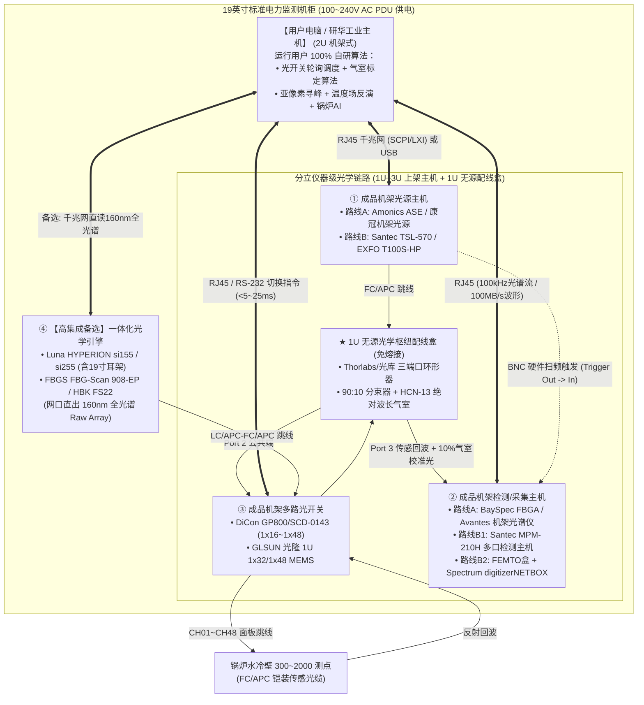

# 11_RACKMOUNT_FINISHED_INSTRUMENTS_SELECTION_AND_PRICING.md
## 全成品 19 英寸标准机架式光电解调硬件选型、原厂资料映射、控制接口与采购报价手册
### *(适用于“全成品上架 + 网口/USB 直连工控电脑 + 100% 自研核心算法与软件”快速工程交付路线)*

---

### 文档控制与适用边界

| 属性 | 说明 |
| :--- | :--- |
| **文档编号** | `BS-PROC-RACK-11-REV1.0` |
| **定位说明** | 针对 [04_Interrogator_Optics_Electronics_and_Algorithms](../Boiler_FBG_Thermometry_Research/04_Interrogator_Optics_Electronics_and_Algorithms/01_Light_Sources_and_Optical_Receivers.md) 中的芯片/电路板级架构，升级提供**直接采购高质量成品上架仪器设备**的完整厂商名录、型号定额、PDF 原厂手册与市场采购报价。 |
| **使用模式** | 所有设备均为 **19 英寸标准机柜（1U~4U）上架形态**，直接使用 `100~240V AC` 工业电源，光路采用 `FC/APC`（或 `LC/APC` 转 `FC/APC`）标准尾纤跳线互联，控制与原始光谱/波形回波信号通过 **千兆以太网（TCP/IP SCPI / LXI / REST / SDK）或 USB 3.0/2.0** 接入用户自带电脑/工控机。 |
| **自研分工** | 用户团队 **0 焊接、0 画高速 PCB、0 调试 TIA 自激振荡、0 开模机箱**，100% 精力聚焦于：光开关轮询调度、HCN 气室实时波长线性化校正、亚像素寻峰算法（`< 0.5 pm`）、水冷壁导热反演与锅炉防爆漏/结焦 AI 软件。 |
| **原厂 PDF 验证库** | 全部新增及基线原厂规格书均已核验并归档于 [`./datasheets_pdf/`](./datasheets_pdf/)，与 [`07_VERIFIED_EVIDENCE_AND_DATASHEET_INDEX.md`](./07_VERIFIED_EVIDENCE_AND_DATASHEET_INDEX.md) 保持 1:1 映射。 |

---

## 一、 架构升级：从“板卡拼装”升级为“全成品机架设备”的机柜拓扑

与自主焊接 TIA 模拟放大板或插装机箱内 OEM 小模块不同，**“全成品上架 + 自研软件”**路线把所有光学腔体、恒温 TEC、低噪声跨阻放大、高速同步 ADC 与光路切换开关全部封装在原厂认证的抗振金属机箱内。现场与实验室机柜内只有四类标准硬件单元：



---

## 二、 第一部分：成品机架式光源主机（Light Sources）选型与报价

根据您选择的后端检测原理，光源分成**宽带光源（配光栅光谱仪）**和**高速扫频激光器（配高精度光电功率计/高速采集主机）**两大阵营。

### 2.1 宽带 ASE / SLED 机架成品光源（推荐用于 300~600 点稳健型方案）

| 厂商 (产地) | 机架成品型号 | 机箱尺寸与供电 | 关键光学指标（实测规格书参数） | 电脑通信接口 | 原厂资料归档 (`./datasheets_pdf/`) | 参考市场含税单价 (单台) |
| :--- | :--- | :--- | :--- | :--- | :--- | :--- |
| **Amonics (香港安博)** | **`ALS-CL-15-R-FA`** *(C+L波段)*<br/>**`ALS-15-R-FA`** *(纯C波段)*<br/>**`ALS-20-GFF-R-FA`** *(高功率平坦)* | `19" 1U/2U` 台式/机架一体式 (`-R` 机架版)，`100~240V AC` | • 波段：`1528~1608 nm` (`CL`版) 或 `1528~1564 nm` (`C`版)<br/>• 出纤功率：`+15 dBm` (`31.6 mW`) 至 `+20 dBm`<br/>• 功率稳定度：`±0.02 dB / 8h` (`5分钟 ±0.005 dB`)<br/>• 偏振度 `<5%`，内置 `>40 dB` 光隔离器，`FC/APC` | `Ethernet` (RJ45) / `RS-232` 遥测开关光与功率监控；前面板 LCD + 钥匙开关 | [`04_Amonics_ALS_C-Band_ASE_Broadband_Light_Source_Datasheet.pdf`](./datasheets_pdf/04_Amonics_ALS_C-Band_ASE_Broadband_Light_Source_Datasheet.pdf) `[EV-PDF-0004]` | • C波段 `ALS-15-R`：**`¥15,000 ~ ¥22,000`** (`` `$2,100 ~ $3,000 USD` ``)<br/>• C+L波段 `ALS-CL-15-R`：**`¥24,000 ~ ¥36,000`** (`` `$3,200 ~ $4,800 USD` ``) |
| **康冠世纪 CONnet (北京)** / **DenseLight** | **`VASS-C15-B-FA-R`** / **`DL-BP1501A-R`** | `19" 1U` 双冗余 AC 电源机架主机，`220V AC` | • 波段：`1528~1565 nm` (可选 C+L `80 nm` 加宽版)<br/>• 功率：`15~20 dBm` (`30~100 mW`)，带平坦滤波器 `GFF` (`<1.5 dB`)<br/>• 偏振度 `<5%`，工业宽温稳定设计 | `RS-232` + `RJ45 网口` SNMP/SCPI 监控，支持继电器告警触点 | 供应链备选（与 Amonics 同等接口及平坦度定额） | **`¥9,500 ~ ¥16,000`** (国内电厂批量首选) |
| **Thorlabs (美国)** | **`PRO8000` (`3U 8槽主机架`) + `SLD8010S` / `ASE730`** | `19" 3U` 模块化机架，支持 `IEEE-488` 与 `RS-232` | • **`ASE730`** 覆盖 `1530~1610 nm`，总功率 `>10 mW` (`+10 dBm`)<br/>• 极其适合实验室高精度台架标定，可靠性极高 | `GPIB / RS-232`，前出 `FC/APC` | Thorlabs 标准机架系列（配套环形器备选 [`EV-PDF-0015]`） | **`¥62,000 ~ ¥70,000`** (`` `$8,200 ~ $9,500 USD` ``) |

### 2.2 高速可调谐扫频激光成品主机（推荐用于 1000~2000+ 点高密度 / 高信噪比方案）

> **注意**：在全成品主机路线下，购买扫频激光器时**务必向原厂加订“19 英寸原厂机架安装耳件（Rack Mount Kit）”**，且确认带有 **`BNC Trigger Out`（扫描触发同步输出）与 `K-Clock / Wavelength Trigger` 接口**，以实现与后端检测主机的毫秒/微秒级硬件同步。

| 厂商 (产地) | 机架成品型号 | 机箱形态与选配件 | 关键光学指标（实测规格书参数） | 电脑与同步接口 | 原厂资料归档 (`./datasheets_pdf/`) | 参考市场含税单价 (单台) |
| :--- | :--- | :--- | :--- | :--- | :--- | :--- |
| **Santec (日本圣德科)** | **`TSL-570`** *(C/L 宽谱高精旗舰)* | 台式/上架兼容（配原厂 19" 机架安装支架），`100~240V AC` | • 调谐范围：`1480~1640 nm` / `1500~1630 nm`（全系 `1240~1680 nm`）<br/>• 扫频速度：**最高 `200 nm/s` 无跳模连续扫描**<br/>• 分辨率：`0.1 pm`，绝对波长精度最高 `±1~5 pm`；动态信噪比 **SSE 抑制 `90 dB/0.1 nm`**<br/>• 峰值出纤功率：`+13 dBm` (`20 mW`)，`FC/APC` | `Ethernet` (支持 Wake-on-LAN 与 SCPI) + `USB` + `GPIB`；后板自带 **`BNC Trigger Out`** 与功率监控输出 | [`03_Santec_TSL-570_Swept_Laser_Datasheet.pdf`](./datasheets_pdf/03_Santec_TSL-570_Swept_Laser_Datasheet.pdf) `[EV-PDF-0003]` | **`¥180,000 ~ ¥240,000`** (`` `$24,000 ~ $32,000 USD` ``，视波长覆盖宽度而定) |
| **Santec (日本圣德科)** | **`WSL-110`** *(或紧凑型 `TSL-550`)* | `19" 2U/3U` 紧凑机架兼容，`100~240V AC` | • 专为多信道高速测试与 FBG 解调优化，C 波段/C+L 波段可选，极窄线宽、低 ASE 噪声 | `Ethernet` / `GPIB` / `USB` + `BNC Trigger Out` | [`02_Santec_WSL-110_Tunable_Laser_Source_Datasheet.pdf`](./datasheets_pdf/02_Santec_WSL-110_Tunable_Laser_Source_Datasheet.pdf) `[EV-PDF-0002]` | **`¥90,000 ~ ¥135,000`** (`` `$12,000 ~ $18,000 USD` ``) |
| **EXFO (加拿大)** | **`T100S-HP`** *(可选升级 `T200S` `200nm/s`)* | 标准台式配 19" 机架耳朵 (`Rack Mount Kit`)，`100~240V AC` | • 全段输出 `>10 mW` (`+10 dBm`)，峰值 **`+13 dBm` (`20 mW`)**<br/>• 内置绝对波长参考，单机长期精度 `±20 pm`，配合 EXFO 平台或气室可达 **`±5 pm` / 重复性 `1 pm`**<br/>• 扫速 `1~100 nm/s` 连续无跳模 | `Ethernet / GPIB / USB` 程控，带专用 **`Trigger Out`** 对接 `CTP10` 或第三方采集卡 | [`19_EXFO_T100S-HP_Swept_Tunable_Laser_Datasheet.pdf`](./datasheets_pdf/19_EXFO_T100S-HP_Swept_Tunable_Laser_Datasheet.pdf) `[EV-PDF-0019]` | **`¥165,000 ~ ¥225,000`** (`` `$22,000 ~ $30,000 USD` ``) |

---

## 三、 第二部分：成品检测器与光谱/波形数字采集主机（Detectors & Digitizers）

用户只要**在电脑上通过以太网/USB 拿到原始波长-光强数组**即可自己写寻峰、去噪、标定与 AI 算法。本部分全部选用**自带光电转换、低噪声放大、16-bit ADC 与高速传输协议的整机成品**，彻底免除您自研 `TIA + ADC` 硬件。

### 3.1 配合“扫频激光器”的成品多通道光电检测与采样机架主机

| 厂商 (产地) | 机架成品型号 | 机箱尺寸与供电 | 核心光电探测与数字化能力（实测规格书参数） | 电脑数据回传机制 | 原厂资料归档 (`./datasheets_pdf/`) | 参考市场含税单价 |
| :--- | :--- | :--- | :--- | :--- | :--- | :--- |
| **Santec (日本圣德科)** *(黄金高性价比拍档)* | **`MPM-210H` 主机框 + `MPM-211` / `MPM-215` 4路检测卡** | 半宽 `3U` (`210×350×133 mm`)，原厂双联 19" 机架套件与 `TSL-570` 并排上架，`100~240V AC` (`50 VA`) | • 单主机插满 5 槽支持 **最多 20 个并行 `FC/APC` 光口**（不必一上来就买满 48 路开关，或直接多路并联！）<br/>• 覆盖 `1250~1680 nm`，动态范围 **`-80 ~ +10 dBm` (`MPM-211`)** 或高速高动态 `-70 ~ +5 dBm` (`MPM-215`)<br/>• 最快 **`10 μs` 积分间隔（`100 kHz` 采样）**，每通道 **`1,000,000 × 2` 双缓冲记忆深度**，内置实时自动量程 TIA | `RJ45 Ethernet (TCP/IP)` / `GPIB` / `USB`；激光器 BNC 触发输入后，主机把全扫频过程 **`1~5 pm` 步进的原始光强曲线配列直接传回电脑**（C++/C#/Python 可直接调 SCPI/DLL 读数组） | [`20_Santec_MPM-210H_Rackmount_MultiPort_Detector_Mainframe.pdf`](./datasheets_pdf/20_Santec_MPM-210H_Rackmount_MultiPort_Detector_Mainframe.pdf) `[EV-PDF-0020]`<br/>[`21_Santec_Swept_Test_System_TSL_MPM_Integration.pdf`](./datasheets_pdf/21_Santec_Swept_Test_System_TSL_MPM_Integration.pdf) `[EV-PDF-0021]` | **整套入门（1台 `MPM-210H` + 1张 4路 `MPM-211` 卡）**：**`¥62,000 ~ ¥78,000`** (`` `$8,500 ~ $10,500 USD` ``)；每增配 1 张 4路检测卡约加 **`¥18,000 ~ ¥25,000`** |
| **EXFO (加拿大)** *(电信实验室最高级)* | **`CTP10` 10槽扫频光学测试平台** (`+ SCAN SYNC + OPM2 模块`) | `19" 4U` 标准上架整机，`100~240V AC` | • 10 槽热插拔，可扩展至 `50~100+` 测试端口，单次扫描动态范围 **`70~80 dB`**<br/>• **亚皮米/飞米（`fm`）级波长采样分辨率**，直接反向控制多台扫频激光器实现精密触发同步 | `1G / 10G LAN` 网口直接高速读取全谱插损/回波光谱曲线与自动化 SCPI 控制 | [`22_EXFO_CTP10_Rackmount_Swept_Detector_Platform.pdf`](./datasheets_pdf/22_EXFO_CTP10_Rackmount_Swept_Detector_Platform.pdf) `[EV-PDF-0022]` | **`¥200,000 ~ ¥320,000`** (`` `$28,000 ~ $45,000 USD` ``，视配置槽位数定) |
| **FEMTO (德国) + Spectrum (德国)** *(WDM+TDM 脉冲高带宽组合)* | **`FEMTO HCA-S-200M-IN`** 成品光电盒 + **`Spectrum digitizerNETBOX DN2.592-04 / -08`** *(或更高采样 `DN2.596`)* | `DN2.592` 为 `19" 标准机架网口仪` (`100~240V AC`)，**无需在电脑插任何 PCIe 板卡！** | • `FEMTO` 成品屏蔽盒把 `FC/APC` 光信号转成 `BNC/SMA` `DC~200 MHz` 低噪电压；`Thorlabs PDB470C` 可做差分抗噪备选<br/>• `DN2.592`：4~16 路 **`16-bit` 每通道独立 ADC，全通道 `20 MS/s` 同步采样**（`ENOB 13.2 bit`, `SNR 81 dB`；若做 `10 ns` TDM 脉冲分窗可选同系列 **`125 MS/s` `DN2.596`**） | **`RJ45 千兆网口 (LXI Core 2011)`**：通过 FIFO 模式以最高 `70~100 MB/s` 连续流向电脑直吐原始波形；官方自带 **Python / C++ / MATLAB `spcm` 完整驱动** | [`05_FEMTO_HCA-S-200M-IN_InGaAs_Photoreceiver_TIA_Datasheet.pdf`](./datasheets_pdf/05_FEMTO_HCA-S-200M-IN_InGaAs_Photoreceiver_TIA_Datasheet.pdf) `[EV-PDF-0005]`<br/>[`16_Thorlabs_PDB470C_Balanced_InGaAs_Photoreceiver_Datasheet.pdf`](./datasheets_pdf/16_Thorlabs_PDB470C_Balanced_InGaAs_Photoreceiver_Datasheet.pdf) `[EV-PDF-0015]`<br/>[`23_Spectrum_digitizerNETBOX_19inch_LXI_Digitizer_Catalog.pdf`](./datasheets_pdf/23_Spectrum_digitizerNETBOX_19inch_LXI_Digitizer_Catalog.pdf) `[EV-PDF-0023]` | • `FEMTO` 光电盒：**`¥9,500 ~ ¥11,500 / 路`**<br/>• `DN2.592-04` (4路 20MS/s)：**`¥50,000 ~ ¥65,000`** (`` `$6,800 ~ $8,800 USD` ``)<br/>• 125MS/s 脉冲版 `DN2.596`：**`¥75,000 ~ ¥95,000`** |

> **工程选型关键提示（WDM vs WDM+TDM 带宽边界）**：
> - 如果您做**常规波分复用 WDM**（单根光纤 `25~33` 个光栅，不同中心波长，配合多路光开关扩展到 `600~1500` 点），首选 **`Santec MPM-210H`**（`100 kHz` 采样足够且直接按波长步长出 dBm 光功率数组，省去脉冲硬件和极高采样带宽！）。
> - 如果您要在软件里玩**时分复用 TDM / 混复**（单纤串 `99` 个同波长弱光栅，光脉冲间隔只有 `10 ns/m`），`MPM-210H` 带宽不够，必须用 **`FEMTO HCA-S-200M-IN` (200 MHz) + `Spectrum digitizerNETBOX` (`125 MS/s` 版 `DN2.596`)** 才能看清 `10 ns` 级的光脉冲回波包络！

### 3.2 配合“宽带 ASE 光源”的成品近红外光谱检测机架主机（全固态无移动部件）

| 厂商 (产地) | 机架成品型号 | 机箱形态与接口 | 核心光学与探测规格（实测规格书参数） | 电脑数据回传与自研边界 | 原厂资料归档 (`./datasheets_pdf/`) | 参考市场含税单价 |
| :--- | :--- | :--- | :--- | :--- | :--- | :--- |
| **BaySpec / Advanced Energy (美国)** | **`WaveCapture® FBGA-E-1510-1590`** *(配 19" 机架机箱选项)* | 独立工业外壳，支持 **IEEE 802.3 Ethernet** 直连，可上架或装入 1U 抽屉 | • 专利体全息光栅 (VPG) + 512 像元 InGaAs，**无任何机械运动部件**<br/>• 覆盖 `1510~1590 nm` (`80 nm` 全谱) 或 `1525~1565 nm`<br/>• 帧率高达 **`5 kHz`**，动态范围 `-60 ~ -20 dBm` (`40 dB`)，典型重复性 `±5 pm`（可选配内置绝对波长参考 `IRS` 升至 `±2 pm`），`FC/APC` | `Ethernet` 或 `USB 2.0`，提供 **WaveCapture SDK (C/C++/LabVIEW/Python)** 直接读取 512 点 16-bit 原始光谱曲线 | [`24_BaySpec_WaveCapture_FBGA_Rackmount_Analyzer_Datasheet.pdf`](./datasheets_pdf/24_BaySpec_WaveCapture_FBGA_Rackmount_Analyzer_Datasheet.pdf) `[EV-PDF-0024]` | **`¥48,000 ~ ¥70,000`** (`` `$6,500 ~ $9,500 USD` ``) |
| **Avantes (荷兰)** | **`AvaSpec-NIR512-1.7-EVO`** *(或致冷增强版 `-HSC-EVO`)* + **`AvaRack 19"`** 机架箱 | **原生 `19" 2U/3U AvaRack`** 多通道机架机箱（内置工控级电源与同步母板），`220V AC` | • 512 像元 InGaAs 线阵（覆盖 `900~1750 nm`），`-HSC` 版带半导体制冷大幅压低暗电流<br/>• 支持单机箱同步装 1~4 台光谱仪通道（可分别测多路或兼顾参考谱） | `Gigabit Ethernet` + `USB 3.0`，提供全开源友好 **Linux / Windows Python `avaspec` SDK**，直接输出原始 AD Counts 数组 | 荷兰原厂主流近红外光谱仪（与 Ibsen 同类 512 像元阵列架构） | **单通道机架版**：**`¥80,000 ~ ¥120,000`** (`` `$11,000 ~ $16,500 USD` ``) |
| **Ibsen Photonics (丹麦)** | **`I-MON 512 USB` (`E-MON` 独立封装版) + 19" 1U 托盘** | 带坚固金属屏蔽盒的成品版（非裸露 OEM PCB），+5V DC/USB 供电 | • 覆盖 `1510~1595 nm` (`85 nm`)，内嵌滨松 `G11620-512DA` `[EV-PDF-0011]`<br/>• 帧率 `3 kHz` (`HS` 版 `17 kHz`)，16-bit ADC，EEPROM 内建 5 阶像素-波长校准多项式，拟合分辨率 **`<0.5 pm`**，`FC/APC` | `USB 2.0` 直插电脑即用，DLL/SDK 一行函数读取 `uint16[512]` 原始光强与出厂 5 阶多项式系数 | [`01_Ibsen_I-MON_256_512_USB_Interrogator_Datasheet.pdf`](./datasheets_pdf/01_Ibsen_I-MON_256_512_USB_Interrogator_Datasheet.pdf) `[EV-PDF-0001]`<br/>[`11_Hamamatsu_G11620_512Pixel_InGaAs_Linear_Sensor_Datasheet.pdf`](./datasheets_pdf/11_Hamamatsu_G11620_512Pixel_InGaAs_Linear_Sensor_Datasheet.pdf) `[EV-PDF-0011]` | **`¥38,000 ~ ¥49,000`** (`` `$5,200 ~ $6,800 USD` ``) |

---

## 四、 第三部分：成品多光纤切换设备（19" 机架光开关）与无源配线枢纽

要在有限数量的光源和检测主机下轮询锅炉前/后/左/右四面墙的 **16~48 路** 测温光缆（每路 `25~33` 个光栅即实现 **`400~1500+` 个测点**），必须配备基于 **MEMS 微镜原理（切换寿命 `> 10⁹` 次，纯机械移动开关仅 `10⁷` 次不可用于电厂常年 `1 Hz` 连续轮询！）** 的 19 英寸成品机架光开关。

### 4.1 19" 标准机架成品 MEMS 多路光开关对比选型表

| 厂商 (产地) | 机架成品型号 | 机箱规格与电源 | 核心光学与耐久性指标（实测规格书参数） | 电脑遥控接口（供您编写轮询脚本） | 原厂资料归档 (`./datasheets_pdf/`) | 参考市场含税单价 |
| :--- | :--- | :--- | :--- | :--- | :--- | :--- |
| **DiCon Fiberoptics (美国迪康)** | **`GP800-1x32-SM`** *(网管旗舰)*<br/>**`MSR-1xN` (`SCD-0143` 系列, `1×16 ~ 1×128`)** | **`19" 1U / 2U` 工业上架整机**，`100~240V AC` (`SCD-0143` 支持前/后面板 `FC/APC` 自选) | • 宽带 `1260~1675 nm`（`1550 nm` 单模 `9/125 µm`）<br/>• `GP800 1×32` 插损 **`< 1.2 dB`**；`SCD-0143` `1×32` `≤1.5 dB`、`1×48` `≤1.9 dB`<br/>• 切换时间 **`< 25 ms`** (`GP800`) / `<40 ms` (`SCD-0143`)；串扰与回波 `≤ -50 dB`；重复性 `≤ 0.02~0.04 dB`<br/>• **循环寿命 `> 10 亿次 (> 1 Billion Cycles)`**（按 1 秒轮询 32 路计算可连续运行 `> 30` 年！） | **`RJ45 Ethernet`**: 原生支持 **`REST API`、SSH、Telnet、Web GUI**，兼配 `RS-232 (DB9)`，Python `requests` 发送一条 HTTP POST 或 TCP 指令即可毫秒级切端口！ | [`25_DiCon_SCD0143_19inch_Rackmount_MEMS_1xN_Optical_Switch.pdf`](./datasheets_pdf/25_DiCon_SCD0143_19inch_Rackmount_MEMS_1xN_Optical_Switch.pdf) `[EV-PDF-0025]`<br/>[`26_DiCon_GP800_Rackmount_1x32_Optical_Switch_System.pdf`](./datasheets_pdf/26_DiCon_GP800_Rackmount_1x32_Optical_Switch_System.pdf) `[EV-PDF-0026]` | • `1×16`：**`¥31,000 ~ ¥43,000`** (`` `$4,200 ~ $5,800 USD` ``)<br/>• `1×32`：**`¥48,000 ~ ¥65,000`** (`` `$6,500 ~ $8,800 USD` ``)<br/>• `1×48`：**`¥70,000 ~ ¥92,000`** (`` `$9,500 ~ $12,500 USD` ``) |
| **Agiltron (美国)** | **`RM-MEMS-1xN`** (`1×16 / 1×32 / 1×48 / 1×64`) | `19" 1U` 上架式机箱，`100~240V AC` | • 覆盖 `1250~1650 nm`，高消光、低 PDL，可选 `FC/APC` 前面板；**原厂 5 年质保** | `Ethernet` / `USB` / `RS-232`，附带 Python/Linux 脚本库 | 国际三大 MEMS 开关供应商之一 | • `1×16`：约 **`¥34,000`** (`` `$4,500 USD` ``)<br/>• `1×32`：约 **`¥52,000`** (`` `$6,800 USD` ``) |
| **EXFO (加拿大)** | **`LTB-8` (`3U` 机架主平台) + `FTBx-9160` (`1×16 / 1×32 MEMS` 插卡)** | **`19" 3U` 旗舰平台**，内置热插拔双电源与 RAID 控制 | • 模块化 MEMS `1×16` / `1×32` 单模光开关，切换时间 `< 30 ms`，**`10 亿次`**寿命，并支持同框混插 `2×2` 旁路保护开关与功率计/光谱仪模块 | Built-in Web / SCPI / **EXFO Multilink REST API** | [`27_EXFO_LTB-8_Rackmount_Platform_Datasheet.pdf`](./datasheets_pdf/27_EXFO_LTB-8_Rackmount_Platform_Datasheet.pdf) `[EV-PDF-0027]`<br/>[`28_EXFO_FTBx-9160_MEMS_Optical_Switch_Module.pdf`](./datasheets_pdf/28_EXFO_FTBx-9160_MEMS_Optical_Switch_Module.pdf) `[EV-PDF-0028]` | • `LTB-8` + 1张 `1×32` 卡：**`¥68,000 ~ ¥105,000`** (`` `$9,000 ~ $14,000 USD` ``) |
| **桂林光隆科技 GLSUN (中国，电厂工程性价比主力)** | **`SUN-FSW-1U-1×16` / `1×32` / `1×48`** *(MEMS 电信级双电源版)* | **`19" 1U` 标准机架**（前置 LCD 显示与手动按键 + 双路热备份 AC/DC 电源） | • 需向厂家**指定选用 `MEMS` 芯片开关款**（切勿误买机械马达开关！），插损 `< 1.2~1.6 dB`，切换 **`≤ 15 ms`**，`> 10⁹` 次寿命，`FC/APC` | `RJ45 Ethernet (TCP/IP & SNMP)` + `RS-232`，发简洁 ASCII 帧如 `<01_S_05>` 即完成通道切换 | 国产电厂/通信机房批量工程首选（与主机其余进口组件 100% 光口直连兼容） | • `1×16`：**`¥8,500 ~ ¥12,000`**<br/>• `1×32`：**`¥14,000 ~ ¥19,500`**<br/>• `1×48`：**`¥22,000 ~ ¥28,000`** |

### 4.2 关键“免熔接”上架配件：`19" 1U` 无源光学环形器 + `HCN-13` 气室配线枢纽箱

当您买回 **光源主机（1 个 `FC/APC` 输出口）**、**光开关主机（1 个 `Common` 公共口）**、**检测主机（`FC/APC` 接收口）** 后，中间还缺两个小而关键的无源器件把“发出的光”与“返回的光”分开、并为扫频路线的电脑算法提供绝对波长标尺。为避免现场自己剥纤熔接，建议向 **珠海光库科技（AFR）** 或 **Thorlabs / 深圳太辰光** 定制 **1 只 `19" 1U` 无源光学配线枢纽箱（内置全熔接并出前面板 `FC/APC` 法兰）**：
1. 内部预装 1 只三端口 `C+L` 波段光学环形器（对标 Thorlabs `6015-3-APC`，回波隔离度 `>50 dB`）；
2. 若走扫频激光路线，内部同时并联预装 `90:10` 耦合器 + **美国 Wavelength References `HCN-13-100-APC` NIST 氰化氢绝对波长气室** [`08_Wavelength_References_HCN-13_Gas_Cell_Datasheet.pdf`](./datasheets_pdf/08_Wavelength_References_HCN-13_Gas_Cell_Datasheet.pdf) `[EV-PDF-0008]`；
3. 前面板仅露出 5 个标准绿头 `FC/APC` 接口（`Laser IN`、`Switch COM`、`Signal Rx OUT`、`GasCell Ref OUT`、`Reserve`），您只需要用 `FC/APC-FC/APC` 铠装尾纤跳线一插，**全程 0 熔接**！单盒参考价 **`¥2,800 ~ ¥6,500`**（含 `HCN-13` 进口气室本体约 `¥3,200`）。

---

## 五、 第四部分：高集成替代路线——19" 一体化光学引擎（网口直出 Raw Spectrum）

如果您希望机柜更精简（不要把光源、环形器、检测器、气室拆成 3 台仪器接线），而是只买 **“1 台原厂封装好的高速光学解调引擎主机 + 1 台 `1×32/1×48` 机架光开关”**，并要求该主机**开放底层 API，每秒把完整的原始光谱（Raw Spectrum）或未校准峰值直接传给您自己的电脑做自研算法**，国际上有三款公认的顶级工业机架主机可选：

| 厂商 (产地) | 机架成品型号 | 内置光路与通道数 | 为什么依然支持您“100% 自研核心算法”？ | 原厂资料归档 (`./datasheets_pdf/`) | 参考市场含税单价 |
| :--- | :--- | :--- | :--- | :--- | :--- |
| **Luna Innovations (美国 Micron Optics)** *(行业第一金标准)* | **`HYPERION si155`** *(4 路并行)*<br/>**`HYPERION si255`** *(16 路真并行)* + 原厂 **`19" Rack Mount Assembly`** | 内置 `160 nm` 超宽高功率扫频激光器 + 专利 F-P 滤波器 + **NIST 溯源波长基准**；`LC/APC` 接口，无风扇工业机箱（`-20 ~ +60°C`） | • **全光谱直出（Full Spectrum Measurement）**：原生包含全谱原始采集功能（`10 Hz` 输出完整 `1460~1620 nm` 原始高精光谱数组），同时内置高刷实时峰值流（`100~5000 Hz`）<br/>• 附带完整 **Python / C++ / MATLAB / C# API (`Hyperion SDK`)**，网口（Ethernet）直接拉取原始谱线！您的电脑可绕过内置峰值直接在 Python/C++ 中自研双峰识别、坏点容错与 2D/3D 热流反演 | [`29_Luna_HYPERION_si155_4Ch_Swept_Interrogator_Datasheet.pdf`](./datasheets_pdf/29_Luna_HYPERION_si155_4Ch_Swept_Interrogator_Datasheet.pdf) `[EV-PDF-0029]`<br/>[`30_Luna_HYPERION_si255_16Ch_Swept_Interrogator_Datasheet.pdf`](./datasheets_pdf/30_Luna_HYPERION_si255_16Ch_Swept_Interrogator_Datasheet.pdf) `[EV-PDF-0030]` | • `si155` (4路)：**`¥135,000 ~ ¥175,000`** (`` `$18,000 ~ $24,000 USD` ``)<br/>• `si255` (16路)：**`¥205,000 ~ ¥265,000`** (`` `$28,000 ~ $36,000 USD` ``)<br/>*(注：`si255` 16路配 32 点/路已达 `512` 点，如只需 400~500 点甚至**可省掉光开关**！)* |
| **FBGS (德国/比利时)** | **`FBG-Scan 908-EP`** *(Embedded Processing 19" 机架款)* | 内置低偏振（`≤5%`）宽带光源 + VPG 光谱仪 + 内嵌基准；8 个 `LC/APC` 通道，全通道并行 **`222 Hz`**，精度 `0.3 pm (1σ)` | • `19" 机架封装 (-EP)` 直接提供 **TCP/IP API 原始光谱与波长数据流**，且与德国 FBGS 原厂飞秒热稳定 `FSG-A01` 光栅串 [`EV-PDF-0009]` 天生最佳匹配 | 德国 FBGS 官方产品矩阵（参见 `FBGS` 光栅资料 [`EV-PDF-0009]`） | **`¥145,000 ~ ¥195,000`** (`` `€18,000 ~ €25,000 EUR` ``) |
| **HBK / HBM FiberSensing (德国)** | **`FS22 SI / DI Industrial BraggMETER`** *(19" Rack 选配)* | `19" 2U` 工业上架整机，1 / 4 / 8 路并行（可选 `FC/APC`），内置扫频激光与 NIST 气室，最高 `1,000 S/s` | • 工业电力认可度极高，支持 **`Ethernet` 开放 SCPI/ASCII 命令集直接读取全谱与波长流**，无缝脱离其自带软件由您的工控机接管 | 德国 HBK `B04202/B04203` 工业解调仪标准系列 | **`¥160,000 ~ ¥235,000`** (`` `€20,000 ~ €30,000 EUR` ``) |

---

## 六、 第五部分：三套“买回直接拧螺丝上架”的 19 英寸黄金配单总汇

以下三套配单均已把 **光源、检测/采集、多路光开关、无源枢纽、线缆接插件** 全部算齐（不含锅炉炉体传感光缆与用户自己的电脑/机柜），供您按预算和研发阶段直接拍板下单：

| 配单代号与定位 | 硬件组成明细（全 19" 上架设备 + 原厂成品） | 整套主机参考总价 (不含传感光缆) | 适用的锅炉点数与自研软件工作重点 |
| :--- | :--- | :--- | :--- |
| **配单 A：高性价比全固态光谱仪路线** *(推荐首台验证 / 600 点以下主力)* | 1. **Amonics `ALS-CL-15-R-FA`** (1U 机架 C+L ASE 光源): `¥30,000`<br/>2. **BaySpec `WaveCapture FBGA-E-1510-1590`** *(或国产/Ibsen `E-MON`)*: `¥58,000` (Ibsen版约 `¥44,000`)<br/>3. **DiCon `GP800-1×32`** (`¥56,000`) 或 **GLSUN 1U MEMS `1×32`** (`¥16,500`)<br/>4. **1U 环形器配线箱 + 跳线包**: `¥3,500` | • 全进口光开关系：**`¥14.75 万`**<br/>• 配国产电信级 MEMS 开关：**`¥9.4 万 ~ ¥10.8 万`** | **支持 `600~800` 测点（全炉巡检 `~0.4s`）**。<br/>软件通过网口/USB 读入 512 点光谱数组，**自研核心价值极高**：靠多点对数高斯拟合把 `166 pm` 像素间距软件超分辨到 `0.5 pm`！ |
| **配单 B：实验室与千万千瓦级分离仪器旗舰路线** *(完全可控最底层光学)* | 1. **Santec `TSL-570`** (C+L 高速扫频激光主机 + 机架套件): `¥210,000`<br/>2. **Santec `MPM-210H` + 4路 `MPM-211`** (或 `FEMTO + DN2.596` 脉冲版): `¥72,000`<br/>3. **DiCon `SCD-0143` 1U MEMS `1×48`** (或 `1×32`): `¥80,000`<br/>4. **1U 环形器 + `HCN-13` NIST 气室配线枢纽箱**: `¥6,000` | • 通用 WDM 路线（配 `MPM-210H`）：**`¥36.8 万`**<br/>• 脉冲 WDM+TDM 千点混复路线（改配 `FEMTO + DN2.596`）：**`¥38.5 万`** | **支持 `1,000 ~ 2,000+` 测点（纯 WDM 33点/路；脉冲混复可达 99点/路）**。<br/>电脑直接掌握每一帧气室吸收指纹、`BNC` 触发同步与 `1 pm` 原生反射峰全波形，适合彻底吃透前沿超弱光栅算法与实验室计量定型。 |
| **配单 C：极简上架高可靠交付路线** *(最快 1 周打通全炉系统)* | 1. **Luna `HYPERION si255-ST-16-1460-1620` (16 路真并行) + 19" 机架件**: `¥235,000` *(若先做 `500` 点连光开关都不用买！)*<br/>2. **选扩**：若扩展至 `1,500` 点，在其中 4 个口后端并接 **4 台 GLSUN 1U MEMS `1×16`**（或 1 台 **DiCon `1×48`**）<br/>3. **16 根 `LC/APC` 转 `FC/APC` 原厂单模跳线包**: `¥1,600` | • `500` 点直连版：**`¥23.7 万`**<br/>• `1,500` 点扩展版：**`¥27.5 万`** | **最省心、硬件故障点最少、交付周期最短**。<br/>通过以太网直接调用 Luna 官方 Python/C++ SDK 拉取 `160 nm` 原始全光谱，全副精力直扑锅炉二维/三维热力图与防爆漏 AI 算法！ |

---

## 七、 电脑端控制协议与现场采购避坑清单

### 7.1 电脑端典型控制与读取伪代码逻辑（以配单 B / 配单 A 为例）

无论选用 **Santec / EXFO / Spectrum / DiCon / BaySpec / Luna**，设备上架接上网线连入您电脑的千兆网卡后，软件主循环仅需如下 `3` 步确定性交互（`Python / C++` 均无需底层驱动编程）：

```python
# 伪代码示意：电脑通过网口 (TCP/IP SCPI + REST API) 协同控制“光开关 + 光源 + 检测主机”
# 1. 向 DiCon GP800 / GLSUN 1U 机架光开关下发切换通道指令（HTTP REST 或 TCP Socket）
requests.post("http://192.168.10.21/api/v1/switch", json={"channel": ch_idx})
time.sleep(0.025)  # 等待 MEMS 微镜 25ms 完全机械稳态（GLSUN/DiCon 视型号 15~40ms）

# 2. 触发扫频激光与检测主机硬件同步采集（例如 Santec TSL-570 + MPM-210H）
#    或读取 BaySpec/Avantes/Luna 这一路当前的原始 16-bit 原始光谱数组 raw_spectrum[]
tsl_socket.sendall(b":WAV:SWE:STAT START\n")        # 激光器发出 Sweep 并从 BNC 发脉冲触发检测主机
raw_power_dbm = mpm_socket.query_binary(":READ:POW:ARR? CH1")  # 从检测主机拉回全谱原始功率数组
hcn_ref_dbm   = mpm_socket.query_binary(":READ:POW:ARR? CH2")  # 同步拉回 CH2 的 HCN-13 气室吸收谱

# 3. 进入您的核心自研算法引擎：
#    -> HCN 吸收峰非线性波长重采样 -> 高斯亚像素拟合寻峰 -> 二次热光反演 -> 导热块传热补偿 -> 锅炉 AI 预警
wavelengths_calibrated = calibrate_with_hcn13(raw_power_dbm, hcn_ref_dbm)
temps_celsius = your_proprietary_peak_and_boiler_ai(wavelengths_calibrated)
```

### 7.2 成品机架设备采购“四大物理坑”务必核查

1. **光学连接器制式坑（最容易下单买错）**：
   * 锅炉水冷壁高反射/弱光栅系统**全链路严禁出现平头 `UPC/PC` 接口**（`UPC` 回损仅 `-50 dB` 左右会造成干涉基底起伏，甚至干扰激光腔），所有主机出光口、光开关端口、配线箱法兰 **必须强制订货为 `8°` 斜面绿头 `APC` 接口**。
   * 特别留意 **Luna `HYPERION si155/si255`** 与 **FBGS `FBG-Scan 908`** 原机面板配的是小型化 **`LC/APC` 接口**，而 **Santec / Amonics / DiCon / GLSUN / 锅炉现场尾缆** 均是 **`FC/APC` 接口**，下单时记得同步购置足够数量的 **原厂电信级 `LC/APC-FC/APC` 单模跳线（带金属铠装护套更好）**！
2. **机架安装件坑（`Rackmount Ears` 往往是选配料号）**：
   * **Amonics** 下单需确认型号带 **`-R`**（19 寸机架版，而非 Benchtop 仅桌面机箱）；
   * **Santec `TSL-570` / `MPM-210H`**、**EXFO `T100S-HP`**、**Luna `si155/si255`** 默认发桌面机型，采购合同 `PO` 中务必把原厂 **`19" Rackmount Bracket / Tray Kit`** 作为独立子料号写入清单。
3. **光开关选型“机械马达 vs MEMS 微镜”防呆坑**：
   * 电厂监测需要 **`24×7×365`** 连续秒级轮询，每年开关次数超过 **`3,000 万次`**。普通百元/千元级机械步进电机光开关寿命只有 `1,000 万次`（4 个月就会卡死报废！）。向 GLSUN、DiCon 等下单时**合同技术附件必须写死 `MEMS Micro-Mirror` 固态微镜器件（循环寿命 `≥ 10⁹` 次）**。
4. **交期与进口许可预留**：
   * 国产机架 ASE（康冠）与 GLSUN MEMS 光开关货期一般 **`2~4 周`**；
   * 进口主机（Santec / EXFO / Luna / DiCon / Spectrum）常规货期 **`6~10 周`**，且 `Santec` / `EXFO` 高性能扫频激光器及 `Luna` 主机均需确认代理商包含国内正规报关（`3C/EMC` 及计量免检通道说明），建议样机调试首套优先考虑现货代理库存或采用“**Luna `si155/si255`**”或“**BaySpec/Ibsen + 康冠/Amonics + GLSUN**”快速落地。

---

## 八、 本章引用的全量原厂物理 PDF 规格书清单 (`./datasheets_pdf/`)

1. [01_Ibsen_I-MON_256_512_USB_Interrogator_Datasheet.pdf](./datasheets_pdf/01_Ibsen_I-MON_256_512_USB_Interrogator_Datasheet.pdf) `[EV-PDF-0001]` — Ibsen I-MON 512 光谱仪技术规格书
2. [02_Santec_WSL-110_Tunable_Laser_Source_Datasheet.pdf](./datasheets_pdf/02_Santec_WSL-110_Tunable_Laser_Source_Datasheet.pdf) `[EV-PDF-0002]` — Santec WSL-110 可调谐激光源规格书
3. [03_Santec_TSL-570_Swept_Laser_Datasheet.pdf](./datasheets_pdf/03_Santec_TSL-570_Swept_Laser_Datasheet.pdf) `[EV-PDF-0003]` — Santec TSL-570 高速扫频激光器规格书
4. [04_Amonics_ALS_C-Band_ASE_Broadband_Light_Source_Datasheet.pdf](./datasheets_pdf/04_Amonics_ALS_C-Band_ASE_Broadband_Light_Source_Datasheet.pdf) `[EV-PDF-0004]` — Amonics ALS 系列 ASE 宽带光源规格书
5. [05_FEMTO_HCA-S-200M-IN_InGaAs_Photoreceiver_TIA_Datasheet.pdf](./datasheets_pdf/05_FEMTO_HCA-S-200M-IN_InGaAs_Photoreceiver_TIA_Datasheet.pdf) `[EV-PDF-0005]` — FEMTO HCA-S-200M-IN 光电探测盒规格书
6. [08_Wavelength_References_HCN-13_Gas_Cell_Datasheet.pdf](./datasheets_pdf/08_Wavelength_References_HCN-13_Gas_Cell_Datasheet.pdf) `[EV-PDF-0008]` — Wavelength References HCN-13 NIST 绝对波长气室规格书
7. [11_Hamamatsu_G11620_512Pixel_InGaAs_Linear_Sensor_Datasheet.pdf](./datasheets_pdf/11_Hamamatsu_G11620_512Pixel_InGaAs_Linear_Sensor_Datasheet.pdf) `[EV-PDF-0011]` — Hamamatsu G11620 512 像元 InGaAs 线阵传感器
8. [16_Thorlabs_PDB470C_Balanced_InGaAs_Photoreceiver_Datasheet.pdf](./datasheets_pdf/16_Thorlabs_PDB470C_Balanced_InGaAs_Photoreceiver_Datasheet.pdf) `[EV-PDF-0015]` — Thorlabs PDB470C 平衡探测器及光学环形器备选规格
9. [19_EXFO_T100S-HP_Swept_Tunable_Laser_Datasheet.pdf](./datasheets_pdf/19_EXFO_T100S-HP_Swept_Tunable_Laser_Datasheet.pdf) `[EV-PDF-0019]` — EXFO T100S-HP 高功率无跳模扫频激光主机规格书
10. [20_Santec_MPM-210H_Rackmount_MultiPort_Detector_Mainframe.pdf](./datasheets_pdf/20_Santec_MPM-210H_Rackmount_MultiPort_Detector_Mainframe.pdf) `[EV-PDF-0020]` — Santec MPM-210H 机架多通道 InGaAs 光电检测主机规格书
11. [21_Santec_Swept_Test_System_TSL_MPM_Integration.pdf](./datasheets_pdf/21_Santec_Swept_Test_System_TSL_MPM_Integration.pdf) `[EV-PDF-0021]` — Santec TSL + MPM 扫频测试集成架构规格书
12. [22_EXFO_CTP10_Rackmount_Swept_Detector_Platform.pdf](./datasheets_pdf/22_EXFO_CTP10_Rackmount_Swept_Detector_Platform.pdf) `[EV-PDF-0022]` — EXFO CTP10 19" 4U 扫频光谱检测平台规格书
13. [23_Spectrum_digitizerNETBOX_19inch_LXI_Digitizer_Catalog.pdf](./datasheets_pdf/23_Spectrum_digitizerNETBOX_19inch_LXI_Digitizer_Catalog.pdf) `[EV-PDF-0023]` — Spectrum digitizerNETBOX (DN2.592/DN2.596) 19" 网口采集主机规格书
14. [24_BaySpec_WaveCapture_FBGA_Rackmount_Analyzer_Datasheet.pdf](./datasheets_pdf/24_BaySpec_WaveCapture_FBGA_Rackmount_Analyzer_Datasheet.pdf) `[EV-PDF-0024]` — BaySpec / Advanced Energy WaveCapture FBGA 光谱分析仪规格书
15. [25_DiCon_SCD0143_19inch_Rackmount_MEMS_1xN_Optical_Switch.pdf](./datasheets_pdf/25_DiCon_SCD0143_19inch_Rackmount_MEMS_1xN_Optical_Switch.pdf) `[EV-PDF-0025]` — DiCon SCD-0143 19" 1U/2U 机架 MEMS `1x16~1x128` 光开关规格书
16. [26_DiCon_GP800_Rackmount_1x32_Optical_Switch_System.pdf](./datasheets_pdf/26_DiCon_GP800_Rackmount_1x32_Optical_Switch_System.pdf) `[EV-PDF-0026]` — DiCon GP800 `1x32` 网管型 REST/SCPI 机架光开关规格书
17. [27_EXFO_LTB-8_Rackmount_Platform_Datasheet.pdf](./datasheets_pdf/27_EXFO_LTB-8_Rackmount_Platform_Datasheet.pdf) `[EV-PDF-0027]` — EXFO LTB-8 19" 3U 模块化机架测试平台规格书
18. [28_EXFO_FTBx-9160_MEMS_Optical_Switch_Module.pdf](./datasheets_pdf/28_EXFO_FTBx-9160_MEMS_Optical_Switch_Module.pdf) `[EV-PDF-0028]` — EXFO FTBx-9160 MEMS `1x32` 光开关插卡规格书
19. [29_Luna_HYPERION_si155_4Ch_Swept_Interrogator_Datasheet.pdf](./datasheets_pdf/29_Luna_HYPERION_si155_4Ch_Swept_Interrogator_Datasheet.pdf) `[EV-PDF-0029]` — Luna HYPERION si155 (4通道) 一体化光学引擎规格书
20. [30_Luna_HYPERION_si255_16Ch_Swept_Interrogator_Datasheet.pdf](./datasheets_pdf/30_Luna_HYPERION_si255_16Ch_Swept_Interrogator_Datasheet.pdf) `[EV-PDF-0030]` — Luna HYPERION si255 (16通道) 一体化光学引擎规格书
