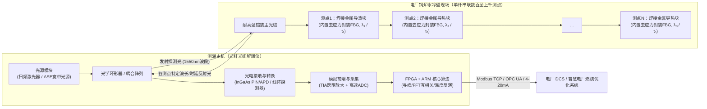

# 电厂锅炉水冷壁光纤光栅（FBG）准分布式测温系统深度技术调研报告

## 1. 系统技术定性与核心原理速览

您在电厂锅炉现场看到的**“单根光纤不同位置刻蚀不同光栅 + 穿入焊接在水冷壁上的金属导热块 + 后端单台解调主机同时测出几百至上千个点温度”**的装置，在工业光电传感领域被称为**高温光纤布拉格光栅（Fiber Bragg Grating, FBG）准分布式测温系统**（当单纤点数达到数百至上千点时，工程上主要采用**飞秒激光直写/再生高温光栅波分时分混合复用系统**，或**拉丝塔在线刻写超弱反射光栅阵列 UWFBG + 光频域反射 OFDR/时分波分复合解调系统**）。

### 核心工作闭环：
1. **光纤刻蚀（光栅写入）**：利用紫外激光或飞秒激光在石英光纤纤芯内产生周期性的折射率调制（即光栅）。每个点位通过改变**光栅周期 $\Lambda$**（刻出不同中心波长 $\lambda_B$）或控制**空间位置距离 $z_i$**（结合低反射率弱光栅），赋予每个测温点唯一的“光学身份证”。
2. **导热块传热与去应力保护**：锅炉膜式水冷壁管壁/鳍片温度高达 $350^\circ\text{C}\sim 600^\circ\text{C}$，且伴随剧烈热膨胀。金属导热块（通常为 `15CrMoG`、`12Cr1MoVG` 或 `316L` 耐热钢）焊接在水冷壁上，热量传导至导热块内部；光纤光栅穿在导热块内孔的**微细金属毛细管或陶瓷管**中处于**自由悬空（松套去应力）状态**，只受温度影响、不受水冷壁机械拉伸影响。
3. **主机发光、接收与解调算法**：主机向光纤发射宽谱光或高速扫频激光，各点位光栅将符合自身布拉格条件（$\lambda_B = 2 n_{\text{eff}} \Lambda$）的窄带光反射回主机。主机内的 `InGaAs` 光电探测器接收光信号并经 `TIA` 跨阻放大、`ADC` 采样后，由 `FPGA` 运行**高斯拟合寻峰算法**或 **OFDR 快速傅里叶变换（FFT）+ 互相关光谱寻峰算法**，算出各点波长漂移量 $\Delta\lambda_B$，代入标定公式精准还原出几百乃至上千个点的实时温度。

---

## 2. 调研报告文件夹结构与导航（英文目录分类）

本文件夹（`Boiler_FBG_Thermometry_Research`）下设 5 个专业子文件夹，按**技术溯源与原理**、**光纤加工工艺与供应链**、**水冷壁导热块封装与现场安装**、**解调主机光电路与核心算法**、**核心器件 BOM 清单与单点成本精算**分类整理：

| 子文件夹名称 | 包含文档 | 核心内容摘要 |
| :--- | :--- | :--- |
| **`01_Technology_Origins_and_Principles`** | [01_Historical_Origins_and_Milestones.md](../01_Technology_Origins_and_Principles/01_Historical_Origins_and_Milestones.md) [02_Sensing_Physics_and_Multiplexing_Architecture.md](../01_Technology_Origins_and_Principles/02_Sensing_Physics_and_Multiplexing_Architecture.md) | 1978 年 Kenneth Hill 首次发现光纤光栅、1989 年 Meltz 侧写法、1993 年相位掩模法、2003 年飞秒激光光栅、2008 年再生光栅（RFBG）、超弱光栅阵列（UWFBG）及国内外电力锅炉应用源头；热光效应公式、应变解耦物理机制、单纤百点/千点复用（WDM / TDM / OFDR）架构对比。 |
| **`02_Fiber_Fabrication_Grades_and_Vendors`** | [01_Grating_Inscription_Processes.md](../02_Fiber_Fabrication_Grades_and_Vendors/01_Grating_Inscription_Processes.md) [02_Specialty_Fiber_Grades_and_Coatings.md](../02_Fiber_Fabrication_Grades_and_Vendors/02_Specialty_Fiber_Grades_and_Coatings.md) [03_Global_and_Domestic_Supply_Chain.md](../02_Fiber_Fabrication_Grades_and_Vendors/03_Global_and_Domestic_Supply_Chain.md) | 五大光栅刻蚀工艺（UV相位掩模、拉丝塔在线刻写 DTG、高温再生 RFBG、飞秒激光相位掩模/逐点直写）；光纤质量等级（Proof Test 100/200 kpsi、纯石英芯抗氢损等级）、耐高温涂覆层（聚酰亚胺 PI、镀铝、镀铜、镀金）；全球及国内特种光纤与光栅核心供应商清单及选型参数。 |
| **`03_Boiler_WaterWall_Packaging_and_Installation`** | [01_Thermal_Block_Mechanics_and_Heat_Transfer.md](../03_Boiler_WaterWall_Packaging_and_Installation/01_Thermal_Block_Mechanics_and_Heat_Transfer.md) [02_Field_Welding_Routing_and_Protection_SOP.md](../03_Boiler_WaterWall_Packaging_and_Installation/02_Field_Welding_Routing_and_Protection_SOP.md) | 水冷壁焊接导热块（过渡块）材料力学与传热学模型、消除热应力干扰的松套毛细管封装结构、鳍片/管壁传热偏差补偿；电厂炉膛水冷壁现场 TIG 氩弧焊工艺、铠装光缆穿炉墙密封、热膨胀余量留设与现场排障规范。 |
| **`04_Interrogator_Optics_Electronics_and_Algorithms`** | [01_Light_Sources_and_Optical_Receivers.md](../04_Interrogator_Optics_Electronics_and_Algorithms/01_Light_Sources_and_Optical_Receivers.md) [02_Electronic_Hardware_and_Signal_Chain.md](../04_Interrogator_Optics_Electronics_and_Algorithms/02_Electronic_Hardware_and_Signal_Chain.md) [03_Demodulation_and_Peak_Tracking_Algorithms.md](../04_Interrogator_Optics_Electronics_and_Algorithms/03_Demodulation_and_Peak_Tracking_Algorithms.md) | 解调主机光源（ASE 宽带源、扫频激光器、可调谐 F-P 腔）与接收器（InGaAs PIN/APD、体光栅 VPG + InGaAs 线阵 CMOS）；模拟前端电路（TIA 跨阻放大、高速 ADC、TEC 温控、HCN 气室/F-P 标准具硬件校准、FPGA+ARM 架构）；寻峰与反演算法（质心法、高斯拟合、Levenberg-Marquardt、OFDR 傅里叶互相关解调、温度多项式标定）。 |
| **`05_BOM_and_Cost_Estimation`** | [01_Core_Components_Vendor_and_Price_List.md](../05_BOM_and_Cost_Estimation/01_Core_Components_Vendor_and_Price_List.md) [02_Channel_Capacity_and_Per_Point_Cost_Model.md](../05_BOM_and_Cost_Estimation/02_Channel_Capacity_and_Per_Point_Cost_Model.md) [03_InHouse_Grating_Inscription_CAPEX_vs_Outsourcing.md](../05_BOM_and_Cost_Estimation/03_InHouse_Grating_Inscription_CAPEX_vs_Outsourcing.md) [04_OffTheShelf_Hardware_Modules_and_Fast_Productization_Guide.md](../05_BOM_and_Cost_Estimation/04_OffTheShelf_Hardware_Modules_and_Fast_Productization_Guide.md) [05_All_Imported_Top_Performance_100_to_1000_Points_Cost_Plan.md](../05_BOM_and_Cost_Estimation/05_All_Imported_Top_Performance_100_to_1000_Points_Cost_Plan.md) | 解调主机光学器件、高速电子芯片及现场特种光纤/光栅/导热块供应商清单与小批量/批量采购价预估；单路点数 × 主机路数容量计算与单点均摊 BOM 成本精算；光纤光栅自建产线投资预算（CAPEX）与外购对比；买成品硬件模块+自研算法快速产品化指南；100% 全进口顶级硬件选型（具体外国厂家与型号）及 100～1000 点阶梯成本精算表。 |

---

## 3. 电厂锅炉水冷壁光纤测温与传统点式热电偶对比表

| 对比维度 | 传统 K 型 / N 型铠装热电偶 | 普通紫外刻蚀 FBG（常规波分复用） | 锅炉高温专用 FBG / UWFBG 阵列系统（飞秒/再生 + WDM/TDM/OFDR） |
| :--- | :--- | :--- | :--- |
| **单根线缆可测点数** | **1 根线仅测 1 点**（1000 点需敷设 1000 根补偿导线，桥架不堪重负） | 单通道 15～30 点（受限于 C 波段 $40\text{ nm}$ 带宽及单个光栅 $1\sim 2\text{ nm}$ 保护带） | **单通道 100～1000+ 点**（4～16 通道主机轻松覆盖全炉膛 500～4000 点） |
| **长期耐受温度上限** | $800^\circ\text{C}$ 以上（但长期高温下偶丝晶粒粗化引起热电势漂移） | $\le 250^\circ\text{C}\sim 300^\circ\text{C}$（高于 $300^\circ\text{C}$ 光栅折射率调制迅速热擦除失效） | **再生光栅 $600^\circ\text{C}\sim 900^\circ\text{C}$；飞秒 II 类光栅 $800^\circ\text{C}\sim 1000^\circ\text{C}$** |
| **抗电磁干扰能力** | 差（变频器、等离子点火器、高压电机强磁场易引入毫伏级共模干扰） | **极强（石英光纤全绝缘，本质抗一切强电磁脉冲与接地环路干扰）** | **极强（本质绝缘，不受电厂高压变频与点火干扰）** |
| **信号零漂与重标定** | 冷端补偿误差 + 偶丝氧化劣化，每年大修需抽检更换 | 波长绝对编码，无光强波动漂移，但高温下光栅易退化 | **波长/频域绝对编码 + 内部 HCN 气室/标准具实时自校准，长期零漂 $< \pm 0.5^\circ\text{C}$** |
| **测温精度与空间分辨率** | $\pm 1.5^\circ\text{C}\sim \pm 2.5^\circ\text{C}$；点式离散分布，易漏检局部水冷壁结焦/微过热 | $\pm 0.5^\circ\text{C}$；光栅栅区长 $5\sim 10\text{ mm}$ | **$\pm 0.5^\circ\text{C}\sim \pm 1.0^\circ\text{C}$；栅区长 $2\sim 10\text{ mm}$，导热块间距可密至 $0.2\sim 1.0\text{ m}$** |
| **现场施工接线复杂度** | 极高（穿管、冷端补偿盒、远程 I/O 柜及海量端子排接线） | 低（一线串多点，尾纤熔接进解调柜） | **极低（预制耐高温铠装光栅串 + 焊接导热块，单根主光缆直连主机）** |
