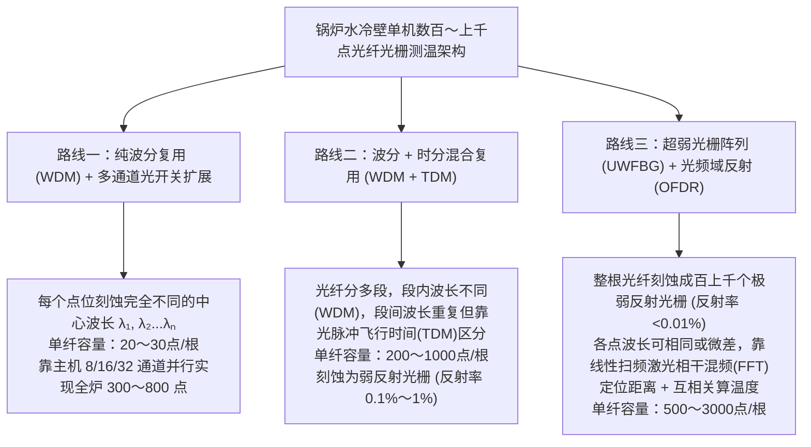

# 光纤光栅测温物理机制与单纤百点/千点复用架构

## 1. 为什么刻蚀不同光栅就能测出不同位置的温度？

### 1.1 布拉格（Bragg）波长反射定律
当宽谱光或扫频激光在光纤纤芯内传输，经过某一段被周期性刻蚀（折射率呈周期性正弦调制）的区域时，只有满足**布拉格相位匹配条件**的特定波长光会被强烈反射回来，其余波长的光直接透射过去继续往前走：

$$\lambda_B = 2 \cdot n_{\text{eff}} \cdot \Lambda$$

* $\lambda_B$：该光栅反射回来的中心波长（Bragg Wavelength），通常设计在光纤损耗最低的 C+L 通信波段（$1510\text{ nm} \sim 1590\text{ nm}$）；
* $n_{\text{eff}}$：光纤纤芯的有效折射率（普通掺锗单模光纤约 $1.447 \sim 1.468$）；
* $\Lambda$：刻蚀在纤芯上的光栅空间周期（栅距），对于 $1550\text{ nm}$ 波段，刻蚀周期约为 $\Lambda \approx \frac{1550\text{ nm}}{2 \times 1.45} \approx 534\text{ nm}$（即每毫米内刻蚀约 1870 条微米/纳米级折射率条纹）。

### 1.2 温度改变波长的基本物理方程
当锅炉水冷壁的热量传到金属导热块、加热内部光纤光栅（温度变化量为 $\Delta T$，同时假设存在轴向机械应变 $\varepsilon$）时，光栅中心波长漂移量 $\Delta\lambda_B$ 满足微分关系：

$$\frac{\Delta\lambda_B}{\lambda_B} = \left( \alpha_\Lambda + \xi \right) \Delta T + \left( 1 - p_e \right) \varepsilon$$

将纯温度项拆解来看：
1. **热光效应（Thermo-Optic Effect，$\xi$）**：温度升高导致石英玻璃的有效折射率 $n_{\text{eff}}$ 增大，$\xi = \frac{1}{n_{\text{eff}}}\frac{\partial n_{\text{eff}}}{\partial T} \approx 6.8 \times 10^{-6}\text{ }^\circ\text{C}^{-1} \sim 8.3 \times 10^{-6}\text{ }^\circ\text{C}^{-1}$，**占波长漂移总量的 $92\%\sim 95\%$**；
2. **光纤热膨胀效应（Thermal Expansion，$\alpha_\Lambda$）**：温度升高导致石英光纤自身热膨胀，刻蚀周期 $\Lambda$ 变长，$\alpha_\Lambda = \frac{1}{\Lambda}\frac{\partial \Lambda}{\partial T} \approx 0.55 \times 10^{-6}\text{ }^\circ\text{C}^{-1}$，**仅占波长漂移总量的 $5\%\sim 8\%$**；
3. **弹光效应（Photo-Elastic Effect，$p_e$）**：若光纤受到外力拉伸产生轴向应变 $\varepsilon$，$p_e \approx 0.22$，每产生 $1\text{ }\mu\varepsilon$（微应变）会引起约 $1.2\text{ pm}$ 的波长漂移。

> [!IMPORTANT]
> **水冷壁导热块为什么要“光纤穿过铁块内孔”而不是直接把裸光纤焊死在铁块上？**
> 在 $1550\text{ nm}$ 波段，温度每升高 $1^\circ\text{C}$，光栅波长向长波方向漂移约 **$10\text{ pm}\sim 13.5\text{ pm}$**（高温区非线性系数稍大）；而光纤若被金属铁块带着一起热膨胀拉伸，每 $10\text{ }\mu\varepsilon$ 就会产生 $12\text{ pm}$ 的漂移（相当于产生 $1^\circ\text{C}$ 的假温度误差！）。
> 因此，工程上必须将光纤光栅**松套穿在导热块内部的不锈钢毛细管/陶瓷管中（一端固定、另一端自由伸缩）**，令公式中的机械应变 $\varepsilon \equiv 0$，从而让光栅纯粹只响应导热块的温度 $\Delta T$。

### 1.3 宽温区（$20^\circ\text{C}\sim 650^\circ\text{C}$）的非线性温度修正模型
在常温小范围内（$0^\circ\text{C}\sim 100^\circ\text{C}$），$\Delta\lambda_B$ 与 $\Delta T$ 近似呈线性关系（灵敏度约 $10.5\text{ pm/}^\circ\text{C}$）。但在电厂锅炉从冷态点火到满负荷运行（$20^\circ\text{C}\sim 600^\circ\text{C}$）的大跨度温区内，石英的热光系数 $\xi(T)$ 随温度升高而显著增大（在 $500^\circ\text{C}$ 时灵敏度升至约 $15\sim 16\text{ pm/}^\circ\text{C}$）。因此主机内部必须采用**二阶或三阶多项式反演**：

$$T(\lambda_B) = T_0 + c_1 \left(\lambda_B - \lambda_{B0}\right) + c_2 \left(\lambda_B - \lambda_{B0}\right)^2 + c_3 \left(\lambda_B - \lambda_{B0}\right)^3$$

其中 $\lambda_{B0}$ 为参考温度 $T_0$（如 $25^\circ\text{C}$）下的初始标定波长，$c_1, c_2, c_3$ 为出厂高温恒温槽标定写入主机的拟合系数。

---

## 2. 如何在一根（或几根）光纤上测出几百甚至上千个点？（四大复用技术路线）

您在现场看到的“每个点位刻蚀得不一样，整圈光纤测几百甚至上千个点”，在光学工程上有**四种主流复用实现架构**。不同厂家根据点数规模和成本预算采用不同方案：

### 2.1 路线一：纯波分复用（WDM）+ 多通道并行解调（最经典、最皮实）
* **刻蚀方式**：同一根光纤上的第 $1, 2, \dots, N$ 个点位，分别用不同周期的相位掩模板（或飞秒逐点设定不同周期 $\Lambda_i$）刻蚀出互不重叠的中心波长，例如：
  * 测点 1：$\lambda_1 = 1512.0\text{ nm}$
  * 测点 2：$\lambda_2 = 1515.5\text{ nm}$
  * $\dots$
  * 测点 25：$\lambda_{25} = 1596.0\text{ nm}$
* **容量瓶颈计算**：因为锅炉水冷壁从室温 $20^\circ\text{C}$ 升至 $600^\circ\text{C}$ 时，每个光栅的波长会向右漂移约 $\Delta\lambda_{\max} \approx 580^\circ\text{C} \times 14\text{ pm/}^\circ\text{C} \approx 8.1\text{ nm}$！为了防止相邻两个测点的波长在高温下“撞车（光谱混叠交叉）”，每个高温测点必须预留 $3.5\text{ nm}\sim 8.5\text{ nm}$ 的波长通道间隔。
* **如何做到全炉几百个点**：常规 C+L 波段总宽约 $80\sim 100\text{ nm}$，因此**单根纯 WDM 高温光纤最多串联 $12\sim 25$ 个大温跨测点**。工程上通过解调主机内置 **$16\sim 32$ 路高速并行通道（或机械/MEMS 光开关）**，围绕锅炉水冷壁分层布置 $16\sim 32$ 根支路光缆，合计实现 **$300\sim 800$ 个测点**。

### 2.2 路线二：波分 + 时分混合复用（WDM + TDM，单纤数百至上千点主力方案）
* **刻蚀方式**：为了在一根光纤上串入几百上千个点，不再要求每个点波长都不同，而是将整根光纤划分为 $M$ 个空间区段（Sub-arrays），每个区段内刻蚀 $K$ 个不同波长的**低反射率光栅（反射率 $R \approx 0.1\%\sim 1\%$）**。不同区段重复使用同一套波长集合 $\{\lambda_1, \lambda_2, \dots, \lambda_K\}$。
* **位置与温度区分原理**：
  1. 主机不再发射连续光，而是通过半导体光放大器（SOA）或声光调制器（AOM）斩波发射纳秒级**窄光脉冲**（例如脉宽 $10\text{ ns}\sim 20\text{ ns}$，对应光纤空间距离分辨率 $1\text{ m}\sim 2\text{ m}$）；
  2. 光在石英光纤中的往返群速度约为 $v_g = \frac{c}{n_g} \approx 2 \times 10^8\text{ m/s}$，即**每相隔 $1\text{ m}$ 的两个导热块，反射光回到主机的时间相差 $10\text{ ns}$**；
  3. 主机先按**光脉冲到达的先后时间窗口（TDM）**切分出是第几段光纤，再在每个时间窗口内按**不同波长（WDM）**区分具体测点。
* **系统容量**：若波长通道数 $K = 20$，时分复用区段数 $M = 50$，则**单根光纤即可精确测量 $20 \times 50 = 1000$ 个高温点位**。

### 2.3 路线三：超弱光栅阵列（UWFBG）+ 光频域反射（OFDR，高密度前沿方案）
* **刻蚀方式**：在光纤拉丝过程中或用飞秒激光，每隔固定距离（如每隔 $0.5\text{ m}$ 或 $1\text{ m}$）刻写一个反射率极低（$-35\text{ dB}\sim -50\text{ dB}$，即反射率万分之一到十万分之一）的**超弱光纤光栅（UWFBG）**。各点位的初始刻蚀波长可以完全相同，也可以呈阶梯微差分布。
* **为什么反射率必须做得很弱？**
  如果刻蚀 1000 个反射率为 $90\%$ 的强光栅，光经过前 3 个光栅就被反射光了，后面的 997 个点根本收不到光；而且光在相邻强光栅之间来回多次反射会产生严重的**多径干扰（鬼影串扰，Multipath Ghosting）**。将每个光栅反射率压低到 $0.01\%$，1000 个光栅累计损耗不到 $0.5\text{ dB}$，整圈光纤从头到尾光强均匀。
* **位置与温度解调原理（OFDR 相干检测）**：
  1. 主机内的窄线宽可调谐激光器以固定速率 $\gamma$（$\text{THz/s}$）对光频率进行线性扫频；
  2. 光纤上第 $i$ 个位置（距离主机 $z_i$）的弱光栅反射回来的信号光，与主机内部的本地参考光（Local Oscillator）发生拍频干涉，产生一个**差频频率 $f_{b,i} = \frac{2 n_g \gamma}{c} z_i$**；
  3. **空间位置距离 $z_i$ 直接与拍频信号的频率 $f_{b,i}$ 成正比！** 主机对接收到的光电信号做一次**快速傅里叶变换（FFT）**，频谱上的每一个频率坐标就对应炉膛上某一个导热块的精确空间位置；
  4. 再将该位置对应的频域片段截取出来做逆傅里叶变换（iFFT）并与参考光谱做**互相关（Cross-Correlation）计算**，直接算出该位置的波长漂移 $\Delta\lambda_i$，换算为该导热块的温度。

---

## 3. 三种大容量光纤光栅测温技术路线综合对比表

| 技术指标 | 纯波分复用（WDM + 多通道） | 波分时分混合复用（WDM + TDM） | 超弱光栅 + 光频域反射（UWFBG + OFDR） |
| :--- | :--- | :--- | :--- |
| **各点位光栅刻蚀特征** | 每个点刻蚀周期 $\Lambda_i$ 均不同，强反射率（$R = 30\%\sim 90\%$） | 区段内 $\Lambda_i$ 不同、区段间重复，弱反射率（$R = 0.05\%\sim 1\%$） | 所有点位 $\Lambda$ 可相同或微差，超弱反射率（$R = 0.001\%\sim 0.05\%$） |
| **单根光纤最大测点数** | $12\sim 30$ 点 / 根 | **$200\sim 1,000$ 点 / 根** | **$500\sim 3,000$ 点 / 根** |
| **相邻测点最小安装间距** | 无限制（可紧挨到几厘米） | 受光脉宽限制，通常 $\ge 1.0\text{ m}\sim 2.0\text{ m}$ | **厘米级（可密至 $1\text{ cm}\sim 10\text{ cm}$）** |
| **区分不同点位的物理依据** | 纯波长域区分（$\lambda_1 \neq \lambda_2 \neq \dots \neq \lambda_N$） | 脉冲飞行时间（$t_m$）+ 波长域（$\lambda_k$）二维区分 | 相干拍频频率定位（$f_b \propto z_i$）+ 局部光谱互相关算温度 |
| **单点光纤熔接损耗容忍度** | 高（强反射信号信噪比裕量大） | 中等 | 较高，但需控制法兰/熔接点强菲涅尔反射以免饱和探测器 |
| **电厂水冷壁适用场景** | 测点总数 $<300$ 点、按炉膛标高分层多光缆引出 | **大型 $600\text{ MW}/1000\text{ MW}$ 超超临界锅炉（500～2000 点）主流工程方案** | **高密度水冷壁全炉膛热负荷三维成像、微区结焦与局部过热精细诊断** |
