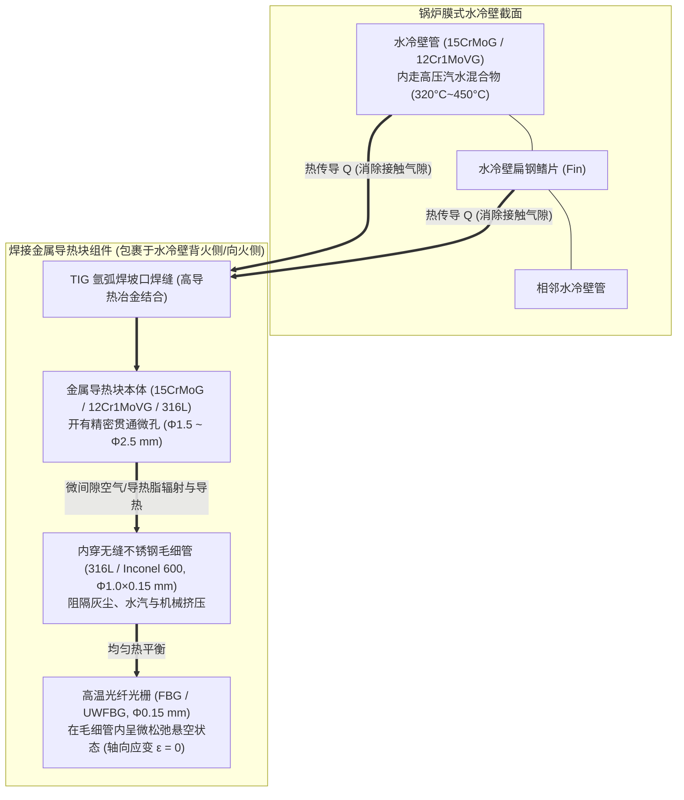
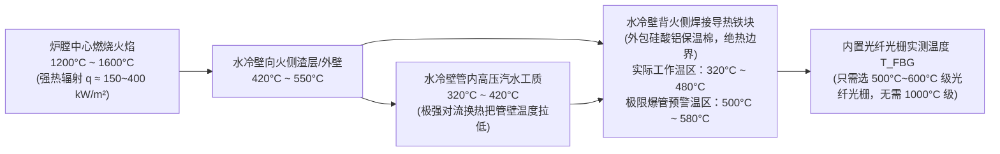
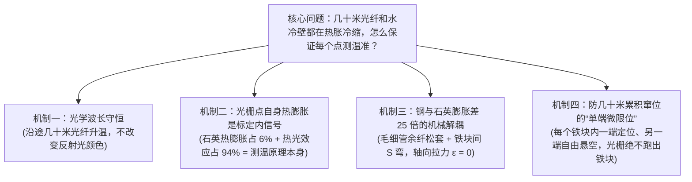

# 锅炉水冷壁金属导热块封装结构、去应力设计与传热学模型

您在现场观察到的**“光纤穿过一个金属铁块，铁块焊接在炉膛水冷壁上，水冷壁把热传给铁块，光纤再去测铁块温度”**，是整个电站锅炉光纤测温系统能否长期存活、测温是否准确的**机械与热工核心**。

如果直接把光纤贴在水冷壁管子上，或者把光纤死死粘在铁块里，系统一投运就会面临两大致命问题：
1. **水冷壁热膨胀拉断光纤或产生百摄氏度级假温度**：锅炉从冷态 $20^\circ\text{C}$ 点火升至 $450^\circ\text{C}$，每米水冷壁钢管要伸长约 $5.5\text{ mm}$（相当于 $5500\text{ }\mu\varepsilon$ 应变）。如果光纤与铁块刚性粘死，这 $5500\text{ }\mu\varepsilon$ 的拉伸会让光栅波长暴增 $6.6\text{ nm}$，**解调仪会误以为温度升高了 $550^\circ\text{C}$**，甚至直接把石英光纤拉断！
2. **接触热阻与炉墙保温散热引起的测温偏低**：如果导热块结构设计不合理，热量传不过来或向背火侧保温棉散失，测出来的温度会比水冷壁真实管壁温度低 $20^\circ\text{C}\sim 50^\circ\text{C}$。

---

## 1. 金属导热块（Thermal Conduction Block）多层解剖结构

工程上标准的水冷壁光纤测温导热块采用**“外焊耐热钢导热基座 + 中层导热均温衬管 + 内层不锈钢/刚玉毛细管松套悬空光栅”**的三层同轴去应力结构：

### 1.1 为什么光纤在铁块里必须“自由穿过（松套悬空）”？
* **单端固定 / 余量松套法则**：整根铠装传感光缆在穿过一排金属导热块时，内部的不锈钢毛细管（外径 $\Phi 0.8\sim 1.2\text{ mm}$）穿入导热块的通孔（孔径 $\Phi 1.5\sim 2.0\text{ mm}$）中；而在毛细管内部，直径 $0.15\text{ mm}$ 的光纤光栅与毛细管内壁之间留有 $0.2\sim 0.4\text{ mm}$ 的径向间隙，且在装配时预留了 **$0.2\%\sim 0.5\%$ 的微弯曲余量（Excess Fiber Length, EFL）**。
* **解耦效果**：当水冷壁管和金属导热块随锅炉升温发生毫米级热膨胀变形时，导热块可以在外层护套管上微幅滑动，内部光纤则在毛细管内自由舒展，**完全不受轴向拉力（$\varepsilon = 0$）**。光栅反射波长的变化 $100\%$ 来自于导热块传递过来的温度 $\Delta T$。

### 1.2 金属导热块的材质选型规范（必须与水冷壁母材热膨胀匹配）
电厂锅炉水冷壁管和鳍片均属于特种承压设备部件，导热块材质绝不能随便拿一块普通碳钢（Q235）往上焊，必须遵循**与水冷壁管/鳍片母材同质或热膨胀系数相近**的原则，防止长期冷热启停交变下焊缝热疲劳开裂：

| 锅炉类型与水冷壁常见母材 | 推荐导热块金属材质 | 热膨胀系数（$20\sim 500^\circ\text{C}$） | 热导率 $\lambda$（$400^\circ\text{C}$） | 适用部位与焊接匹配性 |
| :--- | :--- | :--- | :--- | :--- |
| **亚临界锅炉（`20G` 高压锅炉碳钢）** | **`20G` 优质碳素结构钢** 或 **`304/316L` 不锈钢** | $13.5 \times 10^{-6}\text{ /}^\circ\text{C}$ | $\sim 42\text{ W/(m}\cdot\text{K)}$ | 导热快、与 `20G` 鳍片焊接性能极佳，无异种钢焊接冷裂纹风险。 |
| **超临界锅炉（`15CrMoG` 珠光体耐热钢）** | **`15CrMoG` 同材质耐热合金钢块** | $13.8 \times 10^{-6}\text{ /}^\circ\text{C}$ | $\sim 36\text{ W/(m}\cdot\text{K)}$ | 母材同质焊接，配套 `R307` / `TIG-R30` 焊丝，高温热膨胀完全同步。 |
| **超超临界锅炉（`12Cr1MoVG` / `T23` / `T12`）** | **`12Cr1MoVG` 耐热合金钢块** 或 **`Inconel` 过渡块** | $13.2 \times 10^{-6}\text{ /}^\circ\text{C}$ | $\sim 34\text{ W/(m}\cdot\text{K)}$ | 耐 $580^\circ\text{C}$ 高温氧化与蠕变，配套 `TIG-R31` 焊丝焊接。 |

---

## 2. 炉膛内部 $1200^\circ\text{C}+$ 燃烧火焰 vs 水冷壁外侧 $320^\circ\text{C}\sim 480^\circ\text{C}$ 导热块的传热与反演模型

### 2.1 为什么炉膛里面烧到 $1200^\circ\text{C}\sim 1600^\circ\text{C}$，而水冷壁外侧铁块只有几百度？
这是一个非常关键的锅炉热工边界条件（也是决定光纤选型不必盲目追求 $1000^\circ\text{C}$ 极端耐温等级的核心依据）：
1. **向火侧（炉膛内火焰辐射区）**：煤粉剧烈燃烧的火焰中心温度高达 **$1200^\circ\text{C}\sim 1600^\circ\text{C}$**（此区域的烟气场温度通常用**声波测温系统**测量，任何接触式传感器直接伸进炉膛火焰都会被烧毁或砸断）。
2. **水冷壁管内（汽水工质强迫对流冷却）**：水冷壁管内走的是 $16\sim 28\text{ MPa}$ 的高压给水或汽水混合物，其工质温度在亚临界锅炉中约为 **$340^\circ\text{C}\sim 360^\circ\text{C}$**，在超超临界直流锅炉中也仅为 **$320^\circ\text{C}\sim 430^\circ\text{C}$**。由于沸腾换热系数极高（$h_{\text{in}} \approx 20,000\sim 50,000\text{ W/(m}^2\cdot\text{K)}$），水冷壁管壁被管内工质牢牢“冷却锁温”。
3. **水冷壁外侧（背火侧保温层内导热块实测温区）**：
   * 焊接在水冷壁背火侧（管壁冠部或扁钢鳍片外侧、包裹在保温层内部）的金属导热块，其正常满负荷工作温度仅在 **$320^\circ\text{C}\sim 460^\circ\text{C}$** 之间！
   * 即便发生局部传热恶化（膜态沸腾 DNB）或短期超温报警，珠光体耐热钢水冷壁（`15CrMoG` / `12Cr1MoVG`）的金属允许极限温度也仅为 **$500^\circ\text{C}\sim 580^\circ\text{C}$**（一旦管壁真的升到 $700^\circ\text{C}\sim 1000^\circ\text{C}$，水冷壁早就发生短期过热爆管了）。

### 2.2 既然外侧只有 $320^\circ\text{C}\sim 480^\circ\text{C}$，怎么通过外侧铁块温度算出炉膛内的燃烧与结焦状态？
虽然光纤在背火侧只测到了几百度的管壁/鳍片温度 $T_{\text{FBG}}$，但因为背火侧外敷厚保温棉（近似绝热边界 $q_{\text{back}} \approx 0$），通过以下两个热工物理机制，可以直接反演出炉膛内 $1200^\circ\text{C}+$ 的燃烧偏斜与水冷壁结焦情况：
1. **鳍片温度与管顶温度差反演局部热流密度 $q''$**：
   来自炉膛 $1200^\circ\text{C}\sim 1600^\circ\text{C}$ 火焰的辐射热流 $q''$ 打在扁钢鳍片上，必须横向传导进两侧的水冷壁管内被水带走。因此**鳍片中心导热块温度 $T_{\text{fin}}$ 永远高于水冷壁管背火侧导热块温度 $T_{\text{tube}}$**（正常满负荷下温差约 $25^\circ\text{C}\sim 65^\circ\text{C}$），且温差与炉膛局部辐射热流密度 $q''$ 严格成正比：
   $$q'' \propto \frac{2 \lambda_{\text{steel}} \delta_{\text{fin}}}{b^2} \left( T_{\text{fin}} - T_{\text{fluid}} \right)$$
2. **动态识别炉膛水冷壁结焦（Slagging）与吹灰效果**：
   * 当某一片水冷壁向火侧严重结焦挂渣时，灰渣层热阻大幅增加，挡住了炉膛 $1200^\circ\text{C}$ 火焰向管壁的辐射传热，该区域的导热块温度 $T_{\text{FBG}}$ 会**反常下降 $15^\circ\text{C}\sim 40^\circ\text{C}$**（形成“冷斑”）；
   * 一旦大块焦渣突然脱落（掉焦）或吹灰器吹扫干净，干净管壁直接暴露在 $1400^\circ\text{C}$ 火焰辐射下，该点导热块温度 $T_{\text{FBG}}$ 会在几十秒内**迅速跃升回正常高值**；
   * 若管内发生汽水停滞或垢下腐蚀导致冷却失效，该点导热块温度则会**突破 $480^\circ\text{C}\sim 520^\circ\text{C}$ 红线**，直接触发防爆管预警。

### 2.3 稳态传热热阻网络与测温偏差修正
热量从水冷壁管外壁/鳍片（真实温度 $T_{\text{wall}}$）传递到导热块中心孔内的光纤光栅（实测温度 $T_{\text{FBG}}$），经历以下串联热阻：

$$T_{\text{wall}} - T_{\text{FBG}} = q_{\text{loss}} \cdot \left( R_{\text{weld}} + R_{\text{block}} + R_{\text{gap}} \right)$$

1. **焊接界面热阻 $R_{\text{weld}}$**：若导热块仅在四角点焊，块体底面与水冷壁圆弧面之间存在空气隙（空气热导率仅 $0.04\text{ W/(m}\cdot\text{K)}$，比钢铁低 1000 倍！），会导致高达 $30^\circ\text{C}\sim 60^\circ\text{C}$ 的测温滞后和偏低。因此**导热块底部必须铣削加工出与水冷壁管外径或鳍片完全贴合的底面，并沿两侧长边采用连续满焊（Fillet Weld）**，形成冶金结合导热通道。
2. **导热块本体热阻 $R_{\text{block}} = \frac{\delta_{\text{block}}}{\lambda_{\text{steel}} A}$**：导热块穿纤孔中心距离水冷壁外壁的距离 $\delta_{\text{block}}$ 通常控制在 **$3\text{ mm}\sim 5\text{ mm}$** 以内，块体长 $25\sim 40\text{ mm}$、宽 $12\sim 18\text{ mm}$、高 $8\sim 12\text{ mm}$。
3. **背火侧保温层全包覆要求**：导热块焊接在水冷壁背火侧（炉墙保温层一侧）时，导热块外表面必须被硅酸铝耐火保温棉严密覆盖（热损 $q_{\text{loss}} \to 0$）。在良好满焊与保温包覆下，稳态温差 $T_{\text{wall}} - T_{\text{FBG}} \le 1.0^\circ\text{C}\sim 2.5^\circ\text{C}$。

### 2.2 动态热响应时间常数 $\tau$（能不能抓到锅炉瞬态超温？）
光纤光栅本身质量极小（每厘米石英纤仅重 $0.3\text{ mg}$），裸光栅的热响应时间仅几毫秒；套上 $\Phi 1.0\text{ mm}$ 不锈钢毛细管并穿入焊接好的导热块后，系统的集中参数热响应时间常数 $\tau_{63.2\%}$ 为：

$$\tau = R_{\text{gap}} \cdot C_{\text{capillary+fiber}} \approx \frac{\rho c_p V_{\text{sensor}}}{h_{\text{eff}} A_{\text{surface}}}$$

* 实测工程数据：在微间隙干式穿孔结构下，导热块温度发生阶跃变化时，光纤光栅的热响应时间常数 **$\tau_{63.2\%} \approx 1.2\text{ s}\sim 3.5\text{ s}$（$T_{90} < 8\text{ s}$）**；若在孔内填充耐高温氮化硼（BN）或纳米银导热膏，响应时间可缩短至 **$< 0.8\text{ s}$**。
* 相比水冷壁管自身数十秒的热惯性，该响应速度完全能够实时捕捉锅炉深度调峰、磨煤机启停、吹灰器投运及局部掉焦引发的水冷壁瞬态温度波动。

---

## 3. 核心疑难解答：整根几十米光纤与水冷壁都在“热胀冷缩”，为什么不会影响某个点的测温精度？

在锅炉上敷设十几米到几十米长的光纤，沿途温度都在剧烈变化，光纤和水冷壁自身都在热胀冷缩。工程上通过以下**四个物理与机械机制**彻底排除了沿途热胀冷缩对单点测温精度的干扰：

### 3.1 疑虑一：光要走过前面几十米滚烫、热胀冷缩的光纤才能到达第 $N$ 个点，沿途光纤的热胀冷缩会不会把信号搞歪？
* **物理真相：测温看的是“反射光的颜色（波长 $\lambda_B$）”，而光在普通光纤里传输时，无论沿途光纤怎么热胀冷缩，光的颜色（频率）绝对不会变！**
  1. 每个测温点上刻蚀的“光栅”长度只有 **$5\text{ mm}\sim 10\text{ mm}$**，正好藏在那个金属导热铁块的肚子正中间；其余几十米连接段全是没有刻光栅的普通光纤。
  2. 当第 20 个铁块（比如当前 $420^\circ\text{C}$）里的这 $5\text{ mm}$ 光栅把特定波长（比如 $\lambda_{20} = 1554.250\text{ nm}$）的光反射回去后，这束光在往回走那 30 米光纤的路上，哪怕沿途某段光纤被火烤到 $500^\circ\text{C}$ 发生了热膨胀，或者某段在炉外吹冷风降到 $0^\circ\text{C}$ 发生了冷缩，**只会改变这束光往返跑一趟的时间（差零点几纳秒）和轻微光强，但绝对不会改变这束光 $1554.250\text{ nm}$ 的波长（颜色）**！
  3. 解调主机只认波长 $\lambda_{20}$，所以前面 30 米光纤怎么热胀冷缩，对第 20 个点的温度读数影响为 **零**。

### 3.2 疑虑二：那这 $5\text{ mm}$ 光栅点位它自己的“光纤热胀冷缩”呢？
* **物理真相：光栅那 $5\text{ mm}$ 自身的热胀冷缩不仅不是误差，反而是它用来测温的物理原理本身！**
  * 因为这 $5\text{ mm}$ 光纤光栅就泡在金属导热铁块内孔里，它的温度和铁块完全一致。当铁块升温 $\Delta T$ 时，这 $5\text{ mm}$ 石英光纤发生两部分变化：
    1. **石英光纤自身热胀冷缩**（热膨胀系数 $\alpha_\Lambda = 0.55 \times 10^{-6}\text{ /}^\circ\text{C}$）：把刻蚀条纹的间距 $\Lambda$ 撑大了，贡献了约 **$6\%$** 的波长变化；
    2. **石英折射率随温度变化**（热光系数 $\xi = 8.3 \times 10^{-6}\text{ /}^\circ\text{C}$）：贡献了约 **$94\%$** 的波长变化。
  * 这两项加在一起（$\alpha_\Lambda + \xi$）都是纯碎只跟该点温度 $T$ 一一对应的物理常数，出厂标定时已经一起算进温度公式里了。

### 3.3 疑虑三：水冷壁钢铁的热膨胀量是石英光纤的 25 倍！几十米水冷壁涨长了十几厘米，会不会把里面的光纤拽长、拉歪温度？
这是现场最核心的工程难题，先看一组惊人的对比数据：
* **水冷壁钢铁热膨胀系数**：$\alpha_{\text{steel}} \approx 13.5 \times 10^{-6}\text{ /}^\circ\text{C}$；
* **石英光纤热膨胀系数**：$\alpha_{\text{quartz}} \approx 0.55 \times 10^{-6}\text{ /}^\circ\text{C}$（**钢铁热胀冷缩的幅度是石英光纤的 24.5 倍！**）。
* 当一段 $30\text{ 米}$ 长的水冷壁从 $20^\circ\text{C}$ 升到 $420^\circ\text{C}$（$\Delta T = 400^\circ\text{C}$）时：
  * 水冷壁钢管伸长了：$30\text{ m} \times 13.5 \times 10^{-6} \times 400 = \mathbf{162\text{ 毫米}}$！
  * 而里面的石英光纤自己只伸长了：$30\text{ m} \times 0.55 \times 10^{-6} \times 400 = \mathbf{6.6\text{ 毫米}}$！
* **如果把光纤死死绑在水冷壁上，这 $155\text{ 毫米}$ 的长度差当场就会把光纤拉断！为了彻底化解这 25 倍的热胀冷缩差，工程上采用了三级解耦结构**：
  1. **第一级（铁块之间留 S 形/Ω形膨胀弯）**：相邻两个焊接在水冷壁上的铁块（比如间隔 $1\text{ 米}$，升温后两铁块距离拉开了 $5.4\text{ 毫米}$）之间，外层金属铠装波纹管故意做成带弧度的微 S 形弯曲（预留 $15\text{ mm}$ 长度余量）。水冷壁涨长时，只是把铁块之间的波纹管稍微拉直了一点点。
  2. **第二级（毛细钢管内部预留 $0.3\%\sim 0.5\%$ 余纤率 EFL）**：在直径 $1.0\text{ mm}$ 的不锈钢毛细管内部，直径 $0.15\text{ mm}$ 的石英光纤在穿管生产时就故意比钢管多放进去了 $0.5\%$ 的长度（光纤在管内呈微正弦松弛弯曲）。就算外层不锈钢毛细管受热伸长了 $0.5\%$，内部石英光纤也只是从“微弯”变成“自然舒展”，**受到的机械拉力永远为 $0$**。
  3. **第三级（光栅点位“单端定位、另一端自由悬空”）**：为了防止几十米光纤在管子里乱窜导致那 $5\text{ mm}$ 光栅滑出铁块外面，同时又不能把光栅两端卡死，工艺上在每个铁块入口处将毛细管与导热块锁紧，而光栅在毛细管内处于**悬臂自由状态（或一端微固定、越过 $5\text{ mm}$ 光栅后的另一端自由伸缩）**。这样既保证了**“第 $N$ 个光栅永远对准第 $N$ 个铁块中心，偏不出 $2\text{ mm}$”**，又保证了光栅段绝对不受拉伸应力！

### 3.4 疑虑四：如果用飞行时间（TDM / OFDR）区分位置，前面几十米光纤热胀冷缩会不会导致主机“认错点位”？
* 算一笔定量账：$50\text{ 米}$ 长的石英光纤整体升温 $400^\circ\text{C}$，其物理长度只伸长了 **$1.1\text{ 厘米}$**，加上折射率变大引起的光学等效距离（光程 $nL$）变化也只有 **$17.5\text{ 厘米}$**（相邻两个铁块之间仅差 **$3.5\text{ 毫米}$**）。
* 而锅炉水冷壁上相邻两个铁块的安装距离通常是 **$50\text{ 厘米}\sim 150\text{ 厘米}$**，且在 `WDM+TDM` 系统中相邻铁块的刻蚀波长还不一样。**$3.5\text{ 毫米}$ 的热膨胀光程偏移相对于 $1000\text{ 毫米}$ 的铁块间距来说完全可以忽略不计，主机绝对不会把第 20 号铁块和第 21 号铁块认混！**
