# 解调主机（Interrogator）光学前端：发光光源、无源光路与光电接收器

您在锅炉现场看到的“最后有一个主机，既是发光器又是接收器，能把全炉几百上千个点算出来”，这台主机在专业上称为**光纤光栅传感解调仪（FBG Sensor Interrogator）**。因为光栅温度每变化 $1^\circ\text{C}$，反射波长只移动约 $10\text{ pm}$（$1\text{ pm} = 10^{-12}\text{ m}$，约为一根头发丝直径的八百万分之一），要实现 $\pm 0.5^\circ\text{C}$ 的测温精度，主机的光学系统必须具备 **$1\text{ pm}\sim 2\text{ pm}$ 的绝对波长分辨与测量精度**。

---

## 1. 解调主机的三大主流光学架构

工业界用于锅炉测温的解调主机，按“怎么发光”和“怎么接收分辨波长”分为三种光学路线：

```mermaid
flowchart TD
    subgraph Arch1["架构一：窄线宽扫频激光源 + 单点高速 InGaAs 探测器 (主流大容量方案)"]
        S1["可调谐扫频激光器 (Swept Laser)<br/>1510~1590 nm 周期性扫频"] --> C1["光学环形器 (Circulator)"]
        C1 --> F1["锅炉水冷壁光纤光栅串"]
        F1 --> C1
        C1 --> PD1["高速 InGaAs PIN / APD 光电二极管<br/>(把时间轴上的光强脉冲转为电压)"]
    end

    subgraph Arch2["架构二：宽带光源 (ASE/SLED) + 体光栅色散 + 线阵 InGaAs 相机 (全固态高可靠方案)"]
        S2["C+L 波段宽带光源<br/>(ASE / SLED, 同时发出所有波长)"] --> C2["光学环形器"]
        C2 --> F2["锅炉水冷壁光纤光栅串"]
        F2 --> C2
        C2 --> VPG["体全息透射光栅 (VPG)<br/>(按不同波长在空间展开成彩虹条)"]
        VPG --> Array["512/1024 像元 InGaAs 线阵图像传感器"]
    end

    subgraph Arch3["架构三：高相干线性扫频激光 + 迈克尔逊干涉仪 + 平衡探测器 (OFDR 超弱光栅千点方案)"]
        S3["超窄线宽外腔可调谐激光器 (TLS)"] --> Coupler["90:10 耦合器"]
        Coupler -- "信号臂" --> F3["水冷壁千点级超弱光栅阵列 (UWFBG)"]
        Coupler -- "本振参考臂" --> Ref["参考反射镜"]
        F3 & Ref --> Mix["50:50 相干混频耦合器"]
        Mix --> BPD["双平衡 InGaAs 光电探测器 (Balanced PD)"]
    end
```

---

## 2. 发光端核心器件：光源（Light Sources）深度拆解

### 2.1 可调谐扫频激光器（Tunable Swept Laser）——大容量 WDM / WDM+TDM / OFDR 核心光源
* **工作原理**：激光器在每个扫描周期内（例如每 $1\text{ ms}$ 或 $10\text{ ms}$），输出波长从 $1510\text{ nm}$ 连续、单调、匀速地扫描到 $1590\text{ nm}$。因为在任意时刻 $t$ 主机发出的光只有一个确定的波长 $\lambda(t)$，所以当某个时刻接收器收到了反射回来的光脉冲，主机只要看“现在是哪个时刻 $t$”，就能直接对应出该光栅的反射波长！
* **三种扫频激光器硬件实现**：
  1. **压电陶瓷（PZT）或 MEMS 谐振腔可调谐激光器**：利用光纤环形腔配合 MEMS 微镜或法布里-珀罗（F-P）可调滤波器，扫描频率 $100\text{ Hz}\sim 5\text{ kHz}$，输出光功率高（$+10\text{ dBm}\sim +13\text{ dBm}$，约 $10\sim 20\text{ mW}$），动态范围高达 $40\sim 50\text{ dB}$。
  2. **采样光栅分布布拉格反射半导体激光器（SG-DBR / MG-Y Laser）**：全单片集成的半导体芯片激光器，无任何机械运动部件！通过向芯片的四个电极区（前光栅区、后光栅区、相位区、增益区）注入精密的数字电流组合（由 DAC 驱动），实现全 C 波段无机械磨损切换，寿命长达 $>10$ 万小时，极适合电厂常年 $7\times 24\text{ h}$ 连续运行。
  3. **外腔可调谐窄线宽激光器（External-Cavity TLS）**：线宽极窄（$< 100\text{ kHz}$，相干长度达数公里），专门用于 `OFDR` 相干光频域反射系统。

### 2.2 放大自发辐射宽带光源（ASE）与超辐射发光二极管（SLED）——光谱仪路线光源
* **ASE 光源（Amplified Spontaneous Emission）**：
  * **内部结构**：由 $980\text{ nm}$ 半导体泵浦激光器（Pump LD）+ 波分复用耦合器（WDM）+ 一段 $10\sim 20\text{ m}$ 长的**掺铒光纤（Erbium-Doped Fiber, EDF）** + 光隔离器 + 光谱平坦滤波器（GFF）组成。
  * **特点**：光谱极宽且平坦（C 波段 $1525\sim 1565\text{ nm}$，或 C+L 波段 $1525\sim 1605\text{ nm}$），总输出光功率 $10\sim 50\text{ mW}$，偏振度极低（避免偏振态变化引起波长误判）。
* **SLED 光源（Superluminescent Diode）**：
  * **特点**：单颗半导体光电芯片，体积小、成本低、功耗小，谱宽 $40\sim 80\text{ nm}$；缺点是谱密度比 ASE 略低且具有一定偏振性（需加消偏器）。

### 2.3 时分复用（TDM）脉冲调制器件（当单纤串联数百个同波长弱光栅时必备）
* **半导体光放大器（SOA，Semiconductor Optical Amplifier）**或**声光调制器（AOM，Acousto-Optic Modulator）**：
  * 安装在连续光源出口处，充当**纳秒级高速光快门（Optical Shutter）**。
  * 由 `FPGA` 发出脉宽 $10\text{ ns}\sim 20\text{ ns}$ 的电脉冲驱动 `SOA`/`AOM`，把连续激光斩切成一串极短的光脉冲打入锅炉光纤，消光比高达 $> 50\text{ dB}$，从而利用光脉冲往返飞行时间差（每米光纤往返 $10\text{ ns}$）将一根光纤上的几百个点在时间轴上彻底分开。

---

## 3. 接收端核心器件：光电探测器（Optical Receivers & Detectors）

由于锅炉光纤测温工作在 **$1550\text{ nm}$ 近红外通信波段**，普通的硅（`Si`）光电二极管在 $>1100\text{ nm}$ 波段完全失明（光子能量小于硅禁带宽度 $1.12\text{ eV}$），因此解调主机的接收器**必须全部采用三五族化合物半导体——铟镓砷（$\text{InGaAs}$，Indium Gallium Arsenide）探测器**。

| 接收器类型 | 核心物理结构与选型型号举例 | 关键性能参数（@ $1550\text{ nm}$） | 适用解调路线与在主机中的作用 |
| :--- | :--- | :--- | :--- |
| **1. 单点高速 `InGaAs PIN` 光电二极管** | `InGaAs/InP` 异质结 PIN 管（带尾纤耦合封装），如滨松（Hamamatsu）`G8376`、Thorlabs `FGA01FC` 或国产光迅/海信同级器件 | 响应度 $\mathcal{R} \approx 0.95\sim 1.05\text{ A/W}$；暗电流 $< 0.5\text{ nA}$；响应带宽 $100\text{ MHz}\sim 2\text{ GHz}$ | **扫频激光解调仪主力接收器**：接收反射率 $\ge 5\%$ 的常规/再生高温光栅信号，线性度极好、噪声低。 |
| **2. 雪崩光电二极管 `InGaAs APD`** | 内部具有高电场雪崩倍增区（Avalanche Multiplication），内置半导体制冷器（TEC）恒温封装 | 内置雪崩增益 $M = 10\sim 20$ 倍；等效响应度高达 $9\sim 18\text{ A/W}$；带宽 $200\text{ MHz}\sim 1\text{ GHz}$ | **WDM+TDM 超弱光纤光栅阵列专用接收器**：当光栅反射率低至 $0.01\%\sim 0.1\%$（反射光功率仅纳瓦 $\text{nW}$ 级）时，靠内部雪崩效应将微弱光电流放大十余倍，大幅提升信噪比。 |
| **3. 体全息光栅（VPG）+ `InGaAs` 线阵图像传感器** | 空间色散体光栅将 $1510\sim 1590\text{ nm}$ 反射光按角度打散，投射到 **512 像元或 1024 像元 `InGaAs` 线阵 CMOS**（如索尼/滨松 `G11620-512DA` 或 Ibsen `I-MON 512` 模块） | 512 或 1024 个独立感光像素并列；单像素尺寸 $25\text{ }\mu\text{m} \times 500\text{ }\mu\text{m}$；帧率 $1\text{ kHz}\sim 30\text{ kHz}$ | **宽带光源（ASE/SLED）光谱仪路线核心接收器**：整机无任何活动扫描部件，512 个像素同时曝光读取整条光谱，抗振动性能最强。 |
| **4. 双平衡光电探测器（Balanced Photodetector, BPD）** | 两只严格配对的 `InGaAs PIN` 管反向串联，直接输出两路光电流之差 $\Delta I = I_+ - I_-$ | 共模抑制比 $\text{CMRR} > 25\text{ dB}$；带宽 $100\text{ MHz}\sim 400\text{ MHz}$ | **`OFDR` 光频域反射主机专用接收器**：彻底抵消直流背景光和激光器相对强度噪声（RIN），只提取微弱的相干拍频交流干涉信号。 |

---

## 4. 主机内部无源光学链路与关键校准标准具

除发光器和接收器外，解调主机内部光路板（Optical Tray）还包含以下关键无源光器件：

1. **三端口光学环形器（Optical Circulator）**：
   * 端口 1 接发光光源，端口 2 接通往锅炉水冷壁的传感光缆，端口 3 接 `InGaAs` 接收器。
   * 利用法拉第磁光非互易效应，让光源发出的光只能从 $1 \rightarrow 2$ 进入锅炉光纤，而从锅炉反射回来的光只能从 $2 \rightarrow 3$ 进入接收器（隔离度 $> 50\text{ dB}$，插损 $< 0.7\text{ dB}$），既防止反射光倒灌烧毁激光器，又把发射与接收完美分离。
2. **内置绝对波长参考基准：氰化氢（$\text{H}^{13}\text{C}^{14}\text{N}$）或乙炔（$^{12}\text{C}_2\text{H}_2$）气体吸收池 + 法布里-珀罗标准具（F-P Etalon）**：
   * **为什么主机必须内置气室和标准具？** 扫频激光器受环境温度影响，每次扫描的起始波长和扫描速度都会有微小的非线性漂移。
   * 主机在激光器出口用 $95:5$ 分光器分出 $5\%$ 的光，穿过一个**内置的 $\text{HCN}$ 分子气体吸收池**和一个**石英 F-P 梳状标准具（自由光谱范围 $\text{FSR} = 50\text{ GHz}$ 或 $100\text{ GHz}$，即每隔 $0.4\text{ nm}$ 产生一个极其精准的透射基准齿）**。
   * 因为 $\text{HCN}$ 气体分子的量子能级吸收峰波长是全宇宙恒定不变的物理常数（美国 NIST 标准，例如 P 支第 10 条吸收线精确固定在 $1549.7305\text{ nm}$，温度漂移 $< 0.01\text{ pm/}^\circ\text{C}$）！主机每扫描一次，就用气室吸收线和标准具梳齿对时间轴进行一次实时标尺校准，确保主机用上 10 年都不会发生零点漂移。
