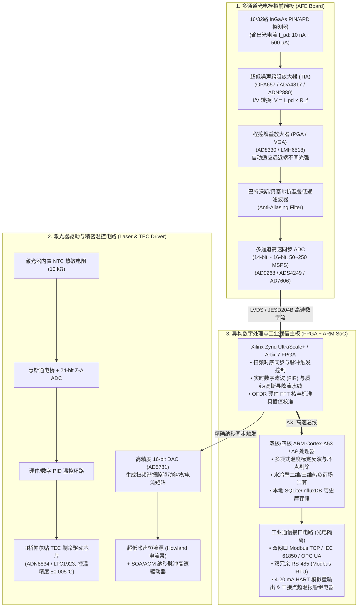

# 解调主机电子电路硬件架构与信号调理链路

当锅炉水冷壁上几百个光栅的微弱反射光回到主机，被 `InGaAs` 光电探测器转化为微安（$\mu\text{A}$）乃至纳安（$\text{nA}$）级的微弱光电流后，必须经过一套高信噪比、高带宽、低温漂的电子电路完成**电流转电压、程控放大、抗混叠滤波、高速同步模数转换（ADC）、激光器恒温恒流控制以及 FPGA 实时数字信号处理**。

---

## 1. 整机电子硬件总体框图

---

## 2. 核心模拟与混合信号电路模块详解

### 2.1 第一级：超低噪声跨阻放大器电路（TIA，Transimpedance Amplifier）
`InGaAs` 光电二极管输出的是微弱电流信号 $I_{\text{pd}}$，电路的第一步必须用跨阻放大器将其无失真地转换成电压信号 $V_{\text{out}} = -I_{\text{pd}} \cdot R_f$。
* **电路拓扑与关键元器件**：
  * 采用 **JFET 输入级或 CMOS 输入级超低偏置电流高速运算放大器**（如德州仪器 `OPA657`、`OPA857`，或亚德诺 `ADA4817`、`LTC6268`），其输入偏置电流 $I_b < 2\text{ pA}$，输入电压噪声密度 $< 4.8\text{ nV}/\sqrt{\text{Hz}}$。
  * **反馈电阻 $R_f$ 与反馈电容 $C_f$ 相位补偿**：
    * 针对常规强反射光栅（反射率 $>20\%$）：$R_f$ 通常取 $10\text{ k}\Omega\sim 100\text{ k}\Omega$；
    * 针对超弱光栅阵列（UWFBG，反射率 $<0.1\%$）：$R_f$ 需取 $100\text{ k}\Omega\sim 1\text{ M}\Omega$（甚至采用两级放大或可切换双档跨阻芯片 `OPA857`）。
    * 为防止光电二极管结电容 $C_d$（约 $1\sim 5\text{ pF}$）与 $R_f$ 形成滞后极点导致运算放大器自激振荡，必须在 $R_f$ 两端并联 $0.2\text{ pF}\sim 1.5\text{ pF}$ 的低温漂 `NP0/C0G` 陶瓷反馈电容 $C_f$，满足巴特沃斯平坦响应条件：
      $$C_f = \sqrt{\frac{C_d + C_{\text{in}}}{2 \pi R_f \cdot \text{GBW}}}$$
* **PCB 布局硬性规范**：光电二极管阴/阳极引脚到运放反相输入端（`-IN`）的走线长度必须 **$< 3\text{ mm}$**，且必须挖空该节点下方的参考地平面（Ground Plane Cutout），并在四周布置保护环（Guard Ring），以减小杂散电容和漏电流。

### 2.2 第二级：程控增益放大器（PGA）与抗混叠滤波器（AAF）
* **为什么必须加程控增益（PGA）？**
  同一根锅炉光纤上，第 1 个导热块离主机最近，反射信号最强；第 500 个导热块离主机最远，且经过沿途熔接点和微弯损耗，反射光强可能比第 1 个点弱 $10\sim 15\text{ dB}$（差 $10\sim 30$ 倍）。
  通过在电路中加入由 `FPGA` 实时控制的**高速可变增益放大器（VGA/PGA，如 `AD8330` 或 `LMH6518`）**，对近端强信号采用低增益防止饱和削顶，对远端弱信号自动切换高增益放大，使所有测点进入 `ADC` 时均处于满量程的 $50\%\sim 85\%$ 最佳线性区间。
* **抗混叠低通滤波器（AAF）**：采用 4 阶或 6 阶有源贝塞尔（Bessel，保证群时延恒定、脉冲波形不失真）或巴特沃斯低通滤波器，滤除带外高频热噪声与开关电源纹波。

### 2.3 第三级：多通道同步模数转换电路（ADC）
根据系统复用技术路线的不同，ADC 的采样率与位数选型截然不同：

| 解调系统架构 | ADC 采样率要求 | ADC 分辨率要求 | 典型工业芯片选型 | 电路设计要点 |
| :--- | :--- | :--- | :--- | :--- |
| **常规纯波分复用（WDM，扫频/线阵）** | $1\text{ MSPS}\sim 20\text{ MSPS}$ | $16\text{-bit}$ | `AD7626`、`LTC2387-16`、`ADS8860` | 重点追求高动态范围（$\text{SNR} > 90\text{ dB}$）与极低积分非线性（$\text{INL} < \pm 1\text{ LSB}$），确保微弱反射峰轮廓采样细腻。 |
| **波分+时分混合复用（WDM+TDM 脉冲式）** | **$100\text{ MSPS}\sim 500\text{ MSPS}$** | $14\text{-bit}\sim 16\text{-bit}$ | `AD9268` (双通道 $125\text{ MSPS}$ $16\text{-bit}$)、`ADS4249` ($250\text{ MSPS}$) | 因为 $1\text{ m}$ 光纤间距对应的光脉冲回波间隔仅 **$10\text{ ns}$**！ADC 必须具备至少 $100\sim 250\text{ MHz}$ 采样率（每 $4\sim 10\text{ ns}$ 采一个点），且采集时钟必须与发射光脉冲时钟同源锁相（抖动 $< 1\text{ ps}$）。 |
| **光频域反射（OFDR 相干拍频式）** | **$50\text{ MSPS}\sim 250\text{ MSPS}$** | $14\text{-bit}\sim 16\text{-bit}$ | `AD9650`、`LTC2195` | 常采用**外时钟等光频间隔采样（k-clock triggering）**：利用辅助马赫-曾德尔干涉仪（MZI）产生的过零脉冲直接作为 ADC 的采样时钟输入，从硬件根源上消除激光器扫频速度不均匀引起的 FFT 频谱展宽。 |

---

## 3. 激光器精密恒温（TEC）与低纹波驱动电源电路

激光器的发光波长对自身芯片温度极度敏感（温度每波动 $0.1^\circ\text{C}$，激光波长就会漂移约 $10\text{ pm}$）。因此主机内部必须有一套**毫开尔文（$\text{mK}$）级半导体制冷器（TEC）闭环温控电路**：
1. **测温电桥**：激光器蝶形封装（14-pin Butterfly Package）内部集成有高精度负温度系数热敏电阻（`NTC 10 kΩ`），通过 $5\text{ ppm/}^\circ\text{C}$ 超低温漂基准源与精密金属箔电阻组成电桥。
2. **专用 TEC 控制芯片**：采用亚德诺 **`ADN8834` / `ADN8835`** 或凌力尔特 **`LTC1923`** 单片热电制冷控制器，内部包含斩波自稳零误差放大器与同步 PWM H 桥驱动器，控制帕尔贴（Peltier）热电片既能制冷又能加热，将激光器管芯温度死死锁定在 $25.000^\circ\text{C} \pm 0.005^\circ\text{C}$ 以内。
3. **电源隔离与电磁兼容（EMC）**：主机电源输入端配置双级共模电感 EMI 滤波器；数字板（FPGA/ARM）采用开关电源（DC-DC）供电，而模拟前端板（TIA/ADC）和激光驱动板**必须经超低噪声低压差线性稳压器（LDO，如 `LT3042` / `ADM7150`，输出噪声 $< 1\text{ }\mu\text{V}_{\text{rms}}$）二次稳压供电**，防止开关电源纹波混入微弱光电信号。

---

## 4. 电厂 DCS 对接与工业接口电路

解调主机安装在电厂集控楼电子间机柜内，通过以下标准工业接口将解调出的几百个水冷壁温度点实时送入电厂分散控制系统（`DCS`，如艾默生 Ovation、西门子 SPPA-T3000、和利时 MACS、国电智深 EDPF 等）：
* **主流高速数字接口（强烈推荐）**：因为测点多达数百至上千个，若用传统的 `4-20 mA` 硬接线需要几十块模拟量卡件；工程上普遍采用 **双冗余工业以太网（`Modbus TCP` 协议或电力标准 `IEC 60870-5-104` / `IEC 61850` / `OPC UA`）** 或 **双冗余隔离 `RS-485`（`Modbus RTU`）**，两根网线即可每秒向 `DCS` 刷新全部 1000 个测点的温度值、波长原始值及断纤诊断状态字。
* **硬接线安全联锁接口**：主机同时配备 $8\sim 16$ 路光电隔离 `4-20 mA` 模拟量输出（可将全炉最高温度、各墙平均温度等关键参数硬接线进 DCS）以及常开/常闭无源干接点继电器（当水冷壁任一测点超过设定的报警阈值如 $480^\circ\text{C}$ 时，直接触发声光报警）。
