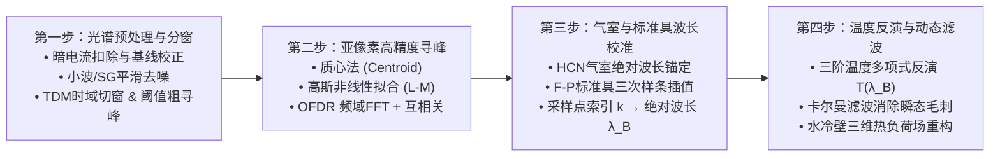

# 光纤光栅核心解调算法、寻峰算法与温度场反演全流程

当 `ADC` 把光电接收器的模拟电压变成一串离散数字采样序列 $\{y_1, y_2, \dots, y_M\}$ 送入 `FPGA` 和 `ARM` 处理器后，主机要分四步把这串原始数据变成锅炉操作员屏幕上精确到 $0.1^\circ\text{C}$ 的温度值：

---

## 1. 第一步：数字光谱预处理与自适应阈值分窗

`ADC` 采集到的原始反射光谱叠加有光电探测器暗电流偏置、电路热噪声（白噪声）以及光源包络起伏：
1. **暗电流扣除与光源包络归一化**：扣除未发光时的零点偏置电压 $y_{\text{dark}}$，并除以预存的宽带光源光谱平坦度参考曲线。
2. **Savitzky-Golay（S-G）多项式平滑滤波**：
   * 普通滑动平均滤波会把光栅反射峰“削平、压宽”，导致波长顶点失真；
   * 工程上在 `FPGA` 内采用 **5 点或 7 点二次 Savitzky-Golay 卷积滤波器**，既能滤除高频毛刺噪声，又能 $100\%$ 保持反射峰的高斯轮廓曲率与峰值位置不变。
3. **动态双阈值切窗（Peak Windowing）**：设定上升沿触发阈值 $T_{\text{high}}$ 与下降沿结束阈值 $T_{\text{low}}$（通常取峰值半高宽 `FWHM` 处的 $-3\text{ dB}$ 位置），把一整条光谱上串联的几十个独立光栅反射峰切割成一个个独立的局部数据窗口 $\{ (\lambda_i, I_i) \}_{i=1}^m$。

---

## 2. 第二步：五大核心寻峰算法（Peak Detection Algorithms）原理与代码级公式

为什么不能直接取采样点里电压最高的那一个点（最大值法）作为光栅波长？
因为受限于 `ADC` 采样率或线阵相机像素间距（例如相邻两个采样点间隔为 $20\text{ pm}\sim 150\text{ pm}$），如果只取最大值点，波长分辨率最多只能达到 $20\sim 150\text{ pm}$（对应温度跳字高达 $2^\circ\text{C}\sim 15^\circ\text{C}$！）。**必须利用反射峰两侧的多个采样点进行数学拟合，实现“亚像素级（Sub-pixel）”内插寻峰，把寻峰精度提高 $50\sim 100$ 倍（达到 $\le 1\text{ pm}$）**。

### 2.1 算法一：质心法（Centroid / Center of Mass Algorithm）——FPGA 硬件流水线最快算法
* **数学公式**：将反射峰窗口内的离散光谱点 $(\lambda_i, I_i)$ 看作具有不同质量的质点，计算其加权几何重心作为中心波长 $\lambda_B$：
  $$\lambda_B = \frac{\sum_{i=1}^{m} \lambda_i \cdot \left( I_i - I_{\text{base}} \right)^p}{\sum_{i=1}^{m} \left( I_i - I_{\text{base}} \right)^p}$$
  其中 $I_{\text{base}}$ 为窗口基底噪声阈值，指数 $p$ 通常取 $1$（标准质心法）或 $2$（平方加权质心法，赋予峰值顶部更高权重以抑制边带不对称干扰）。
* **工程优缺点**：只涉及一次乘累加（MAC）和一次除法，在 `FPGA` 中仅需几个时钟周期即可算完一个点，极适合 `WDM+TDM` 上千点高速实时解调；缺点是当光栅受局部微弯曲导致反射峰左右不对称时，重心会偏向宽边产生误差。

### 2.2 算法二：三点/五点抛物线拟合法（Parabolic / Polynomial Fitting）
* **数学公式**：光纤光栅反射峰顶部附近可近似为开口向下的二次抛物线 $I(\lambda) = a\lambda^2 + b\lambda + c$。取最大值点 $(\lambda_0, I_0)$ 及其左右相邻点 $(\lambda_{-1}, I_{-1})$、$(\lambda_{+1}, I_{+1})$（设等波长步长 $\Delta\lambda$），其解析顶点波长直接由下式给出：
  $$\lambda_B = \lambda_0 + \frac{\Delta\lambda}{2} \cdot \frac{I_{-1} - I_{+1}}{I_{-1} - 2I_0 + I_{+1}}$$
* **工程优缺点**：计算量极小，不依赖底部边带；但抗随机白噪声能力较弱（因为只用了顶部 3～5 个点）。

### 2.3 算法三：高斯拟合法（Gaussian Fitting）与对数线性化变换——工业解调仪标准算法
* **物理依据**：标准均匀光纤布拉格光栅的主反射峰光谱包络高度符合**高斯分布函数（Gaussian Function）**：
  $$I(\lambda) = I_{\max} \cdot \exp\left[ -4 \ln 2 \cdot \left( \frac{\lambda - \lambda_B}{\Delta\lambda_{\text{FWHM}}} \right)^2 \right]$$
* **快速对数线性化最小二乘求解（Caruana 算法）**：
  直接对指数函数做非线性拟合很慢，两边取自然对数 $\ln I(\lambda)$ 后，高斯曲线直接变成一条标准二次多项式抛物线：
  $$\ln I_i = \underbrace{\left( \ln I_{\max} - \frac{4\ln 2 \cdot \lambda_B^2}{\Delta\lambda_{\text{FWHM}}^2} \right)}_{b_0} + \underbrace{\left( \frac{8\ln 2 \cdot \lambda_B}{\Delta\lambda_{\text{FWHM}}^2} \right)}_{b_1} \lambda_i + \underbrace{\left( -\frac{4\ln 2}{\Delta\lambda_{\text{FWHM}}^2} \right)}_{b_2} \lambda_i^2$$
  利用加权最小二乘法（权重取 $w_i = I_i^2$，以消除取对数后底部小信号噪声被放大的问题）求解线性方程组得出系数 $b_1, b_2$，即可直接求出极高精度的中心波长：
  $$\lambda_B = -\frac{b_1}{2 b_2}$$
* **非线性 Levenberg-Marquardt（L-M）迭代高斯拟合**：在 `ARM` 处理器中，以加权对数高斯拟合的结果作为初值，再运行 $3\sim 5$ 次 L-M 阻尼最小二乘迭代，**寻峰精度可达 $0.2\text{ pm}\sim 0.5\text{ pm}$（对应温度分辨率 $0.02^\circ\text{C}\sim 0.05^\circ\text{C}$）**。

### 2.4 算法四：针对超弱光栅阵列（UWFBG + OFDR）的傅里叶变换（FFT）与光谱互相关算法
在单纤上千点且各点初始波长相同的 `OFDR` 系统中，不再在波长域直接寻峰，而是执行**“频域定位 $\rightarrow$ 逆变换回局部光谱 $\rightarrow$ 互相关求波长漂移”**三步曲：
1. **全局 FFT 空间定位**：对一整帧扫频相干拍频信号 $s(k)$（长度如 $N = 1048576$ 点）执行快速傅里叶变换（FFT），得到空间距离域反射率分布 $S(z)$。根据预先标定的水冷壁导热块距离坐标 $z_m$，用带通矩形窗函数截取第 $m$ 个导热块对应的频域区间 $[z_m - \delta z, z_m + \delta z]$。
2. **局部窄带 iFFT 重构单点光谱**：对截取出的第 $m$ 个导热块频域切片补零（Zero-Padding）后执行**逆快速傅里叶变换（iFFT）**，单独还原出这第 $m$ 个超弱光栅的局部反射光谱 $R_m(\lambda)$（完全消除了其他 999 个光栅的干扰！）。
3. **光谱互相关（Cross-Correlation）求温度**：将当前时刻还原出的单点光谱 $R_m(\lambda)$ 与锅炉冷态基准光谱 $R_{m,\text{ref}}(\lambda)$ 进行离散互相关运算：
   $$C_{m}(\Delta\lambda) = \sum_{\lambda} R_{m,\text{ref}}(\lambda) \cdot R_m(\lambda + \Delta\lambda)$$
   互相关函数 $C_m(\Delta\lambda)$ 的峰值偏移量，即为该导热块当前相对于冷态的精确波长漂移 $\Delta\lambda_B$！即便超弱光栅反射谱形状不规则或信噪比低至 $3\text{ dB}$，互相关算法依然稳如磐石。

---

## 3. 五大寻峰与解调算法性能量化对比表

| 算法名称 | 波长解调精度（典型值） | 折合测温分辨率 | 计算耗时（单峰） | 抗噪声与抗波形畸变能力 | 硬件部署位置与适用场景 |
| :--- | :--- | :--- | :--- | :--- | :--- |
| **最大值法（Max Value）** | $10\sim 100\text{ pm}$ | $1.0^\circ\text{C}\sim 10^\circ\text{C}$ | $< 0.01\text{ }\mu\text{s}$ | 极差（受采样网格限制，严重跳字） | 仅用于第一阶段粗略锁定峰值窗口位置 |
| **加权质心法（Weighted Centroid）** | $1.5\sim 3.0\text{ pm}$ | $0.15^\circ\text{C}\sim 0.3^\circ\text{C}$ | **$< 0.1\text{ }\mu\text{s}$** | 中（对白噪声稳健，对光谱不对称敏感） | **`FPGA` 纯硬件流水线首选**，适合 `WDM+TDM` 千点高速扫描 |
| **三点/五点抛物线拟合** | $2.0\sim 4.0\text{ pm}$ | $0.2^\circ\text{C}\sim 0.4^\circ\text{C}$ | $< 0.2\text{ }\mu\text{s}$ | 中偏弱（仅利用峰顶采样点） | 适合采样点较稀疏的线阵 `InGaAs` 光谱仪快速初算 |
| **加权对数高斯拟合 / L-M 迭代高斯拟合** | **$0.3\sim 1.0\text{ pm}$** | **$0.03^\circ\text{C}\sim 0.1^\circ\text{C}$** | $2\sim 15\text{ }\mu\text{s}$ | **优**（充分利用全峰数据，抗噪极强） | **工业级锅炉解调仪主力高精度算法**（FPGA + ARM 协同） |
| **OFDR 分段 FFT + 光谱互相关算法** | **$0.5\sim 1.5\text{ pm}$** | **$0.05^\circ\text{C}\sim 0.15^\circ\text{C}$** | 整纤千点约 $50\sim 200\text{ ms}$ | **极优**（不受弱光栅双峰/畸变影响，信噪比增益极高） | **`UWFBG` 超弱光栅阵列单纤千点系统核心算法** |

---

## 4. 第三步与第四步：气室标准具校准、温度反演与锅炉三维温度场算法

### 4.1 硬件气室 + F-P 标准具实时波长映射校准算法
在扫频激光解调仪中，光电探测器直接采到的是“第 $k$ 个时间采样点”，要把它变成极其精准的绝对波长 $\lambda(k)$：
1. 在参考通道中，识别出 $\text{HCN}$ 气室已知的吸收线中心采样点 $k_{\text{HCN}}$（对应绝对物理波长 $\lambda_{\text{NIST}} = 1549.7305\text{ nm}$）；
2. 以 $k_{\text{HCN}}$ 为绝对坐标原点，向左右两侧逐一计数 F-P 标准具的所有等间距谐振峰采样点 $\{k_{\text{FP}, j}\}$，每个相邻标准具峰之间的光频率间隔严格等于自由光谱范围 $\Delta\nu_{\text{FSR}}$（如 $50.00\text{ GHz}$）；
3. 采用**分段三次样条插值（Cubic Spline Interpolation）**或五阶多项式拟合，实时生成当前这一毫秒扫描周期的《采样点索引 $k \leftrightarrow$ 绝对波长 $\lambda$ 映射查找表（LUT）》，彻底消除压电陶瓷/MEMS 扫频激光器的迟滞与非线性误差。

### 4.2 宽温区多项式反演与卡尔曼（Kalman）状态滤波
1. **三阶非线性温度换算**：
   算出第 $n$ 个导热块光栅的实时绝对波长 $\lambda_{B,n}$ 后，减去其冷态初始波长 $\lambda_{B0,n}$ 得到 $\Delta\lambda_n = \lambda_{B,n} - \lambda_{B0,n}$，代入该批次特种光纤标定好的三阶温度方程：
   $$T_n = T_0 + c_1 \Delta\lambda_n + c_2 (\Delta\lambda_n)^2 + c_3 (\Delta\lambda_n)^3$$
   （典型高温再生/飞秒石英光栅系数：$c_1 \approx 96.5\text{ }^\circ\text{C/nm}$，$c_2 \approx -1.85\text{ }^\circ\text{C/nm}^2$，$c_3 \approx 0.042\text{ }^\circ\text{C/nm}^3$）。
2. **一维卡尔曼滤波与离群值剔除（Outlier Rejection）**：
   因为锅炉水冷壁金属块具有物理热惯性（每秒真实温度变化率不可能超过 $\pm 20^\circ\text{C/s}$），算法對每个测点建立热状态方程 $[T_k, \dot{T}_k]^T$。若某一次扫描因现场强机械冲击出现瞬态单帧波长跳变（超出 $3\sigma$ 预测区间），卡尔曼滤波器会自动予以平滑抑制，保证送往电厂 `DCS` 的温度曲线平滑可靠。
3. **水冷壁克里金（Kriging）/ 双三次样条插值全炉膛温度场成像**：
   上位机软件将分布在炉膛前墙、后墙、左墙、右墙水冷壁上的数百个离散导热块实测温度 $(x_i, y_i, z_i, T_i)$，通过**普通克里金空间插值（Ordinary Kriging）**或**径向基函数（RBF）神经网络插值**，实时渲染出全炉膛水冷壁三维连续温度云图、计算局部热负荷偏差系数与结焦厚度指标，并直接联动吹灰器（智能吹灰）或燃烧器摆角控制。
