# 三大核心件（激光器/检测器/光纤刻蚀）成本汇总与“买成品硬件+自研算法”快速产品化指南

针对您的核心诉求：**“整理核心的激光器、信号接收检测器、光纤刻蚀的成本；光源、信号检测器和电路部分有没有成品？如果买成品硬件回来自己开发算法，能不能快速做出产品？”**

直接给出明确答案：
**完全有现成的工业级成品模块！而且“外购成品光模块/成品采集板卡 + 自己写寻峰解调算法与锅炉热工软件 + 外购预刻蚀光栅串”正是国内外 80% 以上的光纤传感仪器公司最快做出第一代商业化产品的标准打法（最快 30～60 天即可攒出整机样机上锅炉实测，完全不用自己去焊高难度的模拟跨阻运放电路或调空间光路）。**

---

## 1. 三大核心部分（激光器/光源、接收检测器、光纤刻蚀）成本一表通览

我们将这三大件按**“买散件芯片自己画电路板”**与**“直接买带电路的成品模块（插电即用）”**两个层级对比如下（含税人民币 RMB）：

| 核心部分 | 细分技术路线 | **买裸芯片/光器件单价** *（需自己画驱动与放大电路）* | **买“带驱动/放大电路的成品模块”单价** *（供电即工作，直接出标准信号）* | 成品模块国内/国际代表供应商 |
| :--- | :--- | :--- | :--- | :--- |
| **一、核心激光器 / 光源** *(1台主机只需 1 个)* | **1. 宽带光源（`ASE`）** *(适合 512 像元线阵光谱路线)* | 仅买泵浦管+掺铒光纤： `$1,200 ～ $2,000 元` | **成品 `ASE` 模块（内置恒流源+TEC温控，接 `5V/12V` 电即出光）**： • 小批量：**`3,500 ～ 6,500 元`** • 批量集采：**`2,200 ～ 4,200 元`** | • 北京康冠世纪光电 • 深圳博瑞集信 / 绵阳超光 • 香港 Amonics（安博） |
| | **2. 可调谐扫频激光器** *(适合单纤大容量 WDM/TDM)* | 仅买 `MG-Y` 或蝶形激光器裸管： `$8,000 ～ $18,000 元` | **成品扫频激光源模块（内置 DAC 扫频电路+TEC恒温+同步 Trigger 脉冲输出）**： • 国产成品模块：**`15,000 ～ 28,000 元`** *(批量 $1.1\sim 1.6\text{ 万}$)* • 进口成品模块：**`35,000 ～ 65,000 元`** | • 深圳源国光电 / 武汉光迅 • 武汉安扬激光 / 佰为深 • 美国 Lumentum / 日本 Santec |
| **二、信号接收检测器** *(含光电转换与采集)* | **1. 单点 `InGaAs PIN / APD` 光电检测器** *(配合扫频激光源使用)* | 仅买带尾纤的光电二极管裸管： • `PIN` 管：**`80 ～ 250 元/只`** • `APD` 管：**`600 ～ 1,500 元/只`** | **成品光电转换模块（`InGaAs PD/APD + TIA 跨阻放大电路` 装在屏蔽金属盒内，插光纤直接从 `SMA` 口输出 $0\sim 2\text{V}$ 电压）**： • 国产 `PIN+TIA` 成品盒：**`600 ～ 1,800 元/路`** • 国产 `APD+TIA` 成品盒：**`2,200 ～ 4,500 元/路`** • 进口 Thorlabs/FEMTO：**`6,000 ～ 15,000 元/路`** | • 中电科 44 所（重庆光电所） • 绵阳超光通信 / 武汉敏芯 • 北京立鼎光电 • 美国 Thorlabs / 德国 FEMTO |
| | **2. 体光栅 + 512 像元 `InGaAs` 线阵光谱检测器** *(配合 ASE 宽带光源使用)* | 仅买滨松/国产 512 像元 `InGaAs` 传感器芯片： `$6,500 ～ $15,000 元/颗` | **成品 FBG 光谱解调 OEM 模块（内置体光栅分光光路 + 512 像元 InGaAs + TIA + 16位 ADC + USB/SPI/网口，直接输出 512 个点的数字光谱数组！）**： • 国产 OEM 模块：**`14,000 ～ 24,000 元/个`** • 丹麦 Ibsen `I-MON 512 USB`：**`32,000 ～ 48,000 元/个`** | • **丹麦 Ibsen Photonics** (`I-MON 512`) • 国科光芯 / 北京卓立汉光 • 武汉纤云 / 深圳佰为深 |
| **三、锅炉水冷壁光纤刻蚀** *($350^\circ\text{C}\sim 500^\circ\text{C}$ 级)* | **1. 飞秒直写 / 热再生高温光栅串** *(每路 20～50 点)* | 自建飞秒刻写机台（投 $85\text{ 万}$）自己买长飞 `PI` 光纤刻： **`10 元/点`** *(纯耗材)* | **直接买“预刻蚀好 + 穿好 $\Phi 1.0\text{ mm}$ `316L` 不锈钢毛细管”的成品传感光缆**： • 样机小批量：**`150 ～ 280 元/点`** • 千点级工程批量：**`65 ～ 110 元/点`** *(含光纤+刻蚀+毛细钢管)* | • 深圳光子传感 / 东方锐择 • 深圳太辰光 / 南京帕斯テック |
| | **2. 拉丝塔在线刻写弱光栅阵列（`UWFBG/DTG`）** *(每路 100～500 点)* | 无法自建（需光棒拉丝塔） | **直接买预刻蚀好的成品弱光栅阵列光缆（已含聚酰亚胺涂覆与护套）**： • 样机小批量：**`60 ～ 120 元/点`** • 千点级工程批量：**`25 ～ 45 元/点`** *(含光纤基底+在线刻写)* | • 武汉理工光科 • 长飞光坊 / 德国 FBGS |

---

## 2. 怎么“只买成品硬件回来、自己开发算法”快速做出产品？（两大拼装方案）

如果您不想在硬件研发上耗费 1 年时间去攻克微弱电流放大器自激振荡、高速 PCB 阻抗匹配和精密激光温控，您可以采用**“工业成品模块积木式拼装 + 100% 自研核心算法与软件”**的捷径。

下面为您提供两套可以直接采购现货拼装的方案（**无需自己画任何模拟电路板**）：

```mermaid
flowchart TB
    subgraph FastRoute1["捷径方案一：基于“成品线阵光谱 OEM 模块” (最快 30 天出整机，适合 320～640 点)"]
        direction LR
        M1_1["成品件1：ASE 宽带光源盒<br/>(康冠世纪/博瑞集信, ¥3,800)<br/>接 12V 直流电即发光"] --> M1_2["成品件2：1×32 串口光开关盒 + 环形器<br/>(桂林光隆/科毅, ¥4,200)<br/>RS232 发指令切通道"]
        M1_2 --> M1_3["成品件3：Ibsen I-MON 512 USB<br/>或国产 512 像元 InGaAs 光谱模块<br/>(¥18,000 ~ ¥35,000)<br/>内置光路 + 探测器 + TIA + 16位ADC"]
        M1_3 == "USB / SPI / 网口直接吐出<br/>512个像素的原始光谱数组" ==> Alg1["💻 您自己的工控主板 / ARM 板<br/>(跑您自研的寻峰算法 + 温度标定 + 锅炉三维云图)"]
    end

    subgraph FastRoute2["捷径方案二：基于“成品扫频源 + 成品光电盒 + 成品 Zynq 采集板” (适合 800～2000 点大容量)"]
        direction LR
        M2_1["成品件1：扫频激光器模块<br/>(内置DAC驱动与TEC温控, ¥16,000)"] --> M2_2["成品件2：1×16 光开关 + 环形器<br/>+ HCN气室/F-P标准具盒 (¥6,500)"]
        M2_2 --> M2_3["成品件3：双路 InGaAs PIN/APD<br/>+ TIA 成品光电转换盒 (¥2,500)<br/>SMA口直接输出 0~2V 电压"]
        M2_3 == "SMA 同轴线直连" ==> M2_4["成品件4：米联客 / ALINX / 创龙<br/>Zynq-7020 + 双路 125MSPS AD9268<br/>成品高速采集板 (¥3,500)"]
        M2_4 == "千兆网口传输原始波形" ==> Alg2["💻 您自己在 Zynq/工控机上开发算法<br/>(气室插值校准 + 高斯寻峰 + TDM分窗 + 温度场)"]
    end
```

---

### 2.1 捷径方案一：买 `ASE 成品光源盒` + `I-MON 512 成品光谱解调模块` + `串口光开关盒`（最省心、零硬件开发）

这是全球众多光纤光栅解调仪厂家在第一代产品中最常用的方案：
1. **您买哪 4 个成品硬件（装进一个您自己印 Logo 的 `2U` 标准机箱里）**：
   * **成品件 ①**：1 个 **C波段 `ASE` 宽带光源成品模块**（如北京康冠世纪或深圳博瑞集信，带铝合金外壳、内置恒流源与温控，接上 $+12\text{V}$ 电源就稳定输出宽谱光，约 **$3,500\text{ 元}$**）；
   * **成品件 ②**：1 个 **三端口光学环形器 + $1\times 16$ 或 $1\times 32$ 通道成品光开关模块**（如桂林光隆科技或广西科毅，带 `RS-232/UART` 串口控制板，发一句串口指令 `SW 01` 就切到第 1 路光纤，约 **$4,000\text{ 元}$**）；
   * **成品件 ③**：1 个 **丹麦 Ibsen `I-MON 512 USB` 模块**（或国产 512 像元 `InGaAs` 光谱 OEM 模块，内部已经把体全息光栅、`InGaAs` 线阵探测器、`TIA` 跨阻放大电路、$16\text{-bit}$ `ADC` 采集电路全部做好并封装在一个巴掌大的金属盒里，约 **$18,000\sim 35,000\text{ 元}$**）；
   * **成品件 ④**：1 块 **小型工控机主板（如研华/控创 x86 板）或树莓派/瑞芯微 `RK3588` ARM 工控板** + 明纬 $12\text{V}$ 开关电源 + `2U` 机箱（合计约 **$2,000\text{ 元}$**）。
2. **数据怎么交给您的算法？**
   * `I-MON 512` 模块通过一根 `USB` 线（或 `SPI`/`UART`）插在您的工控主板上；
   * 厂家提供现成的 C/C++/Python 读取函数（仅十几行代码），调用一次 `ReadSpectrum()`，就直接返回一个长度为 512 的数组 `double raw_intensity[512]`（即 512 个波长像素点当前采集到的原始光强电压值）！
3. **您自己需要开发的核心算法有哪些（含金量全在这里）？**
   * **算法第 1 层（光谱预处理）**：扣除暗电流基底 `dark_current[512]`，做 5 点 Savitzky-Golay 平滑滤波；
   * **算法第 2 层（亚像素高精度寻峰算法）**：512 个像素平分 $40\text{ nm}$ 带宽，每个像素间隔是 $78\text{ pm}$（如果不加算法，精度只有 $7.8^\circ\text{C}$）。您用自己写的 **加权对数高斯拟合算法** 或 **Levenberg-Marquardt 非线性高斯迭代算法**，通过每个反射峰覆盖的 $6\sim 8$ 个像素点拟合出抛物线/高斯顶点，一下子把波长精度从 $78\text{ pm}$ 提升到 **$0.5\text{ pm}$（测温精度达到 $\pm 0.1^\circ\text{C}$）**！
   * **算法第 3 层（光开关轮询调度与温度标定）**：控制串口光开关每 $15\text{ ms}$ 切换一个通道，$0.5\text{ 秒}$ 扫完 32 路（共 640 个水冷壁测点），代入三阶温度多项式 $T(\lambda_B)$ 算出温度；
   * **算法第 4 层（电厂锅炉水冷壁业务层软件）**：做卡尔曼滤波去毛刺、断纤自动诊断（某点光强低于阈值报警）、水冷壁三维温度场克里金插值渲染、结焦与爆管预警，并通过 `Modbus TCP` 发给电厂 `DCS`。
4. **整机硬件成本与开发周期**：
   * 整台 32 路（640 点）主机全部用成品模块拼装的硬件成本：**约 $2.75\text{ 万}\sim 4.45\text{ 万元/台}$**；
   * 硬件组装耗时：**仅需 $2\sim 3$ 天**（拧螺丝、插光纤跳线、接电源线）；软件与算法开发：**$1\sim 2$ 个月**即可拿出完整商业化产品！

---

### 2.2 捷径方案二：买 `成品扫频激光源盒` + `成品 InGaAs+TIA 转换盒` + `成品 Zynq+AD9268 采集板`（适合千点级大容量系统）

如果您要做单纤串上百个点、单机测 $1,000\sim 2,000$ 个点的**扫频激光路线**，同样可以全部买成品硬件模块拼装：
1. **成品件 ①（发光端）**：采购国内（如深圳源国光电、武汉光迅、安扬激光）的 **成品 C波段可调谐扫频激光源模块**（若做时分复用则让厂家在模块出口集成好 `SOA` 脉冲调制器，约 **$16,000\sim 25,000\text{ 元}$**）。模块只需供电，每次开始扫频时会自动从 `SMA` 口输出一个 `TTL Trigger` 同步触发电脉冲。
2. **成品件 ②（无源与基准端）**：向珠海光库科技或太辰光采购一个定制好的 **无源光路集成盒**（内含分路器、环形器、$\text{HCN}$ 氰化氢气体吸收池、`50GHz F-P` 标准具，全部熔接好留在盒内，只伸出标准接口，约 **$5,000\text{ 元}$**）。
3. **成品件 ③（光电接收+放大端）**：采购 2～4 只 **带 `TIA` 跨阻放大器的成品 `InGaAs PIN/APD` 光电转换模块**（如中电科 44 所、绵阳超光通信或敏芯半导体成品盒，合计约 **$2,500\sim 4,000\text{ 元}$**）。您把反射光纤插上去，它直接从 `SMA` 射频口输出放大好的 $0\sim 2\text{ V}$ 干净模拟电压信号！
4. **成品件 ④（高速采集与 FPGA 端）**：直接在淘宝或官方企业店采购 **米联客（Milianke）/ 芯驿电子（ALINX，如型号 `AX7Z020` 套件）/ 创龙科技（Tronlong）** 的 **`Zynq-7020 + 双通道 125MSPS 16-bit AD9268` 成品高速数据采集开发板套件**（含工业核心板+高速 ADC 子卡，现成现货仅 **$3,000\sim 5,500\text{ 元}$**！）。
   * 用同轴线把光电转换盒的 `SMA` 电压口和激光器的 `Trigger` 触发口插到这块成品 `Zynq` 采集板上；
   * 板卡厂家自带现成的 `ADC DMA` 采集工程源码，每次激光器 `Trigger` 一响，`ADC` 自动把这一毫秒扫频周期内的 $100,000$ 个采样点存入内存，并通过 `AXI` 总线交给 `ARM` 核（Linux 系统）或通过千兆网口发给工控机！
5. **您自己开发什么**：
   * 您完全省去了画高速电路板的时间，直接在 `Zynq` 的 `ARM` 端（C/C++）或 `FPGA` 端开发：**$\text{HCN}$ 气室与 `F-P` 标准具实时插值波长校准算法 + 高斯拟合/质心法寻峰算法 + 锅炉水冷壁温度反演算法**！
6. **整机硬件成本与开发周期**：
   * 整台 16 路（可带 $1,000\sim 1,600$ 点）主机全部买成品模块拼装的硬件成本：**约 $3.0\text{ 万}\sim 4.2\text{ 万元/台}$**；
   * 省去了 6～10 个月的高频模拟电路与激光温控硬件踩坑期，**2 个月内即可完成整机联调**。
