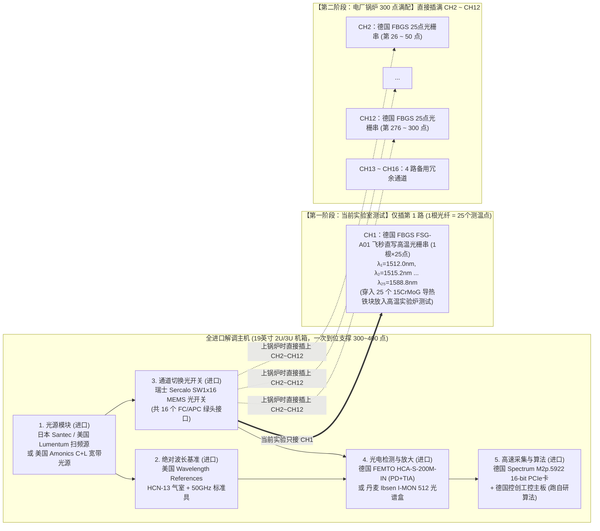

# 300点锅炉光纤光栅测温系统总体设计与“单纤25点”实验室测试方案

## 1. 设计目标与“先做单纤25点实验 $\rightarrow$ 平滑扩展至300点工程”两步走架构

根据您的明确需求：
* **系统最大设计容量**：**300 个测温点**（单根光纤满载串联 **25 个点** $\times$ **12 路光纤通道** = **300 个点**；主机光开关按标准 **$1\times 16$ 路** 配置，满配可达 $16 \times 25 = 400$ 个点，留有 4 路冗余备用通道）。
* **当前实验室验证阶段（Lab Test）**：**只需先采购 1 根（或 2 根互备）串联了 20～25 个光栅点的进口耐高温光栅串**，跑通单根光纤满容量 25 点的极限测试与自研寻峰算法验证；主机硬件一次到位（或光开关后补），后续上锅炉现场测 300 点时，**主机无需改动任何一行硬件或算法，只需再买 11 根同样的 25 点光栅串插到主机面板剩下的接口上即可！**

---

## 2. 单根光纤 25 个测温点的波长通道精确分配表（$1510\text{ nm} \sim 1590\text{ nm}$）

为什么单根光纤设计为 **20～25 个点** 是物理性能的最优解？
* **物理依据**：锅炉水冷壁外侧导热块温度范围在 **$20^\circ\text{C}$（冷态停炉）$\sim 500^\circ\text{C}$（满负荷/超温预警）**。石英光栅在 $480^\circ\text{C}$ 温升下的波长向长波方向最大漂移量为：
  $$\Delta\lambda_{\max} \approx 480^\circ\text{C} \times 12.8\text{ pm/}^\circ\text{C} \approx 6.14\text{ nm}$$
* 在实验室或锅炉现场，若整根光纤各点同时升温，各点波长同步右移；而相邻两个铁块之间的最大局部温差（比如一个点结焦 $320^\circ\text{C}$、相邻点火焰舔墙 $500^\circ\text{C}$，温差 $180^\circ\text{C}$）引起的相对波长靠近量仅为 $180^\circ\text{C} \times 13.5\text{ pm/}^\circ\text{C} \approx 2.43\text{ nm}$。
* 因此，在 **$1510\text{ nm} \sim 1590\text{ nm}$（共 $80\text{ nm}$ 宽波段）** 内，每隔 **$3.2\text{ nm}$** 刻蚀 1 个光栅，**恰好排满 25 个点**！任何工况下相邻两个光栅的反射峰都绝对不会撞车重叠，信噪比高达 $>40\text{ dB}$。

### 2.1 向德国 FBGS 下单定制“单纤 25 点实验光栅串”的波长排布参数表

| 点位序号 | 冷态（$25^\circ\text{C}$）中心波长 $\lambda_{B0}$ | $450^\circ\text{C}$ 工作时中心波长 | 距第1点空间距离（按 $1.0\text{ m}$ 间距例） | 刻蚀工艺与反射率指标（发给德国 FBGS 定制参数） |
| :--- | :--- | :--- | :--- | :--- |
| **Point #01** | `1512.00 nm` | `1517.40 nm` | `0.00 m`（尾纤引出端 $5\text{ m}$ 后） | • 产品系列：**FBGS `FSG®-A01`**（飞秒透过聚酰亚胺涂覆层直写） |
| **Point #02** | `1515.20 nm` | `1520.60 nm` | `1.00 m` | • 光纤基底：$\Phi 125\text{ }\mu\text{m}$ 石英包层 / $\Phi 155\text{ }\mu\text{m}$ 聚酰亚胺（PI）涂覆 |
| **Point #03** | `1518.40 nm` | `1523.80 nm` | `2.00 m` | • 机械抗拉强度筛选：**$> 100\text{ kpsi} \sim 200\text{ kpsi}$**（全程无剥皮无熔接） |
| **Point #04** | `1521.60 nm` | `1527.00 nm` | `3.00 m` | • 单个光栅栅区长度（Grating Length）：**$6.0\text{ mm}$**（切趾高斯轮廓 Apodized） |
| **Point #05** | `1524.80 nm` | `1530.20 nm` | `4.00 m` | • 单点峰值反射率（Reflectivity）：**$R = 15\% \sim 25\%$**（保证 25 点光强均衡） |
| **Point #06 ~ #20** | 每点递增 `+3.20 nm` | 每点递增 `+3.20 nm` | `5.00 m ~ 19.00 m` | • 半高全宽（FWHM Bandwidth）：**$0.20\text{ nm} \sim 0.25\text{ nm}$** |
| **Point #21** | `1576.00 nm` | `1581.40 nm` | `20.00 m` | • 边模抑制比（SLSR）：**$\ge 15\text{ dB}$** |
| **Point #22** | `1579.20 nm` | `1584.60 nm` | `21.00 m` | • 中心波长加工公差：**$\le \pm 0.3\text{ nm}$** |
| **Point #23** | `1582.40 nm` | `1587.80 nm` | `22.00 m` | • 接口类型：首尾双端带 **`FC/APC`（$8^\circ$ 斜面）** 耐高温连接头 |
| **Point #24** | `1585.60 nm` | `1591.00 nm` | `23.00 m` | • 外护套封装：穿入 $\Phi 1.2\times 0.15\text{ mm}$ 无缝 `316L` 不锈钢毛细管 |
| **Point #25** | `1588.80 nm` | `1594.20 nm` | `24.00 m` | • 外表面打标：每个光栅中心位置在毛细管外壁做激光环形刻度标记 |

*(注：若选用纯 C 波段 $1525\sim 1568\text{ nm}$ 的 $43\text{ nm}$ 光源，则将通道间隔设为 $2.0\text{ nm}$，单根光纤排布 **20 个点**：`1526.0 nm, 1528.0 nm ... 1564.0 nm`，用 15 路通道同样实现 $15 \times 20 = 300$ 个点。)*

---

## 3. 全进口硬件两套落地技术架构对比（供您二选一）

为了满足您“**除了算法自己写，所有硬件全用进口成品模块**”的要求，针对 **300点（12～15路 × 20～25点/路）** 规模，有以下两套全进口硬件组合：

### 架构一（极简全固态光谱仪路线——最推荐实验室快速起步）：
* **核心组合**：**美国/香港 Amonics `ALS-CL` 宽带光源成品盒** + **瑞士 Sercalo `SW1x16` 光开关成品盒** + **丹麦 Ibsen `I-MON 512 USB`（1510–1595 nm 宽波段版）光谱解调成品盒** + **德国控创工控机**。
* **为什么极力推荐这套做 300 点实验**：
  1. 丹麦 **Ibsen `I-MON 512 USB`** 的测量波段刚好是 **$1510\text{ nm} \sim 1595\text{ nm}$（整整 $85\text{ nm}$ 宽）**，单根光纤一次曝光就能直接看清全部 **25 个点**！
  2. 它内部已经把分光体光栅、日本滨松 512 像元 `InGaAs` 线阵、`TIA` 放大器和 $16\text{-bit}$ `ADC` 全部封死在充氮密封盒里，**直接插一根 `USB` 线到电脑上，就能每秒读取 3,000 帧 512 像素的原始光谱数组**！
  3. **连高速 PCIe 采集卡和气室校准盒都省了**，整台全进口主机仅由 **3 个进口铁盒子 + 1 台工控机** 组成，故障率为零，买回来当天下午就能通电跑您的 C++/Python 寻峰算法！

### 架构二（旗舰扫频激光路线——超高动态范围）：
* **核心组合**：**日本 Santec `WSL-110` / `TSL-570`（或美国 Lumentum）可调谐扫频激光源** + **瑞士 Sercalo `SW1x16` 光开关** + **德国 FEMTO `HCA-S-200M-IN` 光电接收放大盒** + **美国 Wavelength References `HCN-13` 气室校准盒** + **德国 Spectrum `M2p.5922-x4` 16位 PCIe 采集卡**。
* **优势**：单波长激光功率集中，即使光纤中间有 10 个法兰接头损耗，信噪比依然高达 $50\text{ dB}$，且未来可通过升级算法直接支持单纤上百点的 `OFDR/TDM` 模式。
