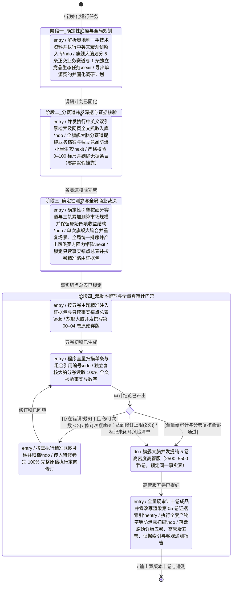

# 01 四阶段研究逻辑与 OMG UML 2.5 状态机规范 (`01_DESIGN_PATTERNS_AND_RESEARCH_PLAN`)

## 一、 四阶段精简主干映射表（取代旧版 8 阶段 34 次调用）

| 阶段 | 核心模块 | 职责二分（大脑 vs 确定性底盘） | 关键防错与防截断设计 |
| :--- | :--- | :--- | :--- |
| **阶段一：确定性底座与全局规划** | `siggi_corpus_loader` + `run_macro_recon` + `node_siggi_ingest_and_planner` | 🛡️ 解析本地一手资料与宏观双引擎侦察入库 🧠 1 次旗舰大脑规划正交业务赛道与独立竞品生态任务 | 业务赛道与竞品生态物理拆轨，禁止静默降级吞错 |
| **阶段二：分赛道并发深挖与核验** | `node_parallel_track_researcher` + `clean_sector_dossier` / `clean_competitive_dossier` | 🛡️ 并发检索与全文抓取 + 零假挂靠证据清洗 🧠 全旗舰大脑并发提纯 `SectorDossier` / `CompetitiveEcosystemDossier` | 单源 Schema 强约束 0–100 标尺；无有效证据条目直接剔除并留痕 |
| **阶段三：确定性测算与全局裁决** | `market_and_roi_calculator` + `node_size_screen_and_arbitrate` | 🛡️ 细分累加 `[MKT-CALC]` + 保比例 `[ROI-CALC]` 淘汰伪需求 🧠 **1 次旗舰全局裁决**合并重复场景、统一排序并产出四类买方阻力矩阵 | 以 1 次全局旗舰裁决取代 10 次 `flash` STORM + 10 场 `flash` Elo；锁定只读事实锚点总表 |
| **阶段四：双版本撰写与全量真审计** | `synthesizer` + `node_full_text_critic` + `distill_executive_edition` + `run_deterministic_full_audit` | 🛡️ 卷宗精准证据路由 + 全量单/组合引用与数值硬审计 + Zero-LLM 第 05 卷 + 防泄密 🧠 5 卷原始详版撰写 → 100% 全文分卷复核/CRAG 修订（≤2 轮）→ 5 卷高密度高管版提纯 | 零 `[:2200]`/`[:5500]` 截断；砍掉 100 分花瓶 Judge，改为客观硬门禁 |

## 二、 OMG UML 2.5 行为状态机图

完整矢量工程图见 [02_CLEAN_WORKFLOW_TOPOLOGY.svg](./02_CLEAN_WORKFLOW_TOPOLOGY.svg)（同步导出至 `research_outputs/07_WORKFLOW_EXECUTION_TOPOLOGY.svg`）。
