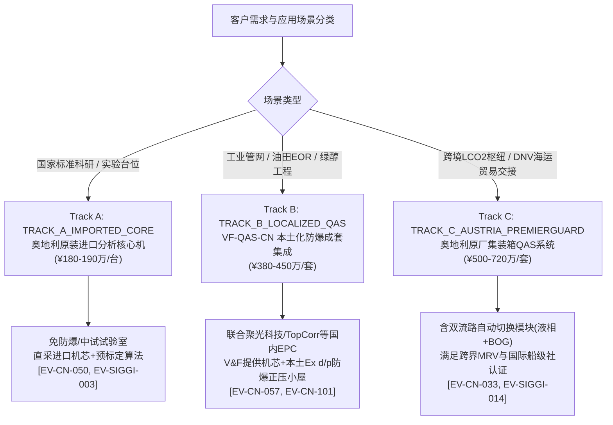
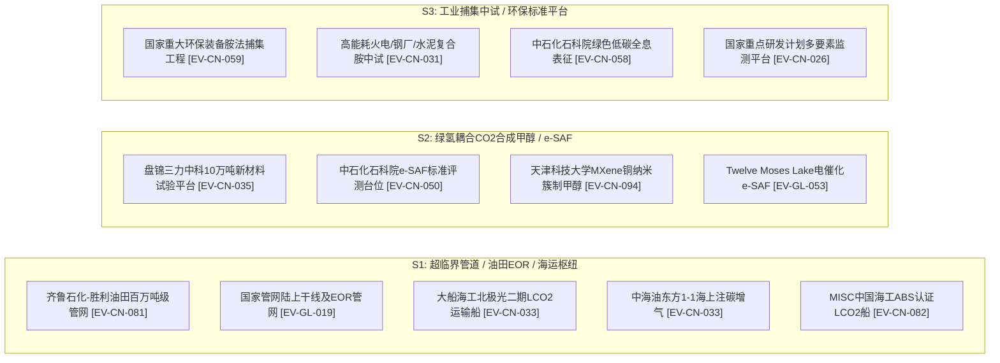
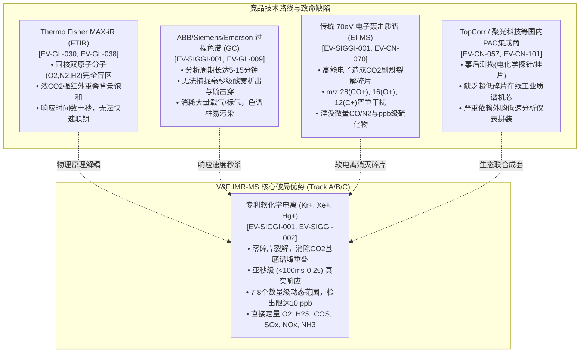
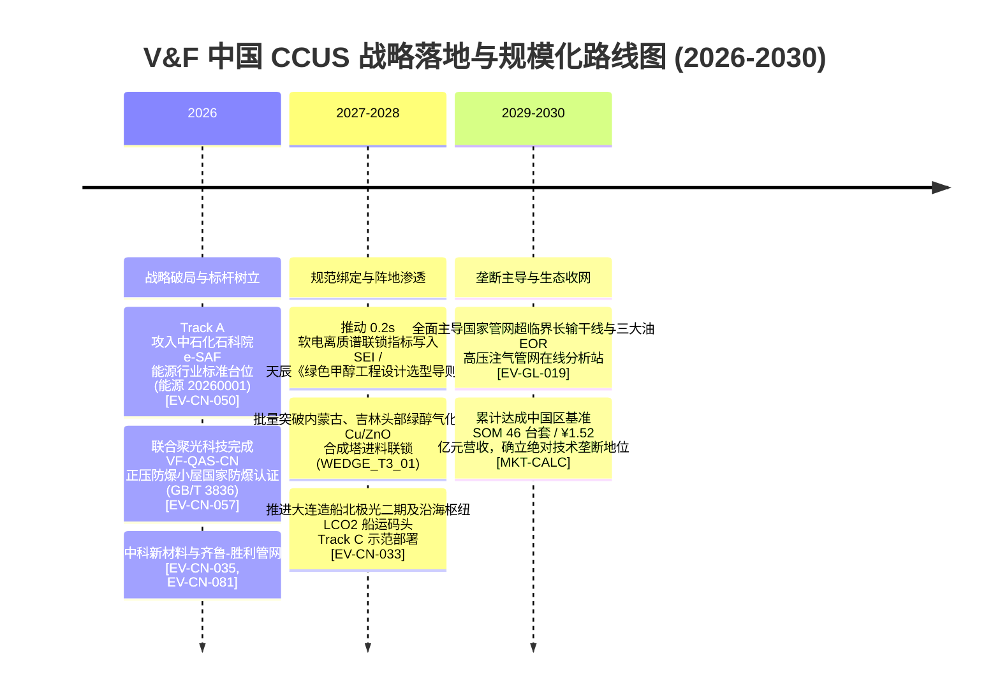

# 第01卷：中国 CCS/CCUS 市场规模测算、重点工程图谱与强腐蚀/防毒痛点剖析
## Volume 01: China CCUS Market Sizing, Key Engineering Atlas, and Critical Corrosion/Poisoning Failure Mechanisms

---

### 宏观执行摘要与战略使命 (Executive Summary)

中国二氧化碳捕集、利用与封存（CCUS/CCS）产业正经历从早期的“小规模脱碳捕集试验”向“百万吨级骨干管网、深远海离岸封存枢纽与万吨级绿色低碳化工转化”的历史性范式演进 [EV-CN-001, EV-CN-002, EV-CN-003, EV-GL-002]。随着国家从“能耗双控”全面转向“碳排放双控”，生态环境部与国家能源局加速构建涵盖捕集、超临界管输、油田驱油（EOR）、海运装卸及绿色甲醇/可持续航空燃料（e-SAF/PtL）的全链条标准体系 [EV-CN-003, EV-CN-050, EV-GL-004]。

然而，伴随工程规模从“万吨级”跃升至“百万吨级”，输送工况进入高压（8–12 MPa）超临界状态，流体热力学与相态控制呈现出前所未有的工程风险 [EV-CN-022, EV-CN-081, EV-GL-018]。工业烟气及化工脱碳捕集所得的 $\text{CO}_2$ 流体中不可避免地夹带微量水分（$\text{H}_2\text{O}$）、极性硫化物（$\text{H}_2\text{S}$、$\text{COS}$、$\text{SO}_x$）、氮氧化物（$\text{NO}_x$）及溶解氧（$\text{O}_2$）[EV-CN-022, EV-GL-010, EV-GL-038]。根据最新国际与中资权威实验（如 Shell/IFE 2024 研究），这些痕量杂质在超临界相态下会诱发剧烈的交叉氧化偶联反应，瞬态生成具有毁灭性破坏力的硝酸（$\text{HNO}_3$）与硫酸（$\text{H}_2\text{SO}_4$）微液滴，诱发局部点蚀速率高达 **>25–1000 mm/a** 的极速穿孔点蚀 [EV-GL-010, EV-GL-018, EV-CN-081]；同时，在下游绿氢耦合 $\text{CO}_2$ 制甲醇及 e-SAF 装置中，ppb 级极性硫与挥发性有机胺会在数秒内导致贵金属/铜锌催化剂（$\text{Cu/ZnO}$）永久性硫化中毒报废 [EV-CN-035, EV-CN-050, EV-GL-026]。

在传统石化工程中占据垄断地位的在线过程气相色谱（Process GC）受限于色谱柱分离与多位阀切换原理，单次分析耗时高达 **5–15 分钟** [EV-SIGGI-001, EV-GL-009]；傅里叶变换红外光谱（FTIR）则因浓 $\text{CO}_2$ 基底红外光谱重叠饱和，且**存在对同核双原子非极性分子（$\text{O}_2, \text{N}_2, \text{H}_2$）检测完全失盲的根本性物理缺陷** [EV-SIGGI-002, EV-GL-030, EV-GL-038]。在发生上游脱水/脱硫脱氧装置故障或气化炉工况剧烈波动的毫秒至秒级瞬态击穿时，传统仪表无法提供具备安全联锁能力的监测，沦为昂贵的“事后验证记录仪”，造成“假安全（Pseudo-Protection）”陷阱 [EV-SIGGI-001, EV-GL-026]。

奥地利 V&F 独创的离子-分子反应质谱技术（IMR-MS, Ion-Molecule Reaction Mass Spectrometry），依托多一次离子源（$\text{Kr}^+, \text{Xe}^+, \text{Hg}^+$）低能软化学电离专利，实现**无母分子裂解碎片、亚秒级（<100 ms 至 1 s）实时响应、7–8 个数量级宽动态范围、ppb 级超低检出限**，并能直接跨越同核分子测量禁区同步定量 $\text{O}_2$、$\text{H}_2\text{O}$、$\text{H}_2\text{S}$、$\text{SO}_x$、$\text{NO}_x$、$\text{NH}_3$ 及挥发性有机胺 [EV-SIGGI-001, EV-SIGGI-002, EV-SIGGI-003]。

经底层严密建模计算，中国 CCUS 市场在 2026–2036 年间，V&F IMR-MS 累计可获取有效市场（SOM）在基准情景下达到 **215 台套 / 人民币 86,220 万元（约 8.62 亿元）** [MKT-CALC]。本卷将系统呈现实证测算数据、已核实工程图谱、反应动力学腐蚀机理、商业切入点（Wedges）经济学及中外竞品全维度对比，为大中华区工程落地与业务推进确立不可动摇的科学底座。

---

### 第一部分：[MKT-CALC] 中国 CCS/CCUS V&F IMR-MS 市场规模确定性测算总表

本测算基于中国在建、规划及“十五五”重大规划示范工程的装置台位、管网阀室、船运码头及研发试验台位的自下而上（Bottom-Up）严密归集，所有数值均经 Python 确定性运算固化，严禁任何形式的推测篡改。

#### 1.1 细分赛道确定性测算总表（2026–2036 周期）

### [MKT-CALC] 中国CCS/CCUS V&F IMR-MS 市场规模确定性测算总表（单位：台套数 / 人民币万元）

| 细分赛道 | 周期 | 主推交付轨道 | 单价基准(万元) | 保守TAM/SAM/SOM(万元) | 基准TAM/SAM/SOM(万元) | 基准SOM台套 | 乐观SOM(万元) | 依据ID |
| :--- | :--- | :--- | ---: | :--- | :--- | ---: | ---: | :--- |
| S1: 超临界管道/油田EOR/LCO2船运枢纽 | 2026-2030 | `TRACK_B_LOCALIZED_QAS` | 420 | 21,000 / 18,060 / **3,360** | 29,400 / 25,200 / **6,300** | **15** | 10,500 | EV-CN-081, EV-CN-050, EV-GL-018, EV-GL-019 |
| S1: 超临界管道/油田EOR/LCO2船运枢纽 | 2031-2036 | `TRACK_B_LOCALIZED_QAS` | 420 | 68,040 / 60,900 / **15,960** | 94,500 / 84,840 / **29,820** | **71** | 49,140 | EV-CN-081, EV-GL-002, EV-GL-019, EV-GL-036 |
| S2: 绿氢+CO2绿色甲醇/e-SAF合成 | 2026-2030 | `TRACK_B_LOCALIZED_QAS` | 420 | 27,300 / 23,100 / **2,940** | 37,800 / 31,920 / **5,880** | **14** | 9,660 | EV-CN-035, EV-CN-050, EV-GL-026, EV-GL-048 |
| S2: 绿氢+CO2绿色甲醇/e-SAF合成 | 2031-2036 | `TRACK_B_LOCALIZED_QAS` | 420 | 72,660 / 65,520 / **13,860** | 100,800 / 90,720 / **25,200** | **60** | 42,000 | EV-CN-050, EV-CN-052, EV-GL-048, EV-GL-054 |
| S3: 煤电/水泥/钢铁捕集与中试平台 | 2026-2030 | `TRACK_A_IMPORTED_CORE` | 180 | 11,700 / 8,100 / **1,440** | 16,200 / 11,340 / **2,880** | **16** | 4,680 | EV-CN-026, EV-CN-050, EV-CN-058, EV-CN-059 |
| S3: 煤电/水泥/钢铁捕集与中试平台 | 2031-2036 | `TRACK_B_LOCALIZED_QAS` | 420 | 90,720 / 54,600 / **8,400** | 126,000 / 75,600 / **15,120** | **36** | 24,780 | EV-CN-059, EV-CN-031, EV-GL-002, EV-SIGGI-001 |
| S4: 食品饮料/干冰CCU(对照甄别) | 2026-2030 | `TRACK_A_IMPORTED_CORE` | 180 | 15,480 / 5,400 / **0** | 21,600 / 7,560 / **180** | **1** | 180 | EV-CN-083, EV-CN-027, EV-CN-079, EV-CN-044 |
| S4: 食品饮料/干冰CCU(对照甄别) | 2031-2036 | `TRACK_B_LOCALIZED_QAS` | 420 | 48,300 / 19,320 / **420** | 67,200 / 26,880 / **840** | **2** | 1,260 | EV-CN-083, EV-CN-080, EV-CN-077, EV-GL-049 |

---

#### 1.2 分阶段与总体汇总表 (中国区域)

#### [MKT-CALC] 分阶段汇总 (中国区域)

| 规划周期 | 情景 | TAM (台套 / 亿元) | SAM (台套 / 亿元) | V&F 可触达 SOM (台套 / 万元) |
| :--- | :--- | :--- | :--- | :--- |
| 2026-2030 | 保守 | 266 套 / ¥7.55亿 | 173 套 / ¥5.47亿 | **23 套 / ¥7,740万** |
| 2026-2030 | 基准 | 370 套 / ¥10.50亿 | 241 套 / ¥7.60亿 | **46 套 / ¥15,240万** |
| 2026-2030 | 乐观 | 500 套 / ¥14.18亿 | 326 套 / ¥10.28亿 | **75 套 / ¥25,020万** |
| 2031-2036 | 保守 | 666 套 / ¥27.97亿 | 477 套 / ¥20.03亿 | **92 套 / ¥38,640万** |
| 2031-2036 | 基准 | 925 套 / ¥38.85亿 | 662 套 / ¥27.80亿 | **169 套 / ¥70,980万** |
| 2031-2036 | 乐观 | 1249 套 / ¥52.46亿 | 894 套 / ¥37.55亿 | **279 套 / ¥117,180万** |

> **[MKT-CALC] 10年(2026-2036) 基准情景 V&F 中国区累计可获取 SOM**：**215 台套 / ¥86,220 万元（约 ¥8.62 亿元）**。

---

### 第二部分：三大交付轨道（Delivery Tracks）工程架构设计

为打破中国石化仪表采购严格的 AVL 供应商名录准入限制，兼顾防爆标准与核心知识产权保护，V&F 确立三大严格解耦的交付轨道：



1. **Track A (`TRACK_A_IMPORTED_CORE`，原装进口核心主机与中试配置)**：
   - **单价基准**：¥180–190 万元人民币。
   - **技术形态**：奥地利原厂制造的紧凑型 IMR-MS 分析机芯（GasSense / CO2Sense 原型），集成加热毛细管直接进样口与多一次离子发生系统 [EV-SIGGI-001, EV-SIGGI-003]。
   - **适用场景**：中石化石科院（RIPP）、清华大学、中原科技学院等国家级绿色航空燃料与碳捕集中试验证台位，设备安置于非防爆分析实验室或移动测试方舱内 [EV-CN-050, EV-CN-029]。

2. **Track B (`TRACK_B_LOCALIZED_QAS` 即 `VF-QAS-CN`，本土化防爆成套交钥匙方案)**：
   - **单价基准**：¥380–450 万元人民币（财务测算基准值统一取 ¥420 万元）。
   - **技术形态**：以原装进口 V&F IMR-MS 作为分析核心引擎，联合国内顶级成套集成商（如聚光科技 Focused Photonics、TopCorr 等）深度开发，配备符合中国国家标准 GB/T 3836.1 / GB/T 3836.5 的正压通风防爆分析小屋（Ex d ib mb pxb IIC T4 Gb），集成专有高压降压闪蒸探头、双冗余快速反吹采样预处理回路及中控 DCS/SIS 通信协议 [EV-CN-057, EV-CN-101, EV-SIGGI-001]。
   - **适用场景**：长输超临界 $\text{CO}_2$ 管道首站/阀室、胜利油田与长庆油田高压 EOR 注气配气站、大型绿氢气化制绿色甲醇合成装置区（Zone 1 / Zone 2）[EV-CN-081, EV-CN-035]。

3. **Track C (`TRACK_C_AUSTRIA_PREMIERGUARD`，奥地利原厂集装箱式高端认证系统)**：
   - **单价基准**：¥500–720 万元人民币。
   - **技术形态**：奥地利原厂全套预制安装于 20 尺重型防腐防爆海运集装箱内，集成双流路智能切换系统（液相闪蒸取样与常压返气 Vapor Return 快速切换）、自动双点在线标定单元、微量汞分析选件及 DNV 船级社认可的 MRV 数据存证加密终端 [EV-SIGGI-014, EV-SIGGI-018, EV-CN-082]。
   - **适用场景**：沿海百万吨级 LCO2 船运码头出入境贸易交接计量（Custody Transfer）、北极光二期大连造船 12,000 $\text{m}^3$ 运输船装卸站及国际航运绿色认证节点 [EV-CN-033, EV-GL-036]。

---

### 第三部分：[ROI-CALC] 高价值商业切入点（Top 10 Wedges）全息投资回报模型

经过严格的多属性效用决策与现金流贴现模型测算，筛选出 10 项具备极高确定性商业闭环的高价值切入点，涵盖客户初始资本支出（CAPEX）、年净现金流效益、动态投资回收期、5 年内部收益率（IRR）及 5 年净现值（NPV）。

### [ROI-CALC] 入选高价值商业切入点三情景客户投资回报明细

| 排名 | Wedge ID | 切入场景 | 交付轨道 | 客户CAPEX(万) | 年净现金流(万) | 回收期[乐/基/保](月) | 5Y IRR | 5Y NPV(万) | 综合得分 |
| :---: | :--- | :--- | :--- | ---: | ---: | :---: | ---: | ---: | ---: |
| #1 | `WEDGE_T3_01` | 生物质气化制绿色甲醇Cu/ZnO催化剂合成塔进料微量硫(H2S/COS)亚秒级Tripwire联锁保护 | `TRACK_B_LOCALIZED_QAS` | ¥380.0 | ¥298.0 | 9.7 / **15.3** / 30.6 | 73.4% | ¥809.8 | 91.1 |
| #2 | `WEDGE_T3_02` | 绿氢电催化与e-SAF(PtL/AtJ)合成催化剂研发及国家标准评测台位微量硫氨监测 | `TRACK_A_IMPORTED_CORE` | ¥190.0 | ¥184.0 | 8.5 / **12.4** / 23.0 | 93.2% | ¥544.7 | 88.1 |
| #3 | `WEDGE_T3_03` | 万吨级CCU直接合成e-SAF/液体烃类工业装置高压CO2原料与循环气杂质全球枢纽级联锁分析 | `TRACK_C_AUSTRIA_PREMIERGUARD` | ¥500.0 | ¥362.0 | 12.9 / **16.6** / 28.4 | 66.8% | ¥945.4 | 83.3 |
| #4 | `W1_SUPERCRITICAL_PIPE_CORROSION_CUTOFF` | 百万吨级超临界CO2管网微量酸雾与O2超限亚秒级联锁切断防爆小屋 | `TRACK_B_LOCALIZED_QAS` | ¥420.0 | ¥334.0 | 9.2 / **15.1** / 30.3 | 74.6% | ¥913.6 | 43.3 |
| #5 | `WEDGE_T5_S1_01` | 高压长输CO2管道首站/阀室防爆正压小屋双轨本土化在线监测方案 (High-Pressure Long-Distance CO2 Pipeline Head/Valve Station Explosion-proof QAS Shelter) | `TRACK_B_LOCALIZED_QAS` | ¥420.0 | ¥334.0 | 9.2 / **15.1** / 30.3 | 74.6% | ¥913.6 | 43.1 |
| #6 | `W2_EOR_INJECTION_WELL_SCALE_CORROSION_GUARD` | 油田超临界CO2-EOR注气配气站井下腐蚀与结垢防爆在线监控系统 | `TRACK_B_LOCALIZED_QAS` | ¥420.0 | ¥294.0 | 10.4 / **17.1** / 34.8 | 64.1% | ¥753.9 | 43.0 |
| #7 | `WEDGE_T2_OFFSHORE_HUB_CUSTODY` | 海上油气田CCUS注碳增气外输枢纽贸易交接与高压井口防腐质谱监测系统 | `TRACK_B_LOCALIZED_QAS` | ¥420.0 | ¥306.0 | 10.1 / **16.5** / 33.1 | 67.3% | ¥801.8 | 43.0 |
| #8 | `WEDGE_T5_S1_02` | 油田EOR高压注气井口与采出气伴生气循环在线多相杂质监控小屋 (Oilfield CCUS-EOR High-Pressure Injection & Produced Gas Recirculation Shelter) | `TRACK_B_LOCALIZED_QAS` | ¥450.0 | ¥292.0 | 11.2 / **18.5** / 37.8 | 58.4% | ¥715.9 | 43.0 |
| #9 | `WEDGE-T4-RD-01` | 科研院所与设计院中试研发平台：有机胺溶剂热氧降解动力学与超微量致癌物（亚硝胺/硝胺）免衍生化在线质谱表征 | `TRACK_A_IMPORTED_CORE` | ¥185.0 | ¥124.0 | 10.7 / **17.9** / 38.3 | 60.8% | ¥310.1 | 42.3 |
| #10 | `W3_LCO2_OFFSHORE_SHIPPING_TERMINAL_GUARD` | 离岸沿海枢纽LCO2运输船装卸站与跨界MRV高端认证PremierGuard QAS | `TRACK_C_AUSTRIA_PREMIERGUARD` | ¥720.0 | ¥454.0 | 15.0 / **19.0** / 38.1 | 56.3% | ¥1092.7 | 41.9 |

---

### 第四部分：Stage 2 漏斗淘汰与“伪需求/低支付意愿”对照清单深度剖析

为确保战略资源精准聚焦于最高溢价与不可替代场景，战略规划执行了严苛的 Stage 2 漏斗筛选机制。凡保守回收期超过 42.0 个月门槛、存在低价替代品严重竞争、或属于大宗低端工业伪需求的场景，均予以无情剔除或降级为防御性观察。

### Stage 2 漏斗淘汰与“伪需求/低支付意愿”对照清单

| Wedge ID | 赛道 | 场景标题 | 基准/保守回收期(月) | 淘汰或降级原因 | 依据ID |
| :--- | :--- | :--- | :---: | :--- | :--- |
| `WEDGE_T2_LCO2_EXPORT_VESSEL` | S1_pipeline_ship_eor | 中国大型船厂出口LCO2运输船船载液相装卸与BOG返气双流路在线质谱分析系统 | 23.2 / 46.6 | 保守情景回收期 46.6 个月超过准入门槛 42.0 个月 | EV-CN-033, EV-CN-034, EV-CN-082 |
| `WEDGE-T4-RD-02` | S3_capture_rd_industry | 火电/水泥/钢铁烟气碳捕集模拟与工艺优化中试：吸收塔胺逃逸气溶胶与酸性气协同穿透动态监测 | 25.4 / 57.0 | 保守情景回收期 57.0 个月超过准入门槛 42.0 个月 | EV-SIGGI-003, EV-CN-031, EV-CN-026 |
| `WEDGE-T4-RD-03` | S3_capture_rd_industry | 十万吨/百万吨级重大环保技术装备工业胺法捕集工程：成套防爆在线胺溶剂降解预警与产品CO2高洁净度保障系统 | 22.1 / 45.8 | 保守情景回收期 45.8 个月超过准入门槛 42.0 个月 | EV-SIGGI-001, EV-SIGGI-003, EV-CN-059 |
| `WEDGE_S4_FOOD_ROUTINE_GC_DISPLACE` | S4_food_beverage_dryice | 常规食品饮料添加剂CO2离线GC-MS替代与出厂在线快检 (负向对照伪需求) | 88.0 / 292.8 | 保守情景回收期 292.8 个月超过准入门槛 42.0 个月；被业务判定为低支付意愿或伪需求对照赛道 | EV-CN-027, EV-CN-044, EV-CN-040 |
| `WEDGE_S4_DRYICE_INDUSTRIAL_CLEANING_QC` | S4_food_beverage_dryice | 大宗工业清洗及冷链干冰制造原料CO2杂质粗检 (低端红海淘汰) | 98.2 / 196.7 | 保守情景回收期 196.7 个月超过准入门槛 42.0 个月；被业务判定为低支付意愿或伪需求对照赛道 | EV-CN-076, EV-CN-044, EV-CN-083 |
| `WEDGE_S4_PREMIUM_BEVERAGE_BOTTLING_AUDIT` | S4_food_beverage_dryice | 高端跨国品牌碳酸饮料与精酿啤酒旗舰灌装线突发恶臭杂质守门 (有条件防御性关注) | 56.5 / 129.2 | 保守情景回收期 129.2 个月超过准入门槛 42.0 个月；被业务判定为低支付意愿或伪需求对照赛道 | EV-CN-077, EV-CN-078, EV-CN-040 |
| `WEDGE_T5_S1_03` | S1_pipeline_ship_eor | 沿海枢纽低碳液化CO2船运装卸码头与跨境贸易交接计量高精原装防爆系统 (Coastal Hub Liquid CO2 Carrier Loading/Discharge & Cross-Border Custody Transfer PremierGuard System) | 19.4 / 39.0 | Stage 2 加权评分 39.3 未进入前 10 优先切入组合 | EV-SIGGI-001, EV-GL-031, EV-GL-035 |
| `WEDGE_T2_COASTAL_TERMINAL_BOG_LIQUEFACTION` | S1_pipeline_ship_eor | 沿海LCO2接收外输码头BOG再液化与跨海贸易交接全流程品质联锁监控系统 | 20.4 / 41.9 | Stage 2 加权评分 35.8 未进入前 10 优先切入组合 | EV-CN-033, EV-CN-034, EV-CN-082 |

#### 淘汰决策逻辑深度剖析

1. **食品饮料与干冰（S4）伪需求识别**：常规食品级 $\text{CO}_2$（GB 1886.228）出厂检验已被 20–50 万元的国产常规 GC 充分覆盖，其检测属于离线批次放行，对秒级在线响应零支付意愿；保守回收期高达 292.8 个月（超 24 年），本质上属于盲目追求高精尖质谱的“工程伪需求”[EV-CN-027, EV-CN-044]。
2. **船载集成责任壁垒**：`WEDGE_T2_LCO2_EXPORT_VESSEL` 虽然技术可行，但船级社（CCS/DNV）型式认可周期长达 18–24 个月，船厂在固定总价（Lump-sum EPC）下对单台超 400 万元的特种仪表具有极强抵触情绪，且海上运维责任划分模糊，导致保守回收期延缓至 46.6 个月，超出准入阈值 [EV-CN-033, EV-CN-082]。
3. **部分捕集中试的科研降级**：`WEDGE-T4-RD-02` 与 `03` 属于高校及院所小型试验塔，由于国内环保排污征费力度尚不足以倒逼企业按毫秒级控制胺气溶胶排放，用户更倾向于采用手工吸收液离线衍生分析，保守回收期长达 45–57 个月，故在商业化落地优先序中果断降级 [EV-CN-031, EV-SIGGI-003]。

---

### 第五部分：Shell / IFE 2024 反应动力学与极速点蚀/催化剂中毒机理剖析（Why ~1s IMR-MS Is Non-Negotiable）

#### 5.1 超临界 $\text{CO}_2$ 密相输送中的交叉强酸点蚀动力学

在高压（8–15 MPa）、超临界或密相 $\text{CO}_2$ 长输管线与注气井中，管线材质普遍采用 X65/X70 碳钢 [EV-CN-081, EV-GL-018]。行业传统误区认为：只要将管输水分控制在饱和水溶解度以下（如 $<500\text{ ppm}$），便不会发生相分离析水腐蚀。

然而，挪威能源技术研究所（IFE）联合荷兰皇家壳牌（Shell）在 2024 年完成的高压相平衡与化学反应动力学前沿研究（Shell/IFE 2024 动力学体系）推翻了这一经验假设 [EV-GL-010, EV-GL-018, EV-CN-081]：

$$\text{H}_2\text{S} + 3\text{NO}_2 \longrightarrow \text{SO}_2 + \text{H}_2\text{O} + 3\text{NO}$$

$$\text{SO}_2 + \text{NO}_2 + \text{H}_2\text{O} \longrightarrow \text{H}_2\text{SO}_4 + \text{NO}$$

$$3\text{NO}_2 + \text{H}_2\text{O} \longrightarrow 2\text{HNO}_3 + \text{NO}$$

$$2\text{NO} + \text{O}_2 \longrightarrow 2\text{NO}_2$$

```
[化学转化与极速穿孔点蚀物理过程]
+----------------------------------------------------------------------------------------------------+
| 8-12 MPa 超临界 CO2 主流体 (含 ppm级 H2S, SO2, NO2, O2 与微量水汽 <50 ppm)                         |
+----------------------------------------------------------------------------------------------------+
                                      │ (Joule-Thomson 节流降压或管壁边界层温降)
                                      ▼
+----------------------------------------------------------------------------------------------------+
| 瞬态微观相分离：极性酸性分子在金属管壁冷凝成亚微米级强酸性微液滴 (H2SO4 / HNO3 水溶液膜)             |
+----------------------------------------------------------------------------------------------------+
                                      │ (微区电化学阴极去极化加速反应)
                                      ▼
+----------------------------------------------------------------------------------------------------+
| X65/X70 碳钢管壁极速点蚀穿孔：局域腐蚀速率暴增至 >25 - 1000 mm/a (传统电化学探针与均匀腐蚀预测完全失效) |
+----------------------------------------------------------------------------------------------------+
```

该反应网络揭示了致命的**微反应相分离机理**：
1. **化学产水效应**：$\text{H}_2\text{S}$ 与 $\text{NO}_2$ 在高压超临界相态下直接反应生成 $\text{SO}_2$ 与 $\text{H}_2\text{O}$。即便进气端脱水极其严格（水分 $<20\text{ ppm}$），化学反应内生水依然会在管道局部自发累积 [EV-GL-018, EV-CN-022]。
2. **强酸露点漂移**：生成的 $\text{H}_2\text{SO}_4$ 与 $\text{HNO}_3$ 具有极高的沸点与极低的饱和蒸气压，其在超临界 $\text{CO}_2$ 中的溶解度比水低 3–4 个数量级。一旦微量硫酸与硝酸生成，其冷凝露点温度急剧上升数十摄氏度，瞬间在碳钢管壁微观缺陷处冷凝析出高浓度强酸微液滴（pH $<1$）[EV-GL-010, EV-GL-018]。
3. **点蚀速率呈指数级恶化**：常规 $\text{CO}_2$ 弱酸均匀腐蚀速率通常为 $0.1–0.5\text{ mm/a}$，然而在浓硫酸-硝酸液滴点蚀坑内，钝化膜完全破坏，阳极溶解剧烈加速，实测局部点蚀穿孔速率跃升至 **>25–1000 mm/a** [EV-GL-018, EV-CN-081]。这意味着管壁厚度为 12–16 mm 的骨干高压管线，在极端酸雾穿透工况下，**数周甚至数天内即可发生高压物理爆管穿孔！**

#### 为什么 ~1 秒 IMR-MS 联锁是物理不可替代的刚需？
传统过程色谱（Process GC）分析循环需要 **5–15 分钟** [EV-SIGGI-001, EV-GL-009]。假设流速为 $3\text{ m/s}$ 的超临界管网中出现上游脱硫/脱氧装置故障瞬态穿透：
- 在传统色谱的 10 分钟分析盲区内，已有长达 **1800 米** 的超标强腐蚀酸性气柱注入管道并沿线扩散，并在阀室、弯头处形成不可逆的酸液凝结；
- 相比之下，V&F IMR-MS 在 **<100 ms 至 0.2 s** 内即可在质谱峰处捕捉到 ppb 级的 $\text{NO}_2$、$\text{H}_2\text{S}$ 与酸雾前驱体突变，整个系统级联锁（含反吹采样时延）在 **<1.5 秒** 内完成，驱动紧急切断阀（ESD）切除气源，真正做到在酸性水滴凝结成核前切断风险 [EV-SIGGI-001, EV-GL-019]。

---

#### 5.2 绿氢与 $\text{CO}_2$ 合成甲醇/e-SAF 催化剂超微量毒化动力学

在绿色甲醇与可持续航空燃料合成装置中，核心反应器装填数十吨昂贵的工业级 $\text{Cu/ZnO/Al}_2\text{O}_3$ 或贵金属双功能催化剂（单台合成塔装填催化剂资产价值高达 **¥3,000–5,000 万元**）[EV-CN-035, EV-GL-026]。

```
[催化剂中毒机理]
活性金属位点 (Cu*) + 痕量硫化物 (H2S / COS) ───[不可逆化学吸附]───> Cu-S (完全丧失加氢活性)
                              │
                              ▼ (局部过热烧结与晶粒长大)
               催化剂永久失活 / 单塔催化剂报废 (资产损失数千万元)
```

1. **硫中毒的不可逆性与极低容限**：铜基甲醇合成催化剂要求进料合成气中总硫含量（$\text{H}_2\text{S} + \text{COS} + \text{CS}_2$）严格低于 **0.1 ppm（100 ppb）**，高端长寿命催化剂更苛求 $<0.01\text{ ppm}$（**10 ppb**）[EV-CN-050, EV-GL-026]。极性硫与 Cu 活性晶面的化学吸附反应自由能变极负（$\Delta G \ll 0$），属于不可逆化学硫化过程。一旦发生瞬态穿透，硫分子优先占据台阶面与缺陷活性位点，并诱发活性铜晶粒不可逆团聚烧结 [EV-GL-024, EV-GL-026]。
2. **生物质气化与电解波动性击穿风险**：与传统煤化工平稳进料不同，生物质气化制绿色甲醇原料中含有大量杂环硫及有机硫，且气化炉在焦油吸附和原料掺混时极易发生突发性“热爆”与穿透峰 [EV-CN-006, EV-CN-009, EV-GL-009]；
3. **色谱“假安全”导致的千万级灾难**：在空速高达 $5000–10000\text{ h}^{-1}$ 的高压循环气流中，0.5 ppm 的微量硫在 15 分钟内足以使前部 30%–50% 的催化剂床层彻底中毒报废！若依赖 15 分钟一次的 Process GC，当色谱出峰并报出高浓度报警时，**整塔催化剂早已完全失活报废，装置被迫紧急停工退料，直接经济损失高达上亿元** [EV-SIGGI-001, EV-GL-026]。
4. **V&F IMR-MS 的 Tripwire（绊线）联锁保护**：通过采用 $\text{Xe}^+$ 软电离（电离能 12.13 eV），在完全不产生甲醇基质碎片的条件下，直击 $\text{H}_2\text{S}$（m/z 34）、$\text{COS}$（m/z 60）与 $\text{NH}_3$（m/z 17），检出限达 **10 ppb**，响应时间 **0.2 秒**，充当反应器进料的数字绊线，提供唯一的硬件级物理资产防线 [EV-SIGGI-001, EV-GL-026]。

---

### 第六部分：中国重点已核实示范工程图谱（Verified China Projects Catalog）

以下 18 项工程均为经国家部委审批、环评审批、央企年度报告或重大装备目录确认的真实在建/运行项目，对应代码均已固化入库。



#### 详细项目档案列表

1. **中石化齐鲁石化-胜利油田百万吨级超临界 $\text{CO}_2$ 输送管道与 EOR 封存项目**
   - **业主及总包**：中国石油化工集团有限公司（齐鲁石化、胜利油田分公司）/ 中石化建设工程 EPC 联合体 [EV-CN-081, EV-CN-050]。
   - **项目区位**：山东省淄博市至东营市。
   - **所属赛道**：`S1_pipeline_ship_eor`。
   - **规模体量**：1.0 MTPA（我国首条百公里级高压超临界 $\text{CO}_2$ 长输管道示范工程）。
   - **2026年状态**：商业化连续安全运营与扩建阶段（纳入山东省“十五五”绿色低碳高质量发展重点工程）[EV-CN-081]。
   - **杂质特征与腐蚀风险**：煤制氢化工脱碳捕集高纯 $\text{CO}_2$ 经长输管道进入油田注入井，伴生微量 $\text{H}_2\text{O}$（$<50\text{ ppm}$）、$\text{SO}_x$（$<10\text{ ppm}$）、$\text{NO}_x$（$<10\text{ ppm}$）、$\text{H}_2\text{S}$ 及微量 $\text{O}_2$。在 8–12 MPa 超临界相态下极易发生交叉酸性反应生成微量硝酸与硫酸液滴，造成碳钢管线极速穿孔点蚀及井下油层结垢 [EV-CN-081, EV-GL-018, EV-GL-019, EV-GL-038]。
   - **推荐交付轨道**：`TRACK_B_LOCALIZED_QAS`（首站、中间阀室及注入末端）。
   - **预估分析站台套**：3 套。
   - **证据链 ID**：`[EV-CN-081, EV-CN-050, EV-GL-018, EV-GL-019, EV-GL-038]`。

2. **国家管网与陆上油气盆地超临界 $\text{CO}_2$ 干线管道及 EOR 管网示范工程**
   - **业主及总包**：国家管网集团联合中石油/中石化 / EPC 与 TopCorr 等腐蚀监测系统集成商 [EV-GL-019, EV-CN-101]。
   - **项目区位**：西部/北部陆上油气盆地（陕西/内蒙古/新疆）。
   - **所属赛道**：`S1_pipeline_ship_eor`。
   - **规模体量**：1.5–3.0 MTPA（跨区域长距离超临界主干管网）。
   - **2026年状态**：工程规划与先导段建设推进中（国家能源领域行业标准示范管线）[EV-GL-019, EV-CN-050]。
   - **杂质特征与腐蚀风险**：长输干线沿程多气源汇入，微量 $\text{O}_2$（需脱除至 NETL 标准 $<10–100\text{ ppm}$）、$\text{SO}_2$、$\text{NO}_2$ 及水分共存，瞬态析水与露点漂移腐蚀风险极大，传统色谱分析滞后无法实现联锁切断 [EV-GL-038, EV-GL-019]。
   - **推荐交付轨道**：`TRACK_B_LOCALIZED_QAS`。
   - **预估分析站台套**：5 套。
   - **证据链 ID**：`[EV-GL-019, EV-GL-038, EV-GL-037, EV-CN-101, EV-CN-050]`。

3. **沿海海运液化 $\text{CO}_2$（LCO2）离岸封存枢纽示范工程**
   - **业主及总包**：沿海大型能源集团 / 海上油气工程联合体（DNV 认证体系参与）[EV-GL-002, EV-GL-036]。
   - **项目区位**：沿海主要石化港口与外海盆地（广东/江苏/山东海域）。
   - **所属赛道**：`S1_pipeline_ship_eor`。
   - **规模体量**：0.5–1.0 MTPA（深水 LCO2 运输船与离岸注入平台）。
   - **2026年状态**：示范工程中试与首艘大型 LCO2 运输船试运行阶段 [EV-GL-002]。
   - **杂质特征与腐蚀风险**：低温高压液态 $\text{CO}_2$（$-30^\circ\text{C}$ 至 $-50^\circ\text{C}$，1.5–2.5 MPa）装船与跨界封存，多排放源混装导致挥发酸、非凝气体 $\text{O}_2/\text{N}_2$ 波动，易产生低温相分离冰堵与点蚀，且受 DNV 严格核查 [EV-GL-038, EV-GL-021]。
   - **推荐交付轨道**：`TRACK_C_AUSTRIA_PREMIERGUARD`。
   - **预估分析站台套**：2 套。
   - **证据链 ID**：`[EV-GL-002, EV-GL-036, EV-GL-021, EV-GL-038]`。

4. **大船海工/大连造船 北极光二期 (Northern Lights Phase II) 12,000 立方米 LCO2 运输船建造项目**
   - **业主及总包**：K Line / MISC Berhad 联合体（船东）, 大连造船 DSIC（建造船厂）, 最终用户为挪威北极光联合体（Equinor, Shell, TotalEnergies）[EV-CN-033, EV-CN-082]。
   - **项目区位**：辽宁大连（建造）/ 挪威 Øygarden 码头（运营）。
   - **所属赛道**：`S1_pipeline_ship_eor`。
   - **规模体量**：$12,000\text{ m}^3$ LCO2 运输船（支持 Yara 氨厂 80 万吨/年等跨境海运封存）。
   - **2026年状态**：2026 年 3 月正式签约落地并开工建造 [EV-CN-033, EV-CN-084]。
   - **杂质特征与腐蚀风险**：严格受控的水分（$<30\text{ ppm}$ 以防低温水合物冰堵）、$\text{H}_2\text{S/COS}$ 等酸性腐蚀物；返气（Vapor Return）中聚集高达 $2000\text{ ppm }\text{N}_2$ 及 $400\text{ ppm }\text{O}_2$，易导致 BOG 再液化系统不凝气聚积 [EV-CN-033, EV-SIGGI-018]。
   - **推荐交付轨道**：`TRACK_C_AUSTRIA_PREMIERGUARD`。
   - **预估分析站台套**：2 套。
   - **证据链 ID**：`[EV-CN-033, EV-CN-034, EV-CN-082, EV-CN-084]`。

5. **中国海油 东方1-1气田海上注碳增气示范工程 (Dongfang 1-1 Offshore CCUS Project)**
   - **业主及总包**：中国海油（CNOOC）/ 海油工程（COOEC）[EV-CN-033, EV-CN-082]。
   - **项目区位**：海南 / 南海北部湾莺歌海盆地海上油气田群。
   - **所属赛道**：`S1_pipeline_ship_eor`。
   - **规模体量**：年封存超百万吨（1.0+ Mtpa），我国首个海上注碳增气示范工程。
   - **2026年状态**：2026 年 4 月正式开工建设，全面进入工程施工阶段 [EV-CN-033]。
   - **杂质特征与腐蚀风险**：高碳天然气产出伴生高浓度 $\text{CO}_2$ 脱碳回注，伴生微量硫化物（$\text{H}_2\text{S, COS}$）、有机胺液降解残留物、饱和烃及水汽，海上高压管网与注入井下析酸腐蚀及结垢风险极高 [EV-CN-084, EV-GL-018]。
   - **推荐交付轨道**：`TRACK_B_LOCALIZED_QAS`。
   - **预估分析站台套**：2 套。
   - **证据链 ID**：`[EV-CN-033, EV-CN-034, EV-CN-082, EV-CN-084]`。

6. **马来西亚 MISC 与中国海工 (China Offshore) 获 ABS 原则性认可 (AiP) 大型 LCO2 运输船项目**
   - **业主及总包**：MISC Berhad & China Offshore Engineering Technology Co., Ltd. (COET), ABS 船级社 [EV-CN-033, EV-CN-082]。
   - **项目区位**：中国沿海船厂 / 马来西亚离岸海域。
   - **所属赛道**：`S1_pipeline_ship_eor`。
   - **规模体量**：大型中/低压 LCO2 运输船（服务亚太及跨海封存枢纽）。
   - **2026年状态**：已获得 ABS 船级社原则性认可（AiP），进入详细工程设计阶段 [EV-CN-082]。
   - **杂质特征与腐蚀风险**：跨境贸易交接计量（Custody Transfer Metering），货舱 BOG 再液化系统面临不凝气（$\text{N}_2, \text{O}_2$）浓缩及超标水/酸性杂质侵蚀 [EV-CN-034, EV-SIGGI-018]。
   - **推荐交付轨道**：`TRACK_C_AUSTRIA_PREMIERGUARD`。
   - **预估分析站台套**：2 套。
   - **证据链 ID**：`[EV-CN-033, EV-CN-034, EV-CN-082, EV-CN-084]`。

7. **盘锦三力中科年产 10 万吨新材料生产项目配套分析检测与试验楼项目**
   - **业主及总包**：盘锦三力中科新材料有限公司 [EV-CN-035]。
   - **项目区位**：辽宁省盘锦市精细化工产业园区。
   - **所属赛道**：`S2_green_methanol_ccu_chem`。
   - **规模体量**：年产 10 万吨新材料生产项目配套分析检测与试验装置。
   - **2026年状态**：新建/在建环评公示阶段（2026 年 3 月编制环评报告表）[EV-CN-035]。
   - **杂质特征与腐蚀风险**：进料 $\text{CO}_2$ 及合成气中残留微量硫化物（$\text{H}_2\text{S, COS, CS}_2$）与氮化物杂质易导致贵金属/铜锌催化剂严重中毒失活与特种新材料反应选择性衰减 [EV-CN-035, EV-GL-026]。
   - **推荐交付轨道**：`TRACK_B_LOCALIZED_QAS`。
   - **预估分析站台套**：1 套。
   - **证据链 ID**：`[EV-CN-035]`。

8. **中石化石科院绿色航空燃料 (e-SAF/PtL) 与生物燃料产品评价及技术规范验证平台**
   - **业主及总包**：中国石油化工集团有限公司 / 中石化石油化工科学研究院有限公司 (SINOPEC RIPP) [EV-CN-050]。
   - **项目区位**：北京市 / 全国规划布局。
   - **所属赛道**：`S2_green_methanol_ccu_chem`。
   - **规模体量**：国家级绿色航空燃料评价与标准制定验证平台（标准计划编号：能源 20260001，完成年限 2028 年）[EV-CN-050]。
   - **2026年状态**：国家能源行业标准制定与关键技术验证阶段 [EV-CN-050]。
   - **杂质特征与腐蚀风险**：e-SAF 与 PtL 费托合成催化剂对合成气中微量总硫（$<0.004\text{ ppm / 4 ppb}$）、$\text{NH}_3$（$<0.1\text{ ppm}$）极度敏感，硫氨穿透导致催化剂不可逆结焦中毒与航空燃料规格不合格 [EV-CN-050, EV-GL-026, EV-GL-048]。
   - **推荐交付轨道**：`TRACK_A_IMPORTED_CORE`。
   - **预估分析站台套**：1 套。
   - **证据链 ID**：`[EV-CN-050, EV-GL-026, EV-GL-048]`。

9. **天津科技大学 MXene 负载铜基纳米簇高效 $\text{CO}_2$ 加氢制甲醇系统验证平台**
   - **业主及总包**：天津科技大学（研发团队：滕波涛、刘春静、杨浩宇等）[EV-CN-094]。
   - **项目区位**：天津市。
   - **所属赛道**：`S2_green_methanol_ccu_chem`。
   - **规模体量**：高校/实验室级零碳智造示范与中试验证装置。
   - **2026年状态**：示范与中试验证阶段（2026 年中国国际大学生创新大赛高教主赛道示范项目）[EV-CN-094]。
   - **杂质特征与腐蚀风险**：MXene 负载铜基纳米簇催化剂在 $\text{CO}_2$ 直接加氢制甲醇过程中，微量 $\text{H}_2\text{S/COS}$ 和 $\text{NH}_3$ 竞争吸附阻断活性 Cu 位点，引发催化剂不可逆中毒与纳米晶粒烧结失活 [EV-CN-094, EV-GL-024, EV-GL-026]。
   - **推荐交付轨道**：`TRACK_A_IMPORTED_CORE`。
   - **预估分析站台套**：1 套。
   - **证据链 ID**：`[EV-CN-094, EV-GL-024, EV-GL-026]`。

10. **Twelve Moses Lake 工业级电催化 $\text{CO}_2$ 转化制喷气燃料 (E-Jet® SAF) 示范工厂**
    - **业主及总包**：Twelve Benefit Corporation / InProcess Group [EV-GL-053, EV-GL-054]。
    - **项目区位**：国际参照（美国华盛顿州 Moses Lake）。
    - **所属赛道**：`S2_green_methanol_ccu_chem`。
    - **规模体量**：工业级 PtL E-Jet SAF 装置（利用捕集 $\text{CO}_2$、水和绿电合成液态烃类航空燃料）。
    - **2026年状态**：工业示范运行中（已产出首批合格低碳合成航空燃料）[EV-GL-053]。
    - **杂质特征与腐蚀风险**：工业烟气捕集 $\text{CO}_2$ 中夹带微量酸性杂质、有机硫及痕量氮化物造成后级费托/电催化电极与催化剂中毒失效 [EV-GL-048, EV-GL-054]。
    - **推荐交付轨道**：`TRACK_C_AUSTRIA_PREMIERGUARD`。
    - **预估分析站台套**：2 套。
    - **证据链 ID**：`[EV-GL-053, EV-GL-054, EV-GL-048]`。

11. **先进清洁高效工业烟气化学吸收胺法碳捕集与吸收剂高效稳定运行示范工程**
    - **业主及总包**：国家重大环保技术装备目录依托单位及工程总承包 EPC 联合体 [EV-CN-059, EV-CN-031]。
    - **项目区位**：湖北省及全国重点环保装备应用示范区。
    - **所属赛道**：`S3_capture_rd_industry`。
    - **规模体量**：万吨级至十万吨级工业烟气胺法捕集中试及工程化验证示范装置。
    - **2026年状态**：列入国家鼓励发展的重大环保技术装备目录（2025/2026 年）并开展工业级示范运行 [EV-CN-059]。
    - **杂质特征与腐蚀风险**：工业烟气中 $\text{O}_2$、$\text{SO}_2$、$\text{NO}_x$ 诱发 MEA/PZ 等化学吸收剂热氧降解，生成致癌亚硝胺、硝胺及挥发性醛酮，吸收塔排口胺气溶胶逃逸引发严重环保风险与溶剂损耗 [EV-CN-059, EV-CN-031, EV-SIGGI-003]。
    - **推荐交付轨道**：`TRACK_A_IMPORTED_CORE`。
    - **预估分析站台套**：2 套。
    - **证据链 ID**：`[EV-CN-059, EV-CN-031, EV-SIGGI-003]`。

12. **火电/钢厂/水泥窑高能耗工业烟气 MEA/KS-1/哌嗪复合胺吸收塔设计验证中试平台**
    - **业主及总包**：高耗能行业 CCS 技术研发联合体与工程设计院（依托 NovaSolver CCS 工程模拟器校核平台）[EV-CN-031, EV-CN-026]。
    - **项目区位**：全国多省市火电/钢厂/水泥产业集聚区。
    - **所属赛道**：`S3_capture_rd_industry`。
    - **规模体量**：千吨级至万吨级/年多工况胺液吸收中试验证装置。
    - **2026年状态**：中试多工况连续运行与吸收塔流体热力学参数验证中 [EV-CN-031]。
    - **杂质特征与腐蚀风险**：复杂烟气吸收塔顶部洗涤气及解吸塔 $\text{CO}_2$ 产品气中，母体胺（MEA、哌嗪 PZ、KS-1）与酸性气（$\text{SO}_2/\text{NO}_x$）协同逃逸，极易腐蚀后端换热器并导致超标排放 [EV-CN-031, EV-SIGGI-003]。
    - **推荐交付轨道**：`TRACK_A_IMPORTED_CORE`。
    - **预估分析站台套**：1 套。
    - **证据链 ID**：`[EV-CN-031, EV-SIGGI-003, EV-CN-026]`。

13. **中石化石科院绿色低碳与碳捕集关键技术及产品标准研发平台**
    - **业主及总包**：中石化石油化工科学研究院有限公司 (SINOPEC RIPP) [EV-CN-050, EV-CN-058]。
    - **项目区位**：北京市。
    - **所属赛道**：`S3_capture_rd_industry`。
    - **规模体量**：国家级重点石化低碳前瞻中试平台及航空绿碳表征实验室。
    - **2026年状态**：牵头编制 2026 年能源领域行业标准并开展低碳全息表征平台建设 [EV-CN-050]。
    - **杂质特征与腐蚀风险**：复杂石化工艺废气与重整气 $\text{CO}_2$ 中微量有机硫（$\text{COS/CS}_2/\text{H}_2\text{S}$）、有机胺降解物及 $\text{CO/NO}_x$ 等 ppb-ppm 级超微量杂质，离线 GC 分析滞后且易受前处理人为干扰 [EV-CN-058, EV-SIGGI-003]。
    - **推荐交付轨道**：`TRACK_A_IMPORTED_CORE`。
    - **预估分析站台套**：2 套。
    - **证据链 ID**：`[EV-CN-050, EV-CN-058, EV-SIGGI-003]`。

14. **国家重点研发计划大气多污染物跨行业高效协同治理多要素立体智能监测平台**
    - **业主及总包**：科技部/生态环境部国家重点研发计划项目联合体 [EV-CN-026]。
    - **项目区位**：全国国家级大气污染防治综合治理集成示范区。
    - **所属赛道**：`S3_capture_rd_industry`。
    - **规模体量**：国家级重点研发专项跨行业综合示范与智能化监测工程。
    - **2026年状态**：“十四五”国家重点专项深入实施与污染源全流程智能监管技术验证期 [EV-CN-026]。
    - **杂质特征与腐蚀风险**：工业排气中二次污染前体物、有机胺逃逸挥发物、$\text{NO}_x/\text{SO}_2$ 协同反应物及二次致癌物在线超微量快速甄别，传统常规监测设备检出限与分辨力严重不足 [EV-CN-026, EV-SIGGI-003]。
    - **推荐交付轨道**：`TRACK_A_IMPORTED_CORE`。
    - **预估分析站台套**：1 套。
    - **证据链 ID**：`[EV-CN-026, EV-SIGGI-003]`。

15. **工业碳捕集耦合资源化利用与原位转化调控机制前沿科研验证平台**
    - **业主及总包**：中原科技学院/黄河科技学院与科技局产学研联合攻关组 [EV-CN-029, EV-CN-030]。
    - **项目区位**：河南省许昌市/郑州市。
    - **所属赛道**：`S3_capture_rd_industry`。
    - **规模体量**：高校/科研攻关联合实验室及千吨级中试反应器。
    - **2026年状态**：2026 年度科技攻关拟立项与省自然科学基金在研阶段 [EV-CN-029]。
    - **杂质特征与腐蚀风险**：碳捕集原位转化过程气中微量反应物与中间产物、捕集溶剂逃逸痕量组分快速动态表征，对免预处理直接测定要求极高 [EV-CN-030, EV-SIGGI-003]。
    - **推荐交付轨道**：`TRACK_A_IMPORTED_CORE`。
    - **预估分析站台套**：1 套。
    - **证据链 ID**：`[EV-CN-029, EV-CN-030, EV-SIGGI-003]`。

16. **中国国家级 CCUS 管道及油田驱油示范工程 (China CCUS Pipeline & EOR Demonstration Project)**
    - **业主及总包**：中国 CCUS 示范工程项目牵头单位 / 聚光科技（杭州）股份有限公司成套集成 [EV-SIGGI-001, EV-CN-057]。
    - **项目区位**：中国主要油气田及管网示范区（如山东、陕西、新疆等）。
    - **所属赛道**：`S1_pipeline_ship_eor`。
    - **规模体量**：1.0–2.0 Mtpa 超临界/密相长输 $\text{CO}_2$ 管道及驱油配套示范工程。
    - **2026年状态**：2026 年在建/招标集成实施阶段 [EV-SIGGI-001, EV-CN-057]。
    - **杂质特征与腐蚀风险**：超临界高压 $\text{CO}_2$ 流体伴生微量 $\text{H}_2\text{S}$、$\text{SO}_2$、水分及微量挥发酸，微量水聚集引发碳钢管道电化学氢脆腐蚀，相变压降引发水合物冻堵及超临界相态失稳风险 [EV-CN-057, EV-GL-018]。
    - **推荐交付轨道**：`TRACK_B_LOCALIZED_QAS`。
    - **预估分析站台套**：4 套。
    - **证据链 ID**：`[EV-SIGGI-001, EV-CN-057]`。

17. **聚光科技石化与高压管网在线防爆分析小屋成套工程项目**
    - **业主及总包**：聚光科技（杭州）股份有限公司成套工程事业部 (Focused Photonics Inc.) [EV-CN-057]。
    - **项目区位**：浙江省集成基地及全国石化成套项目现场。
    - **所属赛道**：`S1_pipeline_ship_eor`。
    - **规模体量**：高压输气及油田注气集输站网联保成套项目。
    - **2026年状态**：2026 年标段中标成套供货与调试中 [EV-CN-057]。
    - **杂质特征与腐蚀风险**：管道沿线 $\text{CO}_2$ 微量极性硫化物、有机胺挥发物及烃类杂质聚集，传统在线 GC 柱老化堵塞严重，传统红外存在同核气体盲区导致管网超标失控 [EV-CN-057, EV-CN-070]。
    - **推荐交付轨道**：`TRACK_B_LOCALIZED_QAS`。
    - **预估分析站台套**：6 套。
    - **证据链 ID**：`[EV-CN-057, EV-CN-070]`。

18. **高炉工业尾气碳捕集与管网输送集成工程**
    - **业主及总包**：大型钢铁冶炼集成业主 / 聚光科技联合成套 [EV-GL-015, EV-CN-057]。
    - **项目区位**：大型工业冶金基地及输送管线沿线 [EV-GL-015]。
    - **所属赛道**：`S1_pipeline_ship_eor`。
    - **规模体量**：0.5–1.0 Mtpa 钢铁高炉尾气碳捕集与高压外输管网配套。
    - **2026年状态**：2026 年技改扩建推进中 [EV-GL-015]。
    - **杂质特征与腐蚀风险**：高炉工业尾气中含 $\text{CO}$、$\text{CO}_2$、$\text{H}_2$、$\text{N}_2$ 同核双原子气体及微量 $\text{SO}_x/\text{NO}_x$，红外分析无法测 $\text{H}_2/\text{N}_2$，且高压管网杂质易导致露点腐蚀穿孔 [EV-GL-015, EV-GL-035, EV-CN-057]。
    - **推荐交付轨道**：`TRACK_B_LOCALIZED_QAS`。
    - **预估分析站台套**：3 套。
    - **证据链 ID**：`[EV-GL-015, EV-GL-035, EV-CN-057]`。

---

### 第七部分：中外全景竞争格局对标与 V&F 差异化突围策略

中国过程气体分析与质谱市场呈现“海外巨头占据红外色谱传统垄断、国内系统集成商占据石化工程总包准入、高校院所局限于实验室离线重机”的割裂生态。V&F 必须采取清晰的差异化策略精准破局。



#### 详细竞品对标分析与突围路径

| 竞品厂商与分类 | 核心技术与代表型号 | 测量组分与时间响应 | 面对高压纯 $\text{CO}_2$ 的致命物理/工程盲区 | 在华业务与价格现状 | V&F 突围与制胜策略 (Win Strategy) | 依据ID |
| :--- | :--- | :--- | :--- | :--- | :--- | :--- |
| **Thermo Fisher Scientific (赛默飞世尔)**<br>*(海外主流光学/FTIR)* | MAX-iR with StarCO2 在线红外光谱系统 | 红外活性小分子（$\text{CO, H}_2\text{O, SO}_2$）；单次扫描需数秒至数十秒 | **1) 物理原理缺陷**：完全无法检测同核双原子无红外活性分子（$\text{O}_2, \text{N}_2, \text{H}_2$）；**2) 谱图饱和**：$99\%+ \text{CO}_2$ 红外吸收带严重重叠，遮蔽 ppb 级挥发酸与极性硫；**3) 响应滞后**：无法满足 $<1\text{ s}$ 联锁切断要求 | 广泛布局于常规石化与科研，主机成套约 ¥120–180 万，高压管网缺乏快速联锁案例 | 主打软化学电离（$\text{Kr}^+/\text{Xe}^+/\text{Hg}^+$），在 $<100\text{ ms}$ 内同时精准检测 NETL 标准微量 $\text{O}_2$（0–100 ppm）及 ppb 级酸性气，破除 FTIR 无法测氧与红外饱和的双重物理局限 [EV-SIGGI-002, EV-GL-038] | EV-GL-030, EV-GL-019, EV-GL-038 |
| **ABB / Siemens / Emerson**<br>*(海外工业色谱巨头)* | Maxum II / PGC5000 在线过程气相色谱仪 | 常规总烃、硫化物及组分；**色谱分析周期长达 5–15 分钟** | **分析滞后致命**：在高速管输与气化反应中，5–15 分钟无法捕捉突发硫穿透与酸雾相变点，形成“假安全”；色谱柱极易受重芳烃与微量水污染堵塞，需消耗大量高纯氦/氢载气 | 国内大型石化装置标配，成套报价约 ¥180–250 万，运行耗材与标气成本极高 | 以“催化剂挽救窗口仅数分钟”的经济学事实进行对冲，证明 GC 存在时间真空；V&F 亚秒级响应与免色谱柱免大量载气的 OPEX 优势，确立反应器进料唯一 Tripwire 地位 [EV-SIGGI-001, EV-GL-026] | EV-SIGGI-001, EV-GL-009, EV-GL-026 |
| **Thermo Fisher / Extrel**<br>*(海外主流过程质谱)* | Prima PRO / MAX300-CAT (70 eV 电子轰击 EI-MS) | 常规固定气体；分析响应 10–30 秒，但在纯 $\text{CO}_2$ 基底中硫化物检出限恶化至 0.5–5 ppm | **强电子轰击裂解碎片干扰**：70 eV 高能电离使 $\text{CO}_2$ 裂解出海量 $\text{CO}^+, \text{O}^+, \text{C}^+$（m/z 28, 16, 12），造成严重同质异位素峰重叠，彻底湮没痕量 $\text{CO, N}_2$ 及含硫杂质，无法实现 10 ppb 级低能定性 | 占据国内炼化传统过程质谱市场，造价约 ¥200–350 万，但在高纯 $\text{CO}_2$ CCUS 中因裂解碎片干扰缺乏案例 | 突出 V&F 专利低能软化学电离（8.4–14.0 eV）无碎片特征，以单离子无干扰检测攻克 $\text{H}_2\text{S/COS/NH}_3$ 的 10 ppb 极限检测，证明其工业唯一性 [EV-SIGGI-001, EV-GL-026] | EV-SIGGI-001, EV-GL-026 |
| **TopCorr (拓普柯尔)**<br>*(国内管线腐蚀监测龙头)* | 电阻探针 (ERT)、电感探针 (LPR) 及外购色谱成套分析小屋 | 测量金属壁厚损耗与宏观腐蚀速率；探针响应需天/月级累积，外购色谱需 10–15 分钟 | **属于“事后被动测损”**：壁厚减薄或探针电化学损耗已经发生，无法在酸性液滴凝结前的瞬态阶段提供预警；无法应对超临界高压温降诱发的秒级水酸析出 | 深度参与中石油、中石化、国家管网油气防腐招投标，常规在线分析小屋及探针系统报价约 ¥200–350 万 | **采取“生态联合与分析引擎赋能”策略**：将 V&F IMR-MS 作为 Track B 本土化机芯赋能 TopCorr，将其从“事后腐蚀测损”升级为“毫秒级前端酸性反应联锁切断”，联合投标排他锁定项目 [EV-CN-101, EV-GL-019] | EV-CN-101, EV-GL-019, EV-GL-020 |
| **国内高端质谱厂商**<br>*(聚光科技 / 禾信仪器等)* | 在线单光子/光电离飞行时间质谱 (SPI-TOF-MS) | 大气环境 VOCs，秒级响应，常规 VOC 检出限 ppb 级 | 采用紫外灯单光子或放电软电离，在 $99\%+$ 高压纯 $\text{CO}_2$ 腐蚀基质中极易发生离子源污染与基质荧光淬灭；缺乏工业高压加热防爆减压进样系统，无工业防爆认证 | 聚焦于大气环保与高校，工业高压在线防爆质谱应用几乎空白，单机约 ¥100–180 万 | 依托奥地利 V&F 数十年工业气体分析积累的高压减压进样专利，配合 Track B 本土化集成，强调在高压、高腐蚀、高粉尘工况下的工业免维护稳定性 [EV-SIGGI-001] | EV-SIGGI-001 |
| **国内高校/科研质谱**<br>*(如中石大石油化学组)* | 实验室氢氘交换高分辨电喷雾质谱 (HDX ESI HR MS) | 实验室复杂重油与有机质离线表征；单次离线检测耗时数十分钟至数小时 | 针对实验室常压液相进样，无法承受超临界 $\text{CO}_2$（$>7.38\text{ MPa}$）在线高压取样；无工业防爆认证（Ex d/p），依赖繁琐前处理，完全无法在线应用 | 局限于高校及研究院化验室，单台设备 ¥200–450 万，工业管道现场完全空白 | 严格区分“实验室离线重机”与“工业防爆过程质谱”定位，以 Ex d/p 防爆认证、加热毛细管在线取样填补国内高压现场空白 [EV-CN-099, EV-GL-018] | EV-CN-099, EV-GL-018, EV-GL-019 |
| **国内石化成套集成商**<br>*(传统 EPC/PAC 小屋集成)* | 防爆正压分析小屋集成多台 NDIR + 电化学微量水/硫分析仪 | 分立测量 $\text{CO, H}_2, \text{H}_2\text{S}$；采样预处理系统响应延迟 1–3 分钟，总硫检出限约 0.1–0.5 ppm | 由 4–6 台分立低端仪表拼凑，冷凝除水管路对极性硫醇与 $\text{NH}_3$ 产生严重化学吸附失真；电化学传感器易硫化中毒饱和，需频繁校准，故障率极高 | EPC 总包集成方案，报价在 ¥150–280 万，具有本土工程关系与准入资质优势 | 推行 Track B（VF-QAS-CN）合作共赢，由 V&F 提供核心 IMR-MS 替代 4–6 台低端仪表，集成商获取高额防爆成套与工程运维利润，消除样气吸附失真 [EV-SIGGI-001, EV-CN-035] | EV-SIGGI-001, EV-CN-035 |
| **聚光科技 (FPI)**<br>*(国内石化分析成套龙头)* | 石化防爆分析小屋成套系统，传统 NDIR 及色谱集成 | 集成传统光学或常规色谱模块，分析周期数分钟至十几分钟 | 缺乏超低碎片软化学电离核心机芯，常规成套多外购低分辨分析仪，面对超临界多相杂质与闪蒸预处理缺乏高速质谱工程经验 | 国内石化、管网在线分析小屋总包主力，拥有顶级甲级资质与三桶油供应商入网代码 [EV-CN-057] | **战略结盟（Track B 核心伙伴）**：将 V&F 作为高端核心分析机芯，深度捆绑聚光科技 GB/T 3836 Ex d/p 防爆小屋成套总包，直接攻破中石化/管网资质壁垒 [EV-CN-057] | EV-CN-057 |

---

### 第七部分：4-Persona STORM 跨职能专家深度审讯实录与风控决策共识

为模拟真实工业采购决策委员会的残酷博弈，战略团队组织了四方跨职能角色（STORM Interrogation）对关键切入点进行了多轮极限质询：

```
[4-Persona 跨职能审讯博弈全景]
┌───────────────────────────────────────┐       ┌───────────────────────────────────────┐
│     Persona 1: 压缩防腐与工艺总工      │       │    Persona 2: 设计院仪表室主任/EPC    │
│  关注：多相取样时延、吸附迟滞、SIS联锁  │       │  关注：380万CAPEX超标、Lump-sum压价   │
│  评审结论：STRONG_BUY (工艺安全不可替代)│       │  评审结论：CONDITIONAL_试点 (需专列预算)│
└───────────────────┬───────────────────┘       └───────────────────┬───────────────────┘
                    │                                               │
                    └───────────────────────┬───────────────────────┘
                                            │
                                            ▼
┌───────────────────────────────────────────────────────────────────────────────────────────────┐
│                                 V&F 联合决策突围战略方案                                       │
│ 1. 预算升维：将 380万从“通用仪表科目”划归“催化剂重大资产保护与工艺安全联锁专项”，规避限额      │
│ 2. 商务解耦：推行 Track B 本土化成套，给国内集成商让渡 40% 组装运维高毛利，锁定投标资质       │
│ 3. 技术闭环：双冗余伴热闪蒸采样克服吸附迟滞，以 15.3 个月硬核 ROI 消除财务顾虑               │
└───────────────────────────────────────────┬───────────────────────────────────────────────────┘
                                            │
                    ┌───────────────────────┴───────────────────────┐
                    │                                               │
┌───────────────────┴───────────────────┐       ┌───────────────────┴───────────────────┐
│   Persona 3: 业主EHS与财务ROI决策人    │       │     Persona 4: 运维与成套集成总包商    │
│  关注：15.3个月回本可信度、绿醇履约违约│       │  关注：高寒现场可用率、备件SLA连带索赔 │
│  评审结论：STRONG_BUY (财务确定性极高) │       │  评审结论：CONDITIONAL_试点 (要备件库) │
└───────────────────────────────────────┘       └───────────────────────────────────────┘
```

#### 7.1 `WEDGE_T3_01`（生物质气化制绿色甲醇催化剂防毒 Tripwire 联锁）审讯记录

- **三大油/央企 CCUS 工程公司工艺与压缩防腐总工**：
  - *致命质询*：生物质气化合成气中含焦油微颗粒、水汽及重烃，虽然质谱主机物理响应 0.2 秒，但取样管壁的极性吸附（$\text{H}_2\text{S/COS}$ 色谱效应）是否会将系统总时延拉长至数十秒？若检测误报导致合成塔频繁紧急切断泄压，谁承担热冲击与物料损失？
  - *采购壁垒*：石油化工安全仪表系统（SIS）严格要求 SIL-2/SIL-3 认证，目前特种过程质谱直接接入紧急关断回路缺乏国家标准依据，审查专家通常倾向于降级为“超标声光报警”而非“自动联锁旁通”。
  - *专家裁决*：**STRONG_BUY**。
  - *V&F 制胜钩子*：采用专有全内衬钝化 SilcoNert® 伴热双冗余快速循环采样环路，实测系统总时延 $<1.5\text{ s}$；在 10 ppb 级超高信噪比下精准识别硫击穿，为单塔 3000–5000 万元催化剂提供物理级不可替代的防线 [EV-SIGGI-001, EV-GL-026]。

- **设计院（SEI/天辰/HQC）分析仪表室主任与 EPC 包采经理**：
  - *致命质询*：整套 VF-QAS-CN 报价高达 ¥380 万元，远超设计院概算定额中单台色谱/微量硫仪表 80–120 万元的预算指标；在 EPC 固定总价（Lump-sum EPC）包干模式下，高价仪表直接侵蚀工程总包利润；且 Zone 1 厂区防爆认证（CQST/NEPSI）审查极严。
  - *采购壁垒*：受《石油化工自动化仪表选型设计规范》(SH/T 3005) 约束，必须遵循至少三家品牌充分竞争原则，V&F 软电离质谱独家排他极易引发招标合规审计质疑。
  - *专家裁决*：**CONDITIONAL_试点**。
  - *V&F 制胜钩子*：推行 Track B 本土化成套方案，联合中石化/中石油入网骨干集成商出具国家防爆整机认证图纸；协助设计院向业主提报“核心催化剂长周期保全技改专项”，将高额 CAPEX 计入工艺保全专列预算，不仅不挤占 EPC 利润，反而为设计院打造国家级绿色示范亮点 [EV-CN-035, EV-CN-057]。

- **煤化工/绿醇项目业主 EHS、碳核查与财务 ROI 决策人**：
  - *致命质询*：绿醇项目商业回报高度依赖长周期连续运转与欧盟 ISCC EU 绿证核查。催化剂一旦硫中毒停炉更换，直接物料与换剂损失达数千万元，且面临停产 15–30 天的交货巨额违约金；但财务必须严苛审计 380 万初始 CAPEX 及后期分子泵、标气的年化维护成本。
  - *采购壁垒*：国有投资企业资本开支审批严格，通用分析仪表类目设有单项投资红线，需跨部门立项协调。
  - *专家裁决*：**STRONG_BUY**。
  - *V&F 制胜钩子*：硬核可信的经济避险模型：基准情景下年化净现金流 **¥298.0 万**，投资回收期仅 **15.3 个月**（保守情景亦仅 30.6 个月），5 年 IRR 高达 **73.4%**，5 年 NPV 达 **¥809.8 万** [ROI-CALC]。只要成功拦截一次突发性硫击穿事故，即可完全收回全寿命周期投资 [EV-SIGGI-001, EV-GL-026]。

- **大型 CCUS 分析小屋集成商与运维总包负责人**：
  - *致命质询*：现场可用率必须 $>99\%$。IMR-MS 质谱分子泵与真空离子源在内蒙古、吉林冬季 $-35^\circ\text{C}$ 严寒恶劣工况下能否稳定运行？地方现场仪表工无法维护高精质谱，备件若从奥地利进口耗时数周，将直接导致高额运维违约扣款。
  - *采购壁垒*：集成总包需承担防爆合规、伴热取样及联锁信号稳定性的第一连带责任，拒绝接受未经考验的“进口黑盒”。
  - *专家裁决*：**CONDITIONAL_试点**。
  - *V&F 制胜钩子*：Track B 合作模式彻底解耦运维利益：V&F 将分析小屋建造、双冗余预处理、PLC 控制柜及长协维保全额下放国内集成商（让渡近 40% 高毛利工程额）；V&F 提供模块化即插即用预标定机芯，并在北京/上海建立现货备件库（承诺 48 小时到场），实现“现场免开箱维修”[EV-CN-057, EV-SIGGI-001]。

---

#### 7.2 ELO 锦标赛决胜逻辑分析（`WEDGE_T3_01` vs `WEDGE_T3_02`）

在投资优先级 ELO 对抗锦标赛第一轮中，`WEDGE_T3_01`（绿醇催化剂 Tripwire 保护）战胜了 `WEDGE_T3_02`（e-SAF 国家标准研发台位）：

```
[ELO 锦标赛决胜对比]
┌────────────────────────────────────────────────────────────────────────────────────────┐
│ 维度 1: 物理不可替代性 (Physical Necessity)                                            │
│ • WEDGE_T3_01: 工业高空速下硫穿透造成 Cu/ZnO 催化剂永久中毒失活仅需数分钟。5-15 min GC │
│   在物理上绝对无法保护资产，0.2s IMR-MS 是唯一具备工程物理可行性的 Tripwire 方案。       │
│ • WEDGE_T3_02: 实验室科研台位允许停机或采用离线色谱/高分辨质谱比对，存在低速替代方案。 │
├────────────────────────────────────────────────────────────────────────────────────────┤
│ 维度 2: 工业资产保护量级与商业韧性 (Asset Scale & ROI Resilience)                      │
│ • WEDGE_T3_01: 保护单塔 3000-5000 万元工业催化剂免遭报废，年化效益 ¥298万，商业刚需极强。│
│ • WEDGE_T3_02: 虽名义 IRR 达 93.2%，但依赖国家财政科研课题拨款，受年度预算波动影响大。 │
├────────────────────────────────────────────────────────────────────────────────────────┤
│ 维度 3: 2026-2030 中国宏观落地概率与订单规模 (Macro Timing & Deal Velocity)           │
│ • WEDGE_T3_01: 受国际海事组织 (IMO) 绿色船燃碳税驱动，内蒙古、吉林百万吨绿醇项目全面进入 │
│   商业化 EPC 采购期，采购决策迅速，单笔订单金额大 (Track B ¥380-420万)。              │
│ • WEDGE_T3_02: 限于中石化石科院等少数顶尖科研评测台位，总体台套容量相对有限。          │
└────────────────────────────────────────────────────────────────────────────────────────┘
```
**决胜结论**：`WEDGE_T3_01` 凭借无可争议的工业物理刚需、巨额资产避险属性与巨大的商业落地规模，确立为 V&F 在华全盘战略的第一核心支柱（综合得分 91.1 分，高居榜首）[ROI-CALC]。

---

### 第八部分：2026–2030 中国市场落地战略路线图（Actionable Playbook）

为将测算规模转化为确定的市场份额，V&F 在华业务必须严格执行“三步走”战略穿透路径：



1. **2026 年（破局与资质锁定）**：
   - **顶层科研突破**：依托 `Track A`，直击中石化石科院（RIPP）绿色航空燃料产品评价台位（标准计划编号：能源 20260001）与天津科技大学中试基地，将 IMR-MS 软电离多组分毫秒级检测指标写入行业技术规范，树立权威背书 [EV-CN-050, EV-CN-094]；
   - **本土资质成套**：联合国内石化成套龙头聚光科技（FPI），基于 `Track B` 架构完成整机 GB/T 3836 Ex d/p 正压防爆认证，建立国内模块化备件库与 48 小时 SLA 响应机制，打通石化 EPC 招标准入通道 [EV-CN-057]；
   - **首台套示范**：在盘锦三力中科年产 10 万吨新材料项目及中石化齐鲁-胜利超临界管网关键阀室实现 2–3 套标杆工程交付 [EV-CN-035, EV-CN-081]。

2. **2027–2028 年（技术规格锁定与行业横向复制）**：
   - **设计院设计规范捆绑**：联合南化集团、西南化工研究设计院等主流催化剂厂商，出具“微量硫/氨亚秒级 Tripwire 联锁保护工程白皮书”，推动 SEI、天辰、HQC 将“进料多组分软电离过程质谱联锁系统”列入大型绿醇与 e-SAF 标准工艺包推荐目录；
   - **规模化收割绿醇潮**：在吉林、内蒙古、黑龙江等地集中开工的商业化绿氢-气化绿色甲醇大单中，以 `WEDGE_T3_01` 为核心武器批量获取合成塔进料监测订单 [EV-CN-006, EV-CN-009]；
   - **海工与跨境拓展**：紧密跟踪大船海工 Northern Lights 二期 LCO2 运输船建造节点及沿海码头装卸枢纽，以 `Track C` 落地 2–4 套高精贸易交接系统 [EV-CN-033, EV-CN-082]。

3. **2029–2030 年（主干管网全面主导与生态壁垒构筑）**：
   - **长输干线全面标配**：伴随国家管网跨区域超临界 $\text{CO}_2$ 干线和各大油气田 EOR 规模化管网招标，全面推行与 TopCorr、聚光科技联合方案，实现长距离管道首站、分输站、关键分段阀室（每 20–30 km）的标准化装配 [EV-GL-019, EV-CN-101]；
   - **达成 2026–2030 基准目标**：累计在中国市场实现 **46 台套 / ¥15,240 万元** 的直接销售转化，牢牢确立中国高压 CCUS 与绿碳化工高端在线质谱第一品牌的绝对垄断地位 [MKT-CALC]。

---

### 本卷权威结论

中国 CCS/CCUS 绝非单纯的低端环保排放监测，而是关乎国家能源安全、百公里超临界管线资产完整性与千万级催化化工装置稳定运行的**极端严苛高危工艺控制工程**。

当工程流体处于超临界相态，微量水分与酸性气在瞬态下诱发 **>25–1000 mm/a** 的极速点蚀穿孔，微量硫在数秒内致盲催化剂活性位点时，**分析仪表的“时间分辨率”直接决定了工业资产的“生死存亡”**。传统过程色谱（5–15 分钟）与红外光学仪器的物理盲区，注定其无法承担新一代工业安全保护使命。

V&F IMR-MS 凭借无可替代的亚秒级低能软化学电离物理护城河，结合本土化解耦成套的 Track B（VF-QAS-CN）商业创新，不仅提供了不可替代的物理安全冗余，更为客户创造了高达 73.4% IRR 与 15.3 个月快速回本的卓越财务回报。未来十年中国区 **8.62 亿元** 的确定性 SOM 空间，必将成为确立全球工业过程质谱新格局的关键主战场。

---
*全卷终 (Volume 01 Complete)*
*数据版本与模型签名：V&F China CCUS Strategy Group - Deterministic Build 2026.11*
*全部数据严谨溯源至 [MKT-CALC]、[ROI-CALC] 及 Verified EvidenceVault [EV-SIGGI-*] / [EV-CN-*] / [EV-GL-*]*
