# AI 范式演进全景图：从 LLM Workflow、RAG、AI Agent 到 Agentic AI

- **原图出处**：《Agentic Design Patterns: A Hands-On Guide to Building Intelligent Systems》（Antonio Gulli 著，**PDF 第 16 页 Fig. 2**）
- **关联文档**：
  - [Agentic_Design_Patterns_full.md（PDF Page 15–16 原文）](./Agentic_Design_Patterns_full.md)
  - [00_章节目录_Table_of_Contents.md](./00_章节目录_Table_of_Contents.md)
- **核心价值**：这张图浓缩了过去两年生成式 AI 架构演进的**四个代际（Four Generations of AI Paradigms）**。理解这四层架构的边界，是决定你在项目中到底该写普通脚本、搭知识库、做单智能体还是上多智能体系统的根本依据。

---

## 一、 全景架构还原图（高保真 Mermaid 版）

下面使用与原图严格一致的四色泳道（黄 $\rightarrow$ 绿 $\rightarrow$ 蓝 $\rightarrow$ 紫）完整还原图中四个代际的数据流向、双向交互箭头与核心组件：

```mermaid
flowchart TB
    %% 样式定义（严格对应原图四色泳道）
    classDef yellowLane fill:#fff9c4,stroke:#fbc02d,stroke-width:2px,color:#212121
    classDef yellowBox fill:#fff59d,stroke:#f57f17,stroke-width:2px,color:#212121
    classDef greenLane fill:#f1f8e9,stroke:#7cb342,stroke-width:2px,color:#212121
    classDef greenBox fill:#dcedc8,stroke:#558b2f,stroke-width:2px,color:#212121
    classDef blueLane fill:#e1f5fe,stroke:#0288d1,stroke-width:2px,color:#212121
    classDef blueBox fill:#b3e5fc,stroke:#01579b,stroke-width:2px,color:#212121
    classDef purpleLane fill:#ede7f6,stroke:#7e57c2,stroke-width:2px,color:#212121
    classDef purpleBox fill:#d1c4e9,stroke:#4527a0,stroke-width:2px,color:#212121
    classDef ioNode fill:#ffffff,stroke:#424242,stroke-width:2px,color:#212121

    %% ==================== 1. LLM Workflow (黄色泳道) ====================
    subgraph Row1["1. LLM Workflow（基于确定性规则触发的大模型工作流）"]
        direction LR
        U1(["👤 User"]):::ioNode --> P1["⌨️ Prompt"]:::ioNode
        P1 --> R1["📋 Rules based Trigger<br/>(硬编码规则触发器 1, 2, 3)"]:::yellowBox
        R1 --> LLM1["🧠 Large Language Model"]:::yellowBox
        LLM1 -->|"单向调用"| T1["🛠️ Tools"]:::ioNode
        LLM1 -->|"单向读取"| D1[("🗄️ Data Sources")]:::ioNode
        LLM1 --> O1(["📤 Output"]):::ioNode
    end
    class Row1 yellowLane

    %% ==================== 2. RAG (绿色泳道) ====================
    subgraph Row2["2. RAG（检索增强生成：用事实数据锚定模型）"]
        direction LR
        U2(["👤 User"]):::ioNode --> P2["⌨️ Prompt"]:::ioNode
        subgraph RAG_Box["🔍 RAG 核心流水线"]
            direction LR
            DS2[("🗄️ Data Sources")]:::ioNode --> Emb["Embedding"]:::greenBox
            Emb --> VDB[("Vector Db")]:::greenBox
            VDB -->|"Retrieval (检索阶段)"| Aug["Data (Augmented 增强上下文)"]:::greenBox
            Aug -->|"单向调用"| T2["🛠️ Tools"]:::ioNode
        end
        P2 --> Emb
        Aug --> O2(["📤 Output"]):::ioNode
    end
    class Row2 greenLane

    %% ==================== 3. AI Agent (蓝色泳道) ====================
    subgraph Row3["3. AI Agent（单体智能体：具备规划、记忆与双向工具循环）"]
        direction LR
        U3(["👤 User"]):::ioNode --> P3["⌨️ Prompt"]:::ioNode
        subgraph Agent_Box["🤖 AI Agent 自主认知闭环"]
            direction LR
            subgraph Left_Inputs["输入与规划侧"]
                C3["💬 Chat"]:::ioNode
                DB3[("🗄️ Database")]:::ioNode
                PL3["🗂️ Planning (规划)"]:::ioNode
            end
            Core3["🧠 Agent Core<br/>(LLM + Runtime Loop)"]:::blueBox
            subgraph Right_Caps["记忆、工具与推理侧"]
                M3["💾 Memory (记忆)"]:::ioNode
                T3["🛠️ Tools (工具)"]:::ioNode
                RS3["💡 Reasoning (推理)"]:::ioNode
            end
            Left_Inputs <-->|"双向动态交互"| Core3
            Core3 <-->|"双向闭环反馈"| Right_Caps
        end
        P3 --> Agent_Box
        Agent_Box --> O3(["📤 Output"]):::ioNode
    end
    class Row3 blueLane

    %% ==================== 4. Agentic AI (紫色泳道) ====================
    subgraph Row4["4. Agentic AI（多智能体协同系统 + 人类在环 HITL）"]
        direction LR
        U4(["👤 User"]):::ioNode --> P4["⌨️ Prompt"]:::ioNode
        
        subgraph Agent1_Box["🤖 Agent 1（规划/对话/记忆专家）"]
            direction LR
            M4["💾 Memory"]:::ioNode <--> A1["🧠 Agent 1"]:::purpleBox
            RS4["💡 Reasoning"]:::ioNode <--> A1
            C4["💬 Chat"]:::ioNode <--> A1
        end

        subgraph Agent2_Box["🤖 Agent 2（执行/数据/合规专家）"]
            direction LR
            A2["🧠 Agent 2"]:::purpleBox <--> T4["🛠️ Tools"]:::ioNode
            A2 <--> DB4[("🗄️ Database")]:::ioNode
            A2 <--> HITL["🧑‍⚖️ Human in the Loop<br/>(人工审批门禁)"]:::ioNode
        end

        P4 --> Agent1_Box
        Agent1_Box <-->|"A2A / Subgraph<br/>多智能体双向协作"| Agent2_Box
        Agent2_Box --> O4(["📤 Output"]):::ioNode
    end
    class Row4 purpleLane
```

---

## 二、 原图最容易被忽略的“魔鬼细节”：看箭头方向的变化！

仔细观察原图，你会发现从第 1 层到第 4 层，**核心变革不在于组件变多了，而在于“箭头从单向（$\rightarrow$）变成了双向（$\leftrightarrow$）”**！

| 演进层级 | 核心箭头特征 | 底层代码本质（硬编码 vs. 模型） | 核心跃迁点（比上一层多了什么？） |
| :--- | :--- | :--- | :--- |
| **第 1 层：LLM Workflow** *(黄色泳道)* | **全单向箭头 ($\rightarrow$)** `Prompt -> Rules Trigger -> LLM -> Output` | **🟦 100% 硬编码 `if-else` 决定流程** 先走写死的规则触发器（1, 2, 3），再单次调用 LLM。 | 最早期的自动化：流程完全写死在代码里，LLM 只是一个被动的文本处理节点。 |
| **第 2 层：RAG** *(绿色泳道)* | **全单向流水线 ($\rightarrow$)** `Data -> Embedding -> Vector DB -> Augmented Data -> Output` | **🟦 硬编码检索流水线 + 🟨 Embedding 模型 + 🟥 单次 LLM 生成** | 引入了外部知识库（Vector DB），解决了大模型预训练知识过时和幻觉问题，但**检索步骤依然是一次性、单向写死的**。 |
| **第 3 层：AI Agent** *(蓝色泳道)* | **首次出现双向箭头 ($\leftrightarrow$)**！ 中心大脑与 `Planning`、`Memory`、`Tools`、`Reasoning` 全部是 **$\leftrightarrow$ 双向交互** | **🟦 外层 `while` 循环 / `StateGraph` + 🟥 LLM 多轮 ReAct 自主决策** | **质变点**：从“单向流水线”变成了**“闭环反馈系统”**。Agent 调完工具拿到结果后，会**反向流回大脑**重新触发 `Reasoning` 和 `Planning`，直到目标完成。 |
| **第 4 层：Agentic AI** *(紫色泳道)* | **Agent 1 $\leftrightarrow$ Agent 2 双向协作** + 引入 **`Human in the Loop` ($\leftrightarrow$)** | **🟦 多子图编排（Subgraphs / A2A）+ Checkpointer 持久化中断** | **终极形态**：不再让一个全能 Agent 干所有事，而是拆分为专业团队（如 Agent 1 负责记忆、推理与用户沟通；Agent 2 负责调工具、改数据库并对接**人类专家审批 HITL**）。 |

---

## 三、 四大代际在工程落地中的选型对照（结合你的商业合同审查场景）

为了让你直观体会这四层架构在实际产品中的区别，我们以**“商业合同风险审查”**为例，看它在四个阶段分别长什么样：

1. **用第 1 层（LLM Workflow）做**：
   - 用户上传合同 $\rightarrow$ 硬编码正则匹配提取出“违约责任”那一段 $\rightarrow$ 塞进固定 Prompt 让大模型挑毛病 $\rightarrow$ 输出文本。
   - *缺陷*：不查公司最新制度、不查《民法典》，全凭大模型自己瞎猜。
2. **用第 2 层（RAG）做**：
   - 用户上传合同条款 $\rightarrow$ 用 `Qwen3-Embedding` 把条款转成向量去向量库（Vector DB）里搜最相似的 3 条《民法典》法条 $\rightarrow$ 把法条和条款拼在一起发给大模型生成意见 $\rightarrow$ 输出。
   - *缺陷*：如果搜出来的 3 条法条不对，或者条款里引用了附件三的金额表格，单向 RAG 不会自己去翻附件三，只能硬着头皮回答。
3. **用第 3 层（AI Agent）做**：
   - 给单个 Agent 挂载 `查法条`、`查公司底线手册`、`算金额公式` 三个工具，开启 ReAct 循环。Agent 自己先做 `Planning`，发现条款提到了“见第 12.4 条”，于是自己调工具去翻第 12.4 条，结合 `Memory` 里记住的甲方身份，多轮 `Reasoning` 后给出意见。
   - *缺陷*：当工具增加到 20 个、既要审法条又要算财务还要改 Word 文档时，单个 Agent 上下文过载，容易顾此失彼。
4. **用第 4 层（Agentic AI）做**：
   - **Agent 1（前台主办律师 Agent）**：负责 `Chat`（与用户沟通诉求）、`Memory`（调取该客户的长期风险偏好）、`Reasoning`（总体任务拆解）；
   - **Agent 1 $\leftrightarrow$ Agent 2 双向协同**：Agent 1 将具体条款派发给 **Agent 2（后台合规审计与执行 Agent）**；
   - **Agent 2**：调用 `Database` 和专业 `Tools` 完成比对与红线拟定，遇到高风险条款自动触发 **`Human in the Loop`（挂起等待法务总监点击批准）**，批准后生成最终修订版合同交付输出。
   - *优势*：职责隔离、上下文干净、带人工安全兜底，真正达到企业级生产可用标准。

---

## 四、 附：Obsidian JSON Canvas 原生画布文件

如果你使用 **Obsidian** 或支持 [JSON Canvas 标准](https://jsoncanvas.org/) 的白板工具，我也为你生成了原生的 `.canvas` 画布文件，可直接拖拽打开自由缩放编辑：
- **Canvas 文件路径**：[01_AI范式演进全景图_LLM_Workflow_RAG_Agent_AgenticAI.canvas](./01_AI范式演进全景图_LLM_Workflow_RAG_Agent_AgenticAI.canvas)

