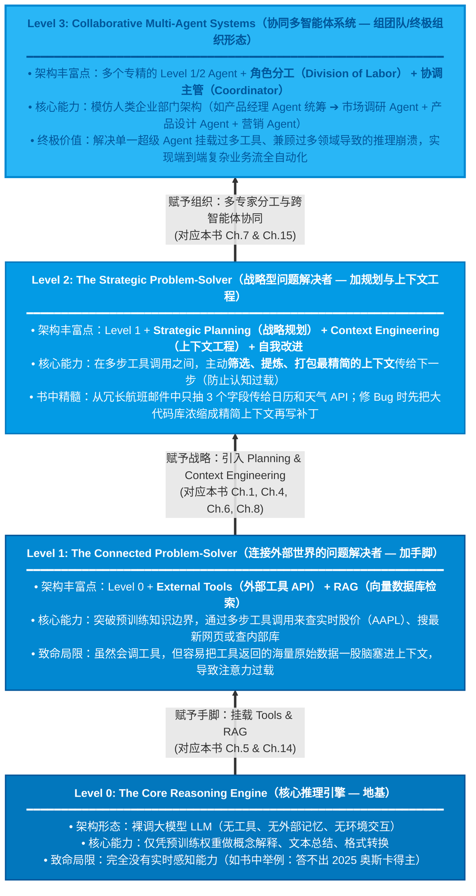
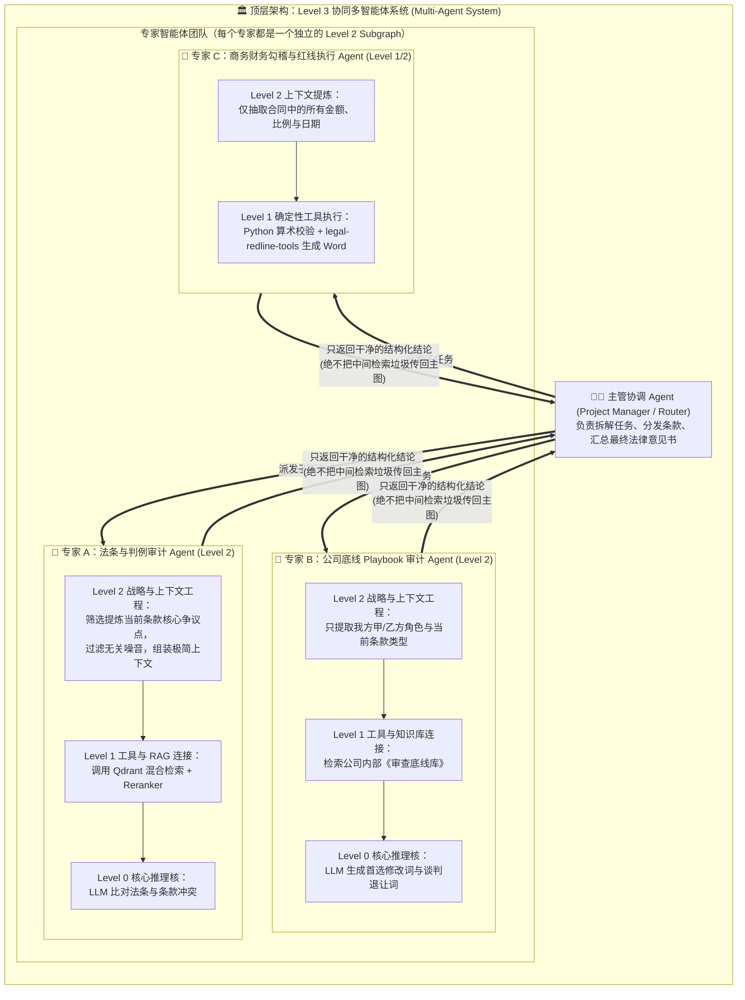

# 智能体复杂度金字塔（Level 0 – Level 3）：是演进替代还是架构叠加？我们的终极目标是 Level 3 吗？

- **原图出处**：《Agentic Design Patterns: A Hands-On Guide to Building Intelligent Systems》（Antonio Gulli 著，**PDF 第 16–19 页 Fig. 3**）
- **关联文档**：
  - [01_AI范式演进全景图_LLM_Workflow_RAG_Agent_AgenticAI.md](./01_AI范式演进全景图_LLM_Workflow_RAG_Agent_AgenticAI.md)
  - [Agentic_Design_Patterns_full.md（PDF Page 16–19 原文）](./Agentic_Design_Patterns_full.md)
- **核心问题**：
  > *“在这本书里，他是怎么讲解 Level 0 到 Level 3 的？它是一种演进，还是一种架构的丰富？对我来讲，我需要理解它的过程，以及最终的目标应该是用 Level 3 吧？”*

---

## 一、 核心结论：为什么作者画成“金字塔”，而不是“阶梯”？

你问到了最关键的点上：**Level 0 到 Level 3 到底是“新代际淘汰旧代际的演进”，还是“架构能力的层层丰富与叠加”？最终目标是不是一定要用 Level 3？**

结合书中第 16–19 页的原文，答案非常明确：

1. **它是“俄罗斯套娃式的架构丰富与包含关系”，绝不是淘汰关系！**
   - 注意看原图，作者特意画了一个**四层金字塔（Pyramid）**：
   - **没有下一层做地基，上面一层根本立不住**：
     - **Level 3（多智能体团队）** 的每一个成员，本质上就是一个 **Level 2（懂上下文工程的专家 Agent）** 或 **Level 1（带专用工具的执行 Agent）**；
     - 而每一个 **Level 1 / Level 2 Agent** 的每一次单步思考，底层调用的依然是 **Level 0（核心大模型推理引擎）**！
2. **关于“最终目标是不是用 Level 3”——书中给出了一个极具洞察力的双层答案**：
   - **对于“端到端复杂业务系统”（比如你的商业合同全流程审查系统、新产品发布系统、工业全厂诊断系统）**：**是的，最终的系统级架构形态必然是 Level 3（Collaborative Multi-Agent Systems）**。因为作者在 P18 明确指出：*“我们正在放弃追求一个无所不能的单一超级智能体（Single Super-Agent），转向像人类公司组织架构一样的专业智能体团队分工。”*
   - **但对于 Level 3 里面的“每一个子模块”**：必须遵循**“够用即止（Least Complexity Principle）”**——能用 Level 0/1 解决的子任务，绝不在子模块内部搞复杂的 Level 3，否则延迟和推理误差会成倍放大。

---

## 二、 金字塔四层架构还原与书中原意深度拆解（Level 0 $\rightarrow$ Level 3）

---

## 三、 重点精读：书中对每一层的独到定义（尤其是被很多人忽略的 Level 2！）

很多人在看这个金字塔时，觉得 Level 0（裸大模型）、Level 1（调工具）、Level 3（多智能体）都很好懂，唯独卡在 **Level 2（The Strategic Problem-Solver）**：**到底 Level 2 比 Level 1 高级在哪里？**

让我们直接对照书中 **PDF 第 16–18 页** 的原文与案例，把这四层彻底看透：

### 1. Level 0：The Core Reasoning Engine（核心推理引擎，P16）
- **书中定义**：大模型本身还不是 Agent，但它是所有上层 Agent 的“CPU 运算核”。它没有工具、没有记忆，完全靠训练时的死记硬背和逻辑能力回答问题。
- **书中案例**：你问它“什么是量子计算”，它答得很好；但你问它“2025 年奥斯卡最佳影片是谁”，它就抓瞎了。
- **它在你的终极系统里干什么？**：作为底层被调用的无状态算子（比如专门把一段话翻译成英文、或者把一段文本格式化成 JSON）。

### 2. Level 1：The Connected Problem-Solver（连接世界的问题解决者，P16）
- **书中定义**：给 Level 0 装上了 **Tools（搜索、API）** 和 **RAG（数据库）**，让它第一次真正成为了一个功能性智能体（Functional Agent）。
- **书中案例**：查最新电视剧、或者调金融 API 查苹果公司（`AAPL`）的实时股价。
- **为什么停留在 Level 1 不够用？**
  Level 1 的 Agent 拿到第一个工具的返回结果（比如地图 API 返回了整整 50 页的周边道路详情 JSON）后，会**不加筛选地原样塞进上下文**去调第二个工具。结果走不了两步，上下文就被垃圾信息塞满了，模型开始胡言乱语。

### 3. Level 2：The Strategic Problem-Solver（战略型问题解决者，P16–P17）—— **全书最关键的一跃！**
- **书中定义**：作者在 P17 用了整整一页篇幅强调，从 Level 1 升到 Level 2 的核心标志，不是工具变多了，而是掌握了 **“Context Engineering（上下文工程）”** 和 **“Strategic Planning（战略规划）”**！
- **作者对 Context Engineering 的原话定义（P17，极其精彩）**：
  > *“To achieve maximum accuracy from an AI, it must be given a short, focused, and powerful context. Context engineering is the discipline that accomplishes this by strategically selecting, packaging, and managing the most critical information from all available sources. It effectively curates the model's limited attention to prevent overload.”*
  > （为了让 AI 达到最高准确率，必须只给它**简短、聚焦、强有力**的上下文。上下文工程就是从所有可用信息源中**战略性地筛选、打包、管理最关键信息**的工程学科，用来保护模型有限的注意力，防止认知过载。）
- **书中给出的 3 个 Level 2 经典案例**：
  1. **找两地之间的咖啡馆**：先调地图工具，拿到庞杂结果后，**先做一次上下文提炼（只抽出途经的几条街道名称列表）**，再把这个干净的短列表传给本地搜索工具；
  2. **差旅助手看航班邮件**：收到冗长的航空公司确认邮件后，**只把核心三要素（航班号、日期、机场代码）抽出来打包**，再传给日历工具和天气 API；
  3. **修 Bug 的软件工程 Agent**：读完报错和庞大的代码库后，**先把相关文件浓缩打包成一份极度聚焦的上下文**，再开始写代码打补丁。
- **这跟你之前的感悟完全吻合！**
  我们在前面讨论 LangGraph 时说的“不要无脑 `messages.append`，要在每个节点里用硬编码和独立 State 字段精准装配每一轮的 Prompt”，在 Antonio Gulli 这本书里就叫做 **Level 2：Context Engineering**！

### 4. Level 3：The Rise of Collaborative Multi-Agent Systems（协同多智能体系统，P18–P19）
- **书中定义**：当业务目标极其庞大（比如“完成整个新产品的立项、调研、设计与营销发布”，或者“完成一份 50 页跨国并购合同的法务、税务、财务全维度审计”），哪怕单个 Level 2 Agent 再懂上下文工程，它的单脑推理上限和专业Prompt边界也会撞墙。
- **核心解法（模仿人类公司组织架构）**：
  - 放弃“造一个全知全能的单体超级神仙 Agent”；
  - 改为打造一个 **“1 个项目经理协调员（Coordinator） + N 个专精领域的 Level 2 专家 Agent”** 的团队。每个专家 Agent 只拥有自己领域的精简 Prompt、专属的 2~3 个工具和完全隔离的干净上下文，通过结构化协议交换最终成果。

---

## 四、 为什么你的最终目标确实应该是“外层 Level 3 + 内层 Level 2”？

你判断得非常准：**对于严肃的企业级应用（比如你前面关注的商业合同 Audit 与法律意见系统），最终的架构目标一定是以 Level 3 为顶层骨架，以 Level 2 为每个专家节点的内核！**

我们可以用下面这张**“金字塔四层在同一个系统里的嵌套关系图”**，看清你最终要建成的系统是什么样的：

---

## 五、 给你的实战落地路线图：如何一步步走到 Level 3？

作者在书中把全书 21 章设计模式对应到了从 Level 1 到 Level 3 的攀登过程。你在实际动手开发自己的业务系统时，千万不要第一天就写 10 个 Agent 互相聊天，最稳健的工程路径是**“三步走”**：

### 第一步：先打磨好 1 个达到 **Level 2 水准** 的单体专家工作流
- **用什么模式？**
  - **Pattern 1 (Prompt Chaining, Ch.1)** + **Pattern 5 (Tool Use, Ch.5)** + **Pattern 14 (RAG, Ch.14)** + **Pattern 4 (Reflection, Ch.4)**。
- **核心验收标准（Level 2 的标志）**：
  - 在 LangGraph 里，你已经不用笼统的 `messages` 一把梭了；
  - 你学会了在调下一个节点前，**用代码把上一步工具返回的脏数据清洗、浓缩成干净的结构化字段（Context Engineering）**，单领域的审查准确率达到 90% 以上。

### 第二步：将多个 Level 2 专家组装成 **Level 3 协同系统**
- **用什么模式？**
  - **Pattern 2 (Routing, Ch.2)** + **Pattern 3 (Parallelization, Ch.3)** + **Pattern 7 (Multi-Agent Collaboration, Ch.7)**。
- **核心做法**：
  - 当你发现单个专家既要看法律风险、又要算财务税率、还要检查行业技术规范，Prompt 越写越长、准确率开始下降时；
  - 把它们拆成 3 个独立的 **LangGraph Subgraph（子图，每个子图都是一个 Level 2 专家）**，在顶层加一个 **Supervisor / Map-Reduce 调度图** 把它们串联/并联起来——这时候你就自然而然站在了 **Level 3** 的塔尖上！

### 第三步：加上生产级护栏与人工门禁（补齐企业级可靠性）
- **用什么模式？**
  - **Pattern 13 (Human-in-the-Loop, Ch.13)** + **Pattern 12 (Exception Handling, Ch.12)** + **Pattern 18 (Guardrails, Ch.18)** + **Pattern 19 (Evaluation, Ch.19)**。
- 在 Level 3 系统的最终输出前，加上 `interrupt()` 人工签批节点与量化评估测试集，系统即可正式投产。

