# Chapter 1 (Prompt Chaining) 高亮重点解析：任务分解到底是“预先硬编码定义”还是“让 LLM 自己拆”？

- **关联原书**：[Agentic_Design_Patterns.pdf](./Agentic_Design_Patterns.pdf)（对应 **Primer P14** 及 **Chapter 1: Prompt Chaining，PDF P23–P35**）
- **全文对照**：[Agentic_Design_Patterns_full.md](./Agentic_Design_Patterns_full.md)
- **核心问题**：
  > *“我在 Chapter 1: Prompt Chaining 里做了一些黄色标记，我理解这里是把目标拆解成可以按照顺序执行的单一目标的小问题，然后发给 LLM 推理。但是这个问题的分解，是让 LLM 自己做呢，还是在智能体设计时候，由工程师预先定义好呢？”*

---

## 一、 直接给你最透彻的答案：正是这一区别，划分了本书的 **Chapter 1（Prompt Chaining）** 和 **Chapter 6（Planning）**！

你问到了整个 Agent 架构设计里最核心的一条分界线！

- **在 Chapter 1（Prompt Chaining，提示词链）中**：
  **问题的分解是 100% 由工程师在设计智能体时【预先硬编码定义好】的（Design-Time Decomposition）！**
  - 到底分几步、第 1 步干什么、第 2 步干什么、每一步的 Prompt 模板长什么样、上一步哪个 JSON 字段塞进下一步，**全部由你在写代码时固定死**。
  - LLM 在这里**不负责拆解步骤**，它只负责像流水线上的工人一样，专心做好你分派给它的那一步单点任务（比如第 1 步只做摘要，第 2 步只提炼趋势，第 3 步只写邮件）。
- **那什么时候才“让 LLM 自己做问题分解”呢？**
  **那是本书 Chapter 6（Planning，规划模式，PDF P100）干的事（Runtime Decomposition）！**
  - 当用户的目标过于开放、事先根本无法预知需要哪几步时（例如：“帮我调查竞争对手 X 最近三个月的所有动作并制定应对方案”），我们才会在最前面放一个 **Planner LLM（规划器）**，让 LLM 在运行时动态生成任务列表 `[Step 1, Step 2, Step 3...]`。

---

## 二、 提取你在 PDF 中标记的 4 处黄色高亮并逐条批注

我已从你的最新 PDF 中提取出你在第 14 页与第 23–24 页标记的 4 段黄色高亮原文：

### 📍 【高亮 1】PDF Page 14（智能体工作的五步闭环）
> **原文**：
> *"1. Get the Mission: You give it a goal, like 'organize my schedule.'*
> *2. Scan the Scene: It gathers all the necessary information—reading emails, checking calendars, and accessing contacts—to understand what's happening.*
> *3. Think It Through: It devises a plan of action by considering the optimal approach to achieve the goal.*
> *4. Take Action: It executes the plan by sending invitations, scheduling meetings, and updating your calendar.*
> *5. Learn and Get Better: It observes successful outcomes and adapts accordingly."*
>
> **中文精译**：
> 1. 接收使命（设定目标）$\rightarrow$ 2. 扫描全局（收集信息）$\rightarrow$ 3. 深思熟虑（制定计划）$\rightarrow$ 4. 付诸行动（执行计划）$\rightarrow$ 5. 学习进化（观察结果并适应）。

---

### 📍 【高亮 2】PDF Page 23（Chapter 1：Prompt Chaining 的核心思想）
> **原文**：
> *"The core idea is to break down the original, daunting problem into a sequence of smaller, more manageable sub-problems. Each sub-problem is addressed individually through a specifically designed prompt, and the output generated from one prompt is strategically fed as input into the subsequent prompt in the chain."*
>
> **中文精译**：
> 核心思想是将原本棘手的大问题拆解为一系列更小、更易管理的子问题。**每个子问题都通过一个专门设计的提示词（specifically designed prompt）单独解决**，前一个提示词生成的输出被战略性地作为输入喂给链条中的下一个提示词。

- **🔍 关键细节批注**：
  注意作者的用词：**“through a specifically designed prompt（通过专门设计的提示词）”**。谁来专门设计这个提示词？**是你（人类架构师/工程师）在写代码的时候设计好的！**

---

### 📍 【高亮 3 & 4】PDF Page 24（通过顺序拆解提升可靠性）
> **原文 1**：
> *"Enhanced Reliability Through Sequential Decomposition: Prompt chaining addresses these challenges by breaking the complex task into a focused, sequential workflow, which significantly improves reliability and control."*
> （通过顺序拆解提升可靠性：提示词链通过将复杂任务拆解为聚焦的顺序工作流来解决单提示词的缺陷，从而显著提升**可靠性与控制力**。）
>
> **原文 2**：
> *"This decomposition allows for more granular control over the process. Each step is simpler and less ambiguous, which reduces the cognitive load on the model and leads to a more accurate and reliable final output."*
> （这种拆解允许对过程进行更细粒度的控制。每一步都更简单、更少歧义，从而**降低了模型的认知负荷 [cognitive load]**，带来更准确、更可靠的最终输出。）

- **🔍 为什么预先硬编码拆解能“降低模型认知负荷”？**
  - 如果你把一个复杂任务（“读这份市场报告 $\rightarrow$ 做摘要 $\rightarrow$ 提取 3 个带数据的趋势 $\rightarrow$ 给市场部写封邮件”）塞进**一个大 Prompt** 里让大模型一次性做完，大模型既要自己思考怎么分步，又要同时遵守几十条格式约束，极易出现**指令遗漏（Instruction Neglect）**或**幻觉**。
  - 当你用 **Prompt Chaining** 在代码里预先把它拆成 3 个固定节点（见 PDF 第 30 页的代码）：
    - `Node 1` 的 LLM 只管提取规格参数；
    - **中间硬编码衔接**：Python 代码拿到 `Node 1` 的输出，校验无误后填入 `Node 2` 的模板变量 `{specifications}`；
    - `Node 2` 的 LLM 只管把这段文字转成严格的 JSON。
  - 每个节点上的大模型每次只干一件极其单纯的小事，准确率瞬间从 60% 飙升到 99%！

---

## 三、 一图看懂三种“问题分解”方式：Prompt Chaining vs. Planning vs. 混合架构

在真实的智能体开发中，针对“谁来拆解问题”，共有三种模式（分别对应本书第 1 章、第 6 章、以及工业界最常用的混合模式）：

```mermaid
flowchart TB
    classDef codeStyle fill:#e3f2fd,stroke:#1565c0,stroke-width:2px,color:#0d47a1
    classDef llmStyle fill:#fce4ec,stroke:#c2185b,stroke-width:2px,color:#880e4f

    %% 模式 A
    subgraph ModeA["模式 A：预先静态拆解 — Prompt Chaining (本书 Chapter 1, P23)"]
        direction LR
        A_Goal(["固定业务目标<br/>(如：审查单个合同条款)"]) --> A_S1["🟦 工程师硬编码第 1 步<br/>🟥 LLM 提取条款核心实体"]:::codeStyle
        A_S1 -->|"JSON 传递"| A_S2["🟦 工程师硬编码第 2 步<br/>🟥 LLM 比对法条与底线"]:::codeStyle
        A_S2 -->|"JSON 传递"| A_S3["🟦 工程师硬编码第 3 步<br/>🟥 LLM 拟定修改措辞"]:::codeStyle
    end

    %% 模式 B
    subgraph ModeB["模式 B：LLM 动态拆解 — Planning Pattern (本书 Chapter 6, P100)"]
        direction LR
        B_Goal(["开放式未知目标<br/>(如：调查某公司并写尽调报告)"]) --> B_Planner["🟥 1. Planner LLM (规划器)<br/>由大模型自己把大目标拆解成<br/>动态子任务列表 [Task 1, Task 2, ...]"]:::llmStyle
        B_Planner --> B_Exec["🟦 2. 循环执行器 + 🟥 Worker LLM<br/>按大模型列出的计划逐条调用工具执行"]:::codeStyle
        B_Exec --> B_Replan["🟥 3. Re-Planner (动态重规划)<br/>根据执行结果决定是否修改剩余计划"]:::llmStyle
    end

    %% 模式 C
    subgraph ModeC["模式 C：工业级黄金混合模式 — 宏观硬编码拆解 + 局部 LLM 动态拆解"]
        direction LR
        C_Macro["🟦 宏观阶段 (大 SOP)：工程师用 Prompt Chaining 预先硬编码定死<br/>【阶段1：解析合同】 ➔ 【阶段2：专项风险审计】 ➔ 【阶段3：生成报告】"]:::codeStyle
        C_Micro["🟥 微观节点内：在【阶段2】内部某条复杂条款看不懂时，<br/>允许该节点的 LLM 自己动态拆解出 2 个子查询去搜法条库 (Sub-question Planning)"]:::llmStyle
        C_Macro --> C_Micro
    end
```

---

## 四、 工程决策表：在你的系统里，什么时候预先定义，什么时候让 LLM 拆？

| 维度 | 方式 1：设计时预先定义好（Chapter 1: Prompt Chaining） | 方式 2：运行时让 LLM 自己拆（Chapter 6: Planning） |
| :--- | :--- | :--- |
| **谁负责拆解步骤？** | **🧑‍💻 人类工程师 / 领域专家（如资深法务、总工）** 把人类标准作业程序（SOP）写成固定的代码节点。 | **🟥 Planner LLM（大模型规划器）** 你在 Prompt 里写：“请针对用户目标制定分步计划”，大模型输出 `list[Step]`。 |
| **拆解发生在什么时候？** | **写代码阶段（Design-time）**，上线后步骤顺序固定不变。 | **用户提问后的运行阶段（Runtime）**，每次提问拆出来的步骤可能都不一样。 |
| **确定性与可靠性** | **⭐⭐⭐⭐⭐（极高）** 绝对不会漏步骤、不会乱造步骤，中间还能插入 Python 代码做格式校验。 | **⭐⭐⭐（中等）** 灵活度极高，但大模型有时会拆出不切实际或冗余的步骤。 |
| **Token 成本与延迟** | **低**（省去了让大模型先思考怎么列计划的那一次昂贵调用）。 | **高**（需要先调一次大模型生成 Plan，每跑完一步可能还要调 Re-planner 更新计划）。 |
| **典型适用场景** | **已有明确 SOP 的专业任务**： • 商业合同审查（解析 $\rightarrow$ 查库 $\rightarrow$ 初审 $\rightarrow$ 复核 $\rightarrow$ 生成 Word） • 发票/表单信息提取与校验 • 代码生成（写伪代码 $\rightarrow$ 写实现 $\rightarrow$ 静态检查 $\rightarrow$ 写单测） | **没有固定套路的开放式探索任务**： • 深度竞品调研报告（Deep Research） • 复杂未知 Bug 的跨仓库排查 • 个人全自动行程规划 |

> **💡 甚至在 Chapter 1 第 26 页（Use Case 2: Complex Query Answering），作者还展示了一种极其巧妙的“小混合”用法**：
> 当用户问了一个复合问题（*“1929 年股市崩盘的原因是什么，政府采取了什么政策应对？”*），作者设计的 **Prompt Chain** 是：
> - **第 1 步（固定节点）**：专门调一次 LLM，**只让它把用户的复合长句拆成 2 个独立的子问题（Sub-questions）**；
> - **第 2 步（固定节点）**：拿子问题 1 去检索；
> - **第 3 步（固定节点）**：拿子问题 2 去检索；
> - **第 4 步（固定节点）**：把两份检索结果合并起来写最终回答。
>
> **总结一句话**：**流水线的“工位顺序”（先拆问题 $\rightarrow$ 再检索 $\rightarrow$ 最后合成）是你作为总设计师预先在代码里焊死的；而每个工位上针对具体输入内容的“切分与处理”，则交给大模型去完成！**

