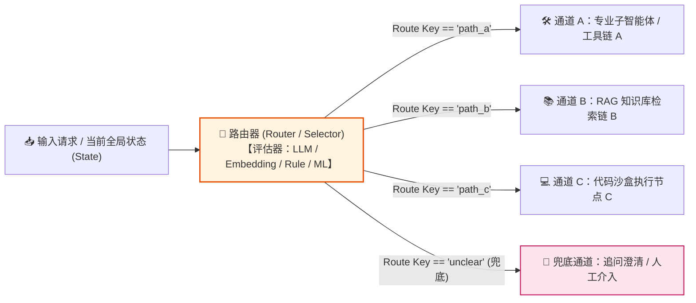
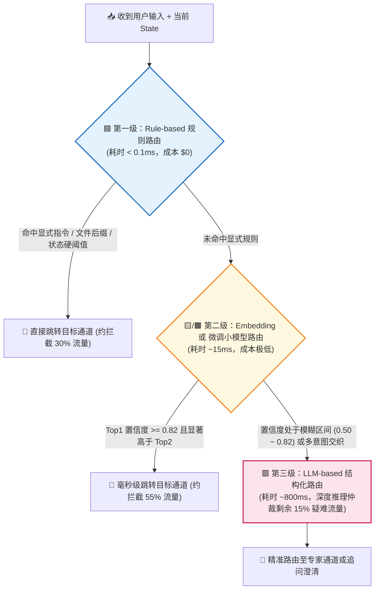
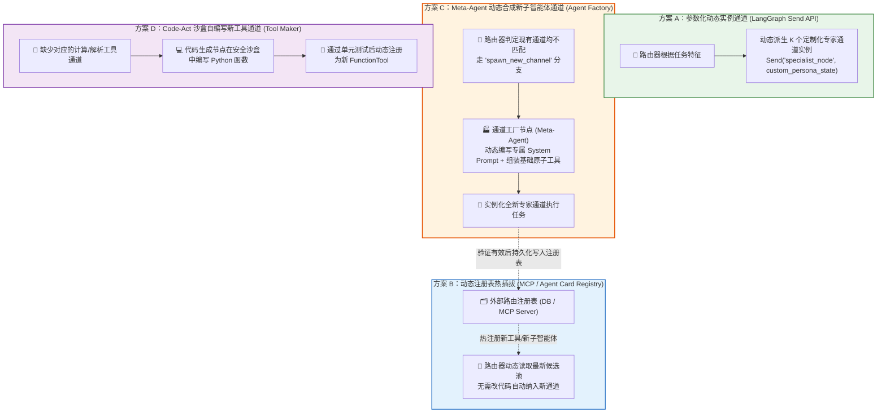

# Chapter 2: Routing（路由模式）— 高亮重点解析、四种路由机制选型与动态通道扩展实战指南

> **文档定位**：本文档基于你在 [Agentic_Design_Patterns.pdf](./Agentic_Design_Patterns.pdf) **Chapter 2: Routing（PDF 第 36–37 页）** 中标记的 **8 处黄色高亮**，全面解答你的三个核心工程问题：
> 1. **本质界定**：路由（Routing）是不是就是一个“多路选择器（Selector）”？它在智能体运行周期的哪些位置起作用？
> 2. **方法选型**：书中高亮的 **4 种不同路由方式（LLM 路由、Embedding 向量路由、规则路由、判别式小模型路由）** 分别适应什么工程场景？在 LangGraph 中如何优雅实现？
> 3. **进阶架构**：路由默认只能从预定义的通道里选（闭集选择），**它能否在运行时自主增加新的后续通道（开集扩展）？** 工程上有哪些实现“动态新通道”的模式？

---

## 一、 你在 PDF 中标记的 8 处黄色高亮全景提取与核心意图解读

你在 **Chapter 2（PDF 第 36–37 页）** 做的 8 处高亮非常成体系，完整勾勒出了路由模式的 **“核心定义 -> 评估分流器 -> 四大实现机制 -> 介入时机 -> 状态图编排（LangGraph）”** 五层架构：

| 高亮序号 | 所在位置 | 高亮关键概念与核心内容提炼（中文精解） | 你关注背后的工程切入点 |
| :---: | :---: | :--- | :--- |
| **高亮 #1** | **PDF P36**<br>第 1–2 段 | **从固定线性路径转向条件分支控制流（`conditional logic`）**：路由机制通过动态评估特定条件，从一组候选后续动作、专用函数、工具或子流程中做出选择，赋予智能体上下文感知与自适应能力。 | **路由的本质定义**：打破 Chapter 1 的单行道，引入动态分流开关。 |
| **高亮 #2** | **PDF P36**<br>倒数第 2 段 | **路由的核心组件是“评估并引导流向的机制”（`mechanism that performs the evaluation and directs the flow`）**。 | **路由器的结构拆解**：任何路由都包含两步——先**评估判别（Evaluate）**，再**切换流向（Direct Flow）**。 |
| **高亮 #3** | **PDF P36**<br>倒数第 1 段 | **机制一：`LLM-based Routing`（基于生成式大模型的路由）**：通过提示词让大模型分析输入，直接输出代表下一步或目标分支的分类标识符（如 `'Order Status'`、`'Technical Support'`）。 | **最灵活但有延迟的路由**：靠 LLM 的语义推理与指令遵循做选择。 |
| **高亮 #4** | **PDF P37**<br>第 1 段 | **机制二：`Embedding-based Routing`（基于向量语义相似度的路由）**：将输入查询转化为 Embedding 向量，与代表各条路径能力的锚点向量计算相似度，路由至语义最接近的通道。 | **高并发低延迟语义路由**：不调生成式大模型，靠向量空间余弦相似度做毫秒级分流。 |
| **高亮 #5** | **PDF P37**<br>第 2 段 | **机制三：`Rule-based Routing`（基于确定性规则的路由）**：使用预定义的 `if-else`、`switch-case`、正则表达式或从输入中提取的结构化数据字段进行判断。最快、最确定，但缺乏处理模糊输入的弹性。 | **零成本硬编码路由**：工程兜底、阈值判断、元数据分流的首选。 |
| **高亮 #6** | **PDF P37**<br>第 3 段 | **机制四：`Machine Learning Model-Based Routing`（基于判别式机器学习模型的路由）**：使用在标注语料上监督微调（Supervised Fine-tuning）过的判别式分类模型（Classifier）。推理时不执行生成式 Prompt，路由逻辑编码在微调模型的权重中。 | **企业级吞吐量与专业边界分类**：用小尺寸微调分类器（如 ModernBERT / DeBERTa）替代昂贵的生成式 LLM。 |
| **高亮 #7** | **PDF P37**<br>第 4 段 | **路由可在智能体运行周期的多个关键节点介入（`implemented at multiple junctures`）**：不仅在入口处做主任务分类，还可在流水线中间节点决定下一步动作，或在子程序内部从工具集中挑选合适工具。 | **路由不只是“入口网关”**：它贯穿“入口分诊 -> 中间状态跳转/打回 -> 末端工具选择”全周期。 |
| **高亮 #8** | **PDF P37**<br>第 5 段 | **LangGraph 的状态图架构极其适合复杂路由（`contingent upon the accumulated state of the entire system`）**：当路由决策不仅取决于用户当前一句话，而是取决于整个系统运行至今**累积的全局状态（Accumulated State）**时，LangGraph 是最佳载体。 | **为什么真实项目首选 LangGraph 做路由**：因为复杂路由看的是“全局状态账本”，而不只是单条文本。 |

---

## 二、 问题一：路由（Routing）是不是就是一个“多路选择器”？

### 1. 精准定性：路由就是智能体控制流中的“多路选择器（Demultiplexer / Switch）”

你的理解**完全准确**。借用数字电路或网络工程的概念：
- **Chapter 1（Prompt Chaining）** 是 **串联电路（Pipeline）**：`Node A -> Node B -> Node C`，电流只能沿着唯一固定的导线往下走。
- **Chapter 2（Routing）** 则是 **多路选择器 / 铁路道岔（1-to-N 或 K-to-N Switch）**：
  1. **预先定义好若干条后续路径**（可以是不同的专业子智能体 Sub-Agents、不同的 Prompt 处理链、不同的工具函数 Tools，甚至是人工介入通道 Human-in-the-Loop）。
  2. **路由器（Router）只做“裁判/扳道工”，不做具体业务干活**：它接收当前输入或系统状态，通过某种评估算法算出一个**路由键值（Route Key）**，然后把任务派发到对应的后续通道上。



---

### 2. 深入高亮 #7 & #8：路由绝不仅仅发生在“第一棒入口”！

很多初学者以为路由只是客服机器人入口处的“意图分诊（Intent Classification）”。但正如你在 **PDF 第 37 页高亮 #7 和 #8** 所敏锐捕捉到的，路由在智能体系统中有 **3 个截然不同的介入位置（Junctures）**，且越往后越依赖 **LangGraph 的累积全局状态（Accumulated State）**：

#### 位置 1：入口分诊路由（Entry-Gate Triage Routing）
- **发生时机**：用户请求刚进入系统时（第 1 步）。
- **判断依据**：主要依据用户的原始输入 `user_query` 和基础上下文。
- **例子**：商业合同审查系统收到请求后，先判断用户是要 **“审查完整合同（走合同审查流水线）”**、**“起草单个条款（走条款生成流水线）”**，还是 **“咨询某条劳动法法规（走法规问答 RAG）”**。

#### 位置 2：流水线中间状态路由 / 循环回退路由（Intermediate & Loop-Back State Routing）
- **发生时机**：在多步执行的中间节点之间（连接 Chapter 1 与 Chapter 4 Reflection）。
- **判断依据**：依据 **LangGraph 的全局累积状态 `State`**（如：上一步解析出的合同金额、风险等级、或者审查节点的校验得分、当前已重试次数 `retry_count`）。
- **例子**：
  - 合同风险扫描节点跑完后，路由函数检查 `State`：如果 `risk_level == "HIGH"` 且 `contract_value > 500万`，路由到 **“法务总监人工审批节点（Human-in-the-Loop）”**；如果 `risk_level == "LOW"`，直接路由到 **“自动生成定稿报告节点”**。
  - 如果生成报告的 JSON 校验失败且 `retry_count < 3`，**路由回退（Loop-back）** 到重写节点；若已达 3 次，路由至告警节点。

#### 位置 3：子程序内部的工具选择路由（Subroutine Tool Selection Routing）
- **发生时机**：在某个具体节点内部，面对一组候选工具（Tools）时。
- **判断依据**：通过 LLM 的 Function Calling（工具调用）或语义检索，从候选工具池中挑出当前最匹配的一个或多个工具执行。

---

## 三、 问题二：四种不同路由方法的全面对比、适用场景与代码实现

你在 **PDF 第 36–37 页（高亮 #3、#4、#5、#6）** 完整标出了书中总结的 **4 种核心路由实现方式**。为什么要有 4 种？因为工程架构永远在做 **“语义理解深度（智商） vs. 响应延迟（速度） vs. 调用成本（算力） vs. 可控确定性”** 的权衡。

### 1. 四种路由机制核心指标与适用场景全景对比表

| 维度 | 1. 规则路由<br>**(Rule-based)** | 2. 向量语义路由<br>**(Embedding-based)** | 3. 判别式小模型路由<br>**(ML Classifier-based)** | 4. 生成式大模型路由<br>**(LLM-based)** |
| :--- | :--- | :--- | :--- | :--- |
| **执行属性** | 🟦 **纯硬编码确定性逻辑** | 🟨 **向量表征模型 + 余弦相似度** | 🟧 **监督微调判别式分类器** | 🟥 **生成式大模型推理** |
| **底层技术栈** | Python `if/else`、正则、JSON 字段比对、状态机阈值 | `Qwen3-Embedding` / `bge-m3` + `semantic-router`（锚点向量余弦距离） | 微调 `ModernBERT` / `DeBERTa-v3` / `FastText` / `XGBoost` | LLM + `with_structured_output` (Pydantic `Literal` 枚举) |
| **单次路由延迟** | **< 0.1 ms**（极速） | **10 ~ 30 ms**（毫秒级） | **5 ~ 20 ms**（毫秒级） | **300 ~ 2,000 ms**（较慢） |
| **Token / 算力成本** | **0 成本** | 极低（仅一次 Embedding） | 极低（CPU 或小显存即可跑） | 较高（每次路由消耗 Prompt Tokens） |
| **可解释与确定性** | **100% 确定**，完全可审计 | 确定性高（受相似度阈值控制） | 确定性高（输出各分类 Softmax 概率） | 存在微小概率波动（需设 `temperature=0`） |
| **冷启动开发难度** | 极低（直接写代码） | 低（每个通道写 5~10 句代表性样本即可） | 高（需要收集/合成几百至上千条标注样本并训练） | 极低（写好 System Prompt 和枚举定义即可上线） |
| **处理复杂/隐晦意图能力** | ⭐（只能处理显式字段或关键词） | ⭐⭐⭐（擅长同义句匹配，不擅长逻辑转折与否定句） | ⭐⭐⭐⭐（在垂直领域边界问题上极准，但泛化限于训练集） | ⭐⭐⭐⭐⭐（具备深度上下文推理、多条件综合权衡能力） |
| **最佳适用场景** | 1. **结构化状态流转**（如 `retry < 3`、金额 `> 100万`）<br>2. **文件格式/元数据分流**（`.pdf` vs `.docx`）<br>3. **合规硬红线拦截** | 1. **高并发客服/知识库入口分流**（从 20~100 个已知标准业务主题中秒级匹配）<br>2. **过滤闲聊与无关提问** | 1. **超高 QPS 生产网关意图分类**<br>2. **安全护栏（越狱/敏感词/PII 识别）**<br>3. **大小模型级联路由（RouteLLM：简单问题派给小模型，难题派给大模型）** | 1. **冷启动期快速搭建多智能体调度器（Coordinator）**<br>2. **依赖多轮对话上下文或复杂业务语义的综合分流**<br>3. **数量较少（2~8 个）但界限微妙的专业通道选择** |

---

### 2. 四种路由机制的代码级实现范式（基于 LangGraph / Python）

书中第 39–46 页只给出了第 4 种（LLM-based Routing）的 `RunnableBranch` 和 Google ADK 示例。下面为你补齐全部 **4 种路由机制在现代 LangGraph 生产环境中的标准写法**：

#### 方法一：Rule-based Routing（确定性规则与状态路由）
> **场景**：在 LangGraph 中根据前序节点写入 `State` 的结构化字段（如风险等级、重试次数、合同金额）决定下一步走哪条边。

```python
from typing import Literal, TypedDict
from langgraph.graph import StateGraph, START, END

class ContractState(TypedDict):
    query: str
    contract_amount: float
    risk_score: int
    retry_count: int
    parse_error: bool

# 🟦 纯 Python 规则路由函数：0 延迟、100% 确定性
def rule_based_router(
    state: ContractState,
) -> Literal["retry_parse_node", "cfo_human_review_node", "legal_audit_node", "fast_track_node"]:
    # 规则 1：解析报错且重试未超限 -> 打回重解析
    if state.get("parse_error") and state.get("retry_count", 0) < 3:
        return "retry_parse_node"
    # 规则 2：金额超 500 万或风险分 >= 80 -> 强制走高管/法务人工审批通道
    if state.get("contract_amount", 0) > 5_000_000 or state.get("risk_score", 0) >= 80:
        return "cfo_human_review_node"
    # 规则 3：中等风险 -> 走深度法务 Agent 审查通道
    if state.get("risk_score", 0) >= 40:
        return "legal_audit_node"
    # 规则 4：低风险小额标准合同 -> 走快速自动放行通道
    return "fast_track_node"
```

---

#### 方法二：Embedding-based Routing（向量语义锚点路由）
> **场景**：入口有 10~50 个明确的业务通道，要求在 **20 毫秒内** 完成语义分流，不希望每次都调用昂贵且慢的生成式 LLM。
> **核心原理**：每个通道预先配置 5~10 句典型用户问法（Anchor Utterances），启动时用本地 `Qwen3-Embedding-0.6B` 算出向量；运行时只需对用户输入算一次 Embedding，做矩阵点积（余弦相似度），超过阈值（如 `0.75`）即命中对应通道，低于阈值则落入 `unclear` 或交给 LLM 兜底。

```python
import numpy as np
from typing import Literal

# 预先定义的各通道典型问法锚点（Route Anchors）
ROUTE_ANCHORS = {
    "labor_contract": [
        "帮我看看这份劳动合同的竞业限制条款合法吗",
        "员工离职经济补偿金N+1怎么算",
        "试用期辞退员工有什么法律风险",
    ],
    "nda_agreement": [
        "审查一下这份保密协议的保密期限和违约金",
        "双方向第三方披露商业秘密的免责条款",
        "技术交底前的NDA协议模板审阅",
    ],
    "procurement_contract": [
        "采购合同里的延迟交货违约金上限怎么定",
        "供应商货物质量验收不合格的退换货条款",
        "设备买卖合同的付款账期与发票开具约定",
    ],
}

class SemanticEmbeddingRouter:
    def __init__(self, embed_fn, threshold: float = 0.72):
        self.embed_fn = embed_fn  # 例如调用本地 Qwen3-Embedding-0.6B
        self.threshold = threshold
        # 启动时预计算所有锚点的归一化向量矩阵
        self.route_names = []
        anchor_texts = []
        for route_name, phrases in ROUTE_ANCHORS.items():
            for p in phrases:
                self.route_names.append(route_name)
                anchor_texts.append(p)
        vecs = np.array(self.embed_fn(anchor_texts))
        self.anchor_matrix = vecs / np.linalg.norm(vecs, axis=1, keepdims=True)

    def route(self, query: str) -> str:
        # 🟨 运行时仅需 1 次向量化 + 矩阵乘法（耗时 ~15ms）
        q_vec = np.array(self.embed_fn([query])[0])
        q_vec = q_vec / np.linalg.norm(q_vec)
        scores = np.dot(self.anchor_matrix, q_vec)
        best_idx = int(np.argmax(scores))
        if scores[best_idx] >= self.threshold:
            return self.route_names[best_idx]
        return "unclear_fallback"  # 低于阈值则转交兜底或大模型复核
```

> [!TIP]
> **为什么需要注意 Embedding 路由的短板？**
> Embedding 路由对**否定词和条件转折**不敏感。例如用户说：*“我**不是**要审劳动合同，我是想问采购设备款项拖欠怎么起诉”*，由于句中同时出现了“劳动合同”和“采购设备”，向量相似度可能会被带偏。因此，当 Top-1 和 Top-2 通道的相似度分差很小（例如相差不到 `0.05`）时，工程上应当自动升级交给 **LLM-based Router** 仲裁。

---

#### 方法三：Machine Learning Model-Based Routing（判别式微调分类器路由）
> **场景**：日均调用量数十万次的企业级网关，或者对延迟与边界准确率要求极高的场景（例如：识别输入是否包含越狱攻击/敏感数据、判断该问题应该路由给便宜的 `Qwen3-8B` 还是昂贵的 `Claude-Opus / DeepSeek-R1`）。
> **核心原理**（对应你在 **PDF P37 高亮 #6** 标记的内容）：
> - 先用强大的大模型离线生成几千条带标签的合成训练数据（Synthetic Data），加上线上真实历史日志；
> - 监督微调一个参数量仅 `100M ~ 500M` 的判别式序列分类器（如 `ModernBERT-base`、`DeBERTa-v3` 或 `BGE-Reranker` 分类头）；
> - 推理时**完全不需要写长篇 Prompt**，路由知识已经固化在微调模型的权重里，单次前向传播仅需 **5~15 毫秒**，直接输出每个通道的概率分布 `[P(route_A), P(route_B), P(route_C)]`。

---

#### 方法四：LLM-based Routing（生成式大模型结构化路由）
> **场景**：需要结合多轮对话历史、复杂语义推理或全局状态做综合裁决。
> **工程改进点**：书中 PDF P40 的代码用了 `StrOutputParser()` 让大模型输出纯文本再 `.strip() == 'booker'`，这在生产环境中容易因为大模型多输出一个标点符号或解释文字而导致路由失败。**生产级标准做法必须使用 `with_structured_output` 绑定 Pydantic `Literal` 枚举**：

```python
from typing import Literal
from pydantic import BaseModel, Field
from langchain_core.prompts import ChatPromptTemplate

# 1. 用 Pydantic 严格锁定允许输出的通道枚举集合（100% 杜绝格式拼写错误）
class RouteDecision(BaseModel):
    reasoning: str = Field(description="简短的一句话推理：为什么选择该通道")
    destination: Literal["booker", "info", "technical_support", "unclear"] = Field(
        description="选定的目标下游通道标识符"
    )

# 2. 绑定结构化输出（底层利用 Function Calling / Constrained Decoding 约束采样）
structured_router_llm = llm.with_structured_output(RouteDecision)

def llm_router_node(state: dict) -> str:
    # 🟥 大模型先输出一句简短思考，再严格从枚举中选出唯一合法的通道名
    decision: RouteDecision = structured_router_llm.invoke(state["messages"])
    return decision.destination
```

---

### 3. 生产级王牌组合：三级漏斗级联路由（Cascading Hybrid Router）

在真实的高并发智能体系统中，我们往往不是四选一，而是将前三种与第四种串联成 **“三级漏斗级联路由”**，兼顾 **极致速度、低成本与高智商**：



---

## 四、 问题三：路由能否自主增加新的后续通道？（从闭集选择到开集扩展）

你提出的这个问题极具架构前瞻性：**“若干种后续路径被定义后，路由通过不同方式选哪条路——那如果现有的后续通道都不合适，路由能否自主增加新的后续通道？”**

### 1. 标准 Chapter 2 Routing 的边界：默认是“闭集选择器（Closed-Set Selector）”

在书中 Chapter 2 的标准定义下，路由本身**不能**凭空变出一条新通道：
- 它的数学本质是映射函数 $f(\text{State}) \in \{C_1, C_2, \dots, C_n, C_{\text{fallback}}\}$。
- 为什么标准路由不能随便乱造一个 `'new_channel_xyz'`？因为每一个路由键值背后，都必须绑定**实际存在的可执行代码节点、提示词模板、数据库权限或外部 API 工具**。如果路由器只输出了一个新名字，但图（Graph）里没有对应的节点实现，程序就会立刻抛出 `KeyError`。

---

### 2. 突破闭集限制：在高级智能体架构中实现“自主增加新后续通道”的 4 种工程方案

当你希望智能体面对未知领域或长尾需求时，能够**动态生长出新的处理通道**，工程界按“动态化程度”由浅入深有 **4 种成熟的实现范式**：



#### 方案 A：参数化动态实例通道（基于 LangGraph `Send` API 的动态扇出）
- **核心机制**：虽然图里只有一个通用的 `domain_specialist_node`（领域专家节点模板），但路由器可以根据当前任务，**动态决定派生（Spawn）出几个后续通道、以及每个通道扮演什么全新角色**！
- **代码实现（LangGraph `Send`）**：
  ```python
  from langgraph.types import Send

  def dynamic_channel_spawner(state: dict) -> list[Send]:
      # 🟥 路由器发现这份跨国并购合同涉及“反垄断法”、“知识产权”、“跨境税务”三个特殊领域
      # 哪怕事先没有写死这三个专用节点，路由器也可以在运行时动态构造 3 条专属通道！
      detected_domains = state["llm_detected_specialties"]  # 由路由器动态识别产生
      return [
          Send(
              "generic_specialist_worker",
              {
                  "specialty_name": domain["name"],
                  "custom_system_prompt": domain["generated_prompt"],
                  "contract_text": state["contract_text"],
              }
          )
          for domain in detected_domains
      ]
  ```
- **适用场景**：合同审查、多维度研报分析等需要“按需动态组建专家组”的场景。

#### 方案 B：基于动态注册表的热插拔通道（Dynamic Route Registry + MCP / A2A）
- **核心机制**：为什么传统路由器的通道是固定的？因为通道列表被硬编码在了 Python 代码的 `Literal["a", "b"]` 里。如果把所有可用通道的描述（`route_id`, `description`, `endpoint/tool_schema`）存储在 **PostgreSQL 数据库、MCP Server 列表或 A2A Agent Card 注册中心** 里，路由器在每次执行时动态从注册表拉取当前激活的通道列表。
- **效果**：当后台新增了一个业务模块或接入了一个新的外部 MCP 插件时，**路由器不需要修改一行代码，下一秒就能自动感知并把流量路由到这个新通道上**。

#### 方案 C：Meta-Agent 通道工厂（当现有通道都不匹配时，自主合成新通道并沉淀）
- **核心机制**：这是最接近你说的 **“路由自主增加新后续通道”** 的完整闭环架构（结合了 Chapter 2 Routing + Chapter 6 Planning + Chapter 9 Learning & Adaptation）：
  1. 路由器评估用户请求，发现现有的 `[通道 A, 通道 B, 通道 C]` 均无法处理，于是路由到一条特殊的分支：`create_new_channel_node`（**通道工厂节点 / Meta-Agent**）。
  2. **通道工厂节点（Meta-Agent）** 根据用户的未知需求，从底层**原子工具池（Atomic Tools，如网页搜索、数据库只读查询、Python 计算器、文档读取）**中挑选几个基础工具，并自动撰写一套针对该新场景的 **专属 System Prompt、评分标准与输出 Schema**。
  3. 系统在内存中动态实例化这个全新的 `DynamicSpecialistAgent` 并执行本次任务。
  4. **通道固化（Route Persistence）**：如果本次执行结果通过了 Reflection（第 4 章自我审查）或得到了用户的正面反馈，系统会将这个新合成的通道配置写入 **动态路由注册表（方案 B）**。**从第二次遇到同类问题开始，它就正式成为了路由表里的一条常驻标准通道！**

#### 方案 D：Code-Act 沙盒自造工具通道（Voyager / Tool-Maker 模式）
- **核心机制**：如果新通道不仅缺 Prompt，还缺底层的计算或数据转换函数（例如：用户要求解析一种冷门的行业自定义报文格式），路由器将任务导向 **Tool-Maker 节点**。
- 该节点在受控沙盒（如 Docker / E2B Sandbox）中自主编写一段 Python 解析函数并运行测试，测试通过后将其包装为 `FunctionTool` 注册进当前会话的工具路由表中。

---

### 3. 工程架构师的冷静思考：为什么企业生产系统要给“自主新增通道”加上护栏？

虽然方案 C（Meta-Agent 动态造通道）和方案 D（自写代码造工具）非常酷，但在严肃的企业级应用（如金融、法务、医疗、企业 ERP）中，**绝不能允许路由器在无人监管的情况下直接把新造的通道永久写死到主干路由表里**，原因有三：

1. **路由污染与语义重叠（Route Collision & Pollution）**：
   - 如果每次遇到稍微怪一点的提问就自动新建一条通道，运行一个月后路由表里可能会冒出 500 条高度重叠的通道（比如“劳动合同审查通道”、“劳务协议审阅通道”、“用工合同检查通道”），导致路由器的分类准确率雪崩式下降。
2. **权限越界与安全风险（Security & Compliance）**：
   - 新通道如果能够自行组合底层数据库读写工具或发邮件工具，可能绕过原有的业务审批流。
3. **生产环境的最佳实践（Shadow Route + 人工审批晋升机制）**：
   - 运行时遇到未知任务，允许走 **方案 A（利用 `Send` 派生一次性动态专家实例）** 完成当次响应；
   - 同时将该未知意图记录到 **`unmatched_intent_log`（未命中意图日志表）** 并自动生成新通道草案（Draft Route Spec）；
   - 当某类未知意图高频出现（例如一周内触发超过 20 次），由工程师或业务专家在后台点击 **“一键批准晋升（Approve & Promote）”**，再正式并入主干路由注册表。

---

## 五、 总结：Chapter 1 与 Chapter 2 的组合心法

学完前两章，你手里已经握住了构建任何生产级 Agentic Workflow 最核心的两块积木：

1. **Chapter 1（Prompt Chaining，提示词链）** 提供了 **“纵向深度（Depth）”**：把一件复杂的事，拆成确定性的 `Step 1 -> Step 2 -> Step 3` 逐步做精、做稳。
2. **Chapter 2（Routing，动态路由）** 提供了 **“横向广度与适应性（Breadth & Adaptability）”**：在每个关键分岔路口（入口分诊、中间状态校验、末端工具调用），利用 **规则（0ms） -> 向量/小模型（15ms） -> 大模型（800ms）** 的多级选择器，结合 **LangGraph 的全局累积状态 `State`**，把任务精准调度到最匹配的纵向流水线或动态派生的专家通道中。

