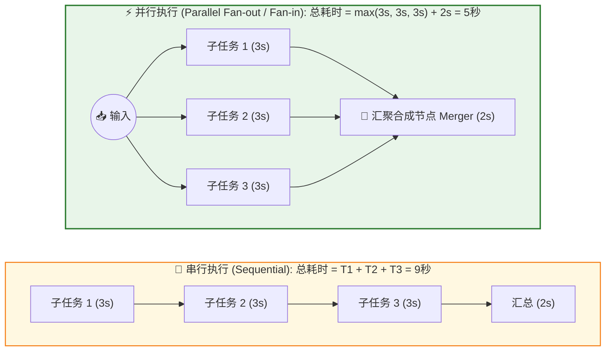
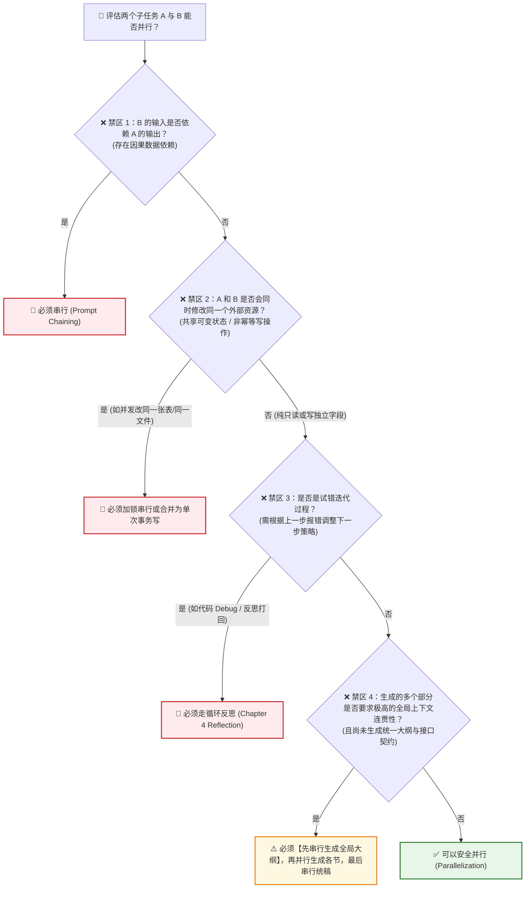
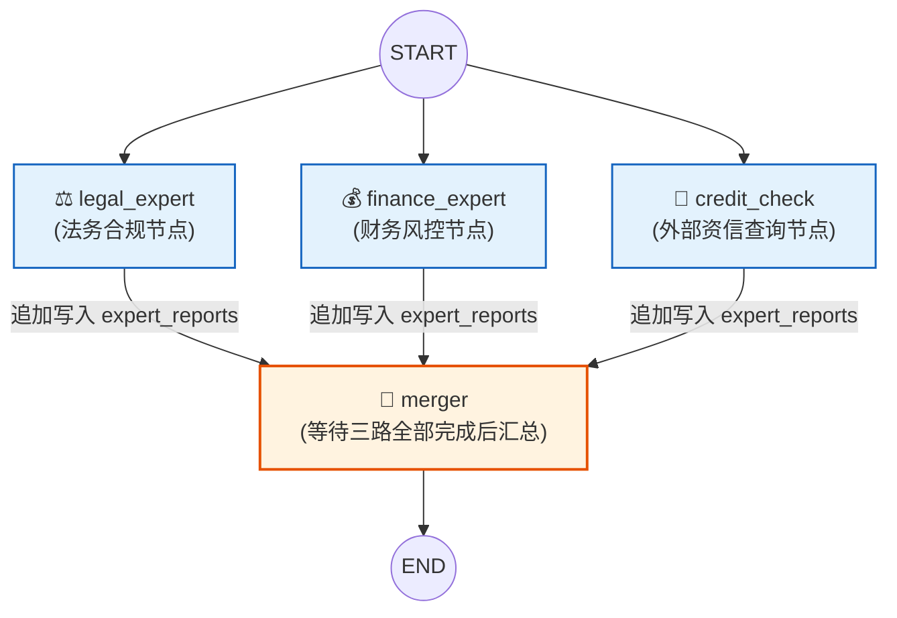

# Chapter 3: Parallelization（并行化模式）— 高亮解析、适用与禁区场景、工程重点及 LangChain/LangGraph 实现指南

> **文档定位**：本文档基于你在 [Agentic_Design_Patterns.pdf](./Agentic_Design_Patterns.pdf) **Chapter 3: Parallelization（PDF 第 50–64 页）** 中标记的 **2 处核心黄色高亮**，并结合你的四个核心问题，系统梳理：
> 1. **适用场景**：哪些场景需要或最适合做并行？（两大架构范式 + 七大实战场景）
> 2. **禁区与避坑**：哪些场景**绝对不可以**或者**必须避免**做并行？（六大工程禁区）
> 3. **核心工程重点**：并发 vs 并行、木桶效应、超时隔离、汇聚防幻觉、状态覆写冲突等五大重点。
> 4. **代码级落地**：在 **LangChain (`RunnableParallel`)** 与 **LangGraph（静态扇出汇聚 & `Send` 动态 Map-Reduce）** 中如何标准实现？

---

## 一、 你在 PDF 中标记的黄色高亮提取与核心本质

你在 **Chapter 3（PDF 第 50 页）** 做的两处黄色高亮，精准抓住了并行化模式的 **“定位”** 与 **“第一性判定准则”**：

| 高亮序号 | 所在位置 | 高亮关键概念与核心内容提炼（中文精解） | 核心工程洞察 |
| :---: | :---: | :--- | :--- |
| **高亮 #1** | **PDF P50**<br>第 1 段 | **从线性串行（Chaining）和条件分支（Routing）迈向同时执行（`executed simultaneously`）**：许多复杂智能体任务包含多个可同时推进的子任务，不再需要等待上一步彻底结束才启动下一步。 | **前三章构成了控制流三大基石**：<br>• Ch1 顺序流（`A -> B`）<br>• Ch2 条件分支（`A -> B or C`）<br>• Ch3 并发扇出（`A -> B and C`） |
| **高亮 #2** | **PDF P50**<br>倒数第 2 段 | **并行的黄金判定准则——无数据依赖（`do not depend on the output of other parts`）**：核心在于识别工作流中**彼此不依赖对方输出结果**的组件并发执行。这在涉及外部服务（API、数据库、大模型推理）等高 I/O 延迟场景下收益极大。 | **延迟压缩公式**：<br>串行总耗时 $T_{\text{seq}} = \sum_{i=1}^n T_i$<br>并行总耗时 $T_{\text{par}} = \max(T_1, \dots, T_n) + T_{\text{merge}}$ |



---

## 二、 哪些场景需要或适合做并行？（两大范式 + 七大场景）

在智能体工程中，适合做并行的场景可以分为 **两大底层架构范式**：
1. **范式一：正交任务切分并行（Sectioning / Map-Reduce）** —— **“大家干不同的活，最后拼成完整结果”**（为了**降延迟**和**突破单次上下文容量**）。
2. **范式二：同构多视角冗余并行（Voting / Ensemble / Best-of-N）** —— **“大家干同一件活，最后投票或择优”**（为了**提准确率**和**消除单次推理盲区**）。

结合书中 **PDF 第 52–53 页** 列举的 7 类应用，具体适用场景如下：

### 范式一：正交切分并行（Sectioning / Map-Reduce）

| 场景编号 | 典型工程场景 | 为什么适合并行？（无依赖性分析） | 实战案例（以合同审查 / 投研 Agent 为例） |
| :---: | :--- | :--- | :--- |
| **场景 1** | **多源异构信息检索**<br>*(Information Gathering & Multi-RAG)* | 查向量库、查知识图谱、查网页搜索、查 SQL 业务库之间**没有任何先后依赖**，且全是高延迟网络 I/O。 | 审查合同时，同时并发执行：① 检索内部《合同审核标准库》（向量库）、② 检索《最新民法典司法解释》（GraphRAG）、③ 企查查 API 调取签约对方资信状态。 |
| **场景 2** | **长文档/大批量数据分片处理**<br>*(Data Chunk Map-Reduce)* | 单篇长文档（如 150 页招股书或跨国合同）切分为独立章节后，各章节的初筛提取互不依赖。 | 将一份 80 页的采购主协议按章节切分为 8 个文本块，并发启动 8 个提取子任务扫描风险点，3 秒内扫完，最后由汇总节点归并。 |
| **场景 3** | **多维正交专家会诊**<br>*(Multi-Aspect Analysis)* | 针对同一份输入数据，从法务、财务、税务、业务四个完全正交的专业维度进行诊断，各维度评判标准独立。 | 同一份合同，并发派发给：`法务合规审查 Agent`、`财务付款账期核算 Agent`、`知识产权归属审查 Agent` 同时审阅。 |
| **场景 4** | **主任务与安全护栏“投机并行”**<br>*(Speculative Guardrails & Validation)* | 安全合规检查（越狱检测、PII 隐私检测、格式校验）与主模型推理同时启动；若护栏报错则直接丢弃主模型输出。 | 用户输入问题后，**同时**启动“安全护栏检查（200ms）”与“主业务 RAG 回答生成（2000ms）”，省去了串行先等安全检查的 200ms 延迟。 |
| **场景 5** | **多组件内容生成 / 多模态处理**<br>*(Multi-Component & Multi-Modal)* | 在全局大纲已确定的前提下，独立的模块（如邮件标题 vs 配图生成，或图片视觉识别 vs 文本情感分析）互不干扰。 | 收到带公章扫描件的合同图片：一路并发跑 OCR 文本提取与条款分析，另一路并发跑印章真伪视觉检测。 |

### 范式二：同构投票与择优并行（Voting / Best-of-N）

| 场景编号 | 典型工程场景 | 为什么适合并行？ | 实战案例 |
| :---: | :--- | :--- | :--- |
| **场景 6** | **高风险决策多数决投票**<br>*(Multi-Model / Multi-Prompt Voting)* | 单次 LLM 推理可能出现偶发幻觉或误判；让 3 个不同温度/不同模型独立判断并投票，可将错误率指数级降低。 | 针对“该免责条款是否属于法定无效格式条款”这一关键定性问题，并发调用 `DeepSeek-R1`、`Claude-Sonnet`、`Qwen3-Max` 独立给出结论，按 2:1 或 3:0 多数决采纳。 |
| **场景 7** | **多候选方案生成与择优**<br>*(A/B Generation & Best-of-N)* | 创意或复杂条款改写没有唯一标准答案，同时生成多个版本供人类或 Critic 节点挑选，比串行反复重写真快得多。 | 为客户生成“违约金上限修改建议”时，并发生成 **【强硬甲方版】**、**【温和折中版】**、**【让步换账期版】** 三个修订表述供法务人员一键点选。 |

---

## 三、 哪些场景不可以或者必须避免做并行？（六大工程禁区）

这是架构设计中最考验功力的地方。**盲目并行不仅不会提速，反而会导致逻辑错乱、状态丢失、API 封禁和账单爆炸。** 以下 **6 类场景必须严禁并行（或必须先串行再并行）**：



### 禁区 1：存在先后因果数据依赖（Causal Data Dependency）
- **反例**：把“识别合同类型（是劳动合同还是买卖合同）”与“去法规库检索对应法条”做成并行。
- **后果**：在合同类型还没识别出来之前，检索节点根本不知道该搜《劳动合同法》还是《民法典合同编》，只能瞎搜一通，造成垃圾输入（Garbage In, Garbage Out）。
- **铁律**：凡是满足 $Input(B) = f(Output(A))$ 的步骤，必须严格使用 **Chapter 1（Prompt Chaining）** 串行执行。

### 禁区 2：共享可变状态的非幂等写操作（Shared Mutable State & Write Collisions）
- **反例**：让 3 个并行的子智能体同时直接修改本地同一个 Word 文档（`.docx`），或者同时向数据库同一行订单记录执行 `UPDATE`、同时调用外部支付/下单 API。
- **后果**：引发严重的**竞态条件（Race Condition）**、文件损坏、后写覆盖先写（Lost Update）或重复扣款。
- **铁律**：**“读（Read / Query / Analyze）可以大胆并行，写（Write / Mutate / Execute Action）必须收口到单一汇聚节点串行提交”**。

### 禁区 3：依赖中间反馈的渐进式推理与调试（Iterative Trial-and-Error）
- **反例**：让 Agent 调优一段报错的 SQL 或 Python 代码，如果不看第 1 次运行的报错信息，直接并发让大模型盲改 5 个版本。
- **后果**：没有真实环境反馈（Observation）支撑的盲目并发，5 个版本可能犯同一个语法错误。这种场景必须用 **Chapter 4（Reflection 反思循环）** 串行迭代：`生成 -> 运行拿报错 -> 针对报错修改`。

### 禁区 4：无全局契约约束的强连贯性长文/代码生成（Unanchored Cohesive Generation）
- **反例**：用户要求写一套包含前端、后端、数据库的完整微服务代码，或者写一份前后严密呼应的法律意见书。如果跳过架构设计，直接并发让 3 个 Agent 分别写前端、后端、数据库。
- **后果**：前端调用的 API 字段名（`user_id`）和后端定义的字段名（`uid`）完全对不上！长文各章节之间论点前后打架、定义不一。
- **铁律**：必须采用 **“串行定契约 -> 并行填血肉 -> 串行做集成”** 的三明治结构（先由 1 个架构师节点串行输出统一的 API 接口 Schema 或全文大纲，再并行实现各模块）。

### 禁区 5：下游 API 速率限制（Rate Limit: RPM/TPM）与资源池受限
- **反例**：将一份文档切成 200 个片段，不加并发限制直接 `asyncio.gather` 同时发起 200 个大模型 API 请求。
- **后果**：瞬间触发云厂商的 `HTTP 429 Too Many Requests (Rate Limit Exceeded)`，导致大面积失败、指数退避重试，整体耗时反而比每次并发 5 个慢得多。
- **铁律**：任何动态扇出并行都必须配置 **`max_concurrency`（最大并发度信号量，通常设为 5~10）**。

### 禁区 6：高中断率链路中的无谓算力浪费（Wasted Compute on Early-Exit Flows）
- **反例**：在一个 80% 的请求都会在第一步因为“材料不齐”而被拒回的审批流中，一上来就把后面昂贵的 5 个深度审查大模型节点全部并发跑起来。
- **后果**：80% 的情况下，那 5 个深度审查节点的昂贵 Token 全白跑了。应当**先把轻量级的准入校验串行放在最前面（Fail-Fast 快速失败）**，通过后再启动重型并行。

---

## 四、 Chapter 3 的五大工程重点与核心避坑指南

在阅读本章及编写生产代码时，有 **5 个必须掌握的工程重点**（其中前 3 个直接出自书中 PDF 第 56、60、63 页的精髓）：

### 重点 1：分清 Python 的 `asyncio` 并发（Concurrency）与多核并行（Parallelism）（PDF P56）
- 书中第 56 页底部专门做了一个极其专业的技术批注：
  - Python 的 `asyncio`（以及 LangChain 的 `ainvoke`）在单线程内运行，受限于 Python 的全局解释器锁（GIL），它提供的是 **I/O 并发（Concurrency）** 而非真正的 CPU 多核并行。
  - **为什么 `asyncio` 对 Agent 依然极其有效？** 因为智能体 95% 的时间都在**等待外部网络 I/O**（等大模型流式吐字、等向量库返回、等网页搜索响应）。当任务 A 在等网络响应空闲时，事件循环（Event Loop）立刻切去发送任务 B 的请求，从而让多个网络等待时间完全重叠。
  - **避坑**：如果你的并行任务是**本地 CPU 密集型计算**（例如：在本地 CPU 上用 PyMuPDF 解析 50 个超大 PDF，或跑本地算子），单纯用 `async def` 依然会卡死单核！此时必须配合 `asyncio.to_thread()` 或 `ProcessPoolExecutor`。

### 重点 2：汇聚节点（Merger/Synthesizer）的“严格闭卷防幻觉约束”（PDF P59–60）
- 在并行模式中，多个子分支跑完后，必然有一个 **汇聚节点（Merger Agent / Synthesis Prompt）** 负责把各路结果捏合在一起。
- 看看书中 **PDF 第 59–60 页** 作者是怎么写 `MergerAgent` 提示词的：
  - 作者用粗体反复强调：**“你的全部回答必须严格且唯一地基于下方提供的输入摘要（grounded exclusively on the information provided），严禁自行脑补任何外部知识或未出现的事实！”**
- **为什么这是重点？** 因为如果汇聚节点在统稿时自由发挥，前面各路并行专家好不容易查出来的精确结论，就会在最后一步统稿时被大模型的发散生成冲淡甚至篡改。

### 重点 3：LangGraph 并行开发头号大坑——状态覆写冲突与 `Reducer` 归约器
- 在 LangGraph 中，多个并行节点运行在同一个 **超步（Superstep）** 中，它们会**同时向全局 `State` 提交更新**。
- **致命报错**：如果节点 A 和节点 B 都往 `State` 的同一个普通字段（比如 `result: str`）写数据，LangGraph 会直接抛出 `InvalidUpdateError: At key 'result': Can receive only one value per step. Use an Annotated key to handle multiple values.`！
- **两种标准解法**：
  1. **各写各的专属字段（独立 Key）**：如书中 PDF P58–59 所示，子任务 1 写 `renewable_energy_result`，子任务 2 写 `ev_technology_result`，互不冲突。
  2. **使用 `Annotated[list, operator.add]` 归约器（Reducer）**：当并行分支数量不确定，或者都往同一个列表汇总结果时，必须将该状态字段声明为列表追加模式：
     ```python
     import operator
     from typing import Annotated, TypedDict

     class ParallelState(TypedDict):
         # ✅ 所有并行节点返回的列表会自动用 operator.add 拼接，绝不覆盖冲突！
         audit_findings: Annotated[list[str], operator.add]
     ```

### 重点 4：木桶效应（长尾延迟 Straggler Problem）与单分支超时降级
- 并行架构的总延迟取决于**最慢的那条分支**：$T_{\text{total}} = \max(T_1, T_2, \dots, T_n)$。
- 如果 5 个并行分支里有 4 个在 2 秒内返回，但第 5 个外部 API 卡死了 60 秒（或抛出了未捕获异常），整个并行组就会被拖死或全盘崩溃！
- **工程对策**：每个并行子任务内部必须包裹 **`asyncio.wait_for(..., timeout=10.0)`** 和异常捕获（Fallback 返回降级提示，如 `"【注：外部企查查接口超时，本次跳过资信核验】"`），确保单路非核心分支故障不会阻塞全局汇聚。

### 重点 5：调试与日志追踪复杂度激增（PDF P63 Key Takeaways）
- 书中第 63 页特别提醒：引入并行架构会显著增加系统设计、调试和日志追踪（Logging）的复杂度。
- 当 5 个子智能体同时打印日志时，控制台输出会完全交错在一起。因此生产环境中必须为每个并行分支注入独立的 `trace_id / branch_name` 标签（或接入 LangSmith / Phoenix / OpenTelemetry 分布式追踪）。

---

## 五、 在 LangChain 与 LangGraph 中如何实现并行？（三种标准代码范式）

在当前的 LangChain / LangGraph 生态中，实现并行一共有 **3 种标准方式**，分别对应不同的业务复杂度：

| 实现方式 | 所属层级 | 核心组件 | 适用场景 |
| :--- | :--- | :--- | :--- |
| **方式一：LCEL 字典并行** | LangChain 基础层 | `RunnableParallel` | 在**单个节点内部**，针对同一个输入并发执行 2~4 个固定的 Prompt 或检索器（书中 PDF P54–56 写法）。 |
| **方式二：静态图扇出与汇聚** | LangGraph 编排层 | 多条 `add_edge(START, node_i)` + `Annotated` Reducer | 图中预先定义了几个**职责不同的固定专家节点**（如法务节点、财务节点、税务节点），同时并发运行后汇聚。 |
| **方式三：动态 Map-Reduce 扇出** | LangGraph 高阶层 | `Send(node_name, payload)` API | **运行时才知道要并发几个分支**（例如：合同拆出了 $N$ 个章节或 $N$ 个风险点，动态启动 $N$ 个相同节点的并发实例）。 |

---

### 方式一：使用 LangChain `RunnableParallel` 实现轻量级并发（对应书中 PDF P54–56）

当你不需要复杂的图状态管理，只是想对同一个输入同时跑几个独立的 Prompt 链并汇总时，`RunnableParallel` 是最简洁的写法：

```python
import asyncio
from langchain_openai import ChatOpenAI
from langchain_core.prompts import ChatPromptTemplate
from langchain_core.output_parsers import StrOutputParser
from langchain_core.runnables import RunnableParallel, RunnablePassthrough

llm = ChatOpenAI(model="gpt-4o-mini", temperature=0)

# 1. 定义三个互不依赖的独立分析链
legal_risk_chain = (
    ChatPromptTemplate.from_template("从法务合规角度，简述以下条款的核心风险（1-2句话）：\n{clause}")
    | llm
    | StrOutputParser()
)
commercial_risk_chain = (
    ChatPromptTemplate.from_template("从商业利益与付款账期角度，简述以下条款的风险（1-2句话）：\n{clause}")
    | llm
    | StrOutputParser()
)
key_entities_chain = (
    ChatPromptTemplate.from_template("提取以下条款中的关键主体、金额与时间节点（逗号分隔）：\n{clause}")
    | llm
    | StrOutputParser()
)

# 2. 🟦 使用 RunnableParallel 组装并发块（执行 ainvoke 时，内部字典的所有键会并发执行）
parallel_map_chain = RunnableParallel(
    legal_risk=legal_risk_chain,
    commercial_risk=commercial_risk_chain,
    entities=key_entities_chain,
    original_clause=RunnablePassthrough(),  # 原样透传原始输入供下一步汇总使用
)

# 3. 定义严格基于输入的汇聚合成 Prompt（遵循 PDF P60 防幻觉原则）
synthesis_prompt = ChatPromptTemplate.from_template("""请严格且唯一地基于以下并行审查结果，生成结构化的条款综合评估报告（严禁添加外部信息）：

- 原始条款：{original_clause}
- 关键要素提取：{entities}
- 法务合规评估：{legal_risk}
- 商业账期评估：{commercial_risk}
""")

# 4. 串联：并发块 -> 汇聚 Prompt -> LLM -> 输出
full_chain = parallel_map_chain | synthesis_prompt | llm | StrOutputParser()

async def main():
    clause_text = "乙方应在收到货物后 180 个工作日内支付 90% 货款，若甲方延迟交货超过 3 天，应按合同总额的 30% 支付违约金。"
    # 使用 ainvoke 触发 asyncio 异步并发，并可通过 config 限制最大并发数
    result = await full_chain.ainvoke(clause_text, config={"max_concurrency": 3})
    print(result)

if __name__ == "__main__":
    asyncio.run(main())
```

---

### 方式二：使用 LangGraph 静态多分支扇出与汇聚（Static Fan-out & Fan-in）

在真实智能体项目中，每个并行分支往往不只是调一次 Prompt，而是包含工具调用、数据库查询的完整节点。在 LangGraph 中，只需**从一个上游节点同时连出多条边（`add_edge`）指向不同的下游节点**，LangGraph 就会在同一个超步（Superstep）中并发执行它们，并在所有分支完成后自动进入汇聚节点：

```python
import asyncio
import operator
from typing import Annotated, TypedDict
from langgraph.graph import StateGraph, START, END

# 1. 定义全局状态 State
class AuditGraphState(TypedDict):
    contract_text: str
    # 关键重点：使用 Annotated[list, operator.add] 作为归约器（Reducer）
    # 这样 3 个并行节点同时往 expert_reports 写数据时，会自动合并列表，不会发生覆写报错！
    expert_reports: Annotated[list[dict], operator.add]
    final_summary: str

# 2. 定义三个互不依赖的并行专家节点（建议定义为 async 函数以获得最佳 I/O 并发性能）
async def legal_expert_node(state: AuditGraphState) -> dict:
    # 模拟异步调用大模型或法条向量库（带超时保护）
    await asyncio.sleep(1.0)
    return {
        "expert_reports": [
            {"domain": "法务合规", "finding": "违约金比例 30% 接近司法调整红线，建议下调至 10%-15%。"}
        ]
    }

async def finance_expert_node(state: AuditGraphState) -> dict:
    # 模拟异步调用财务风控规则与计算
    await asyncio.sleep(1.0)
    return {
        "expert_reports": [
            {"domain": "财务风控", "finding": "180 个工作日账期过长（约合自然日 8 个月），资金占用成本极高。"}
        ]
    }

async def credit_check_node(state: AuditGraphState) -> dict:
    # 模拟异步调用外部企查查 API（含超时与异常隔离降级）
    try:
        await asyncio.wait_for(asyncio.sleep(0.8), timeout=3.0)
        finding = "签约对方近一年无失信被执行记录，注册资本实缴。"
    except asyncio.TimeoutError:
        finding = "【降级提示】外部征信接口响应超时，请人工复核对方资信。"
    return {"expert_reports": [{"domain": "主体资信", "finding": finding}]}

# 3. 定义汇聚合成节点（Fan-in Merger Node）
async def merger_node(state: AuditGraphState) -> dict:
    # 此时 state["expert_reports"] 已经自动汇聚了上述 3 个并行节点的全部输出！
    lines = [f"- 【{r['domain']}】：{r['finding']}" for r in state["expert_reports"]]
    merged_text = "### 合同多维并行审查汇总报告\n" + "\n".join(lines)
    return {"final_summary": merged_text}

# 4. 构建 LangGraph 状态图拓扑
builder = StateGraph(AuditGraphState)
builder.add_node("legal_expert", legal_expert_node)
builder.add_node("finance_expert", finance_expert_node)
builder.add_node("credit_check", credit_check_node)
builder.add_node("merger", merger_node)

# ⚡ 扇出（Fan-out）：从 START 同时连向 3 个节点 -> LangGraph 自动并发执行它们！
builder.add_edge(START, "legal_expert")
builder.add_edge(START, "finance_expert")
builder.add_edge(START, "credit_check")

# 🔀 汇聚（Fan-in）：3 个并行节点全部指向 merger -> LangGraph 会等待 3 个全部跑完再触发 merger！
builder.add_edge(["legal_expert", "finance_expert", "credit_check"], "merger")
builder.add_edge("merger", END)

graph = builder.compile()
```



---

### 方式三：使用 LangGraph `Send` API 实现动态 Map-Reduce 并行（Dynamic Fan-out）

如果并发的数量在写代码时根本不知道——比如用户上传了一份合同，第一步先拆出了 $N$ 个章节（有时是 3 章，有时是 15 章），然后需要**动态并发启动 $N$ 个审查节点实例**同时审这 $N$ 章，最后汇总。这时候静态连线就不够用了，必须使用 LangGraph 的 **`Send` API**：

```python
import operator
from typing import Annotated, TypedDict
from langgraph.graph import StateGraph, START, END
from langgraph.types import Send

# 1. 主图全局状态
class OverallDocumentState(TypedDict):
    raw_document: str
    sections: list[str]  # 第一步切分出的章节列表（数量动态可变）
    section_reviews: Annotated[list[str], operator.add]  # 汇聚各并行实例的结果
    final_report: str

# 2. 单个并行工作节点的局部输入状态
class SectionWorkerState(TypedDict):
    section_index: int
    section_content: str

# 步骤 1（串行）：切分文档章节
def split_document_node(state: OverallDocumentState) -> dict:
    # 按双换行或章节标题切分出 N 个独立段落
    chunks = [c.strip() for c in state["raw_document"].split("\n\n") if c.strip()]
    return {"sections": chunks}

# ⚡ 动态扇出边函数：根据 sections 的实际数量，动态生成 N 个 Send 指令并发派发！
def map_sections_to_workers(state: OverallDocumentState) -> list[Send]:
    return [
        Send(
            "review_single_section_worker",
            {"section_index": idx + 1, "section_content": content}
        )
        for idx, content in enumerate(state["sections"])
    ]

# 步骤 2（动态并行 x N）：审查单个章节的 Worker 节点
async def review_single_section_worker(state: SectionWorkerState) -> dict:
    idx = state["section_index"]
    content = state["section_content"]
    # 这里调用 LLM 审查单章内容...
    review_result = f"第 {idx} 节审查完毕（字数 {len(content)}）：未见明显合规漏洞。"
    # 返回值会自动通过 operator.add 追加到主图 OverallDocumentState 的 section_reviews 中！
    return {"section_reviews": [review_result]}

# 步骤 3（串行汇聚 Reduce）：等待所有动态 Worker 执行完毕后统稿
def reduce_reviews_node(state: OverallDocumentState) -> dict:
    combined = "\n".join(state["section_reviews"])
    return {"final_report": f"## 全文分章并行审查总报告\n{combined}"}

# 组装 Map-Reduce 动态并行图
mr_builder = StateGraph(OverallDocumentState)
mr_builder.add_node("split_document", split_document_node)
mr_builder.add_node("review_single_section_worker", review_single_section_worker)
mr_builder.add_node("reduce_reviews", reduce_reviews_node)

mr_builder.add_edge(START, "split_document")
# 使用 add_conditional_edges 配合返回 list[Send] 的函数，实现动态数量并行扇出！
mr_builder.add_conditional_edges(
    "split_document",
    map_sections_to_workers,
    ["review_single_section_worker"]
)
mr_builder.add_edge("review_single_section_worker", "reduce_reviews")
mr_builder.add_edge("reduce_reviews", END)

map_reduce_graph = mr_builder.compile()

# 调用时通过 max_concurrency 严格限制同时并发请求大模型的上限（防 429 限流）：
# await map_reduce_graph.ainvoke({"raw_document": "..."}, config={"max_concurrency": 5})
```

---

## 六、 一张表总结：前三章基础编排模式的黄金组合（Ch1 + Ch2 + Ch3）

读到这里，书中 Part One 的前三个基础控制流模式已经全部打通。在设计任何复杂的智能体架构时，你可以直接用下面这张决策表来决定每一步该用什么模式：

| 架构设计自问 | 答案与拓扑选择 | 对应 LangGraph 核心原语 |
| :--- | :--- | :--- |
| **Q1：任务 B 是否必须拿任务 A 的输出才能开工？** | **是 -> 用 Chapter 1 (Prompt Chaining 串行)** | `builder.add_edge("node_a", "node_b")` |
| **Q2：当前是否面临“多选一”分岔路，需要根据意图或状态挑一条路走？** | **是 -> 用 Chapter 2 (Routing 条件路由)** | `builder.add_conditional_edges("node_a", router_fn, path_map)` |
| **Q3：当前是否有多个互不依赖的只读/分析子任务，需要“同时跑”以省时间或做多数决投票？** | **是 -> 用 Chapter 3 (Parallelization 并行化)** | • 静态分支：多条 `add_edge` + `Annotated[list, operator.add]`<br>• 动态分支：`Send("worker", payload)` + `max_concurrency` |

