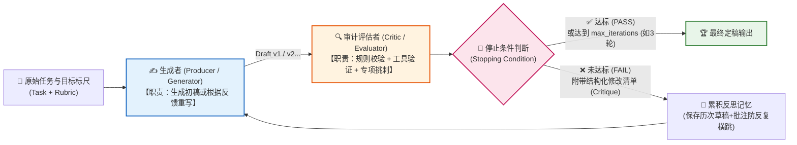
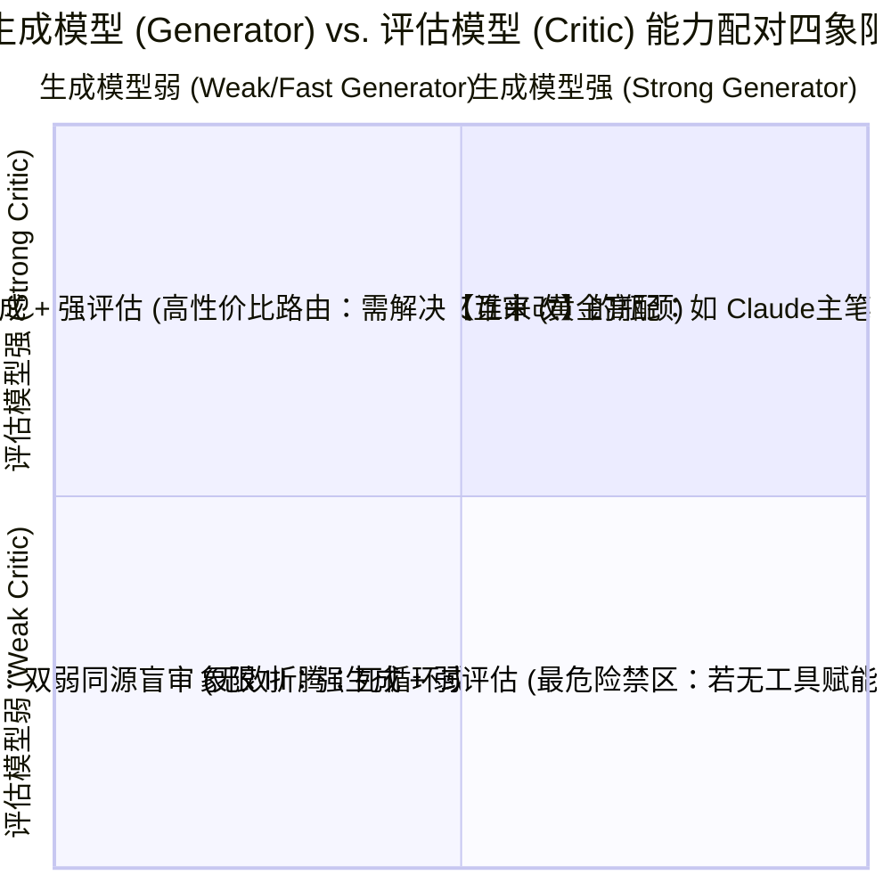
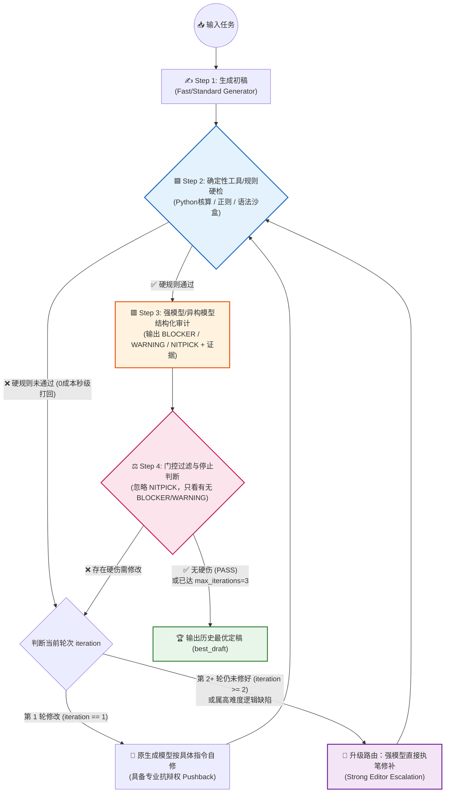
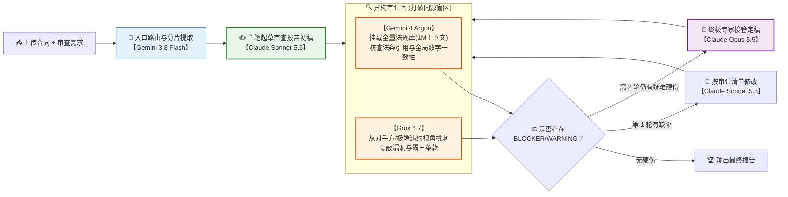
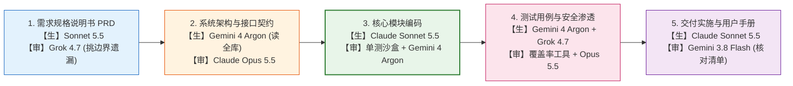
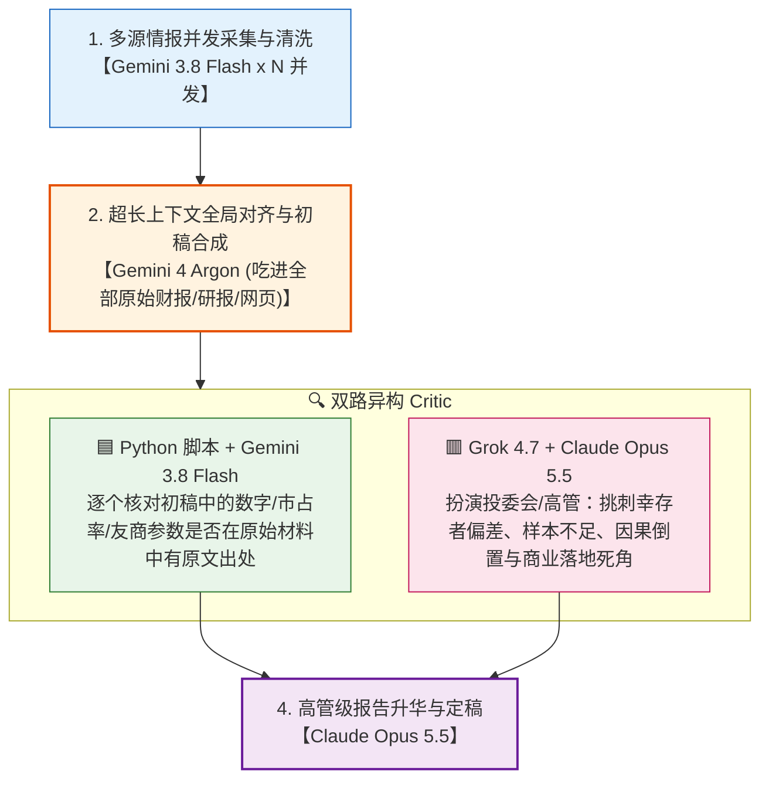

# Chapter 4: Reflection（反思与自我纠错模式）— 高亮解析、生成与评估模型配对博弈及工业界落地方案

> **文档定位**：本文档基于你在 [Agentic_Design_Patterns.pdf](./Agentic_Design_Patterns.pdf) **Chapter 4: Reflection（PDF 第 65–78 页）** 中标记的 **8 处黄色高亮**，全面总结反思模式的核心机制，并重点攻克你提出的**最具实战价值的工程难题**：
> - **核心痛点**：在“生成模型（Producer/Generator）”与“评估/审计模型（Critic/Evaluator）”的配对中：
>   1. 为什么用同一个模型自省往往效果不佳（同源盲区与迎合偏见）？什么条件下同模型也能起效？
>   2. **弱生成 + 强评估**时，发现问题后到底该让弱模型改，还是让强模型直接改？
>   3. **强生成 + 弱评估**时，如何防止“外行指导内行（劣币驱逐良币，把好答案改坏）”？
>   4. **异构同级模型（不同擅长领域）** 如何交叉配对？
>   5. 社区与工业界验证过的 **6 大可落地工程方案** 与 **LangGraph 生产级代码实现** 是怎样的？

---

## 一、 你在 PDF 中标记的 8 处黄色高亮全景提取与核心精解

你在 **Chapter 4（PDF 第 65–67 页）** 做的 8 处高亮非常紧凑，完整覆盖了反思模式的 **“存在原因 -> 闭环本质 -> 四步标准循环 -> 双角色解耦 -> 与目标监控及记忆的协同”**：

| 高亮序号 | 所在位置 | 高亮关键概念与核心内容提炼（中文精解） | 核心工程洞察 |
| :---: | :---: | :--- | :--- |
| **高亮 #1** | **PDF P65**<br>第 1 段末尾 | **为什么需要反思（`initial output or plan might not be optimal`）**：即便有了串行链（Ch1）、路由（Ch2）和并行（Ch3），智能体单次生成的初稿或初始计划依然常常存在遗漏、幻觉或不够深入。 | 前三章都是**开环控制（Open-Loop：一锤子买卖）**；高可靠性任务必须引入**闭环控制（Closed-Loop）**。 |
| **高亮 #2** | **PDF P65**<br>第 2 段 | **反思的定义（`self-correction or self-improvement`）**：智能体对自身的工作、输出或内部状态进行评估，依据内部批判或外部标准迭代打磨输出，通常可由一个专门负责挑刺的独立智能体（Separate Critic Agent）来协助完成。 | 反思既可以是单智能体“自我复盘”，也可以是双智能体“主笔 + 审稿人”协作。 |
| **高亮 #3** | **PDF P65**<br>第 3 段 | **引入反馈闭环（`introduces a feedback loop`）**：智能体不再只是“吐出结果就结束”，而是经历“审视结果 -> 定位缺陷 -> 生成改进版或调整后续动作”的反馈回路。 | 控制论中的 **负反馈调节（Negative Feedback）** 在大模型工程中的直接映射。 |
| **高亮 #4** | **PDF P65**<br>第 4 段列表 | **反思的四步标准生命周期**：<br>1. `Execution`（执行/生成初稿）<br>2. `Evaluation/Critique`（评估/挑刺：用另一次 LLM 调用或一套规则检查事实准确性、连贯性、完整性、指令遵循度）<br>3. `Reflection/Refinement`（反思/重写：根据批评意见改进输出或修正计划）<br>4. `Iteration`（循环迭代：重复上述过程直至达标或触发停止条件 `stopping condition`）。 | 注意第 2 步括号里的关键提示：评估既可以用 **另一次 LLM 调用**，也可以用 **一套确定性规则/工具（`a set of rules`）**！ |
| **高亮 #5** | **PDF P66**<br>第 1 段 | **最佳实践——分离为两个截然不同的逻辑角色（`two distinct logical roles: Producer and Critic`）**：将“生成者（Producer）”与“批评家/审计员（Critic）”解耦，避免单模型自己审自己时的认知偏见（`cognitive bias`）。 | **职责分离原则（Separation of Concerns）**：写代码的人和做 Code Review 的人不能用同一套思维定势。 |
| **高亮 #6** | **PDF P67**<br>第 1 段首句 | **与目标设定及监控协同（`A goal provides the ultimate benchmark... while monitoring tracks its progress`）**：明确的目标是评估的终极标尺，而监控负责追踪当前进度（呼应第 11 章）。 | 没有清晰量化标尺（Rubric/Goal）的反思，只会变成漫无目的的文字润色。 |
| **高亮 #7** | **PDF P67**<br>第 1 段中句 | **反思充当纠偏引擎（`act as the corrective engine`）**：利用监控到的反馈分析偏差（Deviations），动态修正执行策略。 | 当实际输出偏离目标标尺时，Reflection 就是拉回正轨的驱动器。 |
| **高亮 #8** | **PDF P67**<br>第 2 段首句 | **会话记忆大幅增强反思效果（`significantly enhanced when the LLM keeps a memory of the conversation`）**：保留历次初稿与批评意见的上下文历史（呼应第 8 章 Memory），才能让反思成为累积进步的过程，避免在两版错误之间反复横跳（Oscillation）。 | 如果 Refiner 看不到第 1 轮为什么被骂，它第 3 轮改回来时很容易把第 1 轮犯过的老错重新犯一遍！ |

---

## 二、 Chapter 4 全章核心架构总结

在深入讨论你的“模型配对与谁来修改”问题之前，我们先用一张图把书中第 65–78 页的 **Producer-Critic 反思闭环架构** 及其代价边界固定下来：



### 书中强调的三大工程代价（PDF P73, P77）：
1. **延迟成倍增加（Latency Multiplication）**：每多迭代 1 轮，就要多串行执行 `1 次 Critic + 1 次 Refiner`。如果单次 LLM 调用耗时 4 秒，迭代 3 轮就会变成 $4 + (4+4)\times 2 = 20$ 秒以上，**不适合对实时响应要求极高的低延迟闲聊场景**。
2. **Token 成本与上下文膨胀（Context Window Bloat）**：随着 `初稿 v1 -> 批注 1 -> 修改稿 v2 -> 批注 2` 不断追加进 `message_history`，输入 Token 呈三角形累加增长。
3. **Rule of Thumb（何时使用，PDF P74）**：**当输出结果的“质量、准确性、合规性与完整性”远比“响应速度和几分钱 Token 成本”更重要时**（例如：商业合同审查、核心代码生成与修复、严肃法律/医疗/金融报告起草、复杂规划制定），必须使用 Reflection 模式。

---

## 三、 深度攻关你的核心问题：生成模型 vs. 评估模型的能力差异与配对博弈

你提出的问题直击大模型自我纠错（Self-Correction）领域的最核心痛点：
> *“生成的大语言模型，和用于评估/审计/Criticize 的大语言模型，肯定不能选同一个，否则输出都一样了。但不同模型在不同工作上质量、性能、知识差异很大：*
> *1. 如果**生成模型质量差一点，评估模型好**，那用谁来修改？*
> *2. 如果**生成模型本身好，评估模型反而不好（或某方面知识不如生成模型）**，这个问题怎么解决？”*

这个问题在学术界（如 Google DeepMind 的著名论文 *"Large Language Models Cannot Self-Correct Reasoning Yet"* 及本章参考文献 #1 *"Training Language Models to Self-Correct via RL"*）和工业界已经有了非常透彻的定论与成熟解法。下面我们分四步彻底讲透：

---

### 剖析 1：为什么“同一个模型盲目自审”往往无效？什么条件下同模型也能起效？

#### （1）同模型裸奔自审的两大死穴
如果你用**同一个模型**（比如都是 `GPT-4o`），在没有任何外部工具辅助的情况下，生成完答案后直接问它：*“请检查你刚才的回答有没有错，有错请改正”*，会出现两种典型的失败：
1. **同源知识盲区（Shared Knowledge Blind Spot）**：模型在生成时之所以犯错，就是因为它的权重里缺失某条冷门法规或算错了某步逻辑。让同一个大脑再去读一遍，它依然处于同一个知识盲区里，根本看不出破绽（“自己批改自己的考卷，越看越觉得自己写得对”）。
2. **迎合偏见导致的“把对改错”（Sycophancy / Over-correction）**：当你在 Prompt 里严厉要求它“找出错误并改进”时，模型会揣测用户的意图是“不满意当前答案”，从而为了迎合指令，把原本完全正确的答案强行改成错误的答案！

#### （2）打破误区：为什么有时候“同模型不同角色”依然有效？（生成与验证的认知不对称性）
虽然异构模型更好，但在只有一种主力模型可用时，通过构造 **“信息与认知负载的不对称（Asymmetry）”**，同一个模型也能有效挑出自己的错：
- **生成（Generation）是高维综合任务**：主笔模型在写一份 3,000 字合同时，要同时兼顾文风、结构、15 条业务约束，注意力被严重分散，极易出现你在 Chapter 1 高亮过的 **“指令忽略（Instruction Neglect）”**。
- **验证（Verification）是低维对标任务**：审稿模型（哪怕底层是同一个 LLM）不需要从零构思文章，它的 System Prompt 只聚焦于 **1 个极度垂直的核查清单**（例如：“只检查全文所有的金额数字大小写是否一致、违约金是否超过 20%”）。**因为注意力高度聚焦，它在 Critic 角色下能轻松发现自己在 Producer 角色下漏掉的细节！**

---

### 剖析 2：四大模型能力配对象限与破局策略（含你最关心的两种错配情况）

在实际工程中，生成模型（$M_{\text{gen}}$）与评估模型（$M_{\text{critic}}$）的能力关系可以分为 **4 个象限**。我们逐一拆解其风险与工业界标准解法：



---

#### 情况 A（象限 II）：生成模型质量差一点（或为了省钱用小模型），评估模型好 —— **到底用谁来修改？**

> **你的问题**：“比如生成模型确实质量差一点，那评估模型好，那用谁来去修改呢？”

这在工业界非常普遍：为了降低首字延迟和成本，用轻量级快速模型（如 `Qwen3-8B`、`GPT-4o-mini`、`Gemini-2.5-Flash`）做初稿生成（Producer），用昂贵的顶级推理模型（如 `DeepSeek-R1`、`Claude-Opus/Sonnet`、`GPT-4o`）做审计（Critic）。

**❌ 常见踩坑**：
如果强评估模型（Critic）只写一段高屋建瓴的评审意见（例如：*“第三条的违约责任与不可抗力条款存在法理冲突，请重新组织语言消解冲突”*），然后把这段话扔回给**弱生成模型（Weak Generator）**去修改——你会发现**弱模型由于自身推理与表达能力天花板限制，根本改不明白！** 改了 3 轮还是驴唇不对马嘴，白白浪费 Token。

**✅ 工业界三大落地方案（根据错误类型决定“谁来改”）**：

1. **方案 A1：审改合一的“局部外科手术补丁模式（Strong Critic as Surgical Patcher）” —— 社区最推荐！**
   - **核心思路由“批阅打回”变为“弱模型铺底稿，强模型打补丁”**：
   - 为什么要让弱模型写初稿？因为一份 5,000 字的报告或代码里，有 **85% 是常规套话、基础框架和格式样板**，让弱模型先花 2 秒钟把这 85% 铺出来，极其省钱省时间。
   - 接下来，当 **强评估模型（Strong Critic）** 审阅初稿时，如果发现某 15% 的关键段落有硬伤，**不要只写批评意见让弱模型去猜，而是让强模型直接在输出结构中给出精确的 `search_and_replace`（局部替换补丁），由确定性 Python 代码直接把补丁打到初稿上！**
   - **优势**：既省去了让强模型从头吐 5,000 字的高昂成本与漫长等待，又保证了最难的那 15% 修改是由**强模型亲自操刀**完成的！

2. **方案 A2：降维喂饭式批注（Pinpoint Actionable Critique）—— 若仍由弱模型重写全文**
   - 如果业务要求必须重新生成完整文本，那么强评估模型（Strong Critic）绝对不能给“抽象评价”，必须在 Prompt 中强制要求它输出 **“喂到嘴边的具体修改指令”**（明确指出：把第几段哪句话，改成什么具体逻辑，甚至直接给出参考句式），把高难度的“逻辑重构”降维成弱模型能胜任的“按指令填空与全文顺畅化衔接”。

3. **方案 A3：阶梯式升级路由（Escalation Routing：第 1 轮弱模型自己改，第 2 轮强模型接管）**
   - **第 1 轮反馈**：如果强 Critic 查出的是**漏填字段、格式错误、字数超标**等低级错误，打回给**弱模型（Weak Generator）**自己改（省钱，且弱模型完全改得动）。
   - **第 2 轮升级**：如果打回改了 1 次后，第 2 次检查发现核心逻辑依然没改对（或者 Critic 直接判定该缺陷属于 `COMPLEX_REASONING_DEFECT` 高难度逻辑缺陷），**直接通过条件边（Routing）将修改任务路由给强模型（Strong Editor）一锤定音**，绝不让弱模型做第 2 次无用功！

---

#### 情况 B（象限 III）：生成模型本身好，评估模型反而不好（或局部知识不如生成模型）—— **如何防止“外行瞎指挥内行”？**

> **你的问题**：“或者说生成模型本身好，评估模型本身不好，不同的模型在不同工作上质量、性能、知识差异很大，这个问题怎么解决？”

这是一个**极其危险但又经常发生**的真实场景！
- **场景一**：你用了最顶级的大模型（如 `Claude-3.7-Sonnet`）做主笔生成，为了省钱或图快，拿了一个参数量较小的模型（如 `8B` 模型）去当 Critic。
- **场景二**：主笔模型在某个细分领域（如中国民商法）训练得极好，而评估模型（如某个偏理工科代码的国外模型）虽然数学逻辑强，但对中国法律条文一知半解。

**💥 直接后果（负优化 / 劣币驱逐良币）**：
如果让知识或能力处于劣势的 Critic 对强 Generator 的输出做“自由挑刺”，弱 Critic 会产生大量 **假阳性批评（False Positive Critiques，即“明明写得完全正确，审稿人因为自己不懂反而指责写错了”）**；而如果主笔模型被设定为“必须听从 Critic 的意见修改”，就会发生灾难性的 **“把满分答案改成不及格”**！

**✅ 工业界四大可落地解决方案（让评估端绝不瞎指挥）**：

##### 解法 B1：剥夺弱评估模型的“主观自由裁量权”，改用【外部确定性工具 + 客观证据核查】（Tool-Grounded Verification）
- **核心铁律**：**如果评估模型本身的知识或推理不如生成模型，就绝对不能让评估模型“凭空靠自己的脑子去评判对错”，必须给评估节点挂载确定性的验证工具（Deterministic Tools）！**
- **怎么做**：
  - **代码场景**：不让弱模型去“肉眼看代码有没有 Bug”，而是让评估节点直接把强模型写的代码放进 **Python 沙盒 / 单元测试 (`pytest`) / 静态检查器 (`ruff` / `mypy`)** 里跑一下，拿真实的编译器报错堆栈（Traceback）作为评估结果。编译器不会撒谎！
  - **专业知识/合同场景**：不让评估模型凭记忆判断某条法规对不对，而是让评估节点调用 **权威法规库 RAG / 知识图谱 / 正则与数学核算脚本**（例如：用 Python 脚本验算合同里的 `首付款 + 阶段款 + 尾款` 是否严格等于 `合同总价`；用 RAG 调出《民法典》第 585 条原文逐字比对）。评估模型只做**“拿着标准答案原文和客观计算结果去核对初稿”**的对账员！

##### 解法 B2：将宏观评估拆解为“正交微观二分类核对清单（Atomic Binary Checklist）”
- **核心原理**：弱模型做不好“开放式综合挑刺”，但极其擅长做 **“单项字面存在性与格式核查（Yes/No Checklist）”**。
- **怎么做**：把 Critic 的任务限定死为一张 **客观核对表（Checklist）**，只查它能力范围内 100% 拿得准的客观项（如：是否漏掉了必填的 5 个章节？JSON 格式是否合法？是否出现了禁用词？甲乙双方简称全文是否一致？），**严禁它对专业深度推演指手画脚**。

##### 解法 B3：强制要求 Critic 提供“原文证据锚点（Evidence-Based Critique）”与“严重度分级”
- 在 Critic 的结构化输出 Schema 中，强制要求每一个批评项必须包含：
  1. `severity`: 严重等级（`BLOCKER` 致命硬伤 / `WARNING` 疑似风险 / `NITPICK` 风格建议）
  2. `evidence_source`: **判定出错的客观依据是什么？**（必须引用原始任务指令的第几条、或外部工具/法规库返回的哪句话；如果写不出客观依据，说明是 Critic 自己臆测的，代码层直接丢弃该条意见！）

##### 解法 B4：赋予强生成模型“专业抗辩与驳回权（Generator Pushback Mechanism）”
- **这是解决两个不同特长模型认知冲突的关键设计！**
- 在传统教材的简单示例里（如书中 PDF P70），给生成模型的修改指令是盲从式的：`Please refine the code using the critiques provided`（请按批评意见修改）。
- **在生产级系统中，必须把 Refiner 的 Prompt 改为“理性仲裁式”**：
  > *“以下是审计节点提出的质疑清单。请你结合原始任务要求与专业事实逐条审视：*
  > *1. 若质疑指出了确凿的事实遗漏、计算偏差或违反了任务硬性约束，请立即修正；*
  > *2. **若你确认某条质疑是由于审计节点缺乏特定领域背景知识而产生的误判（False Positive），请保留你原本正确的专业表述，并在 `pushback_justification` 字段中简要列出你的法条/事实依据予以驳回**。”*

---

#### 情况 C（象限 IV）：同级异构强模型“基因互补交叉互审”（Heterogeneous Peer Cross-Critique）

当你预算充足、追求极致质量（即我们在 [02_智能体复杂度金字塔](./02_智能体复杂度金字塔_Level0至Level3演进与架构叠加精解.md) 中讨论的最高质量交付）时，不同大模型在不同维度上的长短板差异，恰恰是**最宝贵的互补资产**！

**工业界经过大量实战检验的“黄金异构配对表”**：

| 业务领域 | ✍️ 主笔生成模型 (Producer)<br>【选文笔好、结构感强、上下文长的模型】 | 🔍 审计挑刺模型 (Critic)<br>【选逻辑冷酷、数学/推理强、不讲情面的模型】 | 🔧 最终谁来执笔修改 (Refiner)？ |
| :--- | :--- | :--- | :--- |
| **商业合同起草与审查** | **Claude 3.7 Sonnet / Qwen3-Max**<br>*(长文结构严密、法言法语自然流畅、指令遵循度极高)* | **DeepSeek-R1 / OpenAI o3-mini + 法规库 RAG**<br>*(思维链推理极深，极其擅长发现隐藏的极端边界漏洞、数字矛盾与霸王条款逻辑陷阱)* | **仍由原主笔模型 (Claude / Qwen3-Max) 执笔修改**（保证全文法言法语的文风与格式统一，不会因为换模型改写而出现行文割裂） |
| **复杂软件工程与代码开发** | **Claude 3.7 Sonnet**<br>*(目前公认代码生成完整度、工程结构与前端审美最强)* | **Python 沙盒 (`pytest`/`mypy`) + DeepSeek-R1 / GPT-4o**<br>*(先跑真实单测抓语法/运行错误，再用推理模型查并发安全、边界条件与算法复杂度)* | **原主笔模型 (Claude)** 根据 Traceback 报错和算法审计清单修复代码 |
| **深度行业研报与数据分析** | **Gemini 2.5 Pro**<br>*(超大上下文窗口，擅长一次性吞入几十份财报 PDF 写出宏大初稿)* | **Python 财务核算脚本 + Claude / GPT-4o**<br>*(逐一核查初稿引用的每一个财务数字、同比增速是否与原表一致，严查幻觉)* | **原主笔模型** 修正数据引用错误，或直接由代码做局部数字替换 |

> [!IMPORTANT]
> **黄金铁律总结（到底用谁来修改？）**：
> 1. **如果是“同级异构互补”（如 Claude 写 + DeepSeek-R1 审）**：**谁写的初稿，就让谁根据审稿清单去改（Producer Refines）**，这样能保持全文风格、语气和上下文记忆的一致性。
> 2. **如果是“弱模型写初稿 + 强模型审稿”（为了省钱提速）**：
>    - 简单格式/遗漏错误 -> **弱模型自己改**；
>    - 局部深度逻辑错误 -> **强模型直接输出 `search_and_replace` 局部补丁（Surgical Patch）**，或者在第 2 轮直接由 **强模型接管重写（Escalation）**！
> 3. **如果是“强模型写初稿 + 弱模型/小模型审稿”**：**弱模型绝不允许直接改稿，也绝不允许做主观开放式挑刺**！弱模型只能配合 **外部确定性工具（沙盒/计算器/正则/RAG）** 做客观核对清单（Checklist），且强模型拥有对无证据质疑的**驳回权（Pushback）**。

---

## 四、 工业界可落地的完整解决方案（六大工程支柱 + LangGraph 生产级代码）

为了让你能直接将上述经验落地到自己的智能体项目中，下面将社区与专业人士的最佳实践浓缩为 **“六大工程落地支柱”**，并附上一套完整的 **LangGraph 生产级 Reflection 代码模板**。

### 1. 工业界 Reflection 落地的六大工程支柱

1. **支柱一：先过“确定性硬护栏（Rule/Tool Check）”，再调“大模型审计（LLM Critic）”**
   - 算术加总、JSON 格式、必填章节是否存在、代码能否跑通——这些全部用 **0 成本、100% 准确的 Python 函数** 先跑一遍。如果硬规则都没过，直接把 Python 报错打回给 Generator 重改，根本不用浪费钱去调 Critic LLM！
2. **支柱二：结构化评分卡（Structured Rubric Schema）替代自由散文式批评**
   - 严禁让 Critic 输出洋洋洒洒一大段散文。必须用 Pydantic 强制 Critic 输出结构化缺陷列表：每个缺陷必须包含 **位置（`location`）、严重度（`BLOCKER / WARNING / NITPICK`）、客观证据（`evidence`）、具体修改指令（`actionable_fix`）**。
3. **支柱三：过滤“吹毛求疵（Nitpick Filtering）”，防止无限改稿死循环**
   - 大模型当 Critic 时有个通病：哪怕文章已经 95 分了，它为了显得自己尽职，依然会挑出三四条无关痛痒的遣词造句建议。
   - **落地规则**：代码层判断停止条件时，只要 `blocker_count == 0` 且 `warning_count == 0`（哪怕还有几条 `NITPICK`），或者总分 `>= 90`，**立即判定 PASS 放行！** 绝不为了一两个近义词多跑一轮大模型。
4. **支柱四：动态升级路由（Adaptive Refiner Escalation）**
   - 第 1 轮打回由低成本 Generator 修改；若第 2 轮仍有 `BLOCKER`，自动路由切换给高阶大模型（Strong Editor）执行外科手术式修补。
5. **支柱五：带历史对比的防退化检查（Non-Regression & Pushback）**
   - 保存每一轮的得分与版本快照（`best_draft`）。如果改完后的 `v2` 版本客观得分反而低于 `v1` 版本，系统自动回滚采纳历史最高分版本。
6. **支柱六：硬性熔断上限（Hard `max_iterations = 3`）**
   - 经验表明，90% 的有效提升发生在 **第 1 轮和第 2 轮反思**。超过 3 轮仍未解决的问题，继续循环通常只会陷入震荡，此时应立即跳出循环并附上人工复核标记（Human-in-the-Loop）。



---

### 2. 生产级 LangGraph 完整落地代码模板

下面这段代码将上述 **“确定性前置校验 + 异构模型结构化审计 + 吹毛求疵过滤 + 弱模型/强模型阶梯式修改路由 + 抗辩机制”** 完整封装在了一个标准的 LangGraph 状态图中：

```python
from typing import Literal, TypedDict
from pydantic import BaseModel, Field
from langchain_openai import ChatOpenAI
from langchain_core.messages import SystemMessage, HumanMessage
from langgraph.graph import StateGraph, START, END

# =====================================================================
# 1. 配置异构/分级模型池（可根据你的实际 API 替换为 Qwen / DeepSeek / Claude）
# =====================================================================
# 初稿与常规修改模型（速度快、成本低，或文笔好的主笔模型）
generator_llm = ChatOpenAI(model="gpt-4o-mini", temperature=0.2)
# 审计与高阶兜底修补模型（逻辑推理强、知识面广的旗舰模型）
strong_critic_llm = ChatOpenAI(model="gpt-4o", temperature=0.0)

# =====================================================================
# 2. 定义结构化审计评分卡 Schema（杜绝主观散文式挑刺）
# =====================================================================
class DefectItem(BaseModel):
    location: str = Field(description="缺陷所在的具体条款编号或原句摘录")
    severity: Literal["BLOCKER", "WARNING", "NITPICK"] = Field(
        description="BLOCKER=致命事实/法规/指令违背；WARNING=逻辑漏洞；NITPICK=纯文字润色建议"
    )
    evidence: str = Field(description="判定其出错的客观依据（违反了哪条原始要求或哪条客观事实）")
    actionable_fix: str = Field(description="喂到嘴边的具体修改指令或建议替换文本")

class CritiqueReport(BaseModel):
    score: int = Field(description="综合质量评分 (0-100)")
    defects: list[DefectItem] = Field(description="发现的缺陷列表，若无缺陷则为空列表")

structured_critic = strong_critic_llm.with_structured_output(CritiqueReport)

# =====================================================================
# 3. 定义 LangGraph 全局反思状态 State
# =====================================================================
class ReflectionState(TypedDict):
    task_requirements: str          # 原始任务与目标标尺
    current_draft: str              # 当前最新草稿
    best_draft: str                 # 历史最高分草稿（防负优化回滚）
    best_score: int                 # 历史最高得分
    iteration: int                  # 当前反思轮次
    max_iterations: int             # 最大允许反思轮次（默认 3）
    actionable_critiques: list[str] # 过滤掉 NITPICK 后的有效修改指令
    status: Literal["PASS", "NEED_REFINE"]

# =====================================================================
# 4. 节点一：初稿生成与第 1 轮常规自修节点 (Producer / Standard Refiner)
# =====================================================================
def generator_node(state: ReflectionState) -> dict:
    iteration = state.get("iteration", 0)
    if iteration == 0:
        # 首次生成初稿
        resp = generator_llm.invoke([
            SystemMessage(content="你是一名专业法务主笔，请严格按照用户要求起草条款。"),
            HumanMessage(content=state["task_requirements"])
        ])
        return {
            "current_draft": resp.content,
            "best_draft": resp.content,
            "best_score": 0,
            "iteration": 1,
        }
    else:
        # 第 1 轮返修：赋予主笔模型“基于事实修改 + 对误判抗辩”的指令
        critique_text = "\n".join(state["actionable_critiques"])
        prompt = f"""【原始任务要求】：
{state['task_requirements']}

【你上一版的草稿】：
{state['current_draft']}

【审计节点指出的必改缺陷清单】：
{critique_text}

请逐一修正上述有客观证据支撑的缺陷并输出完整修订稿。若某条质疑确属审计误判且违反任务硬约束，请保留正确表述。只输出修订后的正文。"""
        resp = generator_llm.invoke([HumanMessage(content=prompt)])
        return {
            "current_draft": resp.content,
            "iteration": iteration + 1,
        }

# =====================================================================
# 5. 节点二：高阶模型外科手术接管节点 (Strong Editor Escalation)
#    解决“生成模型弱、改了一轮还改不对时，由强模型直接执笔终结”
# =====================================================================
def strong_editor_escalation_node(state: ReflectionState) -> dict:
    critique_text = "\n".join(state["actionable_critiques"])
    prompt = f"""初级主笔模型在修改以下文稿时未能解决核心逻辑缺陷。请你作为首席专家直接执笔完成最终修正稿：

【原始任务要求】：{state['task_requirements']}
【当前待修文稿】：{state['current_draft']}
【待解决的核心缺陷】：{critique_text}

请直接输出修正后的最终定稿正文。"""
    resp = strong_critic_llm.invoke([HumanMessage(content=prompt)])
    return {
        "current_draft": resp.content,
        "iteration": state["iteration"] + 1,
    }

# =====================================================================
# 6. 节点三：混合评估节点（确定性代码硬检 + 强模型结构化审计 + 过滤 NITPICK）
# =====================================================================
def hybrid_critic_node(state: ReflectionState) -> dict:
    draft = state["current_draft"]
    
    # --- 第 1 层：🟦 确定性代码/规则硬检（0 成本，100% 客观，防模型盲区） ---
    rule_errors = []
    if "违约金" not in draft:
        rule_errors.append("[BLOCKER] 确定性规则拦截：正文中缺失必备的【违约金】条款。")
    if len(draft.strip()) < 50:
        rule_errors.append("[BLOCKER] 确定性规则拦截：正文字数过短，内容不完整。")
    
    if rule_errors:
        # 硬规则未过，直接打回，无需浪费 Token 调用 Critic 大模型！
        return {
            "actionable_critiques": rule_errors,
            "status": "NEED_REFINE",
        }

    # --- 第 2 层：🟥 强模型结构化审计（只抓 BLOCKER 和 WARNING，自动忽略 NITPICK） ---
    report: CritiqueReport = structured_critic.invoke([
        SystemMessage(content="""你是一名冷酷严谨的合同审计专家。请对照原始任务要求审查草稿。
注意：
1. 每一条缺陷必须提供确凿的原文证据（evidence）和具体可执行的修改指令（actionable_fix）。
2. 不要吹毛求疵！如果只是同义词替换等无关痛痒的风格偏好，必须标为 NITPICK。"""),
        HumanMessage(content=f"【原始任务要求】：\n{state['task_requirements']}\n\n【待审草稿】：\n{draft}")
    ])

    # 更新历史最优草稿（防止越改越差）
    best_score = state.get("best_score", 0)
    best_draft = state.get("best_draft", draft)
    if report.score >= best_score:
        best_score = report.score
        best_draft = draft

    # 过滤掉纯属吹毛求疵的 NITPICK，只保留真正需要改的 BLOCKER 和 WARNING
    must_fix = [
        f"[{d.severity}] 位置({d.location}) | 依据({d.evidence}) -> 修改指令：{d.actionable_fix}"
        for d in report.defects
        if d.severity in ("BLOCKER", "WARNING")
    ]

    if not must_fix or report.score >= 90:
        return {
            "best_score": best_score,
            "best_draft": best_draft,
            "actionable_critiques": [],
            "status": "PASS",
        }
    return {
        "best_score": best_score,
        "best_draft": best_draft,
        "actionable_critiques": must_fix,
        "status": "NEED_REFINE",
    }

# =====================================================================
# 7. 条件路由函数：决定【放行】、【原模型自修】还是【强模型接管修补】
# =====================================================================
def reflection_router(
    state: ReflectionState,
) -> Literal["generator", "strong_editor_escalation", "__end__"]:
    # 1. 已达标或达到最大迭代轮次上限 -> 结束循环
    if state["status"] == "PASS" or state["iteration"] >= state.get("max_iterations", 3):
        return "__end__"
    # 2. 第 1 次打回 (iteration == 1) -> 先让低成本原生成模型自己改
    if state["iteration"] == 1:
        return "generator"
    # 3. 第 2 次及以后打回 (iteration >= 2) -> 说明原生成模型改不动，升级由强模型直接接管！
    return "strong_editor_escalation"

# =====================================================================
# 8. 组装并编译 LangGraph
# =====================================================================
builder = StateGraph(ReflectionState)
builder.add_node("generator", generator_node)
builder.add_node("strong_editor_escalation", strong_editor_escalation_node)
builder.add_node("hybrid_critic", hybrid_critic_node)

builder.add_edge(START, "generator")
builder.add_edge("generator", "hybrid_critic")
builder.add_edge("strong_editor_escalation", "hybrid_critic")
builder.add_conditional_edges("hybrid_critic", reflection_router)

reflection_graph = builder.compile()
```

---

## 五、 一张决策速查表：你的项目该如何配置 Reflection？

| 你的业务场景与预算约束 | 推荐的 Generator（生成端） | 推荐的 Critic（评估端） | 推荐的 Refiner（谁来改？） |
| :--- | :--- | :--- | :--- |
| **场景 1：高频、低成本、格式与要素提取任务** | 轻量快速模型<br>*(如 `Gemini 3.8 Flash`)* | **纯确定性代码规则 + Pydantic 校验**<br>*(不调第二个 LLM，0 延迟 0 成本)* | 原轻量模型根据 Pydantic/正则报错自修（最多 2 轮） |
| **场景 2：性价比优先的长文/报告生成（弱生成 + 强评估）** | 轻量或中杯模型快速铺底稿<br>*(如 `Gemini 3.8 Flash` / `Claude Sonnet 5.5`)* | **旗舰推理模型 (`Gemini 4 Argon` / `Grok 4.7`)**<br>*(输出带定位的具体修改指令)* | **阶梯升级路由**：<br>• 第 1 轮小错：原模型改<br>• 第 2 轮逻辑硬伤或局部补丁：旗舰模型 (`Claude Opus 5.5`) 直接接管改 |
| **场景 3：生成端已是顶级模型，评估端想省成本（强生成 + 弱评估）** | 旗舰主力模型<br>*(如 `Claude Opus 5.5` / `Claude Sonnet 5.5`)* | **确定性外部工具（代码沙盒 / 法规 RAG / 计算脚本）+ `Gemini 3.8 Flash` 原子核对清单 (Yes/No Checklist)** | **旗舰主力模型执笔修改**（同时拥有对无客观证据质疑的**驳回权 Pushback**，绝不盲从弱模型） |
| **场景 4：不计成本追求极致质量的严肃交付（合同审查/核心代码）** | **擅长长文结构与表达的旗舰模型**<br>*(如 `Claude Opus 5.5` 或 `Sonnet 5.5`)* | **确定性工具 + 跨厂商异构旗舰推理模型**<br>*(如 `Gemini 4 Argon` + `Grok 4.7`)* | **原主笔旗舰模型 (`Claude Opus 5.5 / Sonnet 5.5`) 执笔修改**（借用异构模型的逻辑审计洞察，同时保持全文行文风格一致） |

---

## 六、 专属实战配置：基于你当前 6 大模型池的黄金组合方案与 `Fable 5.1` 排雷指南

你当前可用的模型池包含：**`Gemini 4 Argon`**、**`Gemini 3.8 Flash`**、**`Claude Opus 5.5`**、**`Claude Sonnet 5.5`**、**`Grok 4.7`**、**`Fable 5.1`**。这是一套涵盖 Google、Anthropic、xAI 三大顶尖家族的豪华阵容。

### 1. 为什么你感觉 `Fable 5.1` 的输出“很奇怪甚至是胡说八道”？（深度诊断与处置建议）

你的实际体感非常敏锐，这并不是你的用法问题，而是由该模型的底层训练特性决定的：
1. **激进强化学习（RL）导致的“过度脑补与思维脱轨”**：
   - `Fable 5.1` 是针对长周期终端沙盒探索与科学实验（Terminal/Science Agentic Loop）做过激进后训练（Post-training RL）的模型。
   - 当你把它用于常规的中文业务分析、合同审查或直接问答（没有挂载它训练时高度依赖的特定多步终端反馈环境）时，它的内部推理预算（Thinking / Effort budget）会发生 **“过度发散（Over-extrapolation）”**——它会自己凭空捏造不存在的上下文前提、生造奇怪的术语、夹杂半截伪工具调用语法，或者出现严重的中文语序错乱与幻觉。
2. **指令遵循刚性差、发散度（Entropy）过高**：
   - 相比稳扎稳打的 `Claude Sonnet 5.5` 和 `Opus 5.5`，`Fable 5.1` 经常无视“只基于原文回答”的负向约束，为了凑出看似高深的结论而一本正经地胡说八道（Confabulation）。
3. **🛑 工程处置结论：直接将 `Fable 5.1` 从你的主力生产链中剔除（封存不用）！**
   - 你手握极其稳健的 **`Claude Opus 5.5`**、**`Claude Sonnet 5.5`** 和 **`Gemini 4 Argon`**，它们在可控性、中文表达准确度与逻辑严密性上全面胜出，完全没有任何必要在生产环境里去赌 `Fable 5.1` 的稳定性。

---

### 2. 其余 5 大主力模型的能力基因画像与分工定位

剔除 `Fable 5.1` 后，你剩下的 5 个模型正好构成了一个**零短板、跨三大厂商（彻底消除同源模型盲区）**的完美特种部队：

| 模型名称 | 所属家族 | 核心能力基因（长板） | 在智能体架构（Ch1~Ch4）中的最佳角色定位 |
| :--- | :---: | :--- | :--- |
| **1. `Claude Opus 5.5`** | Anthropic | **文笔之王 & 定稿主脑**：结构极度严密，法言法语/商业文书表达最自然，复杂多约束遵循度最高。 | 👑 **高价值主笔 (Top Producer)** & **终极修补匠 (Escalation Editor)**：负责核心合同/报告定稿、以及第 2 轮疑难杂症的外科手术式修改。 |
| **2. `Claude Sonnet 5.5`** | Anthropic | **全能黄金主力 (Sweet Spot)**：速度比上代快 30%+，不写废话，代码生成与结构化长文起草极稳，性价比极高。 | ✍️ **日常主力生成者 (Primary Producer)** & **第 1 轮自修节点 (Refiner)**：承担 80% 的初稿撰写、代码实现与首轮反思修改。 |
| **3. `Gemini 4 Argon`** | Google | **百万上下文巨兽 & 深度逻辑推理王**：支持 1M Token 超长上下文，跨多份大文档/代码库的全局推理与数学科学逻辑极强，抗提示词注入极强。 | 🔍 **首席逻辑审计官 (Chief Critic)** & **超长文档全局规划器 (Planner)**：负责吞入整套卷宗/法规库，对 Claude 写的初稿进行严酷的逻辑与事实交叉审计。 |
| **4. `Grok 4.7`** | xAI | **反套路独立审计员 & 垂直领域专家**：训练语料与对齐偏好独立于 Google/Anthropic，不爱“和稀泥（低迎合度）”，在法律、工程和安全边界判断上极犀利。 | ⚖️ **异构交叉评审员 (Cross-Family Critic / Voting 投票第 3 极)**：在并行投票（Ch3 Voting）或双重反思中担任“唱反调的挑刺官”，专门抓 Claude 和 Gemini 的共同盲区。 |
| **5. `Gemini 3.8 Flash`** | Google | **极速高并发特种兵**：响应极快、成本极低，同时具备优秀的 JSON 结构化提取与长文分片扫描能力。 | ⚡ **智能路由器 (Ch2 Router)** + **并行分片扫描工 (Ch3 Map-Reduce Worker)** + **原子清单核对员 (Checklist Critic)**。 |

---

### 3. 四大实战场景的黄金模型组合配方（直接抄作业）

#### 配方一：高严肃度【商业合同审查 / 核心法律文书起草】（全模式满配）

- **为什么这套组合无敌？**
  - **写手（`Claude Sonnet 5.5` / `Opus 5.5`）** 保证了中文法律文书的行文质感、结构严密性与修改前后的文风高度统一；
  - **审稿人（`Gemini 4 Argon` + `Grok 4.7`）** 来自另外两家完全不同的公司（Google + xAI）！`Gemini 4 Argon` 发挥 100 万上下文优势把整部法典和合同附件全塞进去做完备性对账；`Grok 4.7` 发挥冷酷直接的批判特性专门找逻辑死角；
  - **谁来改**：普通问题 `Claude Sonnet 5.5` 自己改；改不动的硬骨头直接升级给同属 Claude 家族的老大哥 **`Claude Opus 5.5`** 操刀，文风零割裂！

#### 配方二：高难度【软件工程架构设计与代码生成】（Coding Agent 组合）
1. **全局架构规划与跨库理解（Planner）**：用 **`Gemini 4 Argon`**（利用超大上下文一次性读入整个仓库代码，输出架构设计图与接口契约）。
2. **模块代码编写（Producer）**：用 **`Claude Sonnet 5.5`**（写代码速度快、干净利落、不啰嗦）。
3. **代码审查与 Bug 定位（Critic）**：**`Python 真实单元测试沙盒` + `Gemini 4 Argon` / `Grok 4.7`**（先跑真实测试拿报错，再由 `Gemini 4 Argon` 检查并发安全、边界条件与内存泄漏）。
4. **疑难 Bug 修复（Escalation Refiner）**：若 `Sonnet 5.5` 改完一轮单测依然挂，立即切换 **`Claude Opus 5.5`** 或 **`Gemini 4 Argon`** 直接输出补丁。

#### 配方三：高并发、低延迟【日常企业工作流 / 多文档批处理】（高性价比组合）
1. **入口意图路由（Ch2 Router）**：**`Gemini 3.8 Flash`**（毫秒级结构化输出路由枚举）。
2. **并行分片提取（Ch3 Map-Reduce）**：10~20 个并发 **`Gemini 3.8 Flash`** 实例同时扫描各个数据块。
3. **汇总初稿（Merger / Producer）**：**`Claude Sonnet 5.5`** 统稿生成结构化报告。
4. **轻量级审计（Checklist Critic）**：**`Python 确定性规则校验` + `Gemini 3.8 Flash`**（做 10 项 Yes/No 客观核对表，低成本拦截漏项）。

#### 配方四：高风险定性决策【三巨头多数决投票（Ch3 Voting）】
当遇到一个极其关键的判断（例如：“该条款在司法实践中是否会被认定为无效格式条款？”或“两个技术方案选哪个？”），直接用 `RunnableParallel` 同时发给三大异构旗舰：
- **投票席位 1（Anthropic 视角）**：`Claude Opus 5.5`
- **投票席位 2（Google 视角）**：`Gemini 4 Argon`
- **投票席位 3（xAI 视角）**：`Grok 4.7`
- **裁决机制**：如果三家不同技术路线的大模型 **3:0 一致同意**，该结论的可靠性接近 100%；如果出现 **2:1 分歧**，将少数派的反对理由提取出来交给人类专家重点复核。

---

## 七、 企业全业务域（研发 / IT / 宣传 / 调研 / 制度管理 / 生产运营）Reflection 模型组合全景作战表

针对你覆盖的 **六大企业核心业务板块**（软件研发全流程、IT 选型部署、宣传文稿、市场调研分析、企业规章制度、生产与日常运营），不同板块对 **“生成（Producer）”** 和 **“挑刺审计（Critic）”** 的能力要求截然不同：
- 比如**写代码**怕的是“跑不通、跨文件接口不一致”；
- **写宣传稿**怕的是“浓重的 AI 翻译腔、自嗨、违反广告法”；
- **定企业规章制度**怕的是“违反劳动法、部门职责甩锅、执行标准模糊无法落地”；
- **生产与 IT 部署**怕的是“漏掉安全红线、无回滚预案、算错成本与产能数据”。

下面通过 **1 张全局矩阵总表 + 6 张分场景精细化作战表**，把你手头 5 款主力模型（`Claude Opus 5.5`、`Claude Sonnet 5.5`、`Gemini 4 Argon`、`Grok 4.7`、`Gemini 3.8 Flash`）在每个具体环节的 **“生成 -> 审计 -> 修改”** 组合彻底定型。

---

### 1. 企业六大职能域 Reflection 核心配对总览矩阵

| 企业职能域 | 核心交付物特征 | ✍️ 首选生成主笔 (Producer) | 🔍 首选异构审计官 (Critic) | 🔧 谁来修改定稿 (Refiner) | 核心配对逻辑（为什么这么配？） |
| :--- | :--- | :--- | :--- | :--- | :--- |
| **① 软件研发全流程**<br>*(需求/设计/开发/测试/实施)* | 强逻辑、强代码规范、跨多文件上下文耦合 | **`Claude Sonnet 5.5`**<br>*(复杂架构用 `Opus 5.5`)* | **`真实单测/编译沙盒`**<br>+ **`Gemini 4 Argon`** *(1M全库对齐)* | 第 1 轮：`Sonnet 5.5`<br>第 2 轮疑难：`Opus 5.5` | Claude 写代码最干净；`Gemini 4 Argon` 凭 100 万上下文能一眼看出新代码是否破坏了其他老模块接口。 |
| **② IT 技术选型与部署实施**<br>*(选型/拓扑/脚本/排障)* | 重客观技术参数对比、重高可用安全与回滚预案 | **`Gemini 4 Argon`** *(选型方案)*<br>**`Claude Sonnet 5.5`** *(部署脚本)* | **`Grok 4.7`** *(找单点故障与隐藏成本)*<br>+ **`语法检查工具`** | **`Claude Sonnet 5.5`** *(脚本)*<br>**`Claude Opus 5.5`** *(方案终稿)* | `Gemini 4 Argon` 擅长吞入海量技术白皮书做选型；`Grok 4.7` 极其擅长扮演“混沌工程/运维老兵”挑出生产环境故障死角。 |
| **③ 宣传文稿与品牌公关**<br>*(软文/新闻稿/演讲稿/策划)* | 重中文语感、感染力、去“AI 爹味/翻译腔”、防违规词 | **`Claude Opus 5.5`** *(旗舰精品)*<br>**`Claude Sonnet 5.5`** *(日常批量)* | **`Grok 4.7`** *(毒舌去AI味/读者体感挑刺)*<br>+ **`Gemini 3.8 Flash`** *(广告法合规清单)* | **`Claude Opus 5.5`**<br>*(必须由文笔最好的模型统稿)* | Claude 中文文笔最细腻；而 `Grok 4.7` 对陈词滥调和假大空套话极其敏锐，能精准逼出有信息增量的好文案。 |
| **④ 市场调研与商业分析**<br>*(行业调研/竞品/ROI测算)* | 多源海量资料吞吐、数据真实性、严禁编造数据 | **`Gemini 3.8 Flash`** *(并发搜集)*<br>-> **`Gemini 4 Argon`** *(全局初稿)* | **`Python 验算脚本`**<br>+ **`Claude Opus 5.5` / `Grok 4.7`** *(商业逻辑挑刺)* | **`Claude Opus 5.5`**<br>*(将调研素材升华为高管级报告)* | `Gemini 4 Argon` 负责把几十份研报吃透并保证数据有据可查；`Claude Opus 5.5` 负责拔高商业洞察深度与叙事结构。 |
| **⑤ 企业规章制度与日常管理**<br>*(人事/财务/流程SOP/合同)* | 重严谨性、防钻空子、防劳动法/合规冲突、责权清晰 | **`Claude Opus 5.5`** *(核心基本法)*<br>**`Claude Sonnet 5.5`** *(常规SOP)* | **`Grok 4.7`** *(模拟“刺头员工/钻空子”博弈测试)*<br>+ **`Gemini 4 Argon`** *(关联旧制度冲突检查)* | **`Claude Opus 5.5`** | 制定制度最怕“上有政策下有对策”：让 `Grok 4.7` 扮演想钻制度空子的角色做红蓝对抗，再由 `Opus 5.5` 堵死漏洞。 |
| **⑥ 生产制造与供应链运营**<br>*(排产/质量8D/采购/安全规程)* | 重工业现场可执行性、数据精确核算、安全零容忍 | **`Claude Sonnet 5.5`** | **`Python 数据核算`** + **`Gemini 4 Argon`** *(全流程完备性)* + **`Grok 4.7`** *(工程物理边界)* | 第 1 轮：`Sonnet 5.5`<br>高危规程：`Opus 5.5` | 结合确定性表格计算与工程逻辑双审，确保车间工人看得懂、算得准、安全无死角。 |

---

### 2. 分场景精细化作战表（每个子环节的生成、审计重点与修改策略）

#### 表一：💻 场景 1 — 软件工程全生命周期（需求 -> 设计 -> 开发 -> 测试 -> 实施）



| 研发子阶段 | ✍️ 生成模型 (Producer) | 🔍 评估/挑刺模型 (Critic) | 📋 Critic 审计评分卡核心抓手（审什么？） | 🔧 谁来修改 (Refiner) 及升级策略 |
| :--- | :--- | :--- | :--- | :--- |
| **1.1 需求分析与 PRD 编写** | **`Claude Sonnet 5.5`**<br>*(擅长把散乱的业务口述整理成结构化用户故事与验收标准)* | **`Grok 4.7`** + **`Gemini 4 Argon`** | 1. **异常流完备性**：只写了正常流程（Happy Path），断网、并发重复提交、权限不足时怎么处理？<br>2. **前后端/历史需求冲突**：与现有系统已上线功能是否矛盾？<br>3. **验收指标是否可量化测试**？ | **`Claude Sonnet 5.5`** 补充异常分支与量化指标；若涉及跨系统复杂重构，交由 **`Claude Opus 5.5`** 定稿。 |
| **1.2 系统架构与接口设计** | **`Gemini 4 Argon`**<br>*(利用 1M 上下文读入整个老代码库与数据库表结构，设计新架构)* | **`Claude Opus 5.5`** | 1. **过度设计检查**：是否引入了不必要的中间件或复杂度？<br>2. **接口契约一致性**：字段命名、错误码、鉴权方式是否符合团队既有规范？<br>3. **扩展性与性能瓶颈预判**。 | **`Gemini 4 Argon`** 修正全局表结构映射，或由 **`Claude Opus 5.5`** 最终收敛输出标准 OpenAPI/Schema 文档。 |
| **1.3 核心代码开发** | **`Claude Sonnet 5.5`**<br>*(日常模块)*<br>**`Claude Opus 5.5`**<br>*(核心并发/底层算法)* | **`pytest / 编译器沙盒`** (第1层)<br>+ **`Gemini 4 Argon`** (第2层) | 1. **硬护栏**：语法错误、类型检查 (`mypy`)、单元测试是否 100% 通过？<br>2. **跨文件引用检查**：调用的函数签名、导入路径在真实仓库中是否存在（防幻觉调包）？<br>3. **安全漏洞**：SQL 注入、未释放锁、硬编码密钥。 | • **第 1 轮报错**：`Claude Sonnet 5.5` 根据 Traceback 自修；<br>• **第 2 轮仍未过**：立即切 **`Claude Opus 5.5`** 或 **`Gemini 4 Argon`** 外科手术式修复。 |
| **1.4 测试用例生成** *(注意：写测试和写代码必须异构！)* | **`Gemini 4 Argon`** + **`Grok 4.7`**<br>*(绝不能让写代码的 Sonnet 自己写测试，否则会漏掉同样的盲区)* | **`代码覆盖率工具`**<br>+ **`Claude Sonnet 5.5`** | 1. **边界值与恶意输入覆盖**：空值、超大数值、越权访问、并发竞态是否覆盖？<br>2. **断言有效性**：测试是不是只测了表面没测核心状态变更？ | **`Gemini 4 Argon`** 补齐边界测试脚本。 |
| **1.5 实施交付与运维手册** | **`Claude Sonnet 5.5`** | **`Gemini 3.8 Flash`**<br>*(跑客观核对表 Checklist)* | 1. 环境变量配置项是否与代码中读取的完全一致？<br>2. 升级步骤是否包含备份与一键回滚命令？ | **`Claude Sonnet 5.5`** 快速补齐。 |

---

#### 表二：🖧 场景 2 — IT 技术方案选型、部署与实施（选型 -> 拓扑 -> 部署脚本 -> 排障预案）

| IT 需求子阶段 | ✍️ 生成模型 (Producer) | 🔍 评估/挑刺模型 (Critic) | 📋 Critic 审计核心抓手（扮演“刁钻架构师 / 混沌运维”） | 🔧 谁来修改 (Refiner) |
| :--- | :--- | :--- | :--- | :--- |
| **2.1 技术方案选型对比**<br>*(如选数据库/ERP/中间件/开源组件)* | **`Gemini 4 Argon`**<br>*(1M 上下文直接塞入 5 款候选产品的官方文档、GitHub Issue 和报价单)* | **`Grok 4.7`** *(主审)*<br>+ **`Claude Opus 5.5`** | 1. **隐性成本（TCO）审计**：除了软件授权费，运维人力成本、硬件显存要求、未来迁移锁定（Vendor Lock-in）风险算没算？<br>2. **团队技术栈匹配度**：以公司现有 IT 人员水平，出了故障能不能自己修？<br>3. **信创/安全合规**：开源协议（如 AGPL 传染性）是否有法律风险？ | **`Claude Opus 5.5`** 综合客观数据与风险批注，输出给管理层拍板的《技术选型决策建议书》。 |
| **2.2 部署架构与脚本编写**<br>*(Docker / K8s / Nginx / Ansible / Terraform)* | **`Claude Sonnet 5.5`** | **`静态校验工具 (kubeval/shellcheck)`**<br>+ **`Grok 4.7`** | 1. **单点故障（SPOF）**：某台宿主机或网关挂了，服务会不会全停？<br>2. **权限最小化与网络安全**：容器是不是默认用了 `root`？数据库端口是不是暴露在公网了？<br>3. **幂等性**：部署脚本重复执行两次会不会把环境搞崩？ | **`Claude Sonnet 5.5`** 修正脚本配置；复杂高可用架构由 **`Claude Opus 5.5`** 复核定稿。 |
| **2.3 割接上线实施计划与应急预案** | **`Claude Sonnet 5.5`** | **`Gemini 4 Argon`** | 1. **回滚时间窗（RTO/RPO）**：如果上线后第 15 分钟发现数据库迁移失败，能在 5 分钟内无损退回旧版本吗？具体回滚命令写出来了吗？<br>2. **上下游停机通知与灰度验证步骤**是否完备？ | **`Claude Sonnet 5.5`** 补全精确到分钟的《割接 CheckList 与回滚操作手册》。 |
| **2.4 生产故障日志排查 (Troubleshooting)** | **`Gemini 4 Argon`**<br>*(直接吞入几万行报错日志 + 相关源码定位根因)* | **`Grok 4.7`** + **`Claude Opus 5.5`** | 1. **区分表面症状与根本原因（Root Cause）**：给出的修复方案是治标（重启了事）还是治本？<br>2. **修复动作是否会引发次生雪崩**？ | **`Claude Opus 5.5`** 产出最终修复补丁与《故障复盘报告（Post-Mortem）》。 |

---

#### 表三：📣 场景 3 — 宣传文稿、品牌公关与营销文案（软文 -> 新闻稿 -> 演讲稿 -> 多渠道投放）

> **💡 宣传文稿的特殊痛点**：大模型写宣传稿最容易犯两个毛病——一是**“浓重的 AI 味/翻译腔（如‘在这个瞬息万变的时代’、‘赋能、抓手、闭环’）”**；二是**“自嗨式堆砌形容词，缺乏打动客户的真实痛点与具体细节，甚至误用绝对化用语违反《广告法》”**。

| 宣传文稿子场景 | ✍️ 生成模型 (Producer) | 🔍 评估/挑刺模型 (Critic) | 📋 Critic 审计核心抓手（扮演“挑剔读者 + 广告法审核员”） | 🔧 谁来修改 (Refiner) |
| :--- | :--- | :--- | :--- | :--- |
| **3.1 深度品牌公众号长文 / 产品发布主文稿** | **`Claude Opus 5.5`**<br>*(中文叙事节奏感、修辞克制感与情感共鸣能力断层第一)* | **`Grok 4.7`** *(扮演毒舌目标客户)*<br>+ **`正则/广告法违禁词库`** | 1. **去 AI 味审查**：圈出所有空洞套话、排比废话和翻译腔句式，要求全部删掉换成人话！<br>2. **读者视角灵魂三问**：“看完前 3 句话我想不想关掉？”、“这跟我（客户）有什么利益关系？”、“有没有具体数据或真实案例支撑？”<br>3. **合规硬红线**：拦截“国家级、最高级、第一、100%安全”等《广告法》禁用词。 | **必须由 `Claude Opus 5.5` 亲自执笔修改**（千万不要让别的模型改宣传稿，否则文气会断掉）。 |
| **3.2 官方新闻通稿 / PR 危机公关声明** | **`Claude Opus 5.5`** | **`Gemini 4 Argon`** *(事实核查)*<br>+ **`Grok 4.7`** *(模拟舆论挑刺)* | 1. **危机公关雷区模拟（由 `Grok 4.7` 扮演愤怒网友/媒体）**：这篇声明里哪句话听起来像“傲慢推诿、避重就轻、甩锅临时工”？哪句话会被截图放大产生二次舆情？<br>2. **口径一致性（由 `Gemini 4 Argon` 核查）**：声明中的时间线、数据与公司过往公告是否严丝合缝？ | **`Claude Opus 5.5`** 逐字打磨定稿。 |
| **3.3 多平台矩阵裂变文案**<br>*(小红书/朋友圈/短视频脚本/邮件)* | **`Claude Sonnet 5.5`**<br>*(用 Ch3 Parallelization 并发生成多平台版本)* | **`Gemini 3.8 Flash`** | 1. 平台调性核对：短视频脚本前 3 秒有没有黄金钩子（Hook）？朋友圈文案是否控制在折叠线（6行）以内？<br>2. 核心卖点与行动号召（CTA）是否清晰？ | **`Claude Sonnet 5.5`** 批量快速微调。 |

---

#### 表四：📊 场景 4 — 市场调研分析、竞品情报与商业可行性报告



| 市场调研子场景 | ✍️ 生成模型 (Producer) | 🔍 评估/挑刺模型 (Critic) | 📋 Critic 审计核心抓手（防幻觉编数据 + 防表面肤浅） | 🔧 谁来修改 (Refiner) |
| :--- | :--- | :--- | :--- | :--- |
| **4.1 行业全景调研与竞品深度对比分析** | **阶段 1 采集**：`Gemini 3.8 Flash`<br>**阶段 2 整合初稿**：**`Gemini 4 Argon`** *(利用 1M 窗口把几十份竞品手册、财报、评测全塞进去做矩阵对比)* | **`Grok 4.7`** *(逻辑挑刺)*<br>+ **`Python 引用溯源校验`** | 1. **零容忍数据幻觉核查**：报告里引用的每一个市场规模数字、增长率、友商价格，是否都标注了原始文档出处？无出处的野生数据一律标为 `BLOCKER` 删除！<br>2. **信息增量审计**：是不是只罗列了百度百科式的公开废话？有没有给出对我们公司产品定价和差异化切入的具体结论？ | **`Claude Opus 5.5`**（将 `Gemini 4 Argon` 扎实的底层数据初稿，改写升华为逻辑锋利、适合高管阅读的决策报告）。 |
| **4.2 新业务商业计划书与 ROI 财务测算** | **`Claude Opus 5.5`** *(商业叙事)*<br>+ **`Gemini 4 Argon`** *(测算建模)* | **`Python 财务核算工具`**<br>+ **`Grok 4.7`** *(扮演挑剔投资人)* | 1. **数学与财务勾稽硬检**：客单价 × 转化率 × 复购率算出来的营收，与现金流表、盈亏平衡点（Break-even Point）是否算术一致？<br>2. **悲观压力测试（由 `Grok 4.7` 提问）**：如果获客成本翻倍、交付周期延长 50%，这个模型还能活吗？敏感性分析做了吗？ | **`Claude Opus 5.5`** 结合 Python 重新跑出的敏感性数据表完成定稿。 |
| **4.3 客户声音（VoC）/ 售后评价大批量分析** | **`Gemini 3.8 Flash`** *(并发打标分类)* -> **`Claude Sonnet 5.5`** *(汇总报告)* | **`Gemini 4 Argon`** | 抽样核查分类准确率，检查总结出的 Top 5 客户痛点是否被个别极端评论带偏，是否附带了原声引用（Verbatim Quotes）。 | **`Claude Sonnet 5.5`** 修正。 |

---

#### 表五：🏛️ 场景 5 — 制定企业规章制度、管理方案与日常行政/人事/财务规范

> **💡 制定企业规章制度的独门秘籍（红蓝对抗 Reflection）**：
> 写公司制度最怕两件事：**① 写得像空中楼阁，口号喊得震天响，但没有明确“谁在什么时间点做什么动作、不按规定做怎么罚、由谁监督”；② 存在制度漏洞，发下去第二天就被聪明员工找到空子钻，甚至因为违反《劳动合同法》在劳动仲裁时赔钱。**
> **最佳解法**：让 **`Claude Opus 5.5`** 当“制度起草办主任”，让 **`Grok 4.7`** 扮演 **“最想钻制度空子的刺头员工 / 推诿扯皮的部门经理 / 劳动仲裁律师”** 对制度初稿进行模拟攻击！

| 规章制度子场景 | ✍️ 生成模型 (Producer) | 🔍 评估/挑刺模型 (Critic) | 📋 Critic 审计核心抓手（合规性 + 博弈防钻空子 + 可执行性） | 🔧 谁来修改 (Refiner) |
| :--- | :--- | :--- | :--- | :--- |
| **5.1 人事管理、考勤奖惩与薪酬绩效制度** | **`Claude Opus 5.5`**<br>*(条文结构最规范，总则-分则-附则层次分明)* | **`Grok 4.7`** *(模拟员工钻空子/套利)*<br>+ **`Gemini 4 Argon`** *(挂载《劳动合同法》与公司现行制度库)* | 1. **劳动法合规红线（`Gemini 4 Argon`）**：罚款/扣薪条款、末位淘汰表述、加班调休规定是否违反现行《劳动合同法》及最新司法解释？<br>2. **KPI 博弈漏洞测试（`Grok 4.7`）**：如果我是销售/研发员工，怎么在不给公司创造真实价值的情况下“刷高”这个绩效指标？（遵循古德哈特定律挑刺）<br>3. **边界模糊词清理**：把所有“原则上、视情况而定、严重者、及时”等无法落地的模糊词全部标出，强制要求改为量化数字或明确审批人！ | **`Claude Opus 5.5`** 根据合规意见与博弈漏洞清单，逐条加固制度条文。 |
| **5.2 跨部门协作流程 SOP 与审批权限方案** | **`Claude Sonnet 5.5`** | **`Gemini 4 Argon`** + **`Grok 4.7`** | 1. **责任孤儿与扯皮死角检查**：流程交接处（如销售交接给交付、研发交接给运维），如果出问题到底谁是第一责任人（RACI 矩阵是否唯一）？<br>2. **流程死锁与效率评估**：一个 500 元的常规采购是不是设了 6 道审批？是否存在审批人请假时的代理授权机制？ | **`Claude Sonnet 5.5`** 修正流程图（Mermaid）与权责表。 |
| **5.3 日常管理通知、会议纪要与督办方案** | **`Claude Sonnet 5.5`** *(重要通知)*<br>**`Gemini 3.8 Flash`** *(会议纪要提取)* | **`Gemini 3.8 Flash`**<br>*(5W2H 要素核对表)* | 检查每一项待办任务是否都具备完整的 **3 要素**：`唯一责任人 (Who)`、`明确交付物标准 (What)`、`精确到日的截止时间 (When)`。缺一不可！ | 原生成模型秒级补齐。 |

---

#### 表六：🏭 场景 6 — 企业生产制造、质量管理、供应链与日常运营分析

| 生产与运营子场景 | ✍️ 生成模型 (Producer) | 🔍 评估/挑刺模型 (Critic) | 📋 Critic 审计核心抓手（工业现场落地性 + 数据零误差 + 安全红线） | 🔧 谁来修改 (Refiner) |
| :--- | :--- | :--- | :--- | :--- |
| **6.1 生产现场标准作业指导书 (SOP) 与安全操作规程** | **`Claude Sonnet 5.5`** | **`Gemini 4 Argon`** *(对照设备厂家说明书与国标安全规范)*<br>+ **`Grok 4.7`** *(模拟一线新手误操作)* | 1. **安全红线零容忍**：断电挂牌上锁（LOTO）、防护穿戴、危化品/高温高压急停步骤是否放在操作第一步且醒目加粗？<br>2. **一线工人可读性**：步骤是不是写成了书呆子式的长难句？一线操作工能否一眼看懂“拧哪个阀门、看哪个表盘读数在什么区间”？<br>3. **参数核对**：温度、压力、扭矩数值与设备原厂手册是否 100% 一致？ | 涉及安全规程一律升级由 **`Claude Opus 5.5`** 严谨统稿；常规作业卡由 **`Claude Sonnet 5.5`** 修改。 |
| **6.2 质量异常分析（8D 报告 / 五个为什么 5-Why / 客诉整改）** | **`Claude Sonnet 5.5`** | **`Grok 4.7`** *(严抓“假根因”)*<br>+ **`Gemini 4 Argon`** *(排查历史同类缺陷记录)* | 1. **痛批“形式主义假根因”**：如果根因分析写的是“员工粗心大意”，纠正措施写的是“加强员工培训教育”，`Grok 4.7` 必须直接打回 `BLOCKER`！强制要求深挖到**工装防呆设计（Poka-Yoke）、工艺参数闭环或来料检验标准**层面！<br>2. **水平展开（Yokoten）核查**：同类产线、同类机台是否同步排查了？ | **`Claude Sonnet 5.5`** 结合工艺参数补充实质性防呆整改措施。 |
| **6.3 供应链采购比价、BOM 核算与供应商评估** | **`Gemini 3.8 Flash`** *(多份报价单结构化提取)* -> **`Gemini 4 Argon`** *(综合对齐对比)* | **`Python/Pandas 自动验算脚本`**<br>+ **`Claude Sonnet 5.5`** | 1. **价格与税率/运费口径对齐**：A 供应商报的是含税到厂价，B 供应商报的是不含税出厂价，直接比大小会出重大采购事故！必须用 Python 脚本统一折算后再比。<br>2. **交期（Lead Time）与最小起订量（MOQ）风险核查**。 | **`Claude Sonnet 5.5`** 输出标准化的《采购比价与定标评审报告》。 |
| **6.4 月度/季度企业经营与生产运营复盘报告** | **`Gemini 4 Argon`** *(汇总 ERP/MES/财务多表数据)* -> **`Claude Opus 5.5`** *(撰写经营洞察)* | **`Python 数据一致性校验`**<br>+ **`Grok 4.7`** | 1. **表文一致硬检**：正文中写的“良率提升 2.3%”、“库存周转天数下降 5 天”，必须与源 Excel 表格通过 Python 脚本计算的结果分毫不差。<br>2. **归因客观性**：避免“业绩好了全是主观努力，业绩差了全怪外部大环境”，要求给出下月可量化追踪的改进动作。 | **`Claude Opus 5.5`** 最终定稿。 |

---

### 3. 总结：一套可在你代码中直接配置的“企业全场景模型路由字典”

如果你正在用 Python / LangGraph 搭建统一的企业级智能体底座，可以直接将下面这张配置字典作为你的 **全局模型调度表（Model Registry）**（已彻底剔除不稳定的 `Fable 5.1`）：

```python
ENTERPRISE_REFLECTION_MODEL_CONFIG = {
    # 1. 软件研发：Claude 写代码，沙盒+Gemini 4 Argon 查全库一致性
    "software_engineering": {
        "router_and_extractor": "gemini-3.8-flash",
        "planner_and_architect": "gemini-4-argon",
        "primary_producer": "claude-sonnet-5.5",
        "critic_models": ["gemini-4-argon", "grok-4.7"],  # 配合 pytest/mypy 沙盒
        "round1_refiner": "claude-sonnet-5.5",
        "escalation_refiner": "claude-opus-5.5",
    },
    # 2. IT 选型与部署实施：Gemini 4 Argon 读海量文档选型，Grok 4.7 挑单点故障与运维死角
    "it_infrastructure_and_devops": {
        "router_and_extractor": "gemini-3.8-flash",
        "primary_producer": "gemini-4-argon",             # 脚本类用 claude-sonnet-5.5
        "critic_models": ["grok-4.7", "claude-opus-5.5"],
        "round1_refiner": "claude-sonnet-5.5",
        "escalation_refiner": "claude-opus-5.5",
    },
    # 3. 宣传文稿与公关：Claude Opus 5.5 执笔保文风，Grok 4.7 毒舌去 AI 味 + 广告法核查
    "marketing_and_pr_copywriting": {
        "router_and_extractor": "gemini-3.8-flash",
        "primary_producer": "claude-opus-5.5",
        "critic_models": ["grok-4.7", "gemini-3.8-flash"],
        "round1_refiner": "claude-opus-5.5",              # 文稿修改必须全程由 Opus 5.5 操刀保文气
        "escalation_refiner": "claude-opus-5.5",
    },
    # 4. 市场调研与商业分析：Flash 并发搜集，Argon 百万窗口合成，Python+Grok 严查数据幻觉
    "market_research_and_strategy": {
        "router_and_extractor": "gemini-3.8-flash",
        "primary_producer": "gemini-4-argon",
        "critic_models": ["grok-4.7", "claude-opus-5.5"], # 配合 Python 财务与引用溯源校验
        "round1_refiner": "claude-opus-5.5",              # 由 Opus 5.5 升华商业报告质感
        "escalation_refiner": "claude-opus-5.5",
    },
    # 5. 企业规章制度与日常管理：Opus 5.5 起草条文，Grok 4.7 模拟“钻空子”红蓝对抗 + Argon 查劳动法
    "corporate_governance_and_sop": {
        "router_and_extractor": "gemini-3.8-flash",
        "primary_producer": "claude-opus-5.5",
        "critic_models": ["grok-4.7", "gemini-4-argon"],
        "round1_refiner": "claude-opus-5.5",
        "escalation_refiner": "claude-opus-5.5",
    },
    # 6. 生产制造与日常运营：Sonnet 5.5 写规程/8D报告，Python 验算数据 + Grok 抓“形式主义假根因”
    "production_and_operations": {
        "router_and_extractor": "gemini-3.8-flash",
        "primary_producer": "claude-sonnet-5.5",
        "critic_models": ["gemini-4-argon", "grok-4.7"],  # 配合 Pandas 数据核算
        "round1_refiner": "claude-sonnet-5.5",
        "escalation_refiner": "claude-opus-5.5",
    },
}
```


