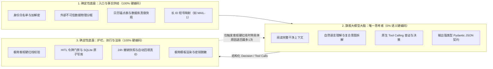
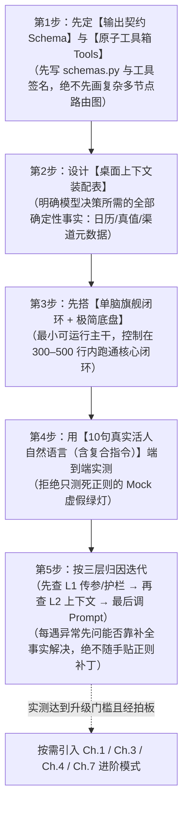

# 07｜智能体工作流开发方法论：从「过度硬编码内耗」走向「大模型优先 + 确定性底盘」

> **文档定位**：本文档结合《Agentic Design Patterns》（Antonio Gulli 著）全书模式体系与 `wechat_AI_assistant` 从 v2.0 踩坑到 v3.0 重构的真实实战复盘，系统回答“硬编码与大模型该如何划界”，并沉淀为后续所有智能体工作流项目的架构宪章与避坑指南。
> **关联资料**：
> - 理论基座：[01_AI范式演进全景图](./01_AI范式演进全景图_LLM_Workflow_RAG_Agent_AgenticAI.md) · [02_智能体复杂度金字塔](./02_智能体复杂度金字塔_Level0至Level3演进与架构叠加精解.md) · [03_Ch1_Prompt_Chaining](./03_Chapter1_Prompt_Chaining_高亮解析与任务拆解机制对比.md) · [04_Ch2_Routing](./04_Chapter2_Routing_高亮解析_四种路由机制与动态通道扩展指南.md) · [06_Ch4_Reflection](./06_Chapter4_Reflection_高亮解析_生成与评估模型博弈及工程落地方案.md)
> - 实战证据：[五彩湾DCS任务故障复盘](../wechat_AI_assistant/debug_records/01-2026-11-25-五彩湾DCS任务修改截止日被清空与啰嗦故障复盘.md) · [历史高频故障三层归因台账](../wechat_AI_assistant/debug_records/02-历史高频典型故障三层归因速查台账.md) · [v3.0大模型优先重构方案](../wechat_AI_assistant/debug_records/03-v3.0大模型优先架构重构方案.md)
> - 执行规则（AI Agent 自动加载）：[.agents/rules/agentic_workflow_model_first.md](../.agents/rules/agentic_workflow_model_first.md)

---

## 一、 核心复盘：为什么此前在智能体工作流上浪费了大量时间？

**一句话定论：这是一场「双方共振」造成的结构性踩坑——需求设计阶段把《设计模式》当成了“全套必点菜单”，而 AI Coding Agent 带着传统确定性软件工程师的“不信任大模型”惯性，把大量本该交给大模型推理的工作写成了死板硬编码。**

在 `wechat_AI_assistant` 累计 12 起真实线上“看似 AI 变傻”的故障复盘中：**75%（9 起）是编排与硬编码写歪了，17%（2 起）是上下文或展示未隔离，仅 8%（1 起）是 LLM 自身短板**。甚至在“五彩湾电厂 DCS 任务”真实对话中，大模型两次都算对了“昨天 = 11月24日”“本周五 = 11月27日”，反而是外围的“防出错硬编码”把正确结果强行抹掉了。

### 1.1 需求与提示词侧的 3 个隐形陷阱

| 隐形陷阱 | 实战中的典型表现 | 工程代价 |
| :--- | :--- | :--- |
| **1. 把模式百科当成“全套必上菜单”** | 开工直接追求“15+ 模式 1:1 映射”“三档异构反思（`flash` 路由 + `max` 主推 + `deepseek` 审计）”。 | 违背了《复杂度金字塔》的 **「够用即止原则（Least Complexity Principle）」**。Ch.4 Reflection 适用于不介意 20–40 秒延迟的严肃长文/合同/代码，却被套在了高频微信对话上。 |
| **2. 点状救火式提需求（见错就打铁皮补丁）** | 抄送误派 → 加硬拦截；嫌操作麻烦 → 加 20+ 条零模型快捷口令正则；怕编造数字 → 加字符串子串核验。 | 每次局部修补都叠加了一层脆弱规则，最终不同规则互相打架（邮件规则误杀微信交办，防造假规则误杀日历推算）。 |
| **3. 过早锁死微观实现（How）** | 提前焊死 16 个离散意图枚举、6 阶段图、必须先过小模型路由。 | AI Coding Agent 高度顺从：一旦用户锁死了“怎么写”，Agent 就不会主动指出“其实 1 个旗舰大脑 + 原生 Tool Calling 就能 5 秒搞定”。 |

### 1.2 AI Coding Agent（AntiGravity 等）本身的 3 个固有惯性

| Agent 固有惯性 | 表现与根因 | 工程后果 |
| :--- | :--- | :--- |
| **1. 防御性过度工程** | Coding Agent 的训练语料绝大部分是传统确定性代码，潜意识里不信任运行时的 LLM。一听“防出错/防幻觉”，第一反应是写正则、`if-else` 和字符串警察，而非给模型补齐上下文事实。 | `graph.py` 一度膨胀到 1,780 行，用大量死代码重复做旗舰模型最擅长的自然语言理解。 |
| **2. 多节点接力的“传话断层”** | 工作流拆成 `Router → Investigator → Compactor → Producer → Critic` 五段接力后，AI 修改单个节点时极易漏传状态（如 `revise_pending` 覆写 `raw_text` 却漏传 `user_correction` 给下游审计节点）。 | **工作流被硬编码切分得越碎，AI 自己写丢状态的概率呈指数级上升。** |
| **3. Mock 单测造成的“绿灯幻觉”** | 105 条单元测试全绿，但大量测试是在用 Mock 验证“正则有没有匹配成功”“16 意图枚举有没有走对分支”。 | 单测只证明了“死规矩按代码逻辑运行了”，掩盖了真实人类自然语言复合句直接崩盘的事实。 |

---

## 二、 关键校准：到底该不该“尽可能避免硬编码”？

> **核心判断**：**不是“消灭硬编码”，而是“把硬编码从【替大脑做语义判断】赶出去，集中到【给大脑铺事实、递工具、守红线、做落盘】上”。**

一句话记住这条分界线：
**大模型做大脑和眼睛，硬编码做手脚和围栏；绝不用硬编码冒充大脑，也绝不用大模型冒充锁匠和会计。**



---

## 三、 智能体工作流开发「七条原则与五步法」

> **版本与演进声明**：本方法论是面向当前前沿大模型（原生强 Tool Calling + Structured Output）的**工程默认起点（Default Prior）**，而非僵化教条。随着模型能力演进或遇到高并发/强监管等特殊业务场景，只要有实测数据或明确约束依据，随时可按“升级门禁”灵活调整或修订本文档。

### 原则 1：「大脑 vs 底盘」绝对职责二分表

| 归属 | 职责范围 | 典型例子 | 越界后果 |
| :--- | :--- | :--- | :--- |
| **🧠 100% 归旗舰大模型（严禁硬编码插手）** | 意图理解、多意图复合指令、口语消歧、实体提取、任务拆解、上下文推理、文案组织、自主选择工具 | 理解“目标截止暂定本周五，之后确认落盘了”；一句话同时改 #1 截止日 + 给 #2 写评价 + #3 标完成 | 一旦用正则、关键词或 15 个小模型枚举替代，用户换种说法就崩，维护成本爆炸 |
| **🛡️ 100% 归确定性硬编码底盘（严禁只靠 Prompt 祈祷）** | **1. 安全与权限**：身份白名单、只读边界、防注入分框、密钥脱敏<br>**2. 客观事实供给**：日历对照表、邮件 `From/To/Cc` 头提取、数据库真值快照<br>**3. 精确计算与 ID 绑定**：工作日算术、120 位长 ID 回填、文档解析<br>**4. 事务与门禁**：HITL 审批令牌、DB 原子提交、24h 撤销快照、幂等防重<br>**5. 展示排版**：隐藏复读摘要、剥离重复前缀、过滤内部技术黑话 | `build_calendar_anchor_text`、`[SYSTEM_TRUSTED_MAIL_META]` 与 `[UNTRUSTED_EXTERNAL_DATA]` 物理分框、`_backfill_mail_conversation_ids`、`ApprovalToken`、`format_decision_card` | 若把安全、日历心算、长 ID 抄写、落盘原子性交给模型，会出现越权、算错星期几、断链与脏数据 |
| **🚫 灰色禁区（永远不要写的代码）** | **1. 伪智能正则**：试图用正则解析人类活语言<br>**2. 过宽字符串警察**：用原文子串匹配拦截模型合法推算结果<br>**3. 无通道锁的全局规则**：拿 A 渠道规矩管 B 渠道<br>**4. 低频高价值场景强拆弱路由**：为省几分钱 Token 引入弱小模型路由或强制二审法庭 | 误杀“昨天/本周五”的字面数值校验；无通道锁的 `cc_observer` 拦截；16 意图 `flash` 路由器；20 条固定口令正则 | 既丧失大模型智商，又拉高 3–5 倍延迟，制造海量“防呆反致障”离奇 Bug |

---

### 原则 2：复杂度升级门禁 —— 从「单脑 Level 2」起步，无实测瓶颈绝不升级

《Agentic Design Patterns》的 21 个模式是**“按需取用的工具箱”**，不是“每做项目必须全套集齐的考题”：

| 架构档位 | 形态 | 适用场景占比 | 允许升档的实测硬门槛（满足任一即可经拍板升级） |
| :--- | :--- | :---: | :--- |
| **第 1 档（默认起点）** | **单脑旗舰 Agent（Level 2）**：1 个旗舰模型 + 确定性上下文装配 + 原生 Tool Calling + Pydantic 强类型输出 + 极简安全底盘 | **80%–85%**（个人助理、PMO、内部工具、轻量客服） | ① 挂载工具超过 **12–15 个** 导致模型实测选错工具；<br>② 业务包含**长且固定的多工序专业 SOP**（如 50 页合同多维度审查）；<br>③ 并发量达到高 QPS（如日均数万次），旗舰模型成本不可承受。 |
| **第 2 档（按需加链/并行）** | **Ch.1 提示词链 + Ch.3 并行化**：仅拆分“长且互不依赖的固定工序” | **10%–15%**（复杂文档解析、合同审查、多源尽调） | 经实测优化上下文与 Schema 后，单次生成仍存在**系统性高风险漏错**时，再引入 Ch.4 Reflection。 |
| **第 3 档（按需加反思/多智能体）** | **Ch.4 异构反思（局部外科手术补丁）+ Ch.7 多智能体团队（Level 3）** | **< 5%**（严肃法务、金融风控、大型研发协同） | 引入 Critic 必须遵守两条死规矩：**① 100% 共享完整用户原话与最新修正；② 仅高风险分支按需触发，绝不阻塞日常高频轻对话。** |

> **成本清醒原则**：在低频高价值系统（每天几十到几百次调用）里，旗舰模型与小模型一个月的 Token 差价往往只有几十元，但因引入弱模型路由和补丁正则浪费的调试时间成本高出数百倍。**低频高价值场景默认直上旗舰大脑，绝不用智商换几分钱 Token。**

---

### 原则 3：上下文装配的「新秘书桌面四问」（Context Engineering）

在写长篇 Prompt 之前，先检查交给模型的“桌面资料”是否满足以下 4 项：

1. **时间与环境事实印好了吗？** —— 今天日期与星期几、昨天/明天/本周/下周日历锚点表、输入通道来源是否由确定性代码直接给出？
2. **真值快照实时装配了吗？** —— 当前在途状态、待确认单据是否直接从数据库实时读取，而不是让模型翻聊天记录瞎猜？
3. **记忆与外部资料物理隔离了吗？** —— 外部大段邮件/附件原件绝不混入“用户对话记忆”；系统可信元数据与外部不可信文本是否物理分框？
4. **内部过程与用户展示隔离了吗？** —— 内部校验失败原因、Schema 英文键名、工具名称绝不写入用户可见字段。

---

### 原则 4：确定性护栏的「三道防误杀安检」

每次打算在代码里新增一条硬编码拦截/校验规则时，必须通过以下 3 项审查，否则禁止写入：

1. **客观性审查**：校验的是**数学/公历/权限/安全级别的绝对客观事实**（如 `2026-02-30` 非法、`end >= start`、HMAC 验签、零密钥泄露），还是主观语义猜测（如“原文没出现这串数字就算编造”）？—— **只留前者，砍掉后者。**
2. **通道锁审查**：规则是否只针对特定来源渠道（如 Outlook 抄送 `cc_observer`）？若是，代码条件必须**显式绑定通道标识**，杜绝跨渠道误杀。
3. **零断链审查**：拦截触发重试时，传回模型的上下文是否完整包含**用户原话 + 最新修改意见 + 具体客观报错**，且重试上限硬锁死（`<= 1~2` 次）？

---

### 原则 5：标准化「五步开发流程」



---

### 原则 6：6 条「过度硬编码红牌信号」（评审方案与代码时立刻喊停）

1. **🔴 出现中文口语/指令正则**：代码里出现解析自然语言的正则或关键词判断（仅允许极少数单字离线应急按钮如 `1`/`0`/`撤销`/`看板`）。
2. **🔴 意图枚举超过 6–8 个仍在膨胀**：说明正用脆弱的离散分类切割活语言，应改用统一 `Decision` Schema + 原生 Tool Calling。
3. **🔴 节点间修改/覆写用户原话**：任何节点覆写 `raw_text` 或把多轮输入拆散后只传一半给下游节点。
4. **🔴 护栏去核查“模型推理衍生值”**：用原文子串匹配去审查模型合法换算出的日期、汇总数或同义归纳。
5. **🔴 低频高价值场景强塞“小模型前置路由 + 强制二审”**：为省微薄 Token 牺牲理解力并把延迟拉至 20–40 秒。
6. **🔴 遇一个 Bug 就补一条特例 `if`**：同一模块连续修 2 轮仍出回归或怪现象时，立刻停止叠补丁，审视架构分层是否已歪。

---

### 原则 7：给 AI Coding Agent 的「防过度硬编码开工提示词模板」

启动新智能体工作流项目或做重构时，可将以下段落直接贴入首轮提示词：

```markdown
【架构最高宪章：Model-First + 确定性底盘】
在本智能体工作流设计与编码中，请严格遵守以下职责边界：

1. 架构起点（够用即止）：
   - 默认采用「单脑旗舰大模型 + 原生 Tool Calling + Pydantic 强类型结构化输出」的 Level 2 架构；
   - 未经我明确批准并给出量化理由，严禁引入小模型前置意图路由器（如 10+ 离散意图枚举）、多节点串行传话流水线或每轮强制执行的二审反思循环。

2. 大脑领地（禁止硬编码插手）：
   - 一切自然语言理解、口语消歧、单句多意图复合指令、槽位提取与工具选择，100% 交给旗舰大模型；
   - 严禁编写用于解析自然语言的正则表达式、关键词列表或硬编码意图补丁（仅允许极少数单字离线应急控制键）。

3. 底盘领地（必须用确定性代码写死）：
   - 客观事实供给：调用模型前由确定性代码一次性装配日历锚点表、数据库实时真值快照与渠道可信元数据，不考模型心算与默写长 ID；
   - 安全与事务：身份白名单、外部不可信数据物理分框、高危写操作审批门禁（HITL）、原子写库与可撤销快照、密钥脱敏；
   - 护栏最小化：后置确定性校验仅允许检查“数学/公历/权限/通道锁”类绝对客观硬底线，严禁用字面子串匹配误杀合法推理结果；
   - 展示隔离：内部校验日志、Schema 字段名与工具名绝不透出给最终用户。

4. 验收与豁免：
   - 优先使用真实人类自然语言复合句验证端到端闭环；
   - 若本业务存在高并发成本、超多工具（>12 个）或长固定 SOP 等客观瓶颈需要突破上述默认起点，请先向我列出依据与权衡方案，获批后再升档。
```
