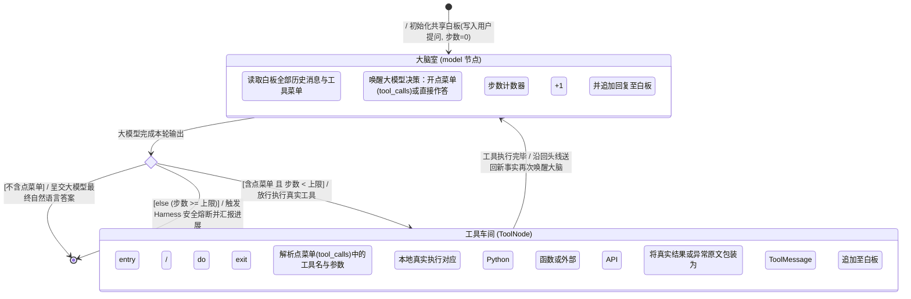

# 09｜LangChain 与 LangGraph“打乒乓球”循环原理解析与逐行对照

> **文档定位**：本文是 [08_智能体动态推理_循环工程与驾驭工程实战指南.md](./08_智能体动态推理_循环工程与驾驭工程实战指南.md) 的**底层机制与可运行代码实战篇**，专门面向非程序员彻底讲清一个最关键的工程问题：
> **“大模型自己不能直接运行工具，那么在我自己搭建 Agent 时，工具、工具调用以及大脑与工具之间‘打乒乓球’的循环，到底是怎么用代码、LangChain 和 LangGraph 实现的？”**
>
> **配套可运行代码与逐行白话伪代码目录**：[09_langgraph_react_pingpong_demo/](./09_langgraph_react_pingpong_demo/README.md)
> - 纯 Python 零依赖原理版：[01_pure_python_pingpong.py](./09_langgraph_react_pingpong_demo/01_pure_python_pingpong.py)
> - 标准 LangChain + LangGraph 版：[02_langgraph_react_pingpong.py](./09_langgraph_react_pingpong_demo/02_langgraph_react_pingpong.py)
> - 逐行白话伪代码对照手册：[03_pseudocode_line_by_line.md](./09_langgraph_react_pingpong_demo/03_pseudocode_line_by_line.md)
>
> **理论来源**：📗 [Learning LangChain (O'Reilly)](/Users/john/Documents/learning-langchain-building-ai-and-llm-applications-with-langchain-and-langgraph-1_compress.pdf) 第 6 章《Agent Architecture》（P164–170）、📘 [Agentic Design Patterns](./Agentic_Design_Patterns.pdf) 第 5 章《Tool Use》（P79–99）。

---

## 一、 先确认一条底层铁律：大模型永远不直接运行工具

大语言模型本质上是运行在远程服务器上的数学参数网络——它**没有手脚**，既不能自己上网、也不能读写你的硬盘、更不能直接算 Python。

你可以用一家餐厅来理解整件事的真实分工：
- **厨房里的厨师与锅碗瓢盆（工具本身）**：必须由你的本地代码编写（或通过 MCP/插件接入现成工具，如秘塔搜索、Outlook 邮箱、计算器）。
- **传菜员与炒菜动作（执行工具 + 来回传话）**：必须由你的代码或框架（LangGraph）在本地真实执行。
- **坐在餐桌旁的主帅（大模型）**：它唯一做的事情，是**看一眼你递给它的“菜单”（工具说明书），然后开一张标准格式的点菜单**（JSON 结构化 `tool_calls`）；等传菜员把真菜端回来后，它看一眼新结果，再决定继续点菜还是买单结账。

---

## 二、 LangChain 与 LangGraph 各自负责哪一半？

很多人容易把这两个框架混为一谈，其实在“打乒乓球”里，它们分工极为明确：

| 框架 | 形象角色 | 它干的核心活 |
| :--- | :--- | :--- |
| **LangChain** | **标准化食材与菜单管理员** | 1. 用 `@tool` 把普通 Python 函数包装成大模型读得懂的标准说明书；<br>2. 用 `model.bind_tools(tools)` 把菜单塞进大模型；<br>3. 统一抹平 OpenAI / Gemini / 通义千问 / DeepSeek 等不同模型接口差异。 |
| **LangGraph** | **专业比赛级乒乓球台** | 1. 提供挂在墙上的**共享白板（`State`）**；<br>2. 搭建**两个房间（`model` 大脑室 + `ToolNode` 工具车间）**；<br>3. 派驻**极简门卫（条件边）**并拉上**回头线（循环边）**；<br>4. 赠送生产级 **Harness 底座**：每步自动存盘（`Checkpointer`）、高危操作暂停等人批（`interrupt`）、出错回滚与全局熔断上限。 |

---

## 三、 LangGraph 乒乓球台的 5 个核心零件（严格 OMG UML 2.5 状态机视图）

下面这张图严格遵循 OMG UML 2.5 行为状态机标准，完整呈现了 LangGraph 仅用 6 行代码搭起来的动态循环骨架（含步数上限熔断证明，绝无死循环）：



### 5 个零件的大白话速记

1. **共享白板（`AgentState` + `add_messages`）**：所有提问、点菜单、工具返回结果按时间顺序往下追加，永不覆盖前文。
2. **工具菜单绑定（`model.bind_tools(TOOLS)`）**：让大模型知道手里有哪些工具可用、分别该填什么参数。
3. **房间 A：大脑室（`model` 节点）**：把整块白板递给大模型看一次，大模型只负责决定“点菜”还是“交卷”。
4. **门口门卫（`gatekeeper` / `tools_condition`）**：**典型的“好硬编码”**——根本不猜自然语言意思，只机械检查两条客观事实：① 最后一张纸上有没有 `tool_calls` 点菜单？② 当前步数有没有撞上限？
5. **房间 B：工具车间（`ToolNode`）+ 回头线（`add_edge("tools", "model")`）**：LangGraph 内置车间自动执行点菜单；**工具报错也不崩程序**，而是把报错原文贴回白板，顺着回头线送回大脑室让模型自行调整重试。

---

## 四、 6 行核心“搭台代码”与白话对照

完整代码见 [02_langgraph_react_pingpong.py](./09_langgraph_react_pingpong_demo/02_langgraph_react_pingpong.py)，逐行白话解析见 [03_pseudocode_line_by_line.md](./09_langgraph_react_pingpong_demo/03_pseudocode_line_by_line.md)。核心搭台骨架其实只有下面这几行：

```python
builder = StateGraph(AgentState)                   # 1. 建图并挂上共享白板
builder.add_node("model", model_node)              # 2. 盖房间 A：大脑室
builder.add_node("tools", ToolNode(TOOLS))         # 3. 盖房间 B：自动工具车间
builder.add_edge(START, "model")                   # 4. 客人进门先去大脑室
builder.add_conditional_edges(                     # 5. 大脑室门口放门卫（含步数上限熔断）
    "model", gatekeeper, {"tools": "tools", END: END}
)
builder.add_edge("tools", "model")                 # 6. 回头线：车间干完自动送回大脑室
graph = builder.compile(checkpointer=MemorySaver())# 7. 编译并装上每步自动存盘器
```

> **实战避坑小注**：📗 *《Learning LangChain》* P167 原书示例里的 `calculator` 使用了 `ast.literal_eval(query)`，但在 Python 3.12 中 `ast.literal_eval("1933 - 1872")` 会报错（因为它不支持二元减法运算），而直接用 `eval()` 又有严重安全注入漏洞。我们的配套示例 [02_langgraph_react_pingpong.py](./09_langgraph_react_pingpong_demo/02_langgraph_react_pingpong.py) 改用了 10 行**安全 AST 四则运算沙箱**，既能精确算账又绝对安全——这本身就是一个标准的 Harness 安全小范例。

---

## 五、 真实运行轨迹一眼看懂（实跑验证输出）

当运行 `02_langgraph_react_pingpong.py --mock` 询问 **“美国第 30 任总统去世时几岁？”** 时，后台真实发生的 3 轮大脑唤醒 + 2 次工具执行轨迹如下：

```text
👤 [用户提问] 美国第 30 任总统去世时几岁？
========================================================================
🧠 [节点: model | 第 1 轮] 大脑开出【点菜单】→ 交由门卫放行至 tools：
    • 工具=web_search | 参数={'query': '美国第30任总统 出生与去世日期'}
🔧 [节点: tools] 真实工具 `web_search` 执行完毕，结果贴回白板并沿回头线送回 model：
    • 返回内容：卡尔文·柯立芝（Calvin Coolidge），美国第 30 任总统，1872年7月4日出生，1933年1月5日逝世。

🧠 [节点: model | 第 2 轮] 大脑开出【点菜单】→ 交由门卫放行至 tools：
    • 工具=calculator | 参数={'expression': '1933 - 1872'}
🔧 [节点: tools] 真实工具 `calculator` 执行完毕，结果贴回白板并沿回头线送回 model：
    • 返回内容：61

🧠 [节点: model | 第 3 轮] 大脑未开点菜单 → 门卫放行至 END 交卷！
========================================================================
✅ [最终呈交用户的答案]
美国第 30 任总统是卡尔文·柯立芝（Calvin Coolidge），生于 1872 年 7 月 4 日，
逝世于 1933 年 1 月 5 日。年份差为 61 年，因去世时还未到当年的 7 月 4 日生日，因此享年 60 岁。
```

---

## 六、 三种落地方式横评：纯手写 vs LangGraph vs IDE 平台

| 实现方式 | 底层原理 | 你需要自己写什么？ | 适用场景 |
| :--- | :--- | :--- | :--- |
| **1. 纯 Python `while` 循环**<br>（见 `01_pure_python_pingpong.py`） | 15 行 `for/while` 传球循环 | 工具函数 + 手动分发 + 存盘/暂停全得自己造 | 教学理解原理、极简一次性小脚本 |
| **2. LangChain + LangGraph**<br>（见 `02_langgraph_react_pingpong.py`） | `StateGraph` 两房间 + 门卫 + 回头线 | 只写工具函数和 6 行搭台代码；存盘、人类审批断点、回滚全内置 | 自主构建生产级智能体（如你的微信助理、行业研报系统） |
| **3. Antigravity / Claude Code 等平台** | 平台内置同等 ReAct 状态机与丰富工具箱 | 只需提需求与写规则/技能，平台代你跑后台乒乓球循环 | 日常研发协作、自动化研究与快速原型验证 |
