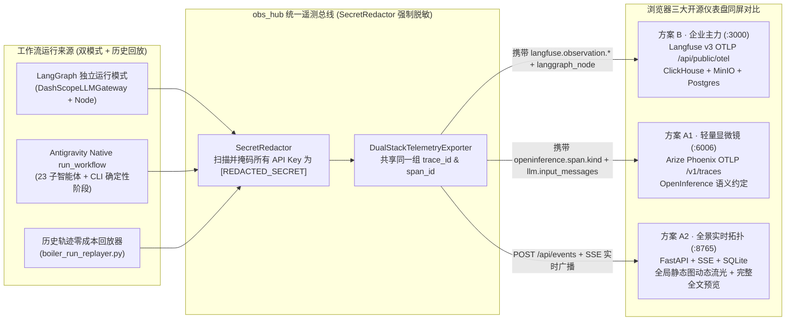

# 01 · 双栈 OpenTelemetry 单次采集多路扇出架构

## 1. 为什么需要“一次埋点、双栈同看”？

在多智能体产品研发中，**没有单个工具能同时完美覆盖所有视角**：
- **纯通用 Trace 平台（Langfuse / Phoenix）** 强在逐次 LLM 交互的 `System Prompt`、`User Context`、思考过程、Token 与延迟统计，但它们的图只能等节点**运行完上报 Span 后**才被动拼出来，无法在运行时看到“全局还有哪些后续阶段和 Critic 回退虚线未执行”。
- **静态声明式全图拓扑画布（`:8765` Live Canvas）** 则在开工前就把完整 8 阶段节点和连线全部铺在屏幕上，随执行进程实时变色呼吸并推送流光，但不负责企业级 Prompt 版本库与长期团队协同评测。

因此，本中心采用 **OpenTelemetry (OTel) + 双路扇出导出器 (`DualStackTelemetryExporter`)**，实现**一次采集、三端同步落盘**：

---

## 2. 双属性注入映射规范（一包兼容两套企业语义）

为了避免同一份大模型交互发送两遍不同的 SDK 调用，我们在 `DualStackTelemetryExporter` 中为每个 Span 同时标注 **Langfuse OTel 属性** 与 **Arize OpenInference 属性**：

| 信息维度 | 写入 Langfuse v3 的 OTel 属性 | 写入 Arize Phoenix 的 OpenInference 属性 | 说明 |
| :--- | :--- | :--- | :--- |
| 节点类型 | `langfuse.observation.type` (`agent`/`generation`/`tool`) | `openinference.span.kind` (`AGENT`/`LLM`/`TOOL`) | 控制两边 UI 图标与层级折叠 |
| 模型名称 | `gen_ai.request.model`, `langfuse.observation.model.name` | `llm.model_name` | 精确统计分模型成本与延迟 |
| 完整输入/Context | `langfuse.observation.input` | `input.value`, `llm.input_messages.0/1.message.content` | 保留完整 System Prompt 与 `[EV-*]` 证据原文 |
| 思维链与回复 | `langfuse.observation.output`, `langfuse.observation.metadata.thinking` | `output.value`, `llm.output_messages.0.message.content` | 支持逐字审查思考链与 JSON/Markdown 输出 |
| Token 用量 | `gen_ai.usage.input_tokens`, `gen_ai.usage.output_tokens` | `llm.token_count.prompt`, `llm.token_count.completion` | 两边同时生成 Token 与成本曲线 |
| 拓扑图节点绑定 | `langgraph.node`, `langfuse.observation.metadata.langgraph_node` | `graph.node.id`, `graph.node.parent_id` | 让 `:3000` 和 `:6006` 都能关联工作流节点 |

---

## 3. 安全与零密钥泄露护栏 (`SecretRedactor`)

在工程研发阶段，`.env.ai_search` 与 `.env.llm` 中存有真实的 `DASHSCOPE_API_KEY`、`METASO_API_KEY`、`SERPER_API_KEY` 等凭据。本中心在遥测发出前自动扫描工作区所有环境变量文件（及内置 `sk-` / `Bearer` 正则特征），对 Prompt、Context、Tool 参数或输出中的任何密钥片段执行强制替换为 `[REDACTED_SECRET]`，确保本地 Docker 卷和浏览器画面零敏感凭据暴露。
