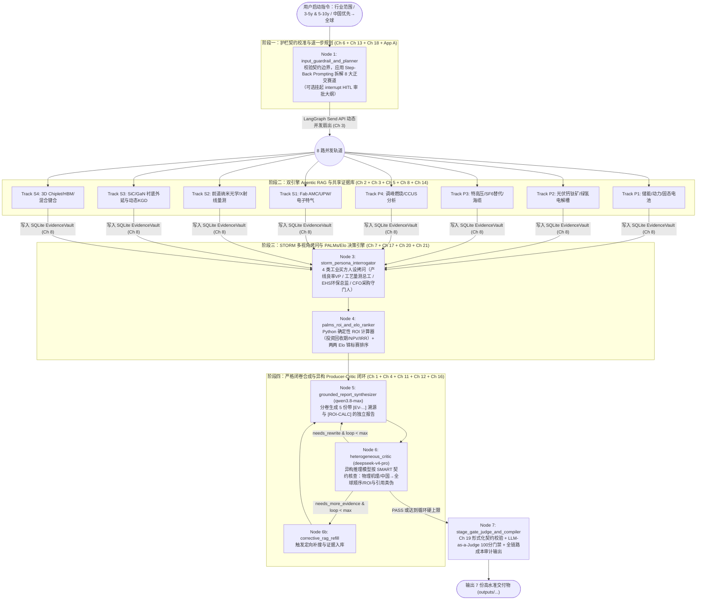

# 智能体工作流架构与《Agentic Design Patterns》全模式映射图

本工作流严格以仓库内 [《Agentic Design Patterns》中文精解分册](../../agentic_design_patterns/全书摘要分册/README.md) 的 21 个核心模式与 Appendices A/C/G 工程实践为基础进行模式编织（Pattern Composition, PDF P416），并针对**电力能源与半导体芯片制造在线测试仪器仪表**这一强物理约束、重资本 ROI 驱动的工业赛道进行了深度工程化。

---

## 1. 端到端系统拓扑架构（LangGraph StateGraph + Pattern Composition）

---

## 2. 《Agentic Design Patterns》全模式落地映射总表

| 书内章节与模式 | 在本工作流中的具体工程实现 | 核心文件位置 |
| :--- | :--- | :--- |
| **Ch 1: Prompt Chaining** | 5 卷深度研报采用分卷结构化流水线生成，每卷严格绑定前序 Pydantic 结构化产出，彻底避免单次超长输出被截断。 | `nodes/synthesizer.py` |
| **Ch 2: Routing** | 三重路由：① 中国(`CN`)优先路由至 **秘塔 Metaso**，全球(`GLOBAL`)优先路由至 **Serper**；② `Critic` 节点基于图状态路由至 `corrective_rag_refill`、`rewrite` 或 `stage_gate_judge`；③ 三级模型成本路由。 | `tools/search_router.py` `graph.py` |
| **Ch 3: Parallelization** | 利用 LangGraph `Send` API 并发扇出 8 个垂直赛道研究员（`asyncio.Semaphore` 限流防封），并在汇聚前贯彻**严格闭卷综合铁律（Strict Grounded Merger）**。 | `graph.py` `nodes/researcher.py` |
| **Ch 4: Reflection** | **异构 Producer-Critic 架构**：生成模型（`qwen3.8-max`）与审查模型（`deepseek-v4-pro` 推理模型）解耦，消除同源模型“自吹自擂”偏见。 | `nodes/critic.py` |
| **Ch 5: Tool Use** | 封装 `MetasoClient`、 `SerperClient`、`JinaReaderFallback` 及确定性 Python 财务算账工具 `roi_calculator.py`。 | `tools/` |
| **Ch 6: Planning** | 首节点执行 **Step-Back 领域规划**，从物理/化学失效机理出发反推在线测量点，生成 8 赛道双时空（3-5y / 5-10y）子任务矩阵。 | `nodes/planner.py` |
| **Ch 7: Multi-Agent Collaboration** | 融合 `stanford-oval/storm` 四角色工业采购委员会拷问（良率副总、工艺量测总工、EHS 总监、CFO），暴露真实产线痛点与落地阻力。 | `nodes/storm.py` |
| **Ch 8: Memory Management** | ① `langgraph-checkpoint-sqlite` 实现断点续跑与时间旅行调试；② `data/evidence_vault.db` 作为持久化结构化证据记忆库实现跨运行 URL 去重。 | `tools/evidence_vault.py` `graph.py` |
| **Ch 11: Goal Setting & Monitoring** | `config/research_contract.yaml` 固化 SMART 量化指标（最低证据数、中国证据占比、8 赛道全覆盖、强制 ROI 校验）。 | `config/research_contract.yaml` `nodes/judge.py` |
| **Ch 12: Exception Handling & Recovery** | 指数退避重试、`errCode` 显式拦截（HTTP 200 下拦截 Metaso `2005/1000`）、引擎互备切换、Markdown Reader 降级至 `r.jina.ai`、模型超时回退。 | `config.py` `tools/search_router.py` |
| **Ch 13: Human-in-the-Loop (HITL)** | 支持 `--hitl` 运行模式及 `langgraph.json` 图调试，在并发深搜前和最终交付前提供检查点确认能力（默认自动跑通以支持批处理）。 | `graph.py` |
| **Ch 14: Knowledge Retrieval (Agentic RAG)** | 在检索链路加入信源权威分级（`T1-T4`）、正文抽提决策、事实去重入库，以及 Critic 触发的 **Corrective RAG** 知识盲区定向补搜。 | `tools/evidence_vault.py` `nodes/researcher.py` |
| **Ch 16: Resource-Aware Optimization** | `FAST (qwen3.8-flash)` 负责高并发压缩、`PRODUCER (qwen3.8-max)` 负责深度合成、`CRITIC (deepseek-v4-pro)` 负责严苛审查，并记录细粒度 Token 与人民币/Credits 成本账本。 | `config.py` |
| **Ch 17: Reasoning Techniques (PALMs)** | 所有 CAPEX、OPEX、良率收益、投资回收期（Payback Months）、5 年 NPV、IRR 全部由 **PALMs 原则**交由确定性 Python 代码计算，大模型不得心算编造。 | `tools/roi_calculator.py` |
| **Ch 18: Guardrails & Safety** | 输入域边界检查、Pydantic `model_validate_json` 强类型边界解析、Prompt 零明文密钥铁律、输出密文泄露自动化扫描测试。 | `schemas.py` `tests/test_search_and_vault.py` |
| **Ch 19: Evaluation & Monitoring** | **Formalized Contractor + LLM-as-a-Judge + 三层自动化测试**：输出独立 100 分制 Stage-Gate 审计分与遥测报告；`pytest` 覆盖工具契约、财务数学与全图轨迹。 | `nodes/judge.py` `tests/` |
| **Ch 20 & Ch 21: Prioritization & Discovery** | 结合加权评分矩阵与 **AI Co-Scientist Elo 锦标赛两两对战**，在多个高潜技术方向中客观收敛出最具投资回报率与产业升级杠杆的 Top 机会榜。 | `nodes/ranker.py` |
| **Appendix A & G: Prompt & IDE Engineering** | 集成 **Step-Back**、**Factored Cognition（轨道隔离）**、**英文内部推理 + 麦肯锡级中文表达**，并提供 Antigravity IDE 原生 `run_workflow` 协同脚本。 | `prompts/templates.py` `ide_workflows/` |
