# V4.0 智能体工作流架构：大模型优先 + 确定性底盘（OMG UML 2.5 状态机标准）

> 本架构基于 [07_智能体工作流开发方法论_大模型优先与确定性底盘边界.md](../../agentic_design_patterns/07_智能体工作流开发方法论_大模型优先与确定性底盘边界.md) 完成 V3.0 → V4.0 结构性重构：
> - **正当升档保留**：并行 8 赛道取证与 5 卷合成（Ch.3）、清晰五阶段专业研报主线（Ch.1）、双引擎联网证据库与校准版 Python PALMs 算账底盘；
> - **砍掉模式堆砌**：全面取消弱小模型降智挖掘，取消 16 次孤立买方拷问 + 16 次 2 轮噪声两两对战（32 次调用合并为 2–3 次行业级组合评审），取消只看 3% 截断摘要的同源 98 分自夸审查，改由 **100% 全量客观硬审计 + 最多 1 轮按需定向核修** 守护真值。

---

## 一、 V4.0 行为状态机全景图（OMG UML 2.5 `stateDiagram-v2`）

```mermaid
stateDiagram-v2
    [*] --> 宏观广谱侦察与赛道立题 : / 装载研究契约与行业范围，初始化独立证据库

    state 宏观广谱侦察与赛道立题 {
        [*] --> 执行宏观双语侦察
        执行宏观双语侦察 : entry / 读取宏观探测词与行业经济护栏
        执行宏观双语侦察 : do / 并发检索中国与全球最新产线痛点及厂商动态并去重入库
        执行宏观双语侦察 : exit / 以不可信外部数据边界框物理封装侦察证据
        执行宏观双语侦察 --> 动态聚类生成候选赛道 : 侦察证据入库完成
        动态聚类生成候选赛道 : do / 旗舰大脑基于实时证据从零归纳正交与交叉赛道并规划双路检索词
        动态聚类生成候选赛道 --> [*]
    }

    state 是否需要人工审定赛道 <<choice>>
    宏观广谱侦察与赛道立题 --> 是否需要人工审定赛道 : 动态赛道清单已生成
    是否需要人工审定赛道 --> 等待人工审定赛道 : [已开启人工审定门禁]
    是否需要人工审定赛道 --> 多赛道并发取证与反证核查 : [未开启人工审定门禁]
    是否需要人工审定赛道 --> 多赛道并发取证与反证核查 : [else]

    等待人工审定赛道 : entry / 保存待审赛道清单并展示侦察证据依据
    等待人工审定赛道 : do / 挂起等待业务决策者确认或微调赛道方向
    等待人工审定赛道 --> 多赛道并发取证与反证核查 : 收到人工批准指令 [已批准] / 锁定最终赛道清单
    等待人工审定赛道 --> [*] : 收到人工中止指令 [未批准] / 保留侦察快照并安全退出

    state 多赛道并发取证与反证核查 {
        [*] --> 赛道首轮双路检索与深抓
        赛道首轮双路检索与深抓 : do / 多赛道并行执行痛点与商用厂商检索，高权威网页深抓全文入库
        赛道首轮双路检索与深抓 --> 旗舰大脑提炼候选与空白初判 : 证据按不可信边界框装配完成
        state 是否存在疑似空白需反证 <<choice>>
        旗舰大脑提炼候选与空白初判 --> 是否存在疑似空白需反证 : 候选机会与初步空白定级产出
        是否存在疑似空白需反证 --> 执行定向反证核查 : [存在疑似空白 且 反证轮次 < 1] / 反证轮次 + 1
        执行定向反证核查 : do / 针对疑似空白定向追搜龙头厂商型号与中标记录，由旗舰大脑复核降级或确认真空白
        执行定向反证核查 --> 旗舰大脑提炼候选与空白初判 : 反证证据补充入库
        是否存在疑似空白需反证 --> 赛道档案零造假封盘 : [无待反证项 或 反证轮次 >= 1]
        是否存在疑似空白需反证 --> 赛道档案零造假封盘 : [else]
        赛道档案零造假封盘 : exit / 严禁伪造回填证据编号，无真实证据支撑的候选保持空引用待淘汰
        赛道档案零造假封盘 --> [*]
    }

    多赛道并发取证与反证核查 --> 校准财务算账与组合决策评审 : 全部赛道档案汇合

    state 校准财务算账与组合决策评审 {
        [*] --> 工业校准财务建模与漏斗筛除
        工业校准财务建模与漏斗筛除 : do / 按行业毛利归因、单机归因上限与首年导入爬坡计算三情景回收期，硬淘汰无证据及超42月候选
        工业校准财务建模与漏斗筛除 --> 行业级买方委员会拷问与组合排位 : 决选短名单与淘汰审计表产出
        行业级买方委员会拷问与组合排位 : do / 电力与半导体分组由旗舰大脑统筹审视全部候选、真实证据与三情景财务，完成四角色压力测试与跨行业总排位
        行业级买方委员会拷问与组合排位 --> [*]
    }

    校准财务算账与组合决策评审 --> 分卷精炼研报并行合成 : 最终排位与买方评审备忘录就绪

    state 分卷精炼研报并行合成 {
        [*] --> 确定性渲染只读数据主表
        确定性渲染只读数据主表 : do / 由程序生成零误差财务总表、商用空白对照表、淘汰审计表与全量证据总索引
        确定性渲染只读数据主表 --> 并发撰写五卷投决级正文 : 只读数据主表已锁定
        并发撰写五卷投决级正文 : do / 旗舰大脑聚焦物理机理、反证结论与落地路线，按精炼篇幅并行成稿并由程序确定性注入主表
        并发撰写五卷投决级正文 --> [*]
    }

    分卷精炼研报并行合成 --> 全量客观硬审计与按需核修 : 五卷主表注入完成

    state 全量客观硬审计与按需核修 {
        [*] --> 全量确定性客观硬审计
        全量确定性客观硬审计 : do / 零截断扫描全量正文，校验每条引用真实入库、财务数字零漂移、赛道真覆盖与零密钥泄露
        state 硬审计是否通过 <<choice>>
        全量确定性客观硬审计 --> 硬审计是否通过 : 确定性硬审计报告产出
        硬审计是否通过 --> 定向局部核修 : [存在硬缺陷 且 核修轮次 < 1] / 核修轮次 + 1
        定向局部核修 : do / 仅针对存在断链或数字漂移的分卷执行增量修补并保留确定性主表占位
        定向局部核修 --> 全量确定性客观硬审计 : 局部修订完成
        硬审计是否通过 --> 编译最终交付包与真实费用台账 : [硬审计全通过 或 核修轮次 >= 1]
        硬审计是否通过 --> 编译最终交付包与真实费用台账 : [else]
        编译最终交付包与真实费用台账 : exit / 写入五卷精炼研报、证据总索引、客观硬审计计分卡及真实检索费用明细
        编译最终交付包与真实费用台账 --> [*]
    }

    全量客观硬审计与按需核修 --> [*] : 全套交付物落盘完成
```

---

## 二、 「大脑 vs 底盘」绝对职责二分表（V4.0 单内核架构）

| 归属 | 核心职责 | 单一真源位置 |
| :--- | :--- | :--- |
| **🧠 旗舰大脑（零弱模型降智）** | Stage 0 动态赛道聚类、Stage 1 赛道机会挖掘与反证复核、Stage 3 行业级买方委员会统筹拷问与组合排位、Stage 4 五卷高密度战略洞见撰写 | [prompts/templates.py](../src/pso_workflow/prompts/templates.py) [nodes/researcher.py](../src/pso_workflow/nodes/researcher.py) [nodes/portfolio_reviewer.py](../src/pso_workflow/nodes/portfolio_reviewer.py) |
| **🛡️ 确定性底盘（红区铁板）** | ① Metaso + Serper + Jina 双擎检索与真实费用台账；② SQLite `EvidenceVault`（统一 `EV-CN-`/`EV-GL-` 编号并兼容旧 `EV-GLOBAL-`）；③ 校准版工业 PALMs 财务引擎（含毛利归因、单机归因与首年爬坡）；④ 外部网页 `[UNTRUSTED_EXTERNAL_DATA_START/END]` 物理分框；⑤ 确定性主表占位符注入；⑥ 零截断全量引用存在性/ROI 一致性/赛道真覆盖硬审计 | [schemas.py](../src/pso_workflow/schemas.py) [tools/evidence_vault.py](../src/pso_workflow/tools/evidence_vault.py) [tools/roi_calculator.py](../src/pso_workflow/tools/roi_calculator.py) [tools/audit_guard.py](../src/pso_workflow/tools/audit_guard.py) [nodes/synthesizer.py](../src/pso_workflow/nodes/synthesizer.py) |
| **🔌 单内核薄双外壳** | IDE 原生运行器（306 行）与终端无头 CLI 100% 共享上述内核，零重复 Schema、零权重漂移 | [ide_workflows/antigravity_run_workflow.py](../ide_workflows/antigravity_run_workflow.py) [src/pso_workflow/graph.py](../src/pso_workflow/graph.py) [src/pso_workflow/cli.py](../src/pso_workflow/cli.py) |
