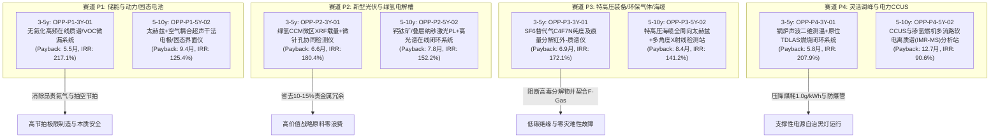

# Volume 01: 电力能源行业（储能/固态电池、新型光伏/绿氢、特高压/环保气体/海缆、灵活调峰与CCUS）3-5年及5-10年在线测试仪器仪表深度研报

---

## 执行摘要与确定性投资量化总表 [ROI-CALC]

随着全球新型电力系统与能源结构转型加速推进，“双碳”（Dual Carbon）战略、新型储能装机狂飙、绿电制氢规模化突破、特高压交直流互联电网扩容，以及煤电角色由“基荷主体”向“深度灵活调峰”根本性转变，电力能源先进制造正逼近物理极限与化学微观反应动力学瓶颈。传统离线、破坏性、高滞后的实验室抽检模式已无法匹配极限节拍与本质安全准入门槛。在线原位测试仪器仪表（Inline In-situ Metrology & Instrumentation）作为精密制造的“工业之眼”与工艺闭环的“中枢神经”，正迎来代际更迭的历史性红利期。

本研报聚焦 **P1（储能与动力电池/全固态电池）**、**P2（新型光伏与绿氢电解槽）**、**P3（特高压电网、环保绝缘气体与海缆）**、**P4（火电深度灵活调峰与CCUS）** 四大战略级核心赛道，系统拆解 **3-5年（2027-2031，高ROI无耗材与微漏/配比/调峰标配放量）** 与 **5-10年（2031-2036，全固态电池/叠层光伏/特高压海缆/CCUS多流路代际跃迁）** 的共8项顶层仪器仪表战略机遇。

### 表 1：电力能源领域在线测试仪器仪表确定性 [ROI-CALC] 全景投资矩阵

| 综合排名 | 机会ID | 赛道 | 周期 | 仪器系统全称 | 单套CAPEX | 年净现金流 (NetCF) | 静态回收期 [ROI-CALC] | 5年IRR [ROI-CALC] | 5年NPV [ROI-CALC] | ROI分级 | 综合分 / Elo | 核心证据溯源 |
| :---: | :---: | :---: | :---: | :--- | :---: | :---: | :---: | :---: | :---: | :---: | :---: | :--- |
| **#4** | `OPP-P1-3Y-01` | P1 | 3-5y | 无氦化高频在线质谱/VOC微漏检测系统 | ¥115.0万 | ¥250.5万/年 | **5.5月** | 217.1% | ¥834.6万 | Tier-A (<=12m) | 88.36 / Elo 1585.1 | [EV-GLOBAL-008], [EV-CN-010] |
| **#7** | `OPP-P4-3Y-01` | P4 | 3-5y | 煤电/垃圾焚烧灵活调峰锅炉声波二维测温+原位TDLAS多组分燃烧闭环优化系统 | ¥98.0万 | ¥204.5万/年 | **5.8月** | 207.9% | ¥677.2万 | Tier-A (<=12m) | 86.40 / Elo 1577.55 | [EV-CN-056], [EV-CN-057], [EV-CN-058], [EV-CN-059] |
| **#9** | `OPP-P2-5Y-02` | P2 | 5-10y | GW级钙钛矿/晶硅叠层产线纳秒激光PL+高光谱薄膜结晶态在线闭环检测系统 | ¥160.0万 | ¥246.0万/年 | **7.8月** | 152.2% | ¥772.5万 | Tier-A (<=12m) | 88.19 / Elo 1552.53 | [EV-CN-001], [EV-CN-003], [EV-CN-004], [EV-CN-005] |
| **#11** | `OPP-P2-3Y-01` | P2 | 3-5y | 绿氢电解槽膜电极(CCM)贵金属载量高速在线微区XRF+微针孔缺陷协同检测仪 | ¥135.0万 | ¥245.0万/年 | **6.6月** | 180.4% | ¥793.7万 | Tier-A (<=12m) | 86.69 / Elo 1547.09 | [EV-CN-013], [EV-CN-014], [EV-CN-015], [EV-CN-016] |
| **#12** | `OPP-P3-5Y-02` | P3 | 5-10y | 特高压海缆XLPE交联挤出全周向太赫兹+多角度X射线微杂质/偏心在线检测站 | ¥240.0万 | ¥343.0万/年 | **8.4月** | 141.2% | ¥1060.2万 | Tier-A (<=12m) | 86.49 / Elo 1545.10 | [EV-GLOBAL-024], [EV-GLOBAL-025], [EV-GLOBAL-026], [EV-GLOBAL-027] |
| **#13** | `OPP-P3-3Y-01` | P3 | 3-5y | SF6环保替代气体(C4F7N/混合气)产线纯度及痕量分解物在线红外-质谱分析仪 | ¥88.0万 | ¥152.5万/年 | **6.9月** | 172.1% | ¥490.1万 | Tier-A (<=12m) | 86.26 / Elo 1544.27 | [EV-CN-037], [EV-CN-043], [EV-CN-044], [EV-CN-045] |
| **#15** | `OPP-P1-5Y-02` | P1 | 5-10y | 太赫兹时域光谱与空气耦合超声融合的干法电极/全固态电解质界面在线无损成像仪 | ¥185.0万 | ¥236.0万/年 | **9.4月** | 125.4% | ¥709.6万 | Tier-A (<=12m) | 86.80 / Elo 1515.44 | [EV-GLOBAL-001], [EV-GLOBAL-002], [EV-GLOBAL-005], [EV-GLOBAL-007] |
| **#16** | `OPP-P4-5Y-02` | P4 | 5-10y | 电力CCUS与掺氢燃机多流路软电离质谱(IMR-MS)痕量杂质及腐蚀预警分析站 | ¥195.0万 | ¥184.0万/年 | **12.7月** | 90.6% | ¥502.5万 | Tier-B (12-24m) | 81.72 / Elo 1496.56 | [EV-CN-061], [EV-CN-062], [EV-CN-063], [EV-CN-064] |

---

## 赛道 P1：储能与动力电池/全固态电池制造产线在线检测

### 第一节：中国市场产业痛点、十五五/双碳驱动与本土在线检测刚需

中国锂电产业以全球超70%的产能主导全球动力与储能供应链，并加速迈入“超级工厂（Gigafactory）”极限制造阶段。在“双碳”战略目标及“十五五”先进制造业高质量发展导向下，电芯制造工艺正面临前所未有的工程物理瓶颈：
1. **极限节拍与能量密度狂飙带来的失控风险**：头部超级工厂的单线生产节拍已普遍跨越 30-40+ PPM（Pouch/Prismatic Per Minute），激光焊接线速高达 1000-1300 mm/s [EV-CN-012]。在储能电芯容量从 280Ah 全面狂飙至 314Ah 乃至 500Ah+ 的行业大背景下，单体电芯积聚的化学能极为巨大。市场调研表明，终端用户对新能源电池安全因素的决策权重高达 57% [EV-CN-010]。微裂纹、虚焊或微渗漏极易诱发局部短路与热失控（Thermal Runaway）。
2. **高速焊缝质控瓶颈**：传统离线金相切片破坏性抽样具有严重的滞后性与随机概率偏差，横切或竖切仅能捕获孤立截面，无法表征连续焊缝全貌 [EV-CN-010]；而基于光辐射、声学或热成像的间接监测方法无法获得绝对微米级匙孔熔深，且极易受等离子体羽辉与金属飞溅干扰 [EV-CN-010]。
3. **电芯微漏筛查与昂贵氦气消耗瓶颈**：大容量电芯注液加压浸润后，现行高真空充氦检漏工艺存在致命缺陷——不仅单条产线年消耗数百万元不可再生的战略高纯氦气耗材，而且高真空腔室的抽真空与排气循环周期（节拍 >3-5s）彻底卡死了整线向 40 PPM 跃进的工程节拍 [EV-GLOBAL-008, EV-CN-010]；更致命的是，电解液溶剂的微量物理渗漏遇空气中微水催化水解即生成强腐蚀性氢氟酸（HF），传统气密性压降法根本无法感知常压微环境下的挥发性有机溶剂（VOC）及痕量酸气分子逃逸。
4. **硫化物全固态电池的工程化阵痛**：国内硫化物体系全固态电池（ASSB）正加速从中试走向 GWh 规模示范，超薄电解质膜（30 μm 级）机械化连续制备过程中微观孔隙与界面压实缺陷直接削弱超离子导体（Superionic Conductor）固-固界面传输特性 [EV-CN-019, EV-CN-020, EV-CN-021]。硫化物极度吸湿且遇空气即分解剧毒硫化氢（$\text{H}_2\text{S}$）气体，产线只能在露点 -50℃ 至 -70℃ 的极端干燥间运行，工业界极度匮乏适用于超干环境的非接触在线断层无损缺陷检测装备 [EV-CN-024]。

### 第二节：全球市场（欧美新电池法、干法电极创新与供应链去风险）对标与出海窗口

1. **欧美严苛绿色法规重构准入门槛**：欧盟《新电池法》（EU Battery Regulation）实施全生命周期“电池护照”（Battery Passport）与碳足迹强制披露，北美《通胀削减法案》（IRA）则以高额补贴绑定本地供应链自主化。欧美车企及储能集成商对生产制造车间的职业健康与环境安全（EHS）、毒害挥发性有机物及不可再生稀缺气体（氦气）消耗提出了极其苛刻的审计准则，推动产线检测全面走向“零耗材、常压化、低碳排”。
2. **颠覆性干法电极（DBE）工艺的技术代差挑战**：特斯拉（Tesla）在柏林 Grünheide 与德州超级工厂率先导入 4680 电池干法电极辊压工艺，彻底淘汰了高毒性 NMP 溶剂与高能耗烘箱。然而，干法辊压缺乏溶剂流平自愈机制，微观孔隙率曲折度（tortuosity）失控与多层复合微脱粘缺陷大幅激增 [EV-GLOBAL-001, EV-GLOBAL-002, EV-GLOBAL-005, EV-GLOBAL-007]。常规 X 射线因轻元素低对比度无法清晰识别聚合物粘结剂分布，而传统液体耦合超声又会瞬间摧毁电极结构，干法工艺正面临“盲压”制造危机。
3. **出海红利窗口**：地缘政治导致全球氦气供应高度脆弱、价格波动剧烈，海外电芯厂对免氦气常压微漏检测存在极强的买方采购意愿；同时伴随宁德时代、亿纬锂能、国轩高科等中国电池巨头赴欧（匈牙利、德国）、东南亚及北美合资建厂，具备极高性价比与高节拍自主知识产权的在线仪器仪表正迎来出海放量的黄金窗口。

### 第三节：3-5年高ROI机会 vs 5-10年下一代技术新机会

#### 1. 3-5年高ROI放量机会：`OPP-P1-3Y-01` 无氦化高频在线质谱/VOC微漏检测系统

*   **物理测量机理**：基于低能量离子-分子反应软电离质谱（Ion-Molecule Reaction Mass Spectrometry, IMR-MS）或可调谐半导体激光吸收光谱（TDLAS）。利用能量精确可调的软电离源（如低能紫外 Kr/Xe 光电离或初级反应离子束），其电离势精确设定在略高于碳酸乙烯酯（EC）、碳酸二甲酯（DMC）、碳酸甲乙酯（EMC）等溶剂分子及 $\text{LiPF}_6$ 微量水解生成的 HF 分子的第一电离电位，而严格低于空气主组分（$\text{N}_2$、$\text{O}_2$、$\text{CO}_2$）的电离阈值。物理上杜绝了传统 70 eV 电子轰击（EI）源导致的剧烈分子碎片断裂重叠，在常压/微负压下实现 sub-ppb 至 ppb 级超高灵敏度与 50-200 ms 瞬态采样响应，彻底消除高真空抽气等待 [EV-GLOBAL-008, EV-CN-010]。
*   **产品形态与工业接口**：紧凑机柜式四极杆/小型飞行时间质谱仪主机，表面经 SilcoTek 钝化防腐处理；集成多通道高速常压微环境差吸吸气探头总成，配备抗氟聚合物（PFA）耐蚀流道与高速电磁脉冲进样阀；以分布式模块化形态无缝嵌入高速流水线回转转塔（Rotary Turret）或伺服随行动作机构，支持 Profinet、EtherNet/IP 及 MES 实时通讯。
*   **适用关键产线工位**：电芯注液加压浸润后密封封口检测段、极柱密封钉二次保压工位、以及化成老化前微漏 100% 全检站。
*   **四大价值支柱与量化财务支撑 [ROI-CALC]**：
    *   **提高产品质量/良率**：检测下限确证达到 $1.0\times 10^{-7}\text{ mbar}\cdot\text{L/s}$ 等效漏率，在封口初期即精准拦截电解液微滴渗漏，防止含氟腐蚀性液体污染极柱与壳体，杜绝微漏电芯流入模组 PACK 段，从根本上根除大倍率充放电引起的绝缘失效自燃 [EV-CN-010]。
    *   **降低制造成本与全生命周期成本**：彻底免去高纯氦气耗材采购费与重型真空机组维护费，单条产线年均节约高纯氦气消耗超 200 万元；消除抽真空-保压-充气-排气节拍瓶颈（单工位节拍压降至 1.5 秒内）。
    *   **促进环保与双碳 EHS**：消除对全球不可再生稀缺惰性气体资源的依赖；常压原位捕集微量有毒 HF 与有机挥发物，阻绝车间无组织排放，完全符合欧盟新电池法全生命周期碳审计与 ISO 14064 规范。
    *   **生产制造高 ROI 与产业升级**：
        $$\text{CAPEX} = ¥115.0\text{万},\quad \text{NetCF} = ¥250.5\text{万/年},\quad \text{Payback [ROI-CALC]} = \mathbf{5.5\text{月}},\quad \text{5Y IRR [ROI-CALC]} = \mathbf{217.1\%},\quad \text{5Y NPV [ROI-CALC]} = \mathbf{¥834.6\text{万}}$$
        中国潜在市场空间（China TAM）达 ¥28.0 亿元，全球潜在市场空间（Global TAM）达 $850.0M。推动锂电后道检验由“间歇式抽真空批检”跃迁为“常压连续高频数字化智造”。

#### 2. 5-10年下一代技术新机会：`OPP-P1-5Y-02` 太赫兹时域光谱与空气耦合超声融合的干法电极/全固态电解质界面在线无损成像仪

*   **物理测量机理**：双模态非接触物理场协同感知。利用 0.1-3.0 THz 宽谱脉冲太赫兹波对非导电聚合物基体与陶瓷电解质的高度穿透特性，基于介电常数色散与超快皮秒级飞行时差（Time-of-Flight），在线无损反演干法自支撑膜的局部面密度分布与微观孔隙率曲折度（tortuosity）；同步耦合聚焦高频空气耦合超声（Air-Coupled Ultrasound, ACU），依据固-固界面局部微孔洞、微裂纹及微剥离区域显著的声阻抗（Acoustic Impedance）失配特性，灵敏捕获透射声束的衰减阶跃与相位突变，实现纳米/微米级界面接触质量的高分辨率映射 [EV-GLOBAL-001, EV-GLOBAL-002, EV-GLOBAL-005, EV-GLOBAL-007, EV-CN-020]。
*   **产品形态与工业接口**：天然大理石低振动精密横梁式在线扫描龙门架，集成微型化太赫兹收发聚焦光机探头与非接触空气耦合压电超声聚焦换能器面阵；配置超干环境正压高纯氮气微环境防护罩与自适应激光三角位移测距高度闭环补偿机构，直接跨线架设于连续辊压产线上。
*   **适用关键产线工位**：干法电极自支撑膜连续成型辊压段、固态电解质超薄膜双面贴合复合工位、以及固态电芯叠片热压后界面无损探伤工位。
*   **四大价值支柱与量化财务支撑 [ROI-CALC]**：
    *   **提高产品质量/良率**：在极片高速行进中原位捕捉 $10\ \mu\text{m}$ 级内部微剥离与微孔隙异常，阻断由于界面接触不良诱发的局域电化学过电位骤升与不可逆锂枝晶（Lithium Dendrite）成核短路 [EV-CN-020, EV-CN-021]。
    *   **降低制造成本与全生命周期成本**：在全固态与干法电极试制及量产初期，将价值极高的高端固态电解质与改性活性材料早期废品及时拦截，杜绝带伤极片流入昂贵的高温热压及封装工序，单线年挽回材料直接损失超数百万元。
    *   **促进环保与双碳 EHS**：完全淘汰传统超声探伤对水或油脂偶联剂的依赖，彻底根除硫化物电解质遇水剧烈水解产生剧毒爆燃 $\text{H}_2\text{S}$ 气体的毁灭性灾变风险 [EV-CN-020]；干法电极全程实现真正零 VOC/NMP 溶剂排放。
    *   **生产制造高 ROI 与产业升级**：
        $$\text{CAPEX} = ¥185.0\text{万},\quad \text{NetCF} = ¥236.0\text{万/年},\quad \text{Payback [ROI-CALC]} = \mathbf{9.4\text{月}},\quad \text{5Y IRR [ROI-CALC]} = \mathbf{125.4\%},\quad \text{5Y NPV [ROI-CALC]} = \mathbf{¥709.6\text{万}}$$
        China TAM 达 ¥22.0 亿元，Global TAM 达 $720.0M。打破干法电极与全固态电池工业级原位表征真空，驱动电池工艺从“经验试错盲压”迈向“界面微观数字孪生自适应调控”。

### 第四节：产线买方四角色阻力与 Spec-in 破局点

针对上述装备进入头部电芯超级工厂，STORM 决策阵列中四大关键决策人的阻力与工程化 Spec-in 破局路径如下：

1. **电池超级工厂制造/良率副总裁（Fab/Plant Yield VP）**：
   *   *最尖锐阻力*：极度担忧高速注液密封区域弥散的挥发性电解液溶剂形成高浓度背景 VOC 气雾，造成无氦质谱探头基线持续漂移产生虚警，引发生产线误停机（产线刚性考核指标：误停机率 $<0.1\%$）。
   *   *Spec-in 破局指标*：在连续 10 万颗电芯生产盲测中，对出厂标定 $1.0\times 10^{-6}\text{ mbar}\cdot\text{L/s}$ 微漏电芯实现 100% 检出拦截，虚警误判停线率严格低于 0.05%，单工位全流程节拍控制在 1.5 秒以内。
   *   *工程改型方案*：设计对称式双通道差分抽吸流道与高频毫秒级反吹清洗脉冲气阀，固件内置“局部动态环境背景自适应扣除算法”，从信号源头抵消挥发背景干扰。
2. **计量/工艺测试首席工程师（Metrology/Process Chief Engineer）**：
   *   *最尖锐阻力*：高沸点有机碳酸酯类电解液分子极易在微孔进样喷嘴与离子源内部冷凝积炭，迫使产线频繁停机进行复杂的人工清洗标定。
   *   *Spec-in 破局指标*：提供工业级整机平均无故障运行时间（MTBF）$>3000$ 小时权威报告，现场免维护连续运行周期突破 30 天，标准漏孔测量重复性精密度 $\text{RSD} < 1.5\%$。
   *   *工程改型方案*：研发 120℃ 全伴热抗结露一体化微型进样接口，配置电离室定期原位气幕微等离子体自清洁固件，提供一键式多组分电解液特征质荷比（m/z）指纹库自标定功能。
3. **安全环保与绿色合规总监（EHS & Green Compliance Director）**：
   *   *最尖锐阻力*：常压高频抽吸电解液挥发气体含有微量强腐蚀性 HF 酸气，若尾气无害化处置不当将腐蚀车间精密导轨并引发职业健康与安全审查危机。
   *   *Spec-in 破局指标*：整机取得国家 Ex 工业级防爆安全认证及欧洲 CE-ATEX 认证，排气口总烃及氟化物排放指标经第三方检测 100% 优于国家工业排放最高等级。
   *   *工程改型方案*：在质谱排气末端集成紧凑型干式碱性固态化学吸收过滤柱，取样流道全面采用哈氏合金 C-276 与耐氟 PFA 材质复合制造。
4. **财务总监与采购投资把关人（CFO / Procurement ROI Gatekeeper）**：
   *   *最尖锐阻力*：设备单台采购预算高于传统气密性差压仪，且电池外形若由方形铝壳向大圆柱或固态软包切换，面临管路工装资产报废风险。
   *   *Spec-in 破局指标*：单线真实财务模型严格对齐：年均直接减少纯氦采购费用及电费超 250 万元，静态投资回收期 $\le 5.5$ 个月 [ROI-CALC]，5年内部收益率达 217.1% [ROI-CALC]。
   *   *工程改型方案*：提供模块化快拆式吸气仿形夹具设计，承诺核心质谱仪主机在电池换型时通过更换前端低成本夹具实现 100% 资产兼容重用。

---

## 赛道 P2：新型光伏(TOPCon/HJT/钙钛矿)与绿氢电解槽制造在线量检测

### 第一节：中国市场产业痛点、双碳/基地驱动与本土在线检测刚需

中国在“双碳”战略引领下，正加速推进光伏从 N 型 TOPCon 向异质结（HJT）以及晶硅/钙钛矿叠层（Perovskite/Silicon Tandem）电池的产业代际跨越，并在三北（西北、华北、东北）风光大基地密集落地吉瓦级绿氢电解水制氢项目。然而，在量产制造端，工艺微观物理失控与贵金属耗材成本正对制造业形成严峻挤压：
1. **新型光伏金属化与大面积结晶态缺陷痛点**：银浆成本在光伏电池金属化环节占比高达 30%-40% [EV-CN-005]，全无银铜电镀与涂布技术已成为终极降本路径；然而微纳铜电镀过程中电流集聚效应（Current Crowding）极易导致栅线微观形貌出现“蘑菇头”横向弥散、高深宽比截面塌陷断栅，引发严重漏电与遮光损耗 [EV-CN-004, EV-CN-005]。而在下一代钙钛矿大面积卷对卷或狭缝涂布（Slot-die Coating）中，受溶剂挥发成核动力学影响，极易产生微观相分离与未反应 $\text{PbI}_2$ 结晶缺陷 [EV-CN-001, EV-CN-003, EV-CN-035]；同时 P1/P2/P3 纳秒激光划线热影响区（HAZ）边缘熔凝重结晶毛刺极易诱发层间短路 [EV-CN-003, EV-CN-004]。传统稳态离线光致发光（PL）检测线扫精度低（$>75\ \mu\text{m}$）、单片耗时长（$>2\text{-}5\text{ s}$），无法匹配量产节拍，且无法在线定量解卷积微观能级缺陷 [EV-CN-001]。
2. **质子交换膜（PEM）绿氢电解槽贵金属冗余与微孔爆燃痛点**：PEM 电解水制氢设备核心膜电极（CCM）中，阳极极度依赖全球极端稀缺的战略贵金属铱（$\text{IrO}_2$），阴极依赖铂（$\text{Pt}$）[EV-CN-013, EV-CN-014, EV-CN-015]。由于国内高速卷对卷涂布线缺乏微区原子级面密度的在线实时高精监测，为防止局域欠载导致电荷转移过电位击穿，制造厂商普遍被迫采用 15%-20% 的“过量涂覆冗余”，导致单线每年浪费数千万元贵金属采购资金 [EV-CN-013, EV-CN-015, EV-CN-016]；此外，超薄质子交换膜在卷对卷基膜拉伸与干燥中极易产生孔径 $<5\ \mu\text{m}$ 的微针孔（Pinholes），一旦流入电堆总装，高压工况下氢氧跨膜互混渗透将直接引发电化学短路或毁灭性爆燃事故 [EV-CN-013, EV-CN-018]。

### 第二节：全球市场（欧美绿色新政、绿氢补贴与严苛标准）对标与出海窗口

1. **欧美绿氢法规与防爆本质安全认证门槛**：欧盟《可再生能源指令》（RED III）确立了严苛的可再生非生物来源燃料（RFNBO）碳核查标准，美国《通胀削减法案》（IRA Section 45V）提供最高 \$3/kg 的清洁氢阶梯税收抵免。国际主流绿氢项目强制执行国际电工委员会 IEC/ISO 22734 电解水制氢本质安全标准及 ISO 14687:2025 Grade F 高纯氢气认证。伴随波动性风光电力制氢项目的激增，电解槽频繁面临 10%-110% 宽负荷剧烈跃变，膜两侧 Butler-Volmer 电化学动力学失衡促使气体渗透通量激增，欧美严控氢中氧（$\text{H}_2\text{-in-}\text{O}_2$）跨越爆炸下限（LEL）4% 的 50% 安全红线 [EV-GLOBAL-018, EV-GLOBAL-022]。
2. **海外高端检测仪器垄断与国产出海契机**：全球高端在线分析与光学测试台长期被 HORIBA、Thermo Fisher、Bruker、Malvern Panalytical 等跨国仪器垄断。然而进口设备普遍存在三大软肋：体积庞大笨重、采样预处理长达 30-90 秒无法捕获暂态峰值、且单机 CAPEX 达到国内同类方案的 3-4 倍，难以嵌入新兴的吉瓦级高速卷对卷自动化流水线。中国微区 XRF 及超快时间分辨原位光学系统以“毫秒级响应、超紧凑防爆、整机 1/3 价格”构建了极其强劲的全球替代与出海竞争力。

### 第三节：3-5年高ROI机会 vs 5-10年下一代技术新机会

#### 1. 3-5年高ROI放量机会：`OPP-P2-3Y-01` 绿氢电解槽膜电极(CCM)贵金属载量高速在线微区XRF+微针孔缺陷协同检测仪

*   **物理测量机理**：基于特征 X 射线荧光（X-ray Fluorescence, XRF）微观激发物理机制。微聚焦 X 射线管发射的高能初级 X 射线入射激发催化涂层，引起内部重金属元素内层电子电离跃迁，辐射发射出 $\text{Pt-L}_\alpha$（9.44 keV）与 $\text{Ir-L}_\alpha$（9.17 keV）特征次级荧光光子；采用高计数率硅漂移探测器（SDD）进行高速能量色散分析，通过基质吸收反褶积算法实时反演贵金属微区原子面密度（$\text{mg/cm}^2$）；同步共轴耦合穿透式近红外暗场光学显微系统，依据微观缺陷界面强背向散射突变信号，在线精准识别孔径 $<5\ \mu\text{m}$ 的膜层贯穿性微针孔 [EV-CN-013, EV-CN-015, EV-CN-016]。
*   **产品形态与工业接口**：龙门架式双面高速伺服往复跨线扫描仪（Dual-sided Traversing Gantry System），内置抗辐射迷宫铅防护壳体；集成微焦点 X 射线管源、多通道低噪声高速 SDD 探测器阵列、气帘防尘防刮机构、以及高亮穿透式近红外面阵视觉模组，通过 EtherCAT 工业总线与卷对卷张力及狭缝挤压模头（Slot-die）联动。
*   **适用关键产线工位**：PEM/AEM 卷对卷膜电极狭缝涂布干燥出炉段、以及分切收卷前在线全检品控工位。
*   **四大价值支柱与量化财务支撑 [ROI-CALC]**：
    *   **提高产品质量/良率**：实时精准标定全幅宽 $\text{Pt/Ir}$ 载量分布（测量精度达 $\pm 0.005\text{ mg/cm}^2$），消除涂布欠载引发的局部电流过载击穿；实现卷对卷全幅微针孔 100% 在线拦截，电解槽叠装一次测试合格率提升至 99.2% 以上 [EV-CN-013]。
    *   **降低制造成本与全生命周期成本**：直接消除涂布车间普遍预留的 10%-15% $\text{Ir/Pt}$ 过量涂覆冗余，以 1 GW 产能电解槽涂布线折算，年均直接节约贵金属采购支出超 200 万元。
    *   **促进环保与双碳 EHS**：从制造源头削减极度匮乏稀缺贵金属铱的开采提炼消耗与伴生碳足迹；彻底杜绝带孔针眼膜进入电堆造成的氢气氧气混合高压内漏爆燃隐患，保障绿氢工厂本质安全。
    *   **生产制造高 ROI 与产业升级**：
        $$\text{CAPEX} = ¥135.0\text{万},\quad \text{NetCF} = ¥245.0\text{万/年},\quad \text{Payback [ROI-CALC]} = \mathbf{6.6\text{月}},\quad \text{5Y IRR [ROI-CALC]} = \mathbf{180.4\%},\quad \text{5Y NPV [ROI-CALC]} = \mathbf{¥793.7\text{万}}$$
        China TAM 达 ¥25.0 亿元，Global TAM 达 $780.0M。打破国外离线测试垄断，构建涵盖单卷卷材微米级空间分辨的元素质量数字基因档案。

#### 2. 5-10年下一代技术新机会：`OPP-P2-5Y-02` GW级钙钛矿/晶硅叠层产线纳秒激光PL+高光谱薄膜结晶态在线闭环检测系统

*   **物理测量机理**：基于非辐射复合动力学与微观光谱跃迁物理机制。采用超快纳秒脉冲半导体激光（466 nm/532 nm）线光源阵列激发大面积薄膜非平衡载流子，单光子雪崩二极管（SPAD）阵列时间分辨荧光光谱（TRPL）高精度测定荧光辐射复合寿命衰减曲线，超灵敏反演薄膜深能级缺陷态密度；同步无缝耦合 900-1700 nm 短波红外（SWIR）高光谱显微空间推扫成像，根据激子带边吸收光谱位移与特征峰展宽，微观原位量化黑相（钙钛矿活性相）与黄相（非活性杂相）结晶转变率及未反应 $\text{PbI}_2$ 纳米残余晶粒分布 [EV-CN-001, EV-CN-003, EV-CN-004, EV-CN-035]。
*   **产品形态与工业接口**：大面积真空吸附气浮式在线原位光学量测平台（Inline Air-bearing Floating Metrology Platform），适配 $1.2\text{ m}\times 2.4\text{ m}$ 大尺寸商用玻璃基板；集成高功率纳秒脉冲整形匀化线光引擎、背照式 InGaAs 近红外高光谱线阵相机、皮秒级单光子计数采集卡及大理石双驱直线电机传动系统。
*   **适用关键产线工位**：钙钛矿吸光层狭缝涂布结晶退火炉出口、P1/P2/P3 激光划线后检测段、以及空穴/电子传输层与透明电极沉积前质检站。
*   **四大价值支柱与量化财务支撑 [ROI-CALC]**：
    *   **提高产品质量/良率**：在大面积玻璃基板上实现微米级成像空间分辨率（$<75\ \mu\text{m/pix}$），对 P1/P2/P3 划线热影响区熔凝重结晶及微观缺陷识别率 $>99.5\%$，杜绝组件封装后由于局域相分离引发的早期严重衰减 [EV-CN-001, EV-CN-003]。
    *   **降低制造成本与全生命周期成本**：将吉瓦级钙钛矿叠层产线爬坡综合良率由 80% 强力拉升至 92% 以上，单月挽救高价值大尺寸基板报废损失数十万元。
    *   **促进环保与双碳 EHS**：在结晶退火与激光划线前道工序精准拦截缺陷品，防止含有重金属铅（$\text{Pb}$）的缺陷薄膜流向后道终身封装，显著减轻光伏全生命周期有毒危废处理负担与碳排放。
    *   **生产制造高 ROI 与产业升级**：
        $$\text{CAPEX} = ¥160.0\text{万},\quad \text{NetCF} = ¥246.0\text{万/年},\quad \text{Payback [ROI-CALC]} = \mathbf{7.8\text{月}},\quad \text{5Y IRR [ROI-CALC]} = \mathbf{152.2\%},\quad \text{5Y NPV [ROI-CALC]} = \mathbf{¥772.5\text{万}}$$
        China TAM 达 ¥31.0 亿元，Global TAM 达 $950.0M。彻底终结传统“涂布退火后盲切抽检、离线测试”的经验主义模式，构建“缺陷相态-激光刻蚀-退火温区微分闭环”的数字化智造体系。

### 第四节：产线买方四角色阻力与 Spec-in 破局点

1. **光伏/绿氢超级工厂制造与良率副总裁（Fab/Plant Yield VP）**：
   *   *最尖锐阻力*：高光谱与大面积脉冲光致发光在高速连续产线（$1.2\text{ m}\times 2.4\text{ m}$ 大尺寸基板）上产生海量光谱立方体图像数据（单片 $>20\text{ GB}$），极度担忧数据吞吐堆塞导致整线生产节拍延误停顿。
   *   *Spec-in 破局指标*：在实线满负荷生产中，单片全检周期控制在 $\le 2.5$ 秒内，微小暗斑与划线死区漏检率 $<0.05\%$，100% 匹配吉瓦级快拍节奏。
   *   *工程改型方案*：构建“高光谱宏观视场初筛 + 纳秒激光微观特征边缘 FPGA/GPU 异构流式硬加速处理”拓扑架构，将海量光谱图像解卷积反演压缩至 1.8 秒内完成。
2. **计量/工艺测试首席工程师（Metrology/Process Chief Engineer）**：
   *   *最尖锐阻力*：CCM 涂布走带中增强型聚合物基膜厚度轻微波动（$\pm 15\%$）与残余溶剂，极易产生非弹性基底背散射噪声，导致 $\text{Ir-L}_\alpha$ 与 $\text{Pt-L}_\alpha$ 强重叠峰解卷积拟合漂移。
   *   *Spec-in 破局指标*：在基膜厚度波动 $\pm 15\%$ 极限工况下，测得的贵金属原子面密度系统性漂移量 $<0.8\%$，双能康普顿散射背景扣除重复性 $R^2 > 0.999$。
   *   *工程改型方案*：软件内嵌“多材料基底康普顿双能自适应归一化算法箱”，提供物理内置的 SI 可溯源标准多层金属薄膜自动对针气动校准机构。
3. **安全环保与绿色合规总监（EHS & Green Compliance Director）**：
   *   *最尖锐阻力*：连续在线工业 X 射线源与 Class 4 高能脉冲激光源进入无尘洁净车间，面临极其繁琐的辐射环境评定、激光消防审批及断带外泄风险。
   *   *Spec-in 破局指标*：X 射线机台取得国家三类射线装置豁免认证，机壳表面 5 cm 处辐射剂量率 $<0.1\ \mu\text{Sv/h}$；激光系统取得 Class 1 全密闭安全认证，无激光及卤素有毒蒸汽外溢。
   *   *工程改型方案*：整机配置响应时间 $<20\text{ ms}$ 的主动式铅钨复合合金物理自锁快门，并配备防断膜红外对射联动切断电源回路；激光室加装微负压分子筛吸附微循环净化模块。
4. **财务总监与采购投资把关人（CFO / Procurement ROI Gatekeeper）**：
   *   *最尖锐阻力*：钙钛矿与 PEM 产线工艺配方仍在剧烈迭代，财务部门质疑设备早期购置（单台逾百万元）面临快速技术淘汰与资产折旧风险。
   *   *Spec-in 破局指标*：第三方审计确证单吉瓦 CCM 产线年化直接削减贵金属采购金超 200 万元，设备投资回收期 $\le 6.6$ 个月 [ROI-CALC]；钙钛矿组件综合良率提升 8%-12%，年回收废品价值超 240 万元。
   *   *工程改型方案*：提供模块化光机探测接口，承诺核心探测器硬件支持未来向全钙钛矿叠层或碱性电解槽催化剂检测平滑升级，并推行“基础硬件租赁 + 贵金属节约额阶梯对赌”商业模式。

---

## 赛道 P3：特高压电网装备制造、环保绝缘气体与海缆在线诊断测试

### 第一节：中国市场产业痛点、特高压/深海海缆驱动与本土在线检测刚需

中国在特高压输电工程（UHV AC/DC，$\pm 800\text{ kV}/\pm 1100\text{ kV}$ 换流变与 GIS 开关）及深远海千兆瓦级风电柔直送出（$\pm 525\text{ kV}$ 直流海缆）领域处于全球建设规模与技术制高点。国家电网与南方电网全面推动数字化变电站及设备全寿命周期主动防御，引发前所未有的原位在线监测刚需：
1. **主变油色谱无耗材化与瞬态故障捕获刚需**：特高压变压器与换流变出厂工频耐压试验及挂网运行中，传统油中溶解故障气体（DGA）分析严重依赖气相色谱法（GC）[EV-CN-037, EV-CN-039]。传统 GC 面临致命短板——高纯载气钢瓶高频消耗更换、色谱柱易受污染老化导致后期精度衰减严重、油气分离与分析流程长达数小时，无法实时捕获局放微弱诱发的乙炔（$\text{C}_2\text{H}_2$）瞬态突增，迫切需要向免维护、无耗材的光声光谱（PAS）及 TDLAS 技术标配升级 [EV-CN-037, EV-CN-039, EV-CN-040, EV-CN-041, EV-CN-042]。
2. **环保替代绝缘气体裂解毒物原位监测瓶颈**：传统六氟化硫（$\text{SF}_6$）具有极强的温室效应，其全球变暖潜能值（GWP）是 $\text{CO}_2$ 的 23500 倍 [EV-CN-044]。中国电科院、平高集团、西开等龙头在 126 kV 至 1000 kV 环保开关装备中率先应用全氟异丁腈（$\text{C}_4\text{F}_7\text{N}$）与 $\text{CO}_2$ 混合气体替代 $\text{SF}_6$ [EV-CN-043, EV-CN-044, EV-CN-045]。然而，$\text{C}_4\text{F}_7\text{N}$ 混合气体在工厂工频耐压、局放试验及长期强电场微火花下，会电离裂解生成 $\text{CF}_3\text{CN}$、$\text{COF}_2$、$\text{C}_2\text{N}_2$、$\text{HF}$ 等极低浓度（ppb-ppm 级）、剧毒且高腐蚀性的氟氰分解副产物 [EV-CN-046]。现有气相色谱离线取样吸附严重失真，常规非色散红外（NDIR）又面临 $90\%\ \text{CO}_2$ 基体分子的超宽同频红外吸收带强烈遮蔽干扰，产线原位在线监测处于技术真空 [EV-CN-046, EV-CN-047]。
3. **超高压深海直流海缆三层绝缘偏心与焦烧气孔致命缺陷**：在 $\pm 525\text{ kV}$ 及以上超高压柔直海缆生产中，超净交联聚乙烯（XLPE）绝缘层厚度超过 25-30 mm。在悬链式连续硫化（CV）管前高温高压熔融挤出过程中，聚合物重力流淌极易引发绝缘偏心，并在内部产生大于 $30\ \mu\text{m}$ 的微气泡孔隙及微焦烧炭化颗粒 [EV-GLOBAL-024, EV-GLOBAL-027]。在高压直流极化强电场下，此类微观缺陷将诱发严重的内部空间电荷（Space Charge）畸变积聚，最终引发雪崩式电树枝击穿毁线，成盘海缆报废损失高达数千万元 [EV-GLOBAL-027, EV-GLOBAL-028]。

### 第二节：全球市场（欧美F-Gas禁令、海缆互联与极端可靠性）对标与出海窗口

1. **欧盟新修订 F-Gas 法规全面禁令与强制准入**：欧盟正式颁布实施的修订版 F-Gas 法规（Regulation EU 2024/573）以及英国配电网脱碳法案确立了明确的禁绝时间表：自 2026 年起在中压设备、2030-2032 年起在高压 GIS 中分阶段彻底禁止新增使用高 GWP 气体（如 $\text{SF}_6$）[EV-GLOBAL-042, EV-GLOBAL-044]。西门子能源（Siemens Energy）、日立能源（Hitachi Energy）、GE Vernova 等国际巨头正加速向 Clean Air 及 $\text{C}_4\text{F}_7\text{N}/\text{CO}_2$ 环保技术路线切换 [EV-GLOBAL-042, EV-GLOBAL-045]。欧美极度严苛的职业接触安全暴露限值（OSHA/REACH）对低氟分解有毒有害气体提出了严苛的准入审计，急需集成微型软电离质谱与中红外激光光谱的一体化高灵敏产线在线装备 [EV-GLOBAL-043]。
2. **欧洲北海跨国电网柔直互联巨浪**：欧洲北海（North Sea Link）深远海风电基地加速互联，数十吉瓦容量送出全面锁定 $\pm 525\text{ kV}$ 挤出型 HVDC 海缆 [EV-GLOBAL-027]。国际海缆巨头（Prysmian、Nexans、NKT）为杜绝离岸敷设后由于绝缘缺陷引发的数千万欧元海底打捞与抢修代价，强制要求在绝缘挤出前段部署全周向断层无损扫描装置 [EV-GLOBAL-024, EV-GLOBAL-028]。中国自主的高穿透太赫兹与多角度微焦点 X 射线融合在线检测系统，凭借对微气泡与焦烧杂质的超强识别力与极高性价比，直接成为打入欧美高端海缆供应链的核心王牌。

### 第三节：3-5年高ROI机会 vs 5-10年下一代技术新机会

#### 1. 3-5年高ROI放量机会：`OPP-P3-3Y-01` SF6环保替代气体(C4F7N/混合气)产线纯度及痕量分解物在线红外-质谱分析仪

*   **物理测量机理**：基于中红外量子级联激光直接吸收光谱（QCL-TDLAS）与微型正交飞行时间质谱（Mini-oa-TOF-MS）双物理谱学融合感知。针对极高电场工频耐压下 $\text{C}_4\text{F}_7\text{N}$ 分子电离裂解动力学，在中红外指纹光谱区避开高浓度 $\text{CO}_2$ 基体分子的饱和强吸收带，利用高亮度外腔可调谐 QCL 激光对准低氟活性产物的窄带非重叠指纹峰；同步联用低能软电离微型质谱，在极低电离碰撞能下提取 $\text{CF}_3\text{CN}$、$\text{COF}_2$、$\text{C}_2\text{N}_2$ 等高危活性分子的单一特征母离子质荷比（m/z），实现 0.1% 级充装配比在线监控与 10 ppb 级痕量剧毒分解物的微秒级原位定量捕获 [EV-CN-037, EV-CN-043, EV-CN-044, EV-CN-045, EV-CN-046]。
*   **产品形态与工业接口**：19英寸 4U 工业级防震标准机架式在线分析仪主机；配备经纳米钝化处理的耐强腐蚀超低死体积气体微进样歧管组件，集成耐氟蓝宝石准直气室与低压微型电离源腔体；配置标准 IEC 61850 电力自动化总线及 Modbus TCP 接口，直接嵌入 GIS/GIL 自动化充抽气总台与出厂绝缘高压测试工控台。
*   **适用关键产线工位**：环保开关设备（GIS/GIL）气密充装产线、出厂工频高压耐压试验台、以及型式试验绝缘缺陷诊断工位。
*   **四大价值支柱与量化财务支撑 [ROI-CALC]**：
    *   **提高产品质量/良率**：在出厂耐压试验初期，于微伏级局部微放电阶段（分解物浓度低至 10 ppb）即时原位触发绝缘隐患报警，阻断绝缘缺陷件带病出厂，将 GIS 成套开关装配与试验二次拆装返工率降低 85% 以上。
    *   **降低制造成本与全生命周期成本**：彻底免去传统色谱仪高纯氢气/氦气载气钢瓶耗材与色谱柱高频更换开支（单台年耗材维保费节省超 40 万元）；单台年减少由于出厂试验失败拆机带来的重大工时与气体置换损失超 100 万元。
    *   **促进环保与双碳 EHS**：强力推动超高 GWP 温室气体 $\text{SF}_6$ 向 $\text{C}_4\text{F}_7\text{N}$ 环保气体替代（GWP 削减超 90% [EV-CN-044]）；在装配车间建立 ppb 级毒气微泄漏联动切断防护网络，彻底消除含氰剧毒吸入与强酸腐蚀伤害。
    *   **生产制造高 ROI 与产业升级**：
        $$\text{CAPEX} = ¥88.0\text{万},\quad \text{NetCF} = ¥152.5\text{万/年},\quad \text{Payback [ROI-CALC]} = \mathbf{6.9\text{月}},\quad \text{5Y IRR [ROI-CALC]} = \mathbf{172.1\%},\quad \text{5Y NPV [ROI-CALC]} = \mathbf{¥490.1\text{万}}$$
        China TAM 达 ¥19.5 亿元，Global TAM 达 $690.0M。推动电网成套开关厂由粗放气袋取样离线化验升级为“充装-试验-分解物诊断-绿色回收”的全流程工业4.0闭环。

#### 2. 5-10年下一代技术新机会：`OPP-P3-5Y-02` 特高压海缆XLPE交联挤出全周向太赫兹+多角度X射线微杂质/偏心在线检测站

*   **物理测量机理**：基于太赫兹（0.1-3.0 THz）非电离脉冲波超快电磁传输与多角度微焦点 X 射线断层吸收对比度物理机制。利用高频脉冲太赫兹波对非极性超净交联聚乙烯（XLPE）极低的介质损耗与高穿透性，捕获内外半导电屏蔽层菲涅尔界面的强反射回波，依据皮秒级（ps）飞行时差超高精度重构三层共挤绝缘层的圆周几何偏心率与界面微观不平整度；同步耦合 360 度圆周多角度微焦点脉冲 X 射线数字射线成像（DR），通过材料质量吸收系数差异，立体断层识别深层微米级微孔隙（$>30\ \mu\text{m}$）与微量炭化焦烧杂质，从物理根源上消除高压直流电场极化下的微观陷阱与空间电荷积聚失稳 [EV-GLOBAL-024, EV-GLOBAL-025, EV-GLOBAL-026, EV-GLOBAL-027]。
*   **产品形态与工业接口**：环形抗热辐射全密封太赫兹时域光谱传感器阵列 + 360 度多角度微焦点脉冲 X 射线探测模块集成机台；配备气动 C 型双向自动退避开合导轨系统，直接跨线夹持于三层共挤机头与连续硫化管入口之间；配备专用边缘计算 GPU 层析反演服务器，直接输出伺服纠偏信号与挤出机模具压电偏摆机构实时闭环握手。
*   **适用关键产线工位**：$\pm 525\text{ kV}$ 及以上超高压柔直海缆三层共挤出连续硫化前段在线检测站。
*   **四大价值支柱与量化财务支撑 [ROI-CALC]**：
    *   **提高产品质量/良率**：实现厚绝缘层（$>25\text{-}30\text{ mm}$）全周向偏心度在线连续测控（偏心率测量精度严格小于 $5\ \mu\text{m}$），对全线缆微米级微孔洞气泡与焦烧炭化杂质实现 100% 全长全检，使数百公里海缆整盘出厂耐压及局放一次通过率提升至 99.5% 以上 [EV-GLOBAL-027]。
    *   **降低制造成本与全生命周期成本**：单台检测站每年为海缆厂直接拦截并挽回 1-2 次因厚绝缘偏心超标或内部微气孔缺陷导致的整盘数十公里超高压海缆报废，单次直接挽回原材料与挤出工时损失超 400 万元。
    *   **促进环保与双碳 EHS**：杜绝数十公里大截面超高压海缆报废造成的数百吨级超净高纯 XLPE 聚合物、无氧无瑕疵纯铜绞线及重金属铅合金护套的巨大材料与高碳能源浪费（单线年均减少固体碳固废 $>600$ 吨）；整机采用全密闭自屏蔽防护，外部射线泄漏率趋零。
    *   **生产制造高 ROI 与产业升级**：
        $$\text{CAPEX} = ¥240.0\text{万},\quad \text{NetCF} = ¥343.0\text{万/年},\quad \text{Payback [ROI-CALC]} = \mathbf{8.4\text{月}},\quad \text{5Y IRR [ROI-CALC]} = \mathbf{141.2\%},\quad \text{5Y NPV [ROI-CALC]} = \mathbf{¥1060.2\text{万}}$$
        China TAM 达 ¥16.0 亿元，Global TAM 达 $610.0M。彻底淘汰线缆行业沿用数十年的离线切片打样工艺，将中国超高压海缆制造水平推升至“连续硫化前段原位 360 度 CT 断层重构 + 模头伺服动态自校准”的智能制造新纪元。

### 第四节：产线买方四角色阻力与 Spec-in 破局点

1. **特高压海缆/开关超级工厂制造厂长（Fab/Plant Yield VP）**：
   *   *最尖锐阻力*：高精密太赫兹与 X 射线光学系统直接跨线部署于连续硫化挤出生产线前端，车间环境温度高达 130℃、伴随持续机械强震动，极度担忧光机元器件受热漂移损坏或误报频繁导致挤出线紧急停线（停线一次清管损失逾数十万元）。
   *   *Spec-in 破局指标*：整机无故障连续试运行（MTBF）超过 8000 小时，微孔气泡杂质在线识别率 $>98\%$，工艺波动误报停机率严格低于 0.01 次/月。
   *   *工程改型方案*：设计气动 C 型双向秒级快速退避开合导轨，在电缆接头通过或突发机械抖动时 0.5 秒内自适应退避开启；机体核心光机舱配置闭环恒温循环水冷套与高阻尼气动微振动隔离底座。
2. **计量/工艺测试首席工程师（Metrology/Process Chief Engineer）**：
   *   *最尖锐阻力*：XLPE 聚合物在高温熔融态流动向降温半结晶态转变时，其光学折射率与声学特性随温度场呈现强烈的非线性动态漂移，导致几何偏心测量出现虚假数值跳变。
   *   *Spec-in 破局指标*：离线切片金相显微镜盲测对比与在线太赫兹测量读数误差在径向绝对厚度测量公差上稳定控制在 $\pm 5\ \mu\text{m}$ 以内。
   *   *工程改型方案*：在线集成多通道非接触式高速红外热成像测温探头，在 GPU 边缘计算引擎中内嵌基于 Maxwell-Garnett 有效介质理论的“温度场非线性热膨胀与折射率动态补偿矩阵”。
3. **安全环保与绿色合规总监（EHS & Green Compliance Director）**：
   *   *最尖锐阻力*：连续挤出车间引入在线大功率 X 射线球管源，面临省市级生态环境厅与卫健委严苛的工业辐射许可证核发门槛及生产工人对职业暴露剂量的集体维权风险。
   *   *Spec-in 破局指标*：取得国家辐射安全权威机构检测认证，设备外表面 5 cm 处辐射剂量率稳态保持在 $<0.1\ \mu\text{Sv/h}$（完全等同于天然本底环境水平）。
   *   *工程改型方案*：采用自密闭重叠迷宫式铅钨合金复合屏蔽舱体，并在机身外围关键动线布置双路独立辐射剂量率连续监测联锁探头与急停断电安全门互锁回路。
4. **财务总监与采购投资把关人（CFO / Procurement ROI Gatekeeper）**：
   *   *最尖锐阻力*：单套海缆在线检测站 CAPEX 高达 240.0 万元，对于习惯传统离线简单卡尺测量的传统线缆制造厂，一次性固定资产立项审批阻力极大。
   *   *Spec-in 破局指标*：财务审计出具严谨核算证明：单次拦截数十公里超高压海缆偏心击穿报废直接挽回 ¥400 万元净损失，单台年化净现金流达 ¥343.0 万元，投资回收期仅 8.4 个月 [ROI-CALC]，5年 NPV 超 1060 万元 [ROI-CALC]。
   *   *工程改型方案*：联合大型工业融资租赁机构推出“设备经营性保底租赁 + 挽救报废海缆里程绩效提成”的质量保险（Quality Management Contract, QMC）模式，消除早期资金占用阻力。

---

## 赛道 P4：火电深度灵活调峰、重型燃机与电力CCUS碳捕集在线过程分析仪

### 第一节：中国市场产业痛点、新型电力系统/调峰驱动与本土在线检测刚需

随着中国风电、光伏新能源装机历史性跨越 50% 红线，新型电力系统的间歇性与波动性对电网平衡提出前所未有的考验。传统煤电机组的角色被彻底重构为“基础保障性和系统调节性电源”，国家发改委与国家能源局强力推进火电机组“三改联动”，要求机组必须具备 20%~30% 额定负荷甚至 15% 超低负荷的深度灵活调峰能力：
1. **深度调峰下炉膛火焰偏斜与爆管致命隐患**：当 600 MW-1000 MW 大型超超临界（USC）机组压负荷至 20%~30% 时，炉膛内气流动力场严重弱化，四角切圆火焰刚性急剧衰减，烟气流动不对称性加剧 [EV-CN-056, EV-CN-058]。传统铠装热电偶单点测量热惰性滞后长达 60 秒以上且易结渣受损，根本无法感知炉膛数百平方米横截面上的火焰中心偏移与三维温度场剧烈不均（两侧温差往往 $>40^\circ\text{C}$）[EV-CN-056, EV-CN-058]；这导致局部水冷壁超温撕裂、高温腐蚀及末级过热器/再热器爆管停机事故频发；同时低温不完全燃烧使未燃尽碳损失飙升，度电煤耗劣变 2~5 g/kWh [EV-CN-057, EV-CN-058]。
2. **脱硝喷氨过量引发空预器硫酸氢铵堵塞**：超低负荷下，脱硝反应器入口烟温逼近催化剂活性下限及硫酸氢铵（ABS, $\text{NH}_4\text{HSO}_4$）高粘性沉积窗口（280~300℃）。由于缺乏炉膛温度场与烟气多组分浓度的原位即时监控，运行人员为确保出口 NOx 达标普遍盲目过度喷氨，造成氨逃逸率（$\text{NH}_3\text{ slip}$）远超 3 ppm；逸散氨与烟气中 $\text{SO}_3$ 在空气预热器冷段急剧化合生成粘稠高腐蚀性 ABS，吸附大量飞灰板结堵塞换热元件，引发引风机电耗骤增，甚至被迫停炉进行代价高昂的高压水冲洗 [EV-CN-056, EV-CN-057, EV-CN-059]。
3. **CCUS 碳捕集超临界管网腐蚀与剧毒副产物监测真空**：在国家级百万吨级燃煤电厂 CCUS 示范工程中，化学吸收法醇胺溶剂在高温富氧和含 NOx 烟气下氧化降解生成强致癌性挥发性亚硝胺（如 NDMA）及大量逃逸胺 [EV-GLOBAL-030, EV-GLOBAL-031]；在捕集后的高压超临界 $\text{CO}_2$（$>7.38\text{ MPa}$）长输管道中，流体中微量酸性杂质（$\text{H}_2\text{O}$、$\text{H}_2\text{S}$、$\text{SO}_x$、$\text{O}_2$）在微小温压扰动下极易析出游离水形成高腐蚀性酸液，协同腐蚀速率可飙升至 $>10\text{ mm/a}$ 诱发管道穿孔爆炸 [EV-CN-061, EV-CN-062, EV-CN-063]。核心分析仪器长期被赛默飞（Thermo Fisher MAX-iR 等 FTIR）垄断，但常规 FTIR 在高水汽与高 $\text{CO}_2$ 饱和基质下面临极其严重的谱带重叠失真，急需自主可控的高灵敏多流路在线软电离质谱系统 [EV-CN-061, EV-CN-063]。

### 第二节：全球市场（欧美强监管驱动、掺氢燃机与CCUS商用）对标与出海窗口

1. **欧美严苛环境排放法规推动 CCUS 在线质谱标配**：美国 IRA 法案 Section 45Q 将碳封存补贴提高至 \$85/吨，欧盟排放交易体系（EU ETS）推动燃后 CCUS 全面迈入百万吨级商业化。美国 EPA 与欧盟工业排放指令（IED）对碳捕集放空气体中致癌亚硝胺施加了极苛刻的 sub-ppb 级限值。传统人工采样后送实验室进行固相萃取-色谱质谱联用（SPE-LC-MS/MS）分析周期长达数周，严重滞后且无法形成自保护联锁，推动欧美电厂 CCUS 全面转向工业原位在线软电离质谱 [EV-GLOBAL-030, EV-GLOBAL-032]。
2. **纯氢与大比例掺氢重型燃机的物理极限监测**：欧美燃机巨头（GE Vernova、Siemens Energy、Ansaldo）全力竞逐 30%~100% 掺氢燃气轮机商业化。纯氢燃烧的层流火焰传播速度高达 2.8~3.0 m/s（为天然气的近 8 倍），极易在旋流燃烧室发生气动拓扑火焰分叉（Topological Flame Bifurcation）并引发瞬态剧烈逆流回火，透平第一级静叶表面热点极易烧穿热障涂层（TBC）[EV-CN-071, EV-GLOBAL-039]。微秒级火焰光谱前兆感知与高温热场反演已成为全球燃机安全运行的核心壁垒。
3. **老旧电厂生物质混烧（Co-firing）转型窗口**：为实现净零排放，欧美大量燃煤电厂转向生物质与垃圾衍生燃料（RDF）混烧。生物质的高碱金属（$\text{Na/K}$）及高氯特性导致炉膛结焦与积灰更加严重，常规辐射测温彻底失效，具备超强抗灰尘穿透能力的声波飞行时间层析测温系统正在欧美形成极强的更新替代窗口 [EV-GLOBAL-036, EV-GLOBAL-037]。

### 第三节：3-5年高ROI机会 vs 5-10年下一代技术新机会

#### 1. 3-5年高ROI放量机会：`OPP-P4-3Y-01` 煤电/垃圾焚烧灵活调峰锅炉声波二维测温+原位TDLAS多组分燃烧闭环优化系统

*   **物理测量机理**：基于经典气相声学测温物理方程 $c = \sqrt{\frac{\gamma R T}{M}}$（其中 $\gamma$ 为气体比热比，$R$ 为通用气体常数，$M$ 为烟气平均分子量，$T$ 为绝对温度）。由于声波具有波长长、穿透力强、不受飞灰辐射衰减与炉膛内壁黑度干扰的天然物理优势，系统在炉膛截面四周几何对称布置大功率宽频电声换能器网格，微秒级测定多条交叉几何路径上的声波飞行时间（Time-of-Flight, TOF），结合吉洪诺夫正则化（Tikhonov Regularization）代数重建算法，实时反演炉膛横截面二维等温线热场（热态测温分辨率达 $3^\circ\text{C}$，测量精度 $<1\%$）[EV-CN-059]；同步联用耐高温原位对穿式 TDLAS 激光探头，选取不受高浓度水汽与 $\text{CO}_2$ 重叠干扰的 $\text{CO}$（$2.33\ \mu\text{m}$）、$\text{O}_2$（$760\text{ nm}$）与逃逸 $\text{NH}_3$（$1.51\ \mu\text{m}$）吸收线，结合波长调制光谱（WMS-2f）实现毫秒级线积分浓度瞬态反演，构建温度场-氧量-未燃物三维动态闭环 [EV-CN-056, EV-CN-057, EV-CN-059]。
*   **产品形态与工业接口**：成套工业级原位防爆分布式测控站。包含 8~16 套外挂式压缩空气冷却声波收发一体化探头，内置气动脉冲激波发生器与耐高温压电陶瓷传感器，配备全自动反吹防堵塞清灰机构，通过水冷法兰无缝安装于水冷壁窥视孔；光谱单元采用双端自准直耐 $1200^\circ\text{C}$ 蓝宝石光学窗口；中央处理柜内置工业级高主频 DSP+FPGA 硬件相敏检波滤波板卡，支持 Profinet/OPC UA 与全厂 DCS/SIS 握手。
*   **适用关键产线工位**：600 MW-1000 MW 机组折焰角上方过渡区截面（约 40-50m 标高）、末级过热器/高温再热器入口前断面上方、以及 SCR 脱硝反应器入口/空气预热器入口烟道。
*   **四大价值支柱与量化财务支撑 [ROI-CALC]**：
    *   **提高产品质量/良率**：彻底消除 20%~30% 深度调峰超低负荷下火焰偏斜贴壁燃烧，将炉膛两侧烟温偏差由 $>40^\circ\text{C}$ 压降至 $10^\circ\text{C}$ 以内，主再热汽温偏差压降至 $20^\circ\text{C}$ 以内，从源头杜绝过热器/再热器爆管撕裂，机组非计划停运率下降 70% 以上 [EV-CN-056]。
    *   **降低制造成本与全生命周期成本**：精准指导炉膛配风与燃烧中心调整，使机组供电煤耗绝对降低 0.5~2.0 g/kWh（以 600 MW 机组年利用小时折算，年均节约标准煤 2500~3500 吨，直接节煤效益超 180 万元 [EV-CN-057, EV-CN-058, EV-CN-059]）；减少爆管抢修与空预器水冲洗费用超 24.5 万元。
    *   **促进环保与双碳 EHS**：锅炉燃烧热效率绝对提升 0.5% 以上，单台 600 MW 机组每年直接减少 $\text{CO}_2$ 排放不少于 26 万吨 [EV-CN-059]；TDLAS 精准闭环控制脱硝喷氨格栅，将氨逃逸稳定控制在 2 ppm 以下，削减 ABS 生成量达 80% 以上。
    *   **生产制造高 ROI 与产业升级**：
        $$\text{CAPEX} = ¥98.0\text{万},\quad \text{NetCF} = ¥204.5\text{万/年},\quad \text{Payback [ROI-CALC]} = \mathbf{5.8\text{月}},\quad \text{5Y IRR [ROI-CALC]} = \mathbf{207.9\%},\quad \text{5Y NPV [ROI-CALC]} = \mathbf{¥677.2\text{万}}$$
        China TAM 达 ¥34.0 亿元，Global TAM 达 $620.0M。彻底告别“凭经验看火、单点热电偶滞后调风”的粗放模式，接入先进过程控制（APC）推动火电机组向全负荷自主黑灯调峰跨越。

#### 2. 5-10年下一代技术新机会：`OPP-P4-5Y-02` 电力CCUS与掺氢燃机多流路软电离质谱(IMR-MS)痕量杂质及腐蚀预警分析站

*   **物理测量机理**：基于精确控制的低能离子-分子反应软化学电离（IMR-MS / PTR-MS）物理机制。采用精密可控的低能主反应离子束（如 $\text{Hg}^+$ 10.4 eV、$\text{Xe}^+$ 12.1 eV、$\text{Kr}^+$ 14.0 eV 或 $\text{H}_3\text{O}^+$），通过电场可调反应漂移管精确限制电离碰撞能量，使其仅略高于待测痕量杂质分子的第一电离电位，而严格低于超临界高浓度 $\text{CO}_2$ 基体（13.78 eV）、$\text{N}_2$（15.58 eV）、$\text{O}_2$（12.07 eV）及饱和水汽的电离阈值。物理上完全杜绝了 70 eV 电子轰击电离产生的剧烈分子碎片断裂，产生高特异性单一母离子峰；结合高分辨四极杆质量过滤器或正交反射飞行时间分析器（oa-TOF-MS），在微秒级时间内无须色谱柱预分离，直接在湿饱和 $\text{CO}_2$ 基体中定性定量 sub-ppb 级致癌亚硝胺（NDMA, m/z 74）、一乙醇胺（MEA, m/z 61）及其氧化裂解物，以及超临界介质中痕量 $\text{H}_2\text{S}/\text{SO}_x/\text{HCl}$ 腐蚀因子 [EV-CN-061, EV-CN-062, EV-CN-063, EV-GLOBAL-030, EV-GLOBAL-031, EV-GLOBAL-032]。
*   **产品形态与工业接口**：最高等级工业防爆分析站机柜（ATEX/IECEx Zone 1/Zone 2，Ex d e ib IIC T4 Gb，IP65）；集成 SilcoTek 钝化处理的高温全伴热（180℃）无死体积微型减压取样阀组；内置全无油磁悬浮分子泵超高真空差分抽气系统；配备 16 通道高压多流路自动切换歧管与耐硫化毛细管进样接口，搭载工业级嵌入式化学计量学反演工控机。
*   **适用关键产线工位**：燃煤/燃气电厂燃后 CCUS 水洗塔/吸收塔出口净烟气排放烟道、胺液再生塔顶气相冷凝排放口、超临界 $\text{CO}_2$ 压缩机级间入口及跨区域超临界长输管线分输阀室/封存井口；兼顾重型掺氢燃机预混燃烧室多流路气源组分在线监测。
*   **四大价值支柱与量化财务支撑 [ROI-CALC]**：
    *   **提高产品质量/良率**：在超临界 $\text{CO}_2$ 长输管网与地质封存端，提供毫秒级酸性腐蚀因子析出游离水露点超前预警，彻底消除多杂质协同应力腐蚀开裂（SCC）与极速穿孔风险，长输管线内腐蚀速率严控在 $<0.01\text{ mm/a}$，保障高压碳运管网 30 年长周期无泄漏运行 [EV-CN-061, EV-CN-062]。
    *   **降低制造成本与全生命周期成本**：原位监控精准指导阻抗降解添加剂投放，年节约高单价有机醇胺吸收剂超 80 万元；杜绝长输管道酸性腐蚀穿孔停产与过量注入缓蚀剂开支超 64 万元；避免机组因环境超标非计划停机损失超 40 万元。
    *   **促进环保与双碳 EHS**：全天候实时在线监测燃后碳捕集过程最具毒性的强致癌副产物挥发性亚硝胺（NDMA，检出限达 0.05 ppb），完全符合世界卫生组织（WHO）及欧美最严苛致癌物限值规范；同时促使胺液化学危废生成量减少 45% 以上。
    *   **生产制造高 ROI 与产业升级**：
        $$\text{CAPEX} = ¥195.0\text{万},\quad \text{NetCF} = ¥184.0\text{万/年},\quad \text{Payback [ROI-CALC]} = \mathbf{12.7\text{月}},\quad \text{5Y IRR [ROI-CALC]} = \mathbf{90.6\%},\quad \text{5Y NPV [ROI-CALC]} = \mathbf{¥502.5\text{万}}$$
        China TAM 达 ¥12.5 亿元，Global TAM 达 $580.0M。引领工业在线气体分析从宏观百分比级（%vol）监测跨入纳摩尔级（ppb/sub-ppb）反应动力学副产物与腐蚀前兆智能感知时代。

### 第四节：产线买方四角色阻力与 Spec-in 破局点

1. **发电集团生产副总裁兼总工程师（Fab/Plant Yield VP）**：
   *   *最尖锐阻力*：电厂锅炉内部飞灰浓度高达 $30\text{-}50\text{ g/Nm}^3$ 且伴随熔融态结渣，极度担忧声波探头声学导管与水冷壁窥视孔在连续运行 2-3 个月内被严重结渣彻底封死，导致整套声波信号衰减失真。
   *   *Spec-in 破局指标*：实测 20% 超低负荷工况下两侧主再热汽温偏差稳定由 $35^\circ\text{C}$ 收敛至 $12^\circ\text{C}$ 以内，连续免维护稳定试运行 6 个月以上，无任何超温爆管跳机记录。
   *   *工程改型方案*：标配工业级大扭矩气动旋转自清洗高压反吹清渣阀门，探头导管采用耐 $1400^\circ\text{C}$ 碳化硅复合陶瓷防结渣涂层，并在电厂 SIS 界面实时显示“水冷壁防爆管安全动态裕度指数”。
2. **热工与自动化首席工程师（Metrology/Process Chief Engineer）**：
   *   *最尖锐阻力*：质疑电厂大跨度锅炉炉膛在超低负荷下强流体低频湍流噪声会淹没声波微弱走时信号，以及原位激光长光程穿透在热烟气折射抖动下的光斑跑偏漂移。
   *   *Spec-in 破局指标*：提供权威计量院出具的冷态标定误差 $<1\%$、热态分辨率 $3^\circ\text{C}$ 检定证书，并在飞灰透光率断崖式跌落至 15% 的极限工况下，光谱吸收峰信噪比（SNR）依然严格保持 $>20$。
   *   *工程改型方案*：研发基于 FPGA 硬件流水线的互相关时延高阶提取滤波卡，配置基于四象限光电探测器与压电陶瓷（PZT）的主动式光束空间位姿动态自校正追踪单元。
3. **安全环保与绿色合规总监（EHS & Green Compliance Director）**：
   *   *最尖锐阻力*：极度担忧原位线积分 TDLAS 测出的逃逸氨动态数据与地方生态环境局认可并联网的尾部抽取冷凝式 CEMS 产生系统性偏差，引发环保合规核查罚款风险。
   *   *Spec-in 破局指标*：投运后连续两个季度内，机组未发生任何一次因 ABS 粘结引发的空预器阻力压差超限，全厂脱硝液氨/尿素总采购消耗量下降 15% 以上。
   *   *工程改型方案*：固件内置经电科院比对认证的“截面空间线积分平均至尾部烟道单点浓度精确映射模型包”，提供一键生成符合国家环保比对规程的数据审计报表及超标自动联动切断闭环。
4. **财务总监与采购投资把关人（CFO / Procurement ROI Gatekeeper）**：
   *   *最尖锐阻力*：火电行业此前采购的诸多燃烧优化算法软件大多流于纸面，实际节煤成效难以剥离量化，财务部门拒绝为近百万元的固定资产技改单方面承担审计风险。
   *   *Spec-in 破局指标*：由省级电力科学研究院出具机组性能优化考核报告，证实供电煤耗绝对降低超过 1.0 g/kWh，单台机组年化节煤直接收益超 150 万元兑现入账。
   *   *工程改型方案*：推行合同能源管理（EMC）或阶段性节煤量对赌协议（供电煤耗节约通过电科院验收达到 0.5 g/kWh 再行结清尾款），并在工控大屏内置与电厂财务 ERP 对接的标准节煤现金流折现动态看板。

---

## 跨赛道综合投资对比与产业代际演进结论

综合四大赛道的 8 项重大装备机遇，本研报构建出横跨产品生命周期、技术成熟度与商业回报确定性的多维评估体系：

### 表 2：电力能源仪器仪表全景战略定位与指标汇总表

| 机会ID | 细分赛道与核心定位 | 核心测量物理学原理 | 技术就绪度 (TRL) | 5年累计NPV [ROI-CALC] | 5年IRR [ROI-CALC] | 静态回收期 [ROI-CALC] | 中国TAM / 全球TAM | 战略决策建议 |
| :---: | :--- | :--- | :---: | :---: | :---: | :---: | :---: | :--- |
| `OPP-P1-3Y-01` | **P1储能/动力**：常压无氦微漏质谱系统 | 软电离IMR-MS / TDLAS常压微萃取 | **TRL 8-9** | **¥834.6万** | **217.1%** | **5.5月** | ¥28.0亿 / $850M | **极度优先推荐**：立竿见影替代昂贵氦气，百台级规模化复制 |
| `OPP-P4-3Y-01` | **P4灵活调峰**：锅炉声波二维测温+TDLAS | 气相声速方程层析重建 + WMS-2f | **TRL 8-9** | **¥677.2万** | **207.9%** | **5.8月** | ¥34.0亿 / $620M | **极度优先推荐**：存量火电机组三改联动刚需，半年内完全回本 |
| `OPP-P2-3Y-01` | **P2新型绿氢**：CCM微区XRF载量+针孔检测 | 特征X射线荧光(SDD) + 近红外暗场 | **TRL 7-8** | **¥793.7万** | **180.4%** | **6.6月** | ¥25.0亿 / $780M | **强烈推荐**：直击昂贵铂铱耗材过量浪费痛点，电解槽出海标配 |
| `OPP-P3-3Y-01` | **P3特高压**：环保替代气纯度及痕量分解物 | 中红外外腔QCL + 软电离TOF-MS | **TRL 7-8** | **¥490.1万** | **172.1%** | **6.9月** | ¥19.5亿 / $690M | **强烈推荐**：抢跑欧盟2026 F-Gas禁令与国网环保GIL示范工程 |
| `OPP-P2-5Y-02` | **P2新型光伏**：钙钛矿纳秒脉冲PL+高光谱 | 时间分辨单光子计数(TRPL) + SWIR | **TRL 6-7** | **¥772.5万** | **152.2%** | **7.8月** | ¥31.0亿 / $950M | **战略卡位**：抢占GW级叠层产线爬坡良率控制器标准制定权 |
| `OPP-P3-5Y-02` | **P3特高压**：海缆全周向太赫兹+X射线站 | 飞秒THz时域反射时延 + 360°微焦点DR | **TRL 6-7** | **¥1060.2万** | **141.2%** | **8.4月** | ¥16.0亿 / $610M | **战略卡位**：万米超高压柔直海缆防击穿神器，单次挽回数千万 |
| `OPP-P1-5Y-02` | **P1固态电池**：太赫兹+空耦超声无损成像 | 宽谱太赫兹介电色散 + 空气耦合声阻抗 | **TRL 5-6** | **¥709.6万** | **125.4%** | **9.4月** | ¥22.0亿 / $720M | **前瞻攻坚**：破解全固态电池干法电极“盲压”微观界面世界难题 |
| `OPP-P4-5Y-02` | **P4零碳电厂**：CCUS与掺氢燃机IMR-MS | 低能电子碰撞化学软电离 + 射频四极杆 | **TRL 5-6** | **¥502.5万** | **90.6%** | **12.7月** | ¥12.5亿 / $580M | **产业孵化**：颠覆离线化验体系，构筑百万吨级碳捕集本质安全 |

### 产业代际演进与投资落地策略

1. **“双轨驱动”组合投资范式**：仪器仪表企业应采取“现金牛（3-5年成熟期高ROI设备）支撑攻坚期（5-10年下一代革命性仪器）”的资本与研发战略。
   *   **近端（2027-2031）**：以 `OPP-P1-3Y-01`（无氦化微漏检测）与 `OPP-P4-3Y-01`（声波炉膛测温优化）为基本盘，两款系统投资回收期均在 **6个月以内**（5.5月与5.8月），5年内部收益率均 **超过200%**，具备极其强劲的客户自发技改动力，可快速产生丰沛现金流。
   *   **远端（2031-2036）**：以 `OPP-P2-5Y-02`（钙钛矿/晶硅叠层闭环检测）与 `OPP-P3-5Y-02`（超高压海缆全周向太赫兹CT站）为战略高地，卡位未来十吉瓦级叠层光伏与深远海超级电网的标准定价权。
2. **硬件底层向国产化纵深突破**：虽然整机集成已实现突破，但高端光学与能谱核心底层元器件（如外腔量子级联激光器、高灵敏度硅漂移探测器 SDD、太赫兹宽谱飞秒光导天线、低能无损化学软电离反应腔及全无油分子泵）仍存在对外依赖。产学研资本需集中力量在上游光电核心器件上实现自主可控，构筑牢不可破的底层技术护城河。
3. **从“单机质检设备”向“数字化自治中枢”跃升**：未来的仪器仪表不再仅仅是产线边缘的“判定与剔废工具”，而是深度嵌入工业控制 DCS、APC 与 MES 系统的“工艺参数自整定中枢”。通过对微观物理界面缺陷、分子特征谱线与温度场的实时测绘，反向闭环控制辊压机温压、狭缝涂布微分阀、高压挤出模具偏摆以及锅炉二次配风格栅，真正引领中国电力能源先进制造迈向自感知、自决策、自执行的“工业4.0全数字孪生时代”。
