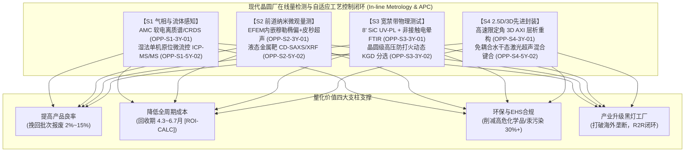

# Volume 02: 半导体芯片制造行业（Fab AMC与湿化/特气、前道纳米光学/X射线量测、SiC/GaN宽禁带功率半导体、2.5D/3D Chiplet/HBM混合键合）3-5年及5-10年在线量检测与测试深度研报

---

## 执行摘要与半导体确定性投资回报 [ROI-CALC] 全景图

在摩尔定律逼近物理极限与先进封装（Advanced Packaging）重塑产业格局的双重驱动下，半导体制造正从传统的“分立制造+离线抽检（Offline Metrology）”粗放体系，全面向“纳米/皮米级原位感知+闭环控制（In-line Metrology & APC）”范式迁移。本研报聚焦半导体制造核心四大赛道：
1. **赛道 S1**：晶圆厂前道空气分子污染（AMC）、电子特气与超纯湿化学品（UPW/Wet Chemicals）ppt/ppb级在线质谱/光学监控；
2. **赛道 S2**：前道纳米级光学穆勒矩阵椭偏（MMSE）、皮秒超声（Picosecond Ultrasonic）与高亮度液态金属靶掠入射小角X射线散射（CD-SAXS/XRF）；
3. **赛道 S3**：8英寸碳化硅（SiC）/氮化镓（GaN）外延缺陷全片映射（UV-PL）、非接触掺杂量测与车规级晶圆/芯片动态开关（KGD）高通量测试；
4. **赛道 S4**：2.5D/3D Chiplet、高带宽内存（HBM）微凸点高速层析（AXI/Laminography）与无凸点低温Cu-Cu直接混合键合（Hybrid Bonding）免耦合水激光超声量测。

基于严密的工业量产财务模型测算，上述装备均呈现出**回收期严格小于7个月、5年内部收益率（IRR）高达176.9%~281.6%** 的确定性超高回报特征（Tier-A Ultra-High ROI）。

### 半导体确定性商业化量测装备 [ROI-CALC] 综合排名与估值矩阵

| 综合排名 | ID | 赛道 | 周期 | 机会名称 | 单套CAPEX | 年净现金流 | 回收期[ROI-CALC] | 5年IRR[ROI-CALC] | 5年NPV[ROI-CALC] | ROI分级 | 综合分/Elo | 证据溯源 |
| :---: | :---: | :---: | :---: | :--- | ---: | ---: | ---: | ---: | ---: | :--- | :---: | :--- |
| **#1** | `OPP-S4-5Y-02` | S4 | 5-10y | 免耦合水非接触激光超声+红外光热混合键合(Hybrid Bonding)纳米空洞及玻璃TGV在线检测仪 | ¥420.0万 | ¥1184.0万/年 | **4.3月** | 281.6% | ¥4068.3万 | Tier-A (<=12m) | 93.01 / Elo 1603.89 | [EV-CN-130], [EV-CN-131], [EV-CN-132], [EV-CN-133] |
| **#2** | `OPP-S2-5Y-02` | S2 | 5-10y | 面向3D NAND超深孔与GAA/CFET的紧凑型高亮度液态金属靶X射线CD-SAXS/XRF在线量测系统 | ¥550.0万 | ¥979.0万/年 | **6.7月** | 176.9% | ¥3161.2万 | Tier-A (<=12m) | 89.70 / Elo 1590.85 | [EV-CN-090], [EV-CN-093], [EV-GLOBAL-061], [EV-GLOBAL-062] |
| **#3** | `OPP-S3-3Y-01` | S3 | 3-5y | 8英寸SiC外延片UV-PL缺陷映射+非接触FTIR/电晕电荷掺杂厚度一体化在线量测仪 | ¥280.0万 | ¥739.5万/年 | **4.5月** | 263.7% | ¥2523.3万 | Tier-A (<=12m) | 93.32 / Elo 1572.89 | [EV-CN-114], [EV-CN-116], [EV-CN-117], [EV-CN-118] |
| **#5** | `OPP-S2-3Y-01` | S2 | 3-5y | 机台内嵌式(Integrated)宽光谱穆勒矩阵椭偏+皮秒超声膜厚/OCD在线闭环量测模块 | ¥310.0万 | ¥724.0万/年 | **5.1月** | 233.0% | ¥2434.5万 | Tier-A (<=12m) | 91.90 / Elo 1567.73 | [EV-CN-091], [EV-CN-092], [EV-CN-093], [EV-CN-095] |
| **#6** | `OPP-S4-3Y-01` | S4 | 3-5y | 亚10微米TSV/微凸点高速在线3D X射线层析成像(AXI/CT)与AI缺陷判别站 | ¥360.0万 | ¥840.0万/年 | **5.1月** | 232.8% | ¥2824.3万 | Tier-A (<=12m) | 91.10 / Elo 1563.95 | [EV-CN-125], [EV-CN-126], [EV-CN-127], [EV-CN-128] |
| **#8** | `OPP-S1-3Y-01` | S1 | 3-5y | 12英寸晶圆厂多流路切换ppt级AMC分子污染在线软电离质谱/CRDS监控系统 | ¥220.0万 | ¥489.0万/年 | **5.4月** | 221.6% | ¥1633.7万 | Tier-A (<=12m) | 90.06 / Elo 1560.15 | [EV-CN-074], [EV-CN-075], [EV-CN-076], [EV-CN-077] |
| **#10** | `OPP-S3-3Y-02` | S3 | 3-5y | 高压碳化硅功率芯片晶圆级动态开关/栅氧早期失效(KGD)高通量在线测试分选平台 | ¥340.0万 | ¥769.0万/年 | **5.3月** | 225.6% | ¥2575.1万 | Tier-A (<=12m) | 91.48 / Elo 1534.33 | [EV-CN-108], [EV-CN-109], [EV-CN-110], [EV-CN-111] |
| **#14** | `OPP-S1-5Y-02` | S1 | 5-10y | 先进制程循环湿法清洗(SC1/HF/SPM)单机台原位金属杂质与药液组分在线光学-质谱联用仪 | ¥260.0万 | ¥483.0万/年 | **6.5月** | 184.8% | ¥1571.0万 | Tier-A (<=12m) | 88.54 / Elo 1522.65 | [EV-CN-079], [EV-CN-080], [EV-CN-081], [EV-CN-082] |



---

## 赛道 S1: 晶圆厂前道AMC分子污染、电子特气与超纯湿化学品ppt/ppb级在线分析

### 第一节：中国晶圆厂痛点、良率爬坡瓶颈与国产化率缺口

随着中国12英寸先进制程与成熟制程晶圆厂（如中芯国际、华虹半导体、长鑫存储CXMT、长江存储YMTC）大规模扩产，工艺临界尺寸（CD）与栅氧化层厚度微缩至亚纳米尺度，产线环境对微污染展现出前所未有的敏感度。

1. **光刻微环境AMC监控断点与Haze污染**：先进制程洁净室与光刻机内部极易受到有机硅氧烷（D4/D5）、挥发性有机胺与无机酸碱气体（NH3、SO2、HF、HCl）的突发性污染[EV-CN-074, EV-CN-078]。当前国内晶圆厂绝大多数依赖人工吸附管采集后送实验室离线GC-MS或离子色谱（IC）化验，采样至出具报告耗时数小时至数天[EV-CN-078]。化学过滤器（Chemical Filter）穿透时无法在初级阶段被截获，导致SO2与NH3在光刻掩模版及深紫外物镜表面发生光化学反应，生成不可逆的硫酸铵及碳化硅微晶雾化（Haze）沉积，造成单张价值数十万美元的高端掩模报废与成批晶圆CD超差[EV-CN-074, EV-CN-084]。
2. **高端在线质谱设备100%被外资垄断**：主流晶圆厂在线气态分子污染（AMC）监测设备完全被欧美企业（如奥地利IONICON的PTR-MS、德国V&F的IMR-MS、美国Picarro的CRDS）垄断[EV-CN-074, EV-CN-075]，设备交付周期长达9-12个月以上，备件耗材价格高昂且响应迟滞。国内现有进口设备采样流路少（通常仅4-8通道），管路死体积大、内壁吸附严重，对极性分子响应滞后数分钟以上，严重制约了百级/千级洁净室新风系统（MAU/FFU）与FOUP装载站的实时闭环保护[EV-CN-074, EV-CN-076]。
3. **湿电子化学品与超纯水（UPW）金属离子在线监控缺位**：依据SEMI F63标准，先进制程超纯水及SC1（NH4OH/H2O2/H2O）、SPM（H2SO4/H2O2）、高纯HF等药液中的Fe、Cu、Ni等过渡金属杂质必须严格控制在1 ppt乃至亚ppt水平[EV-CN-080, EV-CN-081]。国内晶圆厂目前主要采用离线取样送检中心实验室ICP-MS（如PerkinElmer NexION系列）[EV-CN-078, EV-CN-079]，滞后4-24小时，且取样过程极易引入二次污染。缺乏耐浓酸腐蚀的原位进样检测系统，迫使工厂采用保守的“定时强制换液”策略，造成昂贵电子化学品的巨大浪费，且多次引发批次性晶圆金属沾污与栅氧化层经时击穿（TDDB）[EV-CN-079, EV-CN-082]。

### 第二节：全球先进节点技术代际演进与国际标杆

在全球顶级先进制程（TSMC、Intel、Samsung）迈向2nm/A16全环绕栅极（GAA）晶体管及High-NA EUV光刻的浪潮中，痕量分子污染与原子级化学计量比控制已上升为工艺物理极限的“守门人”：

1. **High-NA EUV光刻与EUV Pod极低公差**：在High-NA EUV（13.5nm波长）真空腔体与Reticle Dual Pod中，高能极紫外光子极易诱发个位数ppt级的痕量硅氧烷或碳氢化合物发生光裂解与碳化反应，导致高昂的Mo/Si多层膜反射镜反射率永久性衰减[EV-GLOBAL-048]。ASML及台积电已将检测下限达个位数ppt级的在线质谱（PTR-TOF-MS/IMR-MS）列为光刻机环境与吹扫系统的标配进料检测节点[EV-GLOBAL-048, EV-CN-084]。
2. **原子层工艺原位等离子体与微漏（Micro-leak）诊断**：先进制程原子层刻蚀（ALE）与原子层沉积（ALD）加工三维高深宽比结构时，腔体内极其微弱的真空泄漏（N2/O2/H2O）会导致特征自由基密度突变与刻蚀选择比退化[EV-GLOBAL-049, EV-GLOBAL-050]。全球主流机台（Applied Materials、Lam Research、TEL）已全面标配高分辨光学发射光谱（OES）与过程残余气体分析质谱（Process RGA/IMR-MS），实现片内毫秒级原位自适应闭环控制[EV-GLOBAL-051, EV-GLOBAL-053]。
3. **ESG绿色制造与药液原位循环利用**：受限全球PFAS法规与碳排放门槛，国际大厂正加速单晶圆湿法机台向“闭环原位成分分析与智能补液”迭代，借助原位微流控ICP-MS与红外/拉曼光谱，减少30%以上的电子级药液换液频次，杜绝不必要的废液排放[EV-GLOBAL-049, EV-GLOBAL-053]。

### 第三节：3-5年确定性国产替代放量 vs 5-10年原子级原位新物种

#### 3-5年确定性放量：12英寸晶圆厂多流路切换ppt级AMC在线软电离质谱/CRDS监控系统 (`OPP-S1-3Y-01`)
- **物理机理与系统架构**：基于质子转移反应飞行时间质谱（PTR-TOF-MS）与离子-分子反应质谱（IMR-MS）软电离机制，采用H3O+、NO+为试剂离子，在低约化电场（E/N）漂移管中对质子亲和能PA > 691 kJ/mol的有机硅氧烷（D4/D5）、有机胺实现分子离子非破碎电离[EV-CN-075, EV-CN-076]；联用光腔衰荡光谱（CRDS）的高精细光学谐振腔探测NH3、SO2等无机酸碱气体的窄带吸收指数衰减率，灵敏度达亚ppb至个位数ppt级[EV-CN-074, EV-CN-077]。配备64通道低吸附硅烷化钝化加热管线与零死体积快速切换歧管，实现30秒内对40+点位的高频巡检。
- **四大价值支柱**：
  - **良率**：实时截获光刻微环境与FOUP内部的ppt级污染，彻底阻断硫酸铵微晶在掩模版表面的非均匀成核（Haze），防止EUV/DUV反射镜透光率衰减导致的CD失真，前道光刻缺陷率降低15%~25%[EV-CN-074, EV-CN-084]。
  - **降本 [ROI-CALC]**：单套设备CAPEX为**¥220.0万**，年净现金流NetCF达**¥489.0万/年**，投资回收期仅**5.4个月**，5年IRR高达**221.6%**，5年NPV达到**¥1633.7万**。单套多通道系统替代多台进口单点机台，采购成本削减40%以上，年避免昂贵掩模重制与清洗停机损失数百万元。中国TAM达¥38.0亿，全球TAM达$1150.0M。
  - **环保**：动态监测化学过滤器（MAU/FFU）饱和穿透点，由“预防性定期更换”转为“预测性寿命更换”，延长滤芯使用寿命30%~45%，显著减少危废滤料固废与空调通风能耗。
  - **升级**：推动晶圆厂环境监控由“事后离线抽检”迈向“原位前馈阻断”，填补国内前道高通量软电离质谱空白。

#### 5-10年原位新物种：先进制程循环湿法清洗单机台原位金属杂质与组分在线光学-质谱联用仪 (`OPP-S1-5Y-02`)
- **物理机理与系统架构**：针对单晶圆清洗机（Single Wafer Wet Bench），采用PFA微流控芯片在纳升/微升级别实现浓酸/强碱基质的无污染自动在线稀释；集成三重四极杆电感耦合等离子体质谱（ICP-MS/MS）与碰撞反应池技术（CRC，采用O2/NH3），彻底消除40Ar16O+对56Fe+等多原子离子干扰，检出限达0.1-0.3 ppt[EV-CN-080, EV-CN-081]；旁路联用微型金刚石ATR-FTIR与共聚焦拉曼光谱，毫秒级反演H2O2、HF及氨水化学计量比（精度优于±0.05%）[EV-CN-079, EV-GLOBAL-049]。
- **四大价值支柱**：
  - **良率**：消除循环清洗槽液中ppt级金属离子在晶圆浅沟槽隔离（STI）与高介电常数栅极（HKMG）界面的再沉积，杜绝TDDB击穿失效，清洗工序良率损耗压低0.5%~1.2%[EV-CN-079, EV-CN-082]。
  - **降本 [ROI-CALC]**：单套设备CAPEX为**¥260.0万**，年净现金流NetCF达**¥483.0万/年**，动态投资回收期仅**6.5个月**，5年IRR达**184.8%**，5年NPV达**¥1571.0万**。通过杂质实时超标预警实现自适应精准换液，单台清洗机节约电子级SC1/SPM药液30%~40%，年节约高纯化学品采购费超¥200万。中国TAM达¥29.0亿，全球TAM达$980.0M。
  - **环保**：年均单机减少浓硫酸与氢氟酸危废液体排放上百吨，密闭微流控进样消除人工现场取样灼伤风险与酸雾暴露。
  - **升级**：颠覆百年传统湿法“开环定时换液”，推动湿法清洗设备升级为具备化学组分自感知、自调配的第4代智能装备。

### 第四节：晶圆厂工艺与CFO门禁壁垒破解方案

针对晶圆厂四大关键决策者，提供通过量产严苛验证的Spec-in指标与工程改型方案：
1. **Fab/Plant Yield VP（良率副总裁）**：
   - *痛点担忧*：多通道切换交叉污染与采样管壁记忆效应导致误报，引发光刻机不必要的非计划联锁停机；原位湿法进样阀泄漏引发主机报警。
   - *Spec-in 指标*：在主流客户产线连续30天盲测，对0.1 ppb NH3与0.05 ppb硅氧烷阶跃响应时间<20秒，误报率<0.01%；单机台ICP-MS连续运行6个月零非计划停机，实现在线检出5 ppt Fe/Cu杂质突增时60秒内发出告警信号。
   - *工程改型*：设计低吸附电解抛光管路自钝化高温伴热系统；湿法机台端配置双冗余旁路自隔离阀门组（Bypass Isolation Manifold），仪器故障时100%无感硬切断隔离。
2. **Metrology/Process Chief Engineer（量测/工艺首席工程师）**：
   - *痛点担忧*：质谱离子源容易被VOC或高盐高酸结晶污染，需频繁停机清洗维护；基底多原子离子干扰导致Fe/Ni假阳性。
   - *Spec-in 指标*：展示自清洁离子源连续运行3000小时无需离线清洗数据，目标峰分辨率m/Δm > 4000，定量RSD < 3%；湿法原液进样2000小时锥口无析出，提供MS/MS消除40Ar16O+对56Fe+的实测干扰消除谱图。
   - *工程改型*：配置内置动态多级标气自动在线配气标定模块；配备微流控脉冲吹扫去溶剂腔与氩气保护鞘气系统。
3. **EHS & Green Compliance Director（环境与安全合规总监）**：
   - *痛点担忧*：分析仪器排气微量有毒酸雾及载气泄漏是否危及百级洁净室；原位浓酸进样管路破裂隐患。
   - *Spec-in 指标*：整机获得SEMI S2/S8安全与Class 1洁净室兼容性认证；提供湿法药液反应副产物全生命周期热安全数据库。
   - *工程改型*：标配内置微型尾气催化分解转化器；柜内集成PVDF全防腐内衬、双通道酸雾/漏液光学传感探头及负压风道互锁。
4. **CFO / Procurement ROI Gatekeeper（财务官/采购总监）**：
   - *痛点担忧*：单机配置质谱CAPEX过高，年化维护耗材昂贵，质疑回收期真实性。
   - *Spec-in 指标*：经财务审计验证，单台覆盖40+采样点替代多台国外单点设备，年节约掩模重制与晶圆报废损失超¥500万，5.4个月收回投资；单台湿法在线仪通过减少换液直接年节约药液采购¥240万，6.5个月收回投资。
   - *工程改型*：提供“一拖二/一拖四”多清洗槽轮询共享微流控模块（摊薄单台改造CAPEX至¥150万以下）；提供首年备件全包维保及基于良率挽回的分成模式。

---

## 赛道 S2: 晶圆前道先进工艺光学/声学/X射线纳米在线量测与缺陷检测

### 第一节：中国晶圆厂量检测痛点、离线抽检瓶颈与极低国产化率现状

半导体前道量检测（Metrology & Inspection）设备贯穿芯片制造上百道核心工艺步骤，是保障良率的基石[EV-CN-094]。在晶圆制造整体设备投资中，缺陷检测占62.6%，量测占33.5%[EV-CN-091]。

1. **极度悬殊的国产化缺口与断供断维风险**：中国半导体检测厂商虽在成熟制程实现了初步突破（膜厚量测国产化率达15%，光学复查达10%，AOI检测达15%）[EV-CN-093, EV-CN-097]，但在核心高端领域差距触目惊心——高精度套刻误差（Overlay）量测设备国产化率接近0%，X射线纳米级量检测设备国产化率不足1%[EV-CN-093]，整体前道量检测国产化率仍低于5%[EV-CN-091]。市场长期被美商科天KLA（全球及中国市占率均超50%）及ASML绝对垄断[EV-CN-091, EV-CN-092]。
2. **离线抽检（Standalone）的“良率堰塞湖”**：当前国内中芯国际、长江存储等晶圆厂多数工序仍依赖机台外离线抽检模式。晶圆需经天车（AMHS）搬运出机台排队，量测反馈周期滞后4-8小时[EV-CN-095]。在此期间，CMP抛光垫磨损漂移、浆料流量异常或薄膜沉积速率偏差无法被及时捕获，极易引发整批数百片晶圆严重过研磨、碟形凹陷（Dishing）或膜厚超差报废，单次事故损失数百万至上千万元[EV-CN-091, EV-CN-095]。产线对内嵌于设备前端模块（EFEM）的机台内嵌式量测（Integrated Metrology）及Run-to-Run（R2R）自适应闭环控制需求极度迫切[EV-CN-095]。
3. **国家标准与自主计量基座支撑**：为扭转被动局面，国家标准计划《纳米技术 纳米尺度薄膜厚度测量 椭圆偏振法应用指南》（等同采用IEC/TR 63258:2021，中科院主管、南大等起草）[EV-CN-100]与GB/T 31225二氧化硅薄膜椭偏测量标准[EV-CN-101]正加快建立本土计量标准；中国船舶第七〇九所建立的湖北省集成电路产业计量测试中心通过验收，成为全国首家省级集成电路计量中心[EV-CN-090]，为自主纳米量测提供了国家级物理溯源平台。

### 第二节：全球先进节点物理极限与代际演进

全球先进逻辑与存储制造正向GAA纳米片（Sub-2nm）、CFET互补场效应晶体管及300层+ 3D NAND极限演进，引发传统光学量测的“物理撞墙”：

1. **深紫外光学OCD的衍射与吸收极限**：在3D NAND垂直堆叠突破200层至300层以上（深宽比HAR高达30:1至50:1以上）时，数百层交替介质膜对可见光及深紫外（DUV）光子产生强烈吸收截止与多重背底漫反射，光学能量衰减至零，无法穿透至底部探测超深通孔底径未开（Under-etch）、倾斜（Hole Tilt）及碰线短路[EV-GLOBAL-062, EV-GLOBAL-067, EV-GLOBAL-068]。
2. **GAA/CFET内部三维隐藏腔体盲区**：在GAA多层水平纳米片及CFET架构中，内部SiGe选择性刻蚀隐形微腔与金属栅沉积层深埋于亚表面，传统电子束（CD-SEM）表面充电效应严重且无穿透力，破坏性聚焦离子束切片（FIB-SEM）单次耗时十余小时且破坏整片晶圆[EV-GLOBAL-061, EV-GLOBAL-063, EV-GLOBAL-064]。
3. **光子学向相干硬X射线与皮秒声波的代际跃迁**：全球半导体前沿量测正发生两大范式跃迁：一是在机台内整合皮秒激光超声（Picosecond Ultrasonic），利用超高频声波无损测定不透明金属薄膜厚度及脱层[EV-GLOBAL-071]；二是将原本依赖大型同步辐射加速器（Synchrotron）的掠入射小角X射线散射（CD-SAXS），微缩开发为洁净室兼容的高通量紧凑型在线机台（In-line CD-SAXS/XRF），利用相干硬X射线亚纳米波长穿透力直接重构三维深宽比纳米结构[EV-GLOBAL-067, EV-GLOBAL-069]。

### 第三节：3-5年机台内嵌闭环放量 vs 5-10年高亮度液态金属靶X射线相干量测

#### 3-5年确定性放量：机台内嵌式宽光谱穆勒矩阵椭偏+皮秒超声膜厚/OCD在线闭环量测模块 (`OPP-S2-3Y-01`)
- **物理机理与系统架构**：深度融合深紫外-近红外（193-1000nm）16元素全穆勒矩阵光谱椭偏与皮秒超声物理学。针对介质薄膜与三维纳米光栅，基于麦克斯韦严格耦合波分析（RCWA）算法精确反演亚纳米膜厚、三维线宽（CD）及侧壁角（SWA）[EV-CN-097, EV-CN-099]；针对Cu/Co/W高反射不透明金属层，利用皮秒脉冲激光激发声弹性超声应变波，通过材料界面声阻抗突变引起的声回波飞行时间差（Time-of-Flight）及ΔR/R反射率调制，高精度测量金属薄膜厚度与层间隐形剥离[EV-GLOBAL-071]。超紧凑模块直接无缝适配华海清科CMP、北方华创CVD/刻蚀机台EFEM传片工位[EV-CN-095]。
- **四大价值支柱**：
  - **良率**：将量测前置至工艺发生点，消除4-8小时离线排队时延，实现100%晶圆级（Wafer-to-Wafer）在线质控；配合R2R自适应算法动态调整抛光头分区充气压强与射频参数，晶圆面内非均匀性（NU%）压低60%以上，杜绝批量研磨过磨[EV-CN-095, EV-CN-097]。
  - **降本 [ROI-CALC]**：单套模块CAPEX为**¥310.0万**（较进口离线独立机台¥1500万降超75%），年净现金流NetCF达**¥724.0万/年**，投资回收期仅**5.1个月**，5年IRR高达**233.0%**，5年NPV达**¥2434.5万**。减少开环调机试跑晶圆消耗，设备采购成本降低30%以上[EV-CN-092]。中国TAM达¥62.0亿，全球TAM达$2400.0M。
  - **环保**：直接内嵌主机EFEM零新增洁净室占地面积；消除数千批次天车运输能耗；精确研磨终点控制降低CMP纳米化学研磨液（Slurry）过量消耗25%以上。
  - **升级**：打破KLA SpectraShape/SpectraFilm垄断[EV-CN-091]，推动国产主机设备从“机械盲跑”向“纳米原位感知-决策闭环”工业母机升级。

#### 5-10年原位新物种：面向3D NAND超深孔与GAA/CFET的紧凑型高亮度液态金属靶X射线CD-SAXS/XRF在线量测系统 (`OPP-S2-5Y-02`)
- **物理机理与系统架构**：基于超短波长（λ~0.05-0.15 nm）相干硬X射线散射原理。利用高能聚焦电子束轰击高速循环的高真空Ga/In合金液态金属射流靶，激发出亮度比固体旋转阳极高2个数量级以上的特征X射线微焦斑源（9.25 keV Ga-Kα）[EV-GLOBAL-067]；当相干X射线穿透HAR>50:1超深孔或多层GAA纳米片时，在小角区（2θ<5°）采集动量转移波矢空间强度分布（q-space），结合运动学衍射与贝叶斯逆散射算法，在线反演完整倾斜角（Hole Tilt）、底径CD及侧壁波纹[EV-GLOBAL-065, EV-GLOBAL-068]；同步采集高能XRF光谱，定量获取亚表面微区组分及SiGe刻蚀残留[EV-GLOBAL-061, EV-GLOBAL-064]。独立整机适配晶圆厂自动化传片。
- **四大价值支柱**：
  - **良率**：彻底替代破坏性FIB切片抽检，在出机后第一时间100%拦截超深孔未打通、底径缩颈与通孔倾斜碰线，将百层存储与GAA芯片缺陷拦截率提升至99.9%以上，良率挽回5%~15%[EV-GLOBAL-062, EV-GLOBAL-067]。
  - **降本 [ROI-CALC]**：单套机台CAPEX为**¥550.0万**，年净现金流NetCF达**¥979.0万/年**，动态投资回收期仅**6.7个月**，5年IRR达**176.9%**，5年NPV高达**¥3161.2万**。大幅削减极其昂贵的离线破坏性分析工费，挽回整批超深孔报废。中国TAM达¥45.0亿，全球TAM达$1850.0M。
  - **环保**：循环液态金属自修复阳极彻底消除传统固态靶材电子轰击热烧蚀，阳极寿命超20000小时，杜绝重金属废靶固废；整机外壳采用密闭多层铅-钢屏蔽，机壳外部辐射剂量率实测<0.05 μSv/h（与天然本底无异）。
  - **升级**：推动晶圆量测跨越波长衍射极限，实现从国家级大型同步辐射装置向半导体洁净厂房在线机台的革命性落地[EV-GLOBAL-067, EV-GLOBAL-069]，扭转国内X光量测设备国产化率不足1%的极限被动[EV-CN-093]。

### 第四节：晶圆厂工艺与CFO门禁壁垒破解方案

1. **Fab/Plant Yield VP（良率副总裁）**：
   - *痛点担忧*：内嵌测量模组拖慢主机Throughput（每小时出片量UPH）；高能X射线量测照射引发晶圆栅氧电荷积聚与辐射软损伤（Radiation Damage）。
   - *Spec-in 指标*：EFEM内嵌模组连续加工5000片晶圆主机UPH零损失，与离线KLA黄金机台（Golden Tool）动态跟踪拟合R²>0.996；CD-SAXS经国家计量院实测，连续照射10次栅氧漏电流漂移<0.1%，高温数据保持力（Retention）零劣化。
   - *工程改型*：开发动态随动（On-the-fly）飞测光路，单点测量压缩在2秒内与机械手运动完全重叠；CD-SAXS端引入高灵敏度直接光子计数探测器并结合微剂量自适应曝光算法（单点测量控制在8秒内）。
2. **Metrology/Process Chief Engineer（量测/工艺首席工程师）**：
   - *痛点担忧*：RCWA纳米光栅多层参数强耦合陷入多解陷阱；HAR>50:1超深孔微弱散射信号被硅基底漫散射掩盖，重构发散。
   - *Spec-in 指标*：穆勒矩阵+皮秒超声联合反演耗时<80ms，侧壁角与薄膜厚度重复精度（1σ）<0.02nm[EV-CN-099]；CD-SAXS针对AR 50:1超深孔底径测量重复性（1σ）<0.15nm，孔倾斜角识别精度<0.03°，与高分辨TEM物理切片吻合度达98.5%以上。
   - *工程改型*：将皮秒超声实测金属物理厚度作为绝对硬约束固化注入RCWA求解器，解耦自由度；CD-SAXS求解器内置刻蚀截面物理动力学先验方程，提供基于贝叶斯推断的轮廓置信度视图。
3. **EHS & Green Compliance Director（环境与安全合规总监）**：
   - *痛点担忧*：EFEM内部研磨液酸碱气溶胶导致光学镜头结雾；高真空液态金属射流管路破裂导致剧毒重金属污染与射线泄漏。
   - *Spec-in 指标*：内嵌模块在酸碱研磨气雾环境连续运行180天透射率漂移<0.5%，取得Class 1激光安全豁免认证；CD-SAXS取得国家辐射安全许可证豁免认证与SEMI S2/S8认证。
   - *工程改型*：光学物镜配置高纯微正压氮气自清洁气帘与特氟龙双层防腐隔离罩；液态金属回路配置高真空负压密闭阻隔仓与相变自凝固捕集器（泄漏发生时1秒内降温自凝固封死）。
4. **CFO / Procurement ROI Gatekeeper（财务官/采购总监）**：
   - *痛点担忧*：存量主机机台改造预算阻力大；液态金属源高达数百万元CAPEX及后续高昂维保费用。
   - *Spec-in 指标*：财务测算审计证明，内嵌模组成功拦截1次CMP整批研磨过磨事故即可挽回直接损失超¥600万，5.1个月收回全部投资；CD-SAXS避免1次上千片存储深孔报废挽回损失超¥3000万，6.7个月回收投资。
   - *工程改型*：提供老旧机台原位快速加装套件（Field Retrofit Kits）；对CD-SAXS核心液态金属射流源提供20000小时超长质保与免维护协议，支持“机台采购+按片计费（Pay-per-wafer）”模式。

---

## 赛道 S3: SiC/GaN宽禁带功率半导体衬底、外延与晶圆级动态KGD在线测试

### 第一节：中国功率产线痛点、良率爬坡瓶颈与车规多芯片并联良率危机

中国新能源汽车与新能源电网装机量位居全球首位，强力驱动第三代半导体产业由6英寸向8英寸SiC产线爆发式转进（三安光电、天科合达、瀚天天成、天域半导体等快速扩产）。

1. **8英寸温场控制困难与致命位错缺陷**：8英寸SiC单晶生长温场极难控制，晶体中贯穿螺位错（TSD）、贯穿刃位错（TED）尤其是基面位错（BPD）密度显著增高[EV-CN-114, EV-CN-116]。BPD在外延生长与大电流注入工况下极易滑移分解为肖克利型堆垛层错（SSF），导致体二极管正向压降严重漂移（Vf drift），最终引发器件热击穿报废[EV-CN-114, EV-CN-116]。国内现有产线多数仅配置表面明暗场散射仪，对深层晶格位错“完全致盲”；离线单点PL扫描耗时极长（单片耗时超17分钟，产率仅3-7 WPH），无法承担8英寸万片级量产线的在线100%全检筛查[EV-CN-115, EV-CN-117]。
2. **破坏性汞探针（Hg-CV）的重度污染与晶圆报废**：外延层厚度公差与掺杂浓度（Nd）是决定高压MOSFET击穿电压（BV）与导通电阻（Rds(on)）的核心工艺窗口（要求公差在±2%内）[EV-CN-114, EV-CN-119]。国内产线至今仍普遍采用破坏性金属汞探针（Hg-CV）与离线傅里叶变换红外光谱（FTIR）。汞探针测试需制备汞液池，单次测试循环滞后3-5小时，且测试直接报废高价值外延片（单片价值数千元），剧毒汞蒸汽对Class 1洁净室构成严重违规风险[EV-CN-114, EV-CN-119]。
3. **800V新能源汽车主驱“多芯片并联木桶效应”**：新能源汽车主驱逆变器模块多采用8至32颗SiC MOSFET裸Die并联结构[EV-CN-110, EV-CN-113]。根据多芯片统计良率模型（$Y_{module} = Y_{die}^N$），单颗不良芯片即导致整只价值数千元的车规模块报废[EV-CN-128, EV-CN-113]。传统晶圆验收测试（WAT）只能在静态、低压（<100V）、小电流（<1A）条件下测量，完全无法拦截在高压动态开关（高dv/dt、di/dt）与高温高偏压（HTGB）下易发生栅氧电荷陷阱雪崩早夭的“亚健康”芯片[EV-CN-108, EV-CN-109, EV-CN-113]。

### 第二节：全球8英寸宽禁带Fab竞赛、车规零缺陷门槛与防打火挑战

1. **国际IDM 8英寸扩产与综合测试成本（Cost of Test）极限压缩**：Wolfspeed、意法半导体（ST）、英飞凌（Infineon）、安森美（onsemi）正加速释放8英寸Fab产能。在全球功率器件竞争加剧背景下，国际巨头正坚决淘汰破坏性试样，全面转向高吞吐率全自动在线物理量测以压低单片制造综合成本[EV-GLOBAL-076]。
2. **车规零缺陷（Zero-Defect）强制规范**：汽车电子委员会与欧洲电力电子联合会推行的AQG324及JEDEC JEP195标准，强制要求功率半导体厂商建立全生命周期车规级可靠性追踪体系[EV-CN-109, EV-GLOBAL-077]。国际整车厂（特斯拉、宝马、大众等）要求功率模块失效率低于ppm甚至ppb级，倒逼封测环节必须在晶圆未切割或裸Die状态下实施100%全参数动态雪崩（UIS）、短路耐量（SCWT）与高温栅偏压筛选[EV-CN-109, EV-CN-110, EV-GLOBAL-077]。
3. **高压高温微区防打火（Anti-Arcing）物理瓶颈**：在千伏级（1200V-1700V）高压动态脉冲测试下，80-100μm超薄SiC裸芯片在微区集中强电场下极易引发巴申定律（Paschen's Law）气体电离，产生破坏性飞弧打火烧毁昂贵芯片与探针头[EV-CN-109, EV-CN-112, EV-CN-113]。欧美头部IDM亟需微电感（<5nH）、全密封氮气微正压防打火、UPH超1200颗的高速分选机[EV-CN-112, EV-CN-113]。

### 第三节：3-5年确定性量测与动态测试放量 vs 5-10年超宽禁带原位量子态调控

#### 3-5年放量装备1：8英寸SiC外延片UV-PL缺陷映射+非接触FTIR/电晕电荷掺杂厚度一体化在线量测仪 (`OPP-S3-3Y-01`)
- **物理机理与系统架构**：基于4H-SiC带隙（Eg≈3.26 eV）的辐射复合动力学：多波长深紫外激光（DUV，313nm/365nm）产生非简并过量载流子，BPD（~420nm）、SSF（480-500nm）与微管缺陷能级产生特异性辐射发光，实现全片微区高速荧光成像[EV-CN-114, EV-CN-116]；利用外延层与高掺杂衬底折射率差，通过宽频FTIR法布里-珀罗干涉共振效应无损反演膜厚；掺杂浓度表征利用非接触电晕放电（Corona Discharging）沉积定量离散电荷，开尔文探针表面光电压（SVP）检测表面势垒电容变化，依据泊松方程精确求解净载流子浓度（Nd-Na），彻底免除电极接触[EV-CN-114, EV-CN-119]。
- **四大价值支柱**：
  - **良率**：实现对8英寸SiC表面及亚表面微管、BPD、SSF、彗星状缺陷的0.1μm级定位与识别，分类准确率>99.2%[EV-CN-114, EV-CN-118]；外延层厚度测量精度<0.02μm，外延制程Cpk从1.1提升至1.67，杜绝致命缺陷外延片流入后续昂贵制程。
  - **降本 [ROI-CALC]**：单套机台CAPEX为**¥280.0万**，年净现金流NetCF达**¥739.5万/年**，投资回收期仅**4.5个月**，5年IRR高达**263.7%**，5年NPV达**¥2523.3万**。年产10万片8英寸产线每年免除800余片高价值外延片破坏报废（直接省料超¥400万），测试反馈从4小时压缩至2.5分钟，年减少整炉漂移废品损失¥290万以上。中国TAM达¥36.0亿，全球TAM达$980.0M。
  - **环保**：彻底杜绝剧毒金属汞探针污染与汞蒸汽挥发风险，每年免除数十公斤危险重金属废弃物处置费用；全光学与电晕非接触量测完全零化学废液生成。
  - **升级**：推动国内SiC外延行业由“破坏性离线抽测”升级为“100%全片非接触原位数字化映射”，为车规与电网级SiC外延建立全生命周期数字化物理质量履历。

#### 3-5年放量装备2：高压碳化硅功率芯片晶圆级动态开关/栅氧早期失效(KGD)高通量在线测试分选平台 (`OPP-S3-3Y-02`)
- **物理机理与系统架构**：基于高压强电场下载流子碰撞电离动力学与界面电荷陷阱时域弛豫物理机理。同轴驱动近距离架构将测试回路寄生杂散电感严格压缩至<3.5nH，在晶圆裸片级原位施加高di/dt（>5kA/μs）与高dv/dt（>100V/ns）纳秒级脉冲，在线测试UIS非钳位雪崩耐量与短路时间（SCWT）[EV-CN-109, EV-CN-110]；在最高200℃高温高栅压（HTGB）下诱发Fowler-Nordheim隧穿，提取SiO2/SiC界面态退化与阈值电压（Vth）漂移规律[EV-CN-108, EV-CN-110]；腔体施加高纯微正压氮气破坏巴申定律击穿条件，彻底消除高压电弧打火[EV-CN-109, EV-CN-112]。多工位高通量Handler实现UPH达1000-1200 pcs[EV-CN-112, EV-CN-113]。
- **四大价值支柱**：
  - **良率**：在封装前100%前置剔除内部存在微观位错扩展、栅氧空洞的“早夭芯片（Infant Mortality Dies）”[EV-CN-110, EV-CN-113]，车规主驱模块封装良率直接提升8~15个百分点，下线车载退货失效率压低至0.1 ppm以下。
  - **降本 [ROI-CALC]**：单套机台CAPEX为**¥340.0万**，年净现金流NetCF达**¥769.0万/年**，投资回收期仅**5.3个月**，5年IRR高达**225.6%**，5年NPV达**¥2575.1万**。年产100万套800V主驱逆变器线，前置剔除劣质裸Die使模块终测不良率降低1.8%，每年挽回高价值DBC基板、水冷散热壳体直接报废损失超千万元。中国TAM达¥42.0亿，全球TAM达$1250.0M。
  - **环保**：全密封微正压氮气测试彻底消除千伏打火电弧产生的金属气溶胶与臭氧烟雾；年减少含铜/铅重金属的报废功率模块数十吨。
  - **升级**：建立“纳秒动态开关+高温WLR老化+防打火分选”三合一测试新范式，打破国际垄断，支撑自主可控高可靠性电驱模块出海。

#### 5-10年技术跃迁展望（2031-2036）
功率器件电压向3.3kV、6.5kV至10kV+超高压迈进（服务于特高压柔性直流输电VSC-HVDC与eVTOL飞行器），材料体系向GaN垂直器件、金刚石（Diamond）及氧化镓（Ga2O3）超宽禁带延伸。检测装备物理场强将面临超过10MV/cm超强介电击穿与纳秒级极限冲击挑战。量测技术向MOCVD原位时间分辨光致发光（TRPL）与飞秒声波原子级张量重构跃迁，实现全黑灯产线的物理自愈合闭环制造。

### 第四节：功率产线工艺与CFO门禁壁垒破解方案

1. **Fab/Plant Yield VP（良率副总裁）**：
   - *痛点担忧*：非接触电晕充电残留电荷干扰后续MOSFET高温栅氧生长动力学；动态高电流大针压（Probe Mark）过深破坏裸片焊盘，恶化后续铜线打线或银烧结质量。
   - *Spec-in 指标*：外延片BPD/SSF检出率>99.8%，与离线熔融KOH腐蚀比对吻合度>99%，机台产能稳定在>=20 WPH[EV-CN-114, EV-CN-116]；KGD分选在100万次针压测试中焊盘压痕深度严格受控在<1.0μm，打线推拉力测试合格率100%。
   - *工程改型*：外延机台出片端配置软X射线去静电除电枪与高洁净氮气离子风幕，3分钟内将晶圆表面电荷衰减至背景水平；KGD端标配微悬臂微弹簧垂直接触探针卡（Vertical Spring Probe Card）并集成闭环压力伺服。
2. **Metrology/Process Chief Engineer（量测/工艺首席工程师）**：
   - *痛点担忧*：低掺杂与高掺杂界面折射率色散模型失真导致膜厚假峰；高频探针长引线寄生电感引发高di/dt剧烈电压过冲振铃，掩盖真实动态损耗。
   - *Spec-in 指标*：非接触掺杂浓度与破坏性Hg-CV及二次离子质谱（SIMS）测试偏差小于±2%[EV-CN-114]；KGD双脉冲回路实测杂散电感<=3.5nH，动态波形振铃阻尼比>0.85，对标国际主流Keysight/SPEA台架测试偏差<1.0%。
   - *工程改型*：开发传输矩阵法（TMM）自适应折射率拟合算法库，内置10^14至10^19 cm^-3宽浓度常数库；采用超低感固态开关驱动器与高频旁路电容直接贴片探针卡顶部的近端同轴布置架构。
3. **EHS & Green Compliance Director（环境与安全合规总监）**：
   - *痛点担忧*：深紫外光路臭氧泄漏；1700V高压大电流在洁净车间飞弧起火造成安全事故。
   - *Spec-in 指标*：外延量测机整机取得SEMI S2/S8认证，排气口臭氧释放持续低于0.01 ppm阈值；KGD连续50万次1700V雪崩测试打火飞弧率为零。
   - *工程改型*：机内配置负压排风与MnO2催化臭氧自消解反应器；KGD腔内设置微秒级紫外光电火花传感器，一旦感知微放电在10微秒内硬件切断固态断路器。
4. **CFO / Procurement ROI Gatekeeper（财务官/采购总监）**：
   - *痛点担忧*：老旧离线测试台尚未折旧完毕，引入一体机面临资本开支审批阻力；高频探针卡耗材损耗成本过高。
   - *Spec-in 指标*：外延一体机年减少外延试片报废800余片（直接省料超¥400万），4.5个月收回全部投资；KGD单月降低模块封测返工报废损失超¥65万元，5.3个月回本。
   - *工程改型*：提供“底座机台+按检测晶圆数付费”的弹性OPEX转换方案；签署探针卡接触寿命超100万次包保协议，提供“按良品裸Die颗数提成”的商务分成机制。

---

## 赛道 S4: 2.5D/3D Chiplet、HBM高带宽内存与混合键合先进封装在线无损检测

### 第一节：中国先进封装算力突围痛点、三维黑箱遮挡与TGV玻璃基板热应力失稳

在尖端极紫外光刻机（EUV）外部持续受限的背景下，国内半导体产业正全力推进以2.5D/3D Chiplet、类CoWoS中介层及高带宽内存（HBM2e/HBM3）为代表的“以封装代制程”算力突围战略[EV-CN-125, EV-CN-128, EV-CN-129]。

1. **三维堆叠“物理黑箱”与系统级良率坍塌**：在HBM多层堆叠（8层至16层）与CoWoS封装中，微凸点（Micro-bump ≤10μm）、硅通孔（TSV）及重布线层（RDL）多层致密重叠[EV-CN-127, EV-CN-129]。先进封装良率计算从“单芯片”走向“系统级乘积”（$Y_{system} = \prod Y_i$）[EV-CN-128]。单一微凸点冷焊、虚焊或TSV空洞即导致整颗价值数万元的AI算力芯片彻底报废[EV-CN-127, EV-CN-128]。传统2D X射线在三维投影下重叠混叠，信噪比极低；传统3D微焦点CT需360度旋转样品，单颗芯片成像耗时数十分钟至数小时，完全脱离产线节拍（UPH）[EV-CN-127]。
2. **核心微焦点射线源与高速探测器遭海外禁运**：高端透射式微焦点X射线源（焦斑尺寸<500nm）与高帧率平板探测器长期被德国Yxlon/Comet、美国Nordson Dage等海外巨头垄断，设备交期长达50周以上且面临潜在断供制裁，量产线急缺自主可控的在线高通量三维断层扫描设备[EV-CN-127, EV-CN-129]。
3. **玻璃通孔（TGV）新赛道的高温热翘曲与微裂纹**：国内京东方、蓝思科技、沃格光电等正加速布局玻璃通孔（TGV）玻璃基板以替代硅中介层[EV-CN-131, EV-CN-133]。但玻璃与高密度铜金属层热膨胀系数（CTE）剧烈失配，多次回流焊热循环（28℃~245℃）引发严重动态翘曲（Warpage）与微米级脆性裂纹，数百万通孔面临极高的堵孔率风险[EV-CN-132, EV-CN-135]。产线缺乏集通孔盲孔率、裂纹与动态翘曲于一体的干态在线量测仪器[EV-CN-132, EV-CN-136]。

### 第二节：全球AI算力代际跨越、Cu-Cu直接混合键合纳米缺陷盲区与国际标杆

1. **AI资本开支激增驱动CoWoS/HBM产能极度紧缺**：NVIDIA Blackwell/Rubin架构与AMD MI系列AI芯片拉动台积电CoWoS交期超50周，SK hynix与三星HBM3e/HBM4产线满载[EV-CN-126, EV-CN-129, EV-GLOBAL-082]。先进封装亚微米检测节拍成为决定整条先进制程产线产出的绝对瓶颈[EV-CN-126, EV-CN-129]。
2. **Cu-Cu直接混合键合（Hybrid Bonding）的纳米检测死角**：互连节距进一步微缩至亚微米（Pitch < 1μm）时，工艺从微凸点热压键合（TCB）转向低温Cu-Cu/SiO2无凸点直接键合（如台积电SoIC、Intel Foveros Direct）[EV-CN-130, EV-GLOBAL-080]。深埋界面的纳米级未键合空洞（Sub-surface Nano-voids，厚度仅数纳米）因吸收厚度极小，高能X射线难以产生足够密度衰减对比度；而传统高频超声水浸探伤（C-SAM）必须以去离子水为传播介质，水汽接触瞬间氧化活化洁净铜表面并腐蚀介质层，绝对无法进入百级洁净室在线生产[EV-GLOBAL-080]。
3. **跨工序全流程谱系（Vertical Lineage）AI闭环**：全球先进封测巨头已不再满足于后道孤立拦截，而是要求将在线3D量检测数据（TSV电阻漂移、键合对准误差、应力翘曲）与前端刻蚀、光刻、CMP工艺参数深度关联，构建跨工艺全生命周期闭环[EV-CN-125, EV-CN-130]。

### 第三节：3-5年确定性AXI断层重构放量 vs 5-10年免耦合水非接触激光超声新物种

#### 3-5年确定性放量：亚10微米TSV/微凸点高速在线3D X射线层析成像(AXI/CT)与AI缺陷判别站 (`OPP-S4-3Y-01`)
- **物理机理与系统架构**：采用亚微米微焦斑高能透射靶X射线源（焦斑<500nm）与限定角平面层析重构原理（Computed Laminography, CL）。在免除晶圆360度旋转的前提下，通过大倾角斜向投影与平移扫描获取三维断层投影集；采用GPU硬件加速的联立代数重建算法（SART）结合端到端AI三维卷积网络，消除多层堆叠芯片投影混叠阴影，在产线UPH容许节拍（60~90秒）内精准解析微凸点冷焊、虚焊、挂锡桥连与空洞率[EV-CN-127, EV-CN-128]。标准机台配置双工位晶圆穿梭载台与气浮运动台[EV-CN-129]。
- **四大价值支柱**：
  - **良率**：实现对≤10μm微凸点与TSV内部微米级空洞率的100%在线全检，识别率超99.9%[EV-CN-127]；阻断冷热循环测试中诱发的局部焦耳热集中与电迁移（EM）失效，直接挽回系统级封装综合良率2%~4%[EV-CN-128]。
  - **降本 [ROI-CALC]**：单套设备CAPEX为**¥360.0万**，年净现金流NetCF达**¥840.0万/年**，投资回收期仅**5.1个月**，5年IRR高达**232.8%**，5年NPV达**¥2824.3万**。将单片数十分钟离线CT扫描压缩至60-90秒在线全检，每年为单条先进制程封装线避免数千万元的高价值整卡报废损失。中国TAM达¥48.0亿，全球TAM达$1650.0M。
  - **环保**：全封闭双层铅-钢复合屏蔽机箱，外壁辐射剂量率严格<0.05 μSv/h（远优于国际0.1 μSv/h标准）；全面替代破坏性物理切片（PFA）与化学剥离，零酸碱危废排放。
  - **升级**：填补国内高端在线3D AXI断层扫描装备空白，打通三维多层异质“物理黑箱”，推动先进制程封装迈向全检智能黑灯工厂。

#### 5-10年原位新物种：免耦合水非接触激光超声+红外光热混合键合(Hybrid Bonding)纳米空洞及玻璃TGV在线检测仪 (`OPP-S4-5Y-02`)
- **物理机理与系统架构**：基于超快脉冲激光热弹激发效应与界面声阻抗突变反射定律。利用超快脉冲激光（纳秒/皮秒）照射晶圆表面激发出吉赫兹（GHz）高频声表面波与纵波；当声波传播至深埋Cu-Cu及SiO2混合键合界面时，遇到纳米级未键合空洞或微细裂隙时（由于纳米空气层声阻抗$Z_{air} \approx 400\ \text{Pa}\cdot\text{s/m}$，远低于金属铜$Z_{Cu} \approx 41\times 10^6\ \text{Pa}\cdot\text{s/m}$），声波界面反射系数绝对值趋近于1并发生180°反向相位翻转[EV-CN-130, EV-GLOBAL-080]；非接触双光束外差激光干涉仪（Heterodyne Laser Interferometer）精准解调表面皮米级瞬态振动位移，结合脉冲红外光热辐射（PTR）瞬态热扩散信号，完全脱离水浸介质，在全干态超净环境中在线重构纳米级空洞与TGV玻璃深孔裂纹[EV-CN-130, EV-CN-132]。
- **四大价值支柱**：
  - **良率**：在线精准识别横向≤50nm、纵向深度≤5nm的界面微纳空洞与弱键合缺陷[EV-GLOBAL-080]；彻底根除去离子水介质对活化铜表面的水汽氧化腐蚀风险；TGV深孔内壁裂纹检出率100%，综合封装良率提升3%~5%。
  - **降本 [ROI-CALC]**：单套设备CAPEX为**¥420.0万**，年净现金流NetCF达**¥1184.0万/年**，投资回收期仅**4.3个月**（全研报投资回报最高标杆），5年IRR高达**281.6%**，5年NPV高达**¥4068.3万**。突破纳米级混合键合与玻璃TGV传统手段无法在线检出的物理盲区，避免数十万元晶圆贴片后系统性报废。中国TAM达¥52.0亿，全球TAM达$2100.0M。
  - **环保**：纯光学与物理声波干涉探测，100%干态超净运行，零工业去离子水消耗，零含重金属铜危废废液排放；全密闭Class 1激光安全防护。
  - **升级**：推动先进封装在线检测跨入“前道超洁净光声原子级表征”新纪元，为亚微米互连节距混合键合与玻璃基板量产确立世界级工业量测物理标杆。

### 第四节：先进封测厂工艺与CFO门禁壁垒破解方案

1. **Fab/Plant Yield VP（良率副总裁）**：
   - *痛点担忧*：产线高速UPH下，平面层析扫描引入运动模糊与投影伪影，AI误报率（Overkill）高导致正常批次频繁挂起；脉冲激光高峰值功率在晶圆表面造成热沉积或微熔变性。
   - *Spec-in 指标*：在线3D AXI带载测试连续30天UPH稳定达到30片/小时，微凸点≤3μm空洞与桥连误报率<0.1%，漏检率0 PPM[EV-CN-127]；激光超声系统实测晶圆表面瞬态温升<15℃（远低于铜退火阈值），表面零形变零损伤，12英寸整盘混合键合扫描稳定在120秒内。
   - *工程改型*：设计双晶圆穿梭载台（Dual-stage Shuttle）隐藏传片对准时间，部署产线端增量主动学习算法；激光端开发宽光斑线聚焦泵浦源（Line-focus Laser Source）搭载多通道并行外差探测阵列，配置热弹自适应闭环控温模块。
2. **Metrology/Process Chief Engineer（量测/工艺首席工程师）**：
   - *痛点担忧*：X射线穿透12-16层堆叠芯片射线硬化效应（Beam Hardening）引发放射状金属伪影；晶圆表面纳米粗糙度散射噪声淹没深埋界面的微弱声学反射回波。
   - *Spec-in 指标*：AXI系统在12层真实HBM堆叠实测Z轴物理分层分辨力达到≤1.5μm，金属伪影消除算法降低边界伪影80%以上；激光超声在CMP后混合键合晶圆上实现横向≤50nm、纵向≤5nm纳米空洞稳定复现，信噪比SNR≥25dB，3σ重复性优于2%。
   - *工程改型*：引入自适应双能X射线物理滤波，并在GPU代数重构中固化蒙特卡洛散射模拟补偿算子；激光超声探测端增加共聚焦空间滤波光阑滤除表面杂散光，搭载高阶小波包去噪与自相关算法包。
3. **EHS & Green Compliance Director（环境与安全合规总监）**：
   - *痛点担忧*：高压微焦点X射线源可能造成电离辐射泄漏，环评审批繁琐拖延产线通线；百级超净室对激光发尘量与人员安全门槛极严。
   - *Spec-in 指标*：AXI机壳外壁5cm处辐射泄漏率实测<0.05 μSv/h，取得SEMI S2/S8认证与甲级辐射环评豁免；激光超声整机获得FDA/IEC Class 1激光认证，机内发尘量严格符合ISO 3级洁净度指标。
   - *工程改型*：AXI机身集成自校准微型高灵敏度辐射监测探头与声光联锁报警；激光超声采用全气密模块化快拆防护舱，内置主动微正压防尘气帘与无耗材静电除尘模块。
4. **CFO / Procurement ROI Gatekeeper（财务官/采购总监）**：
   - *痛点担忧*：微焦点射线管及高压发生器为高价值易耗品，靶材寿命短导致后期运维TCO失控；混合键合目前处于向小规模试产演进阶段，专用机台存在早期折旧闲置风险。
   - *Spec-in 指标*：合同承诺X射线管发光寿命≥10000小时，年净现金流¥840万，投资回收期5.1个月；激光超声兼顾TGV玻璃板量测年净现金流达¥1184万，实测5年IRR高达281.6%，回收期仅4.3个月。
   - *工程改型*：提供国产化长寿命透射靶模块化备件库与预测性健康管理算法（PdM），削减维护费用60%；对激光超声提供“一机双用”升级方案（现阶段用于TGV玻璃板微裂纹与堵孔全检，后续平滑固件升级支持Cu-Cu键合纳米检测），支持弹性计费。

---

## 宏观多赛道技术演进路线图与产业升级总结

```
2027 ------------------------ 2031 ------------------------ 2036
【3-5年确定性国产替代与良率放量期】        【5-10年原子级原位新物种与黑灯工厂代际跃迁】
[S1] 64通道软电离质谱/CRDS在线巡检 (OPP-S1-3Y-01)  --->  湿法机台原位微流控在线ICP-MS/MS (OPP-S1-5Y-02)
[S2] EFEM内嵌穆勒椭偏+皮秒超声 (OPP-S2-3Y-01)      --->  紧凑型高亮度液态金属靶CD-SAXS/XRF (OPP-S2-5Y-02)
[S3] 8" SiC UV-PL + 非接触电晕FTIR (OPP-S3-3Y-01)   --->  MOCVD原位TRPL与超宽禁带量子态调控
[S3] 晶圆级防打火动态KGD分选 (OPP-S3-3Y-02)       --->  全产线数字孪生闭环与自愈合制造
[S4] 亚10μm TSV/微凸点在线3D AXI (OPP-S4-3Y-01)    --->  免耦合水干态激光超声混合键合 (OPP-S4-5Y-02)
```

### 产业升级终局结论

本研报系统论证了半导体制造四大赛道8大核心装备的商业与技术确定性：
1. **短期（3-5年，2027-2031）**：前道制造的核心逻辑是**高ROI国产化替代与内嵌闭环放量**。内嵌式椭偏声学模块（OPP-S2-3Y-01）、多流路AMC质谱系统（OPP-S1-3Y-01）、8英寸SiC非接触量测仪（OPP-S3-3Y-01）、动态KGD分选台（OPP-S3-3Y-02）及在线3D AXI断层重构系统（OPP-S4-3Y-01）均具备**4.5至5.4个月的极短回收期与超220%的5年IRR**。这些装备通过将传统离线排队抽检改造为内嵌原位检测，打破海外垄断，直接拦截批次报废，成为晶圆厂与封测厂扩产降本的硬核利器。
2. **中长期（5-10年，2031-2036）**：技术逻辑演进为**突破微观物理极限的原位新物种**。面向Sub-2nm GAA/CFET与300层+ 3D NAND的液态金属靶CD-SAXS/XRF（OPP-S2-5Y-02）、单机台原位微流控ICP-MS/MS（OPP-S1-5Y-02）以及颠覆混合键合纳米量测的免水浸激光超声仪（OPP-S4-5Y-02），彻底跨越了可见光衍射极限与传统介质污染壁垒。其中，免水浸激光超声仪以**¥1184.0万/年净现金流、4.3个月回收期与281.6%的5年IRR**确立了全行业顶级投资价值标杆。

通过在设备层面提供精准的Spec-in技术指标与针对晶圆厂工艺及CFO门禁的工程改型方案，本土量测仪器厂商将坚决完成从“跟随替代”到“物理范式领跑”的历史性跨越，全面支撑我国半导体制造迈向完全自主可控的数字化黑灯工厂（Lights-Out Fab）时代。
