# Volume 04: 在线测试仪器技术研发、产品形态演进与助力产业升级执行手册 (Playbook)

---

## 序言：工业感知范式跃迁与四大价值支柱 (Executive Summary)

高端制造正经历从“传统宏观加工”向“亚微米/原子级极限制造”的不可逆跃迁。在新能源动力电池、全固态电池、半导体先进制程、先进三维封装与新型电力能源系统中，传统“离线破坏性抽检（Off-line Destructive Sampling）”已无法适应大规模连续流水线的高良率诉求，不仅反馈严重滞后（延迟数小时至数天），且抽样无法覆盖连续界面的空间离散缺陷。

在线测试仪器（In-line Metrology & Inspection Instruments）作为制造工业从物理实体向数字孪生映射的“物理感知神经末梢”，正推动制造业底层控制范式向**“原位无损全检（In-situ 100% Non-destructive Inspection）”**与**“先进过程闭环调控（In-line Advanced Process Control, APC）”**升级。本执行手册通过对横跨半导体与泛能源电力八大赛道、16项核心技术装备的系统解构，确立工业级在线测试仪器的**四大价值支柱（Four Value Pillars）**：

```
       ┌────────────────────────────────────────────────────────┐
       │              工业在线测试仪器四大核心价值支柱             │
       └───────────────────────────┬────────────────────────────┘
           ┌───────────────────────┼───────────────────────┐
           ▼                       ▼                       ▼                       ▼
  ┌─────────────────┐     ┌─────────────────┐     ┌─────────────────┐     ┌─────────────────┐
  │ 提高产品质量良率 │     │ 降低全生命周期TCO│     │ 促进双碳与EHS合规│     │ 极致投资回报ROI │
  │ Yield & Quality │     │ Lifecycle Cost  │     │ Green Compliance│     │   High Capital  │
  │  Maximization   │     │   Minimization  │     │   & Zero Harm   │     │   Productivity  │
  └────────┬────────┘     └────────┬────────┘     └────────┬────────┘     └────────┬────────┘
           │                       │                       │                       │
   • 亚纳米/微米级缺陷      • 消除高价耗材(氦气)    • 淘汰剧毒汞探针污染    • 静态回收期4-12个月
     原位100%全检拦截       • 消除离线切片破坏报废  • 零亚硝胺/H2S/酸雾泄漏 • 5年IRR普遍>150%-280%
   • 杜绝批量性报废事故    • 减少非计划停机维护    • SEMI S2/S8绿色认证   • 拦截单批损失千万元
```

1. **提高产品质量与良率 (Yield & Quality Maximization)**：将微观隐形缺陷（如3D NAND深孔未开、混合键合亚50nm微孔洞、动力电池极耳虚焊、SiC体二极管退化BPD缺陷）拦截在工序源头，实现从“事后挑废品”向“过程零缺陷控制”演进。
2. **降低制造与全生命周期成本 (Lifecycle Cost Minimization)**：彻底免除昂贵的离线破坏性切片试片报废（单条外延线年挽回数百万元），替代昂贵不可再生耗材（如无氦化检漏每年节省数百万纯氦气消耗），降低设备全生命周期维护成本（TCO）。
3. **促进绿色低碳与安全生产合规 (Green EHS Compliance & Zero Harm)**：彻底淘汰剧毒化学品与重金属污染（如非接触电晕电荷量测淘汰剧毒汞探针），杜绝高危化学气体与放射性泄漏风险（如CCUS致癌亚硝胺捕集监测、全固态电池硫化物吸湿防爆），契合欧盟《新电池法》电池护照与洁净室Class 1级认证规范。
4. **高确定性投资回报与产业代际升级 (High Capital Productivity & Industrial Upgrade)**：以精密的物理建模与工程改型为依托，实现显著优于传统通用仪器的投资回报率（全谱系装备回收期压缩在4.3至12.7个月以内，5年IRR最高达281.6%），以高ROI装备杠杆牵引下游制造产线完成自主可控代际升级。

---

## 第一部分：共性核心技术平台复用矩阵 (Cross-Industry Core Tech Platform Matrix)

高端科学仪器与在线量测装备在底层物理学机理上具有高度同源性。本手册提炼出**四大共性核心底层技术平台**，通过模块化传感引擎与自适应物理算法包，跨越“半导体微电子（S1-S4）”与“新能源与电力系统（P1-P4）”两大万亿级赛道，构筑极高的研发复用效率与技术护城河。

### 1. 四大底层共性平台与跨赛道复用机理

- **平台一：低动能软电离高分辨质谱平台 (IMR-MS / PTR-MS / Process RGA Platform)**
  - *底层物理机理*：利用Kr/Xe共振紫外光电离或低能初级反应离子（如$H_3O^+, NO^+, O_2^+$）进行选择性电荷转移，将电离能量精准锁定在10~14 eV软电离区间，从源头消除传统70 eV电子轰击源（EI）引发的高能碎片重叠干扰，配合多级差分取样系统与超高传输四极杆/飞行时间质量分析器 [EV-CN-074, EV-CN-075, EV-CN-076]。
  - *跨界复用映射*：
    - **半导体 (S1)**：用于12英寸先进制程晶圆厂洁净室新风系统（MAU/FFU）、光刻机微环境与FOUP传送盒ppt级酸碱/有机硅氧烷（D4/D5）气态分子污染（AMC）在线秒级巡检（`OPP-S1-3Y-01`）[EV-CN-074]；以及Sub-2nm湿法清洗（SC1/HF/SPM）槽液微流控在线质谱监控（`OPP-S1-5Y-02`）。
    - **新能源/电力 (P1/P3/P4)**：用于动力电池注液后电解液溶剂（EC/DMC）微滴挥发与LiPF6水解酸气痕量微漏秒级质谱定性筛查（`OPP-P1-3Y-01`）[EV-CN-010]；环保绝缘气体C4F7N放电剧毒氟氰分解副产物在线分析（`OPP-P3-3Y-01`）；电力CCUS胺液吸收塔剧毒致癌物亚硝胺（NDMA）及超临界高压$CO_2$微量酸性腐蚀质谱预警（`OPP-P4-5Y-02`）[EV-CN-061, EV-CN-062]。
- **平台二：高相干激光光谱与共振光声传感平台 (TDLAS / CRDS / PAS Platform)**
  - *底层物理机理*：基于窄线宽可调谐半导体激光器（TDLAS）与超高反射率介质膜光强衰荡腔（CRDS），将吸收光程折叠扩展至数十公里量级；或利用分子特征红外吸收产生热声转换效应，通过微型光声共振腔与微机电悬臂梁探测皮瓦级微弱声波压力波形 [EV-CN-037, EV-CN-039, EV-CN-040]。
  - *跨界复用映射*：
    - **半导体 (S1/S3)**：用于超纯特气中ppt级微水/微氧CRDS残余监控（`OPP-S1-3Y-01`）；8英寸SiC外延层非接触FTIR膜厚干涉与宽禁带紫外光致发光（UV-PL）位错缺陷高通量映射（`OPP-S3-3Y-01`）[EV-CN-114, EV-CN-116]。
    - **新能源/电力 (P4/P3/P2)**：用于大型火电机组深度调峰锅炉全截面原位TDLAS逃逸氨/CO浓度与声波二维温度场重构（`OPP-P4-3Y-01`）[EV-CN-056]；变压器油中9种故障溶解气体光声光谱免载气原位监控（`OPP-P3-3Y-01`相关技术）[EV-CN-037, EV-CN-040]；GW级钙钛矿叠层产线纳秒激光光致发光PL与短波红外高光谱结晶相变态在线闭环（`OPP-P2-5Y-02`）[EV-CN-001, EV-CN-003, EV-CN-005]。
- **平台三：太赫兹与光声/X射线全息断层成像平台 (THz-TDS / Laser-UT / AXI Platform)**
  - *底层物理机理*：利用皮秒/飞秒激光泵浦激发超快瞬态弹性波或太赫兹相干时域脉冲（THz-TDS），解析纳米/微米级深度界面的声阻抗反射相位突变与飞行时差；结合微焦斑高能X射线源有限角平面层析（Laminography）GPU代数几何重构 [EV-CN-008, EV-CN-009, EV-CN-011, EV-CN-125, EV-CN-127]。
  - *跨界复用映射*：
    - **半导体 (S4/S2)**：非接触激光超声+光热系统用于晶圆级Cu-Cu/SiO2混合键合亚50nm纳米空洞与玻璃TGV深孔微裂纹全检（`OPP-S4-5Y-02`）；多层HBM与CoWoS先进封装TSV及微凸点高速在线3D X射线层析成像（`OPP-S4-3Y-01`）[EV-CN-125, EV-CN-127]；机台内嵌式皮秒光声金属膜厚与宽光谱穆勒矩阵椭偏仪一体化集成（`OPP-S2-3Y-01`）[EV-CN-091, EV-CN-092]；液态金属靶掠入射相干散射CD-SAXS用于3D NAND超深孔底径量测（`OPP-S2-5Y-02`）[EV-CN-090]。
    - **新能源/电力 (P1/P2/P3)**：太赫兹时域光谱与高增益空气耦合超声融合用于全固态电池干法电极微孔隙与固-固界面剥离在线断层无损成像（`OPP-P1-5Y-02`）；锂电激光焊接微米级熔深近红外OCT实时干涉测量与闭环（`OPP-P1-3Y-01`）[EV-CN-008, EV-CN-009, EV-CN-011]；绿氢CCM膜电极高速微聚焦XRF贵金属面密度与微针孔在线透射筛查（`OPP-P2-3Y-01`）；特高压海缆挤出全周向太赫兹厚度偏心与多角度X射线杂质探伤（`OPP-P3-5Y-02`）。
- **平台四：超低感抗大功率宽禁带动态电学测试平台 (Ultra-low Inductance Dynamic Testing Platform)**
  - *底层物理机理*：构建同轴屏蔽微感抗拓扑结构（杂散电感$L_{stray} \le 3.5\text{ nH}$），利用超快固态开关驱动器实现高电压千伏级纳秒级脉冲切换（$di/dt > 5\text{ kA}/\mu\text{s}$），结合微悬臂垂直弹簧微探针接触力闭环与毫秒级固态断路消弧防护 [EV-CN-108, EV-CN-109, EV-CN-110]。
  - *跨界复用映射*：
    - **半导体 (S3)**：车规级高压SiC/GaN功率芯片晶圆级高温动态开关损耗测试、雪崩击穿耐量与栅氧早期经时击穿（TDDB）高通量裸Die KGD分选平台（`OPP-S3-3Y-02`）[EV-CN-108, EV-CN-109]；非接触电晕电荷放电及表面电位差分CV掺杂深度分布测试（`OPP-S3-3Y-01`）。
    - **新能源/电力 (P1/P3)**：储能超大单体电芯极耳大电流脉冲接触阻抗高速测试；特高压变压器与GIS开关局放高频脉冲电流（HFCT）瞬态标定。

### 2. 共性技术平台跨赛道复用架构图

```mermaid
graph TD
    classDef platform fill:#1E293B,stroke:#38BDF8,stroke-width:2px,color:#F8FAFC;
    classDef engine fill:#334155,stroke:#94A3B8,stroke-width:1px,color:#F8FAFC;
    classDef semi fill:#0F766E,stroke:#14B8A6,stroke-width:2px,color:#F8FAFC;
    classDef energy fill:#C2410C,stroke:#FB923C,stroke-width:2px,color:#F8FAFC;

    subgraph Core_Tech_Platforms["四大共性核心物理技术底层平台"]
        P1["平台 I: 软电离高分辨质谱平台<br/>(IMR-MS / PTR-MS / RGA)"]:::platform
        P2["平台 II: 激光光谱与光声传感平台<br/>(TDLAS / CRDS / PAS)"]:::platform
        P3["平台 III: 太赫兹/光声/X射线断层成像平台<br/>(THz-TDS / Laser-UT / AXI)"]:::platform
        P4["平台 IV: 超低感抗动态电学测试平台<br/>(Low-L Dynamic WLR / KGD)"]:::platform
    end

    subgraph Modular_Engines["模块化工业级核心工程引擎"]
        E1["高真空分子泵+耐蚀四极杆/TOF+软电离离子源"]:::engine
        E2["窄线宽DFB/QCL激光源+微型差分光声谐振微腔"]:::engine
        E3["飞秒激光泵浦探针+高灵敏直接光子计数/面阵探测器"]:::engine
        E4["同轴极低感测试夹具+微悬臂探针卡+固态消弧开关"]:::engine
    end

    subgraph Semiconductor_Domain["半导体与泛半导体先进制造 (S1 - S4)"]
        S_AMC["OPP-S1-3Y-01: 晶圆厂多通道AMC在线质谱/CRDS<br/>OPP-S1-5Y-02: 湿法清洗原位ICP-MS药液监控"]:::semi
        S_OCD["OPP-S2-3Y-01: 内嵌式穆勒矩阵偏振+皮秒超声膜厚<br/>OPP-S2-5Y-02: 液态金属靶CD-SAXS超深孔量测"]:::semi
        S_WLR["OPP-S3-3Y-01: 8吋SiC UV-PL缺陷+非接触FTIR膜厚<br/>OPP-S3-3Y-02: SiC晶圆级动态开关KGD分选平台"]:::semi
        S_PKG["OPP-S4-3Y-01: 亚10微米TSV/微凸点高速在线3D AXI<br/>OPP-S4-5Y-02: 混合键合纳米空洞激光超声/光热检测仪"]:::semi
    end

    subgraph Energy_Power_Domain["新能源与绿色新型电力系统 (P1 - P4)"]
        E_BAT["OPP-P1-3Y-01: 动力电池电解液微漏常压高频质谱检漏<br/>OPP-P1-5Y-02: 固态电池干法电极太赫兹/空气超声成像"]:::energy
        E_SOLAR["OPP-P2-3Y-01: 绿氢CCM膜电极XRF贵金属+针孔检测<br/>OPP-P2-5Y-02: 钙钛矿叠层纳秒激光PL+高光谱结晶监测"]:::energy
        E_GRID["OPP-P3-3Y-01: C4F7N环保绝缘混气在线红外-质谱仪<br/>OPP-P3-5Y-02: 特高压海缆全周向太赫兹+X射线偏心检测"]:::energy
        E_CCUS["OPP-P4-3Y-01: 锅炉声波二维测温+原位TDLAS燃烧闭环<br/>OPP-P4-5Y-02: 电力CCUS多流路软电离质谱腐蚀预警站"]:::energy
    end

    P1 ==> E1
    P2 ==> E2
    P3 ==> E3
    P4 ==> E4

    E1 -.->|多通道超洁净气体采样| S_AMC
    E1 -.->|耐蚀取样微流路| E_BAT
    E1 -.->|高浓度CO2脱溶剂| E_CCUS

    E2 -.->|共聚焦微区激发光谱| S_WLR
    E2 -.->|长光程原位穿透对穿| E_GRID
    E2 -.->|多波段宽视场成像| E_SOLAR

    E3 -.->|高频激光表面声波解调| S_PKG
    E3 -.->|掠入射小角硬X射线衍射| S_OCD
    E3 -.->|非接触空气耦合透射| E_BAT
    E3 -.->|多角度旋转断层透射| E_GRID

    E4 -.->|纳米级微力闭环接触| S_WLR
    E4 -.->|百安培大电流纳秒放电| E_BAT
```



---

## 第二部分：从“离线实验室仪器”升级为“产线在线/机台原位仪器”的五大工程化坎

实验室分析仪器以追求“极限分辨率与检测限”为唯一目标，容忍繁琐的前处理、人工标定、数小时乃至数天的检测周期；而工业产线在线量测装备要求在恶劣工况下实现“极限节拍兼容、免人工维护、零虚警误停机、绝对本安合规”。将实验室样机推向大规模制造产线，必须跨越五道极其严苛的工程化壁垒：

```
┌────────────────────────────────────────────────────────────────────────────────────────┐
│               工业在线量测装备演进的“五大工程化坎”及技术攻坚对策                           │
├────────────────────┬───────────────────────────────────┬───────────────────────────────┤
│    工程化壁垒维度   │         实验室仪器的固有局限      │         产线在线/原位装备改型对策│
├────────────────────┼───────────────────────────────────┼───────────────────────────────┤
│ 1. 极端采样预处理  │ 人工稀释与取样；耐受力差；管壁吸附 │ 恒温伴热低吸附管阀；零死体积歧管；│
│    (Conditioning)  │ 严重；易被冷凝溶剂或高温飞灰堵死  │ 耐酸惰性雾化器；脉冲自反吹与旁路隔离│
├────────────────────┼───────────────────────────────────┼───────────────────────────────┤
│ 2. 工业总线与闭环  │ 孤立离线软件；无工业通信栈；通过  │ 原生SECS/GEM协议栈；毫秒级PLC/ │
│    (In-line APC)   │ 迟缓拖慢产线节拍(Throughput)     │ OPC UA闭环；飞测架构与双载台重叠│
├────────────────────┼───────────────────────────────────┼───────────────────────────────┤
│ 3. 本安防爆与洁净度│ 无防护外露；辐射屏蔽不足；超干环境 │ SEMI S2/S8认证；迷宫式铅钨屏蔽；│
│    (EHS & Safety)  │ 产生高压静电火花引燃物料          │ 导电防静电耗散；微秒级紫外防打火│
├────────────────────┼───────────────────────────────────┼───────────────────────────────┤
│ 4. 在线原位自标定  │ 依赖人工定期进标样繁琐校准；温漂与│ 动态气动对针自校准；渗透管内标实时│
│    (Auto-Calib)    │ 振动导致基线线性快速发散          │ 漂移扣除；主被动复合空气浮子隔振 │
├────────────────────┼───────────────────────────────────┼───────────────────────────────┤
│ 5. 物理信息驱动AI  │ 离线超算后处理；反演计算发散；对多│ 异构边缘FPGA+GPU流水线；物理先验 │
│    (PI-AI Engine)  │ 参数强耦合产生“多解异性”与伪缺陷  │ 固化方程约束(RCWA/TMM)；毫秒级重构│
└────────────────────┴───────────────────────────────────┴───────────────────────────────┘
```

### 1. 工程化坎一：高温/高腐蚀/高粉尘采样预处理与流路防结露防吸附 (Advanced Sampling & Conditioning)
- **产线工况痛点**：半导体清洗槽高浓度浓酸（49% HF、浓硫酸/双氧水SPM）极具挥发与腐蚀性；动力电池注液车间高沸点碳酸酯类电解液溶剂（EC/PC，沸点>240℃）极易在微孔进样喷嘴处冷凝积垢；火电及垃圾焚烧锅炉炉膛温度高达1200℃且飞灰质量浓度>50 g/m³，数天即可堵死声导管与光学镜头。
- **改型对策与硬核Spec**：
  - *自伴热与低吸附钝化技术*：采样流道全面采用全氟烷氧基聚合物（PFA）、钝化硅烷化不锈钢或哈氏合金C276，全程维持120℃~150℃恒温伴热，消除极性VOC与酸性气体的管壁记忆效应；
  - *微流控无污染自动稀释与耐蚀进样*：在单机台清洗质谱（`OPP-S1-5Y-02`）中开发蓝宝石原位流动池与耐氢氟酸超纯PFA同心雾化器，配备双冗余旁路隔离阀门组（Bypass Isolation Manifold），实现系统在发生异常时60秒内无感物理切断，绝不污染清洗机主槽；
  - *超强脉冲反吹自洁防堵机构*：针对恶劣烟道（`OPP-P4-3Y-01`），配备0.8 MPa超强脉冲压缩空气定时自清洗气阀与防结渣导声套管，确保探头在1200℃高灰环境下连续免维护周期突破180天。

### 2. 工程化坎二：工业级通信协议栈、实时闭环与节拍无感嵌入 (Industrial Protocol Stack & In-line APC)
- **产线工况痛点**：晶圆厂严格遵循SEMI标准体系，要求机台必须原生内嵌SECS/GEM（E4/E5/E30/E37）、EDA/Interface-A接口与FDC故障分类系统；动力电池超级工厂节拍高达30-40 PPM（单件节拍1.5秒），任何量测等待都会造成整线卡阻；传统离线抽检对工艺飘移无调节能力。
- **改型对策与硬核Spec**：
  - *毫秒级飞测（On-the-fly）与动态重叠*：在机台内嵌式OCD/皮秒超声（`OPP-S2-3Y-01`）与3D AXI断层机台（`OPP-S4-3Y-01`）中，引入双晶圆穿梭载台（Dual-stage Shuttle）与运动中飞测采样机制，将装载、对准与多点测量动作与主机机械手移载100%重叠，实现主设备Throughput零损失（UPH稳定≥30片/小时）；
  - *硬线联锁与前馈-反馈闭环控制（APC Loop）*：在线仪器必须具备直接向主控PLC发出修正指令的能力。例如OCT熔深检测系统（`OPP-P1-3Y-01`）通过实时总线与激光振镜闭环，毫秒级自适应补偿激光输出功率；XRF检测系统（`OPP-P2-3Y-01`）与狭缝挤压模头（Slot-die）分段微阀联动，根据面密度测量值实施涂布量PID动态微调。

### 3. 工程化坎三：极端环境适配、本质安全与洁净室/防爆双向兼容 (Cleanroom Class 1 & Explosion-Proof EHS)
- **产线工况痛点**：半导体前道黄光与薄膜区严苛要求ISO Class 1至Class 3环境，禁止机台运动机构产生微颗粒，且激光设备必须符合Class 1无外泄标准；固态电池超干房露点处于-50℃至-70℃，极度干燥环境下静电电位极易累积至上万伏，一旦放电将引燃硫化物并释放剧毒$H_2S$气体；射线检测装置面临严苛的环保与职业健康审批。
- **改型对策与硬核Spec**：
  - *全封闭正压气帘与微颗粒捕集*：机内配置主动式超高效微正压防尘气帘与无耗材静电排风颗粒物捕集模块，整机通过SEMI S2/S8人机工程与环境安全认证及FDA/IEC Class 1激光认证；
  - *防爆防静电与微秒级主动消弧*：针对全固态产线太赫兹/超声系统（`OPP-P1-5Y-02`），外壳全面涂敷导电特氟龙，表面对地耗散阻抗严格$<10\ \Omega$；针对高压KGD分选机（`OPP-S3-3Y-02`），内置微秒级紫外光电火花探测探头，遭遇电离先兆在10微秒内通过固态断路器实施毫秒级下电切断，确保50万次1700V测试飞弧率为零；
  - *迷宫式多层复合防辐射铅屏蔽*：微焦点X射线机台（`OPP-S4-3Y-01`、`OPP-P3-5Y-02`）采用自密闭重叠迷宫式铅钨合金防护罩壳，实现设备外壳5cm处辐射泄漏率$<0.05\ \mu\text{Sv/h}$（完全等同天然环境本底），取得国家三类射线装置豁免。

### 4. 工程化坎四：在线自动原位标定与抗多场干扰免漂移技术 (In-situ Self-Calibration & Drift Immunity)
- **产线工况痛点**：工厂环境存在强机械振动（冲压机、真空泵、大功率电机谐波）、宽温区热形变以及高频电磁脉冲干扰；传统实验室依赖专业工程师手动配置标样进行两点标定，产线环境无法停机，温漂与基线漂移会导致连续误判。
- **改型对策与硬核Spec**：
  - *气动原位对针在线自校准机构*：在绿氢CCM XRF仪（`OPP-P2-3Y-01`）与AMC质谱仪（`OPP-S1-3Y-01`）中，内置标准动态渗透管内标与气动翻转标准片基准库，支持系统在待机间隙自动注入微量内标气或切换校准靶点，软件自诊断算法实时计算基线漂移并动态补偿补偿增益；
  - *主被动复合宽频悬浮隔振*：在精密光学平台（如`OPP-S3-3Y-01`、`OPP-S4-5Y-02`）中配置大理石机架与多点闭环空气弹簧减振底盘，滤除0.5~200 Hz范围内的地脉动与车间高频机械振动，确保在连续运动扫描中纳米级重复定位精度稳定保持在$1\sigma < 0.02\text{ nm}$。

### 5. 工程化坎五：端侧物理信息驱动AI（Physics-Informed AI）实时高维缺陷解卷积与重构
- **产线工况痛点**：先进封装多达16层芯片堆叠产生的投影混叠遮挡、3D超深孔相干散射逆问题反演均属于高度欠定或多参数耦合难题；若采用传统有限元或蒙特卡洛纯数学反演，单颗芯片计算耗时数小时，且极易陷入局部最优解引发虚假误报（Overkill率居高不下）。
- **改型对策与硬核Spec**：
  - *物理动力学方程先验注入*：在穆勒矩阵+皮秒超声系统（`OPP-S2-3Y-01`）中，利用皮秒超声测得的不透明金属层物理厚度作为绝对已知边界条件，直接固化注入严密耦合波分析（RCWA）麦克斯韦求解器，消解多层光学反演自由度，彻底消除纯光学参数异性与“多解陷阱”，反演收敛时间压缩至$<80\text{ ms}$；
  - *端侧FPGA+GPU级联异构流水线*：针对钙钛矿高光谱（单板数据$>20\text{ GB}$，`OPP-P2-5Y-02`）与3D AXI断层扫描，开发“宏观宽场初筛+微区高敏精扫”级联触发架构，在硬件层固化代数重构（SART/FDK）及卷积神经网络推理，将缺陷重构与分类解卷积时间压缩至1.8秒以内，达成$0\text{ PPM}$漏检率与$<0.1\%$虚警率。

---

## 第三部分：分阶段市场进入策略 (Phased Go-To-Market & Globalization Playbook)

为确保16项装备的技术先进性顺利变现为确定性财务回报，必须执行严格的**“双循环分阶段出海战略”**：立足中国庞大的超级制造工厂完成技术熟化与Spec-in标准绑定，随后依托头部客户海外建厂浪潮与国际合规认证，向全球主流半导体与能源重镇外溢渗透。

```
┌────────────────────────────────────────────────────────────────────────────────────────┐
│                        全球化分阶段市场进入策略 (Go-To-Market Roadmap)                  │
├───────────────────────────────────────────┬────────────────────────────────────────────┤
│   阶段一：中国本土标杆示范线 Spec-in (1-18月) │   阶段二：随链出海与国际标准卡位 (18-36月)   │
├───────────────────────────────────────────┼────────────────────────────────────────────┤
│ • 战略重心：攻关国内先进制程晶圆厂与锂电超级工厂│ • 战略重心：随大客户出海欧美/东南亚/日韩/中东   │
│ • 标杆阵地：中芯、长鑫、宁德、比亚迪、通威、中天 │ • 标杆阵地：台积电美日欧厂、三星、欧美新电池厂 │
│ • 商业模式创新：                          │ • 认证壁垒突破：                           │
│   - “按节约材料对赌分成 (Gain-Sharing)”    │   - SEMI S2/S8/S10、CE-RED、ATEX防爆认证    │
│   - “按片计费 (Pay-per-wafer) 柔性CAPEX”   │   - 欧美射线豁免许可证与洁净室Class 1认证   │
│   - 离线“Golden Tool”一键式配方平滑迁移     │ • 法规赋能：对接欧盟《新电池法》电池护照碳足迹 │
│ • 标准卡位：联合中国计量院主导制定国家/行标 │ • 渠道布局：设立欧洲（法兰克福）与北美服务中心 │
└───────────────────────────────────────────┴────────────────────────────────────────────┘
```

### 1. 阶段一：中国本土标杆示范线 Spec-in 攻坚（攻关期：第1-18个月）

- **首发阵地与战略灯塔客户聚焦**：
  - *半导体先进制程与宽禁带*：优先切入合肥长鑫、中芯国际12英寸产线黄光与清洗区，部署多通道AMC在线质谱（`OPP-S1-3Y-01`）与内嵌式皮秒偏振量测模组（`OPP-S2-3Y-01`）；在天域半导体、瀚天天成8英寸SiC产线锁定UV-PL缺陷及非接触膜厚一体机（`OPP-S3-3Y-01`）标准机台地位；
  - *储能动力电池与高端制造*：在宁德时代（CATL）、比亚迪超级工厂深度嵌入电解液常压高频质谱检漏站（`OPP-P1-3Y-01`）与焊接OCT系统，全量替代传统真空充氦机台与离线切片；在中天科技、亨通光电特高压海缆挤出线上Spec-in太赫兹偏心量测站（`OPP-P3-5Y-02`）。
- **破冰商业模式与降维渗透工具包**：
  - *“零首付+节约耗材对赌分成（Gain-sharing）”*：针对火电灵活性调峰（`OPP-P4-3Y-01`）与贵金属涂布（`OPP-P2-3Y-01`），推行合同能源/质量管理机制，以实测节煤量（供电煤耗降$>1.0\text{ g/kWh}$）或节省贵金属价值（年省$>200\text{ 万元}$）的40%作为分期回收对价，化解采购方初期CAPEX立项阻力；
  - *“按片/按测试点付费（Pay-per-wafer/point）”*：针对昂贵的先进封装3D AXI（`OPP-S4-3Y-01`）与液态金属X射线系统（`OPP-S2-5Y-02`），向试产期客户提供机台租赁+按扫描测试芯片量结算软件算法服务费的复合模式，消除下游产能爬坡期的折旧包袱；
  - *离线黄金机台（Golden Tool）配方一键导入*：机台固件原生内嵌KLA、Lasertec、Keysight标准配方翻译转换接口，在算法层消除系统性偏置（$R^2 > 0.996$），实现新机台并线验证周期由传统的6个月极致压缩至30天以内。
- **主导国家与行业标准制定**：
  - 联合中国电子科技集团、中国电力科学研究院及全国半导体设备和材料标准化技术委员会（TC203/TC279），主导和参与如《半导体器件 功率器件用碳化硅同质外延片缺陷的无损检测识别判据 第3部分：缺陷的光致发光检测方法》（等同IEC 63068-3）[EV-CN-114]、《纳米技术 纳米尺度薄膜厚度测量 椭圆偏振法应用指南》（等同IEC/TR 63258）[EV-CN-100]等标准的落地编纂，将自研物理量测算法固化为国家/行业测试标准规范。

### 2. 阶段二：随链出海与国际高地破局（拓展期：第18-36个月）

- **伴随中国优势产业链整体出海（Follow-the-Customer Strategy）**：
  - 伴随国内动力电池巨头（宁德时代德国/匈牙利超级工厂、远景动力欧洲基地）、光伏组件大厂（东南亚基地）以及电力电网工程总包商（中东/南美特高压EPC项目），以“产线交钥匙工艺标配测试机台”身份成套出口，跨越海外准入信任鸿沟；
  - 针对海外工厂严苛的劳工保护与工会监管环境，主打无氦化常压质谱检漏（降低高压气瓶搬运风险）与零重金属污染测试仪（免除危废处理审批），直击海外工厂EHS管理核心痛点。
- **国际顶级认证全体系卡位**：
  - 全面通过欧美准入硬门槛：SEMI S2（环境健康安全）、SEMI S8（人体工效学）、SEMI S10（风险评估）、CE-RED指令、ATEX欧洲防爆认证；取得美国FDA与国际IEC 60825-1 Class 1激光免防护认证；
  - 微焦点X射线机台取得欧美核安全监管机构的天然豁免许可（Radiation Exempt License），在无需客户新建复杂铅房的前提下实现即插即用部署。
- **直面国际巨头竞争的差异化突围**：
  - 在欧洲与北美市场设立本土化应用研发与备件快速响应中心（72小时到达产线）；
  - 针对欧美车企与先进半导体客户（Tesla 4680干法电极产线、Intel/台积电先进封装厂、QuantumScape固态电池试制线），提供针对干法电极微裂纹（`OPP-P1-5Y-02`）与超薄Cu-Cu混合键合纳米孔洞（`OPP-S4-5Y-02`）的定制化测试解决方案，在国际一线计量大厂（如KLA、Onto、Nordson）尚未推出成熟方案的利基前沿领域实现率先卡位。

---

## 第四部分：未来3-5年与5-10年研发立项与并购/生态合作里程碑清单

```
┌────────────────────────────────────────────────────────────────────────────────────────┐
│               在线测试仪器技术演进与研发里程碑路线图 (2027 - 2036)                         │
├───────────────────────────────────────────┬────────────────────────────────────────────┤
│       3-5年周期：成熟工艺高ROI普及 (2027-2031) │       5-10年周期：颠覆性代际原位革命 (2031-2036)   │
├───────────────────────────────────────────┼────────────────────────────────────────────┤
│ • 战略定位：解决“离线破坏性抽检”与“高昂耗材依赖”│ • 战略定位：解决“极小纳米尺度全盲”与“复杂多相微观力学”│
│ • 产品形态：多通道在线巡检机柜、机台内嵌式检测站│ • 产品形态：单机台微型无感原位内嵌、全息数字孪生闭环│
│ • 标志性研发项目：                         │ • 标志性研发项目：                         │
│   - PROJ-2027-MS01: 电池常压无氦质谱微漏检系统│   - PROJ-2031-HYB01: 激光超声光热混合键合检测机│
│   - PROJ-2027-OCT01: 8kW熔深实时干涉闭环模组   │   - PROJ-2032-SAXS01: 液态金属靶CD-SAXS超深孔仪│
│   - PROJ-2028-PL01: 8吋SiC UV-PL/FTIR一体机  │   - PROJ-2032-ICP01: 单机原位微流控ICP-MS/MS模组│
│   - PROJ-2028-AXI01: 亚10微米先进封装3D AXI站 │   - PROJ-2033-SSB01: 全固态太赫兹/空气超声断层站│
│ • 生态与并购：并购微焦斑X射线源/高频探针卡企业 │ • 生态与并购：联合北方华创/中微定制原位接口标准 │
└───────────────────────────────────────────┴────────────────────────────────────────────┘
```

### 1. 未来3-5年研发立项与生态里程碑（2027-2031：成熟工艺高ROI普及期）

- **重大自主研发立项清单 (Core R&D Projects)**：
  - `PROJ-2027-MS01` **无氦化常压高频质谱/VOC微漏检测系统工程化研发**（对应`OPP-P1-3Y-01`）：攻关耐腐蚀低能软电离反应源、双通道差分差吸进样流路，实现单工位节拍$<1.5\text{ s}$，漏率检测限达$1.0 \times 10^{-6}\text{ mbar}\cdot\text{L/s}$，全检替代传统真空箱充氦。
  - `PROJ-2027-OCT01` **机台内嵌式动力电池激光焊接OCT微米级熔深闭环模组**（对应相关衍生）：攻坚耐受8kW激光满功率抗反射光学探头、超快光谱共焦干涉解调板卡，实现焊接过程纵向微米级直接熔深连续测绘与激光功率自适应闭环[EV-CN-008, EV-CN-011]。
  - `PROJ-2028-PL01` **8英寸SiC外延片紫外微区共聚焦PL缺陷映射与非接触膜厚一体化机台**（对应`OPP-S3-3Y-01`）：掌握多波长深紫外激光共聚焦扫描与高灵敏光谱成像，全面贯通IEC 63068-3与国家标准算法判据，实现体缺陷BPD检出率$>99.8\%$，产率稳定$\ge 20\text{ WPH}$[EV-CN-114, EV-CN-116]。
  - `PROJ-2028-AXI01` **亚10微米先进封装微凸点高速在线3D AXI层析AI判别站**（对应`OPP-S4-3Y-01`）：突破微焦点长寿命X射线透射源工程封装、双晶圆穿梭机构与GPU并行有限角代数重构（Laminography），达成$\le 3\ \mu\text{m}$冷焊空洞漏检率$0\text{ PPM}$、整机产率$\ge 30\text{ WPH}$[EV-CN-125, EV-CN-127]。
  - `PROJ-2029-IMR01` **12英寸晶圆厂40通道ppt级气态分子污染（AMC）软电离质谱/CRDS巡检柜**（对应`OPP-S1-3Y-01`）：研发低吸附自钝化快速切换多阀歧管与高频离子光学传输系统，实现40个点位单点响应时间$<20\text{ s}$，对硅氧烷检出限达$0.05\text{ ppb}$[EV-CN-074, EV-CN-077]。
- **战略并购与产业生态协同里程碑**：
  - *2027年 Q4*：战略入股国内拥有自主可控透射靶高压发生器或高频垂直微悬臂探针卡制造能力的隐形冠军，实现核心硬件100%国产化保供闭环；
  - *2028年 Q2*：联合宁德时代、比亚迪等电池超级工厂签署“无氦化常压质谱检漏标配推进备忘录”，联合制定行业检漏工艺标准；
  - *2029年 Q3*：与合肥长鑫、中芯国际共建“晶圆微环境AMC与先进制程在线计量联合验证中心”，形成标准配方库共享生态。

### 2. 未来5-10年研发立项与生态里程碑（2031-2036：颠覆性代际原位革命期）

- **前沿颠覆性研发立项清单 (Breakthrough Frontier Projects)**：
  - `PROJ-2031-HYB01` **免水免接触激光超声+红外光热混合键合亚50nm空洞与玻璃TGV在线检测仪**（对应`OPP-S4-5Y-02`）：攻关GHz级高频超快外差激光光声相位解调技术，建立多物理场相干逆散射热弹性无损反演模型，将12英寸全盘晶圆Cu-Cu/SiO2未键合空洞检测时间压缩至$<120\text{ s}$，实现表面瞬态温升$<15^\circ\text{C}$完全无伤。
  - `PROJ-2032-SAXS01` **紧凑型高亮度循环液态金属靶X射线CD-SAXS/XRF在线量测机台**（对应`OPP-S2-5Y-02`）：攻克超高真空循环镓/铟射流靶源与高维相干小角散射贝叶斯求解器，攻克深宽比$>50:1$超深孔底径量测重复精度$1\sigma < 0.15\text{ nm}$，彻底终结FIB电镜破坏性切片[EV-CN-090]。
  - `PROJ-2032-ICP01` **Sub-2nm湿法清洗机台内嵌式微流控三重四极杆ICP-MS/MS原位分析仪**（对应`OPP-S1-5Y-02`）：突破高浓强腐蚀酸液微流控高倍率无记忆自动稀释芯片与微型氩气等离子体离子源，实现清洗槽液中Fe/Cu/Ni等金属杂质$<0.3\text{ ppt}$实时连续监测与动态智能配液。
  - `PROJ-2033-SSB01` **超干环境太赫兹时域光谱与高增益空气耦合超声全固态电池在线成像装备**（对应`OPP-P1-5Y-02`）：突破-70℃超级干燥房极端工况下的导电特氟龙静电消除机械架构与Chirp脉冲压缩声学换能器，在$50\text{ m/min}$高速走带节拍下实现固态电解质微孔洞横向分辨率$\le 100\ \mu\text{m}$。
- **产业整合与数字孪生生态里程碑**：
  - *2031年 Q2*：参股或跨国并购欧洲前沿微流控进样系统或超快皮秒激光器核心元器件厂商，筑牢全球知识产权专利网络；
  - *2033年 Q4*：联合北方华创、中微半导体、盛美上海等前道核心设备商，联合发布《中国半导体先进制程单机原位计量（In-situ Metrology）物理互联与通信标准》，确立机台腔内原位分析标准接口体系；
  - *2035年 Q4*：全面构建贯穿从微观原子级界面量测到宏观工厂级数字孪生的“全黑灯无人化工厂（Lights-out Fab）”，由在线测试仪器的原位高频物理数据直接实时驱动工艺腔体自主自愈微调，达成半导体与电池极限制造的物理极限良率。

---

## 第五部分：核心机会全生命周期经济性与工程指标速查总表 (Master Playbook Reference)

本总表汇总了全盘16项在线测试仪器的严密量化财务指标`[ROI-CALC]`、核心工艺痛点、Spec-in标杆指标与工程化改型护城河，为产业投资与产线决策提供最高维度的量化执行底座：

| 综合排名 | ID | 赛道 | 周期 | 装备名称 | 单套CAPEX | 年净现金流 | 回收期[ROI-CALC] | 5年IRR[ROI-CALC] | 5年NPV[ROI-CALC] | 解决核心痛点与标杆 Spec-in 指标 | 工程化改型护城河与技术壁垒 | 证据溯源 |
| :---: | :---: | :---: | :---: | :--- | ---: | ---: | :---: | :---: | :---: | :--- | :--- | :--- |
| **#1** | `OPP-S4-5Y-02` | S4 | 5-10y | 免耦合水非接触激光超声+红外光热混合键合纳米空洞及玻璃TGV检测仪 | ¥420.0万 | ¥1184.0万/年 | **4.3月** | **281.6%** | **¥4068.3万** | 传统水浸C-SAM污染活化Cu界面、高能X射线对纳米缝隙全盲。<br/>**Spec-in**: 检出横向≤50nm、纵向≤5nm空洞，SNR≥25dB，12吋晶圆全检≤120秒，表面温升<15℃。 | 宽光斑线聚焦泵浦激光技术+多通道并行外差阵列探测；集成共聚焦滤波与时域自相关去噪算法。 | [EV-CN-130]<br/>[EV-CN-131]<br/>[EV-CN-132]<br/>[EV-CN-133] |
| **#2** | `OPP-S2-5Y-02` | S2 | 5-10y | 面向3D NAND超深孔与GAA的紧凑型液态金属靶X射线CD-SAXS/XRF量测系统 | ¥550.0万 | ¥979.0万/年 | **6.7月** | **176.9%** | **¥3161.2万** | 3D NAND 200层+与GAA sub-2nm被光学强吸收屏蔽，FIB切片破坏晶圆。<br/>**Spec-in**: AR 50:1超深孔底径测量精度(1σ)<0.15nm，倾斜角识别精度<0.03°，单点曝光≤8秒，栅氧漏电漂移<0.1%。 | 镓铟液态金属自冷微焦斑靶源+直接光子计数器；相干动量切片小波去噪+贝叶斯高维重构算法；迷宫式铅钨防护(辐射<0.05μSv/h)。 | [EV-CN-090]<br/>[EV-CN-093]<br/>[EV-GLOBAL-061]<br/>[EV-GLOBAL-062] |
| **#3** | `OPP-S3-3Y-01` | S3 | 3-5y | 8英寸SiC外延片UV-PL缺陷映射+非接触FTIR/电晕电荷掺杂厚度量测仪 | ¥280.0万 | ¥739.5万/年 | **4.5月** | **263.7%** | **¥2523.3万** | 传统汞探针剧毒且报废高价外延片，离线慢速测试导致整炉报废。<br/>**Spec-in**: BPD检出率≥99.8%，厚度复现性RSD<0.15%，非接触CV偏差<±2%，产率≥20 WPH。 | 多波长紫外共聚焦光路(IEC 63068-3)；出料端微波中和软X射线静电消除；内置TMM多层自适应薄膜折射率拟合库。 | [EV-CN-114]<br/>[EV-CN-116]<br/>[EV-CN-117]<br/>[EV-CN-118] |
| **#4** | `OPP-P1-3Y-01` | P1 | 3-5y | 无氦化高频在线质谱/VOC微漏检测系统（替代真空氦检） | ¥115.0万 | ¥250.5万/年 | **5.5月** | **217.1%** | **¥834.6万** | 真空充氦耗材极贵且高真空排气耗时严重制约30-40 PPM高速产线。<br/>**Spec-in**: 拦截1.0E-6 mbar·L/s漏孔电芯检出率100%，单工位节拍≤1.5秒，虚警率<0.05%，MTBF>3000小时。 | 耐蚀微型软电离反应源+多组分动态指纹谱库；差分差吸双流道反吹除污染；排气端内置干式碱性吸附中和柱(ATEX防爆)。 | [EV-GLOBAL-008]<br/>[EV-CN-010] |
| **#5** | `OPP-S2-3Y-01` | S2 | 3-5y | 机台内嵌式宽光谱穆勒矩阵椭偏+皮秒超声膜厚/OCD在线量测模块 | ¥310.0万 | ¥724.0万/年 | **5.1月** | **233.0%** | **¥2434.5万** | CMP与薄膜沉积离线抽检延迟数小时，纯光学OCD无法穿透不透明金属。<br/>**Spec-in**: 主机Throughput零损失，与离线KLA机台R²>0.996，测量重复性精度(1σ)<0.02nm，联合反演耗时<80ms。 | 飞测机制与机械手动作重叠；皮秒光声金属实测厚度固化为RCWA麦克斯韦求解器硬先验约束；洁净室正压氮气微风帘自清洁。 | [EV-CN-091]<br/>[EV-CN-092]<br/>[EV-CN-093]<br/>[EV-CN-095] |
| **#6** | `OPP-S4-3Y-01` | S4 | 3-5y | 亚10微米TSV/微凸点高速在线3D X射线层析成像(AXI/CT)与AI缺陷判别站 | ¥360.0万 | ¥840.0万/年 | **5.1月** | **232.8%** | **¥2824.3万** | 2D投影在多层HBM与CoWoS中严重混叠，传统3D CT单颗耗时>1小时。<br/>**Spec-in**: 产率稳定≥30 WPH，≤3μm微凸点空洞误报率<0.1%，漏检率0 PPM，射线泄漏<0.05μSv/h。 | 双晶圆穿梭载台隐藏移载时间；双能物理滤波+GPU有限角Laminography代数重构；长寿命开管透射靶模块化备件库。 | [EV-CN-125]<br/>[EV-CN-126]<br/>[EV-CN-127]<br/>[EV-CN-128] |
| **#7** | `OPP-P4-3Y-01` | P4 | 3-5y | 煤电/垃圾焚烧锅炉声波二维测温+原位TDLAS燃烧闭环优化系统 | ¥98.0万 | ¥204.5万/年 | **5.8月** | **207.9%** | **¥677.2万** | 深度调峰至20%超低负荷时热电偶滞后失真，炉膛偏斜致爆管与ABS堵塞。<br/>**Spec-in**: 汽温两侧偏差由35℃收敛至12℃以内，空预器烟温偏差<8℃，供电煤耗降>1.0 g/kWh，连续免维护>6个月。 | 超强脉冲压缩空气定时自清洗气阀与防结渣套管；FPGA硬件互相关去噪板卡；四象限光电探测器主动压电陶瓷对准校正。 | [EV-CN-056]<br/>[EV-CN-057]<br/>[EV-CN-058]<br/>[EV-CN-059] |
| **#8** | `OPP-S1-3Y-01` | S1 | 3-5y | 12英寸晶圆厂多流路切换ppt级AMC分子污染软电离质谱/CRDS系统 | ¥220.0万 | ¥489.0万/年 | **5.4月** | **221.6%** | **¥1633.7万** | 硅氧烷与酸碱气体突发穿透致光刻透镜不可逆雾化(Haze)，离线检测滞后。<br/>**Spec-in**: 覆盖40+采样点，0.1 ppb氨气与0.05 ppb硅氧烷响应<20秒，误报率<0.01%，连续运行3000小时免洗离子源。 | 零死体积微流控自钝化快速切换歧管；自主高频电场软电离漂移管透镜；机内集成微型催化尾气分解器与紧急硬线互锁。 | [EV-CN-074]<br/>[EV-CN-075]<br/>[EV-CN-076]<br/>[EV-CN-077] |
| **#9** | `OPP-P2-5Y-02` | P2 | 5-10y | GW级钙钛矿/晶硅叠层产线纳秒激光PL+高光谱薄膜结晶态在线检测系统 | ¥160.0万 | ¥246.0万/年 | **7.8月** | **152.2%** | **¥772.5万** | 大面积涂布退火易产局部相变不均，离线点测无法覆盖全幅致组件热斑。<br/>**Spec-in**: 单片全检周期≤2.5秒，缺陷漏检率<0.05%，未反应PbI2相残留反演误差<1.0%，组件良率提升8%-12%。 | 纳秒激光大视场均匀线光整形光路；宏观短波红外初筛+微观激光PL边缘GPU流水线解卷积；全封闭微负压惰气保护舱。 | [EV-CN-001]<br/>[EV-CN-003]<br/>[EV-CN-004]<br/>[EV-CN-005] |
| **#10** | `OPP-S3-3Y-02` | S3 | 3-5y | 高压SiC功率芯片晶圆级动态开关/栅氧早期失效(KGD)高通量测试分选平台 | ¥340.0万 | ¥769.0万/年 | **5.3月** | **225.6%** | **¥2575.1万** | 静态WAT无法筛除动态雪崩与高温栅氧隐性缺陷，千伏裸片测试极易打火飞弧。<br/>**Spec-in**: 探针接触100万次焊盘压痕<1.0μm且接触电阻<15mΩ，回路杂感≤3.5nH，200℃恒温对标Keysight偏差<1.0%。 | 微悬臂垂直弹簧探针卡+纳米接触力闭环；近端同轴超低感驱动架构；微秒级紫外光电火花探测与固态超快消弧联锁。 | [EV-CN-108]<br/>[EV-CN-109]<br/>[EV-CN-110]<br/>[EV-CN-111] |
| **#11** | `OPP-P2-3Y-01` | P2 | 3-5y | 绿氢电解槽膜电极(CCM)贵金属载量高速在线微区XRF+微针孔检测仪 | ¥135.0万 | ¥245.0万/年 | **6.6月** | **180.4%** | **¥793.7万** | 缺乏在线微区量测导致被迫过量涂覆贵金属，且微针孔漏检导致电堆漏气报废。<br/>**Spec-in**: 连续试跑Pt/Ir面密度重复性CV值<0.5%，微针孔漏检率0，单GW产能年化直接节约贵金属超200万元。 | 高计数率多通道SDD脉冲数字成形(DSP)；微聚焦毛细管X射线光学透镜；双能康普顿散射基底归一化与气动对针自校准。 | [EV-CN-013]<br/>[EV-CN-014]<br/>[EV-CN-015]<br/>[EV-CN-016] |
| **#12** | `OPP-P3-5Y-02` | P3 | 5-10y | 特高压海缆XLPE挤出全周向太赫兹+多角度X射线微杂质/偏心检测站 | ¥240.0万 | ¥343.0万/年 | **8.4月** | **141.2%** | **¥1060.2万** | ±525kV绝缘超厚，挤出中偏心与微孔隙无法切片全检，成盘击穿单次损数千万元。<br/>**Spec-in**: MTBF>8000小时，杂质检出率>98%，偏心厚度绝对公差稳定在±5μm以内，辐射率<0.1μSv/h。 | 气动C型快开分体防护机架(0.5秒自动避障退避)；非接触红外测温+麦克斯韦-加内特介电常数温度场热漂移动态补偿模型。 | [EV-GLOBAL-024]<br/>[EV-GLOBAL-025]<br/>[EV-GLOBAL-026]<br/>[EV-GLOBAL-027] |
| **#13** | `OPP-P3-3Y-01` | P3 | 3-5y | SF6环保替代气体(C4F7N/混气)纯度及痕量分解物在线红外-质谱分析仪 | ¥88.0万 | ¥152.5万/年 | **6.9月** | **172.1%** | **¥490.1万** | 环保混气放电产生ppb级剧毒氟氰气体，传统色谱耗时长且常规检漏仪失效。<br/>**Spec-in**: 循环多组分分析时间压缩至<45秒，检出限达10 ppb，与权威盲样R²>0.999，年节约载气与离线检测费超90万元。 | 超微光程全反射中红外差分微腔；双通道高速微脉冲直喷与氮吹置换气路；内置一体化高温催化尾气中和微反应器。 | [EV-CN-037]<br/>[EV-CN-043]<br/>[EV-CN-044]<br/>[EV-CN-045] |
| **#14** | `OPP-S1-5Y-02` | S1 | 5-10y | 湿法清洗(SC1/HF/SPM)单机原位金属杂质与药液组分在线质谱联用仪 | ¥260.0万 | ¥483.0万/年 | **6.5月** | **184.8%** | **¥1571.0万** | 清洗槽液金属离子反弹与药液老化无法原位预警，定时强制换液浪费昂贵化学品。<br/>**Spec-in**: 连续进样浓酸2000小时锥口无盐分积聚，检出限稳定在<0.3 ppt，节省30%换液成本，年节约药液超240万元。 | 耐氢氟酸超纯PFA同心雾化器与去溶剂进样腔；微流控宽动态无记忆稀释芯片；双冗余旁路安全隔离阀组与防腐负压联锁。 | [EV-CN-079]<br/>[EV-CN-080]<br/>[EV-CN-081]<br/>[EV-CN-082] |
| **#15** | `OPP-P1-5Y-02` | P1 | 5-10y | 太赫兹时域光谱与空耦超声融合干法电极/全固态电解质在线无损成像仪 | ¥185.0万 | ¥236.0万/年 | **9.4月** | **125.4%** | **¥709.6万** | 干法电极与固态电解质微脱粘无溶剂流平，湿法超声引入液体引发硫化物剧毒水解。<br/>**Spec-in**: 50 m/min高速走带下横向分辨率≤100μm，界面穿透SNR≥30dB，中试线年挽回高价值极片报废损失超236万元。 | 超声面阵初筛+多通道太赫兹线扫聚焦级联架构；导电特氟龙对地耗散阻抗<10Ω(本安防爆)；集成Chirp脉冲压缩低噪滤波算法。 | [EV-GLOBAL-001]<br/>[EV-GLOBAL-002]<br/>[EV-GLOBAL-005]<br/>[EV-GLOBAL-007] |
| **#16** | `OPP-P4-5Y-02` | P4 | 5-10y | 电力CCUS与掺氢燃机多流路软电离质谱痕量杂质及腐蚀预警分析站 | ¥195.0万 | ¥184.0万/年 | **12.7月** | **90.6%** | **¥502.5万** | 胺吸收液降解生成剧毒亚硝胺无法在线监测，高压超临界CO2腐蚀缺乏原位监控。<br/>**Spec-in**: 纯CO2基质中0.5 ppb NDMA回收率在95%~105%，连续运行>8000小时无积碳结垢，单次挽回胺液降解损失超120万元。 | 汞/氪/氙可调低能量(10~14 eV)选择性软电离源；工业级全无油磁悬浮分子泵热备冗余系统；FDA 21 CFR Part 11防篡改审计模块。 | [EV-CN-061]<br/>[EV-CN-062]<br/>[EV-CN-063]<br/>[EV-CN-064] |

---

## 结论与行动纲领 (Call to Action)

本手册不仅是一套高端在线量测技术的研发图谱，更是驱动先进制造业突破物理极限、实现极致良率与商业变现的战略行动指南。核心决策行动要点如下：

1. **研发端：坚持底层共性硬件平台的模块化复用**。以软电离质谱、激光光声、太赫兹超声与超低感动态测试四大硬件底座为母平台，将半导体微电子的严谨计量规范降维赋能至新能源电池、新型电网与CCUS领域，大幅分摊核心零部件研发成本，构建自主技术闭环。
2. **工程端：以五大工程壁垒为准绳执行严苛产品改型**。全面摈弃实验室“重指标轻工况”的开发惯性，将自伴热低吸附流路、原位自校准、SECS/GEM及PLC闭环总线、Class 1与本安防爆作为产品出厂立项的“一票否决指标”，确保装备具备在恶劣产线下连续稳定运行能力。
3. **商业端：以极致财务ROI为杠杆实现标杆破冰与全球出海**。充分利用前沿仪器静态回收期仅4.3至12.7个月、5年IRR普遍超过150%-280%的确定性财务红利，推行“按节约材料对赌”、“按片计费”与“伴随大客户出海”模式，将技术话语权转化为产业标准的制定权，全面决胜高端在线仪器自主创新的黄金十年。
