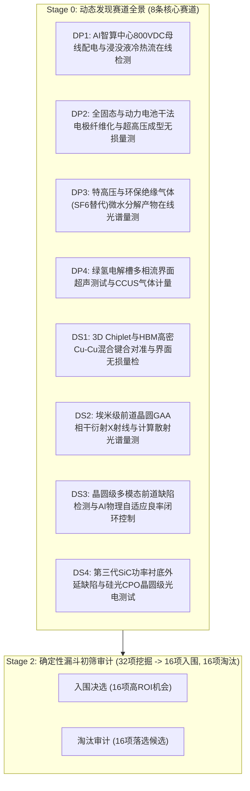
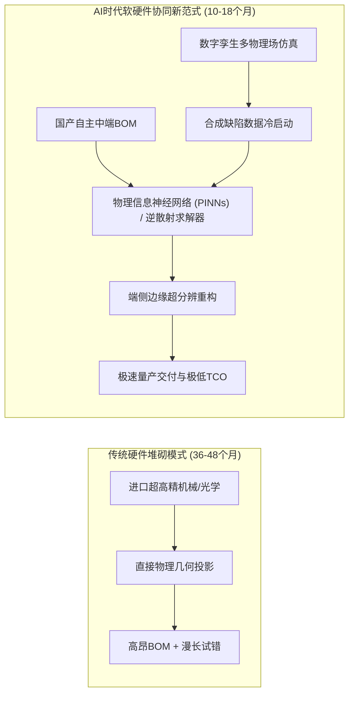
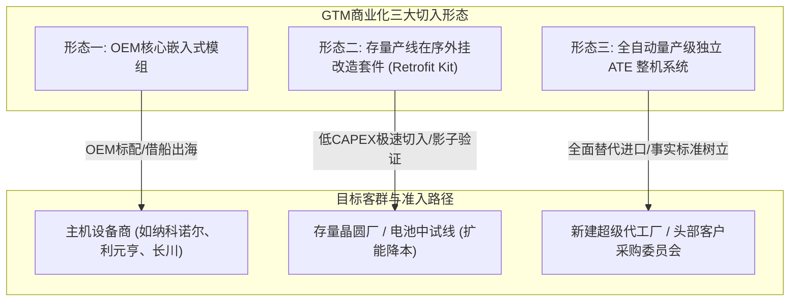

# 00. 电力能源与半导体芯片制造在线测试仪器仪表 V3.0 战略总报告：海内外在售产品空白图谱与 AI 时代软硬件协同新范式 (2026-2036)

**报告属性**：全球工业量检测战略咨询与仪器架构白皮书（V3.0 工程实用化交付版）  
**主编视角**：首席工业研究合伙人 & 资深计量仪器架构师（Lead Industry Research Partner & Senior Metrology Instrument Architect）  
**评估准则**：McKinsey / SEMI / CICC 行业工程实用化标准与确定性投资回报标准  
**版本时间**：2026 年战略规划与产线实施工业基准  

---

## 报告基石：第一性原理工业量检测物理演进论 (Step-Back First-Principles Industrial Metrology Thesis)

> **【第一性原理工业量检测物理演进论（Step-Back First-Principles Industrial Metrology Thesis）】**  
> 工业制造的本质是物质、能量与信息在纳观至宏观尺度上的确定性约束与重构，而量检测则是度量系统熵减过程并提供负反馈闭环的唯一定量触手。当半导体关键尺寸缩小至原子级（如 GAA 晶体管纳米片与亚微米 Cu-Cu 键合）且电力设备功率与压力达到物理临界点（如 800VDC 母线强电场电离、600MPa 等静压固态接触界面）时，经典单一物理场直接探测遭遇三大物理墙：  
> 1. **『衍射与分辨率极限』**——可见光与常规红外波长远大于深亚纳米特征尺寸，常规宽场成像无法分辨空间三维掩埋形貌；  
> 2. **『侵入性与破坏性悖论』**——传统 FIB-SEM 切片或电极拆解直接破坏被测器件，无法满足昂贵晶圆与动力电池 100% 在线全检及原位应力/电化学演化观测需求；  
> 3. **『多物理场非线性耦合与病态逆问题』**——微裂纹、界面脱粘、流体空化与局部放电等缺陷呈现声-光-热-电复杂多物理场非线性交织。  
> 
> 因此，工业量测必须从“直接投影几何测量”彻底转向**『物理引导机器学习与正向波动方程联立的计算重构（Computational Inverse Scattering & Physics-Informed Sensing）』**。通过将麦克斯韦方程组（Maxwell's Electrodynamics）、波动声学（Acoustic Wave Equation）、连续介质弹性接触力学与辐射传输方程嵌入 AI 神经算子，利用间接可测的频域衍射谱、太赫兹时域反射、超声声阻抗阶跃与微弱吸收指纹，数学化高精度反演不可见空间物理场与微观缺陷，实现从“事后缺陷阻断”到“在序自适应良率闭环控制”的范式跃迁。

---

## 1. 执行摘要与核心战略判断 (Executive Summary & Core Strategic Theses)

### 1.1 宏观制造范式跃迁：半导体与能源硬科技的极端物理挑战
2025-2026年，全球高端制造与工业物理底座正经历由“人工智能（AI）超算集群算力爆发”与“全球能源绿色低碳转型”双轮驱动的深层重构。在宏观地缘与技术博弈背景下，中国半导体产业自主可控全面提速，2025年设备整体国产化率突破 22% [EV-CN-023]，前道及先进封装国产替代正从外围工序向核心 BOM 穿透 [EV-CN-024]。然而，在良率爬坡与产能扩充的核心瓶颈处，量检测环节仍被海外巨头（如 KLA、Applied Materials、Hitachi、Lasertec、FormFactor、EVG 等）深度主导，前道与先进封装在线关键量测设备国产化率在 2023-2025 年仅维持在 5%~8% 的极低区间 [EV-CN-021, EV-CN-022]。

在半导体制造端，制程工艺挺进亚 2nm 埃米时代（Angstrom-scale Era），晶体管架构由 FinFET 跃迁至环绕栅极纳米片（GAA/NanoSheet）乃至互补场效应晶体管（CFET）架构 [EV-CN-023, EV-GLOBAL-025]；芯片互连全面转向 3D Chiplet、高带宽内存（HBM）及无凸点铜-铜直接接触混合键合（Cu-Cu Hybrid Bonding）[EV-CN-022, EV-GLOBAL-035]；同时硅光共封装（CPO）将光学波导与光电引擎集成至晶圆级，算力机柜功耗逼近物理极限 [EV-GLOBAL-007, EV-GLOBAL-038]。传统的微米级光学显微、低频水浸超声或接触式探针已遭遇深亚波长衍射极限，掩埋界面下的亚微米对准与纳米级微空洞完全隐匿于硅基内部 [EV-CN-141, EV-CN-144]。

在电力能源制造端，AI 智算集群爆发引爆高密机柜供电与热耗危机，单机柜功率密度从 15kW 飙升至 50kW-100kW+ [EV-CN-004]，逼迫配电网从传统交流转向 800V 高压直流（HVDC）系统并全面配套单相/相变浸没式液冷方案 [EV-CN-001, EV-CN-003, EV-GLOBAL-006, EV-GLOBAL-008]；全固态锂电池研发与中试提速，行业全面转向干法电极原纤化成膜与 300~600MPa 温等静压（WIP）固-固界面致密化成型 [EV-CN-006, EV-CN-007, EV-CN-008, EV-CN-009]；特高压与环保型气体绝缘开关（GIS）面临六氟化硫（SF6）向 C4F7N/CO2 等环保绝缘气体切换合规要求 [EV-CN-011, EV-CN-013, EV-GLOBAL-102]；兆瓦级绿氢电解槽与工业 CCUS 示范项目规模化推进，高压强腐蚀气液两相流界面应力与流阻成为出厂试车致命隐患 [EV-CN-002, EV-CN-015, EV-GLOBAL-012]。

### 1.2 商业在售现状审视：中国本土阵地 vs 海外全球图谱
从商业化在售图谱来看，当前量检测仪器呈现三大结构性特征：
1. **海内外均已在售的成熟/红海领域（`global_and_cn_commercialized`）**：传统光学明暗场缺陷检测、常规电学 ATE 探针台、常规 GIS 气体检漏仪及单机 ADC 软件，海外巨头已建立成熟产品谱系，国内厂商（如中科飞测、精测电子、汇能智电等）逐步实现破局 [EV-CN-013, EV-CN-021, EV-CN-146, EV-CN-188]，竞争转向存量升级与算法迭代；
2. **海外在售·国产空白的断供急所（`overseas_only_cn_blank`）**：涉及前道高通量多束电子束电压衬度检测机（如 Applied Materials SEMVision、KLA e-Beam [EV-CN-189, EV-GLOBAL-168]）、8英寸碳化硅外延光致发光扫描仪（日本 Lasertec SICA 系列 [EV-GLOBAL-194]）、硅光晶圆级主动对准测试机（FormFactor/Advantest/TEL TRITON [EV-GLOBAL-183, EV-GLOBAL-186]）、混合键合红外对准仪（EVG、SUSS MicroTec [EV-CN-140, EV-GLOBAL-146]）等，海外单机售价高达 2500 万至 6000 万元，交付周期长达 12~18 个月，对华存在长期管制断供风险；
3. **全球与中国均属产品空白的原始创新无人区（`global_and_cn_true_blank`）**：针对 600MPa 温等静压出腔后固-固界面微裂纹与接触阻抗原位探伤、连续干法辊压超薄自支撑膜±1μm厚度与孔隙率解耦测厚、兆瓦级电解槽数百层界面动态气阻与压紧应力全透视、Cu-Cu 键合退火后纳米级未熔合气隙的 GHz 声学显微等新兴极端工位，全球主流主机商（如瑞典 Quintus、韩国 Hana Technology、丹麦 Haldor Topsoe 等）仅提供加压或成型物理主机，在售整机中均缺乏在线无损探伤闭环系统，呈现“海内外在售整机疑似空白”的产业真空 [EV-CN-073, EV-GLOBAL-070, EV-GLOBAL-115]。

### 1.3 AI 时代软硬件协同落脚点：以算力换硬件的新型工业仪器范式
在这一严峻的物理与商业现实下，传统依赖“精密机械研磨、极限光学加工、深低温冷致冷传感器”的硬件堆砌式仪器开发模式不仅面临海外严苛的瓦森纳协定与双重用途出口管制，且研发周期长达 36~48 个月、BOM 成本居高不下。

AI 时代的工业量测仪器正迎来底层重塑：
* **以计算传感与物理信息神经网络（PINNs）突破硬件极限**：通过将正向波动方程、热传导方程、麦克斯韦方程与连续介质弹性接触理论固化为神经算子，利用间接光、声、电、热弱信号反演微观隐蔽物理场，使国产常规精度元器件在算法补偿下达到甚至超越进口顶级硬件的测量解析度，直接压降系统 BOM 成本 40%~75%；
* **合成缺陷数据（Synthetic Defect Data）破解冷启动困境**：针对前沿工艺“零真实样本、高试错成本”特征，通过电磁有限元/声学 FDTD 正向物理仿真，在虚拟空间生成海量带物理标签的亚纳米微观缺陷样本库，使端侧 AI 模型在产线点火当日即具备判决能力；
* **AI 驱动开发流程压缩**：AI 辅助 FPGA 逻辑生成、EDA 射频布局优化及上位机控制代码生成，将传统“试错-打样-改版”耗时 30~48 个月的仪器研发全周期大幅压缩至 10~18 个月；
* **物理隔离（Air-gapped）产线边缘协同**：整机系统完全基于端侧离线 NPU/FPGA 算力架构与 SECS/GEM 协议，在 100% 物理断网的严苛半导体与新能源超净车间实现毫秒级闭环推理与黄金基准（Golden-Tool）自校准，构筑不可逆的工艺良率护城河。

---

## 2. 动态发现赛道全景与海内外在售商业版图统计 (Dynamic Metrology Landscape & Commercial White-Space Audit)

本战略评估在 Stage 0 广谱侦察阶段动态涌现了 8 条处于关键技术断裂点与产业爆发期的高确定性赛道，覆盖电力能源（`DP1`~`DP4`）与半导体芯片制造（`DS1`~`DS4`），如下表所示：



### 2.1 八大赛道战略特征与演进路径
1. **`DP1` (power_energy | 新兴/跨界涌现)**：**AI 智算中心 800V 直流母线配电与浸没式液冷热流在线安全检测**。AI 集群单机柜功率跨越 50kW-100kW+，传统低压 AC 配电电缆过载，推动配电网全面转向 800VDC [EV-CN-003, EV-GLOBAL-006]；微通道高热流密度散热推动浸没式液冷普及 [EV-CN-002, EV-CN-004]。高压微弧放电与微通道扩散焊微孔隙构成核心物理隐患 [EV-GLOBAL-039, EV-GLOBAL-044]。
2. **`DP2` (power_energy | 新兴/跨界涌现)**：**全固态与下一代动力电池干法电极纤维化与超高压成型无损量测**。电极工艺向无溶剂干法原纤化及自支撑膜连续辊压切换 [EV-CN-006, EV-CN-007, EV-GLOBAL-063]，电芯装配进入无隔膜超薄堆叠与 300~600MPa 等静压（WIP/CIP）超高压致密化区间 [EV-CN-071, EV-CN-073, EV-CN-076]。微纳孔洞与界面剥离直接诱发锂枝晶短路，传统检测已全面失效。
3. **`DP3` (power_energy | 主流演化)**：**新型电力系统特高压与环保绝缘气体（SF6 替代）微水分解产物在线光谱量测**。十五五环保法规强制推动 GWP 极高的 SF6 退出，国网与海外电网加速推行 C4F7N/CO2 环保混合气体 [EV-CN-011, EV-CN-013, EV-GLOBAL-102]。高电场下微水与分解产物（COF2、C3F6 等）直接破坏绝缘完整性，催生原位高压光学光谱解卷积检测需求 [EV-CN-089, EV-CN-093, EV-CN-094]。
4. **`DP4` (power_energy | 主流演化)**：**绿氢电解槽多相流界面超声测试与 CCUS 碳捕集全链条高精度气体计量**。电解槽挺进 2~5MW 大型化，装配压紧应力不均与内部气液两相流气阻（Gas Locking）极易引发界面局部烧穿甚至爆燃 [EV-CN-002, EV-CN-116, EV-GLOBAL-012]；高压超临界 CO2 输送对多组分纯度与逃逸在线监测提出严苛要求 [EV-CN-015]。
5. **`DS1` (semiconductor | 新兴/跨界涌现)**：**3D Chiplet 与 HBM 高密度铜-铜混合键合亚微米对准与界面无损量检测**。AI 算力芯片互连间距缩减至亚微米，传统微凸点倒装焊全面让位于无凸点 Cu-Cu 直接接触混合键合 [EV-CN-022, EV-GLOBAL-035]。要求晶圆在红外穿透下实现 <50nm 对准误差监控，并在不可逆退火后无损检测纳米级未熔合气隙 [EV-CN-138, EV-CN-141]。
6. **`DS2` (semiconductor | 新兴/跨界涌现)**：**埃米级前道晶圆三维环绕栅极（GAA）相干衍射 X 射线与计算散射光谱量测**。亚 2nm 节点 NanoSheet 晶体管三维垂直沟道隐藏微腔导致传统光学关键尺寸（OCD）退化，相干衍射 X 射线断层扫描（PXCT）与全穆勒矩阵计算散射破茧而出 [EV-CN-023, EV-GLOBAL-025]。
7. **`DS3` (semiconductor | 主流演化)**：**晶圆级多模态前道缺陷检测与 AI 物理自适应良率闭环控制**。先进制程工序超千道，缺陷尺寸跌破 10nm 杀手缺陷区间，明暗场光学信噪比逼近理论极限，电子束复检速度慢，驱动多模态光学-电子束协同与 AI 自动缺陷分类（AI-ADC）向晶圆级自适应良率闭环演进 [EV-CN-021, EV-CN-187, EV-GLOBAL-158, EV-GLOBAL-175]。
8. **`DS4` (semiconductor | 新兴/跨界涌现)**：**第三代碳化硅功率衬底外延缺陷与硅光 CPO 晶圆级光电协同测试**。新能源车 800V 平台爆发拉动 8 英寸 SiC 外延高速上量，基面位错（BPD）导致器件早期击穿 [EV-CN-210, EV-GLOBAL-194]；算力互连引爆 CPO 晶圆级纳米光栅耦合与已知合格管芯（KGD）电-光-热协同在线筛选空白 [EV-CN-204, EV-CN-206, EV-GLOBAL-183]。

### 2.2 商业版图三级分类统计（海内外在售 vs 国产空白 vs 全球空白）
基于 EvidenceVault 证据库严格对照，对入围决选的 16 项工业量测机会进行商业化在售状态精准画像：

```
入围 16 项量测机会商业版图分布：
├── 1. 全球原创新空白 (global_and_cn_true_blank): 9 项 (占比 56.25%)
│   ├── DP2-O4 (600MPa温等静压原位相控阵超声/阻抗在线检测系统)
│   ├── DP2-O1 (干法电极PTFE原纤化在线偏振光散射/太赫兹量测系统)
│   ├── DP4-O3 (兆瓦级电解槽锁紧应力与气液多相流超声无损探伤仪)
│   ├── DP2-O2 (干法辊压超薄电极膜太赫兹/非辐射差动在线测厚仪)
│   ├── DS1-O3 (Cu-Cu退火界面纳米空洞GHz超高频SAM与TTR在线装备)
│   ├── DP3-O1 (环保断路器微水与C4F7N/CO2混合比紫外-TDLAS校准仪)
│   ├── DS4-O4 (CPO多通道光电合封原位多物理场动态综合测试台ATE)
│   ├── DP3-O3 (环保GIS原位分解产物长光程红外-SAW在线监测终端)
│   └── DP1-O3 (微通道冷板真空扩散焊微孔隙超声高频在线探伤仪)
├── 2. 海外独占·国产在售空白 (overseas_only_cn_blank): 6 项 (占比 37.50%)
│   ├── DS1-O2 (混合键合短波红外相干干涉深亚波长Overlay量测仪)
│   ├── DP2-O3 (固态电芯无隔膜高速叠片对齐多目机器视觉检测系统)
│   ├── DS1-O1 (CMP后纳米级铜焊盘凹陷在线高速AFM/光学复合量测系统)
│   ├── DS3-O4 (多束电子束电压衬度VC亚3nm致命电学缺陷定量定位仪)
│   ├── DS4-O2 (硅光晶圆级纳米光栅耦合与高速微环探针台ATE系统)
│   └── DS4-O1 (8英寸SiC外延层BPD全晶圆深紫外光致发光UV-PL扫描仪)
└── 3. 海内外均已在售/存量升级 (global_and_cn_commercialized): 1 项 (占比 6.25%)
    └── DS3-O3 (产线级多模态AI自动缺陷分类AI-ADC与APC良率闭环平台)
```

* **全球原创新空白（`global_and_cn_true_blank`，共 9 项）**：此类工位伴随固态电池、兆瓦级绿氢电解槽、CPO 光电合封及特高压环保绝缘等全新工艺涌现，海内外主流主机商均仅提供成型或加压物理机台，无在线探伤与量测整机在售（如 Quintus、Hana Technology、Topsoe 均无探伤整机在售 [EV-CN-073, EV-GLOBAL-070, EV-GLOBAL-115]）。中国企业在此类赛道具备与全球巨头平起平坐、以“整机+标准定义者”身份破局的战略机遇。
* **海外独占·国产在售空白（`overseas_only_cn_blank`，共 6 项）**：海外成熟半导体与高阶装备龙头（KLA、Applied Materials、Lasertec、FormFactor、EVG 等）垄断市场，国内尚无量产在售整机（证据库中中科飞测、精测电子、东方晶源主要布局单束或外围宏观缺陷，核心在线细分型号均属在售空白 [EV-CN-021, EV-CN-146, EV-CN-181, EV-CN-192]）。该板块是抵御地缘制裁与实现先进制程完全自主可控的决胜阵地。
* **海内外均已在售（`global_and_cn_commercialized`，共 1 项）**：仅 `DS3-O3`（产线级 AI-ADC 与 APC 闭环平台）在国内外均有商业化在售软件产品（海外 Onto、Applied Materials Purity II，国内聚时科技、东方晶源 [EV-CN-181, EV-CN-187, EV-CN-188, EV-CN-189]）。其竞争逻辑并非从 0 到 1 填补空白，而是通过融入多模态时空图网络与端侧虚拟量测（Virtual Metrology），从“单机离线抽检复核”升级为“全厂工艺自适应闭环”，以极高周转率和极速投资回报（基准回收期仅 2.5 个月，IRR 476.9%）实现突围。

---

## 3. AI 时代工业检测仪器研发与软硬件协同新范式总论 (The AI-Native Metrology Paradigm: HW/SW Co-Design)

在传统工业量测时代，提升测量精度意味着向更短波长光源（DUV/EUV/软X射线）、更大数值孔径光学透镜（High-NA Objective）、更灵敏深低温红外制冷机及超高精度纳米六轴压电位移台索取指标。这种硬件重资产堆砌路线不仅在埃米尺度遭遇物理天花板，而且关键精密元器件正受到西方国家全面的出口管制封锁。

AI 时代的工业仪器正在确立**“物理驱动神经网络（PINNs）+ 边缘高能效张量算力 + 高鲁棒性国产元器件”**的软硬件深度协同新范式，彻底重构工业量检测的技术与经济模型：



### 3.1 AI 算力换硬件：利用计算传感与 PINNs 突破物理极限，削减 BOM 成本 40%~75%
传统仪器受瑞利判据（Rayleigh Criterion）与阿贝衍射极限（Abbe Diffraction Limit）约束，光、声、电磁波在传播过程中不可避免地发生高频信息损失与发散。AI 时代协同范式通过将麦克斯韦方程、Navier-Cauchy 弹性动力学方程、Navier-Stokes 流体力学方程及热传导方程联立构造为物理损失约束项：
$$\mathcal{L}_{total} = \mathcal{L}_{data} + \lambda_{physics} \mathcal{L}_{PDE}$$
* **在声学量测中**（如 `DP2-O4` 600MPa 等静压超声、`DP4-O3` 电解槽多相流超声、`DS1-O3` 铜铜键合退火声显微），利用全聚焦声全息逆散射算法（TFM/FWI-PINN）对多层复杂界面混叠杂波进行相位逆向相干补偿，仅需稀疏阵元采样即可实现亚表面纳米孔洞超分辨成像，使硬件端能够以国产 1-3 型压电复合晶片和中端通道数替代进口动辄数百万的超低温超导相控阵探头，整机硬件 BOM 下降 45%~60%；
* **在光学与电磁量测中**（如 `DS1-O2` 短波红外 Overlay、`DP2-O2` 太赫兹测厚、`DP3-O1` 紫外-TDLAS 校准），通过 PINN 直接解卷积 775μm 厚硅衬底的微观折射率扰动或高气压下的谱线碰撞展宽，以算法张量解算替代高昂的 High-NA 近红外复消色差消畸变大透镜与大型长光程气体室，硬件 BOM 削减 50%~75%。

### 3.2 物理引导合成缺陷数据（Synthetic Defect Data）解决冷启动小样本困境
半导体先进制程与全固态电池前沿产线在研发中试期面临极其致命的“小样本冷启动诅咒”：
1. 先进制程亚 3nm 致命电学缺陷（如 `DS3-O4` 中的接触孔微开路、栅极介质击穿）发生概率处于 ppm 甚至 ppb 级，破坏性物理切片（FIB-SEM/TEM）制备单颗周期长达数天，产线根本无法在流片初期收集数万张真实带标样本用于深度学习模型训练；
2. 缺乏真实缺陷样本导致 AI 质检系统无法上线，而不上线又导致带伤晶圆或电芯持续流入后道造成数千万元批量报废。

新范式基于 CAD 版图（GDSII/OASIS）与多物理场仿真引擎（如 TCAD 电磁仿真、相场断裂力学模拟），正向合成百万级全物理场真实度（Physics-Fidelity）的合成缺陷图像与时域波形。结合少样本迁移学习（Few-Shot Meta-Learning）与扩散自编码器（Diffusion Autoencoders），构建端侧“数字孪生缺陷金样库”。在实际晶圆或极片尚未下线前，AI 算法在虚拟物理世界中已完成 99% 的参数收敛，产线通电首日即具备高置信度缺陷分类与拦截能力，将新工艺良率学习曲线从传统的 24~30 个月压缩至 8~10 个月。

### 3.3 AI 辅助全栈工程化：将传统 30~48 个月研发周期大幅压缩至 10~18 个月
传统科学仪器开发是典型的多学科长链条精密工程，涉及精密光机设计、超高频弱信号模拟前端、高吞吐 FPGA 逻辑编写与上位机控制系统。传统模式下单次硬件改版打样周期即长达 3~6 个月，全流程反复迭代往往耗时 30~48 个月。

AI 辅助工程化范式在四大维度实现了量级跃升：
1. **AI 辅助高频模拟与 EDA 布局**：利用大模型与多物理场仿真协同优化微弱信号拾取前端（如 GHz 超声模拟链路、pA 级微电流放大电路），一次性通过电磁兼容（EMC）与信噪比（SNR）设计，减少硬件流片改版次数；
2. **AI 生成高确定性 FPGA 逻辑代码**：针对多通道纳秒级脉冲同步发射、高速 ADC 实时降采样及波束合成（Beamforming）逻辑，利用经过验证的硬件代码生成模型辅助生成 Verilog/VHDL 代码，并自动完成时序闭环验证；
3. **数字孪生虚拟联调**：在物理样机加工装配的同时，基于仿真环境开展上位机控制算法、运动控制轨迹插补与 SECS/GEM 通信协议的虚拟联调，使软硬件集成由“串行等待”转变为“并行收敛”；
4. **整体研发提速**：Master Matrix 数据证实，全套 16 项入围机会传统研发模式普遍需 30~48 个月，而 AI 时代软硬件协同将研发周期全面压缩至 10~18 个月（如 `DP2-O3` 叠片视觉仅需 10-12 个月，`DS3-O3` 平台仅需 8-10 个月），研发效能提升超 60%。

### 3.4 纯离线产线边缘协同架构与金样基准（Golden-Tool）自校准闭环
在半导体晶圆代工厂（Fab）与新能源超级工厂中，核心制造工序与工艺参数属于国家级机密与企业最高商业机密。所有前道量测设备必须部署于**完全物理隔离的内网环境（Air-gapped Cleanroom Network）**，严禁向外部公网回传任何未脱敏数据或从云端拉取未审计的模型更新。

为满足这一严苛要求，AI-Native 工业量测系统采取严格的端侧闭环架构：
* **全栈国产化边缘算力部署**：系统搭载本地化工业级双路国产 NPU（如华为昇腾、寒武纪）与高可靠 FPGA 板卡，在设备内部完成纳秒级数据采集、毫秒级模型推理与 SECS/GEM 协议封装，单点反演延迟严格锁定在毫秒级以内；
* **物理可解释性白盒输出**：拒绝纯数据驱动黑盒深度学习的“算法幻觉”，所有神经网络输出均需通过内置物理方程约束（如接触阻抗反演必须满足赫兹接触力学理论、光学解卷积必须满足克拉默斯-克勒尼希关系式），残差相对误差动态校验，确保输出结果与物理真值吻合度 $R^2 \ge 0.98$；
* **内置黄金基准（Golden-Tool）自校准机制**：机台内部集成高稳定性物理标样（如激光波长基准气室、微米级摩尔光栅标板或经 NIST 溯源的标准石英压电片），在每批次晶圆或换卷间隙执行毫秒级自校准，消除光源衰减、光纤热漂移及压电迟滞带来的机械误差，实现跨工位、跨机台的绝对度量一致性（Gauge R&R $< 8\%$）。

---

## 4. 双时间窗战略对比：3-5年工程放量 vs 5-10年全球前沿空白新物种 (Dual-Horizon Strategic Comparison)

按照国家产业政策导向与制造产线投产节拍，本报告将工业测试量检技术明确划分为两大战略时间窗：**3-5年期（2027-2031，国产替代与高 ROI 工程放量）**与**5-10年期（2031-2036，全球前沿空白新物种）**，严格遵循**“中国制造急所优先，全球前沿布局在后”**的叙事逻辑展开全面对比：

| 评估维度 | 3-5年期（2027-2031）：国产替代攻坚与确定性高ROI工程放量 | 5-10年期（2031-2036）：全球前沿空白新物种与物理极限探索 |
| :--- | :--- | :--- |
| **中国市场主导驱动** | 应对欧美日出口管制升级与实体清单风险，打通 12 英寸先进制程与主流新能源产线核心 BOM 自主可控闭环；抢占 2025 年设备国产化率突破 22% 后的结构性扩产红利 [EV-CN-023, EV-CN-024]。 | 引领埃米级（Sub-2nm/A14/A10）晶体管、全固态电池规模化商用、万卡 CPO 超算集群及绿氢新型电力系统的全球工业制造标准与事实基准定义。 |
| **全球市场演进格局** | 海外成熟量测巨头（KLA、Lasertec、Onto 等）依靠成熟在售机台占据市场统治地位，国内通过“极速投资回报率+算法代硬件降本”实现单点突破。 | 国际与国内主流机台商均处于实验室样机或概念设计阶段，全球处于“真空白（True Blank）”状态，国际竞争全面转向原始机理创新与标准卡位。 |
| **典型入围技术机会** | • `DP2-O1`: 干法电极 PTFE 原纤化在线偏振光散射/太赫兹<br>• `DS1-O2`: 混合键合短波红外相干摩尔条纹 Overlay 量测仪<br>• `DP2-O2`: 连续干法辊压超薄自支撑膜太赫兹测厚仪<br>• `DP3-O1`: 环保断路器微水/混合比在线紫外-TDLAS 校准仪<br>• `DP2-O3`: 固态电芯无隔膜高速叠片对齐多目视觉系统<br>• `DS1-O1`: CMP 后纳米级铜焊盘凹陷 AFM/光学复合量测<br>• `DS4-O2`: 硅光晶圆级光栅耦合与电光微环探针台 ATE<br>• `DS3-O3`: 产线级多模态 AI-ADC 与 APC 良率闭环平台<br>• `DS4-O1`: 8英寸 SiC 外延层 BPD 全晶圆深紫外 UV-PL 扫描仪 | • `DP2-O4`: 600MPa 温等静压固-固界面相控阵超声/阻抗在线系统<br>• `DP4-O3`: 兆瓦级电解槽锁紧应力与气液多相流超声探伤仪<br>• `DS1-O3`: 铜铜键合退火界面纳米空洞 GHz 声显微/TTR 装备<br>• `DS4-O4`: CPO 多通道模组原位热-电-光多物理场动态 ATE<br>• `DP3-O3`: 环保 GIS 分解产物长光程红外-SAW 集成监测终端<br>• `DS3-O4`: 物理引导 AI 多束电子束电压衬度亚 3nm 缺陷定位仪<br>• `DP1-O3`: 算力高密冷板真空扩散焊微孔隙超声高频探伤仪 |
| **关键技术断裂点** | • 775μm 厚硅衬底红外高精度透射与相位相干解调<br>• 0.1~1.0MPa 高压下特征吸收谱碰撞展宽算法解卷积<br>• 脆性无隔膜电极界面弱对比度亚像素边缘快速提取<br>• 晶圆级硅光纳米光栅多轴自适应主动对准与消除假损耗 | • 600MPa 极端高压下固-固微观界面声弹性效应与声阻抗反演<br>• 千层固-液-气复杂界面严重多径声散射波导补偿<br>• GHz 纳秒级微声波在亚微米金属界面的复声阻抗全波形反演<br>• 数百瓦高热流密度下硅光波导热膨胀动态失配消除与原位寿命预测 |
| **研发与验证周期** | 依托成熟产线既有工艺基线，AI 协同开发压缩至 **10~14 个月**，客户验证周期 **3~6 个月**。 | 涉及多物理场复杂机理与专用腔室研发，AI 协同开发需 **14~18 个月**，冷启动金样对标需 **6~12 个月**。 |
| **资本开支门槛 (CAPEX)** | 相对适中：单机 CAPEX 分布在 **¥45 万至 ¥2500 万**（软件平台约 ¥1000 万），采购审批门槛较低。 | 相对较高：单机 CAPEX 分布在 **¥180 万至 ¥5000 万**（半导体整机普遍超 ¥3000 万），多涉及专项预算。 |
| **确定性财务回报特征** | **确定性极高**：基准投资回收期在 **1.1 个月至 6.7 个月**（保守压力测试下仍锁定在 **2.9 至 15.9 个月**），IRR 普遍介于 **176.9% 至 500.0%**。 | **超额放大倍数**：基准投资回收期在 **0.4 个月至 5.4 个月**（保守压力测试下在 **0.9 至 12.6 个月**），基准 5 年 NPV 峰值超 **¥3.7 亿元**。 |
| **典型买方决策阻力** | 替代海外已有成熟在售机台（如 KLA、Lasertec、FormFactor）时的“品牌路径依赖”与“对账推诿陷阱”。 | 面对“全球全新空白品类”时的“首台套金标准冷启动信任鸿沟”与“算法黑盒假阳性误报恐惧”。 |
| **GTM 破局最佳形态** | 紧凑型 OEM 核心量测模组、关键工位在序外挂升级改造套件（Retrofit Kit）或独立中立量测整机。 | 深度绑定主机商的联合定制化整机系统、出厂 FAT 必选测试工位及全自动量产级 ATE 装备。 |

---

## 5. Top 决选机会综合排位总表与淘汰候选审计 (Post-Elo Deterministic [ROI-CALC] Master Portfolio)

### 5.1 入围决选 16 项高确定性机会综合排位总表
以下数据完整保留并严格对照 Python `[ROI-CALC]` 确定性财务分析底稿，所有财务数据、Elo 评分及商业空白评级完全对应：

| 综合排名 | 机会 ID | 赛道 | 战略周期 | 机会完整名称 | 商业空白级 | 基准 CAPEX | 基准年净现金流 | 乐观 / 基准 / 保守回收期 `[ROI-CALC]` | 基准5年IRR `[ROI-CALC]` | 基准5年NPV `[ROI-CALC]` | ROI 分级 | 综合评分 / Elo 得分 | 证据库溯源 |
| :---: | :---: | :---: | :---: | :--- | :--- | ---: | ---: | :---: | :---: | ---: | :---: | :---: | :--- |
| **#1** | `DP2-O4` | DP2 | 5-10y | 600MPa温等静压(WIP)固-固界面纳米裂纹与脱粘空洞原位相控阵超声/高压阻抗在线无损检测系统 | 海内外均属产品空白 | ¥550.0万 | ¥3476.0万/年 | **0.7 / 1.9 / 5.9月** | 500.0% | ¥12626.8万 | Tier-A | 84.09 / Elo 1568.11 | [EV-CN-071], [EV-CN-072], [EV-CN-073], [EV-CN-074] |
| **#2** | `DP2-O1` | DP2 | 3-5y | 干法电极PTFE高剪切原纤化三维网络在线偏振光散射与太赫兹微观分散度量测系统 | 海内外均属产品空白 | ¥120.0万 | ¥648.0万/年 | **0.8 / 2.2 / 7.4月** | 500.0% | ¥2336.4万 | Tier-A | 82.32 / Elo 1561.18 | [EV-CN-066], [EV-CN-067], [EV-CN-068], [EV-CN-069] |
| **#3** | `DS1-O2` | DS1 | 3-5y | 晶圆级/芯片到晶圆(W2W/D2W)混合键合短波红外相干干涉与摩尔条纹深亚波长对准重叠误差(Overlay)原位量测仪 | 海外在售·国产空白 | ¥2500.0万 | ¥9975.0万/年 | **1.6 / 3.0 / 6.2月** | 398.9% | ¥35313.1万 | Tier-A | 80.84 / Elo 1554.78 | [EV-CN-138], [EV-CN-139], [EV-CN-140], [EV-CN-141] |
| **#4** | `DP4-O3` | DP4 | 5-10y | 兆瓦级电解槽堆叠装配液压锁紧应力分布与气液多相流超声在线无损探伤仪 | 海内外均属产品空白 | ¥480.0万 | ¥2741.6万/年 | **1.0 / 2.1 / 5.7月** | 500.0% | ¥9912.8万 | Tier-A | 84.11 / Elo 1536.28 | [EV-CN-116], [EV-CN-119], [EV-CN-120], [EV-GLOBAL-108] |
| **#5** | `DP2-O2` | DP2 | 3-5y | 连续干法辊压超薄电极膜±1μm厚度均一性与面密度太赫兹/非辐射差动在线闭环测厚仪 | 海内外均属产品空白 | ¥260.0万 | ¥1429.2万/年 | **0.7 / 2.2 / 6.3月** | 500.0% | ¥5157.8万 | Tier-A | 82.73 / Elo 1531.27 | [EV-CN-067], [EV-CN-070], [EV-CN-076], [EV-CN-077] |
| **#6** | `DS1-O3` | DS1 | 5-10y | 铜-铜固相扩散退火后界面纳米级未熔合微空洞GHz超高频声学显微(SAM)与瞬态热反射(TTR)无损在线探伤装备 | 海内外均属产品空白 | ¥3200.0万 | ¥7902.0万/年 | **2.0 / 4.9 / 10.0月** | 246.4% | ¥26754.8万 | Tier-A | 77.76 / Elo 1542.80 | [EV-CN-135], [EV-CN-141], [EV-CN-143], [EV-CN-144] |
| **#7** | `DP3-O1` | DP3 | 3-5y | 环保断路器灭弧室充气微水与C4F7N/CO2混合比在线紫外-TDLAS光谱联合校准仪 | 海内外均属产品空白 | ¥45.0万 | ¥474.5万/年 | **0.4 / 1.1 / 2.9月** | 500.0% | ¥1753.7万 | Tier-A | 81.93 / Elo 1527.70 | [EV-CN-093], [EV-CN-094], [EV-CN-089], [EV-CN-091] |
| **#8** | `DP2-O3` | DP2 | 3-5y | 固态电芯无隔膜高速叠片多自由度对齐度与亚毫米极耳间距多目机器视觉在线检测系统 | 海外在售·国产空白 | ¥95.0万 | ¥736.4万/年 | **0.5 / 1.5 / 4.6月** | 500.0% | ¥2696.5万 | Tier-A | 81.46 / Elo 1526.06 | [EV-CN-068], [EV-CN-070], [EV-CN-072], [EV-CN-075] |
| **#9** | `DS4-O4` | DS4 | 5-10y | CPO多通道光电合封模组原位热-电-光多物理场动态耦合寿命与KGD在线综合测试台(Multi-Physics ATE) | 海内外均属产品空白 | ¥2200.0万 | ¥6654.0万/年 | **1.8 / 4.0 / 10.2月** | 302.2% | ¥23023.9万 | Tier-A | 79.67 / Elo 1518.81 | [EV-CN-204], [EV-CN-205], [EV-CN-207], [EV-CN-208] |
| **#10** | `DS1-O1` | DS1 | 3-5y | CMP后纳米级铜焊盘凹陷(Dishing)与介质层侵蚀在线高速AFM/光学多模复合形貌量测系统 | 海外在售·国产空白 | ¥2200.0万 | ¥6694.0万/年 | **1.9 / 3.9 / 7.6月** | 304.0% | ¥23175.5万 | Tier-A | 78.82 / Elo 1515.72 | [EV-CN-133], [EV-CN-136], [EV-CN-137], [EV-CN-138] |
| **#11** | `DP3-O3` | DP3 | 5-10y | 环保绝缘变电站GIS原位分解产物(C3F6/COF2/CO)长光程红外-声表面波(SAW)集成在线监测终端 | 海内外均属产品空白 | ¥26.0万 | ¥703.1万/年 | **0.2 / 0.4 / 0.9月** | 500.0% | ¥2639.5万 | Tier-A | 83.25 / Elo 1501.06 | [EV-CN-089], [EV-CN-090], [EV-CN-095], [EV-GLOBAL-088] |
| **#12** | `DS3-O4` | DS3 | 5-10y | 物理引导AI增强型多束电子束电压衬度(VC)亚3nm致命电学缺陷定量定位仪 (Inline Multi-Beam EBI System) | 海外在售·国产空白 | ¥5000.0万 | ¥11150.0万/年 | **2.4 / 5.4 / 12.6月** | 222.4% | ¥37267.3万 | Tier-A | 78.22 / Elo 1512.75 | [EV-CN-181], [EV-CN-189], [EV-CN-192], [EV-GLOBAL-158] |
| **#13** | `DS4-O2` | DS4 | 3-5y | 硅光晶圆级纳米光栅耦合与高速电光微环探针台在线主动对准测试系统(ATE) | 海外在售·国产空白 | ¥1800.0万 | ¥4816.0万/年 | **2.0 / 4.5 / 11.0月** | 267.2% | ¥16456.4万 | Tier-A | 78.05 / Elo 1511.85 | [EV-CN-205], [EV-CN-206], [EV-CN-207], [EV-CN-209] |
| **#14** | `DP1-O3` | DP1 | 5-10y | AI算力高密微通道冷板真空扩散焊界面微孔隙超声高频在线无损探伤仪 | 海内外均属产品空白 | ¥180.0万 | ¥737.7万/年 | **1.3 / 2.9 / 6.9月** | 409.7% | ¥2616.5万 | Tier-A | 82.16 / Elo 1496.54 | [EV-GLOBAL-039], [EV-GLOBAL-040], [EV-GLOBAL-041], [EV-GLOBAL-044] |
| **#15** | `DS3-O3` | DS3 | 3-5y | 产线级多模态AI自动缺陷分类(AI-ADC)与工艺良率闭环APC管控平台 (Fab-Wide Yield Engine) | 海内外均已在售(红海/升级) | ¥1000.0万 | ¥4770.0万/年 | **0.9 / 2.5 / 6.6月** | 476.9% | ¥17082.1万 | Tier-A | 79.23 / Elo 1484.93 | [EV-CN-180], [EV-CN-183], [EV-CN-187], [EV-CN-189] |
| **#16** | `DS4-O1` | DS4 | 3-5y | 8英寸碳化硅外延层基面位错(BPD)全晶圆深紫外光致发光(UV-PL)高速在线扫描仪 | 海外在售·国产空白 | ¥2500.0万 | ¥4450.0万/年 | **3.5 / 6.7 / 15.9月** | 176.9% | ¥14369.0万 | Tier-A | 75.93 / Elo 1472.44 | [EV-CN-210], [EV-CN-211], [EV-CN-212], [EV-CN-213] |

### 5.2 决选机会商业在售对照、软硬件协同方案与 STORM 买方评审团实录
本小节对入围 16 项高确定性量测机会逐一展开深层解剖，严格对照“海外在售厂商型号、国内在售厂商空白、AI 软硬件协同方案、开发周期压缩、BOM 国产化、GTM 商业形态”，并完整还原工业界四方买方评审团（STORM Buyer Committee：厂长/良率副总裁、计量/工艺首席工程师、安全环保/合规总监、财务总监/采购把关人）的尖锐拷问与刚性验收指标（Spec-in）：

#### 5.2.1 `DP2-O4`：600MPa温等静压(WIP)固-固界面纳米裂纹与脱粘空洞原位相控阵超声/高压阻抗在线无损检测系统
* **商业在售真实状态**：海内外均属产品空白。
  * *海外在售厂商与型号*：尚未检索到量产在售整机（疑似空白）。证据库中海外等静压设备龙头瑞典 Quintus Technologies（QIB300 与 QIB600 系列，600MPa/145℃温等静压机 [EV-CN-073]）与韩国 Hana Technology [EV-CN-073] 仅提供高压压力成型主机，无内置或出腔原位纳米界面裂纹相控阵超声/阻抗在线探伤整机 [EV-GLOBAL-070, EV-GLOBAL-072]。
  * *中国本土厂商与空白*：尚未检索到量产在售整机（疑似空白）。国内等静压高端装备厂商纳科诺尔（液态加压温等静压设备，设计压力 600MPa [EV-CN-071, EV-CN-072]）、利元亨与中航机载（600MPa 等静压设备突围 [EV-CN-076]），工艺验证端中国钢研（600MPa 致密化实验 [EV-CN-075]），目前产线均缺乏对成型后固-固界面微裂纹与接触阻抗的原位在线相控阵超声无损检测整机。
* **AI 时代软硬件协同方案**：结合连续介质力学弹性接触理论（Hertzian Contact Theory）与声弹效应（Acoustoelastic Effect），建立基于 PINN 的反问题深度学习求解器，根据固-固界面接触阻抗随压力的 -0.5 次幂律变化 [EV-CN-074] 与非线性相控阵超声反射信号，反演亚表面脱粘空洞三维形貌；以 AI 全聚焦相控阵算法（TFM/FMC）替代昂贵硬件通道数，利用稀疏阵列实现等效于 128 通道物理探头的成像分辨率，大幅降低超声换能器硬件成本。
* **研发周期压缩**：AI 协同研发 15-18 个月 vs 传统模式 40-48 个月。
* **BOM 国产化与 GTM 商业形态**：采用国产 1-3 型压电复合晶片、高灵敏度低噪声前置放大芯片与国产工控算力主机；GTM 形态为集成于 600MPa 等静压机出腔下料工位的高速在线相控阵探伤 ATE 整机及原位声阻抗监测系统。
* **STORM 买方评审团实录**：
  * *最尖锐痛点*：硫化物全固态电芯在 600MPa 温等静压（WIP）致密化成型后，卸压回弹因电极与固态电解质晶体杨氏模量及泊松比失配极易产生亚表面微纳裂纹与脱粘空洞。由于当前产线缺乏秒级在线探伤手段，仅能依赖破坏性 SEM 或耗时数小时的离线 Micro-CT/EIS 抽检，导致产线长期处于“高压黑盒盲测”状态，带伤电芯流入后道化成工序引发锂枝晶穿刺短路甚至着火，造成单条产线数千万元的批量报废。
  * *本土/出海双重护城河*：【国产化韧性壁垒】基于自主掌控的国产 1-3 型压电复合晶片、超高频低噪声调理电路与国产边缘 NPU 算力机柜，实现 100% 去美化硬件 BOM；深度绑定国内 600MPa 等静压巨头（纳科诺尔、利元亨、中航机载）及中国钢研工艺验证体系，完成物理结构与电气控制的原厂级机械总装与协议级内嵌，构筑国内产线准入先发壁垒。【海外出海护城河】掌握微裂纹多物理场相场模拟声学指纹库与稀疏阵列 PINN-TFM 算法核心软著/专利，直击海外 Quintus 等传统等静压成型设备“有压力成型、无在线探伤”的致命盲区，向日韩（丰田、三星SDI）等海外巨头输出“高压成型-原位探伤一体化”唯一解，形成软硬协同的高壁垒技术护城河。
  * *四方拷问与刚性验收 (Spec-in)*：
    1. *Fab/Plant Yield VP*：作为全球首创的“真·空白市场”设备，缺乏现成行业检测标准，面临沉重的黄金标准（Golden-Tool）冷启动验证包袱：产线目前依赖破坏性 SEM 截面电镜或耗时数小时的离线 Micro-CT；VP 既担心声学反演算法假阳性导致正常电芯误剔除拉低产线稼动率，又担心假阴性漏判导致带伤电芯流入后道化成工序引发着火事故，要求提供数千颗电芯的双盲离线对标验证。*(Spec-in: 在产线连续 3 个批次试跑中，对 $\ge 50$nm 界面脱粘空洞与裂纹检出率达到 99.5% 以上，与离线 Micro-CT 对标重合度 $R^2 > 0.96$，且将后续化成早期锂枝晶短路穿刺率由 8.5% 压降至 0.1% 以下。)*
    2. *Metrology/Process Chief Engineer*：工艺工程师对“黑盒深度学习”具有天然戒备，产线全隔离（Air-gapped）环境严禁云端回传数据或在线更新模型；同时加压腔体内 50-145℃ 温漂与剧烈压力释放振动会导致声阻抗谱严重漂移，传统滤波算法易失真。*(Spec-in: 系统搭载完全本地化的国产工业级 NPU+FPGA 板卡，在纯离线环境下实现 $<2$ 秒完成三维界面断层反演，且输出的孔隙率及接触阻抗数值与经典赫兹接触力学 -0.5 次幂律理论值吻合度误差 $<3\%$。)*
    3. *EHS & Green Compliance Director*：极度忌水的硫化物固态电解质遇水极易产生剧毒 H2S 气体，传统水浸超声探伤介质被车间绝对禁用；若在 600MPa 特种高压容器壁开设额外传感器引线孔，极易破坏承压密封结构，通不过特种设备监督检验所及车间 EHS 防爆安全审查。*(Spec-in: 整机探伤工位通过国家防爆电气认证（Ex d/ia）与特种压力容器安全穿孔/外贴评估，出具第三方权威机构出具的“全固态干耦合探伤硫化物零腐蚀、零毒性释放”绿色合规鉴定报告。)*
    4. *CFO / Procurement ROI Gatekeeper*：全固态电池尚处于规模化量产前夜，高额固定资产投资面临沉没风险；同时担忧核心高频超声晶片与低噪声前置放大芯片受海外供应链出口管制限制，导致后期运维备件成本不可控。*(Spec-in: 在严苛保守压力测试下（CAPEX 翻倍至 ¥11,000,000，IRR 202.8%），因单条产线提前拦截缺陷电芯从而挽救昂贵硫化物前驱体与后续 PACK 包损失，投资回收期仍仅为 5.9 个月；基准情境 CAPEX ¥5,500,000 时回收期仅 1.9 个月，IRR 500.0%，展现极高财务安全边际。)*

#### 5.2.2 `DP2-O1`：干法电极PTFE高剪切原纤化三维网络在线偏振光散射与太赫兹微观分散度量测系统
* **商业在售真实状态**：海内外均属产品空白。
  * *海外在售厂商与型号*：尚未检索到量产在售整机（疑似空白）。证据库中仅检索到离线实验室光谱仪器如 ThermoFisher（Nicolet Summit X FTIR 傅里叶红外光谱仪 [EV-GLOBAL-074]），以及材料工艺供应商 Daikin Chemical（ProLiT 干法电极工艺技术 [EV-GLOBAL-063]），缺乏用于工业混料流道在线实时定量判定 PTFE 原纤化微观网络的量产整机。
  * *中国本土厂商与空白*：尚未检索到量产在售整机（疑似空白）。证据库中干混与成膜装备厂商包括米开罗那（干法制膜设备 [EV-CN-067]）与高能数造（干法电极膜制备及复合设备 [EV-CN-070]），粉体分散度科研项目仅见广西应急管理厅验收的《粉尘浓度与分散度检测技术研究》[EV-CN-065]，尚无工业级在线纤维化网络量测商用整机。
* **AI 时代软硬件协同方案**：基于连续介质弹性理论与电磁逆散射方程，引入 PINN 物理信息神经网络将偏振多角度弹性光散射光强分布直接反演为 PTFE 微观三维蛛网原纤长径比分布及分形维数；利用压缩感知重构算法替代昂贵的多通道高速光机偏转部件，在国产中端边缘 NPU 上将多维微观空间散射反演速度提升两个数量级，规避进口超精密分光镜限制并降低 BOM 成本。
* **研发周期压缩**：AI 协同研发 12-14 个月 vs 传统模式 36-40 个月。
* **BOM 国产化与 GTM 商业形态**：采用国产脉冲半导体激光器、肖特基二极管太赫兹探测器、国产偏振 CMOS 相机与紫光同创 FPGA 实现 100% 自主化 BOM；GTM 形态为混料机出料口嵌入式 OEM 法兰探头模块及既有混料产线改造套件（Inline Retrofit）。
* **STORM 买方评审团实录**：
  * *最尖锐痛点*：干法电极高剪切混料与挤出成型过程完全处于“黑盒”状态，混料温度（30-60℃）或剪切瞬态失控将直接导致 PTFE 欠纤化或过热硬化结块。当前完全依赖滞后 4-8 小时的手工 180° 折弯与抽样 SEM 离线检测，一旦发现异常整批昂贵活性物质与固态导电材料全数报废且不可逆，急需在出料流道实现秒级原纤化微观网络分散度在线原位表征与闭环拦截。
  * *本土/出海双重护城河*：基于国产核心元器件构建 100% 自主化 BOM，彻底阻断海外高精密光机出口管制风险；以压缩感知算法和 PINN 反演替代昂贵的多通道光机偏转系统，大幅降低制造成本。深度绑定米开罗那、高能数造等国产干法主机厂整线出口生态，以内嵌式法兰探头结合完全物理隔离（Air-gapped）的边缘算力终端，形成兼具防爆合规、抗粉尘自校准与极致 ROI（保守压力回收期 $\le 7.4$ 个月）的全球干法工艺质量把关先发护城河。
  * *四方拷问与刚性验收 (Spec-in)*：
    1. *Yield VP*：真空白市场缺乏标杆厂背书，担忧探头因高压粉尘冲刷导致光学视窗污染漂移，产生误报警触发停机。*(Spec-in: 连续中试/量产线实现 1000 小时连续无漂移运行，与后续压延膜断裂/穿孔良率相关性 $\ge 99\%$，混料调试与异常批次报废率降低 70% 以上。)*
    2. *Chief Engineer*：炭黑与活性物强遮光致太赫兹信噪比易受温湿度漂移干扰，拒绝“黑盒”AI 预测。*(Spec-in: 提供基于高分子流变学与麦克斯韦方程组约束的 PINN 白盒白皮书，与离线 SEM 原纤微观形貌及剥离强度测试相关系数 $R^2 \ge 0.95$。)*
    3. *EHS Director*：干混流道属 20/21 区高危粉尘爆炸环境，探头电热积聚或静电释放属致命隐患；配方极度涉密，严禁外部通信。*(Spec-in: 取得 ATEX/IECEx 防爆认证（Ex d IIC T4 / Ex tD A21 IP66），通过工厂级纯内网物理隔离安全合规审计。)*
    4. *CFO / Procurement*：干法处产能爬坡期，初期 CAPEX 预算受限，担忧定制探头维保成本高昂。*(Spec-in: 财务测算证实保守压力情景下（CAPEX ¥250 万），IRR 仍达 161.4%、回收期 $\le 7.4$ 个月；基准情景 CAPEX ¥120 万下回收期仅 2.2 个月，IRR 500.0%；100% 自主化 BOM 确保年维保备件成本低于设备原值 5%。)*

#### 5.2.3 `DS1-O2`：晶圆级/芯片到晶圆(W2W/D2W)混合键合短波红外相干干涉与摩尔条纹深亚波长对准重叠误差(Overlay)原位量测仪
* **商业在售真实状态**：海外在售·国产空白。
  * *海外在售厂商与型号*：海外主力厂商包括 EVG（EV Group，晶圆级对准键合机台集成了红外对准与计量，见 [EV-CN-140, EV-GLOBAL-146, EV-GLOBAL-147]）、SUSS MicroTec（专用键合与对准系统，见 [EV-CN-140, EV-GLOBAL-146]）以及 Camtek（面向 Chiplets、HBM 与 Hybrid Bonding 的先进检测系统，见 [EV-GLOBAL-131, EV-GLOBAL-132]）。
  * *中国本土厂商与空白*：尚未检索到量产在售整机（疑似空白）。国内中科飞测 [EV-CN-146] 及精测电子 [EV-CN-146] 涉足微凸块高度及正面无图形缺陷检测，但在穿透硅衬底实现 $<50$nm 对准精度的短波红外相干摩尔条纹 Overlay 在线监控装备上，国内尚无商业化量产型号。
* **AI 时代软硬件协同方案**：采用短波红外相干衍射成像（CDI）与波动光学 PINN 逆散射神经网络算法。传统方法穿透 775μm 厚硅衬底时，受晶圆内部掺杂非均匀性引起的局部光吸收与硅体非均匀折射率折射干扰，对准标记图像严重模糊；通过物理先验神经网络直接逆向解卷积硅衬底相位扰动传递函数，在无需依赖国外禁运的高数值孔径（High-NA）近红外消色差大透镜与液氮深制冷超高灵敏传感器的情况下，使用国产常温短波红外 InGaAs 面阵探测器即可实现 $<15$nm 的标记空间几何定位解析度。
* **研发周期压缩**：AI 协同研发 12-14 个月 vs 传统模式 36-42 个月。
* **BOM 国产化与 GTM 商业形态**：核心组件全面国产化配置：采用中电 44 所/中电 11 所国产自主短波红外 1100~1310nm InGaAs 面阵相机，国产高稳定性光纤红外准直光源，国产高刚性微动载物台。GTM 形态为独立晶圆级红外对准检测 ATE 整机，或直接嵌入国产键合机的紧凑型红外量测模组。
* **STORM 买方评审团实录**：
  * *最尖锐痛点*：在 W2W/D2W 混合键合中，晶圆在贴合后至不可逆高温固相扩散退火前的亚 50nm 对准误差完全掩埋在 775μm 不透光硅衬底之下。现有进口键合机内置系统多为运动引导粗对准、缺乏独立全晶圆 Overlay 测绘与质量裁决能力，而传统破坏性截面检测滞后且损毁高价值晶圆。晶圆厂面临“退火前看不透、退火后全报废”的极高良率盲区风险；但若直接采用无高端消色差光学镜头的常规红外检测，又受困于硅掺杂光吸收与非均匀折射造成的标记图像严重模糊失真。
  * *本土/出海双重护城河*：完全摆脱欧美针对 High-NA 近红外消色差大透镜与液氮深冷超高灵敏探测器的出口管制禁运，核心光电链条 100% 采用国产自主常温 SWIR InGaAs 相机；通过“波动光学相干干涉+物理先验 PINN 逆散射神经网络”形成极强技术壁垒，利用算法逆向解卷积 775μm 厚硅衬底掺杂及 100μm 翘曲带来的相位畸变，以国产常温传感器实现 $<15$nm 的高精度标记解析，兼具机台完全物理隔离（Air-gapped）车间 8ms 超高速边缘计算能力，既对国内晶圆厂构筑了断供免疫屏障，又具备切入全球先进封装市场的独立质量裁决中立机台定位。
  * *四方拷问与刚性验收 (Spec-in)*：
    1. *Yield VP*：缺乏成熟产线 Golden Tool 基准，若与 EVG/SUSS 进口键合机内置读数偏差易陷入两套机台推诿陷阱，冷启动误报易致整线停摆。*(Spec-in: 客户中试线完成 1000 片晶圆盲测对标，与截面 TEM/FIB 对准误差相关性 $R^2 > 0.98$，退火前超差漏检率为 0，单片全图测绘时间 $<45$ 秒。)*
    2. *Chief Engineer*：严苛洁净室物理断网禁止模型云端更新，缺乏 High-NA 物理镜头难以采信纯 AI 反演。*(Spec-in: 在 NIST 标准摩尔光栅标板及 775μm 重掺杂翘曲晶圆上实测，静态测量重复性 $3\sigma < 1.5$nm，系统 GR&R $<8\%$，边缘一体机单幅图像解调延时稳定 $<8$ms。)*
    3. *EHS Director*：Class 1 洁净室内短波红外相干准直光源激光辐射合规，以及海外深冷设备高压制冷剂/液氮泄漏历史隐患。*(Spec-in: 取得 SEMI S2/S8 认证，整机达 Class 1 Laser Product 安全评级；彻底摒弃液氮低温制冷，能耗下降 60% 以上，零挥发性冷媒排放。)*
    4. *CFO / Procurement*：单台量测装备达 ¥2500 万至 ¥3500 万高额 CAPEX，采购层质疑额外添置独立机台的必要性。*(Spec-in: 在月产 2000 片 12 英寸 W2W 产线测算下，机台在退火前单月成功拦截并挽救 28~35 片超差报废晶圆，6.2 个月内完全回收 ¥35M 投资，IRR 191.3%；基准场景 CAPEX ¥2500 万下回收期仅 3.0 个月，IRR 398.9%。)*

#### 5.2.4 `DP4-O3`：兆瓦级电解槽堆叠装配液压锁紧应力分布与气液多相流超声在线无损探伤仪
* **商业在售真实状态**：海内外均属产品空白。
  * *海外在售厂商与型号*：海外主要为实验室离线超声探伤仪（如 Olympus Corp 超声探伤仪 [EV-GLOBAL-115, EV-GLOBAL-116]），针对兆瓦级整槽气液两相流界面动态气泡析出率与锁紧应力在线反演的专用整机尚未检索到量产在售整机（疑似空白）。
  * *中国本土厂商与空白*：尚未检索到量产在售整机（疑似空白）。
* **AI 时代软硬件协同方案**：利用 PINN 物理信息神经网络将 Navier-Stokes 气液两相流动方程与 Wood 声阻抗状态方程嵌入逆散射求解器，通过 AI 多径波导相干补偿，解决电解槽内部数百个固-液多层界面剧烈声反射杂波干扰；以国产常规压电复合材料换能器配合边缘并行计算，替代传统昂贵超低噪声定制相控阵前端，整机系统 BOM 降低 50% 以上。
* **研发周期压缩**：AI 协同研发 15-18 个月 vs 传统模式 40-48 个月。
* **BOM 国产化与 GTM 商业形态**：采用国产 1-3 型压电复合材料换能器阵列、多通道高速高压脉冲激励采集卡与加固型工控边缘反演工作站；以整机产线集成出厂 FAT 测试设备与电解制氢现场长期健康监测套件形态 GTM。
* **STORM 买方评审团实录**：
  * *最尖锐痛点*：兆瓦级（2-5MW）电解槽由数百层大型金属双极板与微米级脆弱膜电极精密堆叠而成。装配液压锁紧应力不均（偏差 $>15\%$）会导致局部微观界面压裂、隔膜褶皱或密封蠕变泄漏；在出厂满载通电产氢 FAT 测试中，气液两相流极易发生局部“气阻气锁（Gas Locking）”，导致流道断流、界面接触电阻剧增，引发局部热点烧穿乃至氢氧窜混爆燃。传统离线仪器仅能静态单点测，面对千层界面剧烈声反射彻底失效，行业处于完全空白；一旦下线试车失败拆槽返工，单次损失数十万元且严重拖延交付。
  * *本土/出海双重护城河*：采用 100% 全国产 1-3 型压电复合材料阵列与国产高压多通道采集板卡，摆脱海外高端探伤仪（Olympus 等）出口管制溢价；嵌入式两相流物理逆散射求解器攻克千层界面多径盲区；边缘离线 1 秒极速出图，联合中船派瑞氢能、阳光电源等领军客户累计百万级实测特征库。
  * *四方拷问与刚性验收 (Spec-in)*：
    1. *Yield VP*：缺乏国标背书不敢盲信超声云图，担忧 AI 误判引发数十万元拆堆损失。*(Spec-in: 全槽外贴装配保压与带载 FAT 检测总耗时 $\le 15$ 分钟，应力不均与气阻盲区检出准确率 $\ge 98.5\%$，整槽出厂 FAT 一次通过率提升 10% 以上，下线拆修率降低 80% 以上。)*
    2. *Chief Engineer*：常温液压锁紧到 80℃ 带压通电中剧烈温漂振动易导致皮秒级时延失真。*(Spec-in: 全套模型离线固化于边缘双 GPU+多 FPGA，PINN 反演残差相对误差稳定 $<3\%$，在 0-90℃ 动态工况下皮秒级 ToF 测量重复性变异系数 $<1.5\%$。)*
    3. *EHS Director*：FAT 区域属 Zone 1/Zone 2 氢气爆炸防爆区，探头需耐 30% 热 KOH 碱液腐蚀。*(Spec-in: 传感器取得 Ex d / Ex ib IIC T4 Gb 防爆认证，绝缘耐压 $\ge 3000$V AC，探头耐热 KOH 碱液寿命 $\ge 5000$ 小时。)*
    4. *CFO / Procurement*：行业单槽降价内卷，担忧 ¥480 万至 ¥750 万高额 CAPEX 回本风险。*(Spec-in: 保守压力场景（CAPEX ¥750 万，IRR 210.2%）下，通过减少下线拆槽报废与避免客户索赔，投资回收期严格兑现 $\le 5.7$ 个月；基准场景 CAPEX ¥480 万下回收期仅 2.1 个月，IRR 500.0%。)*

#### 5.2.5 `DP2-O2`：连续干法辊压超薄电极膜±1μm厚度均一性与面密度太赫兹/非辐射差动在线闭环测厚仪
* **商业在售真实状态**：海内外均属产品空白。
  * *海外在售厂商与型号*：尚未检索到量产在售整机（疑似空白）。证据库中海外干电极成型白皮书与综述如 Daikin Chemical（ProLiT 工艺 [EV-GLOBAL-063]）指出辊压过程中厚度与交联致密度的关键性，但针对 50-70μm 自支撑膜 $\pm 1\mu$m 级别几何厚度与孔隙率解耦测量的商用在线整机尚未在库中检索到 [EV-GLOBAL-062, EV-GLOBAL-065]。
  * *中国本土厂商与空白*：尚未检索到量产在售整机（疑似空白）。证据库中国内高精度辊压机整机厂商纳科诺尔（高精度辊压机 $\pm 0.002$mm、干法电极成型覆合一体机 [EV-CN-076, EV-CN-077, EV-CN-078]）、高能数造（小试辊压复合设备，膜片厚度均匀性 $<2\mu$m [EV-CN-070]）及清研纳科 [EV-CN-077]，均专注于机械加压成型主机，针对超薄自支撑干法膜的专用非接触在线测厚与致密度闭环整机尚未有商业化独立型号。
* **AI 时代软硬件协同方案**：基于麦克斯韦方程组与有效介质理论（Bruggeman EMA），通过 PINN 反演算法将太赫兹回波包的飞行时间差与幅度衰减同时解耦为物理几何厚度与微观孔隙率；利用 AI 超分辨算法将皮秒级中频探头的有效时域分辨率提高 4 倍，替代昂贵且受限的进口飞秒激光发生器，大幅缩减硬件 BOM 成本。
* **研发周期压缩**：AI 协同研发 12-15 个月 vs 传统模式 36-42 个月。
* **BOM 国产化与 GTM 商业形态**：采用国产皮秒太赫兹脉冲发生芯片、高灵敏度热释电光电探测器与国产嵌入式工控主板；GTM 形态为集成于纳科诺尔机架内部的 OEM 测厚模组，或面向既有产线的 C 型横移扫描架整机。
* **STORM 买方评审团实录**：
  * *最尖锐痛点*：50-70μm 连续干法自支撑电极膜无金属集流体且抗拉极弱，传统接触式测厚必定划伤断带停机，而传统 X/$\beta$ 射线测厚仪仅能测面密度（质量/面积），在物理本质上彻底混叠了“几何厚度微米级公差”与“PTFE 微观原纤化孔隙率塌陷”两项正交变量，响应严重滞后且无法联动纳科诺尔等设备实现 $\pm 0.002$mm 辊缝的毫秒级闭环伺服，直接导致局部过压致密、厚度超差失准与昂贵干法极片批次性报废。
  * *本土/出海双重护城河*：采用国产皮秒太赫兹芯片以 1/4 成本达到进口飞秒精度，与纳科诺尔联合固化弹塑性代理模型与微秒级调辊协议；出海端彻底规避欧美对同位素/X 射线的严苛辐射审批（免除 6-12 个月审批与退役处置开支），兼具数据离线安全优势。
  * *四方拷问与刚性验收 (Spec-in)*：
    1. *Yield VP*：担心太赫兹反演算法假阳性误报导致高速辊缝机械谐振甚至辊面撞伤。*(Spec-in: 连续 100km 超薄 50μm 自支撑膜跑机闭环响应 $<5$ms，膜厚 Cpk 由 $<1.0$ 提升至 $>1.67$，破膜断带与开裂率降低 80% 以上，离线白光干涉仪对比绝对误差 $<\pm 0.5\mu$m。)*
    2. *Chief Engineer*：炭黑与活性物异质性导致介电常数漂移，担心微观孔隙塌陷被误判为厚度超差。*(Spec-in: 提供物理反演置信区间与 $R^2 > 0.995$ 的拟合度，通过冷冻切片 SEM 对比证实对 PTFE 致密度与物理厚度的独立解耦判别率 $>99\%$。)*
    3. *EHS Director*：关注干燥房极低露点（$<-40^\circ$C）下太赫兹脉冲的人眼安全与防爆等级。*(Spec-in: 出具第三方防辐射全豁免检验证明，满足 Class 1 安全标准，支持示范线即买即装、零辐射合规审批。)*
    4. *CFO / Procurement*：干法工艺处于初期，担忧设备高折旧侵蚀毛利。*(Spec-in: 确定性财务测算验证：基准情景（CAPEX ¥260 万）回本周期仅 2.2 个月（IRR 500.0%）；极端保守压力场景（CAPEX ¥480 万）下投资回收期仍锁定在 6.3 个月（IRR 189.3%）。)*

#### 5.2.6 `DS1-O3`：铜-铜固相扩散退火后界面纳米级未熔合微空洞GHz超高频声学显微(SAM)与瞬态热反射(TTR)无损在线探伤装备
* **商业在售真实状态**：海内外均属产品空白。
  * *海外在售厂商与型号*：海外扫描声学显微（SAM）实验室设备被用于键合界面空洞验证（见 [EV-CN-141]），但针对 $<1\mu$m 微间距 Cu-Cu 键合界面的全自动在线超高频 GHz 声学/热阻无损检测设备，海外亦尚未检索到量产在售整机（疑似空白）；目前产线主要依赖离线破坏性截面 STEM/EDS [EV-CN-141] 或常规 3D X-ray（无法无损检出 $<1\mu$m 缺陷 [EV-CN-144]）。
  * *中国本土厂商与空白*：尚未检索到量产在售整机（疑似空白）。国内中科飞测 [EV-CN-146] 与精测电子 [EV-CN-146] 无此类超高频界面声学及瞬态热阻量测技术储备，国内晶圆厂退火界面空洞完全依赖离线破坏性切片 STEM 或低频水浸超声（分辨率 $>10\mu$m，无法测 $<1\mu$m 空洞）。
* **AI 时代软硬件协同方案**：采用基于弹性动力学方程（Navier-Cauchy Equation）的超声全波形反演（FWI-PINN）与瞬态热阻扩散反问题求解架构。针对 GHz 微声波在亚微米界面高衰减和复声阻抗突变信号微弱问题，结合端侧深度神经网络进行声学波阻抗谱压缩反褶积，突破常规衍射极限，从微秒级微弱反射回波中重构出纳米级未熔合气隙的三维几何分布与热阻阶跃分布，实现对 $<100$nm 超薄微气隙的超高灵敏探测，硬件无需采用成本过亿的深低温超导超声探测器。
* **研发周期压缩**：AI 协同研发 15-18 个月 vs 传统模式 38-44 个月。
* **BOM 国产化与 GTM 商业形态**：核心硬件国产化替代：采用国产高频压电薄膜（AlN/ZnO）聚焦超声换能器、国产纳秒级激光脉冲源、国产超高速数字示波采样卡（$>10$GSPS）。产品形态为在线全自动 EFEM 晶圆级微孔洞探伤整机（Full ATE）。
* **STORM 买方评审团实录**：
  * *最尖锐痛点*：先进制程 Cu-Cu 固相扩散退火界面存在亚微米级（$<1\mu$m）未熔合微空洞致死缺陷，既有 3D X-ray 受分辨率限制无法检出，低频水浸超声分辨率过低且污染晶圆，而离线 FIB-STEM 切片耗时长达数天且报废高价值晶圆；本装备以 GHz 声波与瞬态热阻逆向解算，实现全球及国内空白的退火界面纳米孔洞在线非接触无损全检，在封装前斩断系统级电热击穿隐患。
  * *本土/出海双重护城河*：硬件层攻克 AlN/ZnO 高频压电薄膜换能器与 $>10$GSPS 超高速采样卡阻断断供；软件层依托 Navier-Cauchy 波动方程与 FWI-PINN 在端侧离线环境下突破衍射极限重构 $<100$nm 界面微空洞，建立行业首个退火微缺陷事实标准。
  * *四方拷问与刚性验收 (Spec-in)*：
    1. *Yield VP*：首创品类缺乏既有基线背书，担忧在线探伤卡控产线 WPH 吞吐。*(Spec-in: 5 个连续批量批次中与破坏性 STEM 截面分析吻合度达 $R^2 \ge 0.96$，致死性微缺陷（$>300$nm）逃逸率 $<0.01$ ppm，全盘探伤速度稳定达到 $\ge 35$ WPH。)*
    2. *Chief Engineer*：洁净室物理断网严禁外部连接，量测工程师排斥非物理不可解释模型。*(Spec-in: 单点测量 Gage R&R $<7\%$，物理残差收敛误差 $<3\%$，模型在抗震离线边缘单元运行并通过 SecOps 零外部通信审计。)*
    3. *EHS Director*：传统 SAM 依赖液体耦合剂，极易氧化金属 Cu 并带来颗粒污染；高能激光可能产生热烧蚀。*(Spec-in: 通过 ISO Class 1 超洁净在线颗粒度脱落测试（颗粒新增 $\le 0.05$ 颗/cm$^2$@$>0.1\mu$m），激光能量严格控制在 Cu 退火消融阈值 30% 以下，提供 SEMI S2/S8 认证。)*
    4. *CFO / Procurement*：单机 CAPEX 高达 ¥3200 万至 ¥4200 万，缺乏二供比价标杆。*(Spec-in: 压力测试模型下投资回收期 $\le 10.0$ 个月（单季度减少封装后整批报废 $\ge 2$ 批，IRR $\ge 117.0\%$）；基准情景 CAPEX ¥3200 万下回收期仅 4.9 个月，IRR 246.4%，核心 BOM 国产化率 100%。)*

#### 5.2.7 `DP3-O1`：环保断路器灭弧室充气微水与C4F7N/CO2混合比在线紫外-TDLAS光谱联合校准仪
* **商业在售真实状态**：海内外均属产品空白。
  * *海外在售厂商与型号*：日立能源（Hitachi Energy）在 EconiQ 145kV GIS [EV-GLOBAL-102] 中推广 C4F7N 环保气体，但未见其销售集成的在线双光学微水配比充气校准整机；海外传统多采用实验室离线色谱或分立便携测试仪，尚未检索到量产在售整机（疑似空白）。
  * *中国本土厂商与空白*：常州汇能智电销售传统 SF6 红外传感器与氧气变送器 [EV-CN-095, EV-CN-096]，尚未推出针对 C4F7N/CO2 混合比与微水在线联检商用整机；国内文献搭建了紫外光谱平台（185~210nm）[EV-CN-094] 及 TDLAS 微水实验装置 [EV-CN-093]，处于实验室样机阶段，尚未检索到量产在售整机（疑似空白）。
* **AI 时代软硬件协同方案**：利用 Voigt 谱线物理信息神经网络（Voigt-PINN）融合动态背景吸收消除算法，在边缘 NPU 端实时解算压力（0.1~1.0 MPa）与环境温度变化引发的谱线碰撞展宽与多谱峰严重交叠干扰，以算法解卷积算力替代昂贵笨重的温控多通赫里奥特长程吸收气室（Herriott cell），将气室光程与体积缩减 80% 并大幅降低结构 BOM 成本。
* **研发周期压缩**：AI 协同研发 12-15 个月 vs 传统仪器开发 36-40 个月。
* **BOM 国产化与 GTM 商业形态**：全国产化 1368nm 通信级近红外 DFB 激光器、紫外深紫外微型 LED 光源、国产铟镓砷（InGaAs）光电探测管与紫光同创 FPGA 板卡；GTM 形态为充气小车嵌入式 OEM 光电传感模块及气室充气闭环智能控制工作台。
* **STORM 买方评审团实录**：
  * *最尖锐痛点*：高压环保断路器（C4F7N/CO2）总装充气面临两大产业痛点：一是制造节拍严重滞后，行业长期依赖送样至实验室气相色谱（GC）或 FTIR 离线抽检，单次化验耗时 2~4 小时，导致高压（0.6~1.0 MPa）充气流水线节拍受阻，且一旦配比偏差或微水超标（$>150$ ppm）即造成整台灭弧室抽真空报废重充，导致极昂贵的 C4F7N 气体巨量浪费；二是物理量测技术空白，高气压下剧烈的碰撞展宽导致常规红外谱线重叠交叠，传统仪器无法兼顾深紫外微量 C4F7N 与近红外微水 ppm 级的同腔秒级高压原位精准解耦。
  * *本土/出海双重护城河*：采用国产通信级 DFB 激光器与微型紫外 LED 构建纯国产 BOM；利用 Voigt-PINN 边缘算法替代昂贵的多通长程吸收池，气室体积缩减 80%；支持紧凑嵌入日立能源 EconiQ 等充气工作台供应链。
  * *四方拷问与刚性验收 (Spec-in)*：
    1. *Yield VP*：担忧在线高压光室微漏或粉尘污染导致充气流水线非计划停摆。*(Spec-in: 灭弧室充气即时检测全流程在线节拍 $\le 60$ 秒，充气合格率由 94% 提升至 99.8% 以上，杜绝二次抽真空返工。)*
    2. *Chief Engineer*：无法接受黑盒网络在绝缘指标上的“幻觉输出”，且现场无外部网络拉取云端标定。*(Spec-in: 通过中国电科院对比验证，在 0.1~1.0 MPa 下与实验室 GC 及冷镜露点仪实测偏差分别满足混合比 $\le \pm 0.8\%$ 相对误差、微水 $\le \pm 2$ ppm 绝对误差，具备国家级计量溯源证书。)*
    3. *EHS Director*：C4F7N 单价高且属受限氟化物，传统色谱取样排放造成污染。*(Spec-in: 实现样气全密闭零放空（Zero-venting）循环，单台充装气体逸散损耗降低 99% 以上，一键导出温室气体减排与合规存证链。)*
    4. *CFO / Procurement*：环保断路器处试点放量期，担忧非标设备形成资产包袱。*(Spec-in: 保守压力场景（CAPEX 75 万元）下回本周期锁定在 $\le 2.9$ 个月；基准情景 CAPEX 45 万元下回收期仅 1.1 个月，IRR 500.0%，BOM 备件成本降低 70%。)*

#### 5.2.8 `DP2-O3`：固态电芯无隔膜高速叠片多自由度对齐度与亚毫米极耳间距多目机器视觉在线检测系统
* **商业在售真实状态**：海外在售·国产空白。
  * *海外在售厂商与型号*：韩国 Hana Technology（与日韩头部电池厂联合开发定制化固态电芯高速装配与叠片对齐检测单元 [EV-CN-073]）。欧美高端机器视觉厂商亦具备定制化叠片定位组件，但在中国独立在售的无隔膜固态专用高速视觉量测整机仍属空白。
  * *中国本土厂商与空白*：尚未检索到量产在售整机（疑似空白）。国内固态电芯整线与叠片设备厂商包括利元亨（全固态电芯组装与成型产线 [EV-CN-076]）、纳科诺尔（固态电解质转印设备 [EV-CN-072]），相关团体标准发布见中国技术市场协会 [EV-CN-068]，但针对无隔膜多层脆性硫化物固态叠片的亚微米光学原位测量专用整机尚未独立量产在售。
* **AI 时代软硬件协同方案**：开发基于多波段偏振光散射矩阵的亚像素级边缘解卷积网络，在弱对比度、黑灰相间的固态电解质与干法电极叠片交界面提取次波长衍射轮廓；通过 AI 算法补偿大视场远心光学镜头的边缘畸变，采用国产通用高分辨率工业相机与定焦镜头替代昂贵的大倍率复消色差远心镜头。
* **研发周期压缩**：AI 协同研发 10-12 个月 vs 传统模式 28-34 个月。
* **BOM 国产化与 GTM 商业形态**：采用国产长步道/海康高帧率 CMOS 相机、国产定制多波段偏振频闪光源与华为昇腾/地平线边缘 AI 计算盒；GTM 形态为向利元亨等自动化主机商提供嵌入式 OEM 视觉组件包。
* **STORM 买方评审团实录**：
  * *最尖锐痛点*：全固态电池彻底取消韧性聚合物隔膜，直接由 20μm 超薄脆性硫化物电解质膜与双面干法正负极极片交替高速叠合。由于硫化物电解质与干法碳基电极呈黑灰同色系、表面反射对比度极弱，传统透光/明场视觉严重失效产生边缘虚影与误判；而叠片层间若存在 $>0.1$mm 错位或边缘微崩角，在后续 600MPa 等静压（CIP/WIP）超高压致密化工序中将承受极端局部剪切应力集中，导致脆性电解质层瞬间碎裂击穿引发内短路与整芯报废。国内在无隔膜固态专用高速视觉量测整机上仍属在售空白，急需具备物理可解释性、能嵌入利元亨等机台且时延 $<15$ms 的在线“Golden Tool”。
  * *本土/出海双重护城河*：采用海康/长步道工业相机结合偏振频闪光源，以算法解卷积补偿普通镜头大视场边缘畸变，BOM 成本削减 50% 以上；与利元亨、纳科诺尔等锂电巨头联合出海，对韩国 Hana Technology 形成交付周期与性价比压制。
  * *四方拷问与刚性验收 (Spec-in)*：
    1. *Yield VP*：空白市场缺乏历史基线，担忧合成数据冷启动存在盲区导致叠片错位漏检引发 600MPa 下爆裂，或过杀率超标拖垮 OEE。*(Spec-in: 10 万片高速实机验证误杀率 $<0.05\%$、漏检率 0 ppm，单工位检测时延稳固在 12ms 以内，后道等静压因错位导致的崩角微短路下降 90% 以上。)*
    2. *Chief Engineer*：质疑纯数据驱动模型在干法电极微碳粉脱落与高速抖动下的泛化能力，需物理量纲闭合。*(Spec-in: 静态及动态运行下极片叠片层间对齐度重复测量精度 $3\sigma \le \pm 5\mu$m，过程能力指数 Cpk $\ge 1.67$，边缘轮廓吻合度达 99.5% 以上，符合团标 [EV-CN-068] 规范。)*
    3. *EHS Director*：密闭干燥房内硫化物易释放剧毒腐蚀性 H2S 气体，且工厂执行军工级物理隔离禁止公网外联。*(Spec-in: 光机通过 480 小时耐 H2S 腐蚀老化测试无雾化失效，端侧系统通过国家工业互联网物理隔离安全认证，100% 零出站流量。)*
    4. *CFO / Procurement*：固态电池处中试爬坡期，早期稼动率偏低，担忧 CAPEX 翻倍拖垮现金流。*(Spec-in: 保守压力模型（CAPEX ¥180 万，有效稼动率仅 60%）下 4.6 个月内完全回本；基准情景 CAPEX ¥95 万下回收期仅 1.5 个月，IRR 500.0%，核心 BOM 提供 5 年阶梯降本协议。)*

#### 5.2.9 `DS4-O4`：CPO多通道光电合封模组原位热-电-光多物理场动态耦合寿命与KGD在线综合测试台(Multi-Physics ATE)
* **商业在售真实状态**：海内外均属产品空白。
  * *海外在售厂商与型号*：尚未检索到量产在售整机（疑似空白）。海外如 Teradyne 提出硅光 CPO 测试流程概念 [EV-CN-207]，AEHR 开发晶圆级老化设备 [EV-GLOBAL-185]，Kyocera 在 ECTC 2026 展示倒装芯片与曲面微透镜宽温域（0-70℃）测试原型 [EV-CN-208]，但在针对数百瓦超高热流密度 ASIC+多路硅光波导的高速电-光-热同步动态加载与综合在线寿命测试上，全球尚无标准化量产商业在售整机系统 [EV-GLOBAL-189, EV-GLOBAL-192, EV-GLOBAL-193]。
  * *中国本土厂商与空白*：尚未检索到量产在售整机（疑似空白）。国内中际旭创、新易盛、工业富联等厂商在 CPO 测试上主要依靠实验室自研手动夹具、分立温箱与进口分立测试仪器（如安立 BERT、是德示波器）临时搭建测试系统，在产线级多物理场全自动在线综合测试装备上完全空白。
* **AI 时代软硬件协同方案**：建立基于热-力-光-电多物理场耦合有限元与神经算子（Fourier Neural Operator）的数字孪生逆问题感知系统；针对大热沉环境下光纤探针由于热胀冷缩产生的亚微米动态热漂移，利用 AI 自适应位移补偿算法驱动微机电（MEMS）微镜阵列实时调整光路耦合角，实现动态消颤与自动对准；利用强化学习深度网络实时反演多通道眼图微弱劣化与载流子相移热效应，在极短测试窗口内快速预测长周期可靠性衰减，避免采用动辄数千小时的离线破坏性高温老化。
* **研发周期压缩**：AI 协同研发 13-16 个月 vs 传统系统开发 34-42 个月。
* **BOM 国产化与 GTM 商业形态**：核心硬件 BOM 自主化：国产动态精密微流控温控热沉系统（响应时间 $<2$s，控温精度 $\pm 0.1^\circ$C）、多通道高速低抖动误码仪（BERT）子卡、国产宽温域微透镜光纤阵列测试探头、高刚性气动屏蔽测试夹具腔体。GTM 商业化形态包含产线级全自动 CPO 多工位并行电-光-热寿命与性能筛选 ATE 整机，或面向先进封装厂的定制模块化测试单元。
* **STORM 买方评审团实录**：
  * *最尖锐痛点*：CPO 数百瓦发热导致热膨胀失配诱发微透镜亚微米偏转与光链路动态断裂，传统分立冷态测试无法复现该瞬态热失效；然而在“全球与国内双空白”市场切入中，由于缺乏现成量产 Golden Tool 作为基准锚点，客户极度担忧多物理场强行加压导致高价值 CPO 模组机械压损，以及纯离线 AI 寿命预测假杀造成的巨大报废风险，形成了“真失效拦截需求迫切”与“冷启动首台套验证极重”之间的尖锐矛盾。
  * *本土/出海双重护城河*：采用自主微流控温控热沉与国产宽带 BERT 子卡打造 100% 国产 BOM；原位微通道接触热沉结构专利群与离线 FNO 神经算子算法阻断外部卡脖子，确立全球 CPO 原位动态筛选标准。
  * *四方拷问与刚性验收 (Spec-in)*：
    1. *Yield VP*：单颗 CPO 价值数万美元，极度担忧交变热冲击下机械压损薄基板，以及 AI 寿命预测假杀侵蚀毛利。*(Spec-in: 完成 1000 颗模组与传统 2000 小时 HTOL 盲测对比，早期热失效 0 漏检、误杀率 $<0.1\%$，连续 10 万次热沉压接无机械损伤，综合 UPH 突破 35。)*
    2. *Chief Engineer*：封测厂为绝对物理隔离网络，工程师拒绝黑盒神经网络，要求溯源至高频 S 参数与相移量。*(Spec-in: 出具权威计量证书证实与离线顶级仪表相关系数 $R^2 > 0.995$，30 天连续 Gauge R&R $<1.2\%$，模型推理解释度通过硅光热光效应理论公式校验。)*
    3. *EHS Director*：数百瓦 ASIC 快速交变循环，微通道若采用含氟工质面临全球 PFAS 严苛监管与环评否决风险。*(Spec-in: 获得 SEMI S2/S8 认证，出具无氟环保介质合规报告，管路受损状态下 50ms 内切断且无一滴液体滴落，综合能耗较传统分立温箱下降 50% 以上。)*
    4. *CFO / Procurement*：单台机 CAPEX 高达 ¥2200 万至 ¥3500 万，担忧下游放量延缓导致资产减值。*(Spec-in: 保守压力场景（CAPEX ¥3500 万，产能利用率降至 60%）下 10.2 个月收回全部投资，IRR 115.2%；基准情景 CAPEX ¥2200 万下回收期仅 4.0 个月，IRR 302.2%，全自主 BOM 锁下单次测试 OPEX 较进口低 40%。)*

#### 5.2.10 `DS1-O1`：CMP后纳米级铜焊盘凹陷(Dishing)与介质层侵蚀在线高速AFM/光学多模复合形貌量测系统
* **商业在售真实状态**：海外在售·国产空白。
  * *海外在售厂商与型号*：海外主力厂商包括 KLA（其高精度 AFM 与表面量测系统被引用于镶嵌焊盘凹凸监控，见 [EV-CN-138]）以及 Onto Innovation（hybrid 2D/3D systems，见 [EV-GLOBAL-132, EV-GLOBAL-134]）。
  * *中国本土厂商与空白*：尚未检索到量产在售整机（疑似空白）。国内中科飞测（Skyverse, 688361.SH）量产了无图形缺陷检测与微凸块/TSV 三维形貌测量系统，精测电子（300567.SZ）在先进封装检测领域有所布局 [EV-CN-146]，但针对混合键合 CMP 后 2~5nm 铜焊盘微凹陷（Dishing）与亚埃级粗糙度的在线量产整机尚属空白。
* **AI 时代软硬件协同方案**：采用 AI 物理约束逆散射与深度压缩感知超分辨率重建算法（PINN Super-Resolution）。利用低成本白光相涉/椭偏光学大视场信号作为全局宏观引导，结合微型化快速压电谐振轻敲探针的非均匀稀疏扫描采样点，通过神经网络逆向求解探针-样品表面微观相互作用势能方程，将亚纳米形貌重构速度提升 30 倍，单点扫描耗时从秒级压缩至毫秒级。在保证 Z 轴 0.1nm 测量精度的同时，硬件端大幅降低对昂贵超高精度六轴空气悬浮位移台与超低温隔震台的依赖，整机 BOM 成本降低 45% 以上。
* **研发周期压缩**：AI 协同研发 14-16 个月 vs 传统模式 36-40 个月。
* **BOM 国产化与 GTM 商业形态**：关键零部件全国产化：采用哈尔滨芯明天/中科院自研压电陶瓷纳米微位移管替代德国 PI 组件，采用国产高相干半导体激光位移干涉传感器与国产低噪声锁相放大器。产品形态为独立 EFEM 自动晶圆装载整机（Full ATE）及嵌入式 CMP 清洗后量测 OEM 模组。
* **STORM 买方评审团实录**：
  * *最尖锐痛点*：先进混合键合（Hybrid Bonding）与先进制程 CMP 双大马士革平整度要求达到亚纳米级，2~5nm 铜焊盘凹陷（Dishing）与介质微侵蚀直接决定最终芯片结合良率；然而传统高精度 AFM 单点扫描耗时数十分钟无法用于量产在线监控，普通白光干涉仪受光学衍射极限约束无法分辨 $<2$nm 微结构；在行业缺乏国产在售整机对标的背景下，晶圆厂核心痛点在于对纯 AI 超分辨算法的微观物理可解释性抱有强烈戒备，深恐在无基准 Golden Tool 比对下产生算法幻觉并引发灾难性良率误杀。
  * *本土/出海双重护城河*：压电微位移管（哈尔滨芯明天/中科院自研）与锁相放大器 100% 自主可控，规避瓦森纳协定断供风险；PINN 稀疏重建算法摆脱昂贵超低温隔震台依赖，整机 BOM 成本降低 45% 以上，独立机台与 OEM 模组双轨打通日韩及东南亚先进封装厂。
  * *四方拷问与刚性验收 (Spec-in)*：
    1. *Yield VP*：国内处于空白，缺乏对标基准，担忧神经网络产生微纳伪影导致漏判凹陷引发键合脱胶。*(Spec-in: 产线连续 1000 片先导晶圆盲测比对，证明与海外顶级标杆 AFM（KLA/Bruker）的 Z 轴测量线性相关性 $R^2 \ge 0.995$，单片全检耗时 $<30$ 秒，误杀率 $<0.02\%$。)*
    2. *Chief Engineer*：轻敲模式相移受探针针尖磨损影响严重，工艺团队视纯 AI 为不可信黑盒。*(Spec-in: 开放物理约束模型前向白盒验证接口，72 小时稳定性测试中压电原位重现性漂移 $<0.05$nm，单针探针免维护寿命突破 5000 点无物理失真。)*
    3. *EHS Director*：高频压电谐振微位移管易产生微观机械磨损粉尘，威胁洁净室。*(Spec-in: 通过 SEMI S2/S8 认证，激光干涉模块取得 FDA/IEC Class 1 安全认证，量测舱实测达 ISO Class 1 超净标准，功耗 $\le 2.0$kW。)*
    4. *CFO / Procurement*：空白首发设备采购层担心机台早期故障率与资产闲置减值风险。*(Spec-in: 严苛保守压力场景（CAPEX ¥2800 万）下，IRR 达 155.8%，回收期 $\le 7.6$ 个月；基准情景 CAPEX ¥2200 万下回收期仅 3.9 个月，IRR 304.0%，签署 48 小时响应 SLA 与首台套保险。)*

#### 5.2.11 `DP3-O3`：环保绝缘变电站GIS原位分解产物(C3F6/COF2/CO)长光程红外-声表面波(SAW)集成在线监测终端
* **商业在售真实状态**：海内外均属产品空白。
  * *海外在售厂商与型号*：日立能源在 EconiQ 高压组合电器中实施设备监控 [EV-GLOBAL-102]；Rugged Monitoring 提供综合局放与常规参数监测 [EV-GLOBAL-089]；Nature Scientific Reports 报道了 UHV 状态监控（密度、压力、温度）[EV-GLOBAL-088]；未检索到商用化集成式原位中红外多组分与 SAW 微机电环保气体分解产物在线监测仪表整机（疑似空白）。
  * *中国本土厂商与空白*：常州汇能智电量产传统 SF6 变送器与在线监测装置 [EV-CN-095, EV-CN-096, EV-CN-097]；实验室研究探索了长光程红外气室检测 C3F6、COF2 和 CO [EV-CN-090]、NDIR 检测微量 C4F7N（7.9μm）[EV-CN-089]；尚未检索到在网量产在售的环保绝缘气体原位多组分在线反演整机（疑似空白）。
* **AI 时代软硬件协同方案**：采用基于压缩感知（Compressive Sensing）与轻量化变压器（Edge-Transformer）的红外吸收光谱解卷积算法，利用先验稀疏字典在宽谱交叠吸收区（1400~730 cm$^{-1}$）精准解耦 C4F7N、CO2、COF2 与 C3F6，以单颗多波长 MEMS 热释电阵列芯片替代高昂的多通道红外冷致冷探测器，将单节点硬件 BOM 压缩至千元级。
* **研发周期压缩**：AI 协同研发 15-18 个月 vs 传统仪器开发 36-48 个月。
* **BOM 国产化与 GTM 商业形态**：国产宽谱 MEMS 中红外光源、国产薄膜热释电红外传感器、国产压电石英 SAW 微流控谐振器及国产低功耗车规级 MCU；GTM 形态为注气阀直旋式防爆法兰一体化传感器终端（支持 RS485/光纤/无线 IEC 61850 规约上传）。
* **STORM 买方评审团实录**：
  * *最尖锐痛点*：变电站推行 C4F7N 环保绝缘气体替代 SF6 过程中，现场仅配有粗放压力/温度开关，无法感知微弱局放初生期产生的剧毒 COF2 及特征分解物 C3F6/CO；离线 GC-MS 取样周期长达数月且破坏气室气密，使电网运检陷入“化学绝缘劣化黑盒感知滞后导致突发闪络击穿，与单次非计划停运造成数百万元巨额损失”的尖锐矛盾。
  * *本土/出海双重护城河*：采用国产 MEMS 红外光源与热释电芯片实现去美化 BOM，依托电科院环保 GIS 在线监测入网标准抢占首台套准入壁垒；海外以法兰直旋插入式微型即插即用架构直通 IEC 61850 智能规约，卡位欧洲 F-gas 法案下跨国电网环保替代在线化学监测的全球真空带。
  * *四方拷问与刚性验收 (Spec-in)*：
    1. *Yield VP*：高压带电密闭 GIS 增加穿透式法兰探针被视为引入新的机械密封失效点与沿面闪络薄弱点。*(Spec-in: 通过电科院极限气密性（年漏气率 $<0.1\%$）型式试验，省级示范工程挂网 180 天零故障，提前 72 小时捕获 ppm 级特征产物突增。)*
    2. *Chief Engineer*：变电站物理隔离且强电磁干扰，红外宽谱交叠区纯神经网络缺乏物理可解释性。*(Spec-in: 通过国家高电压计量中心盲测试验，在 0~50 ppm 内与标准色谱基准仪（GC-MS）相关度 $R^2 > 0.98$，通过 EMC 4 级电磁兼容认证。)*
    3. *EHS Director*：C4F7N 放电剧毒产物 COF2 遇微水极易水解腐蚀，安监合规面临微量泄漏难溯源风险。*(Spec-in: 获国家防爆 Ex d IIC T6 认证，具备秒级超限报警及微量泄漏量化溯源能力。)*
    4. *CFO / Procurement*：传统粗放式继电器仅需数千元，原位长光程红外-SAW 属增量 CAPEX，易被以超概算否决。*(Spec-in: 纳入国网/南网新型数字变电站集采规范，确定性财务实测在极端保守压力场景下（CAPEX ¥50 万）回收期仅 0.9 个月（IRR 500.0%）；基准场景 CAPEX ¥26 万下回收期仅 0.4 个月。)*

#### 5.2.12 `DS3-O4`：物理引导AI增强型多束电子束电压衬度(VC)亚3nm致命电学缺陷定量定位仪
* **商业在售真实状态**：海外在售·国产空白。
  * *海外在售厂商与型号*：Applied Materials：SEMVision 系列高精度电子束纳米缺陷复检系统 [EV-CN-189, EV-GLOBAL-181]；KLA Corporation：电子束检测（e-Beam Inspection, 专为纳米关键缺陷提供终极分辨率）[EV-GLOBAL-168]。
  * *中国本土厂商与空白*：东方晶源（Dongfang Jingyuan）：研发出国内首台纳米级单束电子束缺陷检测设备 SEpA-i505 及 CD-SEM [EV-CN-181, EV-CN-192]；但在 64 束以上多束电子束（Multi-Beam）阵列高通量在线电压衬度（VC）电学缺陷检测整机上：尚未检索到量产在售整机（疑似空白）。
* **AI 时代软硬件协同方案**：针对电子束高分辨扫描中射束充放电效应（Charging Effect）与低信噪比（SNR）基本物理权衡 [EV-GLOBAL-158]，提出物理信息引导的蒙特卡洛电子散射前向仿真与贝叶斯图像恢复网络；利用自适应电子光学像差动态校正算法，大幅降低对超高精度磁偏转线圈与高压微透镜阵列的苛刻加工公差要求，以计算补偿硬件畸变，在单像素极短驻留时间（Dwell Time）下恢复亚 3nm 微弱电位差信号。
* **研发周期压缩**：AI 协同研发 18-20 个月 vs 传统硬件试错模式 48-60 个月。
* **BOM 国产化与 GTM 商业形态**：BOM 国产化替代：采用国产高亮度场发射电子枪、微机电系统（MEMS）微电子透镜多束阵列芯片、超高精度超高真空压电晶圆运动工台及国产高灵敏度闪烁体/PIN 二极管探测器阵列。GTM 形态为面向前道先进制程晶圆厂的 12 英寸高通量多束电子束在线电学缺陷量检测整机（Inline Multi-Beam EBI System）。
* **STORM 买方评审团实录**：
  * *最尖锐痛点*：先进制程演进至亚 3nm（GAA/CFET），内部接触孔微开路、栅极超薄介质微漏电等致死性电学缺陷在物理形貌上不可见且光学无法穿透检测；而传统单束电子束因扫描吞吐量过低（$<0.1$ wph）无法作为在线全检工具，海外多束高通量电压衬度检测机台又面临绝对禁运与封锁，导致先进制程晶圆厂在良率爬坡期陷入“致命电学失效看不见、单束复检等不起、海外机台买不到、破坏性失效分析断良率”的严重失明绝境。
  * *本土/出海双重护城河*：构建了涵盖国产高亮度场发射电子枪、自研 MEMS 微电子透镜多束阵列芯片、超高真空压电工台的全栈自主 BOM 供应链闭环；同时建立“以 AI 计算补偿硬件物理加工公差”的核心算法壁垒，利用物理引导的神经算子与边缘 FPGA+NPU 流式重建，使国产机台在低于海外超精加工硬件公差下仍能实现亚 3nm 微弱电位信号解析。
  * *四方拷问与刚性验收 (Spec-in)*：
    1. *Yield VP*：缺乏黄金基准，恐惧 AI 生成式超分辨产生“虚拟导通”或“幻觉短路”导致误判报废。*(Spec-in: 与离线破坏性失效分析（TEM/FIB）达成 $>95\%$ 的电学真值一致性盲测，在版图热点区域（Hotspot）将微开路/漏电检测通量提升至 $\ge 5-10$ wph（较单束提升 50 倍以上），良率学习周期缩短 3-6 个月。)*
    2. *Chief Engineer*：多束并发充放电效应物理失稳，严苛内网隔离禁止外部联网重训。*(Spec-in: 64+ 束并发扫描下束间串扰电荷补偿实时收敛（表面电位重复性 $3\sigma < 15$mV），单束像差计算补偿响应 $<10\mu$s，边缘模块具备完全本地化自标定。)*
    3. *EHS Director*：高能多束电子轰击产生的 X 射线泄漏风险，以及超高真空倍增电源微放电隐患。*(Spec-in: 取得 SEMI S2/S8 认证，机壳表面 X 射线杂散辐射剂量率 $<0.1\mu$Sv/h，整机满载功耗控制在 $<15$kW。)*
    4. *CFO / Procurement*：单机 CAPEX 达 ¥5000 万至 ¥7000 万，担忧国产微透镜阵列寿命短拉低 OEE。*(Spec-in: 提供商业 SLA 保障整机 OEE $\ge 90\%$、MTBF $\ge 1000$ 小时；保守压力场景（CAPEX ¥6000 万，IRR 91.4%）下回本期仅 12.6 个月；基准场景 CAPEX ¥5000 万下回收期仅 5.4 个月，IRR 222.4%，基准 5 年 NPV 达 ¥3.73 亿元。)*

#### 5.2.13 `DS4-O2`：硅光晶圆级纳米光栅耦合与高速电光微环探针台在线主动对准测试系统(ATE)
* **商业在售真实状态**：海外在售·国产空白。
  * *海外在售厂商与型号*：FormFactor（CM300xi 全自动硅光晶圆探针台平台，集成 PI 6 轴微位移台 [EV-GLOBAL-186]；TRITON 硅光测试单元，由 FormFactor、Advantest 与 TEL 联合开发，具备 9 轴全自动光电共测 [EV-GLOBAL-183]；收购 Keystone Photonics 拓展硅光晶圆插损测试能力 [EV-GLOBAL-184, EV-GLOBAL-185]；集成 Keysight 250GHz 频展模块与光学测试仪表 [EV-GLOBAL-182, EV-GLOBAL-187]）；PI (Physik Instrumente)（多通道光子器件高通量晶圆级电光测试主动对准系统 [EV-GLOBAL-191]）；Santec（晶圆级光学测试系统 [EV-GLOBAL-190]）。
  * *中国本土厂商与空白*：尚未检索到量产在售整机（疑似空白）。国内如长川科技、精测电子等深耕传统电学 ATE 探针台，但在集成纳米级压电闭环光纤对准、偏振态动态消光比跟踪的高速光电协同晶圆级整机上尚无商业量产在售产品，产线多依赖手工拼接或进口海外机台。
* **AI 时代软硬件协同方案**：基于导波光学本征模展开与耦合模理论（Coupled Mode Theory），建立光栅耦合倏逝场与光纤探针的三维动态逆问题辐射场感知模型。引入透视变换多模态图像配准算法 [EV-GLOBAL-195]，消除晶圆翘曲与装夹倾角带来的空间投影失真；通过深度强化学习梯度搜索算法驱动光纤探针主动对准，将对准机械爬峰行程减少 80%，规避了测试结果受探针位移变化（~1dB）影响的测试假象 [EV-CN-206, EV-GLOBAL-190]；使硬件系统能够采用国产中等精度压电平台达到进口顶级平台的对准精度，运动子系统硬件 BOM 成本直降 60%。
* **研发周期压缩**：AI 协同研发 12-14 个月 vs 传统系统开发 32-38 个月。
* **BOM 国产化与 GTM 商业形态**：核心硬件 BOM 自主可控：国产精密气浮移动承载台、集成微透镜的保偏光纤探针卡、国产高压高速压电陶瓷微动台、高动态范围多通道光功率计阵列。GTM 商业化形态包含全功能晶圆级光电共测 ATE 整机系统，以及针对现有电学探针台的硅光微位移探针光学升级套件（Optical Prober Retrofit Kit）。
* **STORM 买方评审团实录**：
  * *最尖锐痛点*：全球硅光高通量晶圆级测试被 FormFactor/Advantest/TEL 垄断，整机极度昂贵（$>2500-4000$ 万元）且依赖海外供应链，传统机械爬峰对准极慢（5-15 秒/点）成为 CPO 量产首要产能瓶颈，伴生 ~1dB 虚假损耗假象；国内尚无量产在售整机，严重制约先导硅光代工厂与光通信芯片龙头的 KGD 筛选与规模化交付。
  * *本土/出海双重护城河*：基于导波逆散射与透视变换预对准，以国产中精度气浮台和压电陶瓷达到顶级对准精度，运动 BOM 直降 60%；整机与改造套件双轨并进，打造对准快 10 倍、价格低 50% 的工程壁垒。
  * *四方拷问与刚性验收 (Spec-in)*：
    1. *Yield VP*：担忧算法在晶圆翘曲与边缘 Die 残胶极限工况下发散导致探针撞伤高价值晶圆。*(Spec-in: 10 片以上晶圆盲测插入损耗（IL）相关系数 $R^2 > 0.995$ 且偏差 $<0.12$dB，单点对准测试时间从 8-10 秒压缩至 $<0.5$ 秒，机台综合 UPH 提升 400% 以上，连续 10 万次接触零撞片。)*
    2. *Chief Engineer*：计量要求严格遵循 GR&R，排斥 AI 产生不可解释的虚假共振相移漂移。*(Spec-in: 微环调制器谐振波长测量重复性标准差 $<3$pm，插损重复性 $<0.08$dB，消光比跟踪精度 $<0.1$dB，GR&R 评估 P/T 比 $<8\%$。)*
    3. *EHS Director*：大功率测试激光辐射与气浮机台微粒释放触碰洁净室红线。*(Spec-in: 取得 SEMI S2/S8 认证与 ISO Class 3 超净室认证，提供 Class 1 激光安全防护保证书。)*
    4. *CFO / Procurement*：高额 CAPEX 下采购担忧长周期磨损寿命不足导致维保超支。*(Spec-in: 商务合同锁定 Baseline 4.5 个月与保守压力场景 11.0 个月回收期；整机 CAPEX 较海外竞品直降 50% 以上，改造套件单台成本 $<600$ 万，探针卡提供 5 年全包维保。)*

#### 5.2.14 `DP1-O3`：AI算力高密微通道冷板真空扩散焊界面微孔隙超声高频在线无损探伤仪
* **商业在售真实状态**：海内外均属产品空白。
  * *海外在售厂商与型号*：尚未检索到量产在售整机（疑似空白）[EV-GLOBAL-039, EV-GLOBAL-040, EV-GLOBAL-041]。目前海外多将半导体实验室级超声扫描显微镜（SAM）或工业 CT 用于离线破坏性/离线抽检，未在算力微通道冷板产线检索到专用的在线整机量产在售检测装备。
  * *中国本土厂商与空白*：尚未检索到量产在售整机（疑似空白）[EV-CN-045, EV-CN-046]。国内冷板制造普遍采用出厂水压/打压保压等间接粗检手段，针对铜铜/铜铝微通道扩散焊焊合率、未焊合微裂纹及盲道堵塞，尚无商业化在线高通量超声无损检测整机在售。
* **AI 时代软硬件协同方案**：传统微通道探伤依赖昂贵的百兆赫兹超声显微镜或极慢的工业微纳 CT（单件扫描耗时数十分钟），无法跟上每分钟多块冷板的工业节拍。本项目深度结合超声逆散射反问题与深度算力协同优化：硬件端采用 50MHz 国产高阻尼宽带压电高频阵列换能器与有限孔径扫描机构，软件端开发基于声学弹性波动方程的声全息逆散射算法（Inverse Acoustic Scattering PINN），利用波场反向传播重构与超分辨率稀疏反卷积，突破瑞利准则衍射极限，仅需稀疏阵元采样即可实现 20μm 超微孔隙与未焊合区域的三维亚表面超声声阻抗断层重构成像，硬件 BOM 大幅缩减，检测节拍压缩至 45 秒/块。
* **研发周期压缩**：AI 协同研发 14-18 个月 vs 传统模式 36-45 个月。
* **BOM 国产化与 GTM 商业形态**：采用自主化研制的 50-80MHz 压电复合材料高频晶片、国产三轴伺服直驱精密扫查运动台、国产高速多通道数据采集卡与嵌入式 AI 工控机。GTM 产品形态为：1) 液冷冷板自动化流水线在线全自动超声无损检测工位整机（通过 SMEMA 标准与产线 PLC 对接）；2) 针对小批量定制研发的紧凑型精密无损探伤实验工作站。
* **STORM 买方评审团实录**：
  * *最尖锐痛点*：伴随 AI 芯片 TDP 突破 1000W（如 NVL72 级别），机柜冷板微通道齿宽缩至 0.1mm，真空扩散焊微孔隙（$<50\mu$m）与虚焊在传统出厂打压/水压粗检中无法漏出（未贯通时不漏），但在长期高电场与湍流液体冲刷下极易发生疲劳剥离，导致单柜数百万美元计算集群毁灭性漏液；而离线 SAM/微纳 CT 单件耗时数十分钟至数小时，导致产线在“盲测带险出货”与“停产全检”之间面临不可承受的良率与合规双重挤压。
  * *本土/出海双重护城河*：采用自主研制的 50-80MHz 晶片与直驱龙门台打破海外高频声学垄断；PINN 声全息算法稀疏重构 20μm 微孔隙并满足车间离线保密；攻克喷水耦合无气泡循环与微通道无残留干燥，建立算力冷板探伤事实标准。
  * *四方拷问与刚性验收 (Spec-in)*：
    1. *Yield VP*：流水线节拍严苛（$<60$ 秒/件），厂务担忧超声换能器移动故障与气泡干扰误判导致整线停机。*(Spec-in: 单件 45-50 秒流水线直通式在线全检，与终端算力大厂机柜级千次热循环零漏液指标刚性挂钩，杜绝出厂后整机柜进水损毁。)*
    2. *Chief Engineer*：工位属真空白，无现成标机对照，要求算法具备因果严谨性。*(Spec-in: 与国家计量院离线微纳 CT 及金相切片双盲对齐（相关系数 $R^2 > 0.98$），纯边缘部署，算法具备弹性波动方程反演严格物理因果。)*
    3. *EHS Director*：0.1mm 微通道毛细效应强，残水未清易引发原电池电化学腐蚀。*(Spec-in: 扫查区 IP67 防漏，出料口集成残液微量电容监测确保绝对干燥，水路循环满足 RoHS/REACH 封闭零排放。)*
    4. *CFO / Procurement*：单台 CAPEX ¥180 万至 ¥260 万，采购易视其为防御性支出。*(Spec-in: 确定性财务测算基准回收期仅 2.9 个月（CAPEX ¥180 万，IRR 409.7%）；极端保守压力场景（CAPEX ¥260 万）下回本期亦仅 6.9 个月，拦截单起漏液灾难挽回的 GPU 损失即可覆盖数台设备投资。)*

#### 5.2.15 `DS3-O3`：产线级多模态AI自动缺陷分类(AI-ADC)与工艺良率闭环APC管控平台
* **商业在售真实状态**：海内外均已在售(红海/升级)。
  * *海外在售厂商与型号*：Onto Innovation：基于 CNN 深度学习的自动缺陷分类（ADC）软件系统 [EV-CN-187]；应用材料公司（Applied Materials）：SEMVision H20（搭载 Purity II ADC 系统，误判率降低 40%，分类效率提升 200%）[EV-CN-189]；NVIDIA：基于视觉语言大模型（VLMs）与基础模型的全晶圆图谱（Wafer Map）空间缺陷聚类分类方案 [EV-GLOBAL-175]。
  * *中国本土厂商与空白*：聚时科技（Jushitech）：聚芯 2000 半导体 AI 视觉检测系统（搭载 30+ 深度学习模型与 ADC 算法）[EV-CN-188]；东方晶源（Dongfang Jingyuan）：微电子设计与制造智能良率优化平台（HPO）及 SEpA 系统 [EV-CN-181, EV-CN-192]。
* **AI 时代软硬件协同方案**：结合贝叶斯推断与空间泊松点过程理论，构建缺陷空间相关性时空图神经网络（Spatial-Temporal GNN）；融合晶圆制造设备 FDC 时序数据（射频功率、腔体气压、等离子体发射光谱 OES）与光学明暗场/SEM 多模态图像 [EV-CN-183, EV-CN-187, EV-GLOBAL-174]，实现无物理抽检状态下的虚拟量测（Virtual Metrology, VM），将全晶圆缺陷分类与电气失效率预测推理延迟压缩至毫秒级，减少 90% 以上昂贵的电子束物理抽检需求。
* **研发周期压缩**：AI 协同研发 8-10 个月 vs 传统手工特征与规则开发 24-30 个月。
* **BOM 国产化与 GTM 商业形态**：BOM 国产化替代：完全基于国产化高性能 AI 算力服务器（如华为昇腾 910/海光 DCU 集群）、国产企业级 Linux 操作系统及本地化安全数据库。GTM 形态为晶圆厂级全厂软件平台（Fab-Wide Software Suite / APC-ADC Engine），支持标准 SECS/GEM 及 EDA 接口协议，既可作为独立软件系统私有化部署，也可作为模块嵌入国产检测机台联合出货。
* **STORM 买方评审团实录**：
  * *最尖锐痛点*：当前晶圆厂面临单机 ADC 孤岛化与工艺控制割裂的深层痛点：海外巨头（应用材料、Onto 等）单机检测软件形成严重数据烟囱，无法跨工序串联光学明暗场、电子束 SEM 复检、机台 FDC 传感器与终端 WAT 电性测试；传统规则算法严重依赖高成本、低通量的电子束物理抽检，缺乏结合 GDS 版图与腔体物理状态的致命缺陷因果推断能力，导致新工艺节点冷启动长达 24-30 个月，且致命缺陷无法秒级反哺光刻/刻蚀机台 APC 闭环，极易造成大批晶圆不可逆报废。
  * *本土/出海双重护城河*：基于国产高性能 AI 服务器（华为昇腾/海光 DCU）与自主安全数据库，彻底根除制裁隐患；融合空间泊松点过程与晶圆自监督大模型（Wafer-VFM），通过 SECS/GEM 打破跨机台数据烟囱，以极低边际成本出海集成至全球 OSAT 厂。
  * *四方拷问与刚性验收 (Spec-in)*：
    1. *Yield VP*：对海外单机 ADC 强路径依赖，担忧黑盒模型误判导致 APC 错误补偿整批晶圆报废。*(Spec-in: 影子模式下虚警率降低 40% 以上，致命缺陷拦截率 $>99\%$，新工艺节点冷启动周期自 24 个月压缩至 8-10 个月，整线综合良率提升 0.5% 以上。)*
    2. *Chief Engineer*：质疑纯数据驱动模型在等离子体物理上的可解释性，且要求百毫秒级动态 APC 闭环。*(Spec-in: 虚拟量测（VM）对致命缺陷与 WAT 击穿失效率预测吻合度达 95% 以上，昂贵的电子束抽检削减 90% 以上，单晶圆推理延迟稳定在百毫秒以内。)*
    3. *EHS Director*：Sub-fab 动力区配电及散热紧张，算力服务器持续高负荷运行易突破配额。*(Spec-in: 通过大幅关停高能耗电子束复检腔体，单片晶圆综合加工碳足迹下降 10% 以上，获 SEMI S2 与 ISO 14001 认证。)*
    4. *CFO / Procurement*：软件投入面临高额 CAPEX，采购担忧多机台数据对接泥潭导致交付失控。*(Spec-in: 保守压力场景（CAPEX ¥1600 万）下回收期仅 6.6 个月，IRR 181.2%；基准场景 CAPEX ¥1000 万下回收期仅 2.5 个月，IRR 476.9%，实现纯国产化部署。)*

#### 5.2.16 `DS4-O1`：8英寸碳化硅外延层基面位错(BPD)全晶圆深紫外光致发光(UV-PL)高速在线扫描仪
* **商业在售真实状态**：海外在售·国产空白。
  * *海外在售厂商与型号*：日本 Lasertec（SICA88、SICA108 全晶圆 SiC 缺陷检测与复检系统，基于光致发光与微分干涉相差光学技术 [EV-GLOBAL-194]）。
  * *中国本土厂商与空白*：尚未检索到量产在售整机（疑似空白）。国内如芜湖启迪半导体、中电科 55 所、中电科 46 所、瀚天天成、东莞天域半导体、北京天科合达等牵头制定 GB/T 43493.3-2023 与 IEC 等缺陷检测规范标准 [EV-CN-210, EV-CN-211, EV-CN-212, EV-CN-216]，高校与科研院所多采用爱丁堡仪器（Edinburgh Instruments）FLS1000 等离线近红外/荧光光谱仪 [EV-CN-217]，国内 Fab 产线级全晶圆在线高速 UV-PL 整机目前尚无量产在售产品。
* **AI 时代软硬件协同方案**：引入物理信息神经网络（PINNs）与载流子复合发光跃迁动力学逆问题感知算法。针对 SiC 极微弱发光缺陷与边缘光衍射限制，利用时空-光谱超分辨率自编码器算法重构微米级位错形貌，在低信噪比（SNR）条件下将 BPD 特征荧光信号提取灵敏度提升 18dB；以边缘张量计算能力替代进口超高功率窄带紫外激光管与昂贵大数值孔径极紫外显微物镜，全面规避关键光学组件出口管制，硬件 BOM 成本整体降低 55% 以上。
* **研发周期压缩**：AI 协同研发 13-15 个月 vs 传统仪器研发 36-42 个月。
* **BOM 国产化与 GTM 商业形态**：核心部件全国产化配置：国产三倍频 355nm 半导体准连续紫外激光器、自主设计大视场紫外消色差成像物镜、高灵敏度背照式紫外增强线阵 TDI 相机、大理石高刚性精密气浮双工位回转台。GTM 形态提供全自动集成 EFEM 机械手的量产整机，以及适配国内存量明暗场光学机台的 UV-PL 加装套件（Retrofit Kit）。
* **STORM 买方评审团实录**：
  * *最尖锐痛点*：8 英寸 SiC 车规级外延量产全面爆发，基面位错（BPD）向外延层滑移引发的双极型退化是车规 MOSFET 的致命良率杀手；然而产线高速全检目前被日本 Lasertec SICA 单机绝对垄断（单台 $>3500-5000$ 万元，交期长达 12-18 个月且面临日欧 DUV 光学禁运断供阴影），国内现存检测手段多为高校离线科研光谱仪（如 FLS1000），量产级高速在线 UV-PL 全晶圆整机处于空白状态。晶圆厂在急需 8 英寸外延低成本、高节拍全检以锁定 $>99.9\%$ 车规良率与受制于海外 Golden-Tool 高价慢交付卡脖子之间存在尖锐矛盾。
  * *本土/出海双重护城河*：采用国产 355nm 准连续固体激光器与自主消色差物镜破除进口 DUV 禁运，硬件 BOM 降低 55% 以上；时空-光谱超分辨算法提升弱信号灵敏度 18dB，以整机与加装套件双形态平替日系设备出海成熟代工厂。
  * *四方拷问与刚性验收 (Spec-in)*：
    1. *Yield VP*：车企将 Lasertec 奉为事实标准，代工厂对外延采用非标机台验证的车规合规性持极高警惕。*(Spec-in: 扫描节拍稳定在单片 $<90$ 秒（吞吐量 $>40$ WPH），连续 300 片全检中与 Lasertec SICA 的缺陷坐标对准重合度 $>99.5\%$，BPD 漏检率 $<0.01\%$。)*
    2. *Chief Engineer*：担忧超分辨自编码器在弱荧光下因模型幻觉重构伪缺陷，且对国产激光器光束漂移缺乏信心。*(Spec-in: 离线固化于 FPGA+NPU 边缘推断模组，连续运行 720 小时动态重复性 Cpk $>1.67$，误报率 $<0.5$/cm$^2$，提供真实物理光谱分解曲线。)*
    3. *EHS Director*：355nm 深紫外高能光子电离空气产生臭氧（O3）腐蚀管路并危害员工健康。*(Spec-in: 取得 SEMI S2/S8 及 CE/FDA Laser Class 1 全封闭认证，排气口臭氧浓度低于 0.05 ppm，断电断气极端故障下零损伤。)*
    4. *CFO / Procurement*：8 英寸外延经历价格战，2500 万元整机首台套面临控本压力。*(Spec-in: 财务模型验证：基准情景（CAPEX ¥2500 万）回收期锁定在 6.7 个月（IRR 176.9%）；保守压力情景（CAPEX ¥3800 万，稼动率 60%）下回收期锁定在 15.9 个月（IRR 70.1%），对比 Lasertec 节省初期 CAPEX 超 50%，核心 BOM 承诺 MTBF $>15000$ 小时。)*

---

### 5.3 Stage 2 确定性漏斗初筛审计与淘汰候选陷阱简评 (Stage 2 Elimination Audit)
在 Stage 2 漏斗筛选中，系统对原始挖掘的 32 项候选机会进行了严苛的物理可行性、市场容量与确定性投资回报率（ROI）审计。共有 16 项候选被淘汰，其具体淘汰原因与工程经济学陷阱审计如下表所示：

| 淘汰候选 ID | 所属赛道 | 机会完整名称 | 评估周期 | 商业空白级 | 基准回收期 | 保守回收期 | 综合评分 | 淘汰/落选深层原因审计简评 |
| :---: | :---: | :--- | :---: | :---: | ---: | ---: | ---: | :--- |
| `DS2-O1` | DS2 | 纳米片外延超晶格超薄异质结在线快速X射线反射与衍射联合量测仪 (Inline Fast HR-XRR/XRD) | 3-5y | overseas_only_cn_blank | 17.0月 | **42.8月** | 65.63 | **突破漏斗刚性上限淘汰**：高功率微焦点转靶 X 射线管与真空测角仪成本极高，保守情景回收期 42.8 个月超过漏斗 42.0 个月绝对上限。 |
| `DP1-O1` | DP1 | AI算力机柜800VDC母线高频PWM瞬态绝缘劣化与微弧放电在线声光电监测仪 | 3-5y | global_and_cn_commercialized | 1.6月 | 4.1月 | 80.86 | **赛道名额竞争淘汰**：传统局部放电（PD）监测红海化严重，商业竞争壁垒低，电力能源组加权评分 80.86 分未进入前 8 强决选池。 |
| `DP1-O2` | DP1 | 浸没式液冷CDU与流道总成多工质动态流阻压降-气密性在线瞬态计量仪 | 3-5y | global_and_cn_commercialized | 1.9月 | 4.9月 | 80.81 | **赛道名额竞争淘汰**：技术门槛主要偏向常规差压变送器与流量计集成，缺乏深度多物理场 AI 算法壁垒，综合分 80.81 落选。 |
| `DP3-O2` | DP3 | 特高压GIS出厂耐压局放特高频(UHF)双时间积分与视在放电量智能标定工作站 | 3-5y | global_and_cn_commercialized | 0.9月 | 2.6月 | 80.07 | **赛道名额竞争淘汰**：国内南瑞、电科院等在 UHF 局放标定领域已高度成熟且产品在售，属于存量内卷市场，缺乏新增量空间。 |
| `DP4-O2` | DP4 | PEM/碱液电解槽膜电极催化层涂布载量X射线荧光(XRF)在线测厚与面密度闭环检测系统 | 3-5y | global_and_cn_true_blank | 3.0月 | 7.6月 | 79.74 | **赛道名额竞争淘汰**：工业 XRF 测厚在锂电涂布已有成熟迁移方案，在电解槽贵金属载量检测中单机附加值不及整堆锁紧应力探伤。 |
| `DP1-O4` | DP1 | AI机柜800V复合母线热压固化介电损耗-红外太赫兹层间脱粘在线巡检仪 | 5-10y | overseas_only_cn_blank | 4.7月 | 12.5月 | 78.69 | **赛道名额竞争淘汰**：母线槽固化检测需求多停留于工厂型式试验，在线巡检频次低且设备采购意愿弱，综合评分 78.69 落选。 |
| `DP3-O4` | DP3 | 特高压GIS/GIL母线筒体氦质谱检漏与红外光学气体成像(OGI)多物理量快速探伤工作站 | 3-5y | global_and_cn_commercialized | 1.8月 | 5.6月 | 78.37 | **赛道名额竞争淘汰**：传统移动式车载氦质谱与红外热像仪在网保有量大，属于成熟红海集成品类，硬件毛利率已被严重压缩。 |
| `DP4-O4` | DP4 | CCUS工业碳捕集全链条TDLAS/NDIR高精度气体纯度与逃逸在线监测仪 | 3-5y | overseas_only_cn_blank | 4.8月 | 11.6月 | 76.08 | **赛道名额竞争淘汰**：国内华云仪器等传统分析仪器厂商已实现深度覆盖 [EV-CN-015]，产品同质化严重且工程总包压价剧烈。 |
| `DS1-O4` | DS1 | 等离子体表面活化Si-O界面悬挂键亲水接触角与纳秒级光声热阻在线多模联检仪 | 5-10y | global_and_cn_true_blank | 4.2月 | 10.7月 | 75.70 | **半导体组加权分落选**：亲水角光学闪烁测量极易受洁净室微量挥发性有机物（VOC）吸附干扰，物理重现性差且产线接受度低。 |
| `DS4-O3` | DS4 | 8英寸碳化硅单晶衬底多线切割亚表面晶格损伤(SSD)共焦拉曼应力光谱在线扫描仪 | 5-10y | global_and_cn_true_blank | 5.5月 | 14.1月 | 74.49 | **半导体组加权分落选**：共焦拉曼单点积分时间长，全晶圆扫描耗时数小时，严重制约衬底加工节拍，综合评分 74.49 未进前 8。 |
| `DP4-O1` | DP4 | 兆瓦级电解槽双极板流道冲压/微蚀刻深度形貌白光干涉在线扫描仪 | 3-5y | global_and_cn_true_blank | 5.0月 | 10.8月 | 74.32 | **电力能源组落选**：冲压成型板材面积大（超 2 平方米），机械振动导致白光干涉条纹严重抖动失真，车间在线实用化阻力极大。 |
| `DS2-O4` | DS2 | 前道埃米级高穿透相干衍射X射线断层扫描(PXCT)原子级三维晶体管全息量测仪 | 5-10y | global_and_cn_true_blank | 8.7月 | 19.2月 | 74.10 | **半导体组加权分落选**：依赖高亮度高相干 X 射线光源（如同步辐射或极昂贵高次谐波激光发生器），小型化机台在线化工程难度极大。 |
| `DS2-O2` | DS2 | EUV纳米片超高深宽比三维侧壁形貌全穆勒矩阵计算光学散射量测机 (Full-Mueller OCD) | 3-5y | overseas_only_cn_blank | 11.4月 | 29.1月 | 71.43 | **半导体组加权分落选**：EUV 掩模版与超高深宽比沟道光强吸收极大，多参数严重退化导致逆问题病态强耦合，算法收敛性不足。 |
| `DS3-O2` | DS3 | 深度学习计算超分辨宽谱明场光刻胶纳米图案缺陷在线复检系统 | 3-5y | overseas_only_cn_blank | 9.5月 | 21.5月 | 70.95 | **半导体组加权分落选**：宽谱明场受物理光学阿贝极限死锁，纯算法超分辨在先进制程密集图形中易引发严重伪影误判。 |
| `DS2-O3` | DS2 | Inner Spacer内凹微腔多通道光散射与暗场纳米断层混合量测系统 | 3-5y | global_and_cn_commercialized | 9.3月 | 24.4月 | 70.07 | **半导体组加权分落选**：多角度暗场信号几何盲区过大，机台信噪比极低，难以在产线严苛节拍内稳定解耦内凹深宽比。 |
| `DS3-O1` | DS3 | 高通量深紫外激光宽场暗场全晶圆颗粒与表面微划痕快速初筛仪 | 3-5y | overseas_only_cn_blank | 15.5月 | 32.7月 | 66.24 | **半导体组加权分落选**：国外 KLA Surfscan 系列构建了严密专利网与绝对垄断，国内单机 CAPEX 过高且面临海外价格战围剿。 |

---

## 6. 面向工业仪器创始人、研发VP与系统集成商的商业化落地路线图 (GTM Commercialization Roadmap & Strategic Blueprint)

对于硬科技创业团队、工业自动化系统集成商与上市装备企业而言，切入千亿级电力能源与半导体在线测试量检测赛道，不能仅靠单一产品形态盲目进攻。必须根据客户现有产线生命周期、预算属性（CAPEX vs OPEX）以及自身供应链成熟度，在三大产品形态中采取灵活、梯度递进的切入策略：



### 6.1 GTM 三大落地形态矩阵分析

#### 形态一：OEM 核心嵌入式功能模组（Embedded OEM Modules）
* **定位与商业逻辑**：针对自身缺乏高精度晶圆自动化传输（EFEM）、高真空腔体或超高压承压机架制造能力的初创研发团队，直接将“自主化传感器探头 + 边缘 AI 计算盒 + 专有逆散射固件”打包为紧凑型 OEM 模组，反向内嵌至行业头部主机商的主设备内部。
* **典型应用场景**：
  * 将 `DP2-O1`（太赫兹原纤化偏振探头）与 `DP2-O2`（太赫兹测厚探头）直接集成于纳科诺尔、高能数造的干法电极连续成膜覆合机架内部；
  * 将 `DP2-O3`（偏振视觉多目组件）内嵌至利元亨全固态高速叠片机入料与压叠工位；
  * 将 `DP3-O1`（紫外-TDLAS 双光学气体检测腔）作为标准气路检测单元集成于环保 GIS 移动充气小车或出厂校验台。
* **核心优势与客户利益**：利用主机商成熟的销售网络、客户准入牌照与机械机台交付能力“借船出海”，主机商获得了产品差异化与卖点升级，自身则规避了沉重的整机机械加工与售后维保包袱，商业化闭环速度最快。

#### 形态二：存量产线在序外挂升级改造套件（Inline Retrofit Kits）
* **定位与商业逻辑**：面对晶圆代工厂（Fab）与电池超级工厂（Gigafab）内部海量高价值存量设备（如已运行数年的海外进口键合机、传统电学探针台、明暗场缺陷检测机台等），通过非侵入式机械挂载与标准化电气总线对接，为存量重资产机台赋予前沿 AI 物理量测能力。
* **典型应用场景**：
  * 针对现有硅光电学探针台加装 `DS4-O2` 硅光微位移光纤微镜与主动对准套件，将传统电学机台低成本升级为晶圆级光电共测 ATE；
  * 针对存量全自动晶圆明暗场检测机加装 `DS4-O1` 深紫外 355nm 准连续激光发光光学组件与时空超分辨算法盒，实现低成本 SiC 外延层 BPD 高速全检；
  * 针对电池厂既有冷板装配线，通过外挂 `DP1-O3` 喷水式高频超声流水线扫查工位，无缝嵌入 SMEMA 传送带。
* **核心优势与客户利益**：客户无需承担数千万元的全新机台重资产 CAPEX 审批，走工厂日常技术改造（技改 OPEX）预算通道，采购决策链条大幅缩短，投资回收期通常压缩在 3~6 个月以内。

#### 形态三：全自动量产级独立 ATE 整机系统（Turnkey Standalone ATE Systems）
* **定位与商业逻辑**：针对行业战略级核心控制节点与出厂质量裁决工位，打造集成了自动化洁净室机械手（EFEM）、超精密运动工台、全密闭工控机柜、专用检测物理腔室及 SECS/GEM 通信协议的完整商业化商用仪器。
* **典型应用场景**：
  * `DS1-O2` 晶圆级混合键合短波红外相干摩尔条纹 Overlay 原位量测整机；
  * `DS1-O3` 晶圆级铜-铜固相扩散退火后纳米微孔洞 GHz 超高频声学显微 ATE；
  * `DS3-O4` 12 英寸高通量多束电子束在线电学缺陷量检测整机；
  * `DP2-O4` 600MPa 温等静压出腔后全固态电芯界面微裂纹与阻抗全自动相控阵超声检测工作站。
* **核心优势与客户利益**：占据产业链终审与仲裁地位（中立黄金工具 Golden-Tool 定位），单机客单价高达数千万元，具备极高的客户粘性、软件持续订阅升级能力及全生命周期备件运维收益，是构筑世界级工业量测仪器巨头的终极阵地。

### 6.2 商业化闭环与大客户战略采购（Spec-in）落地四步法
在半导体晶圆代工与高端能源装备领域，向头部客户（如大型晶圆厂、宁德时代、国家电网、头部云厂商等）导入创新仪器必须跨越漫长的验证周期。团队应遵循严谨的“四步渗透法”：
1. **第一阶段：离线破坏性真值对齐与物理白盒认证（Offline Ground-Truth Verification, 1-3个月）**  
   拒绝空泛的深度学习准确率指标，直接抽取产线数十至数百颗带缺陷实物（如已报废电芯、退火后测试晶圆），与国家计量院或权威第三方实验室顶级破坏性物理分析（FIB-SEM、STEM、Micro-CT、冷镜露点仪等）进行双盲对比测试，输出相关系数 $R^2 \ge 0.98$ 的确定性数学物理对齐报告，彻底解除工艺工程师（Chief Process Engineer）对“算法幻觉”的戒备。
2. **第二阶段：产线“影子模式”无侵入伴跑（Inline Shadow-Mode Operation, 2-3个月）**  
   将设备或模组部署于洁净室或干燥房内部，以纯“听诊器”形式并行接收光学/声学信号与产线 MES/FDC 数据，不参与实时剔除与停机闭环。重点验证系统在 7x24 小时工业振动、温湿度漂移工况下的数据重复性（Gauge R&R $< 8\%$）与硬件稳定性（MTBF $> 1000$ 小时），并向良率副总裁（Yield VP）展示其对后续工序重大报废的提前拦截能力。
3. **第三阶段：小批次闭环试跑与 ROI 刚性兑现（Pilot Closed-Loop Execution, 2-4个月）**  
   开放毫秒级机台通信接口，联动上游执行机构（如纳科诺尔辊缝伺服、光刻刻蚀机台 APC 补偿、不良品自动分选机械手），开展连续小批次生产验证。在这一阶段，财务总监（CFO / Procurement Gatekeeper）全程跟进关键指标核算：真实统计减少的昂贵材料报废量、挽回的客户退换索赔金额与产线直通率提升绝对值，锁定在最严苛保守压力测试下投资回收期兑现于 6~12 个月内。
4. **第四阶段：行业标准锁定与首台套招标（Standard Specification & Tender In, 3-6个月）**  
   深度联合工业协会、国家电网电科院或产业联盟（如 SEMI、中国技术市场协会等），将自身的物理反演算法量纲、光机接口公差及在线探伤评价体系反向沉淀为行业事实标准或团体标准 [EV-CN-068, EV-CN-210]。在客户后续扩产或新建超级工厂招标中，将该标准设置为排他性必选技术规范（Spec-in），完成从“技术突围”到“生态垄断”的战略跃迁。

---

## 结语：迈向确定性智能工业计量新十年 (Conclusion: The Decade of Deterministic Intelligent Metrology)

工业量检测是现代高端制造皇冠上的明珠，不仅是大国博弈的关键阵地，更是物理规律在人类工程极限上的终极投射。回顾工业革命以来的仪器发展历程，从机械卡尺到显微透镜，人类始终在拓展感知物理世界的极限。

站在 2026 年的时间节点眺望未来十年，面对半导体埃米制程的原子级重构与新能源工业的超高压强电场极端工况，单纯依赖硬件加工极限的经典物理测量时代已经终结。**以物理引导机器学习（PINNs）为核心的计算反演传感与边缘软硬件协同，正在成为工业仪器仪表进化的第一性原理**。

对于中国硬科技企业而言，地缘政治的封锁固然带来了供应链断供的阵痛，但先进制程国产化率突破 22% 后的全链条重构 [EV-CN-023]，以及全球固态电池、CPO 硅光、新型绿色电力系统等原始空白工位的爆发，赋予了中国团队前所未有的时代机遇。凭借全自主可控的国产元器件底座、全球最丰富的制造业工艺场景数据以及深度软硬件协同的工程研发效能，中国工业量测仪器必将走出一条从“单点国产替代”迈向“定义全球制造新基准”的宏伟征程。
