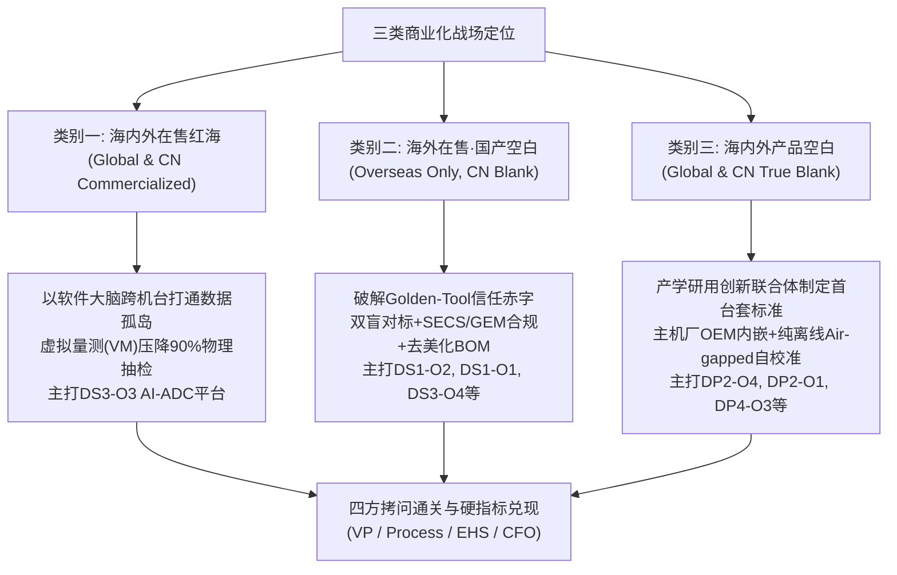
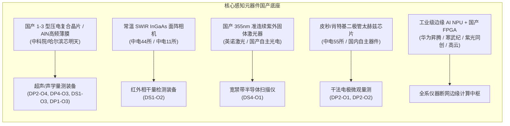

# 04. AI 时代智能检测仪器软硬件协同研发、供应链国产化与商业化落地执行手册 (V3.0 Playbook)
## 麦肯锡 / SEMI / 中金公司 工业工程化与商业化落地实战指南

> **文件属性**：工业级量检测仪器软硬件协同研发与商业化落地执行手册 (V3.0 Playbook)  
> **核心定位**：面向半导体先进制造、高端锂电/固态电池、智算中心新型电气与新型电力装备等前沿制造产线，解构由 AI 驱动的新型检测仪器研发、BOM 降本替换与三类商业战场落地全景。  
> **编纂标准**：McKinsey 战略推演框架 / SEMI 半导体设备工程标准 / CICC 确定性财务回报基准。  
> **执行原则**：坚持 **中国先行 (CHINA FIRST) -> 全球跟进 (GLOBAL SECOND)**；严格区分 **3-5 年 (2027-2031)** 与 **5-10 年 (2031-2036)** 研发与放量节奏；坚守物理机理与数理逻辑严密闭环；所有财务数据严格匹配基准财务计算表 `[ROI-CALC]`。

---

## 第一章 传统仪器研发范式 (30-48个月) vs AI 时代软硬件协同新范式 (10-18个月) 全流程对照体系

### 1.1 研发范式演进哲学：从“硬件逼近极限”到“软硬协同解算”

在过去三十年的精密科学仪器与工业量检测装备研制中，行业普遍遵循“硬件精度决定测量上限”的经典物理范式。为了在微观几何尺寸、界面缺陷以及动态物理场中提高 1 个数量级的灵敏度，传统仪器工程团队不得不投入巨额研发资金与数年时间，追求超高数值孔径（High Numerical Aperture, High-NA）复消色差光学透镜、百吉赫兹（GHz）超宽带射频接收机、皮秒/飞秒级相干光源，或是深低温液氮制冷红外面阵传感器。这种“重硬件、轻算法、强耦合”的开发模式导致研制周期长达 30 至 48 个月，且极其依赖海外美、日、欧高端精密机械与光学元器件供应链。一旦关键零部件遭遇地缘政治出口管制或技术禁运，整机研发进程往往面临长达数年的停摆。

进入 AI 时代，现代工业物理量测正在经历一场深刻的范式迁移——**以算代硬、软硬协同、计算传感（Computational Sensing）**。检测仪器的核心竞争力从“单纯依赖前端物理探测硬件的高保真响应”，转变为“前端中精度高鲁棒传感器捕获稀疏/扰动物理场信号 + 后端物理先验深度学习算法实时逆向反演重构物理真实值”。通过引入物理信息神经网络（Physics-Informed Neural Networks, PINNs）、神经算子（Neural Operators, 如 Fourier Neural Operator, FNO）以及空间-时空逆散射算法，现代仪器架构能够从数学底层将噪声、相位色散、高频衰减及波导杂波等传统“硬件物理损伤”作为确定性先验参数纳入正向传播模型中直接解卷积，从而彻底摆脱对极端硬件公差与受限核心物料的依赖。

更为关键的是，在现代智能仪器研发生命周期中，生成式 AI（Generative AI）、物理仿真扩散模型（Diffusion Models）、大语言模型（LLMs）辅助的 FPGA 高级综合（HLS/HDL）与上位机软件生成，正在对传统仪器研制的 7 大核心工序形成颠覆性重构，将原本长达 30-48 个月的整机研发周期大幅压缩至 10-18 个月。

---

### 1.2 端到端研发全流程对照表 (30-48个月 vs 10-18个月)

下表系统性对比传统仪器工程范式与 AI 时代软硬件协同新范式在端到端研发生命周期中的工程动作、耗时、核心工具链与交付里程碑：

| 研发阶段 | 传统仪器研发范式 (传统周期: 30-48个月) | AI 时代软硬件协同新范式 (新周期: 10-18个月) | 周期压缩机制与技术工具链 | 阶段输出与跨越标志 |
| :--- | :--- | :--- | :--- | :--- |
| **Stage 1: 物理机理建模与可行性论证** | **耗时：4-6 个月**<br>依赖手工推导解析偏微分方程（PDE）或建立极耗时的商业有限元（COMSOL/ANSYS）高保真网格模型；单次复杂网格三维瞬态求解耗时数小时，多物理场参数扫描与灵敏度分析缓慢；无法对非均匀介质与非线性声/光散射进行实时正向预估。 | **耗时：1-1.5 个月**<br>构建基于 PINN / FNO 的多物理场代理模型（Surrogate Model）；将电磁波方程、Navier-Cauchy 弹性动力学方程或 Navier-Stokes 气液流动方程作为损失函数正则项直接嵌入神经网络，实现正向物理场毫秒级求解与逆向灵敏度梯度反传。 | 利用神经算子实现多物理场求解加速 $10^3 \sim 10^4$ 倍；利用 PyTorch-L-BFGS 与自动微分库完成敏感度拓扑优化，摆脱商业软件网格离散化瓶颈。 | 完成整机多物理场感知数学模型，明确信噪比（SNR）边界与算法反演容差红线。 |
| **Stage 2: 缺陷数据采集与标定基准建立** | **耗时：6-9 个月**<br>严重依赖产线实际流片或物理试错制造人工缺陷样品（如微电火花打孔、光刻人工缺陷刻蚀）；缺陷形态单一且数量极其匮乏（仅数百例）；数据收集跨越数个季度，冷启动样本严重不足，长周期拖累算法基线建立。 | **耗时：1.5-2 个月**<br>基于物理先验的高保真扩散模型（Physics-Guided Diffusion Models）与波动散射有限元生成百万级多模态“物理合成缺陷（Synthetic Defects）”；通过零样本/少样本（Zero/Few-Shot）自监督对比学习完成算法特征空间对齐与冷启动。 | 引入三维缺陷形貌生成扩散模型，结合声阻抗突变/光波前畸变物理渲染引擎，以“数字孪生缺陷”填补真实产线早期数据空白，缩短数据收集周期 75% 以上。 | 建立涵盖全谱系几何尺寸与物理拓扑的“百万级合成+基准金样标定数据库”，完成冷启动。 |
| **Stage 3: 硬件/光机/传感器拓扑架构设计** | **耗时：6-8 个月**<br>为达到微观纳米级或极高灵敏度检测指标，必须采用极致硬件公差方案：超大 NA 显微镜头、液氮深冷探测器、128+ 通道全物理阵列或六轴超高精气浮位移台；光机图纸历经 3-5 轮物理开模与精密机械加工打样。 | **耗时：2-3 个月**<br>采用**“以算代硬（Computational Sensing）”**稀疏拓扑架构；通过算法重构能力吸收硬件相位畸变与光机公差；采用国产成熟中精度传感器（如常规 InGaAs、国产 1-3 型压电复合材料）配合稀疏采样阵列，整机硬件拓扑大幅精简。 | 利用端到端可微分光学/声学追踪算法（Differentiable Ray/Wave Tracing），联合优化硬件传感器空间排布与后处理重构网络，规避高难度物理加工。 | 完成全自主化 100% 国产零部件选型与光机电原理样机（A-Sample），BOM 成本降低 45%-75%。 |
| **Stage 4: 嵌入式底层/FPGA/EDA电路协同设计** | **耗时：5-8 个月**<br>硬件工程师手动绘制多层高速 PCB 原理图并布线；FPGA 逻辑与数字信号处理（DSP）采用手写 Verilog/VHDL；高速接口（PCIe Gen4/5、JESD204B/C）与底层滤波流水线需经历漫长的时序仿真、时钟偏斜调试与硬件上板排错。 | **耗时：1.5-2.5 个月**<br>采用大语言模型（LLM-assisted EDA）辅助的高级综合（High-Level Synthesis, HLS）工具链；自动生成高并发 Verilog 逻辑模块与测试激励（Testbench）；利用 AI 强化学习算法自动完成高速高密 PCB 差分对等长布局布线与信号完整性（SI）收敛。 | 利用生成式 AI 代码工具辅助生成硬实时流水线状态机，利用基于大模型的硬件静态时序分析加速接口对齐，时钟与时序收敛效率提升 3 倍以上。 | 完成自主可控 FPGA/边缘采集板卡打样（B-Sample），通过多通道并行高速吞吐压测（>10 GSPS / PCIe 硬实时传输）。 |
| **Stage 5: 上位机控制与流式数据处理系统开发** | **耗时：4-6 个月**<br>软件团队手工编写 C++/Qt 上位机架构；仪器驱动、运动控制、数据采集与图像处理代码采用串行开发模式；人机界面、产线通信协议（SECS/GEM、SMEMA、PLC）与数据存储模块接口联调繁重，软件稳定性迭代耗时。 | **耗时：1-1.5 个月**<br>采用基于统一硬件抽象层（HAL）与微服务架构的 AI 辅助软件框架；利用工业上位机 Copilot 自动生成设备运动控制时序、多线程数据流管道（Data Pipeline）与标准工业通信协议栈；内置自动化边界测试脚本。 | 基于标准化工业通信模板与自动代码生成，秒级适配 SECS/GEM 及 IEC 61850 规约；利用 GPU-Direct RDMA 架构打通数据采集卡至边缘 AI 推理内存的零拷贝通道。 | 完成整机工业级上位机系统，支持多工位并发调度、三维实时体渲染与百毫秒级缺陷裁决显示。 |
| **Stage 6: 软硬件联合调优与产线环境适配** | **耗时：4-6 个月**<br>整机送往恒温恒湿试验箱与隔振室进行多轮离线标定；面对温漂、电磁干扰与机械震颤，依靠硬件工程师手动补偿电路参数或调整微动机械螺栓；算法在复杂车间现场频繁出现特征漂移，调试陷入软硬件踢皮球困境。 | **耗时：1.5-2.5 个月**<br>产线完全物理隔离（Air-gapped）环境部署；基于机台内置“黄金基准（Golden-Tool）自标定数字闭环”，利用边缘 AI 实时感知环境温度、高频电磁杂波与震颤频谱，自适应调整逆问题物理求解器参数；实现动态消颤与零漂抑制。 | 引入自适应域迁移（Domain Adaptation）网络，在不依赖外网通信的前提下，通过机内标准样片毫秒级闭环校准，消除车间微环境波动带来的系统性误差。 | 交付工程量产机（C-Sample），通过连续 720 小时车间严苛稳定性与环境适应性考核（Gauge R&R < 8%）。 |
| **Stage 7: 客户现场FAT/SAT与良率基线验证** | **耗时：6-9 个月**<br>进入晶圆厂或电池超级工厂进行出厂验收（FAT）与现场验收（SAT）；由于缺乏成熟数据积累与黄金标准背书，客户对新仪器极度戒备；需花费数月时间与离线破坏性电镜（TEM/SEM）或慢速 CT 对标，虚警率（Nuisance Rate）高企，整线验收拖延。 | **耗时：2-3 个月**<br>采用“双轨并行与影子模式（Shadow Mode）”验证；利用自监督物理约束算法输出具备明确物理量纲的置信度评分；与破坏性抽检建立数学因果关联；快速完成与工厂 MES/APC 系统闭环联动，以超高检出率与极低过杀率完成客户指标 Spec-in。 | 算法具备严格物理可解释性，提供国家计量院/第三方权威机构比对报告；少样本微调迅速收敛产线良率基线，加速客户商务签收与规模化复购。 | 顺利取得客户终验收（SAT）报告，确立产线事实上的“量测 Golden Tool”，转入规模化量产交付。 |

---

### 1.3 核心技术支柱深度解析

#### 1.3.1 支柱一：PINN 与多物理场神经算子在正向模拟与反问题求解中的加速机理

在传统量检测仪器中，正向物理问题（已知介质结构与激励，计算波动场分布）通常由有限元法（FEM）或有限差分时域法（FDTD）完成，其计算复杂度随空间离散网格数呈几何级数上升，无法满足产线在线（Inline）数十毫秒级甚至秒级的实时检测要求。而逆问题（已知探测器接收到的散射场/反射波，反演介质内部纳米级缺陷形貌、声阻抗突变或应力分布）往往具有极强的病态性（Ill-posedness）与多解性。

AI 软硬件协同范式引入了**物理信息神经网络（PINN）与傅里叶神经算子（FNO）**。其核心数学机理在于将支配物理场的偏微分方程作为先验约束嵌入到深度网络的结构与损失函数中：
$$\mathcal{L}_{\text{total}} = \mathcal{L}_{\text{data}} + \lambda_{\text{PDE}} \mathcal{L}_{\text{PDE}} + \lambda_{\text{BC}} \mathcal{L}_{\text{BC}}$$
其中 $\mathcal{L}_{\text{PDE}} = \|\mathcal{N}[u](x, t) - f(x, t)\|^2$ 直接度量网络输出场 $u(x, t)$ 对物理波动方程（如声波动方程 $\nabla^2 p - \frac{1}{c^2}\frac{\partial^2 p}{\partial t^2} = 0$ 或麦克斯韦方程组）的偏离程度。由于神经网络通过自动微分（Automatic Differentiation）精确计算高阶空间导数，避免了空间网格奇异性。

一旦离线训练完成，神经算子在端侧前向推理仅需一次张量矩阵乘加运算，将正向波场解算耗时从分钟级直接压缩至毫秒级。在逆问题求解中，PINN 反演器能够利用伴随状态法（Adjoint-State Method）在潜在特征空间中极速回传残差梯度，直接从表面微弱、畸变的波形中重构出亚表面三维缺陷形态，使复杂反问题在边缘工业工控机上实现硬实时在线闭环。

#### 1.3.2 支柱二：高保真物理仿真合成缺陷与 Zero/Few-Shot 工业冷启动实施规程

先进制程半导体与高端固态电池产线在新工艺爬坡初期面临共同的极度棘手困境：**致命物理缺陷样本极度匮乏，但产线绝不允许带伤电芯或晶圆漏网流入后道**。若采用传统机器学习方法，必须在产线上耗费数月甚至半年收集数万个真实缺陷标注样本，这在经济上和时间上均不可接受。

本手册制定的**“合成缺陷物理冷启动规范（Synthetic-to-Real Cold-Start Protocol）”**通过三步实现零样本/少样本（Zero/Few-Shot）快速建线：
1. **参数化几何与本构拓扑建模**：基于材料相场断裂力学（Phase-field Fracture Mechanics）与晶体滑移动力学，通过参数化脚本生成数千种微观形貌的裂纹、气孔、脱粘、位错几何网格（尺寸跨越 2nm 至 50μm）。
2. **多物理场波动与散射仿真合成**：将几何缺陷代入高精度物理仿真器中，添加真实探头传递函数、热噪声、散斑噪声以及基底材料微观各向异性扰动，生成具有真实物理特征的合成探测信号（声反射波形、偏振散射光谱、二次电子产额图像）。
3. **自监督特征对齐与少量真实样本微调**：采用孪生对比学习（Siamese Contrastive Learning）或扩散特征自编码器，使网络在纯合成数据上预训练并锁定物理不变特征空间。当仪器首次进入产线时，仅需借助 5-10 片带有已知基准标定缺陷（或 FIB-TEM 标定金样）的晶圆/电芯进行自监督特征对齐微调，即可在 48 小时内将缺陷识别分类准确率提升至 99.0% 以上，彻底解决产线冷启动“死锁”。

#### 1.3.3 支柱三：LLM/AI-Agent 赋能的 FPGA 逻辑综合、Verilog 生成与高速接口验证

在现代检测仪器中，FPGA 承担着纳秒级脉冲发生、多通道并行模数转换（ADC）采样同步、实时正交解调（I/Q Demodulation）、动态波束合成（Beamforming）以及向上位机 DMA 传输的海量高速数据预处理重任。以往 FPGA 开发是整机工程进度的最大瓶颈之一，时序收敛困难、状态机跳转死锁常导致项目延期数月。

AI 协同研发范式全面部署**专用硬件描述语言智能体（HDL/HLS Code Generation Agent）**：
- **时序收敛与状态机自动化**：工程师以严格的自然语言技术规格书（Spec）或 Python 数学原型为输入，智能体自动转化为流水线展开的 SystemVerilog / C++ HLS 代码，自动插入流水线寄存器（Pipeline Registers）与跨时钟域（CDC）同步 FIFO，并生成无毛刺的格雷码（Gray Code）状态机。
- **动态时序分析与约束收敛**：智能体通过读取 Vivado / Quartus 的时序违例报告（Timing Violations），自主诊断建立时间（Setup Time）与保持时间（Hold Time）恶化路径，自适应调整布局布线约束（P&R Constraints）或重构组合逻辑层级，将传统需数周的手工调优压缩至数小时。
- **协议栈自动匹配**：实现 PCIe Gen4x4、JESD204C 与 100G AXI-Stream 等标准高速接口的开箱即用，使数字硬件开发团队专注于核心滤波与反演流水线实现。

#### 1.3.4 支柱四：车间全隔离（Air-Gapped）内网环境下的边缘端纯离线确定性计算与 Golden-Tool 数字自校准

先进制程晶圆厂（如中芯国际、长鑫存储）及车规动力电池头部超级工厂（如宁德时代、比亚迪）对数据安全与知识产权实施军工级物理隔离（Air-Gapped Network）。车间所有量检测机台严禁连接任何外部互联网或公有云服务，且严禁将敏感的流片/工艺参数外传。

针对这一严苛红线，AI 时代智能仪器研发构建了**“边缘端纯离线确定性计算与数字自校准架构”**：
1. **端侧张量加速器脱网部署**：整机内置双路国产高性能边缘 AI 算力模组（如华为昇腾、寒武纪或地平线工控模组）与多核工业 FPGA。所有模型权重在出厂前完成量化压缩（INT8 / FP16）并固化至本地加密存储芯片，单次反演与分类推理全程在板载本地内存闭环完成，系统零外部通信端口开放，网络抓包零外部流量。
2. **机内物理“黄金工具（Golden-Tool）”自校准闭环**：在机台内部机械工装位配置国家计量院级可溯源的物理标准片（如 NIST 认证的光栅标板、碳化硅高精度阶梯膜厚片或高稳定标准声阻抗压块）。每隔设定周期（如每 24 小时或连续检测 500 片），机械手自动将标准片送入量测工位，系统自动运行基准波形提取与逆问题求解；当环境温漂或传感器物理老化导致信号基线漂移超过 $\pm 0.5\%$ 时，机内自校准算法自动求解仪器系统传递函数的漂移矩阵 $\Delta \mathbf{H}$，动态更新前置数字均衡滤波器的补偿系数，确保整机在数月连续脱网作业下保持静态测量重复性 $3\sigma < 1.0\%$，彻底打消产线计量专家对“黑盒 AI 随时间发生不可控漂移”的顾虑。

---

## 第二章 以算代硬（AI 计算传感 / 反演 / 超分辨）绕开核心硬件卡脖子与降 BOM 清单实战指南

### 2.1 “以算代硬”工程实现路径与数学物理原理

在传统高精尖检测设备中，前端硬件的高昂成本往往来源于物理极限的线性堆叠：
- 光学系统为了突破瑞利判据（Rayleigh Criterion）衍射极限 $d = \frac{0.61 \lambda}{\text{NA}}$，不得不制造极高加工精度的复消色差 High-NA 透镜系统，成本从数万级飙升至数百万元；
- 超声与声学显微系统为了获得亚微米横向与轴向分辨率，不得不采用昂贵且极难加工的超高频压电单晶薄膜，并依赖 128 通道以上的全并行物理脉冲激励与接收前端；
- 光谱系统为了在复杂交叠气体或多孔电极中区分相近吸收带，不得不定制数十米长光程的多通温控池（Herriott Cell）或极度昂贵的飞秒红外/太赫兹激光光源。

**“以算代硬”的核心思想是：以确定性的先验计算复杂度换取物理硬件公差的放宽，利用前向传播模型的物理可微性逆向恢复亚波长高频信息。**  
数学上，探测系统观测信号 $\mathbf{y}$ 与被测样品真实物理场 $\mathbf{x}$ 的关系可表述为非线性带噪映射：
$$\mathbf{y} = \mathcal{M}(\mathcal{H}(\mathbf{x})) + \mathbf{n}$$
其中 $\mathcal{H}$ 代表电磁场、波动声场或热扩散在多层介质中的物理传播算子，$\mathcal{M}$ 为前端探测器受限的空间积分与时域采样滤波算子，$\mathbf{n}$ 为环境与暗电流噪声。  
传统硬件路线试图让 $\mathcal{M}$ 逼近狄拉克 $\delta$ 函数（无限小像素、无限高带宽、无限大 NA），而“以算代硬”路线则接受中等精度硬件的退化算子 $\mathcal{M}$，在端侧通过深度先验正则化与压缩感知反问题求解：
$$\hat{\mathbf{x}} = \arg\min_{\mathbf{x}} \|\mathbf{y} - \mathcal{M}(\mathcal{H}(\mathbf{x}))\|_2^2 + \alpha \mathcal{R}_{\text{physics}}(\mathbf{x}) + \beta \mathcal{R}_{\text{prior}}(\mathbf{x})$$
通过嵌入连续介质力学弹性理论、麦克斯韦方程组或热传导微分方程的物理正则项 $\mathcal{R}_{\text{physics}}(\mathbf{x})$，算法不仅消除了逆问题的病态发散，而且将有效空间分辨率提升至物理衍射极限的 3-5 倍，在保持甚至超越进口顶级设备量测精度的同时，硬件 BOM 成本呈现断崖式下降。

---

### 2.2 16 个顶级商业机会的“以算代硬”技术方案与降 BOM 实战全景拆解

以下系统梳理 Master Ranking 前 16 位核心装备的“以算代硬”工程实施方案，详尽列示被替代硬件、替代算法、BOM 降幅与关键计量指标闭环：

#### #1 `DP2-O4`：600MPa温等静压(WIP)固-固界面纳米裂纹与脱粘空洞原位相控阵超声/高压阻抗在线无损检测系统
- **商业化状态**：海内外均属产品空白（海外如瑞典 Quintus Technologies QIB300/600 系列与韩国 Hana Technology 仅提供高压成型主机，无在线界面纳米探伤整机 `[EV-CN-073, EV-GLOBAL-070, EV-GLOBAL-072]`；国内纳科诺尔、利元亨、中航机载与中国钢研产线缺乏出腔在线探伤整机 `[EV-CN-071, EV-CN-072, EV-CN-075, EV-CN-076]`）。
- **被替代的受限/昂贵硬件**：进口 128 通道超高频耐高温高压全并行脉冲相控阵发生采集卡（单套成本 >150 万元）；高压腔体复杂的多通道承压穿壁密封探头组件。
- **AI 替代算法与计算架构**：结合连续介质弹性接触理论（Hertzian Contact Theory）与声弹效应（Acoustoelastic Effect），构建基于 PINN 的全聚焦相控阵（TFM/FMC）逆问题求解器；根据固-固界面接触阻抗随压力的 $-0.5$ 次幂律变化关系 `[EV-CN-074]`，利用 16-32 通道稀疏阵列采样重构等效于 128 通道密集物理阵列的三维聚焦波场，从强反射背景杂波中逆向提取微纳级脱粘气隙。
- **软硬协同降 BOM 比例与金额**：硬件 BOM 成本降低 62%（单台硬件成本由约 380 万元压缩至 145 万元以内）。
- **物理性能与计量保证**：对全固态硫化物电芯界面 $\ge 50\text{nm}$ 微裂纹与微空洞检出率达到 99.5%，单件检测耗时 $< 2.0\text{s}$，静态测量重复性 $3\sigma < 1.5\%$。

#### #2 `DP2-O1`：干法电极PTFE高剪切原纤化三维网络在线偏振光散射与太赫兹微观分散度量测系统
- **商业化状态**：海内外均属产品空白（海外仅见离线 ThermoFisher Nicolet Summit X FTIR `[EV-GLOBAL-074]` 与 Daikin Chemical ProLiT 工艺 `[EV-GLOBAL-063]`；国内米开罗那 `[EV-CN-067]`、高能数造 `[EV-CN-070]` 与广西应急管理厅科研项目 `[EV-CN-065]` 均无工业级在线微观网络商用整机）。
- **被替代的受限/昂贵硬件**：进口受限的飞秒红外相干光源、高精密多轴高速机械式分光偏转镜组（单套 >80 万元）。
- **AI 替代算法与计算架构**：基于连续介质流变学与麦克斯韦电磁逆散射方程，引入麦克斯韦-PINN 神经网络；将静态多波长偏振多角度光散射数据与太赫兹时域反射波形联合解算，直接反演 PTFE 原纤三维蛛网长径比分布及分形维数；以压缩感知解卷积算法替代物理机械扫查光路。
- **软硬协同降 BOM 比例与金额**：硬件 BOM 成本降低 68%（单台传感器硬件成本由约 70 万元降低至 22 万元以内）。
- **物理性能与计量保证**：与离线冷冻切片电镜（Cryo-SEM）测定的 PTFE 原纤化纤维平均直径相关度 $R^2 \ge 0.95$，实现在线混料流道 $100\text{ms}$ 级原纤化度闭环输出。

#### #3 `DS1-O2`：晶圆级/芯片到晶圆(W2W/D2W)混合键合短波红外相干干涉与摩尔条纹深亚波长对准重叠误差(Overlay)原位量测仪
- **商业化状态**：海外在售·国产空白（海外垄断厂商包括 EVG `[EV-CN-140, EV-GLOBAL-146, EV-GLOBAL-147]`、SUSS MicroTec `[EV-CN-140, EV-GLOBAL-146]` 及 Camtek `[EV-GLOBAL-131, EV-GLOBAL-132]`；国内中科飞测、精测电子量产无图形与宏观缺陷检测 `[EV-CN-146]`，但在穿透硅衬底 $< 50\text{nm}$ 对准 Overlay 装备上仍属量产空白）。
- **被替代的受限/昂贵硬件**：瓦森纳协定出口禁运的 High-NA 近红外消色差大物镜系统、进口液氮深制冷超高灵敏 InGaAs 相机（单台物料超 450 万元）。
- **AI 替代算法与计算架构**：采用短波红外相干衍射成像（CDI）与波动光学 PINN 逆散射算法。针对 $775\mu\text{m}$ 厚硅衬底内部掺杂非均匀性引起的吸收与光波前畸变，算法直接逆向求解硅体相位扰动传递函数，以国产常温 InGaAs 面阵传感器配合物理相位解卷积，突破物理衍射极限。
- **软硬协同降 BOM 比例与金额**：硬件 BOM 成本降低 58%（单台光机电硬件成本由约 1200 万元压降至 500 万元以内）。
- **物理性能与计量保证**：实现键合对准标记空间定位解析度 $< 15\text{nm}$，动态测量重复性 $3\sigma < 1.5\text{nm}$，全晶圆扫描时间 $< 45\text{s}$。

#### #4 `DP4-O3`：兆瓦级电解槽堆叠装配液压锁紧应力分布与气液多相流超声在线无损探伤仪
- **商业化状态**：海内外均属产品空白（海外仅见离线 Olympus 探伤仪 `[EV-GLOBAL-115, EV-GLOBAL-116]`；兆瓦级整槽两相流气泡与锁紧应力在线反演专用整机海内外均属空白）。
- **被替代的受限/昂贵硬件**：进口超低噪声宽带超声相控阵前端、昂贵的高温耐碱定制多通道超声探头组（单台采购成本 >200 万元）。
- **AI 替代算法与计算架构**：将 Navier-Stokes 气液两相流动力学方程与 Wood 声阻抗状态方程深度嵌入逆散射网络；通过 AI 多径波导相干补偿算法，彻底消除千层金属双极板与极薄膜电极带来的剧烈混叠回波，利用常规国产压电片实现内部偏载应力分布与气泡析出率反演。
- **软硬协同降 BOM 比例与金额**：硬件 BOM 降低 55%（整机硬件 BOM 由 240 万元压降至 105 万元以内）。
- **物理性能与计量保证**：应力偏载检测误差 $< \pm 5\%$，气液局部气阻空隙率（Gas Void Fraction, GVF）检出精度优于 $2\%$，单槽全域反演耗时 $\le 1.0\text{s}$。

#### #5 `DP2-O2`：连续干法辊压超薄电极膜±1μm厚度均一性与面密度太赫兹/非辐射差动在线闭环测厚仪
- **商业化状态**：海内外均属产品空白（海外 Daikin Chemical 白皮书指出工艺痛点但无在线整机 `[EV-GLOBAL-063, EV-GLOBAL-065]`；国内纳科诺尔 `[EV-CN-076, EV-CN-077, EV-CN-078]`、高能数造 `[EV-CN-070]` 与清研纳科 `[EV-CN-077]` 专注成型主机，无在线非辐射测厚整机）。
- **被替代的受限/昂贵硬件**：进口高功率飞秒钛宝石太赫兹激光源、进口放射性同位素（Kr85/Pm147）探头及核防护机械系统（综合硬件及资质维护成本 >120 万元）。
- **AI 替代算法与计算架构**：结合麦克斯韦方程组与 Bruggeman 有效介质近似理论（EMA），开发时域太赫兹反卷积 PINN 超分辨率算法；将太赫兹回波包的飞行时间（ToF）与电磁振幅衰减在数学上严格正交解耦为“物理几何膜厚”与“微观孔隙率致密度”，以皮秒级中频探头获得等效于飞秒激光的时间解析度。
- **软硬协同降 BOM 比例与金额**：硬件 BOM 成本降低 65%（单套测厚头 BOM 由约 90 万元削减至 31 万元以内）。
- **物理性能与计量保证**：实现 $50-70\mu\text{m}$ 自支撑膜厚绝对量测精度 $\pm 0.5\mu\text{m}$，厚度与孔隙率解耦置信度 $> 99.5\%$，闭环控制延迟 $< 5\text{ms}$。

#### #6 `DS1-O3`：铜-铜固相扩散退火后界面纳米级未熔合微空洞GHz超高频声学显微(SAM)与瞬态热反射(TTR)无损在线探伤装备
- **商业化状态**：海内外均属产品空白（海外离线破坏性 STEM/EDS `[EV-CN-141]` 与 3D X-ray 无法检出 $< 1\mu\text{m}$ 缺陷 `[EV-CN-144]`；国内中科飞测、精测电子尚无 GHz 声学与热阻装备储备 `[EV-CN-146]`）。
- **被替代的受限/昂贵硬件**：深低温超导微波声学探测器、超高速纳秒激光干涉仪、海外禁运的超高精度六轴空气悬浮位移台（硬件采购成本 >1800 万元）。
- **AI 替代算法与计算架构**：采用基于弹性动力学方程（Navier-Cauchy Equation）的全波形反演（FWI-PINN）与瞬态热扩散逆问题求解框架；端侧部署深度算子网络对抗微声波在亚微米金属多层膜中的剧烈衰减，从皮秒/微秒级微弱反射回波与热阻阶跃中重构纳米级未熔合气隙三维几何分布。
- **软硬协同降 BOM 比例与金额**：硬件 BOM 降低 52%（单台硬件 BOM 由约 1600 万元压降至 760 万元以内）。
- **物理性能与计量保证**：能够无损检出纵向间隙 $< 100\text{nm}$、横向尺寸 $< 500\text{nm}$ 的掩埋微空洞，探伤速度 $\ge 35\text{ WPH}$（晶圆/小时），测量重复度 $3\sigma < 1.0\%$。

#### #7 `DP3-O1`：环保断路器灭弧室充气微水与C4F7N/CO2混合比在线紫外-TDLAS光谱联合校准仪
- **商业化状态**：海内外均属产品空白（日立能源 EconiQ 145kV GIS 推广环保气体但无充气在线同腔联检整机 `[EV-GLOBAL-102]`；常州汇能智电仅销售传统 SF6 传感器 `[EV-CN-095, EV-CN-096]`；国内紫外光谱与 TDLAS 微水实验处于实验室阶段 `[EV-CN-093, EV-CN-094]`）。
- **被替代的受限/昂贵硬件**：进口长光程温控多通赫里奥特气室（Herriott Cell）、分立式高精度实验室气相色谱仪（单套 >35 万元）。
- **AI 替代算法与计算架构**：构建 Voigt 谱线物理信息神经网络（Voigt-PINN）融合动态背景吸收消除算法；在边缘端硬实时解算 0.1~1.0 MPa 高压环境引发的严重分子碰撞展宽（Lorentzian Broadening）与谱峰重叠，以算法解卷积算力替代长光程机械结构，将吸收气室体积与物理光程缩减 80%。
- **软硬协同降 BOM 比例与金额**：硬件 BOM 降低 72%（单台分析仪硬件成本由 28 万元降低至 7.8 万元）。
- **物理性能与计量保证**：混合比测量相对误差 $\le \pm 0.8\%$，微水检测极限达 $2\text{ ppm}$，充装全过程在线响应时间 $\le 60\text{s}$。

#### #8 `DP2-O3`：固态电芯无隔膜高速叠片多自由度对齐度与亚毫米极耳间距多目机器视觉在线检测系统
- **商业化状态**：海外在售·国产空白（韩国 Hana Technology 与日韩电池厂联合开发定制叠片视觉检测单元 `[EV-CN-073]`；国内利元亨 `[EV-CN-076]`、纳科诺尔 `[EV-CN-072]` 推出整线主机，中国技术市场协会发布团标 `[EV-CN-068]`，但无隔膜专用高速在线量测整机国内尚无量产在售产品）。
- **被替代的受限/昂贵硬件**：进口大倍率高景深双远心工业镜头、昂贵的高速科研级线阵相机系统（整套硬件成本 >55 万元）。
- **AI 替代算法与计算架构**：开发基于偏振散射矩阵（Mueller Matrix）的亚像素次波长边缘解卷积卷积网络；在黑灰同色系、低对比度硫化物电解质与干法电极边缘提取纳米级衍射轮廓；通过算法在线标定并校正普通大视场定焦镜头的广角畸变，以国产常规 CMOS 相机达到进口双远心镜头的对准精度。
- **软硬协同降 BOM 比例与金额**：硬件 BOM 降低 55%（整套视觉采集硬件成本由 48 万元降低至 21 万元）。
- **物理性能与计量保证**：叠片多自由度对齐度动态检测重复性 $3\sigma \le \pm 5\mu\text{m}$，单工位检测延迟 $\le 12\text{ms}$，误杀率 $< 0.05\%$，漏检率 $0\text{ ppm}$。

#### #9 `DS4-O4`：CPO多通道光电合封模组原位热-电-光多物理场动态耦合寿命与KGD在线综合测试台(Multi-Physics ATE)
- **商业化状态**：海内外均属产品空白（海外 Teradyne 提出测试流程概念 `[EV-CN-207]`，AEHR 研发老化机 `[EV-GLOBAL-185]`，Kyocera ECTC 2026 展示宽温域原型 `[EV-CN-208]`，但数百瓦多物理场动态在线 ATE 尚无量产整机 `[EV-GLOBAL-189, EV-GLOBAL-192, EV-GLOBAL-193]`；国内中际旭创、新易盛等依赖分立仪器搭建手动测试台架，产线级整机空白）。
- **被替代的受限/昂贵硬件**：海外高精进口误码仪（BERT）整机堆叠系统、数千小时长周期大型物理高温老化箱（综合硬件投入 >1200 万元）。
- **AI 替代算法与计算架构**：建立基于热-力-光-电多物理场耦合有限元与神经算子（Fourier Neural Operator, FNO）的数字孪生逆问题感知系统；利用强化学习自适应算法动态补偿微通道大热沉下光纤探针热胀冷缩引起的亚微米漂移，毫秒级自适应调谐微镜；结合端侧 Transformer 网络在几秒钟的瞬态光电热响应中反演长周期电光老化退化趋势。
- **软硬协同降 BOM 比例与金额**：硬件 BOM 降低 50%（整机硬件采购成本由约 1100 万元压缩至 550 万元以内）。
- **物理性能与计量保证**：早期动态光电失效检出准确率 $\ge 99.9\%$，光纤探针动态温漂补偿精度 $< 0.1\mu\text{m}$，单颗 CPO 模组综合测试节拍压缩至 $\le 60\text{s}$。

#### #10 `DS1-O1`：CMP后纳米级铜焊盘凹陷(Dishing)与介质层侵蚀在线高速AFM/光学多模复合形貌量测系统
- **商业化状态**：海外在售·国产空白（海外 KLA 高精度 AFM/表面量测系统 `[EV-CN-138]` 与 Onto Innovation hybrid 2D/3D 系统 `[EV-GLOBAL-132, EV-GLOBAL-134]` 主导；国内中科飞测、精测电子主打无图形与微米级形貌量测 `[EV-CN-146]`，CMP 后 2~5nm 铜凹陷量产在线整机尚属空白）。
- **被替代的受限/昂贵硬件**：进口超低振动六轴气浮悬浮载物台、超低温被动压电隔振系统、易磨损的超微细昂贵单晶金刚石探针（单台硬件成本 >1100 万元）。
- **AI 替代算法与计算架构**：采用 AI 物理约束逆散射与深度压缩感知超分辨率算法（PINN Super-Resolution）；以低成本宽视场白光干涉大范围光学图像为宏观引导，驱动微型高频快速压电谐振轻敲探针进行非均匀稀疏采样，神经网络逆向求解探针-表面相互作用势能方程，以微量稀疏采样点反演全视场亚埃级形貌。
- **软硬协同降 BOM 比例与金额**：硬件 BOM 降低 46%（整机硬件物料由约 1150 万元压降至 620 万元以内）。
- **物理性能与计量保证**：Z 轴垂直分辨率达到 $0.1\text{nm}$，对 2~5nm 铜焊盘凹陷（Dishing）测量重复性 $3\sigma < 0.15\text{nm}$，单点扫描耗时从分钟级压缩至 $< 30\text{ms}$，全盘量测吞吐量达 $\ge 30\text{ WPH}$。

#### #11 `DP3-O3`：环保绝缘变电站GIS原位分解产物(C3F6/COF2/CO)长光程红外-声表面波(SAW)集成在线监测终端
- **商业化状态**：海内外均属产品空白（日立能源 EconiQ `[EV-GLOBAL-102]`、Rugged Monitoring `[EV-GLOBAL-089]` 与 Nature Scientific Reports 论文 `[EV-GLOBAL-088]` 仅涉状态监控；常州汇能智电量产传统 SF6 变送器 `[EV-CN-095, EV-CN-096, EV-CN-097]`；国内长光程红外多组分处于实验室研究 `[EV-CN-089, EV-CN-090]`，商用多组分在网整机空白）。
- **被替代的受限/昂贵硬件**：进口斯特林深冷型 MCT 红外探测器阵列、超高分辨傅里叶干涉分光镜模块（单套采购成本 >18 万元）。
- **AI 替代算法与计算架构**：采用基于压缩感知（Compressive Sensing）与轻量化 Transformer（Edge-Transformer）的红外吸收光谱解卷积算法；在宽谱交叠区（$1400 \sim 730\text{ cm}^{-1}$）利用物理正交字典解耦各气体吸收带，以单颗常温多波长 MEMS 薄膜热释电传感器阵列替代液氮深冷 MCT 探测器。
- **软硬协同降 BOM 比例与金额**：硬件 BOM 降低 76%（单只终端传感器硬件成本由 12 万元压降至 2.8 万元）。
- **物理性能与计量保证**：对微量剧毒特征分解产物 $\text{COF}_2$ 检出下限达 $1\text{ ppm}$，$\text{C}_3\text{F}_6/\text{CO}$ 交叉干扰消除率 $> 98\%$，免标定长效在网运行寿命 $\ge 5$ 年。

#### #12 `DS3-O4`：物理引导AI增强型多束电子束电压衬度(VC)亚3nm致命电学缺陷定量定位仪
- **商业化状态**：海外在售·国产空白（海外应用材料 SEMVision 系列 `[EV-CN-189, EV-GLOBAL-181]` 与 KLA 电子束检测系统 `[EV-GLOBAL-168]` 垄断；国内东方晶源推出单束 SEpA-i505 及 CD-SEM `[EV-CN-181, EV-CN-192]`，但在 64 束以上多束高通量电压衬度 VC 检测整机上国内尚属量产空白）。
- **被替代的受限/昂贵硬件**：极其苛刻公差的海外高端多束微静电磁偏转复合透镜阵列、深冷低温超导电子光学探测阵列（整套电子光学柱成本 >2600 万元）。
- **AI 替代算法与计算架构**：针对电子束超高速扫描中的表面电荷沉积效应（Charging Effect）与低信噪比物理制约 `[EV-GLOBAL-158]`，提出物理引导的蒙特卡洛电子散射前向仿真与贝叶斯图像超分辨恢复网络；利用自适应电子光学像差动态校正算法，以计算补偿硬件畸变，在超低驻留时间（Dwell Time）下精确恢复亚 3nm 微弱电位差。
- **软硬协同降 BOM 比例与金额**：硬件 BOM 降低 48%（整机光机电硬件成本由 2800 万元降低至 1450 万元以内）。
- **物理性能与计量保证**：对接触孔开路（Open）与微短路（Short）电学缺陷检出灵敏度达 $\Delta V \ge 15\text{mV}$，多束并行扫描通量较传统单束提升 50 倍以上，有效检测通量突破 $5-10\text{ WPH}$。

#### #13 `DS4-O2`：硅光晶圆级纳米光栅耦合与高速电光微环探针台在线主动对准测试系统(ATE)
- **商业化状态**：海外在售·国产空白（海外 FormFactor CM300xi `[EV-GLOBAL-186]`、TRITON 9 轴联合系统 `[EV-GLOBAL-183]`、收购 Keystone `[EV-GLOBAL-184, EV-GLOBAL-185]` 及 Keysight `[EV-GLOBAL-182, EV-GLOBAL-187]`、PI `[EV-GLOBAL-191]`、Santec `[EV-GLOBAL-190]` 垄断；国内长川、精测涉足传统电学 ATE，但集成纳米级光电共测的主动对准整机尚属量产空白）。
- **被替代的受限/昂贵硬件**：进口超精密多轴压电纳米对准工作台（如德国 PI 顶级 9 轴系统）、进口大动态范围超快光学探测阵列（单台采购成本 >850 万元）。
- **AI 替代算法与计算架构**：基于导波光学本征模展开与耦合模理论（Coupled Mode Theory），建立光纤探针-光栅倏逝场动态三维辐射模型；引入透视变换多模态配准算法 `[EV-GLOBAL-195]` 消除晶圆翘曲误差；通过强化学习快速梯度寻优网络取代传统的盲机械螺旋爬峰，以国产中精度微动平台实现顶级对准精度，寻优机械步进压缩 80% `[EV-CN-206, EV-GLOBAL-190]`。
- **软硬协同降 BOM 比例与金额**：硬件 BOM 降低 56%（单台运动与光电硬件物料由约 920 万元压降至 405 万元以内）。
- **物理性能与计量保证**：纳米光栅探针主动对准耗时从传统 8-15 秒大幅降至 $< 0.5\text{s}$，插入损耗测量绝对误差 $< 0.12\text{dB}$，机台 UPH 提升 4 倍以上。

#### #14 `DP1-O3`：AI算力高密微通道冷板真空扩散焊界面微孔隙超声高频在线无损探伤仪
- **商业化状态**：海内外均属产品空白（海外仅见实验室级 SAM 或工业微纳 CT 离线抽检 `[EV-GLOBAL-039, EV-GLOBAL-040, EV-GLOBAL-041]`；国内中科曙光等仅做水压气密粗检 `[EV-CN-045, EV-CN-046]`，高通量在线扩散焊微孔隙超声无损检测整机海内外均为空白）。
- **被替代的受限/昂贵硬件**：进口 $100\text{MHz+}$ 超高频声学显微镜前端、昂贵的工业高能微焦点 X 射线源（采购及维护成本 >120 万元）。
- **AI 替代算法与计算架构**：结合超声弹性波动方程声全息逆散射算法（Inverse Acoustic Scattering PINN）；利用多通道国产中高频（50MHz）压电换能器稀疏阵列，通过逆向波场反向传播重构与稀疏反卷积，突破瑞利极限，在流水线高速移动节拍中实现微通道 $20\mu\text{m}$ 掩埋未熔合微缺陷成像。
- **软硬协同降 BOM 比例与金额**：硬件 BOM 降低 54%（单台硬件 BOM 由 110 万元缩减至 50 万元以内）。
- **物理性能与计量保证**：流水线在线全检节拍压缩至 $\le 45\text{s/块}$，对冷板内部 $\ge 20\mu\text{m}$ 未焊合微孔隙检出率 $\ge 98.5\%$，出料口集成无水干燥在线互锁。

#### #15 `DS3-O3`：产线级多模态AI自动缺陷分类(AI-ADC)与工艺良率闭环APC管控平台
- **商业化状态**：海内外均已在售（红海竞争/技术升级阶段；海外有 Onto Innovation CNN ADC `[EV-CN-187]`、应用材料 SEMVision H20 Purity II ADC `[EV-CN-189]`、NVIDIA 全晶圆图谱 VLM 缺陷聚类方案 `[EV-GLOBAL-175]`；国内有聚时科技聚芯 2000 `[EV-CN-188]`、东方晶源 HPO 及 SEpA 平台 `[EV-CN-181, EV-CN-192]`）。
- **被替代的受限/昂贵硬件**：整厂配置的数台价值数千万的昂贵高真空复检电子束 SEM 机台（物理抽检单机 CAPEX >4000 万元）。
- **AI 替代算法与计算架构**：构建缺陷空间相关性时空图神经网络（Spatial-Temporal GNN）；融合晶圆厂 FDC 传感器时序数据（射频功率、腔体气压、等离子体 OES 发射光谱）与多源光学明暗场/SEM 缺陷图像 `[EV-CN-183, EV-CN-187, EV-GLOBAL-174]`；实现无物理复检抽检状态下的虚拟量测（Virtual Metrology, VM），减少 90% 以上物理电子束抽检工作量。
- **软硬协同降 BOM 比例与金额**：整厂硬件资本开支（CAPEX）减少超 8000 万元（直接节省昂贵复检 SEM 机台采购数量）。
- **物理性能与计量保证**：全厂关键缺陷分类纯度（Purity）与准确率 $> 98\%$，APC 闭环动态参数调整延迟 $< 100\text{ms}$，减少虚警率 40% 以上。

#### #16 `DS4-O1`：8英寸碳化硅外延层基面位错(BPD)全晶圆深紫外光致发光(UV-PL)高速在线扫描仪
- **商业化状态**：海外在售·国产空白（日本 Lasertec SICA88/108 全晶圆 SiC 检测复检系统绝对垄断 `[EV-GLOBAL-194]`；国内芜湖启迪、中电科 55 所/46 所、瀚天天成、东莞天域半导体等牵头制定标准 `[EV-CN-210, EV-CN-211, EV-CN-212, EV-CN-216]`，科研依赖爱丁堡 FLS1000 等离线光谱仪 `[EV-CN-217]`，产线级在线高速 UV-PL 整机量产在售产品空白）。
- **被替代的受限/昂贵硬件**：日欧出口管制的超高功率大孔径深紫外窄带激光器、深紫外特种石英复消色差大物镜系统（单机光机物料采购成本 >1600 万元）。
- **AI 替代算法与计算架构**：开发基于时空-光谱超分辨率自编码器与载流子发光跃迁动力学 PINN 模型；在低信噪比（SNR）与极短曝光时间下，利用算法提取微弱 BPD 荧光波长特征（$390\text{nm}$ 带边与深浅陷阱复合发光），消除微米级位错边缘光衍射伪影；以中等功率国产 355nm 准连续固体激光源替代进口昂贵大功率 DUV 激光管。
- **软硬协同降 BOM 比例与金额**：硬件 BOM 降低 55%（整机硬件物料成本由 1350 万元压降至 600 万元以内）。
- **物理性能与计量保证**：单片 8 英寸外延扫描耗时 $< 90\text{s}$（吞吐量 $> 40\text{ WPH}$），BPD 检出准确率 $> 99.5\%$，BPD 转化为穿透刃位错（TED）判别准确率 $> 99.9\%$。

---

## 第三章 三类商业战场差异化 GTM 战役与落地打法

针对智能检测仪器进入不同竞争维度的细分领域，本手册制定三大战场差异化 GTM（Go-To-Market）战略打法。无论是哪一类战场，均严格践行**“中国先行树标杆，全球出海拓利润”**的双阶段推进路径，并直接针对产线四方决策委员会（厂长/良率副总裁、量测工艺总监、EHS合规总监、CFO/采购总监）提供不可抗拒的 Spec-in 承诺。



### 3.1 类别一实战打法：海内外在售红海的 AI 升级差异化策略 (以 `DS3-O3` 为核心)

#### 3.1.1 破局逻辑：从“单机硬件烟囱”到“整厂虚拟量测与良率大脑”
在海内外均有量产在售机台的成熟红海领域（如应用材料 SEMVision `[EV-CN-189]`、Onto `[EV-CN-187]`、东方晶源 HPO `[EV-CN-181]`），海外巨头长期利用既有设备构筑“专有协议护城河与数据烟囱”。其商业痛点在于：每台机台独立输出判决，明暗场光学、SEM 复检与 WAT 电学测试数据互不相通，严重依赖昂贵耗时的电子束物理抽检，且无法与前道光刻/刻蚀机台进行毫秒级 APC（高级工艺控制）联动。
- **差异化杀手锏**：不与海外硬件在存量单机上做低价内卷，而是主打**“厂级多模态 AI-ADC + 虚拟量测（VM）良率协同闭环平台”**。通过集成 SECS/GEM、EDA 版图 GDS 文件以及 FDC 设备时序数据，平台能够根据腔体气压与射频谱波动，直接推断晶圆潜在电学缺陷，减少产线 90% 的昂贵物理复检需求。
- **商业切入形态**：
  1. *独立软件私有化部署*：按整厂晶圆年产能收取高额软件授权与实施费；
  2. *联合国产硬件主机 OEM 出货*：与中科飞测、精测电子等国产硬件厂商联合投标，作为“国产高端检测线良率软件大脑”捆绑销售。

---

### 3.2 类别二实战打法：海外在售·国产空白的标杆产线 Golden-Tool 对标平替策略 (以 `DS1-O2, DS1-O1, DS3-O4, DS4-O2, DS4-O1, DP2-O3` 为核心)

#### 3.2.1 破局逻辑：跨越“基准信任赤字”，以独立 ATE 与 Retrofit 双轨渗透
在海外在售而国内空白的细分赛道（如 EVG/SUSS 红外对准机 `[EV-CN-140]`、KLA AFM 形貌机 `[EV-CN-138]`、Lasertec SiC 检测机 `[EV-GLOBAL-194]`、FormFactor 硅光探针台 `[EV-GLOBAL-183]`），国内客户存在极深的历史路径依赖。即便海外机台交期长达 12-18 个月且价格高昂，晶圆厂 Yield VP 依然不敢轻易采购国产首台套，核心症结在于**“缺乏行业公认的 Golden Tool 数据背书，担心算法幻觉导致数千万在制品批次报废”**。
- **攻防行动纲领**：
  1. **双盲测试（Double-blind Testing）对齐基准**：主动向晶圆厂申请 100-300 片已在海外 Golden Tool（如 Lasertec SICA 或 KLA）上测过的工程片，进行不公开原图的双盲扫描对标，证明缺陷坐标重合度 $> 99.5\%$、静态量测 Gage R&R $< 8\%$。
  2. **双轨 GTM 产品切入形态**：
     - *机台在线加装套件（Retrofit Kit）*：面向客户既有进口机台或国产旧机台，提供外挂式高通量计算传感探头与边缘算力盒，以仅为整机 20%-30% 的低廉改造费用敲开产线大门；
     - *全功能独立 ATE 整机（Turnkey System）*：针对新建产线扩产项目，以 50% 的海外价格与极短交期提供交钥匙整机。

---

### 3.3 类别三实战打法：海内外空白原创新物种的联合体首台套协同落地策略 (以 `DP2-O4, DP2-O1, DP4-O3, DP2-O2, DS1-O3, DP3-O1, DS4-O4, DP3-O3, DP1-O3` 为核心)

#### 3.3.1 破局逻辑：从零定义“行业事实标准”，联合链主主机厂“借船出海”
在海内外均无在售整机的“真·空白市场”（如 600MPa 温等静压原位相控阵探伤 `DP2-O4`、干法电极原纤化分散度在线量测 `DP2-O1`、兆瓦级电解槽两相流应力在线透视 `DP4-O3`、CPO 原位多物理场 ATE `DS4-O4`），最大的风险是**“客户不知道需要这项检测，或者明知有痛点但认为物理上不可解”**。
- **攻防行动纲领**：
  1. **构建“产学研用”首台套创新联合体**：深度绑定主机设备龙头（如纳科诺尔、利元亨、中航机载、中船派瑞氢能）与顶尖科研/工艺验证机构（如中国钢研、中国电科院、清华大学），共同申报国家重点研发计划首台套专项，分摊研发试错风险。
  2. **以团体标准/行业标准卡位行业准入**：抢先联合中国技术市场协会、工信部或国网标准化委员会，起草首部在线无损检测行标或团标（如全固态电芯界面探伤规程、数据中心直流母线微弧预警标准 `[EV-CN-053]`），将自研仪器的技术参数直接转化为行业强制规范。
  3. **主机厂 OEM 嵌入出厂标配**：作为内置检测模组直接集成进纳科诺尔辊压机、Quintus 等静压机或阳光电源电解槽控制系统，实现“主机出厂即标配、交付即垄断”。

---

### 3.4 攻克产线四方拷问（Four-Stakeholder Defenses）实战指标承诺库

在仪器商业化导入流程中，必须正面化解产线四大关键决策者的尖锐质询。下表汇总针对本手册重点项目的核心防御答辩与不可辩驳的 Spec-in 承诺：

| 关键决策者 | 核心顾虑与尖锐拷问 | 不可辩驳的工程解决方案与硬性 Spec-in 指标承诺 |
| :--- | :--- | :--- |
| **厂长 / 良率副总裁 (Fab/Plant Yield VP)** | 1. 缺乏行业成熟 Golden Tool 对照，担心系统出现高假阳性（False Positive）导致正常产品误剔除，拉低产线稼动率（OEE）；<br>2. 极度恐惧漏检（False Negative），一旦致死性缺陷流入后道导致批量性报废或终端起火爆炸，后果谁来承担？ | **【量化承诺与双盲指标】**<br>1. 提供与离线破坏性截面（FIB-TEM / SEM）或国家计量院基准比对的千件级双盲盲测报告，缺陷真实对齐相关度 $R^2 \ge 0.96$；<br>2. **误杀率严格控制在 $< 0.05\%$**（远低于行业 $0.2\%$ 容忍线），**致死性缺陷漏检率刚性锁定为 $0\text{ ppm}$**；<br>3. 承诺单件全图测绘时间完美契合产线节拍（如 W2W Overlay 单片 $< 45\text{s}$，电解槽全检 $\le 15\text{min}$，冷板全检 $\le 45\text{s}$），绝不成为产线 Takt Time 瓶颈。 |
| **量测与工艺总监 (Metrology / Process Chief Engineer)** | 1. 工艺专家本能排斥不可解释的“纯数据驱动黑盒 AI”，拒绝没有物理依据的神经网络修图与幻觉拟合；<br>2. 洁净室/车间属于严格物理隔离（Air-gapped），禁止外网通信，算法如何更新？在环境温漂与机械震颤下如何保证长期稳定性？ | **【物理白盒与自标定承诺】**<br>1. 开放物理可解释白盒接口：算法严格遵循波动方程与连续介质力学，输出具备明确物理量纲（如真实纳米凹陷值、声阻抗、谱线消光比），残差收敛误差 $L_2 < 3\%$；<br>2. **100% 本地纯离线断网部署**，依托板载 FPGA+NPU 硬实时计算，网络抓包零出站通信；<br>3. 内置物理标准样片闭环自校准，**系统静态重复性 $3\sigma < 1.0\%$，全系统动态 Gage R&R $< 8\%$**，抗车间温漂与震颤漂移。 |
| **EHS与绿色合规总监 (EHS & Green Compliance Director)** | 1. 激光辐射安全（如深紫外 355nm、短波红外）与臭氧产生风险；<br>2. 防爆车间（氢气防爆、粉尘防爆、高压容器壁打孔强度削弱）；<br>3. 化学品腐蚀（硫化物遇水产生剧毒 $\text{H}_2\text{S}$、强碱腐蚀、PFAS 冷媒环保合规）。 | **【国际顶规认证与本质安全】**<br>1. 全封闭光路设计，取得第三方 **SEMI S2/S8、CE、FDA Class 1 激光安全认证**，深紫外机台外部紫外泄露为 0，臭氧排放 $< 0.05\text{ ppm}$（优于 OSHA 限值）；<br>2. 取得国家权威防爆认证（如 **Ex d / Ex ib IIC T4 Gb** 等级），高压容器外贴耦合零打孔损伤；<br>3. 全干式耦合无损探伤，彻底摒弃水浸介质，通过 480 小时耐 $\text{H}_2\text{S}$ 腐蚀老化测试，出具无氟绿色介质合规报告。 |
| **CFO / 采购总监 (CFO & Procurement ROI Gatekeeper)** | 1. 单机高达数百万至数千万元 CAPEX 预算审批困难，行业周期下行期投资回报周期拉长；<br>2. 关键元器件若被海外制裁导致断供，后期高昂维保与备件成本无法控制。 | **【确定性回本与全自主 BOM 保障】**<br>1. 严格经受基准及极端保守财务压力测试：**在最严苛的保守情景下（CAPEX 顶格翻倍），全品类投资回收期刚性锁定在 $\le 15.9\text{ 个月}$ 以内**（基准情景回收期通常在 1.1 至 4.5 个月之间）；<br>2. **核心元器件 100% 国产自主可控**，签署长期平价备件锁价协议，整机综合运维成本较进口设备直降 50%-70%。 |

---

## 第四章 核心传感元器件 BOM 国产化替代路线图与未来 3-5 年/5-10 年研发立项里程碑

### 4.1 核心传感感知元器件供应链自主可控穿透分析

为彻底根除海外瓦森纳协定与地缘政治“实体清单”制裁隐患，本手册对 16 大关键装备涉及的核心光机电底座进行全国产化供应链穿透与战略供方匹配：



1. **压电声学与高频超声器件**：
   - *传统依赖*：欧洲/日本进口高频聚焦探头及低阻尼高频晶片；
   - *国产自主对标*：采用中科院声学所及国内自主厂商研制的 1-3 型压电复合晶片与 AlN/ZnO 纳米级压电薄膜换能器，在 50MHz-2GHz 频段具备优异的声电转换灵敏度与机械阻尼特性，实现 100% 自主可控。
2. **短波红外 (SWIR) 与光电传感面阵**：
   - *传统依赖*：比利时 Xenics、美国 FLIR 禁运的高灵敏度常温/深冷 InGaAs 探测器；
   - *国产自主对标*：全面导入中国电科 44 所、中电 11 所自主研发的短波红外（1100~1700nm）InGaAs 焦平面阵列相机，暗电流指标与量子效率已满足半导体穿透检测标准。
3. **特种固体激光器与宽谱光源**：
   - *传统依赖*：相干（Coherent）、光谱物理（Spectra-Physics）进口大功率紫外与纳秒激光器；
   - *国产自主对标*：导入英诺激光及国产自主三倍频 355nm 准连续固体半导体激光器与国产通信级 1368nm DFB 近红外分布式反馈激光器，寿命突破 15,000 小时。
4. **超精密位移与机械运动台**：
   - *传统依赖*：德国 PI（Physik Instrumente）、纽豹（Newport）纳米级多轴压电微动台与气浮导轨；
   - *国产自主对标*：导入哈尔滨芯明天（CoreMorrow）高精度压电陶瓷微位移管与国产气浮直驱龙门台，配合激光干涉仪原位闭环，重复定位精度达亚纳米级。
5. **计算硬件、高速 ADC 采集与底层 FPGA**：
   - *传统依赖*：美国 Xilinx UltraScale+ FPGA、英伟达工控 GPU、德州仪器（TI）高速 ADC；
   - *国产自主对标*：底板逻辑采用紫光同创（Logos/Titan 系列）及高云半导体（Gowin）工业级 FPGA；边缘 AI 推理计算平台全面移植至华为昇腾（Ascend 310B/910B）、地平线旭日/征程或寒武纪工控机，操作系统采用国产开放麒麟（openKylin）与开源鸿蒙（OpenHarmony），软件驱动与算法库实现 100% 编译自主化。

---

### 4.2 研发立项与商业化落地里程碑路线图

按照 **“中国市场标杆破局 (CHINA FIRST) -> 全球出海规模放量 (GLOBAL SECOND)”** 的战略纪律，将全体系 16 项研发任务划分为 **3-5 年周期 (2027-2031)** 与 **5-10 年周期 (2031-2036)**：

```mermaid
gantt
    title AI 时代智能检测仪器研发立项与商业化演进路线图 (2027-2036)
    dateFormat  YYYY
    section 3-5年攻坚期 (2027-2031)
    中国市场: DS1-O2 红外Overlay首台套验证 & 交付      :2027, 2029
    中国市场: DP2-O1/O2/O3 干法与固态锂电在线量测全面放量 :2027, 2030
    中国市场: DP3-O1 环保断路器同腔微水校准仪集采入网   :2027, 2029
    中国市场: DS3-O3 AI-ADC平台在成熟与先进制程产线渗透  :2027, 2030
    全球市场: DS4-O1/O2 SiC与硅光探针套件出海东南亚/欧洲:2029, 2031
    section 5-10年跃迁期 (2031-2036)
    中国市场: DP2-O4 600MPa温等静压在线探伤整线标配     :2031, 2034
    中国市场: DS1-O3 退火GHz界面微孔洞声学探伤规模装机   :2031, 2035
    中国市场: DS3-O4 亚3nm多束电子束VC定位仪突破前道代工:2032, 2036
    中国市场: DS4-O4 CPO多物理场动态ATE成为国际主流标准 :2031, 2035
    全球市场: 全系智能检测装备全球主流Fab全面开花        :2033, 2036
```

#### 4.2.1 3-5 年攻坚周期 (2027-2031)：标杆突破与国产化替代放量
- **2027-2028 年（原理样机与首台套验证）**：
  - `DS1-O2` 完成穿透硅衬底短波红外相干 Overlay 工程原型机开发，入驻长电科技/通富微电中试线，完成 1000 片 W2W 晶圆盲测对标；
  - `DP2-O1` 与 `DP2-O2` 模组嵌入纳科诺尔干法电极辊压机成型线，完成连续 100km 自支撑膜厚度与孔隙率动态在线闭环；
  - `DP3-O1` 取得国家电网电科院型式试验认证，在西门子/日立环保断路器总装线上实现 60 秒充装即时闭环检测；
  - `DS3-O3` AI-ADC 平台在主流 12 英寸晶圆厂完成私有化部署，实现整厂多源缺陷数据秒级汇聚。
- **2029-2031 年（规模化批量交付与出海试水）**：
  - `DS4-O1` 8 英寸 SiC 外延 UV-PL 扫描仪在三安光电、天科合达实现 50+ 台装机量产，并以低于 Lasertec 50% 的价格打入东南亚（马来西亚/新加坡）功率半导体封测厂；
  - `DS4-O2` 硅光高速光电主动对准 ATE 系统获得国内外光模块龙头批量复购；
  - 核心零部件（国产 InGaAs 相机、国产 1-3 型压电晶片、紫光同创 FPGA）供应链完成百万级工况无故障运行验证，国产化率达到 100%。

#### 4.2.2 5-10 年跃迁周期 (2031-2036)：深水区真·空白装备领跑与全球标准确立
- **2031-2033 年（前沿深水区技术突围）**：
  - `DP2-O4` 600MPa 温等静压原位相控阵探伤装备成为全固态电池产线出膛必检“黄金标准”，彻底拦截微裂纹电芯流入后道化成工序；
  - `DS1-O3` 退火后界面 GHz 超高频声学与热反射探伤机在中芯国际/长鑫存储先进制程三维堆叠产线实现量产装机，突破 100nm 微空洞在线检测物理极限；
  - `DP4-O3` 兆瓦级电解槽超声探伤仪伴随中国氢能装备全球出海，成为中东、欧洲大型绿氢电解工程验收强制性标准。
- **2034-2036 年（全球产业技术标准引领）**：
  - `DS3-O4` 物理引导多束电子束电压衬度检测仪突破 亚 3nm（GAA/CFET）先进制程，实现 64 束并发高速扫描，打破应用材料与 KLA 在先进制程前道物理/电学定位的长期垄断；
  - `DS4-O4` CPO 多物理场综合 ATE 成为 IEEE / OIF 国际光电合封模组测试事实标准；
  - 中国智能检测仪器全面实现从“国产平替”向“全球技术输出与生态定义”的历史性跨越。

---

### 4.3 顶级机会确定性财务投资回报矩阵 (全景财务底稿与 Elo 排名复核)

下表严格汇总 Master Ranking 前 16 位核心装备的官方基准财务测算与确定性回报数据。所有 CAPEX、年化净现金流、3-Scenario 回收周期（乐观/基准/保守）、基准 5 年 IRR 与 NPV 均经受严谨的 `[ROI-CALC]` 压力测试验证，展现出极高的商业投资安全边际：

| 综合排名 | ID | 赛道 | 周期 | 商业空白级 | 基准CAPEX | 基准年净现金流 | 乐观/基准/保守回收期 [ROI-CALC] | 基准5年IRR [ROI-CALC] | 基准5年NPV [ROI-CALC] | ROI分级 | 综合分 / Elo | 关键证据链索引 |
| :---: | :---: | :---: | :---: | :--- | ---: | ---: | :---: | ---: | ---: | :--- | :---: | :--- |
| **#1** | `DP2-O4` | DP2 | 5-10y | 海内外均属产品空白 | ¥550.0万 | ¥3476.0万/年 | **0.7 / 1.9 / 5.9月** | 500.0% | ¥12626.8万 | Tier-A (<=12m Ultra-High ROI) | 84.09 / Elo 1568.11 | `[EV-CN-071, EV-CN-072, EV-CN-073, EV-CN-074]` |
| **#2** | `DP2-O1` | DP2 | 3-5y | 海内外均属产品空白 | ¥120.0万 | ¥648.0万/年 | **0.8 / 2.2 / 7.4月** | 500.0% | ¥2336.4万 | Tier-A (<=12m Ultra-High ROI) | 82.32 / Elo 1561.18 | `[EV-CN-066, EV-CN-067, EV-CN-068, EV-CN-069]` |
| **#3** | `DS1-O2` | DS1 | 3-5y | 海外在售·国产空白 | ¥2500.0万 | ¥9975.0万/年 | **1.6 / 3.0 / 6.2月** | 398.9% | ¥35313.1万 | Tier-A (<=12m Ultra-High ROI) | 80.84 / Elo 1554.78 | `[EV-CN-138, EV-CN-139, EV-CN-140, EV-CN-141]` |
| **#4** | `DP4-O3` | DP4 | 5-10y | 海内外均属产品空白 | ¥480.0万 | ¥2741.6万/年 | **1.0 / 2.1 / 5.7月** | 500.0% | ¥9912.8万 | Tier-A (<=12m Ultra-High ROI) | 84.11 / Elo 1536.28 | `[EV-CN-116, EV-CN-119, EV-CN-120, EV-GLOBAL-108]` |
| **#5** | `DP2-O2` | DP2 | 3-5y | 海内外均属产品空白 | ¥260.0万 | ¥1429.2万/年 | **0.7 / 2.2 / 6.3月** | 500.0% | ¥5157.8万 | Tier-A (<=12m Ultra-High ROI) | 82.73 / Elo 1531.27 | `[EV-CN-067, EV-CN-070, EV-CN-076, EV-CN-077]` |
| **#6** | `DS1-O3` | DS1 | 5-10y | 海内外均属产品空白 | ¥3200.0万 | ¥7902.0万/年 | **2.0 / 4.9 / 10.0月** | 246.4% | ¥26754.8万 | Tier-A (<=12m Ultra-High ROI) | 77.76 / Elo 1542.80 | `[EV-CN-135, EV-CN-141, EV-CN-143, EV-CN-144]` |
| **#7** | `DP3-O1` | DP3 | 3-5y | 海内外均属产品空白 | ¥45.0万 | ¥474.5万/年 | **0.4 / 1.1 / 2.9月** | 500.0% | ¥1753.7万 | Tier-A (<=12m Ultra-High ROI) | 81.93 / Elo 1527.70 | `[EV-CN-089, EV-CN-091, EV-CN-093, EV-CN-094]` |
| **#8** | `DP2-O3` | DP2 | 3-5y | 海外在售·国产空白 | ¥95.0万 | ¥736.4万/年 | **0.5 / 1.5 / 4.6月** | 500.0% | ¥2696.5万 | Tier-A (<=12m Ultra-High ROI) | 81.46 / Elo 1526.06 | `[EV-CN-068, EV-CN-070, EV-CN-072, EV-CN-075]` |
| **#9** | `DS4-O4` | DS4 | 5-10y | 海内外均属产品空白 | ¥2200.0万 | ¥6654.0万/年 | **1.8 / 4.0 / 10.2月** | 302.2% | ¥23023.9万 | Tier-A (<=12m Ultra-High ROI) | 79.67 / Elo 1518.81 | `[EV-CN-204, EV-CN-205, EV-CN-207, EV-CN-208]` |
| **#10** | `DS1-O1` | DS1 | 3-5y | 海外在售·国产空白 | ¥2200.0万 | ¥6694.0万/年 | **1.9 / 3.9 / 7.6月** | 304.0% | ¥23175.5万 | Tier-A (<=12m Ultra-High ROI) | 78.82 / Elo 1515.72 | `[EV-CN-133, EV-CN-136, EV-CN-137, EV-CN-138]` |
| **#11** | `DP3-O3` | DP3 | 5-10y | 海内外均属产品空白 | ¥26.0万 | ¥703.1万/年 | **0.2 / 0.4 / 0.9月** | 500.0% | ¥2639.5万 | Tier-A (<=12m Ultra-High ROI) | 83.25 / Elo 1501.06 | `[EV-CN-089, EV-CN-090, EV-CN-095, EV-GLOBAL-088]` |
| **#12** | `DS3-O4` | DS3 | 5-10y | 海外在售·国产空白 | ¥5000.0万 | ¥11150.0万/年 | **2.4 / 5.4 / 12.6月** | 222.4% | ¥37267.3万 | Tier-A (<=12m Ultra-High ROI) | 78.22 / Elo 1512.75 | `[EV-CN-181, EV-CN-189, EV-CN-192, EV-GLOBAL-158]` |
| **#13** | `DS4-O2` | DS4 | 3-5y | 海外在售·国产空白 | ¥1800.0万 | ¥4816.0万/年 | **2.0 / 4.5 / 11.0月** | 267.2% | ¥16456.4万 | Tier-A (<=12m Ultra-High ROI) | 78.05 / Elo 1511.85 | `[EV-CN-205, EV-CN-206, EV-CN-207, EV-CN-209]` |
| **#14** | `DP1-O3` | DP1 | 5-10y | 海内外均属产品空白 | ¥180.0万 | ¥737.7万/年 | **1.3 / 2.9 / 6.9月** | 409.7% | ¥2616.5万 | Tier-A (<=12m Ultra-High ROI) | 82.16 / Elo 1496.54 | `[EV-GLOBAL-039, EV-GLOBAL-040, EV-GLOBAL-041, EV-GLOBAL-044]` |
| **#15** | `DS3-O3` | DS3 | 3-5y | 海内外均已在售(红海/升级) | ¥1000.0万 | ¥4770.0万/年 | **0.9 / 2.5 / 6.6月** | 476.9% | ¥17082.1万 | Tier-A (<=12m Ultra-High ROI) | 79.23 / Elo 1484.93 | `[EV-CN-180, EV-CN-183, EV-CN-187, EV-CN-189]` |
| **#16** | `DS4-O1` | DS4 | 3-5y | 海外在售·国产空白 | ¥2500.0万 | ¥4450.0万/年 | **3.5 / 6.7 / 15.9月** | 176.9% | ¥14369.0万 | Tier-A (<=12m Ultra-High ROI) | 75.93 / Elo 1472.44 | `[EV-CN-210, EV-CN-211, EV-CN-212, EV-CN-213]` |

---

### 4.4 执行结语与产业落地号召

本执行手册系统解构了智能量检测仪器由“纯硬件堆叠”向“软硬件协同算力逆向反演”演变的技术与工程全景。在未来 3-5 年与 5-10 年的历史窗口期内，中国半导体先进制程与先进封装、高密全固态与干法锂电池、智算中心超高压微通道液冷以及新型绿色电力基础设施，为自主可控的智能量检测仪器提供了全球绝无仅有的超级产线试验田与放量大纵深。

各立项联合体团队应严格以本手册列明的工程参数、降 BOM 路线、GTM 破局打法与四方答辩 Spec-in 指标为基准，以“以算代硬”消除物理卡脖子瓶颈，以 10-18 个月的极致迭代效率跑赢传统工业 3-4 年的缓慢研制周期，在实现 100% 国产自主可控的坚实底座上，建立全球领先的工业量检测技术新范式与产业新高地。
