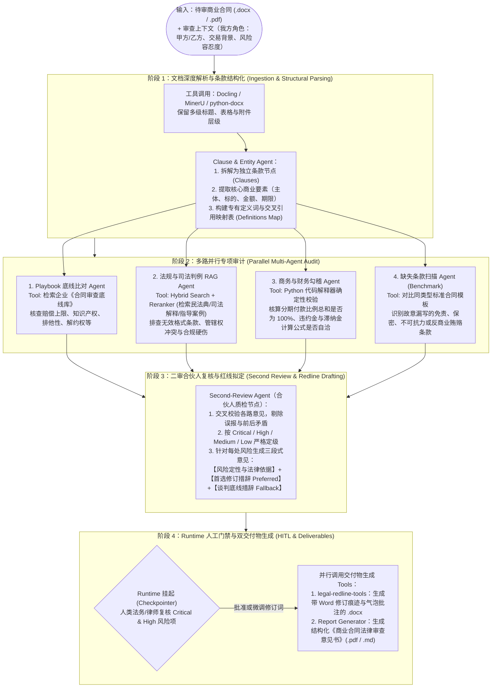

# 商业合同审查（Contract Audit）与法律咨询 Agentic Workflow 开源生态与架构参考

- **文档定位**：梳理 GitHub 上针对**商业合同合规审计（Contract Audit）**、**红线批注修订（Redlining）**与**出具专业法律意见（Legal Opinion）**的代表性开源项目、工具链及工业级多智能体（Multi-Agent）工作流架构蓝图。
- **关联资料**：
  - [Startup Technical Guide: AI Agents — 章节目录](../startup_technical_guide_ai_agents/00_章节目录_Table_of_Contents.md)
  - [核心概念专题问答：工具调用、编排决策、Runtime 与开源 RAG](../startup_technical_guide_ai_agents/01_核心概念专题问答_工具调用_编排决策_Runtime与开源RAG.md)

---

## 一、 为什么商业合同审查是 Agentic Workflow 的典型场景？

传统的“单次 Prompt 扔一篇长合同让大模型挑毛病”在严肃法务场景下几乎不可用，原因在于：
1. **长文本注意力退化（Lost in the Middle）**：几十页的商业合同（MSA、采购协议、投融资协议、EPC 工程合同）一次性塞入上下文，模型极易漏审隐蔽条款或忽略前后交叉引用（Cross-References）。
2. **缺乏审查立场与公司底线（Playbook Alignment）**：不同角色（甲方/买方 vs. 乙方/卖方）对同一条款（如赔偿责任上限、知识产权归属、排他性条款）的利益诉求截然相反，必须对照企业内部的《合同审查底线手册（Contract Playbook）》逐条比对。
3. **零幻觉容忍与强审计轨迹（Auditability）**：每一条风险提示和法律意见都必须精确锚定到合同原文段落、公司制度条款或现行法律法规（如《民法典》合同编及司法解释）。
4. **交付物“最后一公里”难题**：法务和律师的标准工作流是在 Microsoft Word 中开启**“修订模式（Track Changes）”**并添加**“气泡批注（Comments）”**，加上一份结构化的《法律审查意见书》，而非在聊天窗口里复制粘贴。

因此，成熟的法律审查系统普遍采用 **状态机图编排（LangGraph / Google ADK / PydanticAI） + 确定性规则与 Agentic RAG + 人工审批门禁（Human-in-the-Loop） + Word XML 底层修订工具** 的复合架构。

---

## 二、 核心开源项目拆解：多 Agent 编排与工作流骨架

### 1. [`liuhuanyong/ContractAuditAgent`](https://github.com/liuhuanyong/ContractAuditAgent)（中文多 Agent 合同审核流水线）
- **核心定位**：由中文 NLP 与知识图谱社区知名作者（老刘说 NLP）开源的多智能体流水线合同审核系统。
- **Agentic Workflow 五步顺序状态机拆解**：
  1. **`Document Agent`（文档解析智能体）**：负责 PDF/Word 的 OCR、章节层级识别与复杂表格拆分。
  2. **`Clause Agent`（条款结构化智能体）**：将长合同拆解为独立条款单元，提取合同主体、权利义务、履约期限、金额及违约责任等结构化实体。
  3. **`Risk Agent`（混合风险审计智能体）**：采用 **YAML 确定性规则引擎 + LLM 语义推理** 混合机制检测高危漏洞（例如单方解除权失衡、违约金过高或缺失）。
  4. **`Benchmark Agent`（标准模板比对智能体）**：将待审合同与企业标准合同范本比对，计算必备条款覆盖率并识别异常偏离项。
  5. **`Report Agent`（法律意见书生成智能体）**：汇总输出带风险等级、法理依据与修改建议的结构化审查报告。
- **工程亮点**：支持无外部 API Key 时的“本地规则 + 编辑距离模糊匹配”降级运行模式，适合高保密内网改造。

### 2. [`tahasiddiquii/contract-review-agent`](https://github.com/tahasiddiquii/contract-review-agent)（基于 PydanticAI 的工业级合同审计工作流）
- **核心定位**：基于 FastAPI + Next.js + PydanticAI 构建的全栈商业合同审查工作流，强调强类型状态管理与人工门禁。
- **核心架构亮点**：
  - **强类型条款提取（Typed Clause Extraction）**：利用 Pydantic 模型强制约束每个条款的提取 Schema，杜绝格式漂移。
  - **版本化审查手册比对（Versioned Risk Playbook）**：内置结构化的企业风险手册，Agent 逐条计算合同条款与公司标准立场的偏离度并量化打分。
  - **持久化人工签批门禁（Persistent Human Sign-off Gate）**：当识别出 High-Risk（高风险）条款时，Agent Runtime 自动挂起并持久化状态（即使服务器重启也不丢失），必须等待人类法务在前端审批或修改措辞后，才会继续流转生成最终文件。

### 3. [`The-Data-Galaxy/contract-review-skill-starter`](https://github.com/The-Data-Galaxy/contract-review-skill-starter)（深度适配中国商事法务的审查工作流骨架）
- **核心定位**：借鉴 Anthropic 官方商业法务（`commercial-legal`）框架、并针对中国大陆商事法务语境深度改造的轻量级可二次开发工作流。
- **核心架构亮点**：
  - **Scope Check（隐蔽非标条款扫描）**：专门检测夹杂在常规定义或附件中的“夹带私货”条款。
  - **四级风险分级体系**：`Critical`（红线禁区/一票否决）、`High`（重大商业或合规风险）、`Medium`（权利义务不对等）、`Low`（文字瑕疵或表述歧义）。
  - **三段式 Deal-Breaker（底线破坏项）法律推理链**：强制 Agent 按照资深法务思维输出完整论证：
    $$\text{我方审查立场与底线} \longrightarrow \text{对方哪句条款触发底线} \longrightarrow \text{签署后的实际商业/法律后果} \longrightarrow \text{首选修改方案 (Preferred) + 谈判退让底线 (Fallback)}$$

---

## 三、 解决法务“最后一公里”：Word 红线修订（Redlining）与复核工具

在构建合同审查 Agentic Workflow 时，以下几个开源仓库非常适合直接封装为工作流末端的 **Tool（工具）** 或 **QC Node（质检节点）**：

### 1. [`evolsb/legal-redline-tools`](https://github.com/evolsb/legal-redline-tools) & [`evolsb/claude-legal-skill`](https://github.com/evolsb/claude-legal-skill)
- **核心定位**：打通大模型 JSON 输出与律师标准交付物（Word 修订稿 `.docx` + 红线对比 PDF）的专用工具库，配套基于 **CUAD（Contract Understanding Atticus Dataset，含 41 类权威商业合同核心风险条款）** 的审查规则集。
- **作为 Agent Tool 的工作方式**：
  1. 前序的审查 Agent 完成分析后，输出结构化 JSON（包含：原条款精确文本、风险级别、批注说明/法律意见、建议替换文本）。
  2. 宿主程序调用 `legal-redline-tools`，直接在底层操作 `.docx` 的 OpenXML 结构，生成带有**原生 Word 修订标记（红色删除线、下划线）**和**右侧气泡批注（Margin Comments）**的文档。
  3. 法务或外部律师用 Word 打开即可逐条点击“接受/拒绝修订”。

### 2. [`lowtidebuild/second-review-agent`](https://github.com/lowtidebuild/second-review-agent)（“挑刺型”二审合伙人 Agent）
- **核心定位**：部署在合同审查工作流**倒数第二步**的独立质检智能体（Skeptical Quality Control Gate）。
- **核心作用**：模拟律所合伙人做“二审复核（Second Review）”，带着审视和怀疑的眼光专门排查一审 Agent 的输出：
  - 检查修改后的条款是否破坏了合同其他章节的交叉引用或专有词汇定义（Defined Terms）；
  - 核实引用的法律法规条文是否真实存在、是否现行有效（零幻觉容忍）；
  - 剔除吹毛求疵的低价值噪音批注，确保最终交给客户的法律意见切中要害。

---

## 四、 全栈开源系统与垂直场景方案对比

| 开源项目 | 技术栈与架构形态 | 核心能力与适用场景 |
| :--- | :--- | :--- |
| **[`chengyupeng/contract-review-system`](https://github.com/chengyupeng/contract-review-system)** | Vue 3 + Node.js + PostgreSQL + Milvus + OnlyOffice | **企业级中文合同审查平台**：支持法规库与**历史裁判文书** RAG 增强分析；内置 **OnlyOffice 在线协同编辑器**，可在网页端直接定位风险条款、查看批注并一键替换。 |
| **[`Fypy1019/Intelligent-Legal-Contract-Review-Agent`](https://github.com/Fypy1019/Intelligent-Legal-Contract-Review-Agent)** | FastAPI + Streamlit + LangChain + Qwen + Milvus | **本地中文合同审查 Agent 原型**：采用标准 Tool Calling 架构，集成法规检索、判例检索、合同版本 Diff 比对与结构化审查报告导出。 |
| **[`aniket-work/autonomous-legal-contract-auditor`](https://github.com/aniket-work/autonomous-legal-contract-auditor)** | Python + RAG + Vector DB | **合规量化审计范本**：针对 NDA（保密协议）、MSA（主服务协议）等标准商业协议，对照企业内部合规向量库进行 `0–100` 分的量化风险评级。 |
| **[`CaseMark/contract-comparator-OSS`](https://github.com/CaseMark/contract-comparator-OSS)** | Next.js + Semantic Matching | **多轮谈判版本比对 Agent**：当交易对手发回修改稿时，通过语义匹配自动对齐不同措辞的对应条款，并评估对方每一处删改对我方利益的潜在影响。 |
| **[`itzneel05/redline`](https://github.com/itzneel05/redline)** | Local-first + Ollama | **纯本地隐私优先合同扫描器**：100% 运行在本地开源模型（Qwen / Llama / Gemma）上，确保高机密商业合同不出内网，自动输出风险摘要与商务谈判邮件草稿。 |
| **[`Azure-Samples/ally-legal-assistant`](https://github.com/Azure-Samples/ally-legal-assistant)** | Microsoft Word Add-in + OpenAI | **Office 365 Word 原生插件范本**：演示如何将合同审查 Agent 直接嵌入律师日常使用的 Word 侧边栏，实现实时条款问答、合规校验与一键改写。 |

---

## 五、 工业级“商业合同审计与法律意见” Agentic Workflow 架构蓝图

结合《Startup Technical Guide: AI Agents》中的状态机编排、Agentic RAG 与 Runtime 护栏理念，一套可直接用于生产环境的**商业合同审计与法律意见工作流**标准架构如下：



---

## 六、 自研落地核心工程建议

如果你计划基于上述开源项目搭建自己的商业合同审查 Agentic Workflow，建议遵循以下四条工程准则：

### 1. 编排模式：用“确定性图状态机 + 并行子 Agent”替代单一 ReAct 循环
- 不要把整份合同和几十条审查规则塞给单个 `LlmAgent` 跑自由循环。
- 使用 **LangGraph** 或 **Google ADK (`SequentialAgent` + `ParallelAgent`)**，先按条款切分，再按**“公司底线比对”、“法律法规合规”、“商务数字勾稽”、“缺失条款排查”**四个维度并行审查（Map-Reduce 模式），最后由 **Second-Review Agent** 汇总复核。

### 2. 知识库构建（Agentic RAG）：三库分离 + Retrieve & Rerank
在挂载本地 RAG 工具（如 **Docling + LlamaIndex/RAGFlow + Qdrant + BGE-Reranker-v2-m3**）时，务必将知识库拆分为三个独立的检索 Tool：
- `search_company_playbook(contract_type, clause_category, our_role)`：检索我方作为甲方或乙方时的内部审查红线与标准替换话术；
- `search_statutes_and_interpretations(legal_issue)`：精确检索现行有效的法律条文与最高法司法解释（必须带效力级别与条款号元数据）；
- `search_judicial_precedents(dispute_pattern)`：检索同类商业合同纠纷的真实裁判要旨，用于支撑“为什么这一条在诉讼中极易败诉”的法律意见论证。

### 3. 数值与日期校验：必须交给 Python 代码工具，绝不让 LLM 心算
- 商业合同中常见的“首付款 30% + 到货款 40% + 验收款 20% + 质保金 5% = 95%（漏了 5%）”或大小写金额不一致（如“人民币壹佰万元整（¥1,000,0000.00）”），大模型直接阅读极易漏看。
- 必须在工作流中配置一个专门的确定性 Python 校验函数 Tool，由大模型提取出所有金额数字、百分比和日期节点后，调用 Python 脚本做精确的算术与逻辑校验。

### 4. 结构化输出契约（Schema Contract）
每一条审查意见的内部流转状态，建议使用如下强类型 Schema（以便无缝对接前端审批界面与 `legal-redline-tools`）：

```python
from typing import Literal, Optional
from pydantic import BaseModel, Field

class ClauseAuditFinding(BaseModel):
    clause_id: str = Field(description="原合同条款编号，如 '第8.2条'")
    original_text: str = Field(description="触发风险的合同原文精确片段（用于 Word 定位修订）")
    risk_level: Literal["Critical", "High", "Medium", "Low"] = Field(description="风险等级")
    risk_category: str = Field(description="风险类别，如 '违约责任失衡'、'知识产权归属'、'争议管辖'")
    legal_and_business_analysis: str = Field(
        description="三段式法律意见：1. 违反的底线或法条；2. 潜在商业/诉讼不利后果；3. 修改核心逻辑"
    )
    statutory_or_playbook_citation: str = Field(
        description="引用的具体法条（如《民法典》第585条）或公司 Playbook 章节号"
    )
    preferred_redline: str = Field(description="首选修改后条款全文（我方最优立场）")
    fallback_redline: Optional[str] = Field(default=None, description="谈判退让底线条款全文（对方拒不接受首选方案时的备选）")
    negotiation_talking_points: str = Field(description="给业务或法务与对方谈判时的沟通话术建议")
```

