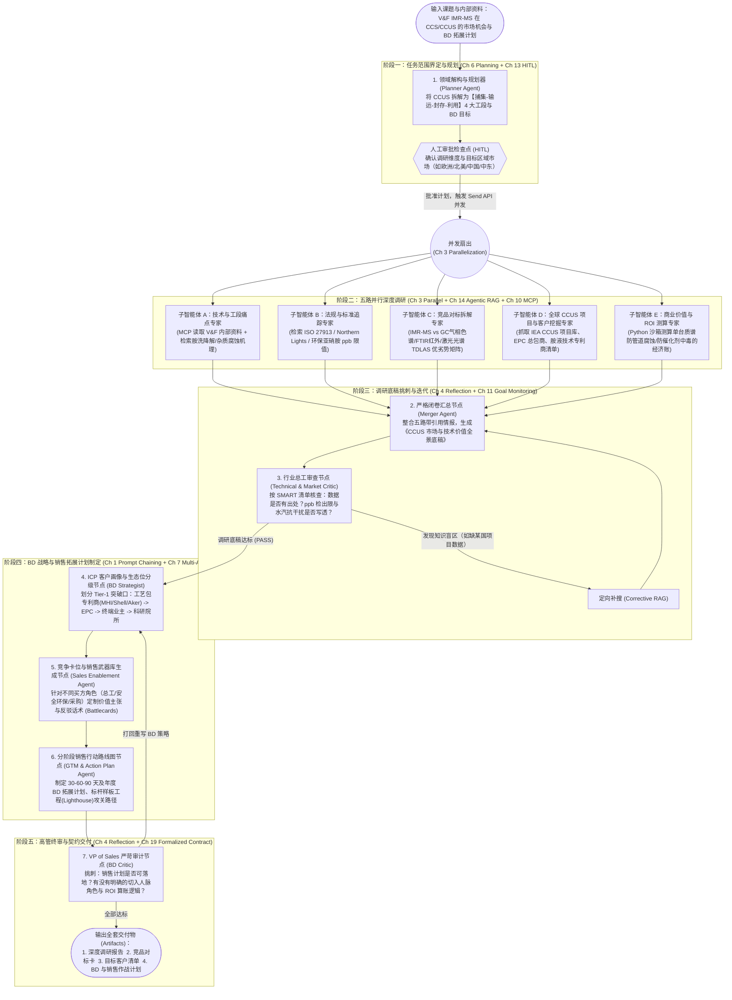

# 工业 B2B 深度市场调研与 BD 销售拓展 Agentic Workflow 开源生态与架构蓝图
## —— 基于《Agentic Design Patterns》全模式编织，以 V&F IMR-MS 在 CCS/CCUS 行业落地为例

---

## 一、 核心结论：GitHub 上有没有“开箱即用且 100% 覆盖全链条”的现成项目？

**客观现状是：GitHub 上有高度契合《Agentic Design Patterns》设计思想的旗舰级开源项目，但它们天然分为“前半段（深度行业/技术调研 Deep Research）”和“后半段（B2B 商业拓展 BD & GTM 销售转化）”两大阵营，目前没有任何一个单一开源仓库把“硬核工业质谱技术调研 -> CCUS 项目库挖掘 -> 客户痛点与 ROI 建模 -> BD 切入策略与销售拓展计划”无缝串成一条现成流水线。**

不过，好消息是：**《Agentic Design Patterns》书中第 6 章（Planning / Deep Research）、第 3 章（Parallelization）、第 14 章（Agentic RAG）、第 4 章（Reflection）、第 7 章（Multi-Agent）以及全书结语（Conclusion：5 大模式组合编织）所讲的架构，在 GitHub 上已经有非常成熟的官方参考实现**。你完全可以用 **“1 个主干框架（如 `bytedance/deer-flow` 或 `langchain-ai/open_deep_research`）+ 后置挂载 BD/Sales 专家节点”** 快速拼装出专属于 V&F IMR-MS 的全链路工作流。

---

## 二、 GitHub 头部开源参考仓库盘点（三大梯队对比）

### 第一梯队：与《Agentic Design Patterns》同源的官方/伴生仓库（Google ADK & 原书代码库）

| 仓库名称与链接 | 核心架构与采用的书中模式 | 覆盖你的需求链条比例 | 优势与局限 |
| :--- | :--- | :---: | :--- |
| **`google/adk-samples`** (`python/agents/marketing-agency`, `financial-advisor`, `deep-search`) | **Google 官方 ADK 样板库**（本书作者 Antonio Gulli 主推框架）。大量使用 `SequentialAgent`（Ch 1）、`ParallelAgent`（Ch 3）、`LoopAgent`（Ch 4 反思）与 `google_search` 接地（Ch 5）。 | **约 60%** （拆分在不同的独立 Sample 中） | **优势**：与本书代码风格 100% 一致；其中 `marketing-agency` 和 `financial-advisor` 展示了“调研 -> 策略制定 -> 营销方案生成”的多智能体交接。 **局限**：偏向通用商业/金融，缺少针对硬核工业仪器（如 IMR-MS vs FTIR/GC）的交叉技术对标与 B2B 工程项目（EPC/业主）BD 切入模板。 |
| **`google-gemini/gemini-fullstack-langgraph-quickstart`** | Google 官方出品的 **Gemini + LangGraph Deep Research** 全栈参考架构：动态生成搜索查询 -> 并行网页检索 -> 反思知识盲区（Gap Identification） -> 循环追索 -> 带引用综合报告。 | **前半段 85%** （深度市场与技术调研） | **优势**：极简、清晰，完美实现了本书 **Ch 6（Deep Research）+ Ch 14（Agentic RAG）+ Ch 4（Reflection）**。 **局限**：止步于“生成调研报告”，没有后半段的“目标客户画像、竞争卡位与 BD 销售行动计划”。 |
| **原书配套社区代码库** (`Mathews-Tom/Agentic-Design-Patterns` / `evoiz/Agentic-Design-Patterns`) | 收录本书 21 章对应的独立 Jupyter Notebooks（含 LangGraph、CrewAI、Google ADK 实现）。 | **原子积木级** （提供 21 种标准零件） | **优势**：学习单章模式的最佳字典。 **局限**：每章是一个独立的微型 Demo，未将 21 个模式串联成端到端的工业级巨型流水线。 |

---

### 第二梯队：GitHub 工业级深度研究（Deep Research）多智能体旗舰（基于 LangGraph）

如果你要调研 **“V&F IMR-MS 在 CCS/CCUS 行业的应用潜力、法规标准与市场机会”**，以下三个仓库是目前 GitHub 上公认最强的开源底座：

| 仓库名称与链接 | 核心架构（对标《Agentic Design Patterns》） | 为什么适合调研 V&F IMR-MS + CCUS？ |
| :--- | :--- | :--- |
| **1. `bytedance/deer-flow`** *(Deep Exploration and Efficient Research Flow)* | **LangGraph 多智能体架构**： `Coordinator`（Ch 2 路由） -> `Planner`（Ch 6 规划 + Ch 13 HITL 人工审批大纲） -> `Researcher`（Ch 5 搜索 + MCP 私域文档读取） + `Coder`（Python 沙箱计算 TAM/SAM/SOM 市场规模与 ROI） -> `Reporter`（汇总长文/PPT）。 | **最推荐作为全链路底座**： 1. 原生支持 **MCP（Ch 10）**，可直接挂载你们内部的 **V&F IMR-MS 产品手册/应用笔记 PDF 库**； 2. 自带 **Python 沙箱（`Coder` 节点）**，不仅能搜集各国 CCUS 捕集产能数据，还能直接写代码测算在线分析仪的市场容量（TAM/SAM/SOM）； 3. 原生支持 **HITL（人在回路）**，在执行深度搜索前先让你审核调研与 BD 计划大纲。 |
| **2. `langchain-ai/open_deep_research`** | **LangGraph 经典三段式 Map-Reduce 架构**： 1. **Scope（界定范围与澄清问题）**； 2. **Research（利用 LangGraph `Send` API 并行扇出多个子课题研究员，各自在闭环内搜索+反思）**； 3. **Write（严格闭卷汇总报告）**。 | **架构最干净、最易二次开发**： 它的 `Supervisor -> Parallel Sub-Researchers (Send API)` 结构，天然适合同时派出 5 个并行子智能体去查：① 胺液捕集降解物（亚硝胺）排放法规、② 管道输运 $\text{CO}_2$ 纯度标准（如 Northern Lights / ISO 27913）、③ 竞品（ABB/Servomex/Miro/Inficon）软肋、④ 全球在建 CCUS 项目清单、⑤ 食品饮料级 $\text{CO}_2$ 利用（CCU）标准。 |
| **3. `assafelovic/gpt-researcher`** & **`stanford-oval/storm`** | **Planner-Executor 树状递归深潜（GPT-Researcher）** / **多视角专家访谈式调研（STORM）**。 | **STORM 的“多视角提问（Perspective-Guided Question Asking）”非常适合工业 B2B**：它可以自动模拟“CCUS 化工厂总工”、“环保合规监管员”、“长输管道安全工程师”、“采购总监”四个不同角色对 V&F IMR-MS 发起拷问，挖出真正的商业痛点。 |

---

### 第三梯队：B2B 市场策略、BD 线索挖掘与销售拓展（GTM / Sales Enablement）开源项目

调研报告写完后，如何转化为 **Business Development（BD）与产品销售拓展计划**？GitHub 上这部分主要由 **CrewAI** 生态的模板领跑：

| 仓库名称与链接 | 核心智能体角色分工 | 可复用的后半段 BD 能力 |
| :--- | :--- | :--- |
| **`crewAIInc/crewAI-examples`** (`marketing_strategy`, `lead-score-flow`, `surprise_trip`) | `Lead Market Analyst`（首席市场分析师） -> `Chief Marketing Strategist`（首席策略官） -> `Creative Content Creator` / `Sales Strategist`（销售拓展策略师）。 | 提供了经典的 **“从调研洞察（Insights）到价值主张（Value Proposition）、理想客户画像（ICP）、竞争卡位话术（Battlecards）与客户开发路径”** 的 Prompt Chaining 与 Role-Playing 模板。 |

---

## 三、 实战蓝图：如何用《Agentic Design Patterns》构建“V&F IMR-MS 进军 CCS/CCUS 全链路智能体工作流”？

针对你的具体课题——**奥地利 V&F 公司核心技术 IMR-MS（离子分子反应质谱仪，如 AirSense / ProcessSense）在 CCS 與 CCUS 全产业链的应用潜力、价值、市场机会及 BD 销售拓展计划**，单靠一个通用 Deep Research 智能体往往会写出“正确的废话”（只讲 CCUS 很大，却讲不出 IMR-MS 相比传统 GC/FTIR 在具体工段上的不可替代性）。

遵循《Agentic Design Patterns》的 **模式组合法则（Pattern Composition，PDF P416）**，我们应该设计一个 **6 阶段、融合 10 大设计模式** 的 LangGraph 工作流：

### 1. 全链路拓扑架构图（Mermaid）

---

### 2. 五路并行调研子智能体（Phase 2）在 V&F IMR-MS 场景下的核心任务定义

为什么普通 AI 写不好工业仪器调研？因为它不知道在 CCUS 现场该查什么。在我们的工作流中，**Phase 2（第 3 章并行化 + 第 14 章 Agentic RAG）** 的 5 个并行子智能体被赋予了极度垂直的专业检索使命：

| 并行子智能体 | 聚焦维度 | 在 V&F IMR-MS + CCUS 场景下必须挖出的核心情报 | 运用的设计模式 |
| :--- | :--- | :--- | :--- |
| **Agent A** 技术与工段痛点专家 | **四大工段刚需定位** | 1. **碳捕集端（Post-combustion Amine Scrubbing）**：胺液（MEA/哌嗪等）氧化与热降解产生的挥发性胺、氨（$\text{NH}_3$）及强致癌物**亚硝胺（Nitrosamines）/硝胺**的实时秒级监测； 2. **压缩与管道输运端（Transport）**：微量 $\text{H}_2\text{O}$、$\text{H}_2\text{S}$、$\text{SO}_x$、$\text{NO}_x$、$\text{O}_2$ 混合形成跨相态强酸导致高压超临界 $\text{CO}_2$ 管道灾难性腐蚀的实时联锁报警； 3. **碳利用端（CCU / 食品级干冰 / 电制甲醇 e-Methanol）**：微量含硫/含氯杂质导致下游合成催化剂永久中毒的在线把关，以及饮料级 $\text{CO}_2$（ISBT 标准）苯、乙醛、总硫等痕量异味杂质秒级全检； 4. **直接空气捕集（DAC）**：吸附剂再生过程中的痕量挥发物动力学监测。 | **Ch 10 (MCP)** 读取本地 V&F 内部技术文档 + **Ch 14 (Agentic RAG)** |
| **Agent B** 法规标准与准入专家 | **强监管驱动力（Compliance Drivers）** | 1. 跨境/海床封存项目的严苛气体接收标准（如欧洲 **Northern Lights**、**Porthos**、**Aramis** 及 **ISO 27913** 管道标准中对 $\text{H}_2\text{S} < 5\text{–}9\text{ ppm}$、$\text{SO}_x/\text{NO}_x < 10\text{ ppm}$、胺类 $< 1\text{–}10\text{ ppm}$ 的强制上限）； 2. 欧美及中国环保部门对碳捕集装置尾气中 **亚硝胺排放（通常要求低至 ppb 级）** 的环评审批红线。 | **Ch 5 (Tool Use)** 搜索权威标准库 + **Ch 14 (Source Validation)** 剔除过期标准 |
| **Agent C** 竞品技术拆解专家 | **为什么非要用 V&F IMR-MS？（差异化护城河）** | 深度对比三大传统方案的软肋： 1. **vs. 气相色谱（GC / GC-MS）**：GC 测量周期长达数分钟至十数分钟，无法捕捉秒级工艺波动（Process Upsets）或溶剂突沸逃逸； 2. **vs. 傅里叶红外（FTIR / NDIR）**：湿法胺洗尾气含极高且剧烈波动的水汽（$\text{H}_2\text{O}$）与高浓度 $\text{CO}_2$ 背景，红外光谱存在严重交叉干扰（Cross-interference），难以做到 ppb 级痕量有机胺/亚硝胺同测； 3. **vs. 传统电子轰击质谱（EI-MS）**：70 eV 硬电离会把复杂分子打成碎片离子，导致同质量数碎片重叠（如 $\text{N}_2/\text{CO}$ 或复杂有机化合物）；而 **V&F IMR-MS 采用软电离（利用 $\text{Hg}^+, \text{Xe}^+, \text{Kr}^+$ 等初级离子在约 10–14 eV 下发生离子-分子反应）**，几乎无碎片、不受高湿与高 $\text{CO}_2$ 基质干扰、毫秒级响应、单台机器同时在线监测数十种无机+有机痕量组分（ppb 级）。 | **Ch 17 (Reasoning / CoT)** 多维技术参数矩阵推演 |
| **Agent D** 全球项目与生态客户挖掘专家 | **钱在谁手里？（Who Pays）** | 从 IEA CCUS Projects Database、Global CCS Institute 报告及招投标网中抓取： 1. **核心工艺包专利商（Licensors）**：三菱重工（MHI）、Shell CANSOLV、Aker Carbon Capture、巴斯夫（BASF Oase）、霍尼韦尔（Honeywell UOP）、中石化/华能等； 2. **大型 EPC 工程总包商**：Fluor、Worley、Technip Energies、KBR、中石油工程建设等； 3. **中试基地与顶尖高校实验室**：挪威 TCM（Mongstad 测试中心，全球胺捕集技术的圣地）、英国 PACT、美国 NCCC、清华/浙大/怀柔实验室等。 | **Ch 5 (Web Search & Scraping)** 结构化提取目标客户名录 |
| **Agent E** 商业价值与 ROI 算账专家 | **帮客户算经济账（Value Selling）** | 利用 Python 沙箱计算： 1. 一台 V&F IMR-MS（虽单价高于普通传感器）如何替代“多台单组分分析仪（FTIR + 测硫仪 + 测氧仪 + 在线 GC）”，降低总集采与运维成本（TCO）； 2. 避免一次因杂质超标被管道运营商拒收（Off-spec rejection）、或避免一次 CCU 合成反应器催化剂中毒停机（动辄数百万欧元损失）所带来的投资回报周期（Payback Period）。 | **Ch 5 (Code Executor / PALMs)** 确定性财务与 ROI 建模 |

---

### 3. 后半段：BD 与产品销售拓展计划（Phase 4）的四步结构化交付

很多 AI 写销售计划只会写“加强市场宣传、参加展会”。在我们的工作流中，**Phase 4（第 1 章结构化提示词链 + 第 7 章专家团队交接）** 强制要求输出工业大客户销售（Enterprise B2B Complex Sales）的 **四大标准作战产出物**：

1. **客户生态位三级突破漏斗（Tiered Go-To-Market Strategy）**
   - **第一波（0–6 个月，最短成交周期 & 最高行业背书）：科研院所与中试测试中心（Pilot Plants & R&D Centers）**
     - *逻辑*：新型胺溶剂研发、DAC 材料老化测试、催化剂耐毒化测试，迫切需要毫秒级多组分在线质谱（IMR-MS）发表高水平论文或做中试包评估；无需漫长的防爆与工程设计院审批，预算充足且决策链短。
     - *核心动作*：提供短期样机租赁测试（Demo/Trial Unit）或联合发表应用白皮书（Application Note），把 V&F 变成行业测试基准。
   - **第二波（6–18 个月，标准植入与批量杠杆）：碳捕集工艺包专利商（Technology Licensors）与撬装设备商**
     - *逻辑*：一旦 Shell、MHI、Aker 等工艺包商在工艺流程图（P&ID）的分析仪表包（Analyzer Package）中将“在线 IMR-MS 监测痕量胺/亚硝胺与酸气杂质”写入标准设计规范（Spec-in），后续全球每一个采用该工艺包的商业化大项目都会自动采购。
   - **第三波（12–36 个月，高客单价商业化大单）：大型 EPC 总包商、管道运营商与 CCU 绿氨/电制甲醇业主**
     - *逻辑*：针对已进入 FEED（前端工程设计）或 FID（最终投资决策）阶段的大型项目，联合本地分析仪表系统集成商（System Integrators，提供防爆小屋 Analyzer Shelter、伴热采样管线与本地售后维保）联合投标。
2. **多角色买方委员会作战卡（Buyer Persona & Battlecards）**
   - 针对 **工艺总工（Process Engineer）**：主打“抗高湿/高 $\text{CO}_2$ 干扰、软电离无谱峰重叠、毫秒级捕捉溶剂降解与动态工况”。
   - 针对 **HSE 与合规总监（Environmental & Safety Director）**：主打“ppb 级致癌亚硝胺与逃逸胺实时在线合规审计，确保持续满足最严苛环评”。
   - 针对 **仪表与自动化主任（I&C Lead）**：主打“单台 IMR-MS 替代 3–4 套独立分析仪，支持多流路切换（Multi-stream valve）同时监测吸收塔入口、水洗塔出口与精制 $\text{CO}_2$ 管道入口”。
   - 针对 **采购与项目总监（Procurement / Project Director）**：主打“全生命周期总拥有成本（TCO）对比与防止管道腐蚀/催化剂中毒的保底保险价值”。
3. **渠道与集成商生态布局（Channel & System Integrator Strategy）**
   - V&F 作为精密质谱原厂，在进入石化/电力/海工 CCUS 现场时，必须解决 **防爆认证（ATEX / IECEx）、高温伴热预处理系统（Sample Conditioning System）及本地 7×24 驻场响应** 问题。BD 计划必须包含：如何与区域头部过程分析系统集成商（PAC Integrators）建立战略绑定。
4. **30-60-90 天及年度 BD 关键里程碑与 KPI 监控表（对齐第 11 章 SMART 原则）**
   - 将销售拓展计划拆解为可量化追踪的里程碑（如：完成 3 份 CCUS 垂直应用笔记、锁定 5 家先导中试基地 Demo、切入 2 家头部工艺包商技术交流会、签约 3 家区域过程分析系统集成商）。

---

## 四、 结合你现有 6 款大模型的最佳角色分配表

结合我们在 [06_Chapter4_Reflection_高亮解析_生成与评估模型博弈及工程落地方案.md](../agentic_design_patterns/06_Chapter4_Reflection_高亮解析_生成与评估模型博弈及工程落地方案.md) 中梳理过的你的 6 款模型特性，在这条工作流中可以这样排兵布阵：

| 工作流阶段与节点 | 推荐主力模型 | 为什么选它？（模型专长匹配） |
| :--- | :--- | :--- |
| **Phase 1：顶层课题拆解与调研规划（Planner）** | **`Claude Opus 5.5`** 或 **`Gemini 4 Argon`** | 逻辑极度严密，擅长将模糊的“调研 IMR-MS 在 CCUS 的机会与 BD 计划”拆解为正交完备的工段、法规、竞品与商业漏斗子任务。 |
| **Phase 2：五路高并发检索、网页清洗与外部动态扫描** | **`Gemini 3.8 Flash`**（主力并发）+ **`Grok 4.7`**（最新行业动态/政策脉冲） | `Gemini 3.8 Flash` 具备极大上下文与极高性价比，最适合同时开启 5 路并发吞吐海量 PDF 标准与网页；`Grok 4.7` 负责捕捉欧美/中东最新 CCUS 补贴政策变动、项目延期或新签 FID 动态。 |
| **Phase 2 汇总：严格闭卷合成底稿（Merger Agent）** | **`Gemini 4 Argon`** | 超长上下文跨文档对齐能力最强，能把 5 路研究员收回的数十万字原始资料无遗漏地合成为带精准引用的技术与市场底稿。 |
| **Phase 3：调研底稿事实核查与技术挑刺（Technical Critic）** | **`Claude Opus 5.5`** | 扮演“严苛的 CCUS 首席工艺专家”，专门挑刺底稿中是否存在电离能数据错误、检出限张冠李戴或缺乏出处的市场规模臆测。 |
| **Phase 4：BD 策略、竞争卡位与销售作战计划生成** | **`Claude Sonnet 5.5`**（主笔）+ **`Claude Opus 5.5`**（策略拔高） | `Claude Sonnet 5.5` 撰写的商业企划、买方话术矩阵（Battlecards）与 30-60-90 天行动计划结构极佳、文风干练且极具说服力。 |
| **Phase 5：销售副总裁终审挑刺（BD Critic）** | **`Grok 4.7`** + **`Claude Opus 5.5`** | `Grok 4.7` 扮演“挑剔的石化业主采购总监/竞争对手销售总监”，用最犀利的现实问题（如“你们防爆怎么做？维保太贵怎么破？”）对 BD 计划做红队压力测试；`Claude Opus 5.5` 做最终合规与契约完整性裁决。（*注：全程禁用 `Fable 5.1` 参与技术参数与市场数据环节*）。 |
