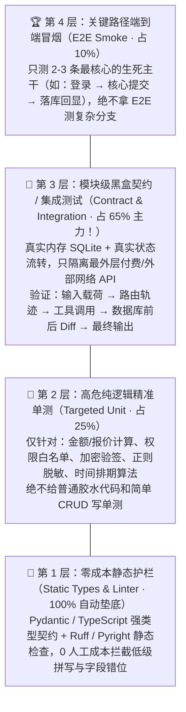

# 01｜AI 时代的免手写 TDD 与测试分层策略（个人开发者专版）

> **一句话核心结论**：在「1 人 + AI Agent」模式下，**TDD 的本质不是“测试技术”，而是“控制 AI 不跑偏的缰绳”**。你不需要成为写测试代码的专家，甚至不需要手写一行 `pytest` 或 `Playwright`；你只需要掌握**「定义中文边界矩阵」**与**「强制 AI 读写隔离」**这两件事。

---

## 一、 破除三大传统测试迷思：为什么单兵不能照搬教科书？

当你听到“用 TDD 解决 AI 代码质量问题”时，第一反应往往是：*“难道我要去苦学单元测试、集成测试、端到端测试框架，自己亲手写几千行测试代码吗？”*

**绝对不要这么做。** 传统软件工程教科书里的测试教条，直接套在个人独立开发者身上会产生严重的副作用：

### 迷思 1：“我需要自己手写测试代码” → 错，你只写「业务判决书」
- **传统痛点**：配置测试数据库、Mock 外部 HTTP 请求、写异步 `pytest` 夹具（Fixture），哪怕对全职高级工程师也很繁琐。如果你自己手写，省下来的写业务代码时间全赔进了写测试代码里。
- **AI 时代正解**：AI 极度擅长写测试脚手架、构造假数据和编写断言语法，但 **AI 极度不擅长替你决定“业务上什么算对、什么算错、什么边界绝对不允许发生”**。因此分工非常纯粹：
  - **你负责写「5 分钟中文验收矩阵」**（纯自然语言，写清输入、预期结果、禁止行为）；
  - **AI 负责把它翻译成可执行的自动化测试脚本**；
  - **你只审阅测试脚本里的「中文用例名」和最后那几行 `assert`（断言）**。哪怕一个测试文件有 200 行，真正决定对错的 `assert` 往往不到 15 行，1 分钟即可扫完。

### 迷思 2：“单元测试越多越好，追求 80% 单元测试覆盖率” → 错，单兵应采用「测试奖杯模型」
传统测试金字塔要求底部写海量的**内部函数单元测试（Unit Tests）**。但在 AI 开发中，细碎单元测试反而是累赘：
- 如果测试绑死了内部私有函数怎么拆、内部变量叫什么，下次你让 AI 重构优化代码时，功能明明没坏，几十个细碎单测却全红了（行业称为**脆弱测试 Brittle Tests**）。
- 对个人开发者而言，内部由 3 个函数还是 5 个函数实现根本不重要，**模块入口喂进去真实数据、出口返回与数据库落盘结果对不对**才重要。

### 迷思 3：“让写代码的 AI 顺手把测试也写了就行” → 大错特错，必陷「同源串谋陷阱」
这是目前 90% 用 AI 写代码的人踩得最深的坑——**同源串谋（AI Collusion / Tautological Tests）**：
- 当你对同一个 AI 说*“帮我实现邮件轮询功能并写好单元测试”*时，AI 先写了业务代码（比如漏掉了拉取附件二进制流，只拉了正文摘要 `bodyPreview`）；
- 紧接着它写测试时，由于上下文里装着自己刚写的代码，它会“贴心地”构造一个只含 `bodyPreview` 的假邮件去测刚才的函数——**测试一跑，瞬间全绿！**
- 这种测试叫**同义反复测试**：它只证明了“AI 写的代码等于 AI 写的代码”，无法发现需求遗漏。

---

## 二、 个人开发者的黄金测试配比：「倒置测试金字塔（Testing Trophy）」

个人独立开发者精力有限，每一分测试算力都必须花在刀刃上。请直接按以下 **4 层黄金配比** 要求 AI 生成测试，砍掉一切形式主义：

### 各层实操取舍速查表

| 测试类型 | 单兵要不要做？ | 什么时候用？ | 什么时候坚决不用？ |
| :--- | :--- | :--- | :--- |
| **静态类型与 Schema 校验**（Pydantic / TS） | **必做（性价比最高）** | 所有跨模块传参、大模型结构化输出（JSON Schema）、配置文件加载 | 无例外，全项目开启 |
| **细碎内部单元测试**（Unit Test） | **只做 25% 高危纯函数** | 算钱/差额对比、白名单拦截、HMAC 令牌验签、复杂日期推算、脱敏规则 | 严禁给页面渲染、普通增删改查、内部辅助小函数写单测 |
| **黑盒契约与轨迹集成测试**（Integration） | **主力核心（占 65%）** | 测完整业务闭环：用真实本地 SQLite 跑完一次请求，直接查库表新增了哪几行、走了哪几个状态节点 | 不要把数据库本身也 Mock 掉（Mock 掉数据库就测不出 SQL 与事务 Bug） |
| **浏览器 / 端到端测试**（E2E） | **极简冒烟（≤ 3 条）** | 上线前验证前后端真的连上了、核心按钮点得动（在 Antigravity 中可直接派 `browser` 子智能体点测） | 严禁用重型 E2E 脚本去测几十种业务排列组合（维护成本高且极易因改样式而报错） |

---

## 三、 核心武器：「读写隔离」的免手写 TDD 四步法

怎么做到**既不用自己手写测试代码，又绝对不让 AI 自己跟自己串谋放水**？  
融合 GitHub 上星标极高的 `obra/superpowers`（*Iron Law of TDD*）与 `addyosmani/agent-skills` 实践，最适合单兵的标准动作是 **「双角色物理隔离的 Red → Green → Refactor 循环」**：

### 第 1 步：你写「5 分钟中文验收矩阵」（人类定规矩）
在写任何业务代码前，你用大白话写下这片功能的 **3 类场景**（通常 5～8 行字就够了）：

1. **正常主干（Happy Path，1～2 条）**：标准输入进来，应该走哪条路、改哪张表、返回什么。
2. **刁钻边界（Edge Cases，2～3 条）**：空值、重复推送、半途超时、混合意图（如“发附件的同时问查档问题”）、格式残缺（如加密 PDF / 扫描件）时怎么兜底。
3. **绝对禁令（Invariants / Forbidden，1～2 条）**：什么情况下**绝对禁止调大模型**、**绝对禁止发外网请求**、**绝对禁止未确认写正式表**。

> **实战填写示范（以邮件与微信消息接入为例）**：
> - **正常 1**：白名单客户发来含报价 PDF 的邮件 → 提取正文与附件页码入 `raw_sources` 表，生成待确认卡存入 `pending_proposals`，**不得直接写入正式待办表**。
> - **边界 1**：同一封邮件（相同 `message_id`）2 分钟后重复轮询抓到 → 直接幂等跳过，0 次大模型调用，不重复推卡。
> - **边界 2**：用户发来 PDF 附件的同时配文“帮我查下去年给这家报过多少钱” → 即使路由判定为查档问答，**附件依然必须完成解析与归档备份**，不能丢失。
> - **禁令 1**：非白名单邮箱或非本人微信号发来任何内容（含提示词注入指令） → 入口处静默丢弃，0 次模型调用、0 行业务表写入。

---

### 第 2 步：独立盲测官写「红灯测试」（Role A：Isolated RED）
**核心防串谋机制**：调用独立的 `blind-test-author` 子智能体（或新开一个干净上下文窗口），**只允许它读取 🔴 红区接口契约（如 `schemas.py` 和空函数签名）以及你写的中文矩阵**，不让它接触业务实现思路。

盲测官必须完成两件事并向你汇报：
1. 编写高可读的黑盒测试（每个测试函数名和文档字符串直接对应你的中文条目，遵循 **DAMP 原则**——宁可测试代码有一点重复，也要让每个测试自包含、一眼看懂，不要搞复杂的测试继承）。
2. **亲手运行测试命令，并证明测试“因为预期的原因报错失败（Red）”**。
   - *为什么要看红灯？* 正如 `obra/superpowers` 的铁律所言：**“如果你没亲眼看到测试失败过，你就不知道这个测试到底能不能抓到 Bug。”** 一上来就绿的测试很可能是假断言。

**你在此步只需花 60 秒做一件事**：扫一眼它汇报的「测试清单与核心 `assert` 摘要」，确认它测的确实是你要的业务结果。

---

### 第 3 步：主实现引擎「锁死测试填空变绿」（Role B：Locked GREEN）
测试确认红灯后，切换回主编码 Agent 编写 `src/` 下的生产代码，同时由 `.agents/rules/solo_production_guardrails.md` 施加硬约束：

- **神圣不可侵犯原则**：**严禁修改、注释、跳过（`@pytest.mark.skip`）或弱化 `tests/` 目录下的任何一行断言代码！**
- **最小实现原则**：只写让当前这组红灯测试变绿所需的最小、最清晰的生产代码，禁止顺手过度设计未来没要求的功能（防代码膨胀）。
- **如果实现 Agent 发现测试本身确实有接口拼写错误怎么办？** 它必须**立即停下**，向你报告具体哪一行测试与契约冲突，经你点头同意后才能修改测试，绝不允许私自改测试凑绿灯。

---

### 第 4 步：带安全网重构与证据交付（Refactor & Proof）
当测试 100% 变绿后：
1. 让 Agent 检查刚写的生产代码是否有重复逻辑、过长函数或硬编码魔数，在**保持测试持续全绿**的前提下整理干净；
2. 必须在当前轮次运行完整测试套件（防止改新功能把旧切片搞坏），贴出真实的终端退出码与通过条数。

---

## 四、 如何花 60 秒一眼识破 AI 写的“烂测试 / 假测试”？

即使你不写测试代码，掌握下面 **4 条「假测试照妖镜」**，扫一眼 `assert` 就能立刻判断测试质量：

| 烂测试 / 假测试特征（看到立即打回） | 高质量生产级黑盒测试特征（放行标准） |
| :--- | :--- |
| **1. 空洞存在性断言**：只写 `assert result is not None` 或 `assert status == 200`，根本没核对返回的具体数值和字段内容 | **精确业务值断言**：明确核对 `assert card.estimated_hours == 0.0`、`assert db.count("list_items") == 0` |
| **2. 把被测对象自己给 Mock 了**：测订单落库逻辑，结果把数据库写入函数 Mock 成了 `return True`——测了个寂寞 | **只隔离最外层边界**：数据库用真实内存/临时 SQLite，只把真正花钱的大模型网关和外部企微/邮件 HTTP 接口替换成确定性桩（Fake/Stub） |
| **3. 绑死内部私有细节**：断言某个内部私有辅助函数 `_helper_x` 被调了 2 次，稍微重构代码测试就碎 | **只测公开入口与可观测副作用**：从公开入口函数或 FastAPI TestClient 喂入请求，只查最终返回值、库表记录变化与外发消息队列 |
| **4. 只测阳光大道**：10 个测试全是正常输入，没有一个测空数据、超长输入、非法权限或接口超时报错 | **边界与禁令占一半以上**：至少包含权限拒绝、重复请求幂等、上游报错优雅降级、危险动作拦截用例 |

---

## 五、 小结：你在测试环节的唯一心智负担

记住这个极简公式：

> **你的工作 = 5 分钟列出「正常 + 刁钻边界 + 绝对禁令」中文表 + 1 分钟核对红灯测试的 `assert` 摘要。**  
> 剩下的测试框架搭建、Mock 桩构造、异步执行、回归跑批，100% 交给 `.agents/` 下的 `red-green-tdd` 技能与 `blind-test-author` 子智能体自动完成。
