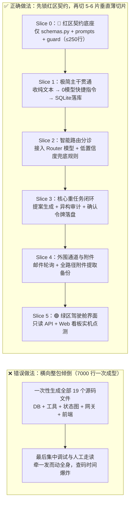

# 02｜垂直薄切片与红黄绿三区审阅法（告别全量源码走读）

> **核心理念**：个人开发者之所以会被迫花大量时间啃几千行源码，是因为犯了两个上游结构错误：**① 一次性让 AI 生成了整栋大楼（批量过大）**；**② 把核心规矩和胶水代码混写在一起（没有风险分层）**。把这两件事在源头拆开，你的审码工作量可以直接下降 **85% 以上**。

---

## 一、 架构全局化，实现薄片化（Vertical Thin Slicing）

以前你自己写代码时，习惯「先做完整需求分析和架构设计，再从底层往顶层写」。在 AI Agent 时代：
- **前半句保留**——全局业务边界、模块划分、数据库核心表结构依然要先想清楚；
- **后半句彻底改写**——**绝不要让 AI 按“先写完所有数据库层 → 再写完所有工具层 → 再写完所有路由层”横向整包生成**，更不要一句提示词让它把 20 个文件全吐出来。

### 什么是「垂直薄切片（Vertical Slice）」？
每一片都是一根**从输入端到存储/输出端完全贯通的极细管道**，每次只新增或修改 **150～300 行生产代码**，并且这一片写完当场就能跑通、验收、提交 Git。

### 垂直薄切片的三大铁律（已写入 `.agents/` 系统规则）

1. **Slice 0 永远只写「契约骨架」，不写业务逻辑**  
   开工第一轮，强制要求 AI 只生成项目的目录骨架、全局数据结构定义（如 `schemas.py`）、配置项校验（`config.py`）和安全门禁签名（`guard.py`）。你花 **10～15 分钟**把这 200 多行看透改定，相当于给整栋楼浇筑好钢筋立柱。
2. **单片超时 / 超长即切碎（150～300 行红线）**  
   如果某一片任务预计改动超过 400 行核心逻辑，或者涉及 3 个以上外部系统联动，说明切得太厚了，必须一分为二。
3. **「重生优于排错（Regeneration over Debugging）」法则**  
   因为每个薄切片都只有两百行左右且有 Git 干净节点保护，一旦发现 AI 在某一片上理解偏了、连改两次还在打补丁绕圈子，**千万不要陪它一起读脏代码排错**——直接回退工作区未提交的这几百行改动，在你的中文验收矩阵里补上一句明确的约束，让它从干净状态重新生成这一片（通常 2 分钟就能干净解决）。

---

## 二、 红黄绿三区审阅法：只看 10% 的代码，管住 95% 的风险

Thoughtworks 与 Simon Willison 等工程专家反复强调：**在 AI 编码时代，把宝贵的人类注意力平均分配给每一行代码，是最大的资源浪费。**

但想做到“只读 10% 的代码就放心上线”，有一个极其关键的前提：**你必须在架构上强制要求 AI 做「红区物理隔离」**——也就是把决定系统生死的核心规矩单独拎出来放在几个极短的文件里，严禁把业务规则、提示词或权限判断零散硬编码在上千行的编排文件或 HTML 页面里。

### 三区划分标准与审阅策略全表

| 区域 | 占全项目代码比例 | 包含哪些代码？（物理隔离目录约定） | 你的审阅方式 | 允许的缺陷容忍度 |
| :--- | :---: | :--- | :--- | :--- |
| **🔴 红区** （核心契约与底线） | **5% ～ 10%** （通常 150～350 行） | 1. **数据契约**：`schemas.py` / `types.ts`（所有枚举、入参出参字段、默认值） 2. **认知宪章**：`prompts/`（全部大模型系统提示词集中存放） 3. **安全与资金门禁**：`guard.py` / `auth.py`（白名单、HMAC 确认令牌、脱敏正则、金额核验、防密钥泄漏） | **人类 100% 逐行精读**。 因为总共只有两三百行且高度浓缩，15 分钟即可彻底看透。 | **零容忍**。任何一处模糊默认值或权限漏口都必须在源头掐灭。 |
| **🟡 黄区** （编排与业务胶水） | **55% ～ 65%** | 1. 状态机与工作流编排（如 `graph.py`） 2. 上下文拼装与检索逻辑（如 `context_assembler.py`） 3. 外部通道收发与数据库事务实现（如 `wecom_gateway.py`、`mail_poller.py`、`db.py`） | **人类 0 通读**。 改由 **「读写隔离黑盒测试 + 独立盲审挑刺 Agent + 黄金样本回放表」** 三重机器交叉验证；你只点开盲审报告标红的那几十行拍板。 | 不允许违背红区契约或吞掉异常；内部怎么拆函数不纠结。 |
| **🟢 绿区** （视图与样板代码） | **25% ～ 35%** | 1. 前端页面与样式（如几千行的 `index.html` / React 组件） 2. 报表导出、Markdown 排版拼接、画图脚本 3. 纯展示类只读统计接口 | **人类 0 代码阅读**。 直接启动本地服务亲手点一遍（或派 `browser` 子智能体自动遍历按钮、窄屏适配与空状态截图）。 | 视觉或交互不顺眼直接截图让 AI 改，绝不翻 HTML/CSS 源码。 |

---

## 三、 为什么「精读 🔴 红区 250 行」能管住全局细节？

很多开发者担心：*“我不读黄区那 3,000 行编排代码，万一它在里面胡写怎么办？”*  
来看「红区物理隔离 + 强类型校验」是如何从物理上封死胡写空间的：

1. **用 `schemas.py` 锁死数据形状与默认值**：  
   比如你规定“AI 不允许瞎猜个人净投入工时，默认必须为 `0.0`”。只要你在红区 `schemas.py` 里亲眼确认了 `estimated_hours: float = 0.0`，并在红区 `prompts/` 里确认写了“禁止估算个人净工时”，黄区代码只要通过 Pydantic 解析，就不可能凭空变出别的字段类型。
2. **用集中式 `prompts/` 杜绝“暗藏私货提示词”**：  
   系统级规则严禁 AI 在 `graph.py` 或业务函数里临时拼凑野生 System Prompt。所有给大模型立的规矩全在几十行的 `system_prompts.py` 里，你一眼就能看完所有 AI 节点的行为边界。
3. **用独立 `guard.py` 锁死写库与外发咽喉**：  
   把单人白名单校验、人类确认令牌验签、外搜敏感词剥离独立成纯确定性小函数。你精读这几十行代码确认逻辑严密，再用契约测试锁住“任何写库入口必调 `guard`”，即使黄区上千行路由怎么绕，也绕不过这把铁锁。

---

## 四、 🟡 黄区免通读神器：「独立挑刺审计官（Adversarial Blind Audit）」

当黄区代码写完（或者你手里已经有几千行现成代码）时，千万不要让**刚才写代码的同一个对话窗口**自我检查——它会有严重的“确认偏见（Confirmation Bias）”，觉得自己写得天衣无缝。

正确的行业做法是 **Agent-on-Agent 盲审对账**（已封装为 `.agents/agents/adversarial-code-auditor.md` 与 `blind-audit-and-trace` 技能）：

1. **物理隔离上下文**：拉起一个全新的只读审计子智能体，它**完全不知道刚才写代码时经历了什么妥协**，眼里只有两份材料：**《需求规格文档》** 与 **《当前磁盘上的真实源码》**。
2. **反客套提示词约束**：明确禁止它输出“整体架构清晰、设计良好”之类的废话，强制它按以下 **4 类高危靶点** 逐项找茬并给出精确的 `文件路径:行号`：
   - **漏做 / 缩水实现（Omission）**：需求写了拉取邮件及附件，代码实际只拉了 `bodyPreview` 摘要；
   - **路径覆盖盲区（Routing Gap）**：附件解析只挂在了路径④入口，如果用户带附件走了路径③就会漏解析；
   - **静默吞错（Silent Failure）**：出现 `except Exception: pass` 或报错后返回空列表假装无数据，导致线上出故障毫无痕迹；
   - **隐含硬编码假设（Hidden Assumption）**：写死了时区、写死了魔数阈值、或主备模型档位与图纸约定不一致。
3. **你只做选择题**：审计官花 1 分钟扫完全部几千行源码，给你吐出一份只有 **5～8 条真实出入点** 的一页纸报告。你只需要花 5 分钟逐条拍板（“第 1 条按需求修代码”、“第 2 条代码更合理，同步改文档”），审核效率直接提升 **10 倍以上**。
