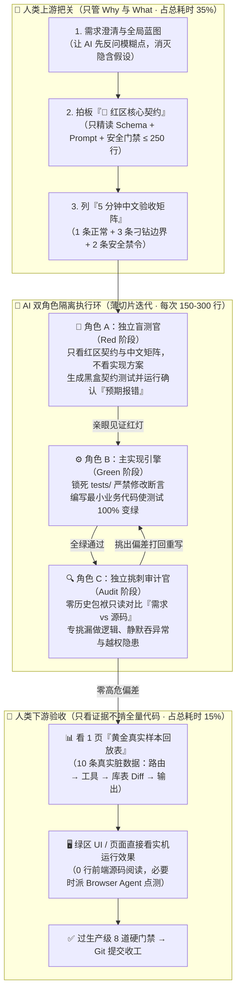

# 个人独立开发者 + AI Agent 生产级软件交付工程体系

> **核心目标**：在不苦练手写测试代码、不通读几千行陌生源码的前提下，让「1 个人 + AI IDE（Antigravity / Cursor）」稳定交付可上线、可维护、细节零失控的**生产级（Production-Grade）项目**。  
> **配套自动化资产**：本指南已同步转化为可直接驱动 AI 的系统级规则、子智能体提示词与技能包，位于工作区根目录 [../.agents/](../.agents/README.md)。

---

## 一、 为什么「一次生成全项目 → 看流程图 → 啃源码」会陷入低效泥潭？

当开发模式从「需求架构 → 亲手逐行敲代码」切换到「AI 直接生成整套项目」时，绝大多数独立开发者都会撞上一堵墙——行业称为 **「AI 验证税（Verification Tax）」**。

过去你亲手写代码时，**“敲键盘”的过程顺带完成了脑内建模、异常推演与边界自检**；而让 AI 一次性吐出几千行代码后，你会同时遭遇三重结构性失灵：

1. **静态流程图是“有损压缩”，天然掩盖魔鬼细节**  
   流程图只能表达主干拓扑（Happy Path），无法呈现字段丢失、分支漏调、静默吞异常或隐含假设（例如：图上画了“拉取邮件并解析附件”，代码里可能只拉了邮件摘要没拉附件二进制流；或者某条旁路分支跳过了前置解析函数）。
2. **事后通读 AI 海量陌生源码的认知负荷极高**  
   审阅别人一次性写好的 7,000 行代码的脑力消耗是自己写的 3～5 倍。读到后半程必然产生注意力疲劳（Cognitive Surrender），花掉大量时间却依然漏掉深层逻辑缺陷，导致整体效率不升反降。
3. **同一个 AI“边写业务代码边补测试”必然发生「同源串谋（AI Collusion）」**  
   如果让写业务代码的同一个会话顺手生成单元测试，AI 会照着自己刚写的（哪怕理解错了需求的）实现逻辑去写 Mock 和断言。测试跑起来 100% 全绿，但只是在证明“代码做了代码正在做的事”（同义反复测试），对需求偏差毫无拦截力。

---

## 二、 四种研发模式全局对比：单兵作战该选哪条路？

我们既不能退回纯手写时代，也不能照搬大厂几十人团队的重型流程。下表对比了四种模式的真实投入产出比：

| 维度 | 传统纯手写开发 | 盲目 Vibe Coding（整包生成） | 传统重型 TDD / 大厂流程 | **单兵契约切片流（本体系推荐）** |
| :--- | :--- | :--- | :--- | :--- |
| **生成粒度** | 逐行手敲 | 一次性生成几千行整套项目 | 重文档、多层评审、高覆盖单测 | **全局定架构 + 每次 150～300 行垂直薄切片** |
| **谁写测试** | 自己手写或干脆不写 | 同一个 AI 事后顺手补假测试 | 要求开发者精通并手写单测/集成/E2E | **人写 5 行中文边界表 → 独立盲测 Agent 先出红灯测试** |
| **测什么** | 靠手动点一点 | 看测试全绿自嗨，上线到处漏 | 追求 80%+ 细碎内部函数单元测试 | **倒置金字塔：只抓黑盒契约测试 + 黄金样本轨迹** |
| **怎么审代码** | 自己写的全懂，无需审 | 被迫回头硬啃几千行陌生代码 | 多人互相 Code Review | **红区（≤10% 代码）精读 + 黄区异构盲审 + 绿区免读** |
| **发现细节偏差** | 写的时候顺手处理 | 上线后踩坑，排错比重写还慢 | 流程极其漫长，单兵根本扛不住 | **红灯断言前置拦截 + 10 条真实样本轨迹表 3 分钟看穿** |
| **交付质量** | 稳但极慢 | Demo 极快，生产级一碰就碎 | 稳但单人精力破产 | **兼顾 5 倍开发提速与生产级确定性** |

---

## 三、 单兵 + AI Agent 生产级交付闭环全景图

---

## 四、 文档体系导航（按阅读与实操顺序编排）

| 序号 | 文档名称 | 核心解决的问题与适用场景 |
| :--- | :--- | :--- |
| **01** | [01-AI时代的免手写TDD与测试分层策略.md](01-AI时代的免手写TDD与测试分层策略.md) | **解开测试心结**：为什么个人开发者千万别练手写单测？单元/集成/E2E 到底留哪个？如何用「中文场景表 + 读写隔离双 Agent」彻底根除 AI 测试放水？ |
| **02** | [02-垂直薄切片与红黄绿三区审阅法.md](02-垂直薄切片与红黄绿三区审阅法.md) | **告别全量审码**：如何把大项目切成 150～300 行的端到端薄片？如何强制 AI 做「红区物理隔离」，让你只读 10% 代码就能锁死 95% 的业务与安全风险？ |
| **03** | [03-黄金样本实弹回放与生产级交付门禁.md](03-黄金样本实弹回放与生产级交付门禁.md) | **跨越生产鸿沟**：如何用「10 条真实样本回放表」替代看静态流程图？手头**已经整包生成的几千行存量项目**怎么在 1 小时内无痛体检接管？上线前必查哪 8 项生产级底线？ |
| **04** | [04-个人开发者日常指令速查手册.md](04-个人开发者日常指令速查手册.md) | **开箱即用口令卡**：日常在 Antigravity / Cursor 中，从立项、切片、红绿 TDD、盲审对账到上线，每一步直接复制粘贴的标准指令与检查点。 |

---

## 五、 与工作区 `.agents/` 系统级配置的一一映射

为了让 AI 自动遵守这套工程方法，而不需要你每次对话重复叮嘱，我们已结合 GitHub 顶尖开源工程规范（融合 `obra/superpowers`、`github/spec-kit`、`addyosmani/agent-skills` 精髓并针对个人开发者裁剪），在 [../.agents/](../.agents/README.md) 下部署了全套系统规则与技能：

1. **常驻与按文件自动触发规则（Rules）**：
   - [solo_production_guardrails.md](../.agents/rules/solo_production_guardrails.md)（`always_on` 全局生效）：强制执行禁止未经授权整包倾倒、红区物理隔离、绿灯阶段禁改测试、生产级安全基线、无实证不报完工五大铁律。
   - [anti_collusion_testing.md](../.agents/rules/anti_collusion_testing.md)（触碰 `tests/` 自动激活）：强制执行黑盒契约测试优先、禁止测私有实现、禁止空洞断言、中文可读场景命名规范。
2. **专用隔离子智能体（Subagents）**：
   - [blind-test-author.md](../.agents/agents/blind-test-author.md)：读写隔离的「独立黑盒测试官」，只看契约与中文验收表编写红灯测试。
   - [adversarial-code-auditor.md](../.agents/agents/adversarial-code-auditor.md)：零客套的「独立挑刺审计官」，只读对比需求文档与源码，专揪细节偏差与静默隐患。
3. **按需激活工作流技能（Skills）**：
   - [spec-thin-slice](../.agents/skills/spec-thin-slice/SKILL.md)：新项目/新功能开荒——反问模糊边界 → 先落红区契约 → 拆解垂直薄切片。
   - [red-green-tdd](../.agents/skills/red-green-tdd/SKILL.md)：切片开发与修 Bug——自动调度盲测官先出红灯测试，再锁死测试写实现变绿。
   - [blind-audit-and-trace](../.agents/skills/blind-audit-and-trace/SKILL.md)：存量项目接管与上线前体检——红黄绿三区分拣 + 独立盲审对账 + 黄金样本实弹轨迹表。
