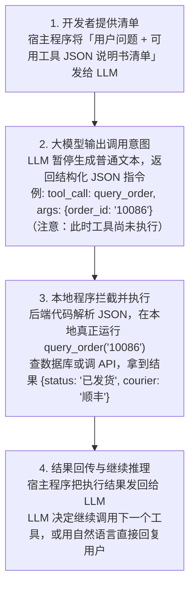
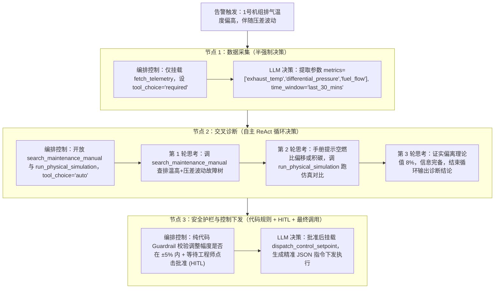

# 《Startup Technical Guide: AI Agents》核心概念专题问答与工程深潜

- **来源**：阅读《Startup Technical Guide: AI Agents》过程中的针对性专题问答整理（[Gemini 原始对话分享链接](https://share.gemini.google/eHoiZ8fZQDJt)）
- **关联文档**：
  - 指南章节目录：[00_章节目录_Table_of_Contents.md](./00_章节目录_Table_of_Contents.md)
  - 指南全文 Markdown：[startup_technical_guide_ai_agents_full.md](./startup_technical_guide_ai_agents_full.md)
  - 指南原版 PDF：[startup_technical_guide_ai_agents_final.pdf](./startup_technical_guide_ai_agents_final.pdf)

---

## 专题目录与原书章节映射

| 专题编号 | 核心探讨问题 | 关联原书章节 | 关键技术概念 |
| :--- | :--- | :--- | :--- |
| **[专题一](#专题一agentic-workflow-中的工具调用tool-calling本质与底层流转机制)** | Agentic Workflow 里的“工具调用”所指的工具具体是什么？是代码还是特定 API 接口？ | Section 1.2 (Tools, P11)<br>Section 2.1 (ADK Tools, P32–P34) | JSON Schema 说明书 vs. 代码执行体、MCP 协议、四步流转机制 |
| **[专题二](#专题二工具准备与编排决策机制agentic-workflow-如何决定在哪里调用哪些工具)** | 开发时如何准备工具清单？大语言模型编排时如何决定在哪里调用哪些工具？背后的决策机制靠什么实现？ | Section 1.2 (Orchestration, P14–P15)<br>Section 2.1 (ADK Architectures, P29–P32) | Tool-Use 微调、Docstring 注意力匹配、ReAct 循环、状态机图编排、`tool_choice` 硬控 |
| **[专题三](#专题三agent-runtime智能体运行时的本质五大核心模块与双层语境)** | 一个 Agent 的 Runtime 具体是什么？仅仅是 Agent 的运行环境吗？ | Section 1.2 (Runtime, P16)<br>Section 2.1 (Vertex AI Agent Engine, P36–P37) | 静态定义 vs. 动态运行、事件循环、Checkpointer 断点续传、安全沙盒、前置护栏 |
| **[专题四](#专题四vertex-ai-rag-engine-开源辨析与同等水平的工业级开源-rag-选型及-tool-封装实战)** | Vertex AI RAG Engine 是开源项目吗？有没有同等技术水平的开源 RAG 项目可直接放入 Agentic Workflow 作为工具使用？ | Section 1.3 (RAG / GraphRAG / Agentic RAG, P17–P22) | RAGFlow (DeepDoc)、Docling/MinerU + LlamaIndex + Qdrant + BGE-Reranker、`Retriever` vs `QueryEngine` |

---

## 目录

- [专题一：Agentic Workflow 中的“工具调用（Tool Calling）”本质与底层流转机制](#专题一agentic-workflow-中的工具调用tool-calling本质与底层流转机制)
  - [1.1 拆解“工具”的双重形态：说明书 vs. 执行体](#11-拆解工具的双重形态说明书-vs-执行体)
  - [1.2 工具的四大常见工程形态](#12-工具的四大常见工程形态)
  - [1.3 核心机制：一次“工具调用”在底层是如何流转的？](#13-核心机制一次工具调用在底层是如何流转的)
  - [1.4 实际应用案例：智能电商售后 Agent](#14-实际应用案例智能电商售后-agent)
  - [1.5 为什么在 Agentic Workflow 中工具如此重要？](#15-为什么在-agentic-workflow-中工具如此重要)
- [专题二：工具准备与编排决策机制——Agentic Workflow 如何决定在哪里调用哪些工具？](#专题二工具准备与编排决策机制agentic-workflow-如何决定在哪里调用哪些工具)
  - [2.1 第一层：微观决策机制——大模型自己怎么选？（语义路由与指令微调）](#21-第一层微观决策机制大模型自己怎么选语义路由与指令微调)
  - [2.2 第二层：宏观编排机制——Workflow 怎么控制调用位置和顺序？](#22-第二层宏观编排机制workflow-怎么控制调用位置和顺序)
  - [2.3 第三层：硬核控制手段——工程师如何在代码里“干预”决策？](#23-第三层硬核控制手段工程师如何在代码里干预决策)
  - [2.4 工程实例：工业设备智能诊断与调控 Workflow](#24-工程实例工业设备智能诊断与调控-workflow)
- [专题三：Agent Runtime（智能体运行时）的本质、五大核心模块与双层语境](#专题三agent-runtime智能体运行时的本质五大核心模块与双层语境)
  - [3.1 为什么需要专门的“Runtime”？（大模型本身是无状态的）](#31-为什么需要专门的runtime大模型本身是无状态的)
  - [3.2 解剖 Agent Runtime：五大核心组成模块](#32-解剖-agent-runtime五大核心组成模块)
  - [3.3 代码直观对比：“静态定义（Design-time）” vs “Runtime 执行”](#33-代码直观对比静态定义design-time-vs-runtime-执行)
  - [3.4 行业语境下的两种“Agent Runtime”指代](#34-行业语境下的两种agent-runtime指代)
  - [3.5 工业自动化控制系统类比总结](#35-工业自动化控制系统类比总结)
- [专题四：Vertex AI RAG Engine 开源辨析与同等水平的工业级开源 RAG 选型及 Tool 封装实战](#专题四vertex-ai-rag-engine-开源辨析与同等水平的工业级开源-rag-选型及-tool-封装实战)
  - [4.1 Vertex AI RAG Engine 为什么强？我们对标什么能力？](#41-vertex-ai-rag-engine-为什么强我们对标什么能力)
  - [4.2 同等技术水平的四大开源 RAG 项目对比与选型](#42-同等技术水平的四大开源-rag-项目对比与选型)
  - [4.3 重点推荐方案剖析（如何达到工业级水准）](#43-重点推荐方案剖析如何达到工业级水准)
  - [4.4 代码实战：如何把开源 RAG 封装成 Agentic Workflow 里的一个 Tool？](#44-代码实战如何把开源-rag-封装成-agentic-workflow-里的一个-tool)
  - [4.5 关键工程建议：在 Agent 里用 Retriever 而不是 QueryEngine](#45-关键工程建议在-agent-里用-retriever-而不是-queryengine)

---

## 专题一：Agentic Workflow 中的“工具调用（Tool Calling）”本质与底层流转机制

> **对应指南章节**：Section 1.2 *Tools: Enabling agentic action*（文档第 11 页 / PDF P13）与 Section 2.1 *ADK tools: A framework for agentic action & Designing effective tools*（文档第 32–34 页 / PDF P34–36）
>
> **核心问题**：Agentic Workflow 里的工具调用所指的“工具”具体是什么？是代码吗，还是特定的 API 接口，还是什么？

在 **Agentic Workflow（智能体工作流）** 中，“工具调用（Tool Calling / Function Calling）”里的**“工具（Tool）”**，本质上是大语言模型（LLM）与外部世界交互的桥梁。

如果把大模型比作一个“被关在房间里、博览群书但没有手脚的大脑”，那么工具就是给它装上的“手和脚”。至于它具体是代码还是 API：
- **对于大模型来说**，工具是一段**“结构化的说明书”（JSON Schema）**；
- **对于底层的执行系统来说**，工具是一段**“可执行的代码函数”**（函数内部可以包含纯本地逻辑、数据库查询、或者外部 API 调用）。

### 1.1 拆解“工具”的双重形态：说明书 vs. 执行体

在代码中定义一个工具时，它永远包含两个核心部分：

#### 1. 给大模型看的：工具说明书（Schema / Declaration）
大模型本身不会直接运行代码，也不会自己去发网络请求。大模型只能看懂文字。因此，需要用 JSON 格式写一份“说明书”塞进提示词里告诉模型：
- **名称（Name）**：工具叫什么（例如 `get_weather`）。
- **描述（Description）**：这个工具是干嘛的、什么时候该用它（例如“用于查询指定城市的实时天气”）。
- **参数定义（Parameters）**：调用它需要传什么参数、什么数据类型（例如需要传入 `city` 字符串，以及可选的 `date`）。

#### 2. 给宿主程序运行的：实际执行体（Implementation）
这是开发者用 Python、TypeScript 等语言写好的真实代码逻辑。当大模型决定使用某个工具时，宿主程序（如后端服务、ADK、LangGraph、PydanticAI 等框架）就会去运行这段代码。这段代码内部可以是任何东西：
- 一段纯本地的数学计算或文件读写代码；
- 一次对外部 RESTful API 的 HTTP 请求；
- 一句查询 MySQL / 向量数据库的 SQL 或检索语句。

### 1.2 工具的四大常见工程形态

在实际工程应用中，Agentic Workflow 里的工具通常表现为以下四种形态：

| 工具类型 | 具体实质是什么 | 典型作用 | 举例 |
| :--- | :--- | :--- | :--- |
| **1. 外部 API 接口封装** | 封装了 HTTP 请求的函数 | 获取实时外部信息，或改变外部系统状态 | 调用高德地图 API 查路线、调用 Stripe API 发起退款、调用 Google Search API 搜新闻 |
| **2. 数据库与知识库检索** | 封装了 SQL 查询或向量检索（RAG）的函数 | 让 Agent 获取企业内部私有数据 | 执行 `SELECT * FROM orders` 查订单状态、在向量库中检索公司报销制度文档 |
| **3. 本地系统与代码沙盒** | 本地 OS 命令、文件系统接口或 Docker 容器环境 | 读写文件、执行动态生成的脚本、操作电脑 | Code Interpreter（代码解释器）：大模型自己写一段 Python 代码扔进沙盒运行来画图表；或者直接操控浏览器点击网页（Computer Use） |
| **4. 其他 Agent 或子工作流** | 将另一个配置好的 Agent 或工作流包装成一个函数 | 复杂任务拆解与多智能体协作（Multi-Agent） | 主控 Agent 调用“代码审查 Agent”工具（`Agent-as-a-Tool`），后者内部又会运行一系列子步骤 |

> **注**：行业中广泛使用的 **MCP（Model Context Protocol）**，就是一种把上述各种工具统一标准化的协议，让写好的工具可以像 USB 设备一样插拔到不同的 AI 客户端与 Agent 框架里。

### 1.3 核心机制：一次“工具调用”在底层是如何流转的？

很多初学者误以为是“大模型在它的服务器里偷偷访问了我的 API”。**完全不是！** 真正的流转过程分为四步：



### 1.4 实际应用案例：智能电商售后 Agent

假设构建一个处理用户退换货的 Agentic Workflow，当用户输入：
> “你好，我昨天买的那个蓝牙耳机（订单号 TB999）左边没声音，帮我查下能不能退货，可以的话直接帮我申请，并把退货地址发到我邮箱。”

在这个工作流中，给 Agent 配备 3 个不同性质的工具，协同过程如下：

1. **第一步：调用【数据库查询工具】（实质：内部 SQL 代码）**
   - **Agent 思考**：我需要先确认订单 `TB999` 的商品信息和购买时间。
   - **触发工具**：`get_order_details(order_id="TB999")`
   - **底层执行**：Python 代码连接公司 MySQL 数据库，查出该订单是“Sony 蓝牙耳机，收货时间：1天前，状态：已签收，用户邮箱：`user@example.com`”。
2. **第二步：调用【知识库检索工具】（实质：本地向量检索代码）**
   - **Agent 思考**：拿到了商品信息，我需要确认电子产品签收 1 天后质量问题是否符合直接退货政策，以及退货仓库地址在哪。
   - **触发工具**：`search_return_policy(category="蓝牙耳机", issue="质量问题")`
   - **底层执行**：代码在本地向量数据库中检索《售后规则手册.pdf》，返回片段：“数码产品 7 天内出现非人为质量问题，支持免审直接退货，退货仓地址为：深圳市南山区XX路XX号”。
3. **第三步：调用【外部系统 API 工具】（实质：微服务 REST API + 邮件服务 API）**
   - **Agent 思考**：符合退货条件！我现在需要先在售后系统里创建退货单，然后给用户发邮件。
   - **触发工具 1**：`create_return_ticket(order_id="TB999", reason="左耳无声-质量问题")` → 通过 HTTP POST 请求调用公司 ERP 系统接口，生成退货单号 `RT888`。
   - **触发工具 2**：`send_email(to="user@example.com", subject="退货申请已通过", body="您的退货单号为 RT888，请寄往：深圳市南山区...")` → 调用邮件服务 API 发送真实邮件。
4. **第四步：总结输出**
   - 所有工具执行完毕并把成功状态返回给大模型后，大模型向用户输出最终回复：“已经为您核实，您的蓝牙耳机符合 7 天质量问题退货政策。我已为您生成了退货单（单号：RT888），并将详细的寄回地址和注意事项发送到了您的邮箱 `user@example.com`，请查收！”

### 1.5 为什么在 Agentic Workflow 中工具如此重要？

- **传统普通工作流（写死的自动化脚本）**：步骤 1 到步骤 3 是工程师用 `if-else` 硬编码焊死的——如果用户没给订单号，只说了“我昨天买的耳机”，传统脚本就会直接报错卡死。
- **Agentic Workflow**：工具是独立的积木。如果用户没给订单号，Agent 会自己思考并决定先调用另一个工具 `list_user_recent_orders(user_id)` 去把订单号找出来，然后再继续后面的流程。**代码/API 提供了确定性的执行能力，而大模型提供了动态选择和组合这些工具的推理能力**，这两者的结合就是 Agentic Workflow 的核心精髓。

---

## 专题二：工具准备与编排决策机制——Agentic Workflow 如何决定在哪里调用哪些工具？

> **对应指南章节**：Section 1.2 *Agent orchestration: The executive function*（文档第 14–15 页 / PDF P16–17）、Section 2.1 *ADK core: Agent architectures & Implementing the ReAct loop*（文档第 29–32 页 / PDF P31–34）、Section 2.2 *Defining an LLM agent*（文档第 40–41 页 / PDF P42–43）
>
> **核心问题**：在开发 Agentic Workflow 时，是否需要先把各种形式的工具和 JSON 清单准备好？在大语言模型编排时，Agentic Workflow 如何决定在哪里调用哪些工具？背后的决策机制靠什么实现？

在开发阶段，确实需要先把工具的代码实现（Python/TS 函数）和对应的“说明书”（JSON Schema）准备好。但**工程上不需要手写繁琐的 JSON**，现代框架（如 Google ADK、LangGraph、PydanticAI、OpenAI SDK 等）都会通过读取代码里的**类型注解（Type Hints）**和**文档注释（Docstring）**，在运行时自动生成 JSON 清单。

至于**“Agentic Workflow 是如何决定在什么时候、调用哪个工具的？”**，这一决策机制由 **“大模型底层的微调能力 + 上下文语义匹配 + 外部编排框架的状态机控制”** 三层机制共同配合实现：

### 2.1 第一层：微观决策机制——大模型自己怎么选？（语义路由与指令微调）

当把“用户问题”和“工具 JSON 清单”一起发给大模型时，大模型在单次推理中决定调哪个工具，靠的是以下三个要素：

1. **专项的指令微调（Tool-Use Fine-Tuning）**
   - 基座大模型（如 Gemini、Claude、GPT、Qwen、Gemma 等）在出厂前的后训练（Post-training / SFT & RLHF）阶段，专门训练过海量的“工具调用数据集”。
   - 模型形成了条件反射：当发现仅凭预训练记忆无法回答问题（如查实时数据、算复杂方程、操作硬件），且上下文里恰好提供了匹配的 `tools` 定义时，它会抑制直接输出自然语言的倾向，转而输出特定的特殊 Token（例如 `<|tool_call|>`），并严格按照 JSON Schema 约束生成函数名和参数。
2. **说明书的“注意力匹配”（Description & Schema Matching）**
   - 大模型本质上在做高维度的语义匹配，计算用户意图（Query）与每个工具的 `name`、`description` 及参数说明之间的注意力权重（Attention）。
   - **Prompt 即路由逻辑**：在工具 Docstring / JSON 里写的 `description`，实际上就是写给大模型的 `if-else` 判断条件。
   - **举例**：若有两个工具 `read_sensor_realtime`（描述：读取传感器当前秒级实时值）和 `query_sensor_history`（描述：查询传感器过去 30 天的历史归档数据）。当用户问“刚才 5 分钟炉膛温度为什么跳变？”时，模型通过语义理解识别出“刚才 5 分钟”属于历史趋势，便会将概率分布倾斜到 `query_sensor_history` 上，并自动推算出起止时间戳填入参数。
3. **思维链推理（ReAct 与 Chain-of-Thought）**
   - 在决定调工具之前，模型会先进行内部推理（Reasoning）。经典范式是 **ReAct（Reason + Act）**：
     - **Thought（思考）**：分析当前缺什么信息 → 盘点手头有哪些工具 → 评估哪个工具能补齐这个信息缺口。
     - **Action（行动）**：决定调用工具 A，并提取上下文中的变量组装成 JSON 参数。
     - **Observation（观察）**：拿到工具 A 的返回值，放入上下文，再开启下一轮 Thought，决定是调用工具 B 还是直接结束。

### 2.2 第二层：宏观编排机制——Workflow 怎么控制调用位置和顺序？

如果把所有工具一股脑全扔给一个大模型让它完全自由发挥（纯自主 Agent），在工业级或复杂业务场景下很容易出现乱调工具、死循环或跳步骤。因此，在真正的 Agentic Workflow 编排中，会通过**控制流（Control Flow）**来约束和引导大模型的决策：

| 编排模式 | 如何决定在哪里调什么工具 | 确定性 vs 灵活性 | 典型适用场景 |
| :--- | :--- | :--- | :--- |
| **1. 动态循环模式**<br>(ReAct Loop / `LlmAgent`) | **完全由 LLM 决定**。把 5–10 个工具全挂载给一个 Agent，它自己根据每次工具返回的结果，决定下一步调谁，直到认为任务完成。 | 灵活性最高，确定性较低（可能多调或漏调） | 开放式探索任务，如深度网页调研、通用代码助手 |
| **2. 状态机 / 图编排模式**<br>(Graph / State Machine / `WorkflowAgent`) | **代码定骨架，LLM 填肌肉**。将流程拆成多个节点（Node），每个节点只挂载 1–2 个特定工具。节点之间的跳转由代码逻辑或轻量级路由决定。 | 工业级平衡（既有确定性边界，又有局部智能） | 复杂的业务流、工业诊断与控制 SOP、多步审批流 |
| **3. 路由与多智能体模式**<br>(Router / Supervisor) | **分级决策**。顶层是一个不带具体执行工具的 Router LLM（或分类器），只负责决定“把任务分发给哪个子 Agent”；子 Agent 内部再调用自己专属的工具。 | 模块化极佳，避免单模型挂载过多工具导致幻觉 | 跨领域综合系统（如同时包含设备控制、文档检索、报表生成的大型系统） |

### 2.3 第三层：硬核控制手段——工程师如何在代码里“干预”决策？

在实际编写编排代码时，各大模型 API 和编排框架提供了精细的控制旋钮，用来决定“在哪里必须调、在哪里绝不能调”：

1. **`tool_choice` 参数（强制控制开关）**
   - `auto`（默认）：由大模型自己决定是直接说话，还是调工具。
   - `required` / `any`：**强制调用**。大模型这次必须从清单里选至少一个工具调用，不允许直接回复自然语言。
   - `{"type": "function", "function": {"name": "check_safety_limit"}}`：**点名强制调用**。在工作流的某个关键节点，直接用代码强制大模型必须调用指定的函数（此时大模型唯一的作用是从杂乱的上下文中提取出符合该函数格式的参数）。
   - `none`：**禁用工具**。哪怕清单还在上下文里，也强制大模型只做总结陈词，不准再触发任何动作。
2. **动态工具挂载（Dynamic Tool Binding / State-based Filtering）**
   - 不需要在每一步都把全部 50 个工具塞给大模型（超过 15–20 个工具时，大模型的选择准确率会明显下降，且浪费 Token）。
   - **做法**：根据工作流当前的状态（State），用代码动态过滤传给模型的工具列表。
   - **例子**：在“故障诊断阶段”节点，代码只把 `[读取传感器, 查询告警日志]` 这两个只读工具塞进 API 请求；只有当工作流流转到“参数调整阶段”且通过了安全校验节点后，代码才把 `[下发控制指令]` 这个写操作工具挂载给大模型。
3. **结构化路由节点（Conditional Edges）**
   - 在 LangGraph 等图编排框架或 ADK 自定义编排中，决定“下一步去哪”往往不靠工具调用本身，而是靠**条件边（Conditional Edge）**。
   - 当上一个工具执行完后，可以用一段纯 Python 逻辑去检查返回值（例如：`if temperature > 200:` 跳转到告警节点 `else:` 跳转到正常分析节点），或者让大模型输出一个枚举分类（Enum），由代码根据这个枚举值精准切换到下一个特定节点。

### 2.4 工程实例：工业设备智能诊断与调控 Workflow

以一套工业锅炉/发动机系统的异常诊断与调控 Agentic Workflow 为例，展示“工具准备 + 编排决策”的完整配合：

#### 第一阶段：准备工具箱（Python 函数 + 自动生成 JSON）
在代码里写好 4 个工具函数，并用清晰自然语言写好注释：
1. `fetch_telemetry(device_id, metrics, time_window)`：获取指定设备的传感器时序数据。
2. `run_physical_simulation(boundary_conditions)`：调用底层物理/CFD 求解器，计算理想工况参数。
3. `search_maintenance_manual(error_pattern)`：检索设备维护知识库与历史故障案例。
4. `dispatch_control_setpoint(device_id, param, target_value)`：向 PLC/DCS 控制器下发设定值微调指令。

#### 第二阶段：编排工作流中的决策过程（Graph 状态机编排）
当系统收到一条告警触发：“1号机组排气温度偏高，伴随压差波动，请分析原因并给出调节建议。”



#### 核心工程总结
构建 Agentic Workflow 的核心工作可以概括为两句话：
1. **写好工具的 Docstring（注释）和类型定义**：利用大模型的语义理解与推理能力，让它在**微观上**知道“怎么选工具、怎么填参数”。
2. **设计好状态机（State Graph）和工具可见性范围**：利用传统软件工程的确定性，在**宏观上**划定护栏，决定大模型“在哪个房间里只能看到哪些工具”，从而实现既智能又安全可控的系统。

---

## 专题三：Agent Runtime（智能体运行时）的本质、五大核心模块与双层语境

> **对应指南章节**：Section 1.2 *Runtime: Deploying agents at scale*（文档第 16 页 / PDF P18）与 Section 2.1 *Deploy to the managed runtime with Vertex AI Agent Engine*（文档第 36–37 页 / PDF P38–39）
>
> **核心问题**：一个 Agent 的 Runtime 具体是什么？是 Agent 的运行环境吗？

在 AI 工程中，**Agent Runtime（智能体运行时）** 确实可以通俗理解为 Agent 的“运行环境”，但如果用软件工程和工业自动化来类比，它更接近于 **“操作系统内核（OS Kernel）”** 或 **“PLC 里的扫描周期引擎（Scan Cycle Engine）”**。

最清晰的理解方式是把一个 Agent 系统拆成**“静态定义（Design-time）”**和**“动态运行（Runtime）”**两部分来看：
- **静态定义（图纸与配置）**：系统提示词（System Prompt）、大模型型号选择、工具函数的代码与 JSON Schema、状态机的节点连线图（Graph）。这些只是躺在硬盘里的静态代码和配置，自己不会动。
- **Agent Runtime（驱动引擎与底座）**：把上述静态配置加载到内存中，真正负责**维持心跳循环、维护上下文状态、拦截并执行工具、处理并发与异常、提供安全沙盒**的那套底层宿主程序。

### 3.1 为什么需要专门的“Runtime”？（大模型本身是无状态的）

大语言模型（LLM）本身是一个完全**“无状态（Stateless）”**且**“被动”**的推理函数：
- 大模型没有内存来记住上一句说了什么，也没有主循环（Event Loop）。发一次 HTTP 请求（或调一次本地推理接口），它吐出一段 Token，这次调用就彻底结束了。
- 如果要让它变成一个能自主思考 10 步、调 5 次工具、甚至挂起等待 2 小时后再继续执行的 Agent，外面就必须套一层持续运行的宿主程序。这层宿主程序，就是 **Agent Runtime**。

### 3.2 解剖 Agent Runtime：五大核心组成模块

在代码和架构层面，一个完整的 Agent Runtime 具体负责以下五件事：

1. **核心事件循环与调度器（The Event Loop / Step Executor）**
   - 这是 Runtime 的心脏（类似 PLC 的 `OB1` 主循环或游戏引擎的 `Tick`），维持着一个 `while` 循环：
     1. 组装当前上下文（Prompt + 历史记录 + 当前状态）发给 LLM；
     2. 解析 LLM 的输出流（是普通文本，还是 `<tool_call>` 指令？）；
     3. 如果是工具调用，挂起 LLM 推理，将控制权交给工具执行器；
     4. 拿到工具返回值，追加到上下文，自动触发下一轮 LLM 推理；
     5. 循环往复，直到触发终止条件（LLM 认为任务完成、达到最大步数限制 `max_iterations`、或遇到致命错误）。
2. **状态与记忆管理器（State & Memory Manager）**
   - **短期工作内存（Working State）**：在多步工具调用之间，传递当前的变量、消息列表（Messages）和中间计算结果。
   - **检查点与持久化（Checkpointer / Persistence）**：每执行完一个节点（Step），Runtime 自动把当前的完整内存状态序列化存入数据库（如 SQLite、PostgreSQL、Redis、Firestore）。
   - **核心价值（时间旅行与断点续传）**：如果 Agent 跑到第 4 步服务器断电了，或者第 4 步需要“等待人类工程师点击审批按钮（可能要等半天）”，Runtime 可以把当前线程释放掉；等半天后人类点同意了，Runtime 从数据库里读取 Checkpointer，精准从第 4 步恢复现场继续往下跑。
3. **工具执行与安全沙盒环境（Tool Dispatcher & Sandbox）**
   - **进程内调用**：像查数据库、发 HTTP 请求这种常规工具，Runtime 会在自己的异步线程池/协程池（如 Python 的 `asyncio`）里并发执行，并做好超时控制（Timeout）和重试（Retry）。
   - **隔离沙盒环境（狭义的 Runtime 容器）**：如果 Agent 需要动态生成代码并执行、操作命令行（Bash）、或者操控浏览器，直接在宿主机器上跑极易引发安全事故或污染环境。此时 Agent Runtime 会包含一个虚拟化隔离环境（如 Docker 容器、Firecracker 微虚拟机、WebAssembly 沙盒），专门用来安全地执行 Agent 的高风险动作。
4. **护栏与中断控制（Guardrails & Interrupts）**
   - **前置/后置拦截器（Hooks / Callbacks）**：在工具真正执行前，Runtime 用确定性代码校验参数（例如：大模型想把某设定值调高 50%，Runtime 的拦截器发现超过 10% 的硬安全限幅，直接拦截并把报错塞回给大模型让它重算）。
   - **死循环熔断**：如果大模型连续 3 次调用同一个工具且传入相同参数，Runtime 强制中止或注入系统提示词打断它。
5. **可观测性与遥测总线（Observability & Tracing）**
   - Runtime 在底层自动埋点（如 OpenTelemetry），记录每一步的输入输出、Token 消耗、工具耗时、状态快照（Span/Trace），方便在监控面板（如 Cloud Trace）上回放整个思考链路。

### 3.3 代码直观对比：“静态定义（Design-time）” vs “Runtime 执行”

以主流图编排框架（如 LangGraph）为例，直观区分静态定义与 Runtime：

```python
# ================= 1. 静态定义阶段 (Design-time) =================
# 这里只是在画图纸，没有任何东西在运行
builder = StateGraph(AgentState)
builder.add_node("diagnose", diagnose_llm_node)      # 定义推理节点
builder.add_node("tools", ToolNode([read_sensor]))   # 定义工具节点
builder.add_edge("diagnose", "tools")                # 定义连线

# ================= 2. 实例化 Runtime 阶段 =================
# 编译图，并挂载持久化存储（数据库）和中断规则
# 此时生成的 `agent_runtime` 就是一个具备完整调度能力的运行时实例！
memory = SqliteSaver.from_conn_string(":memory:")
agent_runtime = builder.compile(
    checkpointer=memory,
    interrupt_before=["tools"]  # Runtime 级别的控制：调工具前强制挂起
)

# ================= 3. Runtime 真正启动工作 =================
# 传入 thread_id，Runtime 开始接管生命周期、驱动主循环、读写数据库状态
config = {"configurable": {"thread_id": "boiler_unit_1_session"}}
result = agent_runtime.invoke({"messages": ["排查1号炉排温异常"]}, config=config)
```

### 3.4 行业语境下的两种“Agent Runtime”指代

在技术文档或开源社区看到“Agent Runtime”时，通常指代以下两个层面之一：

| 层面 | 具体指什么 | 代表性框架 / 产品 |
| :--- | :--- | :--- |
| **1. 软件编排层的 Runtime**<br>（代码框架层） | 负责状态管理、事件循环、消息路由、持久化和工具分发的代码库引擎。 | **Google ADK Runner**、**LangGraph Runtime**、**AutoGen Core**（采用 Actor 模型处理多 Agent 异步消息传递）、**PydanticAI**、**LlamaIndex Workflows** |
| **2. 基础设施层的 Runtime**<br>（云原生托管 / 沙盒层） | 专门为 Agent 提供安全代码执行、会话状态托管、弹性扩缩容、文件系统隔离与长连接托管的云端或容器/微虚拟机环境。 | **Vertex AI Agent Engine**（本指南重点介绍的 Google Cloud 全托管 Agent Runtime）、**Cloud Run / GKE**、**E2B**（云端沙盒 Runtime）、**Docker Agent Sandbox** |

### 3.5 工业自动化控制系统类比总结

如果把开发一个 Agent 比作开发一套**工业自动化控制系统**：
- **大模型（LLM）** 是里面最核心的高级算法模块（如 MPC 预测控制器）；
- **工具（Tools）** 是外接的传感器与执行机构驱动（I/O Drivers）；
- **Agentic Workflow** 是画好的控制逻辑框图（CFC / SFC 顺控图）；
- **Agent Runtime** 就是底层那个 **实时操作系统（RTOS）+ PLC 运行时内核**——它负责按节拍扫描逻辑图、维护寄存器内存状态、处理硬件中断、保障看门狗安全，让整套图纸真正活过来。

---

## 专题四：Vertex AI RAG Engine 开源辨析与同等水平的工业级开源 RAG 选型及 Tool 封装实战

> **对应指南章节**：Section 1.3 *The role of grounding in agentic systems & Vertex AI RAG Engine at work & Agentic RAG*（文档第 17–22 页 / PDF P19–24）
>
> **核心问题**：Vertex AI RAG Engine 是开源的 RAG 项目吗？如果不是，有没有同等技术水平和能力的开源 RAG 项目，可以直接放在自己的 Agentic Workflow 里作为工具使用？

**Vertex AI RAG Engine 不是开源项目**。它是 Google Cloud 提供的一项全托管、闭源的云端商业服务（其设计理念部分吸纳了 LlamaIndex 的架构并与 Google 内部检索技术深度集成）。虽然可以通过开源的 Google Cloud SDK、ADK 或 LangChain/LlamaIndex 接口去调用它，但它的底层文档解析、分块调度、向量索引（Vertex AI Vector Search）和混合检索重排逻辑全部运行在 Google 云端，无法私有化部署在本地服务器上。

如果希望在本地或私有云环境中寻找同等甚至在特定领域超越其技术水平、且能直接封装成 **Tool（工具）** 挂载到 Agentic Workflow 里的开源项目，目前行业内有四个处于第一梯队的开源方案。

### 4.1 Vertex AI RAG Engine 为什么强？我们对标什么能力？

挑选工业级开源替代方案时，核心对标以下三项关键技术指标：
1. **复杂文档深度解析（Layout-Aware Parsing）**：能看懂 PDF 里的跨页表格、双栏排版、流程图和公式，而不是按字符数硬切。
2. **混合检索与重排（Hybrid Search + Reranking）**：同时结合“稠密向量检索（语义）”和“稀疏/全文检索（BM25 关键词精准匹配，如特定设备型号、故障码）”，再用 Cross-Encoder 模型做二次精排（对应指南第 21 页 Pro tip 的 *Retrieve and Re-rank* 两步法）。
3. **开箱即用的服务化能力**：提供标准 API、MCP 接口或 Python 函数接口，能直接作为 Agent 的一个 Tool 被调用。

### 4.2 同等技术水平的四大开源 RAG 项目对比与选型

根据在 Agentic Workflow 中的集成方式（独立运行的后端服务通过 API/MCP 调用 vs 纯 Python 库直接嵌在代码里调用），对比如下：

| 开源项目 | 开源协议 | 架构形态 | 核心技术强项（对标 Vertex AI） | 最适合的场景 |
| :--- | :---: | :--- | :--- | :--- |
| **1. RAGFlow** | Apache 2.0 | 独立服务 (Docker) + HTTP API / MCP | **工业级深度文档解析（DeepDoc）**；原生支持复杂表格、扫描件 PDF 还原；自带混合检索与 GraphRAG。 | 含有大量复杂技术手册、PDF 报表、工程图纸说明的私有知识库。 |
| **2. LlamaIndex** | MIT | 纯 Python / TS 核心代码库 | **Agentic RAG 的行业标准**；极其丰富的索引策略（树状、属性图、父子块检索）和查询路由（Query Router）。 | 需要把 RAG 逻辑深度嵌入 Python 代码内部，做精细的自定义检索控制。 |
| **3. LightRAG** | MIT | 轻量级 Python 库 / 服务端 | **双层知识图谱检索（Graph + Vector）**；比微软原版 GraphRAG 快得多、省 Token，极擅长跨文档关联推理。 | 需要回答跨多份文档的全局性、因果链条类问题（如复杂故障溯源）。 |
| **4. Haystack** | Apache 2.0 | 模块化 Python 管道框架 | **极高工程稳定性的生产级 Pipeline**；组件解耦极佳，支持各种本地向量库与开源重排模型。 | 追求高吞吐、低延迟、架构严谨的企业级后端服务集成。 |

### 4.3 重点推荐方案剖析（如何达到工业级水准）

#### 方案 A：最像 Vertex AI RAG Engine 的“开箱即用引擎” —— RAGFlow
如果想要一个像 Vertex AI 那样“把文档扔进去，自动把表格、段落切好并建好索引，只需在 Agent 里调一个接口就能查”的系统，**RAGFlow** 是目前开源界完成度最高的选择：
- **核心杀手锏**：传统 RAG 往往败在“乱切分（Chunking）”上。RAGFlow 自研了基于视觉和布局识别的 `DeepDoc` 模型，能把 PDF 里的复杂表格、多栏排版精准识别出来，保证表格不被拦腰截断，并提供带精确原文坐标引用（Grounded Citations）的检索结果。
- **如何放进 Agentic Workflow**：用 Docker 在本地启动 RAGFlow 服务，在网页端或通过 API 上传文档建好库；然后在 Agent 代码里写一个 10 行代码的 Python 函数（调用 RAGFlow 的 `/api/v1/retrieval` 接口），或者直接挂载其官方提供的 **MCP Server**，Agent 即可直接将其作为工具调用。

#### 方案 B：最灵活的“代码内嵌式” DIY 黄金组合 —— Docling / MinerU + LlamaIndex + Qdrant
如果不想额外部署庞大的容器集群，而是想在自己的 Python 项目里用纯代码搭一套完全可控、本地优先（Local-first）的顶级 RAG 工具，业界最硬核的开源黄金组合是：
1. **文档解析层（替代云端 Document AI）**：使用 IBM 开源的 **Docling** 或 OpenDataLab 开源的 **MinerU**，将极其复杂的 PDF（含公式、复杂表格、多级标题）无损转换成结构干净的 Markdown 或 JSON。
2. **检索编排层**：使用 **LlamaIndex**。利用 `MarkdownNodeParser` 按章节层级切分，配合 `AutoMergingRetriever`（先检索小片段保证精准度，命中后自动把父级完整章节抽出来喂给大模型，兼顾精准与完整上下文）。
3. **存储与重排层**：底层挂载 **Qdrant** 或 **Milvus**（支持本地嵌入式运行或单容器运行，原生支持稠密向量 + BM25 稀疏向量混合检索），最后接一个开源的 `BAAI/bge-reranker-v2-m3` 模型做二次精排。

### 4.4 代码实战：如何把开源 RAG 封装成 Agentic Workflow 里的一个 Tool？

以 **LlamaIndex（配合本地向量库与 BGE 重排模型）** 为例，展示如何将其封装为可供任何 Agent（Google ADK / LangGraph / PydanticAI / 原生 SDK）直接调用的标准 Tool：

```python
from typing import List, Dict
from llama_index.core import VectorStoreIndex, SimpleDirectoryReader
from llama_index.core.postprocessor import SentenceTransformerRerank

# ================= 1. 初始化开源 RAG 引擎 (启动时加载一次) =================
# 实际工程中这里会连接已持久化的本地 Qdrant / Milvus 数据库，无需每次重新解析
documents = SimpleDirectoryReader("./technical_manuals").load_data()
index = VectorStoreIndex.from_documents(documents)

# 加入开源重排模型 (Reranker)，大幅提升检索精度，对标商业引擎能力
reranker = SentenceTransformerRerank(
    model="BAAI/bge-reranker-v2-m3", 
    top_n=3
)
# 构建检索器：先召回前 10 个相关块，再用 Reranker 精选出最核心的 3 个
query_engine = index.as_retriever(similarity_top_k=10)


# ================= 2. 封装为 Agent 的标准工具 (Tool) =================
def search_technical_manual(query: str, equipment_type: str = "general") -> str:
    """
    当需要查询设备的技术规范、故障排查手册、维护操作规程(SOP)或设计参数时，调用此工具。
    
    Args:
        query: 具体的检索问题或包含关键技术术语、故障现象的查询语句（例如："排温过高报警阈值及排查步骤"）。
        equipment_type: 设备类型过滤标签，可选值包括 "boiler", "engine", "sensor", "general"。
    """
    # 1. 执行向量召回
    raw_nodes = query_engine.retrieve(f"[{equipment_type}] {query}")
    
    # 2. 执行 Cross-Encoder 重排精筛
    reranked_nodes = reranker.postprocess_nodes(raw_nodes, query_str=query)
    
    # 3. 格式化输出给大模型（带上来源文件名和置信度分数）
    results = []
    for i, node in enumerate(reranked_nodes, 1):
        source_file = node.metadata.get("file_name", "未知文档")
        score = round(node.score, 3) if node.score else "N/A"
        results.append(f"【参考片段 {i} | 来源: {source_file} | 相关度: {score}】\n{node.text}")
        
    return "\n\n---\n\n".join(results)
```

### 4.5 关键工程建议：在 Agent 里用 `Retriever` 而不是 `QueryEngine`

注意上面代码里的一个关键细节：在封装工具时，使用的是 **`index.as_retriever()`**（只把相关的原文片段抽出来返回），而**没有**让 RAG 框架内部自己再调一次大模型去生成总结答案（`as_query_engine()`）。

**为什么在 Agentic Workflow 里要这样做？**
- 外层已经有一个聪明的主控 Agent（LLM）在跑推理循环了！
- 如果 RAG 工具内部又调一次大模型做总结，不仅会造成**双倍的推理延迟和 Token 消耗**，而且内部小模型总结时可能会**丢失关键的原始参数细节**。
- **最佳实践**：让开源 RAG 工具只做纯粹、高精度的**“检索 + 重排（Retrieve & Rerank）”**，把原汁原味的 Top-K 文档切片直接交还给主控 Agent 去综合推理。
