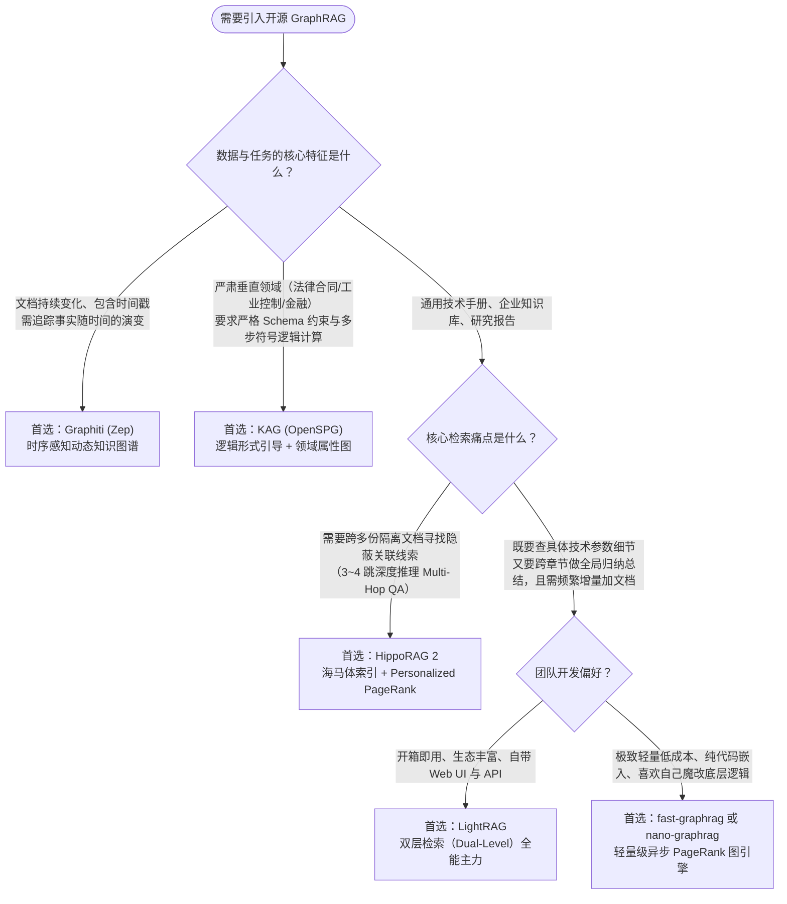

# 高质量高性能开源 GraphRAG 框架选型与工程实战指南

- **关联文档**：[Startup Technical Guide: AI Agents（初创企业 AI 智能体技术指南）](./startup_technical_guide_ai_agents_full.md)
- **章节索引**：[00_章节目录_Table_of_Contents.md](./00_章节目录_Table_of_Contents.md)（对应 **Section 1.3：GraphRAG — Smarter grounding，PDF P21** 及 **Section 2.1：BioCorteX 生物知识图谱案例，PDF P41**）
- **前置专题**：[01_核心概念专题问答_工具调用_编排决策_Runtime与开源RAG.md](./01_核心概念专题问答_工具调用_编排决策_Runtime与开源RAG.md)
- **文档定位**：针对传统纯向量检索（Vector RAG）在跨文档多跳推理、全局归纳及结构化逻辑溯源上的瓶颈，全面盘点 GitHub 上第一梯队的**免费开源、高性能 GraphRAG 项目**，涵盖架构机制、性能与成本指标对比、选型决策树以及封装为 Agentic Workflow 标准工具的代码实战。

---

## 一、 为什么需要 GraphRAG？从第一代痛点到新一代高性能演进

在原书 **Section 1.3 (P19 / PDF P21)** 中指出：传统向量 RAG 擅长通过语义相似度匹配孤立的文本片段，但无法理解数据内部的**层级与拓扑关联**（例如：医疗场景下“症状 $\rightarrow$ 病因 $\rightarrow$ 禁忌症 $\rightarrow$ 治疗方案”，或工业场景下“传感器异常 $\rightarrow$ 子系统耦合 $\rightarrow$ 根因故障树”）。

然而，以 **Microsoft GraphRAG** 为代表的**第一代开源 GraphRAG** 在工程落地时暴露了三大严重瓶颈：
1. **建库 Token 成本极高**：需要对每个文本块调用 LLM 抽取实体与关系，再使用 Leiden 算法聚类并调用 LLM 生成多层级的社区摘要（Community Reports），百万字文档建库往往消耗数千万 Token；
2. **检索延迟高**：Global Search 采用 Map-Reduce 遍历大量社区报告，单次查询耗时可达数十秒，难以满足实时 Agent 交互；
3. **难以动态增量更新（Incremental Update）**：每新增一篇文档，往往需要重新运行图聚类算法，维护成本高昂。

为了解决上述问题，开源社区演化出了以 **LightRAG、HippoRAG 2、fast-graphrag、nano-graphrag、KAG (OpenSPG)、Graphiti** 为代表的**新一代高性能 GraphRAG 引擎**。

---

## 二、 六大顶级免费开源 GraphRAG 项目横向对比

| 开源项目 | 开源协议 | 核心算法 / 检索机制 | 建库成本 (Token) | 检索延迟 | 增量更新能力 | 核心杀手锏与最佳适用场景 |
| :--- | :--- | :--- | :---: | :---: | :---: | :--- |
| **1. [LightRAG](https://github.com/HKUDS/LightRAG)**<br>*(港大 HKUDS)* | MIT | **双层检索（Dual-Level）**：底层实体精确匹配 + 高层主题图谱 + 向量融合 | **低**<br>*(比微软省 80%+)* | **毫秒~秒级**<br>*(单次 API 调用)* | **极佳**<br>*(原生支持增量)* | **综合性价比之王**：兼顾局部细节与全局总结，开箱即用，支持 Neo4j / PostgreSQL / Milvus 等十余种存储后端。 |
| **2. [HippoRAG 2](https://github.com/OSU-NLP-Group/HippoRAG)**<br>*(俄亥俄州立大学)* | MIT | **仿生海马体索引 + Personalized PageRank (PPR)** 子图游走 | **低** | **极快**<br>*(算法图游走替代 LLM 遍历)* | **良好** | **多跳推理（Multi-Hop QA）冠军**：在 HotpotQA / MuSiQue 等跨文档推理基准上大幅领先，成本仅为传统图检索的 1/10~1/30。 |
| **3. [fast-graphrag](https://github.com/circlemind-ai/fast-graphrag)**<br>*(Circlemind)* | MIT | **PageRank 图探索 + 动态状态图谱** + 全异步并发流水线 | **极低**<br>*(官方实测比微软省 6 倍)* | **极快** | **极佳**<br>*(动态插入节点)* | **极致速度与低成本工程化**：强类型 schema 定义、可解释子图可视化，极适合嵌入高并发生产级 Python Agent。 |
| **4. [KAG / OpenSPG](https://github.com/OpenSPG/KAG)**<br>*(蚂蚁集团 & OpenKG)* | Apache 2.0 | **逻辑符号引导（Logical Form）+ 领域 Schema 约束** + 知识与原文互索引 | **中** | **秒级** | **强**<br>*(企业级图数据库)* | **严肃专业领域（法律/金融/医疗/工业）首选**：解决纯 LLM 抽图“幻觉与随意性”问题，支持严谨的数值计算、时间线与多步逻辑推理。 |
| **5. [nano-graphrag](https://github.com/gusye1234/nano-graphrag)** | MIT | 完整保留社区聚类（Leiden）与 Local/Global 检索的**极简异步重构版** | **中** | **快**<br>*(全异步优化)* | **良好** | **极客二次开发与深度定制基座**：核心代码仅约 1100 行 Python，零冗余封装，方便魔改自定义实体抽取 Prompt 与重排逻辑。 |
| **6. [Graphiti](https://github.com/getzep/graphiti)**<br>*(Zep 团队)* | Apache 2.0 | **时序感知知识图谱（Temporally-Aware KG）** + 双时间戳边（发生时间 vs 记录时间） | **低** | **毫秒级** | **实时流式**<br>*(专为动态事件流设计)* | **Agent 动态长期记忆与状态演化**：当事实随时间变化（如“设备 A 状态从正常变为检修”、“合同条款被补充协议修改”）时自动维护历史沿革。 |

*(注：若你的核心需求是针对静态大型文档库做宏观主题发现且预算充足，原版 **[Microsoft GraphRAG](https://github.com/microsoft/graphrag)** [MIT 协议] 依然是 Global Summarization 的标杆。)*

---

## 三、 核心项目深度剖析：架构原理与性能优势

### 1. LightRAG：兼顾“快、省、准”的全能型主力引擎
- **GitHub**：`HKUDS/LightRAG`（Star 数破数万，社区极其活跃）
- **为什么它比 Microsoft GraphRAG 快且省？**
  - Microsoft GraphRAG 慢在“自底向上聚类生成海量社区报告”，检索时又要 Map-Reduce 读所有报告。
  - **LightRAG 抛弃了笨重的社区聚类报告**，转而在抽取实体（Node）和关系（Edge）时，直接为每个节点和边生成一段简短的键值对摘要（Key-Value Summary）并向量化。
  - **检索时采用双层（Dual-Level）范式**：
    - **Low-level Retrieval（具体层）**：查询具体实体及其一阶邻居（例如：“1 号锅炉的排温报警阈值是多少？”）；
    - **High-level Retrieval（抽象层）**：提取查询中的宏观概念词，直接检索跨节点的抽象关系边（例如：“总结本协议中对我方不利的所有违约责任条款”）。
- **工程特性**：原生支持新增文档直接增量融合进现有图谱（无需重建），支持切换本地 Ollama / vLLM、OpenAI、Gemini 等任意模型。

### 2. HippoRAG 2：跨文档多跳推理（Multi-Hop）的学术与实战天花板
- **GitHub**：`OSU-NLP-Group/HippoRAG`（NeurIPS / ICLR 顶会成果开源）
- **核心原理（人脑海马体记忆索引理论）**：
  - 传统 GraphRAG 在图上游走时喜欢让大模型一步步决定往哪走，既慢又贵。
  - **HippoRAG 2** 将大语言模型视为“新皮层（负责离线解析出开放知识三元组 OpenIE）”，将 **Personalized PageRank (PPR，个性化网页排名算法)** 视为“海马体关联索引”。
  - 当用户提问时，系统先定位问题中的种子实体（Seed Nodes），随后直接在内存图结构上跑 **PPR 概率扩散算法**，在几毫秒内算出跨越 3~4 跳之后相关性最高的关联节点及对应的原始文档段落（Passage Nodes）。
- **适用场景**：当问题答案分散在 3 份不同文档中（如：*《采购合同》提到了设备型号 X $\rightarrow$ 《设备台账》记载型号 X 由供应商 Y 生产 $\rightarrow$ 《合规黑名单》显示供应商 Y 的母公司存在诉讼风险*），HippoRAG 2 能一次性把整条证据链精准捞出。

### 3. KAG (Knowledge Augmented Generation)：严肃工业、法律与金融领域的“强逻辑”图谱
- **GitHub**：`OpenSPG/KAG`（蚂蚁集团基于 OpenSPG 开源的专业领域知识增强框架）
- **解决什么痛点？**
  - LightRAG 和 Microsoft GraphRAG 属于“无模式（Schema-free）抽取”，大模型每次抽出来的实体类型可能五花八门，在严谨的工业故障诊断、商业合同审计或医疗风控中容易因为同义词分裂或关系定义模糊导致推理断裂。
- **三大核心突破**：
  1. **Schema 约束与自由抽取融合（SPG 语义属性图）**：既允许预先定义严格的领域本体（如：法律领域的`条款 -> 触发条件 -> 法律后果 -> 适用法条`），又保留非结构化文本块互索引；
  2. **逻辑形式引导推理（Logical-Form Guided Reasoning）**：将复杂的自然语言问题拆解为多步符号逻辑表达式（涵盖检索、数值比较、集合交并、布尔判断），彻底克服向量检索对“大于/小于”、“除非/否则”、“时间先后”等逻辑词不敏感的缺陷。

### 4. fast-graphrag 与 Graphiti：面向实时 Agentic Workflow 的轻骑兵
- **`circlemind-ai/fast-graphrag`**：针对生产环境做了极致的工程精简，内置 PageRank 子图检索，默认使用轻量本地存储（无需部署庞大数据库即可启动），提供极佳的异步高并发吞吐。
- **`getzep/graphiti`**：如果你的 Agent 需要记住随时间动态变化的业务状态（例如设备运行工况历史、多轮合同谈判修改历程），传统 GraphRAG 无法区分“旧事实”和“新事实”，而 Graphiti 在每条知识边上内置了 `t_valid`（事实生效时间）和 `t_invalid`（事实失效时间），天然支持时间切片查询。

---

## 四、 架构选型决策树：你的业务该用哪一个？



---

## 五、 代码实战：将开源 GraphRAG (以 LightRAG 为例) 封装为 Agent Tool

在构建 **Agentic Workflow**（如使用 Google ADK、LangGraph 或 PydanticAI）时，最佳实践是将 **LightRAG** 或 **fast-graphrag** 的检索层封装成一个标准工具函数（Tool），并利用其不同的检索模式（`local` 查细节、`global` 查宏观关系、`hybrid` 混合模式）赋能主控 Agent。

以下示例展示如何初始化 **LightRAG**，并将其封装为遵循 **ADK 工具契约**（参见原书 Section 2.1 P32–P33）的 Python Tool：

```python
import os
from typing import Literal, Dict, Any
from lightrag import LightRAG, QueryParam
from lightrag.llm.openai import gpt_4o_mini_complete, openai_embed

# ================= 1. 初始化 LightRAG 引擎 (支持本地或云端模型) =================
WORKING_DIR = "./graphrag_storage"
os.makedirs(WORKING_DIR, exist_ok=True)

rag_engine = LightRAG(
    working_dir=WORKING_DIR,
    embedding_func=openai_embed,
    llm_model_func=gpt_4o_mini_complete,  # 可无缝替换为 Gemini / 本地 Ollama / vLLM 接口
)

# 离线或增量建库时只需调用：
# with open("./technical_manual.md", "r", encoding="utf-8") as f:
#     rag_engine.insert(f.read())


# ================= 2. 封装为 Agentic Workflow 的标准 Tool =================
def search_knowledge_graph(
    query: str,
    search_mode: Literal["local", "global", "hybrid"] = "hybrid",
    top_k: int = 10,
) -> Dict[str, Any]:
    """
    在企业级双层知识图谱（GraphRAG）中检索实体关联、跨章节因果链条与原始文档片段。

    当遇到以下情况时必须调用此工具：
    1. 需要跨多个条款或章节追踪因果关系、依赖链路或故障树（如“A 异常会导致哪些下游组件报警”）；
    2. 需要汇总全局性的主题、风险点或完整规范要求；
    3. 普通关键词搜索无法命中，需要结合实体拓扑关系与向量语义进行深度检索。

    Args:
        query: 包含核心实体名、技术术语或完整问题的查询语句。
        search_mode: 检索模式选择：
            - "local": 聚焦具体实体及其直接关联上下文（适合查精确参数、单一设备或具体条款细节）；
            - "global": 聚焦跨文档的高层关系与全局主题归纳（适合查整体风险汇总、跨模块关联）；
            - "hybrid": 同时结合 local 与 global 图检索（默认推荐，综合效果最佳）。
        top_k: 召回的最大图谱实体与关系上下文数量，默认为 10。

    Returns:
        包含检索状态、所用模式及图谱结构化上下文的字典。
    """
    try:
        # 关键工程技巧：设置 only_need_context=True！
        # 让 GraphRAG 只返回提取出的【图谱实体关系 + 原始文本块 Context】，
        # 而不让 GraphRAG 内部再调一次 LLM 生成废话总结，交由外层主控 Agent 统一推理！
        context_data = rag_engine.query(
            query,
            param=QueryParam(
                mode=search_mode,
                top_k=top_k,
                only_need_context=True,
            ),
        )
        return {
            "status": "success",
            "mode": search_mode,
            "graph_context": context_data,
        }
    except Exception as e:
        return {
            "status": "error",
            "error_message": f"GraphRAG 检索失败: {str(e)}",
        }
```

---

## 六、 生产环境落地 GraphRAG 的三大黄金法则

### 1. 善用 `only_need_context=True`（只取图谱上下文，不重做内部生成）
与我们在《专题四》中强调的“用 `Retriever` 而不是 `QueryEngine`”同理：在 LightRAG、fast-graphrag 和 nano-graphrag 中，都提供了 **`only_need_context=True`** 参数。
- 开启后，GraphRAG 在检索阶段**完全不需要调用大模型**，仅通过向量匹配 + 图结构一阶/二阶邻域扩展（或 PageRank 算法），在**几十毫秒内**直接返回结构化的：`[Entities 实体表] + [Relationships 关系表] + [Source Chunks 原文切片]`。
- 这不仅把单次工具调用的延迟从 5~10 秒压缩到 **100 毫秒以内**，而且节省了一半的查询 Token 消耗。

### 2. 文档预处理决定图谱上限：先用 Docling / MinerU 清洗再入图
- 任何 GraphRAG 在建图（Indexing）时，如果输入的文本是乱码、断行或被切碎的 PDF 表格，大模型抽取出的三元组就会充满噪声（Garbage In, Garbage Out）。
- **标准流水线**：先用开源 **Docling** 或 **MinerU** 将复杂 PDF 转换为保留完整章节层级与 Markdown 表格的纯净文档，再送入 **LightRAG / HippoRAG 2** 进行实体与关系抽取。

### 3. 混合挂载策略（Agentic Router）：向量快查 + 图谱深查
在实际的 Agentic Workflow 中，并不需要所有问题都走 GraphRAG。最优雅的架构是给 Agent 同时挂载两个检索工具，或在内部通过轻量级路由自动分发：
- **快速事实/精确法条号查询** $\longrightarrow$ 走 **Qdrant / Milvus 混合检索（BM25 + Dense Vector + Reranker）**；
- **跨章节因果溯源/隐性关联风险排查/全局盘点** $\longrightarrow$ 走 **LightRAG / HippoRAG 2 (`only_need_context=True`)**。

