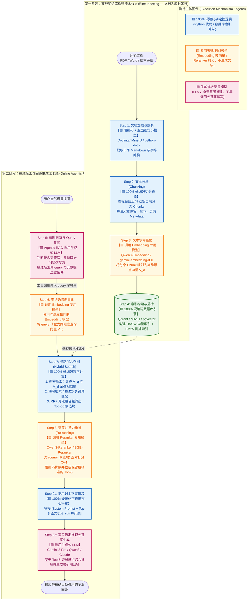

# Embedding 与 Reranker 模型对比（Gemini vs. Qwen）及 RAG 全链路执行机制深度拆解

- **关联文档**：[Startup Technical Guide: AI Agents（初创企业 AI 智能体技术指南）](./startup_technical_guide_ai_agents_full.md)
- **章节索引**：[00_章节目录_Table_of_Contents.md](./00_章节目录_Table_of_Contents.md)（对应 **Section 1.3：The role of grounding in agentic systems，PDF P19–P24**）
- **关联专题**：
  - [01_核心概念专题问答_工具调用_编排决策_Runtime与开源RAG.md](./01_核心概念专题问答_工具调用_编排决策_Runtime与开源RAG.md)
  - [02_开源高性能GraphRAG选型与工程实战指南.md](./02_开源高性能GraphRAG选型与工程实战指南.md)
- **文档定位**：深入解答 `Gemini Embedding Model` 的真实技术形态与开源界 **Qwen（通义千问）Embedding / Reranker** 家族的对标选型；并将 RAG 系统的离线建库与在线检索全流程拆解为 **9 个原子步骤**，精确划定每一步是**“100% 硬编码确定性逻辑”**、**“专用表征/判别小模型”**还是**“调用生成式大语言模型（LLM）”**。

---

## 一、 `Gemini Embedding Model` 是真实模型吗？Qwen 系列有哪些同等性能的开源模型？

### 1. `Gemini Embedding Model` 是一个完全真实的独立模型

在《Startup Technical Guide: AI Agents》第 1.3 节（P20–P21）提到的 **Gemini Embedding**，在 Google AI Studio 与 Vertex AI 中的官方正式模型代号为 **`gemini-embedding-001`**（其前身包括 `text-embedding-004` 与 `text-multilingual-embedding-002`）。

- **本质区分（表征模型 vs. 生成模型）**：它**不是**用来对话或写代码的生成式大模型（如 `Gemini 2.5 Flash` 或 `Gemini 3 Pro`），而是基于 Gemini 双子座底座专门训练的**稠密向量表征模型（Dense Embedding Model）**。
- **输入与输出**：输入一段文本（如一段合同条款或用户问题），它**不会**生成自然语言回复，而是输出一串高维浮点数向量（默认最高 **3072 维**，如 `[0.023, -0.145, 0.891, ...]`）。
- **核心技术特性**：
  1. **MRL（Matryoshka Representation Learning，俄罗斯套娃表征学习）**：信息按重要性从前到后濃縮在向量维度中，开发者可以直接截断取前 `1536` 维或 `768` 维存入向量数据库，在几乎不损失检索精度的前提下大幅降低存储与内存开销；
  2. **跨语言与跨领域对齐**：原生支持 100+ 种语言及代码、金融、法律、科学文献的语义对齐，在国际权威的 **MTEB（Massive Text Embedding Benchmark）** 多语言榜单上稳居商业闭源 API 第一梯队。

---

### 2. Qwen（通义千问）系列的对标模型：开源界的统治级表现

如果你希望在本地环境（如 Mac mini、私有 GPU 服务器）或私有云中使用**完全免费开源（Apache 2.0 协议）**、且性能达到甚至超越 `gemini-embedding-001` 的模型，阿里通义团队研发的 **Qwen3-Embedding**、**Qwen3-Reranker** 以及经典的 **GTE-Qwen2** 系列是目前全球开源社区的标杆：

| 模型系列 | 代表模型 (HuggingFace / ModelScope) | 参数规模 | 最大上下文 | 核心技术优势与 MTEB 对标表现 |
| :--- | :--- | :---: | :---: | :--- |
| **Qwen3-Embedding**<br>*(最新旗舰，强烈推荐)* | • `Qwen/Qwen3-Embedding-8B`<br>• `Qwen/Qwen3-Embedding-4B`<br>• `Qwen/Qwen3-Embedding-0.6B` | 8B<br>4B<br>0.6B | **32K Tokens**<br>*(远超 Gemini 的 2K~8K)* | **当前开源界 MTEB 多语言、中文及代码检索 SOTA（天花板）**。<br>• `8B` 版本在 MTEB 多语言榜单综合得分突破 `70.58`，超越包括 `gemini-embedding-001` 和 `text-embedding-3-large` 在内的众多商业闭源接口；<br>• `0.6B` 版本极度轻量，在本地 CPU 或 Apple Silicon 芯片上推理仅需十余毫秒，精度媲美上一代 7B 模型；<br>• 原生支持 **MRL 自由维度裁剪（32~4096 维）** 与 **Instruction 指令感知**。 |
| **GTE-Qwen2**<br>*(上一代经典主力)* | • `Alibaba-NLP/gte-Qwen2-7B-instruct`<br>• `Alibaba-NLP/gte-Qwen2-1.5B-instruct` | 7B<br>1.5B | 32K Tokens | 将 Qwen2 的单向因果注意力（Causal Attention）改造为**双向注意力（Bidirectional Attention）**并结合对比学习训练而成，曾长期霸榜 MTEB 中英文第一。 |
| **Qwen3-Reranker**<br>*(配套二阶段精排神器)* | • `Qwen/Qwen3-Reranker-8B`<br>• `Qwen/Qwen3-Reranker-4B`<br>• `Qwen/Qwen3-Reranker-0.6B` | 8B<br>4B<br>0.6B | 32K Tokens | 专门配合 Embedding 模型使用的 **Cross-Encoder 交叉重排模型**（直接对应原书 P21 的 `Retrieve and Re-rank` 两步法架构）。 |

> [!TIP]
> **本地与私有化工程选型黄金组合**：
> - **轻量级极速配置（适合笔记本 / Mac mini 本地高频运行）**：`Qwen3-Embedding-0.6B` + `Qwen3-Reranker-0.6B`
> - **企业级高精度配置（适合复杂商业合同审计 / 工业技术手册）**：`Qwen3-Embedding-4B`（或 `8B`） + `Qwen3-Reranker-4B`

---

## 二、 RAG 全过程拆解：每一步是“硬编码执行”、“专用小模型”还是“调用 LLM”？

许多开发者在初学 RAG 时容易产生一个误区：以为文档切分、入库、匹配和排序全都是靠大语言模型（LLM）思考完成的。

**事实恰恰相反**：在工业级 RAG（含 Agentic RAG）系统中，**约 80% 的流程是由 100% 确定性的硬编码代码（Python）与专用的数学表征/判别模型（Embedding & Reranker）执行的**。生成式大语言模型（LLM）只在**“决定搜什么（Query 路由改写）”**和**“读完检索结果后撰写回答（Grounded Generation）”**这两个关键认知节点出场。

下面将完整的 RAG 生命周期拆解为 **两大阶段、9 个核心步骤** 进行逐一定性：

### 第一阶段：离线知识库构建流水线（Offline Indexing — 文档入库时执行一次）

| 步骤序号 | 步骤名称 | 执行主体定性 | 底层执行过程详解 |
| :---: | :--- | :--- | :--- |
| **Step 1** | **文档加载与深度解析**<br>(Document Ingestion & Parsing) | **🟦 硬编码代码 + 版面视觉小模型**<br>*(不调用生成式 LLM)* | 由 Python 代码读取 PDF/Word/HTML。对于简单文档直接用 `python-docx` / `PyMuPDF` 硬编码提取文本；对于含复杂跨页表格、公式与多栏排版的文档，调用 `Docling`、`MinerU` 或 `DeepDoc` 等**专用视觉版面分析小模型（Layout/OCR）**，将其无损转换为结构化 Markdown。 |
| **Step 2** | **文本分块与元数据挂载**<br>(Chunking & Metadata Tagging) | **🟦 100% 硬编码算法逻辑**<br>*(注：仅 GraphRAG 抽图阶段除外)* | 由确定性的 Python 分块器（如 `MarkdownNodeParser` 或 `RecursiveCharacterTextSplitter`）按照 Markdown 标题层级（`#`、`##`）、段落换行符或固定 Token 窗口（如每块 `512 Tokens`、重叠 `64 Tokens`）将长文切分为独立切片（Chunk），并用代码为每个 Chunk 注入文件名、章节路径、页码等 Metadata 字典。 |
| **Step 3** | **文档块向量化**<br>(Chunk Embedding) | **🟨 调用 Embedding 专用模型**<br>*(非生成式 LLM！)* | 硬编码 `for` 循环（或异步批处理）将成百上千个文本块发送给 **`Qwen3-Embedding`** 或 **`gemini-embedding-001`**。模型通过前向传播计算，为每个文本块返回一个固定维度的浮点数数组（如 `1024` 维向量 $V_d$）。 |
| **Step 4** | **构建索引与持久化落库**<br>(Vector & Full-Text Indexing) | **🟦 100% 硬编码数据库算法** | 调用向量数据库客户端（如 `Qdrant`、`Milvus`、`pgvector`）将数据写入磁盘。数据库内核使用纯 C++/Rust 硬编码算法自动构建两套索引：<br>1. **HNSW 图索引**（用于稠密向量近邻搜索）；<br>2. **BM25 倒排词表索引**（用于专有名词、型号、法条号的精确匹配）。 |

---

### 第二阶段：在线检索与回答生成流水线（Online Retrieval & Generation — 用户每次提问时实时执行）

| 步骤序号 | 步骤名称 | 执行主体定性 | 底层执行过程详解 |
| :---: | :--- | :--- | :--- |
| **Step 5** | **意图路由与查询改写**<br>(Query Routing & Rewriting) | • 基础 RAG：**🟦 硬编码直传**<br>• Agentic RAG：**🟥 调用生成式 LLM（第 1 次）** | • 在传统基础 RAG 中，直接用硬编码把用户原话传给下一步；<br>• 在 **Agentic RAG** 中，主控 **LLM** 先思考当前问题是否需要查库，并将用户含糊的口语提问（如“如果乙方延期交货怎么罚？”）改写为精准的结构化工具调用参数：`search_contract(query="乙方 逾期交货 违约金 计算标准", role="甲方")`。 |
| **Step 6** | **查询语句向量化**<br>(Query Embedding) | **🟨 调用 Embedding 专用模型**<br>*(必须与 Step 3 使用完全相同的模型)* | 硬编码接收 Step 5 传来的 `query` 字符串，调用同一个 **`Qwen3-Embedding`** 或 **`gemini-embedding-001`**，将其转化为查询向量 $V_q$（耗时通常在 `10~50ms` 以内）。 |
| **Step 7** | **多路混合召回（粗筛）**<br>(Hybrid Retrieval) | **🟦 100% 硬编码数学计算**<br>*(毫秒级，零大模型开销)* | 向量数据库在内存/磁盘索引上执行纯粹的数学运算：<br>1. **稠密向量检索**：计算查询向量 $V_q$ 与库中文档向量 $V_d$ 的余弦相似度 $\cos(\theta) = \frac{V_q \cdot V_d}{\|V_q\|\|V_d\|}$；<br>2. **稀疏关键词检索**：通过 BM25 公式计算词频逆文档频率得分；<br>3. **RRF（倒数秩融合）**：用硬编码公式 $\text{RRF\_Score} = \sum \frac{1}{k + \text{rank}_i}$ 合并两路排名，快速捞出 **Top-30 ~ Top-50** 个候选文本块。 |
| **Step 8** | **交叉注意力重排（精筛）**<br>(Cross-Encoder Re-ranking) | **🟨 调用 Reranker 专用模型**<br>*(非生成式 LLM！)* | 为什么有了 Step 7 还要 Step 8？因为双塔向量检索把问题和文档分开编码，丢失了词与词之间的细粒度交互。<br>此时硬编码将 `(Query, 候选块_i)` 拼成一对对文本，批量喂给 **`Qwen3-Reranker`** 或 **`BGE-Reranker`**。该模型对问题和候选块做全注意力交叉计算，输出 `0.0 ~ 1.0` 的精准相关性得分。随后由硬编码按分数降序排列，截断保留最核心的 **Top-3 ~ Top-5** 个片段。 |
| **Step 9** | **上下文拼装与事实锚定生成**<br>(Prompt Assembly & Grounded Generation) | **🟦 硬编码模板拼装 + 🟥 调用生成式 LLM（核心调用）** | 分为紧耦合的两小步：<br>1. **Step 9a（硬编码拼装）**：Python 代码用字符串模板将 `[系统角色指令 + Step 8 精选出的 Top-5 原文块（含来源文件名与页码） + 用户原始问题]` 拼接成最终的 Prompt；<br>2. **Step 9b（调用生成式 LLM）**：将拼好的 Prompt 发送给 **`Gemini 3 Pro` / `Qwen3-Max` / `Claude`**。LLM 阅读这 5 段事实依据，综合推理并输出带有明确引用标注（Grounded Citations）的最终回答。 |

---

## 三、 RAG 全链路执行机制全景流程图

下图使用不同颜色严格区分了 **🟦 硬编码确定性代码/数据库算法**、**🟨 专用表征与重排小模型（Embedding / Reranker）** 与 **🟥 生成式大语言模型（LLM）** 在整个生命周期中的位置与职责边界：



---

## 四、 代码级对照：一眼看清“硬编码”、“Embedding/Reranker”与“LLM”的配合

下面用一段精简的 Python 伪代码，将在线阶段（**Step 5 $\rightarrow$ Step 9**）串起来，让你直观看到这三种执行方式在代码里是如何交替配合的：

```python
# =====================================================================
# 假设已完成离线建库 (Step 1~4)，现进入在线 Agentic RAG 流程 (Step 5~9)
# =====================================================================

def run_agentic_rag_pipeline(user_question: str) -> str:
    # -----------------------------------------------------------------
    # 【Step 5 | 🟥 调用生成式 LLM (第 1 次)】
    # 让 LLM 理解用户意图，生成工具调用参数（改写后的精准搜索词）
    # -----------------------------------------------------------------
    tool_call = generative_llm.generate_tool_call(
        prompt=f"用户问题：{user_question}\n请提取用于检索技术手册的精准 query 关键词。",
        tools=[search_knowledge_base_schema]
    )
    rewritten_query = tool_call.arguments["query"]  # 例如："1号锅炉 排气温度 报警阈值"

    # -----------------------------------------------------------------
    # 【Step 6 | 🟨 调用 Embedding 专用模型】
    # 将文字变成一串浮点数数组（如 1024 个 float），耗时 ~20ms
    # -----------------------------------------------------------------
    query_vector: list[float] = qwen3_embedding_model.encode(
        rewritten_query,
        instruction="Given a technical query, retrieve relevant manual passages"
    )

    # -----------------------------------------------------------------
    # 【Step 7 | 🟦 100% 硬编码数学计算与数据库查询】
    # 数据库底层算余弦相似度 + BM25 + RRF 融合，撈出前 30 个候选块，耗时 ~15ms
    # -----------------------------------------------------------------
    candidate_chunks = vector_db.hybrid_search(
        dense_vector=query_vector,
        sparse_text=rewritten_query,
        top_k=30
    )

    # -----------------------------------------------------------------
    # 【Step 8 | 🟨 调用 Reranker 专用模型 + 🟦 硬编码排序截断】
    # 把 query 和 30 个候选块配成 30 对，算交叉相关性分数，只留前 5 名，耗时 ~60ms
    # -----------------------------------------------------------------
    sentence_pairs = [[rewritten_query, chunk.text] for chunk in candidate_chunks]
    scores: list[float] = qwen3_reranker_model.compute_score(sentence_pairs)

    # 🟦 硬编码：按分数从高到低排序，并切片取前 5 个
    scored_chunks = sorted(zip(scores, candidate_chunks), key=lambda x: x[0], reverse=True)
    top_5_chunks = [chunk for score, chunk in scored_chunks[:5] if score > 0.3]

    # -----------------------------------------------------------------
    # 【Step 9a | 🟦 100% 硬编码字符串模板拼接】
    # -----------------------------------------------------------------
    formatted_context = "\n\n---\n\n".join(
        [f"【来源：{c.metadata['file']} 第 {c.metadata['page']} 页】\n{c.text}" for c in top_5_chunks]
    )
    final_prompt = (
        f"你是一名严谨的工程师。请严格依据以下【参考资料】回答用户问题，并在句末标注来源文件名和页码。\n\n"
        f"【参考资料】\n{formatted_context}\n\n"
        f"【用户问题】\n{user_question}"
    )

    # -----------------------------------------------------------------
    # 【Step 9b | 🟥 调用生成式 LLM (第 2 次，也是核心生成调用)】
    # -----------------------------------------------------------------
    final_answer = generative_llm.generate_text(final_prompt)
    return final_answer
```

---

## 五、 核心工程启示总结

1. **职责解耦（Separation of Concerns）**：
   - **切分、存取、向量距离计算、拼接模板**必须交给 **🟦 硬编码代码与数据库**，保证确定性与毫秒级吞吐；
   - **语义映射与相关性精排**必须交给 **🟨 Embedding 与 Reranker 专用小模型**（如 `gemini-embedding-001` 或 `Qwen3-Embedding` + `Qwen3-Reranker`），它们比生成式大模型快几十倍、便宜上百倍；
   - **意图改写与综合推理作答**才交给 **🟥 生成式大语言模型（LLM）**。
2. **建库与查询的 Embedding 模型必须严格一致**：
   - Step 3（离线建库）和 Step 6（在线查询）必须使用**同一个模型、完全相同的向量维度**。如果你建库时用了 `gemini-embedding-001`，查询时换成了 `Qwen3-Embedding-4B`，两个模型训练出的高维向量空间坐标系完全不同，算出来的余弦相似度将毫无意义。

