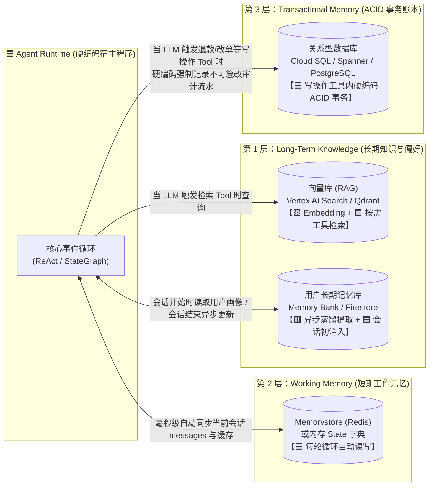

# Section 1 重点高亮笔记、工程实现拆解与“智能体编排（Orchestration）”破壁指南

- **关联原书**：[startup_technical_guide_ai_agents_final.pdf](./startup_technical_guide_ai_agents_final.pdf)（对应 **Introduction & Section 1.1–1.2，PDF P3–P16 / 文档第 01–14 页**）
- **全文对照**：[startup_technical_guide_ai_agents_full.md](./startup_technical_guide_ai_agents_full.md)
- **章节索引**：[00_章节目录_Table_of_Contents.md](./00_章节目录_Table_of_Contents.md)
- **核心目标**：
  1. 完整提取并还原你在 PDF **Section 1（共 9 个页面、32 处黄色高亮）**中标记的所有核心原句；
  2. 为每一处高亮提供**专业工程注释**，并明确界定底层究竟是通过 **🟦 硬编码确定性代码（Python / 数据库 / 循环控制）** 还是 **🟥 调用大语言模型（LLM 推理 / 路由 / 参数生成）** 来实现；
  3. **彻底捅破“智能体编排（Agent Orchestration）”的那层窗户纸**：用一段 **35 行零框架依赖的原生 Python 代码**，把看似神秘的 ReAct 编排循环拆解得清清楚楚。

---

## 第一部分：先捅破那层窗户纸——到底什么是“智能体编排（Orchestration）”？

你在阅读 P7（ADK 编排逻辑）和 P16（ReAct 执行中枢）时密集做了高亮，并提到*“对智能体的编排的理解感觉还有一层窗户纸没捅破”*。

### 1. 为什么你会觉得隔了一层窗户纸？
因为技术文档在讲 **Orchestration（编排）** 时，总喜欢用拟人化的词汇：*“Agent 评估当前状态 $\rightarrow$ 规划步骤 $\rightarrow$ 选择并调用工具 $\rightarrow$ 观察结果并更新计划”*。
这极易让人产生一种错觉：**是不是大模型自己有一个持续运转的大脑，自己会在后台调接口、自己跳来跳去执行任务？**

**真相是：大模型（LLM）连一个 `while` 循环都没有！大模型只是一个“一问一答的无状态文本函数”。**
所谓的 **“智能体编排（Orchestration）”**，本质上是**“一段由工程师硬编码写死的 Python `while` 循环 / 状态机骨架”** 与 **“大模型单次 JSON 填空决策”** 交替打配合的过程。

---

### 2. 一句话捅破窗户纸：谁是“躯干”，谁是“大脑”？

在任何智能体编排（无论是 ReAct 还是 Graph 状态机）中，职责是严格一分为二的：

| 角色 | 到底是谁？ | 它负责干什么？（绝对边界） | 它绝不能干什么？ |
| :--- | :--- | :--- | :--- |
| **🟦 编排器外壳**<br>*(Orchestrator Loop)* | **100% 硬编码的 Python 代码**<br>*(即 `while` 循环或 `StateGraph`)* | 1. 维护一个 `messages = []` 列表（短期记忆）；<br>2. 把 `messages` 发给大模型 API；<br>3. 用 `if-else` 检查大模型返回的字符串里有没有 `tool_calls` 标记；<br>4. 如果有，**由 Python 代码真正去执行对应的本地函数**，把返回值 `append` 进 `messages` 列表，然后**自动进入下一轮 `while` 循环**再次请求大模型。 | 它不懂人类语言，不自己做业务语义判断。 |
| **🟥 认知推理核**<br>*(Cognitive Engine)* | **单次调用的 LLM API**<br>*(如 Gemini / Claude / Qwen)* | 每次被 Python 循环调用时，读一遍传进来的 `messages` 历史，只做一道**二选一的选择题**：<br>• **选项 A（还没做完）**：输出一段 `Thought`（思考文字）+ 一段结构化 JSON（告訴外面的 Python 代码：“请帮我调 `func_X` 函数，参数填 `Y`”）；<br>• **选项 B（信息齐了，做完了）**：直接输出给用户的最终自然语言回答（不再包含 `tool_calls` 标记）。 | 它**永远不会**自己去跑代码、查数据库或发网络请求；调用一结束它就失忆了。 |

---

### 3. 35 行纯 Python 代码：亲眼看见“编排”是怎么跑起来的

抛开 ADK、LangChain、LangGraph 等所有框架包装，你在 PDF 第 16 页高亮的 **ReAct（Reason $\rightarrow$ Act $\rightarrow$ Observe）编排循环**，在底层完完全全就是下面这 35 行 Python 代码：

```python
# =====================================================================
# 捅破窗户纸：没有任何框架，这就是 Agent Orchestration (ReAct) 的全部真相！
# =====================================================================

# 🟦 【硬编码】准备好真实的本地 Python 工具函数字典
TOOL_REGISTRY = {
    "check_return_policy": check_return_policy_fn,   # 查退货政策的 Python 函数
    "get_order_date": get_order_date_fn,             # 查订单日期的 SQL 函数
    "process_refund": process_refund_fn,             # 调 Stripe 退款 API 的函数
}

def run_agent_orchestration(user_goal: str, max_steps: int = 5) -> str:
    # 🟦 【硬编码：Working Memory】初始化一个普通的 Python 列表，用来装对话和动作历史
    messages = [
        {"role": "system", "content": "你是一个售后智能体。请先思考(Reason)，再决定调用哪个工具(Act)。"},
        {"role": "user", "content": user_goal}
    ]

    # 🟦 【硬编码：Orchestration 主循环】这就是所谓的“执行中枢 (Executive Function)”！
    for step in range(max_steps):
        
        # -------------------------------------------------------------
        # 1. 🟥 【调用 LLM：Reason (思考与决策)】
        # 把到目前为止的 messages 历史和工具 JSON 说明书发给大模型
        # 大模型看一眼当前进度，决定下一步干嘛
        # -------------------------------------------------------------
        llm_response = call_llm_api(messages=messages, tools=TOOL_SCHEMAS)
        
        # 🟦 【硬编码】把大模型这轮的思考和决定追加到历史记录里
        messages.append(llm_response)

        # -------------------------------------------------------------
        # 2. 🟦 【硬编码分支判断】大模型这次要调工具吗？
        # -------------------------------------------------------------
        if not llm_response.tool_calls:
            # 如果大模型没有输出 tool_calls，说明它认为目标已达成！
            # 🟦 【硬编码】直接跳出 while/for 循环，把大模型的文字返回给用户
            return llm_response.content

        # -------------------------------------------------------------
        # 3. 🟦 【硬编码执行：Act (行动)】 & 【硬编码回填：Observe (观察)】
        # 大模型只是“点菜”（输出了函数名和参数 JSON），真正“做菜”的是下面这几行 Python 代码！
        # -------------------------------------------------------------
        for tool_call in llm_response.tool_calls:
            func_name = tool_call.name          # 例如 "get_order_date"
            func_args = tool_call.arguments     # 例如 {"order_id": "12345"}
            
            # 🟦 【硬编码 Act】在本地找到真正的 Python 函数并执行它
            actual_python_fn = TOOL_REGISTRY[func_name]
            tool_output = actual_python_fn(**func_args)  # 拿到结果：{"date": "2026-11-01"}

            # 🟦 【硬编码 Observe】把工具跑出来的结果，塞回 messages 列表！
            # 然后 for 循环自动进入下一轮 (step + 1)，大模型就能“看见”这个结果了！
            messages.append({
                "role": "tool",
                "tool_call_id": tool_call.id,
                "content": str(tool_output)
            })

    return "达到最大步骤限制，任务未完成。"
```

---

### 4. 对照你看过的 PDF 第 16–17 页（退款案例），看清每一步谁在干活

```mermaid
sequenceDiagram
    autonumber
    participant User as 用户
    participant Loop as 🟦 Python 编排循环 (硬编码 while/for)<br/>维护 messages 列表
    participant LLM as 🟥 大语言模型 (Gemini API)<br/>无状态：每次只读 messages 做下一步决定
    participant Tools as 🟦 本地工具函数库 (Python/SQL/API)

    User->>Loop: "我要退掉订单 #12345"
    Loop->>Loop: 初始化 messages = [用户请求]

    rect rgb(252, 228, 236)
    Note over Loop,LLM: 第 1 轮循环 (Iteration 1)
    Loop->>LLM: 发送 messages + 3个工具的 JSON 说明书
    Note over LLM: 🟥 Reason 1：先得查退货政策允不允许退
    LLM-->>Loop: 返回 JSON：我想调 `check_return_policy()`
    end
    Loop->>Tools: 🟦 Act 1：Python 执行 check_return_policy()
    Tools-->>Loop: 返回："30天内可退"
    Loop->>Loop: 🟦 Observe 1：将 "30天内可退" 追加进 messages

    rect rgb(252, 228, 236)
    Note over Loop,LLM: 第 2 轮循环 (Iteration 2)
    Loop->>LLM: 发送更新后的 messages（含第1步结果）
    Note over LLM: 🟥 Reason 2：政策是30天，那我得查订单 #12345 是哪天买的
    LLM-->>Loop: 返回 JSON：我想调 `get_order_date(order_id="12345")`
    end
    Loop->>Tools: 🟦 Act 2：Python 执行 SQL 查出购买日期
    Tools-->>Loop: 返回："10天前购买"
    Loop->>Loop: 🟦 Observe 2：将 "10天前购买" 追加进 messages

    rect rgb(252, 228, 236)
    Note over Loop,LLM: 第 3 轮循环 (Iteration 3)
    Loop->>LLM: 发送更新后的 messages（含前2步所有结果）
    Note over LLM: 🟥 Reason 3：10天 < 30天，符合条件！现在调退款接口
    LLM-->>Loop: 返回 JSON：我想调 `process_refund(order_id="12345")`
    end
    Loop->>Tools: 🟦 Act 3：Python 调支付网关完成退款
    Tools-->>Loop: 返回："{status: 'refund_success'}"
    Loop->>Loop: 🟦 Observe 3：将退款成功状态追加进 messages

    rect rgb(232, 245, 233)
    Note over Loop,LLM: 第 4 轮循环 (Iteration 4 - 终止轮)
    Loop->>LLM: 发送更新后的 messages（含退款成功记录）
    Note over LLM: 🟥 Reason 4：所有目标已达成，无需再调工具
    LLM-->>Loop: 返回纯文本："您的订单 #12345 在30天退货期内，已为您成功办理退款！"
    end
    Loop->>User: 🟦 检测到无 tool_calls，跳出循环，输出最终回答
```

> **现在再看“窗户纸”**：
> - **为什么说大模型有“自主编排能力”？** 因为在第 1、2、3 轮里，**下一步调哪个函数、传什么参数**，不是工程师用 `if step == 1` 写死的，而是 **🟥 大模型根据 `messages` 里的上下文动态推理出来的**。
> - **为什么又说编排离不开硬编码？** 因为把大模型的决定拦截下来、真正去跑函数、把结果塞回 `messages`、并驱动下一轮循环的那个 **`for/while` 状态机外壳**，是 **🟦 100% 硬编码的确定性程序**！

---

## 第二部分：你在 PDF Section 1 中标记的 32 处黄色高亮逐页提取与工程实现拆解

下面按你在 PDF 中高亮的页码顺序，逐条列出原文、中文精译、专业工程注释，以及**硬编码（🟦）vs. 模型调用（🟥/🟨）**的实现方式说明。

---

### 📍 第一组高亮：引言与核心挑战（PDF P3 & P5–P6 / 文档第 01、03–04 页）

#### 【高亮 1–3】PDF Page 3（文档第 01 页：Introduction）
> 1. *"How do you manage their non-deterministic behavior? How do you verify their complex reasoning paths?"*
>    （如何管理它们的**非确定性行为**？如何验证它们复杂的**推理路径**？）
> 2. *"the foundational concepts of agentic systems, from their core architectural components to the principles that ensure reliable and responsible operation in production. And you’ll learn about the full spectrum of tools"*
>    （智能体系统的基础概念，从核心架构组件到确保生产环境可靠、负责任运行的原则，以及完整的工具谱系。）
> 3. *"concepts and architectural patterns that allow you to build robust, scalable agents"*
>    （让你能够构建稳健、可扩展智能体的概念与架构模式。）

#### 【高亮 4–9】PDF Page 5 & Page 6（文档第 03–04 页：Section 1 导读与 1.1 生态概览）
> 4. *"core concepts, purpose, and operational mechanics."*（核心概念、目标与运行机制。）
> 5. *"three main paths for using AI agents (build, use, partner),"*（使用 AI 智能体的三条主要路径：自主构建、直接可用、合作伙伴引入。）
> 6. *"the core components of an agent, including models, tools, orchestration, and runtime."*（智能体的核心组件，包括模型、工具、编排和运行时。）
> 7. *"It’s about giving AI a complex goal—like ‘plan this product launch’ or ‘resolve this supply chain disruption’—and having it orchestrate the multi-step tasks needed to achieve it."*
>    （这不再只是问答，而是给 AI 一个复杂的目标——比如“策划这次产品发布”或“解决这次供应链中断”——并让它自主编排达成目标所需的多步任务。）
> 8. *"A complete solution demands scalable infrastructure, robust data integration tooling, and architectural patterns that accommodate diverse technical requirements."*
>    （一个完整的解决方案需要可扩展的基础设施、稳健的数据集成工具，以及适应多样化技术需求的架构模式。）

- **💡 专业工程注释（如何管理“非确定性”与验证“推理路径”？）**：
  - 这是从 Demo 走向工业级系统的核心痛点。大模型的输出本质是概率采样（非确定性），工程上通过三道防线收敛这种非确定性：
    1. **🟦 硬编码结构化输出约束（Structured Outputs / Pydantic Schema）**：强制 LLM 的输出必须通过 JSON Schema 校验，否则触发硬编码重试；
    2. **🟦 硬编码状态机边界（Workflow Agents / StateGraph）**：不让一个 Agent 无限自由发挥，而是用代码限制每个阶段允许调用的工具子集；
    3. **🟦 + 🟥 轨迹级评估（Trajectory Evaluation，见原书 Section 3.1）**：用硬编码记录 Agent 走过的工具调用序列（如 `[check_policy, get_order, refund]`），与预设的黄金标准路径（Golden Trajectory）做集合/顺序比对。

---

### 📍 第二组高亮：ADK 代码优先框架的六大核心支柱（PDF P7 / 文档第 05 页）

你在第 7 页对 **Agent Development Kit (ADK)** 的特性做了最密集的 9 处高亮：

#### 【高亮 10–18】PDF Page 7（文档第 05 页：Build your own agents — ADK）
> 10. *"a code-first approach for maximum control or an application-first approach for accelerated development."*
>     （追求最大控制力的**代码优先（Code-first）**方法，或追求加速开发的**应用优先（Application-first）**方法。）
> 11. *"a high degree of control over agent behavior."*（对智能体行为的高度控制。）
> 12. *"Orchestration logic: The agent’s core reasoning process, like the ReAct framework (see section 1.2), allows it to plan and execute a sequence of tool calls and actions to accomplish a complex goal."*
>     （**编排逻辑**：智能体的核心推理过程，如 ReAct 框架，允许它规划并执行一系列工具调用与动作以完成复杂目标。）
> 13. *"Tool definition and registration: An interface for defining custom functions and APIs, allowing the agent to interact with data, APIs, and external systems."*
>     （**工具定义与注册**：用于定义自定义函数和 API 的接口，允许智能体与数据、API 及外部系统交互。）
> 14. *"Context management: A system that provides the agent with memory, allowing you to use the agent to recall user preferences and conversational history across multiple interactions to provide a coherent experience."*
>     （**上下文管理**：为智能体提供记忆的系统，允许跨多轮交互召回用户偏好和对话历史，提供连贯体验。）
> 15. *"Evaluation and observability: A suite of built-in tools to rigorously test agent quality, debug the agent’s step-by-step reasoning, and monitor its performance in a production environment."*
>     （**评估与可观测性**：一套内置工具，用于严格测试智能体质量、调试逐步推理过程，并在生产环境中监控其性能。）
> 16. *"Multi-agent composition: The ability to build systems where multiple specialized agents can collaborate, delegate tasks, and work together to solve a problem."*
>     （**多智能体组合**：构建由多个专业智能体协作、委派任务并共同解决问题的系统的能力。）
> 17. *"Focus on your product, not infrastructure"* / *"Launch with confidence"* / *"Remember your customers to deliver a truly personal experience"*
>     （聚焦产品而非底层基建 / 满怀信心上线 / 记住客户以提供个性化体验 —— 对应 Vertex AI Agent Engine 托管运行时的三大价值。）

- **⚙️ 工程实现拆解（ADK 这五大模块在代码里分别怎么实现？）**：

| ADK 核心能力 | 🟦 硬编码部分（框架或工程师编写的确定性代码） | 🟥 / 🟨 模型调用部分 |
| :--- | :--- | :--- |
| **1. Orchestration logic**<br>(编排逻辑) | `Runner` 事件循环、`SequentialAgent`（顺序执行）、`ParallelAgent`（并发执行）、`LoopAgent`（循环退出条件判断）均为 **100% 硬编码 Python 控制流**。 | 在每个 `LlmAgent` 节点内部，**🟥 调用 LLM** 根据当前 `instruction` 和上下文决定下一步调哪个 Tool 或移交给哪个子 Agent。 |
| **2. Tool definition & registration**<br>(工具定义与注册) | 工程师编写标准 Python 函数（含类型注解 `type hints` 和 `docstring`）；ADK 框架在启动时通过 **🟦 Python 反射（`inspect` 模块）硬编码自动生成** JSON Schema。 | **🟥 LLM** 阅读注入在系统提示词里的 JSON Schema，输出匹配该 Schema 的参数字典。 |
| **3. Context management**<br>(上下文管理) | `SessionService` 读写数据库（内存/Firestore/Postgres），通过 **🟦 硬编码 I/O** 把历史 `Events` 加载并拼装进每次请求的 `contents` 数组。 | 若启用长期记忆提炼（如 `Memory Bank`），后台异步 **🟥 调用轻量 LLM** 将冗长对话蒸馏为几条用户偏好事实存入向量库。 |
| **4. Evaluation & observability**<br>(评估与可观测性) | **🟦 100% 硬编码埋点**：基于 OpenTelemetry 自动拦截每次 LLM 请求与函数执行，记录耗时、Token 数、入参出参（Span/Trace）。 | 在计算“回答相关性/事实忠实度”指标时，使用 **🟥 LLM-as-a-Judge（裁判模型）** 对输出打分。 |
| **5. Multi-agent composition**<br>(多智能体组合) | 将子 Agent 的 `name` 和 `description` 包装成一个特殊的 `transfer_to_agent(agent_name)` 函数或 `AgentTool`；当触发移交时，**🟦 硬编码切换当前激活的 Agent 对象**。 | 父 Agent 的 **🟥 LLM** 根据各子 Agent 的 `description` 进行语义路由判断，决定把任务委派给谁。 |

---

### 📍 第三组高亮：模型路由策略与微调边界（PDF P11 & P13 / 文档第 09、11 页）

#### 【高亮 19–21】PDF Page 11 & Page 13（文档第 09、11 页：Models & Fine-tuning）
> 19. *"Robust cognitive architectures employ multiple specialized agents, each dynamically selecting the leanest model for its specific sub-task."*
>     （稳健的认知架构采用多个专业化智能体，每个智能体针对其特定子任务动态选择最精简的模型。）
> 20. *"This ensures, for instance, that a heavyweight model is reserved for complex reasoning, while a lightweight model handles routine queries."*
>     （例如，这确保了重量级模型被保留用于复杂推理，而轻量级模型处理常规查询。）
> 21. *"Fine-tuning adapts a model’s style and refines its knowledge on a specific task."*
>     （微调使模型的风格适应特定任务，并精炼其在该任务上的知识。）

- **💡 专业工程注释与实现方式**：
  - **动态模型路由（Model Routing）是怎么实现的？**
    - 在多智能体架构中，**不是所有节点都用昂贵且慢的旗舰模型（如 `Gemini 3 Pro`）**。
    - **🟦 硬编码配置**：你在定义不同子 Agent 时，直接在代码参数里为每个 Agent 指定不同的 `model` 字符串：
      - **顶层分发 Router Agent / 简单提取 Agent** $\rightarrow$ 硬编码绑定 `model="gemini-2.5-flash-lite"`（极快、极便宜）；
      - **常规工具调用 Agent** $\rightarrow$ 硬编码绑定 `model="gemini-2.5-flash"`；
      - **核心复杂规划 / 法律合同深度挑刺 Agent** $\rightarrow$ 硬编码绑定 `model="gemini-3-pro"`。
    - **🟥 模型执行**：请求到达哪个 Agent，ADK 框架就按它配置的模型名去调用对应的 LLM 接口。
  - **微调（Fine-tuning）vs. 事实锚定（Grounding/RAG）的工程铁律**：
    - **微调（Fine-tuning）教的是“行事风格、特定输出格式、行业黑话语感”**（离线训练模型权重）；
    - **RAG（Grounding）塞的是“实时变化的客观事实、公司最新规章制度、具体订单数据”**（运行时动态拼接进 Prompt）。**永远不要为了塞入最新业务文档而去微调大模型！**

---

### 📍 第四组高亮：工具的四大形态（PDF P13 / 文档第 11 页）

#### 【高亮 22】PDF Page 13（文档第 11 页：Tools — Enabling agentic action）
> 22. *"Tools can include a wide variety of components:*
>     *• Internal functions and services: Proprietary logic written by your own team.*
>     *• APIs: Connections to both internal services and external, third-party services.*
>     *• Data sources: The ability to query databases, vector stores, or other repositories of information.*
>     *• Other agents: In a multi-agent system, one agent can use another specialized agent as a tool."*
>     （工具可以包含多种组件：① 内部函数与服务：团队编写的专有逻辑；② API：连接内部微服务与外部第三方服务；③ 数据源：查询数据库、向量库或其他信息库的能力；④ 其他智能体：在多智能体系统中，一个智能体可以把另一个专业智能体当作工具来调用。）

- **⚙️ 工程实现拆解（尤其是第 4 点：“把另一个 Agent 当作工具 `Agent-as-a-Tool`”）**：
  - 前三种工具都是 **🟥 LLM 输出调用参数 $\rightarrow$ 🟦 硬编码执行 Python 函数/HTTP/SQL**。
  - **第 4 种 `Other agents (Agent-as-a-Tool)` 是怎么跑的？**
    - 表面上看是主 Agent 调了子 Agent；
    - 在底层，**🟦 硬编码把“子 Agent 的整个运行入口（`sub_agent.run(request)`）”包装成了一个普通 Python 函数**，塞进主 Agent 的工具列表里！
    - 当 **🟥 主 Agent 的 LLM** 决定调用这个工具时，**🟦 硬编码触发子 Agent 自己内部独立的 ReAct 循环**；等子 Agent 循环跑完得出结论后，**🟦 硬编码把子 Agent 的最终文本作为工具返回值**，塞回给主 Agent 的 `messages` 列表继续往下走。

---

### 📍 第五组高亮：智能体三层数据与记忆架构（PDF P14–P15 / 文档第 12–13 页）

你在 P14–P15 精准高亮了智能体记忆系统的**三层架构分类**：

#### 【高亮 23–27】PDF Page 14 & Page 15（文档第 12–13 页：Data architecture for agentic systems）
> 23. *"Data serves as the basis for an agent’s short-term and long-term memory. A robust data architecture must address three distinct needs: persistent storage for long-term knowledge retrieval, low-latency access for short-term conversational context, and a durable ledger for transactional auditing."*
>     （数据是智能体短期和长期记忆的基础。稳健的数据架构必须解决三类截然不同的需求：用于**长期知识检索的持久化存储**、用于**短期对话上下文的低延迟访问**，以及用于**事务审计的持久化账本**。）
> 24. *"Long-term knowledge base (grounding and retrieval): A robust long-term memory architecture should comprise three core components: a structured knowledge base for fact-based grounding via retrieval-augmented generation (RAG); a persistent store for user interaction history to enable a continuous, personalized experience; and, an operational data lake for raw material like conversation transcripts and workflow states, for more complex cognitive processes and future analytics."*
>     （**第 1 层：长期知识库 [锚定与检索]** —— 包含三个核心组件：通过 RAG 进行事实锚定的结构化知识库；用于提供连续个性化体验的用户交互历史持久化存储；以及存储对话记录和工作流状态等原始材料的运营数据湖。）
> 25. *"Working memory (conversational context and short-term state): This layer manages the transient information required for an ongoing task or conversation. It must provide extremely low-latency access to maintain a responsive user experience."*
>     （**第 2 层：工作记忆 [对话上下文与短期状态]** —— 管理当前正在进行的任务或对话所需的瞬态信息，必须提供极低延迟访问以保持响应速度。）
> 26. *"Transactional memory (state management and action auditing): This layer is responsible for recording actions and state changes with strong consistency and integrity. It serves as the system of record, often requiring ACID guarantees to ensure reliability."*
>     （**第 3 层：事务记忆 [状态管理与行动审计]** —— 负责以强一致性和完整性记录动作与状态变更，作为权威记录系统，通常需要 ACID 事务保障。）

- **⚙️ 工程实现拆解（这三层记忆在代码里是怎么读写的？）**：



1. **Working Memory（工作记忆）**：**🟦 100% 硬编码自动读写**。就是前面 35 行代码里的 `messages` 列表和 `state` 字典，每跑完一步由 Runtime 自动序列化存入内存或 Redis，无需大模型操心。
2. **Long-term Knowledge Base（长期知识库）**：
   - **企业知识 RAG**：由 **🟥 LLM 决定发起工具调用** $\rightarrow$ **🟨 Embedding/Reranker 模型 + 🟦 向量库硬编码检索**；
   - **用户跨会话偏好（Memory Bank）**：在对话结束后，后台触发一个异步任务，**🟥 调用轻量 LLM** 从刚刚的聊天记录里总结出*“该用户偏好保守型合同条款”*，再用 **🟦 硬编码存入数据库**；下次该用户再来聊天时，**🟦 硬编码在拼装 System Prompt 时自动把这句话带进去**。
3. **Transactional Memory（事务记忆）**：**🟦 100% 硬编码在关键业务 Tool 内部**。比如大模型决定调用 `process_refund(order_id="12345")`，在这个 Python 函数内部，工程师必须用传统的 `BEGIN TRANSACTION ... COMMIT` 将退款状态变更、操作人、触发该动作的 LLM Trace ID 写入 PostgreSQL / Cloud SQL，**绝不能靠大模型的自然语言记忆来管账**。

---

### 📍 第六组高亮：智能体编排与 ReAct 循环机制（PDF P16 / 文档第 14 页）

#### 【高亮 28–32】PDF Page 16（文档第 14 页：Agent orchestration — The executive function）
> 28. *"As the agent’s executive function, you can apply the orchestration to be responsible for planning and decision-making. And, by automating complex business processes, it creates powerful leverage for small startup teams."*
>     （作为智能体的**执行中枢 [Executive Function]**，你可以应用编排来负责规划与决策。通过自动化复杂业务流程，它为小型初创团队创造强大的杠杆效应。）
> 29. *"Orchestration is the operational core that guides an agent through a multi-step task. For any process that requires more than a single action, it determines which tools are needed, in what sequence, and how their outputs should be combined to achieve a final goal."*
>     （编排是引导智能体完成多步任务的运营核心。对于任何需要不止一个动作的流程，它决定了**需要哪些工具、按什么顺序调用、以及如何组合它们的输出**以达成最终目标。）
> 30. *"A common and effective orchestration pattern is ReAct (Reason + Action), a framework that synergizes the reasoning and acting capabilities of large language models."*
>     （一种常见且高效的编排模式是 **ReAct [Reason + Action]**，这是一个将大语言模型的推理能力与行动能力协同起来的框架。）
> 31. *"ReAct establishes a dynamic, multi-turn loop where the model generates both reasoning traces (thoughts) and task-specific actions in an interleaved manner. This allows for greater synergy—reasoning helps the model track and update action plans, while actions gather information from external tools to inform the reasoning process."*
>     （ReAct 建立了一个**动态的多轮循环**，模型以**交错方式（Interleaved manner）**同时生成推理轨迹 [Thoughts] 和特定任务动作 [Actions]。这带来了强大的协同效应——推理帮助模型追踪和更新行动计划，而动作从外部工具收集信息以反馈给下一轮推理过程。）
> 32. *"1. Reason: The agent assesses the goal and the current state, forming a hypothesis about the next best step and whether a tool is required. 2. Act: The agent selects and invokes the appropriate tool. 3. Observe: The agent receives the output from the tool. This new information is integrated into the agent’s context and feeds into the next Reason step of the cycle."*
>     （**1. 推理 [Reason]**：评估目标与当前状态，对下一步最佳动作及是否需要工具形成假设；**2. 行动 [Act]**：选择并调用合适的工具；**3. 观察 [Observe]**：接收工具输出，将新信息整合进智能体上下文，并输入给下一轮循环的 Reason 步骤。）

---

## 第三部分：终极对照表——当你在设计“智能体编排”时，哪些写死在代码里，哪些交给大模型？

当你接下来阅读 **Section 2（How to build AI agents with ADK）** 时，你会看到 `LlmAgent`、`SequentialAgent`、`ParallelAgent`、`LoopAgent`。只要记住下面这张表，所有编排架构你都能一眼看穿：

| 编排维度 | 方式 A：纯动态编排（ReAct / `LlmAgent`） | 方式 B：结构化工作流编排（`Sequential` / `Parallel` / `Loop` / `StateGraph`） |
| :--- | :--- | :--- |
| **谁决定下一步调哪个工具/节点？** | **🟥 100% 由 LLM 决定**。<br>每次循环都把所有可用工具给 LLM，由 LLM 根据上一步的 `Observation` 动态决定下一步调谁。 | **🟦 宏观顺序由硬编码决定，🟥 节点内部由 LLM 决定**。<br>例如硬编码规定必须先跑 `解析节点` $\rightarrow$ 再并发跑 `法条检索节点` 和 `底线比对节点` $\rightarrow$ 最后跑 `汇总节点`。 |
| **循环什么时候停？** | **🟥 由 LLM 决定**（当 LLM 不再返回 `tool_call` 时）+ **🟦 硬编码兜底**（达到 `max_iterations` 强制跳出）。 | **🟦 由硬编码条件边（Conditional Edge）或代码判断决定**（例如 `if risk_score < 60: break`）。 |
| **优势** | 极其灵活，能应对用户意想不到的开放式问题（如：“帮我查下昨天那个没写订单号的耳机能不能退”）。 | **确定性极高、不会乱跳步骤、省 Token、易审计**，适合严谨的工业 SOP 与商业合同审查。 |
| **工程最佳实践** | **“外层用 🟦 硬编码状态机定大阶段（Stage），内层在单个阶段节点里用 🟥 ReAct 循环做局部灵活探索。”** | 同左——即**宏观确定性（硬编码图编排）+ 微观智能性（局部 ReAct 工具调用）**的混合架构。 |

