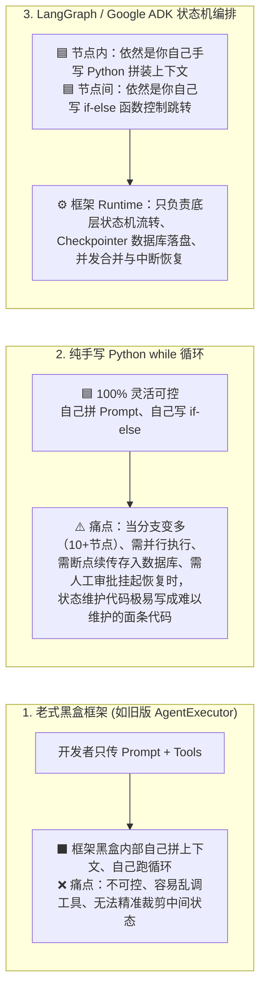

# LangGraph 编排机制深度解析：如何在框架中保留 100% 手写代码的精准度与确定性

- **关联文档**：[Startup Technical Guide: AI Agents（初创企业 AI 智能体技术指南）](./startup_technical_guide_ai_agents_full.md)
- **章节索引**：[00_章节目录_Table_of_Contents.md](./00_章节目录_Table_of_Contents.md)（对应 **Section 1.2：Orchestration，P14–P15** 及 **Section 2.1：ADK Agent Architectures，P29–P32**）
- **前置专题**：[04_Section1_高亮重点提取与智能体编排破壁指南.md](./04_Section1_高亮重点提取与智能体编排破壁指南.md)
- **核心问题**：
  > *“如果用 LangGraph 来做编排，是不是这些调用循环就是 LangGraph 框架本身来实现了？但是是否有一些关于调用步骤和上下文装配的参数要设置呢？否则还没有自己硬编码灵活或者准确可靠。”*

---

## 一、 核心认知：为什么早期框架不如手写代码可靠，而 LangGraph 改变了这一点？

许多资深工程师在使用早期 Agent 框架（如旧版 `LangChain AgentExecutor` 或一键黑盒封装的 `create_react_agent`）时，都会遇到一个共同痛点：**框架把 `while` 循环、Prompt 拼接和历史消息管理全部藏进了黑盒里**。一旦业务复杂，大模型就会乱调工具、上下文被冗长工具返回结果污染（Context Poisoning），确实**远不如自己手写 35 行 `while` 循环灵活、准确、可靠**。

而 **LangGraph**（以及 Google ADK 的 `Workflow Agents` / `CustomAgent`）之所以成为当前工业界标准，恰恰是因为它**彻底摒弃了黑盒封装**。它的核心设计哲学是：

> **“框架只替你接管底层枯燥的步进调度器、数据库状态持久化（Checkpointer）、并发控制与断点恢复；而把【状态账本长什么样】、【每一步的上下文怎么精确拼装】、【下一步跳去哪个节点】这三项核心权力，100% 用原生 Python 硬编码的形式交还给开发者！”**

### 手写循环 vs. 老式黑盒框架 vs. LangGraph 职责边界对比



---

## 二、 在 LangGraph 中精准控制“上下文装配”与“调用步骤”的四大硬核机制

为了确保 LangGraph 编排出来的系统**比纯手写循环更可靠、且丝毫不损失手写代码的灵活度**，在工程开发时绝不能只用默认配置，而必须显式设置以下 **4 个层面的硬编码机制与参数**：

---

### 机制 1：状态账本与归约器控制（`State Schema` & `Reducers`）——告别无脑 `messages.append`

在简单的手写循环中，如果我们把每次工具返回的几万字原始数据全部 `append` 到同一个 `messages` 列表里，跑 3 轮之后不仅 Token 费用暴涨，而且大模型会被前几轮的废话干扰（Lost in the Middle）。

在 LangGraph 中，你通过定义一个**强类型的状态字典（`TypedDict` 或 `Pydantic BaseModel`）**，将“对话流”与“结构化业务变量”严格分离，并通过 **Reducer（归约函数）** 控制每个字段是**追加（Append）**还是**覆盖（Overwrite）**：

```python
from typing import Annotated, TypedDict, List
from langgraph.graph.message import add_messages

# 🟦 【硬编码：自定义强类型状态账本】
class ContractAuditState(TypedDict):
    # 1. 消息列表：使用内置 add_messages Reducer（支持按 ID 追加、替换或用 RemoveMessage 精准删除某条历史消息）
    messages: Annotated[list, add_messages]
    
    # 2. 独立业务字段（默认覆盖更新）：不塞进杂乱的聊天记录，而是作为干净的结构化寄存器！
    current_clause: str           # 当前正在审查的合同条款原文
    retrieved_laws: List[str]     # 当前步骤检索到的法条（用完即可在下个节点覆盖清空，绝不污染全局上下文）
    risk_level: str               # 评估出的风险等级 ("Critical" | "High" | "Medium" | "Low")
    retry_count: int              # 当前节点校验失败的重试计数器
```

---

### 机制 2：节点级上下文精准装配（Context Engineering inside Node）——100% 手写 Prompt 拼装

LangGraph 中的每一个节点（Node），本质上**就是一个普普通通的 Python 函数**（输入是当前的 `state` 字典，返回值是要更新的字段字典）。

**LangGraph 绝对不会在背后偷偷替你拼装 Prompt！** 在每个节点调用大模型之前，到底给大模型看哪几条历史消息、塞入哪些业务变量、挂载哪几个工具、是否强制调用，100% 由你在节点函数内部用 Python 硬编码决定：

```python
from langchain_core.messages import trim_messages, SystemMessage, HumanMessage

# 🟦 【硬编码节点函数】这里面怎么裁剪上下文、怎么拼 Prompt、调什么模型，100% 是你自己的 Python 代码！
def legal_audit_node(state: ContractAuditState) -> dict:
    # -----------------------------------------------------------------
    # 1. 上下文窗口精确裁剪参数 (trim_messages)
    # 防止历史消息过长，且保证绝不会把 [AIMessage(tool_calls)] 和 [ToolMessage] 从中间截断导致 API 报错
    # -----------------------------------------------------------------
    trimmed_history = trim_messages(
        state["messages"],
        max_tokens=4000,
        strategy="last",            # 只保留最近的上下文
        token_counter=llm,
        include_system=False,       # 系统提示词我们在下面单独精准组装
        allow_partial=False,        # 严禁截断单条消息
        start_on="human",           # 确保裁剪后的消息序列合法
    )

    # -----------------------------------------------------------------
    # 2. 手工精准装配当前步骤专属的 Prompt（只给它看当前条款和刚查出来的法条）
    # -----------------------------------------------------------------
    laws_text = "\n".join(state.get("retrieved_laws", []))
    step_prompt = [
        SystemMessage(content=f"你是资深商事法务。请严格依据以下现行法条审查合同条款：\n{laws_text}"),
        *trimmed_history,
        HumanMessage(content=f"请审查此条款并输出风险报告：\n{state['current_clause']}")
    ]

    # -----------------------------------------------------------------
    # 3. 节点级工具可见性与 tool_choice 硬控参数
    # 在这个节点，只向模型暴露 submit_audit_result 这 1 个工具，并强制它必须调用（tool_choice="required"）！
    # -----------------------------------------------------------------
    node_llm = llm.bind_tools([submit_audit_result], tool_choice="required")

    # 🟥 调用 LLM 执行单步推理
    response = node_llm.invoke(step_prompt)

    # 🟦 硬编码返回需要更新到 State 账本里的字段
    return {
        "messages": [response],
        "retry_count": state.get("retry_count", 0) + 1
    }
```

---

### 机制 3：步骤跳转与路由硬编码（`add_conditional_edges`）——用 `if-else` 锁死路线

在纯自主 ReAct 中，最怕大模型陷入死循环或跳错步骤。而在 LangGraph 中，**一个节点跑完之后下一步去哪个节点，不是大模型说了算，而是由你编写的纯 Python 路由函数（Conditional Edge Function）说了算！**

```python
from typing import Literal
from langgraph.graph import StateGraph, START, END

# 🟦 【硬编码路由决策函数】用确定性的 Python if-else 决定下一步去哪！
def route_after_audit(
    state: ContractAuditState
) -> Literal["execute_tools", "partner_review_node", "human_escalation_node", "__end__"]:
    
    last_msg = state["messages"][-1]

    # 硬规则 1：死循环防线——如果当前节点重试达到 3 次仍未通过校验，强制转交人工兜底节点
    if state.get("retry_count", 0) >= 3:
        return "human_escalation_node"

    # 硬规则 2：业务阈值路由——如果识别出 Critical 级别风险，强制路由到“合伙人二审节点”
    if state.get("risk_level") == "Critical":
        return "partner_review_node"

    # 硬规则 3：工具调用路由——如果大模型输出了 tool_calls，跳去工具执行节点
    if getattr(last_msg, "tool_calls", None):
        return "execute_tools"

    # 否则正常结束整个图工作流
    return "__end__"
```

> **提示（LangGraph 新特性 `Command` 对象）**：在最新版 LangGraph 中，你甚至可以直接在节点函数内部返回 `Command(update={"risk_level": "High"}, goto="partner_review_node")`，在一个函数里同时完成**“状态更新 + 强制指定下一个跳转节点”**，写法跟手写状态机一样直观。

---

### 机制 4：编译与运行时的全局控制参数（Compile & Runtime Config）

当你把节点和边连好，调用 `builder.compile()` 和 `graph.invoke()` 时，有 **5 个核心工程参数** 必须根据业务场景显式配置：

| 参数名称 | 设置位置 | 作用与工程意义 | 推荐生产配置示例 |
| :--- | :--- | :--- | :--- |
| **`recursion_limit`** | `graph.invoke(..., config={"recursion_limit": 15})` | **全局最大步数熔断器**（对应手写循环的 `max_steps`）。当图中的节点流转总次数超过该值时，立即抛出 `GraphRecursionError` 终止运行，彻底杜绝死循环烧光 Token。 | 简单任务设为 `10~15`；复杂多智能体流水线设为 `25~40`。 |
| **`checkpointer`** | `builder.compile(checkpointer=PostgresSaver(...))` | **状态快照持久化引擎**。每执行完一个 Super-step（节点步），自动将当前 `State` 完整存入数据库，支撑故障恢复、时间旅行调试与多轮会话记忆。 | 开发测试用 `MemorySaver()` / `SqliteSaver`；生产环境用 `AsyncPostgresSaver`。 |
| **`interrupt_before` / `interrupt_after`** | `builder.compile(interrupt_before=["write_db_node"])` | **静态安全门禁（断点）**。在进入指定高危节点（如发起退款、修改合同、发送邮件）前，Runtime 强制挂起并释放计算资源，等待外部批准指令后再从断点继续。 | 所有涉及外部写操作（Write Actions）或高风险签批的节点列表。 |
| **`interrupt()` (动态中断)** | 在任意节点函数内部直接调用 `human_input = interrupt("请确认修改方案")` | **代码内动态挂起（Human-in-the-Loop）**。可以在节点代码的任意 `if` 分支里随时暂停图执行，向前端抛出提示并等待人类返回值，拿到返回值后原地继续往下跑。 | 当 `if risk_score > 80:` 时动态触发人工复核。 |
| **`RetryPolicy`** | `builder.add_node("api_node", fn, retry=RetryPolicy(max_attempts=3))` | **节点级自动重试策略**。当某个节点因网络抖动、API 限流（429）或大模型偶发 JSON 格式错误抛出异常时，只单独重试该节点，无需从头重跑整个工作流。 | `RetryPolicy(max_attempts=3, initial_interval=1.0, backoff_factor=2.0)` |

---

## 三、 完整代码范本：将四大控制机制组合在一起

下面是一段完整、规范的工业级 LangGraph 编排骨架代码，展示了如何将 **State 强类型定义**、**节点内手写上下文装配**、**`if-else` 条件边路由** 以及 **编译/运行时控制参数** 结合在一起：

```python
from typing import Annotated, TypedDict, List, Literal
from langgraph.graph import StateGraph, START, END
from langgraph.graph.message import add_messages
from langgraph.checkpoint.memory import MemorySaver
from langgraph.types import RetryPolicy, interrupt, Command

# ================= 1. 定义强类型 State 账本 (机制 1) =================
class WorkflowState(TypedDict):
    messages: Annotated[list, add_messages]
    clause_text: str
    retrieved_docs: List[str]
    risk_level: str
    step_count: int

# ================= 2. 编写各个步骤的节点函数 (机制 2) =================
def retrieve_context_node(state: WorkflowState) -> dict:
    """🟦 节点 1：纯硬编码 + 向量检索，不调生成式 LLM"""
    docs = my_local_qdrant_retriever(state["clause_text"], top_k=3)
    return {
        "retrieved_docs": docs,
        "step_count": state.get("step_count", 0) + 1
    }

def llm_analyze_node(state: WorkflowState) -> dict:
    """🟦 + 🟥 节点 2：手工精准装配上下文，并调用 LLM 输出结构化结果"""
    # 手写拼装干净的上下文，只传当前条款和刚刚检索到的 3 段法规，绝不夹带历史噪音
    context_str = "\n---\n".join(state["retrieved_docs"])
    prompt = (
        f"【参考法规】\n{context_str}\n\n"
        f"【待审条款】\n{state['clause_text']}\n\n"
        f"请评估风险等级（High/Low）并给出修改建议。"
    )
    
    # 调用绑定了 Structured Output (Pydantic) 的大模型
    structured_llm = llm.with_structured_output(AuditResultSchema)
    result = structured_llm.invoke(prompt)
    
    return {
        "messages": [{"role": "assistant", "content": result.explanation}],
        "risk_level": result.risk_level,
        "step_count": state["step_count"] + 1
    }

def human_approval_node(state: WorkflowState) -> Command[Literal["finalize_node", "__end__"]]:
    """🟦 节点 3：高风险项触发动态人工中断 (机制 4)"""
    # 调用 interrupt() 原地挂起工作流，将当前草案抛给前端等待人类法务审批
    decision = interrupt({
        "question": "检测到高风险条款，是否批准以下修改建议？",
        "draft": state["messages"][-1].content
    })
    
    if decision.get("approved"):
        return Command(goto="finalize_node")
    else:
        return Command(goto="__end__")

def finalize_node(state: WorkflowState) -> dict:
    """🟦 节点 4：调用确定性工具生成最终修订版 Word"""
    generate_redline_docx(state["clause_text"], state["messages"][-1].content)
    return {"step_count": state["step_count"] + 1}

# ================= 3. 编写硬编码条件路由函数 (机制 3) =================
def route_by_risk(state: WorkflowState) -> Literal["human_approval_node", "finalize_node"]:
    # 100% 确定性的 Python if-else 判断
    if state["risk_level"] == "High":
        return "human_approval_node"
    return "finalize_node"

# ================= 4. 组装并编译状态图 (机制 4) =================
builder = StateGraph(WorkflowState)

# 添加节点，并为可能受网络波动影响的 LLM 节点配置自动重试策略
builder.add_node("retrieve_node", retrieve_context_node)
builder.add_node(
    "analyze_node", 
    llm_analyze_node, 
    retry=RetryPolicy(max_attempts=3, initial_interval=1.0)
)
builder.add_node("human_approval_node", human_approval_node)
builder.add_node("finalize_node", finalize_node)

# 连接确定性边与条件边
builder.add_edge(START, "retrieve_node")
builder.add_edge("retrieve_node", "analyze_node")
builder.add_conditional_edges("analyze_node", route_by_risk)
builder.add_edge("finalize_node", END)

# 挂载 Checkpointer 持久化引擎编译生成 Runtime
checkpointer = MemorySaver()
agent_runtime = builder.compile(checkpointer=checkpointer)

# ================= 5. 启动运行并传入全局安全参数 =================
config = {
    "configurable": {"thread_id": "contract_audit_001"},
    "recursion_limit": 10  # 硬编码最大步数熔断：超过 10 步立即报错停止
}
output = agent_runtime.invoke(
    {"clause_text": "乙方应对甲方遭受的一切直接及间接损失承担无限连带赔偿责任。", "step_count": 0},
    config=config
)
```

---

## 四、 总结：什么时候手写循环，什么时候用 LangGraph / ADK？

1. **绝不要用黑盒的 `AgentExecutor`**：任何不让你自己控制每个节点的 Prompt 拼装、不让你用 Python `if-else` 控制跳转边界的黑盒封装，在生产环境都不可靠。
2. **用 LangGraph 的正确姿势是“白盒状态机”**：
   - 把 LangGraph 当作一个**自带数据库存档（Checkpointer）和并发调度的 `while` 循环外壳**；
   - 在**节点函数内部**，坚持像手写代码一样自己过滤 `state`、自己用字符串模板或 `trim_messages` 组装最干净的 Prompt、自己用 `with_structured_output` 或 `tool_choice="required"` 锁死输出格式；
   - 在**节点之间**，坚持用 `add_conditional_edges` 写纯 Python 的 `if-else` 来决定下一步去哪。
   这样你就同时拥有了**手写硬编码 100% 的精准可控性**与**工业级框架的容错、断点续传和可观测性**。

