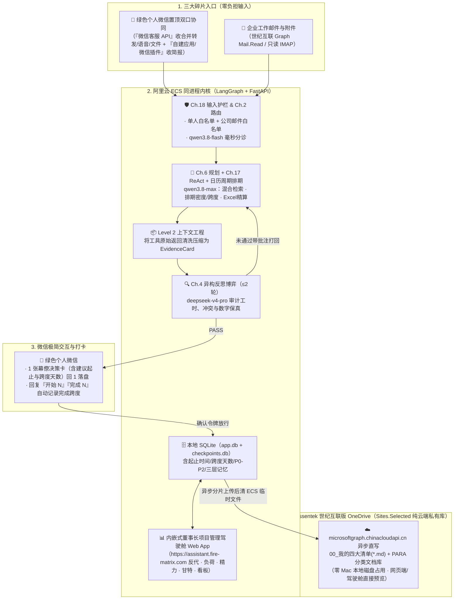

# 个人 AI 董事长助理系统（外轻内重 · 《Agentic Design Patterns》开工基线版）

> **版本**：v3.2（董事长助理开工基线版）  
> **更新日期**：2026-11-17  
> **状态**：定稿开工基线（已完成企微专号策略、Wissentek 世纪互联版 OneDrive、工时排期模型与内嵌项目管理驾驶舱四大定案；历史各版完整留存于 Git 历史）

---

## 一、 核心定位与「外轻内重」设计哲学

本系统面向同时统筹**北京帕莫瑞、维恩科仪（北京）、维恩科仪（香港）**业务研发、项目交付、采购供应链与日常运营的负责人，定位为**「董事长 / 总经理办公室主任（Chief of Staff）」级别的高智商 AI 私人幕僚**：

1. **外围设施极简且物理隔离（不连 Odoo，不装重型第三方软件）**：
   - 运行载体：**仅 1 台阿里云 ECS（`firematrix`，2 核 4G）上的单进程 Python 3.12 服务**，同进程承载**微信双口 HTTPS 回调（个人微信置顶「微信客服 API」+「自建应用/微信插件」）、邮件内核与内嵌式项目管理驾驶舱 Web App**（统一由独立已备案子域名 `https://assistant.fire-matrix.com` 反代）。
   - **彻底与公司多人 ERP（Odoo 19）物理隔离**：私人想法、商业底价、个人负荷分析不进公司多人系统，杜绝权限误配风险；项目孵化成熟需派团队执行时再单独进 Odoo 立项。
   - **锁定 Wissentek 世纪互联版 Office 365 OneDrive（纯云端归档，零 Mac 本地硬盘占用）**：直接走境内高速节点（`microsoftgraph.chinacloudapi.cn`）配合 **`Sites.Selected` 独立私有文档库（`chairman-vault`）** 写入四大清单与分类文件，自带企业级版本回溯；**不在本地 Mac 同步或占磁盘**，日常通过驾驶舱直链与浏览器 SharePoint / OneDrive 网页端直接预览，零额外对象存储与同步盘依赖。
   - **不套 OpenClaw / Hermes 等带裸终端风险的通用外壳**：物理上彻底消除外部邮件提示词注入触发 Shell 越权的风险。
2. **内部大脑与管理视角满配（100% 严格遵循《Agentic Design Patterns》）**：
   - **认知内核**：LangGraph 有界闭环状态图 + Level 2 上下文工程 + **三档异构反思博弈（`qwen3.8-flash` 分诊 / `qwen3.8-max` Thinking 主推 / `deepseek-v4-pro` 独立审计）** + 四大受控幕僚工具箱。
   - **董事长级时间与精力管控**：每件事自动分离评估**「个人净投入工时（Effort Hours）」**与**「日历跨度周期（Duration）」**，通过内嵌驾驶舱网页实时监控每日工作负荷、精力投向占比与在途项目甘特周期，真正从项目管理角度掌控全局节奏。

---

## 二、 四积木闭环与内嵌驾驶舱全景图

---

## 三、 方案演进对照

| 维度 | 初版 v1.x & v2.0（Git 历史） | v3.0 / v3.1 演进版 | v3.2 董事长助理开工基线版（当前定稿） |
| :--- | :--- | :--- | :--- |
| **系统边界与载体** | v1 自造 20 表 / v2 耦合 Odoo+OSS | 去 Odoo 化，3 表 SQLite + 国际版 OneDrive 设想 | **锁定 ECS `firematrix` 单进程 + 世纪互联 OneDrive (`chairman-vault` 纯云端零本地占用)** |
| **微信通道策略** | 单一长连接设想 | 企微智能机器人长连接 + 微信插件假设 | **实测校准并锁定「方案 B」**：绿色个人微信置顶「微信客服 API」（接 `merged_msg` 合并转发）+「自建应用/微信插件」（推早晚简报），统一复用 `assistant.fire-matrix.com` HTTPS |
| **智能体内核** | 单步或固定流 | v3.1 引入《Agentic Design Patterns》三档异构反思 | **严格延续 v3.1 满配内核**（LangGraph + Level 2 上下文工程 + `qwen3.8-max` × `deepseek-v4-pro`） |
| **时间与工时管控** | 仅有单一截止日期 `due_date` | 仅有 `due_date` 与 `P0-P2` | **自动评估起止时间、日历周期与「个人净投入工时(h)」** + 微信一句话打卡校准 |
| **可视化管理界面** | 无（只能看零散文本或 Markdown） | 仅 Markdown 清单 | **同进程内嵌「董事长项目管理驾驶舱 Web App」**（`https://assistant.fire-matrix.com`，固定链接直开（验证码登录后 180 天免密）+ 电脑大屏自适应） |
| **实操可落地性** | 存在待定假设（如消费版 `AppFolder`） | 仍留有 3 项未定配置 | **全部拍板落定**，附实机实测版 SharePoint (`06`) 与企微体检 (`07`) 操作手册及全交互 Checkbox 清单 (`05`) |

---

## 四、 文档导航

| 文档 | 内容说明 |
| :--- | :--- |
| [01-需求定义与日常场景.md](docs/01-需求定义与日常场景.md) | 董事长助理定位、“空壳传声筒”通信本质、三大入口、四大清单、**自动工时/周期评估与项目管理驾驶舱需求**及四大场景演示 |
| [02-技术栈与存储架构设计.md](docs/02-技术栈与存储架构设计.md) | 核心技术栈选型、不接 Odoo/OpenClaw/重型开源 PM 软件的原因、Ch.8 三层记忆与跨度周期表结构、**Wissentek 世纪互联版 `Sites.Selected` 纯云端隔离设计**、及含 `web/` 的代码结构 |
| [03-企业微信双通道来源与使用机制.md](docs/03-企业微信双通道来源与使用机制.md) | 讲清「个人幕僚室 → AI工作助理」与「客服消息 → AI_assistant客服」在企业微信后台的来源出处、能力限制、配合用法与多助理扩展 |
| [04-AI分拣工作流与确认机制.md](docs/04-AI分拣工作流与确认机制.md) | 《Agentic Design Patterns》15+ 模式 1:1 映射、LangGraph 有界闭环、含 **`check_workload_and_schedule`** 的四大工具箱、异构 Critic 契约与 `开始/完成` 打卡指令 |
| [05-阿里云部署与分阶段实施路线.md](docs/05-阿里云部署与分阶段实施路线.md) | ECS 同进程部署边界、防外泄六道硬防线（含 `assistant.fire-matrix.com` Nginx HTTPS 与微信双端无感登录）、**个人微信双口配置与世纪互联 `chairman-vault` 授权步骤**、`.env` 模板与 Ch.19 质量门禁 |
| [06-全流程实操SOP与验收Checklist.md](docs/06-全流程实操SOP与验收Checklist.md) | **开工执行手册**：区分「👤 本人 vs 🤖 AI」的 Stage 0–6 分步 SOP、四路连通性探针、F1–F8 真人验收用例及全交互 Checkbox 总控清单 |
| [07-世纪互联SharePoint私有库与OneDrive实操手册.md](docs/07-世纪互联SharePoint私有库与OneDrive实操手册.md) | **实机实测手册**：记录 Wissentek 世纪互联 SharePoint 新版界面差异、创建 `chairman-vault` 私有库及 `Add shortcut to OneDrive` 的真实每一步操作 |
| [08-企业微信机器人设置核查与个人微信接入实操手册.md](docs/08-企业微信机器人设置核查与个人微信接入实操手册.md) | **实机体检手册**：核查 `智能专区 → 智能机器人` 现状与 `微信插件` 官方限制，并锁定绿色个人微信「微信客服 API + 自建应用」方案 B 接入步骤 |
| [09-路由器意图规范与异常处理机制.md](docs/09-路由器意图规范与异常处理机制.md) | **路由与异常兜底手册**：详解 `FAST_ROUTER_PROMPT` 装配、`IntentRoute` 11 类意图及全链路 10 种异常与超边界兜底机制 |

---

## 五、 本地环境配置目录 (`env/`)

`env/` 目录存放本机参考与部署环境模板（**已被根仓库 `.gitignore` 的 `**/.env.*` 规则忽略，绝不提交至 Git**）：

- `env/.env.bailian`：阿里云百炼（DashScope）OpenAI 兼容接口地址与共用 `DASHSCOPE_API_KEY`（**多应用共用中，严禁重置、修改或删除**，已实测 5 个模型全通）。
- `env/.env.ecs`：目标部署主机阿里云 ECS `firematrix`（呼和浩特，2 核 4G，Ubuntu 24.04）规格与路径约定。
