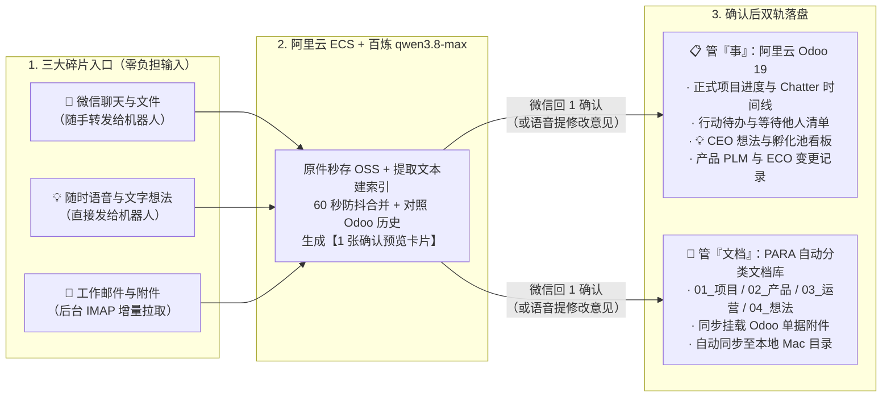

# 个人 AI 私人幕僚系统（微信 + 邮件 + 闪念 → Odoo 19 & 分类文档库）

> **版本**：v2.0（统一幕僚重构版）  
> **更新日期**：2026-11-16  
> **状态**：设计基线（替代初版 `00–12` 自建迷你 ERP 方案；初版已完整归档于仓库 Git 历史）

---

## 一、 项目定位与核心目标

本系统面向同时统筹**北京帕莫瑞、维恩科仪（北京）、维恩科仪（香港）**业务研发、项目交付、采购与客户跟进的负责人，定位为全天候在线的**「AI 私人幕僚（第二大脑）」**：

- **零负担收口三大碎片信息**：
  1. **微信沟通与文件**（个人微信转发的客户/供应商聊天、报价单、合同、现场照片、语音）
  2. **随时随地个人想法**（路上对微信机器人发的语音闪念、文字灵感）
  3. **工作往来邮件与附件**（后台只读 IMAP 自动拉取，自动过滤广告与系统通知）
- **阿里云百炼（`qwen3.8-max`）智能分拣与核验**：合并连续消息、识别客户/项目/产品简称、提炼关键参数与新旧修订冲突（严格保证数字不编造），生成**单张预览确认卡**发回微信。
- **两条腿正式落盘**：
  1. **管「事与想法」→ 阿里云 Odoo 19**：正式项目进展、行动待办清单（Next Actions）、**💡 CEO 想法与孵化池（Idea Pool）**、等待他人清单（Waiting For）全部落入已在阿里云运行的 Odoo 19 业务系统，杜绝双头记账。
  2. **管「文档与知识」→ 统一分类文档库**：所有附件自动按 `日期_项目或对象_原文件名` 重命名，存入阿里云私有 OSS 原件库与 **PARA 四大分类目录**，正式单据同步挂入 Odoo 附件栏，并通过同步工具镜像至本地 Mac（Finder / Obsidian 直接翻阅），同时建本地全文索引支持精确到页码的微信问答。

---

## 二、 核心闭环流程

---

## 三、 为什么重构：v2.0 与初版（v1.x）方案对比

| 维度 | 初版方案（已归档至 Git 历史） | v2.0 统一幕僚方案（当前采用） |
| :--- | :--- | :--- |
| **系统边界** | 明确“不连 Odoo”，用 SQLite + 本地 Markdown 硬造 20 张表迷你 ERP/PLM | **100% 复用阿里云 Odoo 19** 管项目、待办、PLM 与客户，机器人只做收集与秘书 |
| **信息入口** | 仅覆盖微信转发 | 统一收口 **微信 + 个人语音想法 + 工作邮件 IMAP** 三大高频来源 |
| **想法管理** | 未区分“待办”与“不成熟的灵感”，容易混杂 | 在 Odoo 设立专属 **「💡 CEO 想法与孵化池」** 看板，与紧急行动待办隔离 |
| **确认负担** | 一段话拆 5 个阶段，最多要手动回复 **5 次**确认 | 合并为 **1 张预览确认卡**（回 `1` 一键落盘，或高把握自动入库+随时`撤销`） |
| **文件存储** | 只存 ECS 60G 系统盘，与本机和 Odoo 脱节 | **阿里云 OSS 原件保险箱 + PARA 四大分类目录 + Odoo 单据附件 + Mac 自动同步** |
| **开发工作量** | 从零手写 LangGraph 四张图与 20+ 张业务表 | **复用现成 IM 网关 + 已有 `mcp-odoo-server` 审批底座**，砍掉约 80% 重复开发 |

---

## 四、 文档导航

| 文档 | 内容说明 |
| :--- | :--- |
| [01-需求定义与日常场景.md](docs/01-需求定义与日常场景.md) | 痛点拆解、三大入口接入规则、四类清单模型、日常真实场景演示与验收标准 |
| [02-整体架构与Odoo19及文档归档设计.md](docs/02-整体架构与Odoo19及文档归档设计.md) | 四层系统架构、网关与开源路线对比（含 Grok Bot/OpenClaw/企微对比）、Odoo 19 模型映射、PARA 文档库与 OSS/Mac 同步设计 |
| [03-AI分拣工作流与确认机制.md](docs/03-AI分拣工作流与确认机制.md) | 代码与百炼 `qwen3.8-max` 分工、单次分拣 Pydantic 契约、硬核验（数字保真）、1 张卡确认与历史问答流程 |
| [04-阿里云部署与分阶段实施路线.md](docs/04-阿里云部署与分阶段实施路线.md) | 阿里云 ECS `firematrix` 与 Odoo ECS 部署拓扑、安全整改清单、环境变量模板与三阶段实施计划 |

---

## 五、 本地环境配置目录 (`env/`)

`env/` 目录存放本机参考与部署环境模板（**已被根仓库 `.gitignore` 的 `**/.env.*` 规则忽略，绝不提交至 Git**）：

- `env/.env.bailian`：阿里云百炼（DashScope）OpenAI 兼容接口地址与 `qwen3.8-max` 模型配置（上线前需轮换新建专用 Key）。
- `env/.env.ecs`：目标部署主机阿里云 ECS `firematrix`（呼和浩特，2 核 4G，Ubuntu 24.04）规格与路径约定。
