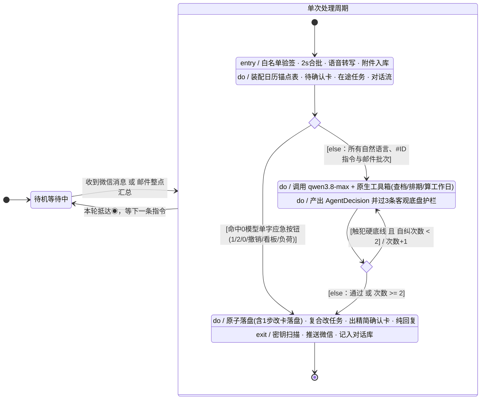

# 个人 AI 董事长助理系统（v3.0 单脑旗舰 Agent · Model-First 生产版）

> **版本**：v3.0（大模型优先 + 极简 4 块安全底盘 · 方案 A 生产重构版）  
> **更新日期**：2026-11-25  
> **状态**：已完成按《Model-First + 确定性底盘》方法论的独立盲审与全部 P0/P1 收尾修订，全仓 **125 条防串谋 TDD 单测 + 14 条离线黄金轨迹 + 8 条真实百炼 `qwen3.8-max` 端到端 E2E 实弹用例** 100% 绿灯通过。

---

## 一、 核心定位与 v3.0「大模型优先 + 极简安全底盘」设计哲学

本系统面向同时统筹**北京帕莫瑞、维恩科仪（北京）、维恩科仪（香港）**业务研发、项目交付、采购供应链与日常运营的负责人，定位为**「董事长 / 总经理办公室主任（Chief of Staff）」级别的纯项目管理（PMO）私人幕僚**：

1. **外围设施极简且物理隔离（不连 Odoo，不装重型第三方软件）**：
   - **单进程服务**：仅 1 台阿里云 ECS（`firematrix`，2 核 4G）上的单进程 Python 服务（`wechat-agent.service`），同进程承载**微信双口 HTTPS 回调（个人微信置顶「个人幕僚室 → AI工作助理」+ 备用客服通道）、香港/国际版 Outlook 整点只读汇总与内嵌式董事长项目管理驾驶舱 Web App**（`https://assistant.fire-matrix.com`）。
   - **物理隔离公司 ERP（Odoo）**：私人想法、CEO 主观评价、个人节奏与商业底价独立保存于私有 SQLite 与私有云盘，绝不混入公司多人系统。
   - **纯云端归档（Wissentek 世纪互联版 OneDrive）**：经 `Sites.Selected` 锁定唯一私有库 `chairman-vault`，零 Mac 本地占盘。
   - **任务来源自动打标（`source_channel`）**：所有任务按来源自动标注 `wechat`（微信）、`outlook`（邮件）、`web`（驾驶舱），驾驶舱支持按来源彩色徽标展示与一键筛选。
2. **v3.0 核心架构跃迁：废弃脆弱硬编码路由与二审内耗，把大脑 100% 交还旗舰大模型**：
   - **单脑旗舰推理（`qwen3.8-max` + Native Tool Calling）**：彻底移除旧版 `qwen3.8-flash` 16 意图分类器、20+ 条脆弱正则口令以及强制执行的第二个异构审计大模型 `deepseek-v4-pro`（曾导致 37 秒延迟与跨节点传话丢上下文）。
   - **确定性事实一次喂齐**：每轮由代码提前生成精确的**《本周/下周日历锚点表》**（昨天、今天周几、明天、本周一~日、下周一~日），连同完整待确认卡、在途任务快照（含 v2.0 1～7 栏）、近期真实对话流一次性交给 `qwen3.8-max`，由模型自主调用受控工具（查档案、读页码、查 14 天排期、算工作日）并输出统一结构化 `AgentDecision` JSON。
   - **自然语言一句话办多件事**：原生支持“目标截止时间暂定本周五，之后可以确认落盘了”（一步改卡+原子落盘），以及“把 #1 截止改到下周三，给 #2 写个 CEO 评价推进太慢，#3 标完成”（复合 `direct_ops` 一次全办完），日常响应耗时由 25～40 秒降至 **5～8 秒**。
   - **4 块极简硬编码安全底盘（绝不干预语义理解，只守安全与账本）**：
     1. **安全门禁**：单人白名单、邮箱物理只读、`[SYSTEM_TRUSTED_MAIL_META]` 与 `[UNTRUSTED_EXTERNAL_DATA]` 物理分框、落盘 `ApprovalToken` 验签、输出密钥扫描；
     2. **账本与撤销**：SQLite 单事务原子落盘、24 小时一键撤销、幂等时间轴、120 位微软 `conversationId` 自动回填与 `source_channel` 强打标；
     3. **客观事实供给 + 3 条纯客观硬护栏**：显式 `Asia/Shanghai` 时区日历锚点表 + 完整邮件正文 + 边界标签逃逸清洗；客观护栏仅拦 3 类绝对客观硬错误（非法/倒挂公历日期、Outlook 仅抄送邮件把董事长填成负责人/实施人、跨度混填为超大工时），彻底移除字面子串数字警察，绝不误杀“昨天/本周五”相对日期、合法换算/汇总数值与微信交办；
     4. **极简排版渲染**：单任务微信卡自动隐藏重复长摘要、过滤系统噪点出处、零内部技术黑话；仅保留 0 模型单字离线应急按钮（`1`/`2`/`0`/`撤销`/`看板`/`负荷`）保障大模型断网时照常可用，其余一切自然语言与 `#ID` 指令全部直通旗舰大脑。

---

## 二、 v3.0 极简三节点状态机架构概览（OMG UML 2.5）

---

## 三、 版本演进对照

| 维度 | 旧版 v2.0（三档模型接力 + 强硬编码路由） | 当前 v3.0（单脑旗舰 Agent · Model-First 方案 A） |
| :--- | :--- | :--- |
| **大脑架构** | `qwen3.8-flash` 16 意图分类 + `qwen3.8-max` 起草 + `deepseek-v4-pro` 强制二审 | **单一旗舰大脑 `qwen3.8-max`** + 原生 Tool Calling + 统一 `AgentDecision` 决策 |
| **响应速度** | 25～40 秒（多模型串行 + 二审打架重写） | **5～8 秒**（单脑一步到位，0 次小模型路由 / 0 次二审大模型） |
| **自然语言与复合操作** | 依赖 20+ 条正则，改完卡还要再回一次 `1`，无法一句话办多件事 | **任意自然中文直接办**：支持“截止暂定本周五，之后确认落盘了”一步到位、复合改多条任务 |
| **日期与角色准确性** | 无日历表导致“昨天/本周五”被判造假；`cc_observer` 误伤微信交办 | **确定性日历锚点表直接喂齐**；`cc_observer` 严格锁定 Outlook 邮件通道 |
| **微信卡片观感** | 单任务顶部长摘要复读 + 泄露内部审计黑话与系统出处 | **单任务卡极致精简**（隐藏冗余摘要、过滤系统噪点、零技术黑话） |
| **任务来源追踪** | 无来源区分 | **全链路 `source_channel` 打标**（`wechat`/`outlook`/`web` 徽标 + 驾驶舱筛选） |

---

## 四、 文档与调试档案导航

| 目录 / 文档 | 内容说明 |
| :--- | :--- |
| [docs/01-需求定义与日常场景.md](docs/01-需求定义与日常场景.md) | 董事长助理定位、纯 PMO 边界、四大清单、周期跨度管理、来源标记与项目管理驾驶舱需求 |
| [docs/02-技术栈与存储架构设计.md](docs/02-技术栈与存储架构设计.md) | v3.0 技术栈选型、不接 Odoo/OpenClaw 原因、SQLite 表结构（含 `source_channel`）、世纪互联 OneDrive 与代码结构 |
| [docs/03-企业微信双通道来源与使用机制.md](docs/03-企业微信双通道来源与使用机制.md) | 「个人幕僚室 → AI工作助理」与备用客服通道的来源、限制与配合方式 |
| [docs/04-AI分拣工作流与确认机制.md](docs/04-AI分拣工作流与确认机制.md) | **v3.0 单脑旗舰工作流全景手册**（附严格 OMG UML 2.5 状态机图与 [A0 全景图纸](docs/04-AI分拣工作流全景图_A0.png)） |
| [docs/05-阿里云部署与分阶段实施路线.md](docs/05-阿里云部署与分阶段实施路线.md) | ECS 同进程部署、Nginx HTTPS、安全防线、`.env` 模板与生产运维规范 |
| [docs/06-全流程实操SOP与验收Checklist.md](docs/06-全流程实操SOP与验收Checklist.md) | Stage 0–6 分步 SOP、四路连通性探针与真人验收清单 |
| [docs/07-世纪互联SharePoint私有库与OneDrive实操手册.md](docs/07-世纪互联SharePoint私有库与OneDrive实操手册.md) | Wissentek 世纪互联 SharePoint 私有库 `chairman-vault` 授权与配置实操 |
| [docs/08-企业微信机器人设置核查与个人微信接入实操手册.md](docs/08-企业微信机器人设置核查与个人微信接入实操手册.md) | 绿色个人微信接入企业微信自建应用与客服 API 实操手册 |
| [docs/09-路由器意图规范与异常处理机制.md](docs/09-路由器意图规范与异常处理机制.md) | **v3.0 统一决策契约（`AgentDecision`）、0 模型应急按钮与 10 类异常兜底手册** |
| [docs/10-代码阅读顺序与流程图对照审核指南.md](docs/10-代码阅读顺序与流程图对照审核指南.md) | **v3.0 源码走读与 UML 2.5 状态图 1:1 审核指南**（含 116 条测试与 14 条黄金轨迹复核命令） |
| [debug_records/README.md](debug_records/README.md) | **调试档案与避坑方法论**（双视角编写：🗣️ 通俗白话给董事长 ＋ 🤖 技术规格给 AI Coding） |
| [TDD_record/README.md](TDD_record/README.md) | **防串谋 TDD 验收总档案**（00～08 全阶段红绿灯实证、盲审修复与阿里云部署记录） |

---

## 五、 本地环境配置目录 (`env/`)

`env/` 目录存放本机参考与部署环境模板（**已被根仓库 `.gitignore` 的 `**/.env.*` 规则忽略，绝不提交至 Git**）：

- `env/.env.bailian`：阿里云百炼（DashScope）OpenAI 兼容接口地址与共用 `DASHSCOPE_API_KEY`。
- `env/.env.ecs`：目标部署主机阿里云 ECS `firematrix`（呼和浩特，2 核 4G，Ubuntu 24.04）规格与路径约定。
