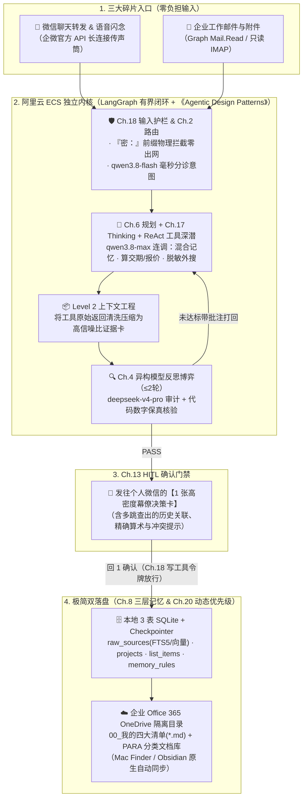

# 个人 AI 私人幕僚系统（外轻内重 · 《Agentic Design Patterns》标准内核版）

> **版本**：v3.1（外轻内重 · Agentic Design Patterns 标准内核版）  
> **更新日期**：2026-11-17  
> **状态**：设计基线（在 v3.0 极简独立存储之上，按工作区 [agentic_design_patterns](../agentic_design_patterns) 标准全面升级推理、工具与反思内核；历史各版均完整留存于 Git 历史）

---

## 一、 核心设计哲学：外轻内重

本系统面向同时统筹**北京帕莫瑞、维恩科仪（北京）、维恩科仪（香港）**业务研发、项目交付、采购与客户跟进的负责人，坚持**「外围设施极简、内部大脑满配」**的工程原则：

1. **外围存储与依赖极轻（不碰重型外部系统）**：
   - 仅运行 **1 个单进程 Python 3.12 服务 + 1 个轻量本地 SQLite（3 张核心业务表）+ 企业 Office 365 OneDrive 隔离专属目录**。
   - **彻底与公司多人 Odoo 19 物理隔离**：不引入复杂 ERP 接口调试，也不让员工系统权限波及 CEO 私人想法与底价；不自建 OSS 与第三方同步盘。
   - **不套 OpenClaw / Hermes 等通用裸终端外壳**：避免外部邮件触发 Shell 注入风险，也不让自由对话流破坏“先核验、后 1 卡确认”的确定性铁律。
2. **内部智能体大脑满配（100% 对齐《Agentic Design Patterns》Level 2/3 标准）**：
   - 复用工作区 `Boiler_FBG_Product_RD_Workflow` 验证成熟的工业级网关与状态图模式：**LangGraph 有界闭环状态图（Bounded Cyclic `StateGraph`）+ Level 2 上下文工程（Context Engineering）**。
   - **三档异构模型配对与反思博弈（Ch.4 + Ch.16）**：`qwen3.8-flash`（极速分诊路由）→ `qwen3.8-max`（开启 Thinking 深度推理与多跳工具深潜）→ `deepseek-v4-pro`（独立异构 Critic 审计挑刺），把半成品错误拦截在发送确认卡之前。
   - **四大受控幕僚工具箱（Ch.5 + Ch.3 + Ch.18）**：赋予智能体混合检索（BM25 + 语义向量）、PDF/Excel 逐页与逐行精算、脱敏外部情报并发调研，以及受 `before_tool_callback` 与确认令牌保护的 OneDrive 编排写入能力。

---

## 二、 四积木闭环与内核拓扑图

---

## 三、 方案演进对照

| 维度 | 初版 v1.x & v2.0（Git 历史归档） | v3.0 过渡版 | v3.1 外轻内重 · 设计模式标准版（当前采用） |
| :--- | :--- | :--- | :--- |
| **外围存储与依赖** | v1 自造 20 表 / v2 耦合 Odoo+OSS | 3 表 SQLite + 企业 OneDrive 直写 | **延续 v3.0 极简外围**（3 表 SQLite + OneDrive 直写 + 零 Odoo/OSS） |
| **大模型推理范式** | 单次或固定多步串行填表 | 单次调用输出 JSON 草案 | **LangGraph 有界闭环**：`ReAct` 多跳工具深潜 + **Level 2 上下文工程** + **Ch.4 异构反思** |
| **模型配对策略** | 单一 `qwen3.8-max` | 单一 `qwen3.8-max` | **Ch.16 三档异构**：`qwen3.8-flash` 分诊 / `qwen3.8-max` 主推 / `deepseek-v4-pro` 独立审计 |
| **执行与调研工具** | 仅简单读库 | 仅基础检索与按页读 | **四大受控工具箱**：混合检索 + Excel/日期精算沙箱 + **脱敏并发外搜(Metaso/Serper)** + OneDrive 编排 |
| **学习与进化** | 简单规则表 | 规则表 + 4 个清单 | **Ch.8 三层记忆**（短期 Checkpointer + 长期语义/情景 Few-Shot/程序性规则）+ **Ch.20 P0–P2 动态排序** |
| **测试与可观测** | 人工抽查样例 | 基础单测 | **Ch.19 三层质量门禁**：Trajectory Eval + 硬核验单测 + LLM-as-a-Judge（可选连私有观测中心） |

---

## 四、 文档导航

| 文档 | 内容说明 |
| :--- | :--- |
| [01-需求定义与日常场景.md](docs/01-需求定义与日常场景.md) | 核心痛点、“空壳传声筒”通信本质、三大入口、四大轻量清单与升级版参谋长场景（含多跳追查/Excel精算/脱敏外搜/P0–P2简报） |
| [02-整体架构与SQLite清单及OneDrive归档设计.md](docs/02-整体架构与SQLite清单及OneDrive归档设计.md) | 架构减法与不套 OpenClaw/Hermes 原因、Ch.8 三层记忆与混合检索 SQLite 设计、OneDrive 沙箱直写、及模块化代码包结构 |
| [03-AI分拣工作流与确认机制.md](docs/03-AI分拣工作流与确认机制.md) | **核心设计规格**：与《Agentic Design Patterns》15+ 模式 1:1 映射、LangGraph 有界闭环图、四大工具箱、异构反思契约与 HITL 决策卡 |
| [04-阿里云部署与分阶段实施路线.md](docs/04-阿里云部署与分阶段实施路线.md) | ECS `firematrix` 单机部署、企业核心信息防外泄六道硬防线（含防邮件注入与脱敏外搜护栏）、三档模型 `.env` 模板与 Ch.19 验收门禁 |

---

## 五、 本地环境配置目录 (`env/`)

`env/` 目录存放本机参考与部署环境模板（**已被根仓库 `.gitignore` 的 `**/.env.*` 规则忽略，绝不提交至 Git**）：

- `env/.env.bailian`：阿里云百炼（DashScope）OpenAI 兼容接口地址与模型配置（支持同端点调用千问与 DeepSeek 系列模型，上线前需轮换新建专用 Key）。
- `env/.env.ecs`：目标部署主机阿里云 ECS `firematrix`（呼和浩特，2 核 4G，Ubuntu 24.04）规格与路径约定。
