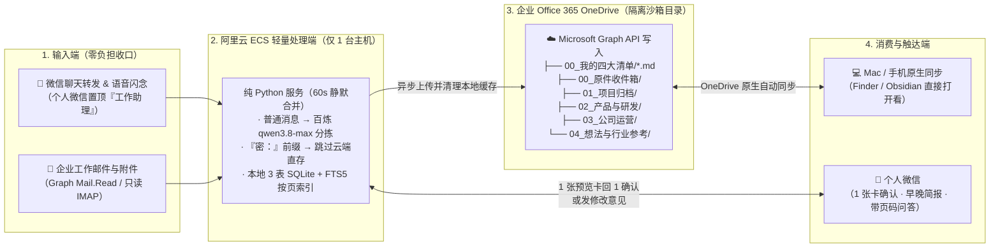

# 个人 AI 私人幕僚系统（微信 + 邮件 + 闪念 → 极简清单 & 企业 OneDrive 文档库）

> **版本**：v3.0（极简独立与企业 OneDrive 版）  
> **更新日期**：2026-11-17  
> **状态**：设计基线（替代初版自建 20 表方案与 v2.0 对接 Odoo/OSS 方案；初版与 v2.0 均已完整留存于仓库 Git 历史）

---

## 一、 项目定位与核心原则

本系统面向同时统筹**北京帕莫瑞、维恩科仪（北京）、维恩科仪（香港）**业务研发、项目交付、采购与客户跟进的负责人，定位为**100% 属于你个人且物理隔离的「AI 私人幕僚（第二大脑）」**：

- **与公司多人 ERP（Odoo 19）彻底解耦**：私人幕僚只管你一个人的微信碎片、工作邮件、未成形想法、四大私人清单与文档归档，**不连接、不写入 Odoo**，既省去繁琐的 ERP 接口调试，又彻底杜绝多人系统权限配置失误导致老板想法与底价泄露的风险（当某个想法孵化成熟、确实需要派给团队执行时，再人工或独立立项进 Odoo）。
- **零负担收口三大碎片信息**：
  1. **微信沟通与文件**（个人微信转发的客户/供应商聊天、报价单、合同、现场照片、语音）
  2. **随时随地个人想法**（路上对微信机器人发的语音闪念、文字灵感）
  3. **企业工作邮件与附件**（同租户 Office 365 Microsoft Graph `Mail.Read` 或标准只读 IMAP 自动增量拉取，过滤广告与验证码）
- **阿里云百炼（`qwen3.8-max`）智能分拣与硬核验**：合并连续消息、识别客户/项目/产品简称、提炼关键参数与新旧修订冲突（严格保证数字不编造），生成**单张预览确认卡**发回微信；遇到绝密内容支持 **`密：` 前缀跳过云端大模型直存**。
- **极简双落盘（3 张表 SQLite + 企业 Office 365 OneDrive 直写）**：
  1. **本地轻量状态与全文索引（ECS 上 1 个 SQLite 文件）**：仅用 **3 张核心表**（原件索引与按页纯文本 `raw_sources` + `sources_fts`、轻量项目字典 `projects`、四合一清单 `list_items`），只负责清单计算、Undo 撤销与页码级全文检索。
  2. **企业 Office 365 OneDrive 隔离目录直写**：经微软官方 Graph API（锁死在仅自己可见的专属隔离文件夹内）直接生成实时更新的 **`00_我的四大清单/*.md`** 与 **PARA 四大分类文档库**。自带企业版历史版本与 93 天双层回收站，办公室/家里 Mac（Finder / Obsidian）与手机原生自动同步，**零额外对象存储、零第三方同步盘**。

---

## 二、 终极四积木闭环架构

---

## 三、 三代方案演进与取舍对比

| 维度 | 初版 v1.x（Git 历史归档） | v2.0 过渡版（Git 历史归档） | v3.0 极简独立与企业 OneDrive 版（当前采用） |
| :--- | :--- | :--- | :--- |
| **与 Odoo 的关系** | 不连 Odoo，但用 SQLite 硬造 20 张表迷你 ERP | 强耦合 Odoo 19 MCP 写任务与附件 | **彻底去 Odoo 化**：私人幕僚只管自己的 4 个清单与文档库，与公司 ERP 100% 物理隔离 |
| **数据库复杂度** | 20+ 张业务表 + LangGraph 4 张状态图 | 依赖 Odoo 多公司模型与审批 Token 库 | **仅 3 张极简 SQLite 表 + FTS5 全文索引**，开发与本地测试极快 |
| **文档存储与同步** | 仅存 ECS 60G 磁盘，无跨端同步 | 阿里云 OSS + Syncthing + Odoo 附件三处同步 | **直接写入企业 Office 365 OneDrive 隔离目录**（自带 Mac/手机同步与版本回溯，省掉 OSS 与同步软件） |
| **信息入口** | 仅支持微信转发 | 微信 + 语音想法 + 邮件 IMAP | 微信 + 语音想法 + **Office 365 Graph Mail / 只读 IMAP**（同租户一套应用搞定收邮件与写网盘） |
| **确认与安全体验** | 一段话停下确认 5 次 | 1 张预览卡确认 | **1 张卡确认**（或高把握自动入库+`撤销`）+ **明确“空壳传声筒”通信模型 + 六道保密硬防线（含 `密：` 零出网）** |
| **预计开发工作量** | 100%（重型工程） | ~50%（主要卡在 ERP 联调） | **< 20%（核心闭环 2～3 天即可跑通）** |

---

## 四、 文档导航

| 文档 | 内容说明 |
| :--- | :--- |
| [01-需求定义与日常场景.md](docs/01-需求定义与日常场景.md) | 核心痛点、**“机器人”通信本质澄清**、三大碎片入口、四大轻量清单模型、日常真实场景与验收标准 |
| [02-整体架构与SQLite清单及OneDrive归档设计.md](docs/02-整体架构与SQLite清单及OneDrive归档设计.md) | 架构减法决策、四积木数据流、极简 3 表 SQLite 设计、企业 OneDrive 沙箱权限隔离与 2Mbps 带宽异步分片上传方案 |
| [03-AI分拣工作流与确认机制.md](docs/03-AI分拣工作流与确认机制.md) | 代码与百炼 `qwen3.8-max` 分工、`密：` 前缀拦截流、Pydantic 分拣契约、数字保真核验、1 张卡确认与带页码历史问答 |
| [04-阿里云部署与分阶段实施路线.md](docs/04-阿里云部署与分阶段实施路线.md) | 单机 ECS 部署拓扑、**企业核心信息防外泄六道硬防线**、`/etc/wechat-agent/env` 配置模板与三阶段敏捷实施路线 |

---

## 五、 本地环境配置目录 (`env/`)

`env/` 目录存放本机参考与部署环境模板（**已被根仓库 `.gitignore` 的 `**/.env.*` 规则忽略，绝不提交至 Git**）：

- `env/.env.bailian`：阿里云百炼（DashScope）OpenAI 兼容接口地址与 `qwen3.8-max` 模型配置（上线前需轮换新建专用 Key）。
- `env/.env.ecs`：目标部署主机阿里云 ECS `firematrix`（呼和浩特，2 核 4G，Ubuntu 24.04）规格与路径约定。
