# 架构文档（ARCHITECTURE.md）

> **图的双轨制**（框架总纲 3.1）：本文件 Mermaid 是机器对账图源（`tools/check_traceability.py` 解析），每张图同步导出 **Obsidian Canvas** 到 `docs/canvas/`，作为人审主视图；两者内容须一致。历史对照：`docs/archive/ARCHITECTURE.md`。  
> **复杂度红线**（框架总纲 3.3）：单张图 ≤12 个文本块、≤15 条连线、单节点连线数(进+出) ≤6；超限一律拆为「总图+子图」，总图把子系统黑盒化为单节点（双框 `[[...]]` + 📦，标注"详见 X.Y"），子图承载细节。**黑盒节点若代表多个真实 .py 文件，标签禁止写出多个 `.py` 后缀**（避免溯源对账脚本误配对；纯业务分组用中文描述，不带文件后缀）。  
> 每张图：箭头带中文动词标注；节点标签双语（代码名+中文职责）；图下附「📖 图解」；关键设计意图用 📌 便签标出。

---

## 1. 一句话概述

本服务在 Docker 中运行，由 Cron/CLI（及可选 API）触发，拉取企业微信打卡与假勤审批，结合本地 JSON 花名册与节假日日历做日/周/月勾稽，结果经 SMTP 邮件分发，并在薪资周期（上月26日–本月25日）于 25/26 日产出月报草稿与终审。

---

## 2. 系统上下文图

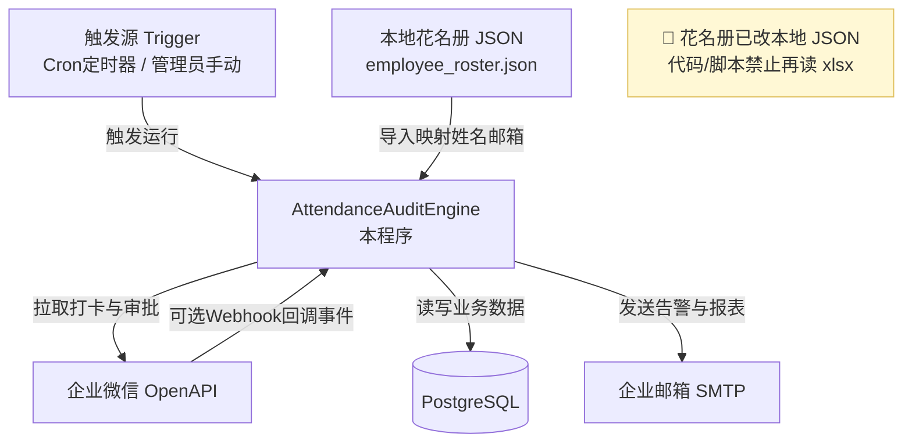

📖 **图解**：这张图回答「本程序和外部世界有哪些往来」。触发源（Cron 定时器或管理员手动）启动程序；程序对外只做四件事——问企微**要**打卡与审批数据、往数据库**写**业务数据、用邮件**发**告警与报表、从本地花名册 JSON **导入**姓名邮箱映射。企微 Webhook 是可选的反向回调（用于事件推送，非必须）。审核要点：图上没有的外部系统，程序就不许碰；花名册已从 Excel 迁移为 JSON，运行时不得再读 xlsx。

---

## 3. 模块结构图

> 每个方框 = 一个 .py 文件。箭头 = "谁调用谁"。原「总图+3子图」4 张图共 66 条真实依赖边，其中总图 19 节点/23 边/门面节点度 11，远超复杂度红线（≤12节点/≤15边/≤6度），拆为 **9 张小图**：每张图只讲一件事，全部合起来仍是 66 条真实依赖边（供 `tools/check_traceability.py` 逐图解析后取并集对账，不因拆分而漏边）。

### 3.0 总图：入口层自身依赖（鸟瞰）

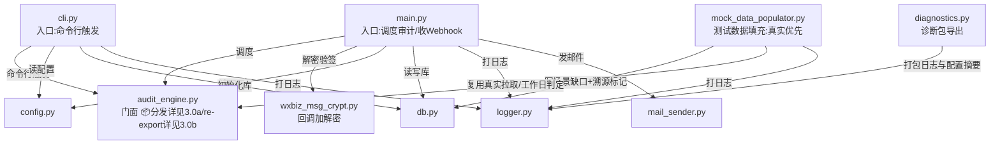

📖 **图解**：这张图回答「main/cli 两个入口自己直接碰了哪些模块」。`main.py` 与 `cli.py` 都只做调度，不含业务：都读配置、读写库、打日志；`main.py` 额外负责 Webhook 解密与发邮件；辅助工具 `mock_data_populator.py`（测试数据，2026-07-14 起改为真实优先：复用门面暴露的 `sync_real_punches`/`sync_real_daily_reports`/`is_workday_db` 拉真实数据，只为 PRD 6.6 场景缺口补 mock 并写 `test_data_provenance` 溯源表，图上边数不变）和 `diagnostics.py`（诊断包）也在这一层。真正的业务分发（`audit_engine.py` 代理到 5 个 service）见 3.0a；工具函数 re-export 见 3.0b。

### 3.0a 子图：门面 → 5 个 Service 分发

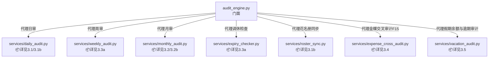

📖 **图解**：门面把 6 类审计任务分别代理给独立的 service 文件；**Services 之间互不调用**（无横向依赖，各自见对应子图）。v0.5 新增第 6 类：F15 金蝶差旅报销交叉审计。

### 3.0b 子图：门面 re-export 工具函数

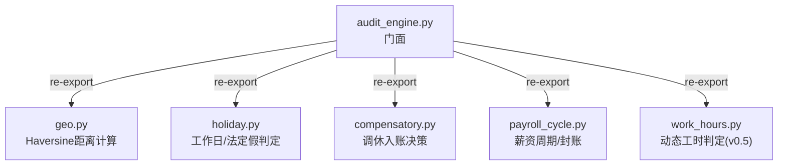

📖 **图解**：门面同时把 5 个纯函数工具模块原样导出，向后兼容旧 import 路径（重构前这些函数在 `audit_engine.py` 内部）。v0.5 新增 `work_hours.py`：制度 3.1.1 动态 8.5h/9.0h 工时判定纯函数。

### 3.1 子图：日审 `daily_audit` 的业务依赖

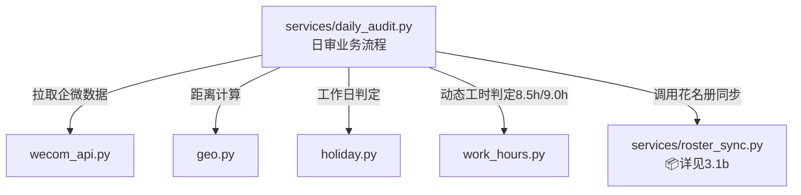

📖 **图解**：日审业务侧依赖：拉打卡（`wecom_api`）、瞬移检测（`geo`）、工作日判定（`holiday`）、动态工时判定（`work_hours`，v0.5 新增：按制度 3.1.1 公式算跨度与缺额），并先调 `roster_sync` 确保花名册最新。基础设施依赖（发邮件/读写库/打日志）见 3.1b。

### 3.1b 子图：日审 + 花名册同步的基础设施依赖

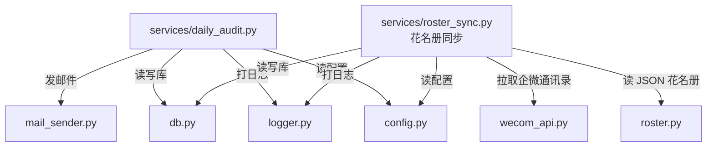

📖 **图解**：`daily_audit.py` 通过基础设施四件套（mail_sender/db/logger/config）落地异常邮件与数据；`roster_sync.py` 除了这四件套，还依赖 `wecom_api`（拉通讯录）和 `roster`（读本地 JSON 花名册）。

### 3.2 子图：月审 `monthly_audit` 的业务依赖

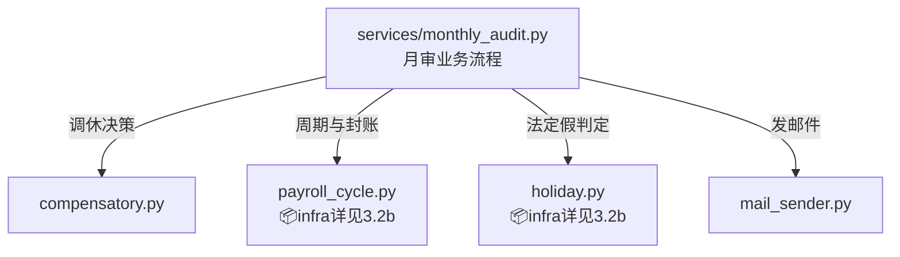

📖 **图解**：月审的特有依赖是 `compensatory`（调休入账决策纯函数）和 `payroll_cycle`（26–25 周期计算、封账锁定），同时复用 `holiday` 做法定假判定。月审自身与 `holiday`/`payroll_cycle` 各自的基础设施依赖见 3.2b。

### 3.2b 子图：月审 + holiday/payroll_cycle 的基础设施依赖

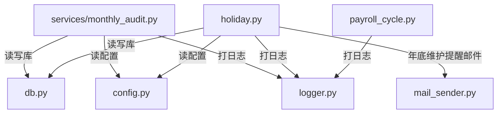

📖 **图解**：`holiday.py` 自身也依赖 db（存节假日表）和 mail_sender（每年 12-31 提醒徐宏玮维护下一年日历）；`payroll_cycle.py` 只打日志，是四个工具模块里最轻的。

### 3.3a 子图：周审 + 调休催用的业务与邮件依赖

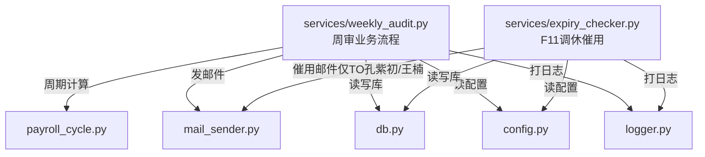

📖 **图解**：周审和调休催用是最轻的两个 service，各自只依赖 mail_sender + db + config + logger 四件基础设施；催用邮件的收件人规则见 PRD §4.2 第 6 条。基础设施模块彼此之间的依赖（谁也读 config、谁也打 logger）见 3.3b。

### 3.3b 子图：基础设施模块内部依赖

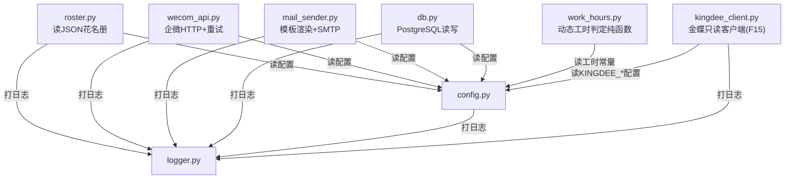

📖 **图解**：所有基础设施模块统一通过 `config` 读配置、通过 `logger` 打日志；`config` 自身只依赖 `logger`。v0.5 新增 `work_hours`（只读工时常量）与 `kingdee_client`（金蝶只读客户端）。**所有依赖方向严格从上到下，无环**——这是 3.0–3.4 各图共同遵守的铁律，`tools/check_traceability.py` 会自动检测循环依赖。

### 3.4 子图：F15 金蝶交叉审计依赖（v0.5 新增）

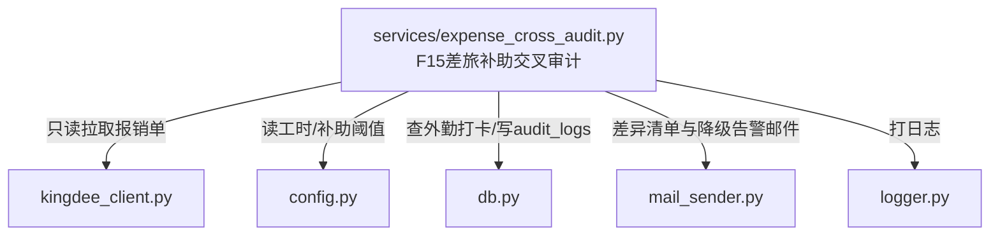

📖 **图解**：F15 只新增一条对外通道——`kingdee_client`（金蝶只读，登录 + 查询两个能力，无任何写接口）。交叉核对用 `db` 里已有的企微外勤打卡数据，差异结果走 `mail_sender` 发给财务与 HR。金蝶失败时降级跳过并告警，不阻塞考勤主流程（见 §9 失败策略表）。

### 3.5 子图：假期余额与逾期堆积审计依赖（v0.7 新增）

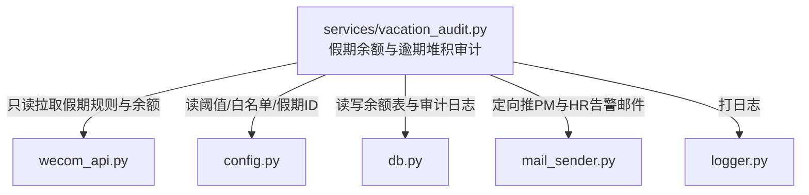

📖 **图解**：一阶段假期余额与逾期堆积审计完全只读拉取企微假期配置（`getcorpconf`）与个人余额（`getuservacationquota`），同步至本地 `vacation_balances` 并输出调休堆积（仅发 PM，禁发本人）、年假偏高、离职残留余额与病假 0 余额限额风险告警，绝不静默扣减企微余额。

**决策（2026-07-14，L2）**：按框架总纲 3.3 复杂度红线（单图 ≤12 节点/≤15 边/单节点度 ≤6），原「总图+3子图」的 §3.0/§3.1/§3.2/§3.3 进一步拆为 9 张小图（3.0/3.0a/3.0b/3.1/3.1b/3.2/3.2b/3.3a/3.3b），每张图讲一件事；66 条真实依赖边原样保留，只是分散到更多小图里（不因拆分丢边，`tools/check_traceability.py` 逐图解析后取并集对账）。黑盒节点（`[[...]]` + 📦）一律只代表单一 .py 文件，禁止把多个文件合并进一个节点标签，避免溯源脚本误配对。

**Canvas 人审对应**（一图一文件，与上列 Mermaid 一一对应）：

| Mermaid | Obsidian Canvas |
|---|---|
| §3.0 总图 | `docs/canvas/02_module_structure.canvas` |
| §3.0a 门面分发 | `docs/canvas/02a_module_facade_dispatch.canvas` |
| §3.0b 门面re-export | `docs/canvas/02b_module_facade_reexport.canvas` |
| §3.1 日审业务依赖 | `docs/canvas/02c_module_daily_business_deps.canvas` |
| §3.1b 日审基础设施依赖 | `docs/canvas/02d_module_daily_infra_deps.canvas` |
| §3.2 月审业务依赖 | `docs/canvas/02e_module_monthly_business_deps.canvas` |
| §3.2b 月审基础设施依赖 | `docs/canvas/02f_module_monthly_infra_deps.canvas` |
| §3.3a 周审+催用依赖 | `docs/canvas/02g_module_weekly_expiry_deps.canvas` |
| §3.3b 基础设施内部依赖 | `docs/canvas/02h_module_infra_internal.canvas` |

---

## 4. 核心流程与审计规则图（Mermaid）

> **文字与数值以 `docs/PRD.md` §4「规则参数表」为准**；本图节点必须写出具体数字（时间、距离、天数等）。规则变更属 L1/L2，须同步改 PRD 与本图。

### 4.0 规则参数一览（必须写清的硬数字）

> 参数之间没有调用/依赖关系，不强行画成图（框架总纲 3.3：图用于表达关系，纯参数列表用表更清楚）；下面各流程图节点会再次带上这些数字，避免只画逻辑不写参数。**唯一权威来源仍是 `docs/PRD.md` §4「规则参数表」**，本表为速查副本，两处不一致以 PRD 为准。

| 分类 | 参数 | 数值 |
|---|---|---|
| 时间触发 | 日审 Cron | 每天 09:00，审计对象=昨日 T-1 |
| | 周审 Cron | 每周一 10:00，范围=上周一 00:00~上周日 23:59 |
| | 月审草稿 / 终审 | 每月 25 日出草稿；每月 26 日 `--final` 终审 |
| | 法定假维护提醒 | 每年 12-31 10:00 → 徐宏玮 |
| 班次与周期 | 打卡大区间 | 工作日 8:30–18:30；9.0h 顺延日至 19:00；**无固定上/下班窗**（制度 3.1.1） |
| | 动态工时公式 | 下班基准=上班打卡+8.5h（8h+30min 无薪午休）；08:30 前到岗从 08:30 起算 |
| | 午休与 9.0h 顺延 | 11:00–14:00 弹性开启，统一 30 分钟；用餐+小憩满 1h → 应出勤 9.0h、封顶 19:00 |
| | 工时封顶 | 无加班单 18:30；顺延日 19:00；晚到不得晚走补时长 |
| | 全勤到岗推导截止 | 10:00（=18:30−8.5h）；上午请假 N 小时 → 10:00+N；推导值非独立卡点 |
| | 薪资周期 | 上月 26 日 00:00 ~ 本月 25 日 24:00（待 HR 书面固化，终审 F-08） |
| | 夜班跨天归属 | 按班次而非自然日；跨午夜最多归前一班次 +6h |
| 打卡与加班 | 补卡 | 坐班**取消遗忘补卡**（故障走核销豁免）；外勤/出差凭证核销；紧急事后补办每月 ≤2 次（制度 6.1） |
| | 被动抵扣上限 | 迟到/早退/趴卧/脱岗被动抵扣调休/年假每月合计 ≤4h；超出按无酬缺勤；当月 >2 次标主管面谈（制度 3.2.1） |
| | 加班 | 事前申请为原则；休息日被动应答 ≥30min 可事后 24h 申报；**无月上限**（旧 16h 作废）；法定假禁调休 |
| | 在途调休分级 F10 | 单程核定 ≤2h 不计；>2h 且 ≤4h=0.5 天；>4h=1 天（票据时刻+前后各 1h 通勤，制度 4.3） |
| | 调休有效期 | 可延至次年头 2 个月，建议当年用完 |
| 金蝶交叉 F15 | 差旅补助减半 | 单日现场 <4h 减半；现场+在途 ≥4h 且未折抵→全额（合并在岗）；主观滞留不发（制度 4.2.3） |
| 距离速度 | 外勤 GPS 围栏 F13 | ≤200m 有效 / >200m 无效；**⚠ 二期启用，一期不校验** |
| | 防瞬移 F2 | 相邻打卡时速 >350km/h = 疑似虚拟定位 E12（证据导出供 IT，不自动定性） |
| 时限扣减 | 缺额催告 | T+2 自然日截止当日 18:00（操作口径；法定冲抵窗=当天或当月内，制度 3.2.1） |
| | 旷工预警 | 单日实际出勤 <4h 且无审批 → 旷工 1 天预警（制度 3.1.5.2；处分走人工）；单侧缺卡→跨度不可算，标待核 |
| | 无酬缺勤公式 | 月基本工资 ÷ 21.75 ÷ 8 × 缺勤小时（制度 3.2.4） |
| | 调休催用 F11 | 入账后第 7/15/30 天；TO 孔紫初、王楠；CC 徐宏玮、薛蕾；禁止发/抄送被催员工 |

### 4.1 日审总流程（含触发时刻）

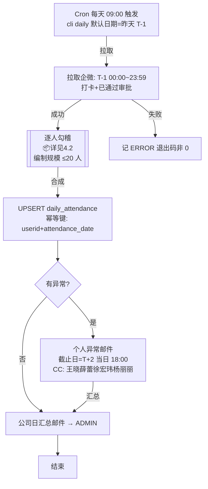

📖 **图解**：这张图回答「日审一次运行从头到尾经历哪几站」。每天早上 9 点对「昨天整天」做对账：拉取失败**立刻记 ERROR 退出**（宁可不跑不带病跑）；拉取成功后进入「逐人勾稽」——这一站内部规则较多，黑盒化为一个节点（📦），细节见 4.2 子图；勾稽完写库后按「有无异常」分流：异常信里写明「后天傍晚 6 点前」要办完手续，最后统一汇总成公司日报。

### 4.2 日审单人判定规则总图（含阈值/次数）

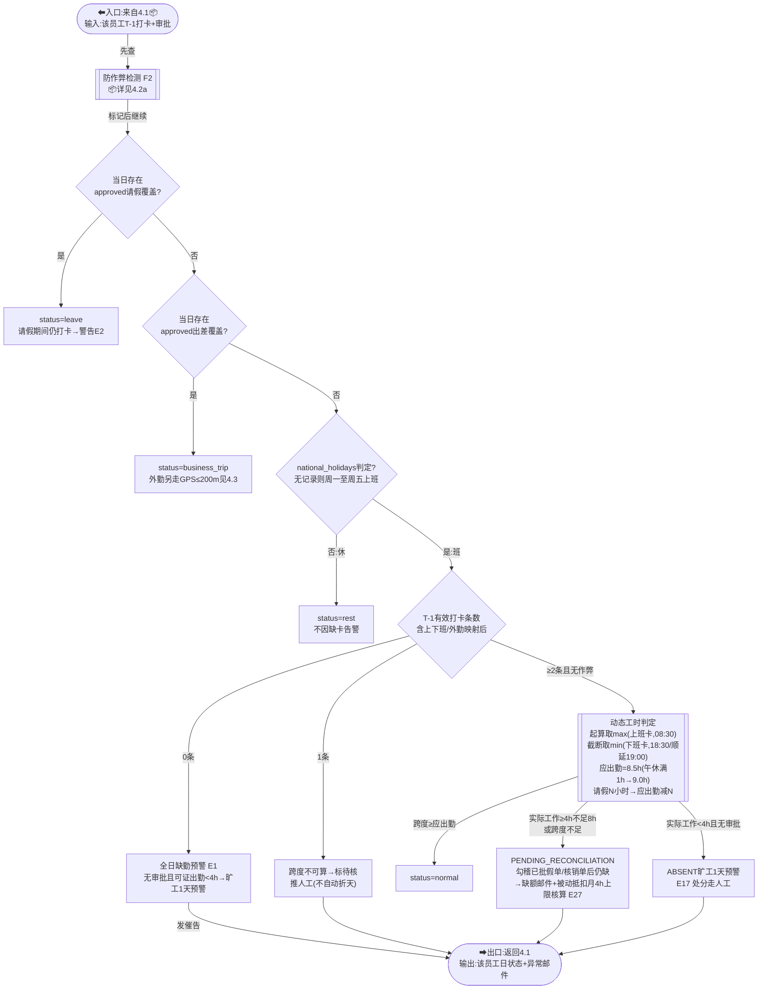

📖 **图解**：这张图回答「一个员工的一天，怎么一步步定出勤状态」。先过防作弊检测（黑盒，细节见 4.2a），标记后继续走主线：请假覆盖 → 出差覆盖 → 工作日判定 → 打卡条数分流。成对打卡进入「动态工时判定」黑盒：按 8/21 版制度 3.1.1 公式算截断后跨度，与当日应出勤（8.5h，午休满 1 小时则 9.0h，请假按小时扣减）比较——**引擎按公式判定，禁止写死 10:00 卡点**。缺额走冲抵勾稽并核算被动抵扣月 4h 上限；单侧缺卡不再自动折 0.5 天（旧口径作废），标待核推人工。审核要点：`Workday` 的「否」分支（休息日）直接免责；`Span` 三个出口的阈值 4h/8.5h/9.0h 必须与 PRD §4.1 一致。

### 4.2a 子图：防作弊检测 F2 内部逻辑（对应总图 📦 节点）

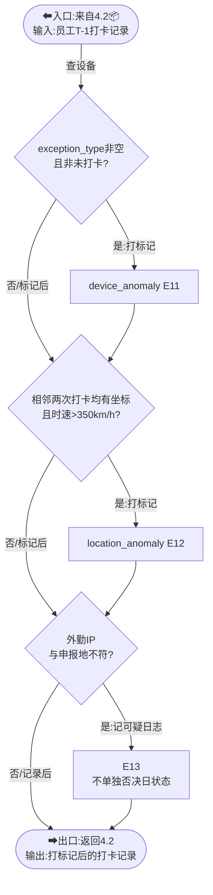

📖 **图解**：这张图放大 4.2 总图的「防作弊检测」黑盒，回答「怎么判定这个人有没有作弊」。三道独立检查依次走：设备异常（企微上报的 exception_type）、位置异常（相邻打卡时速超 350 公里/小时=瞬移）、可疑 IP（外勤 IP 与申报地不符）。**三道检查互不阻断**——查到异常只是打标记继续走，不会让流程中断，最终交回 4.2 主线继续判定请假/出差/工作日。审核要点：`E13`（可疑IP）明确标注「不单独否决日状态」，避免误伤正常外勤。

### 4.3 外勤 GPS 围栏（含 200 米硬阈值）

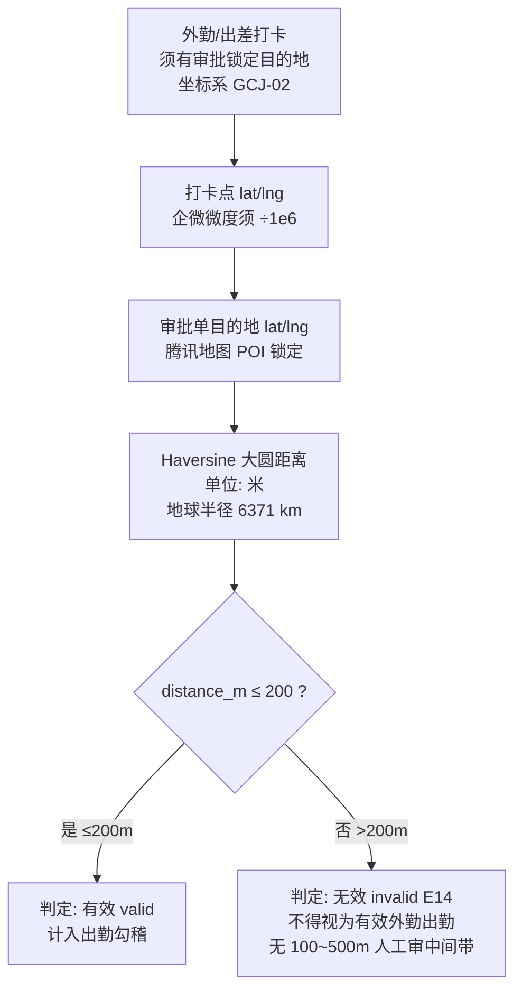

📖 **图解**：只认 200 米以内；超过半寸都不行，没有「再远一点找主管」的缓冲带。

### 4.4 加班转调休（含法定假与签字）

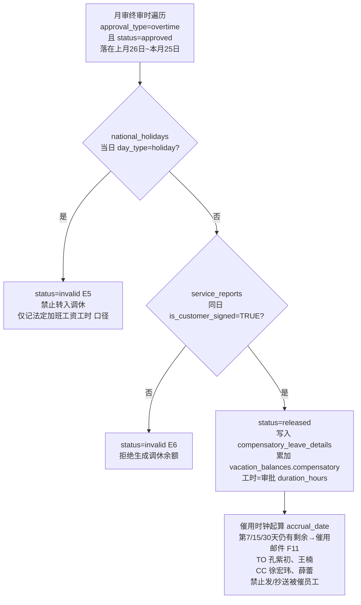

📖 **图解**：法定假加班不能倒休；平时加班必须有客户手写签字的服务报告；倒休闲置满约一周开始催。

### 4.5 月审与封账（含 25/26 与周期边界）

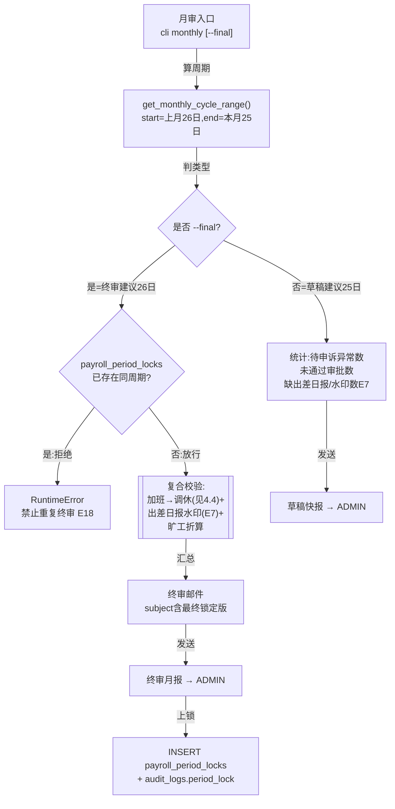

📖 **图解**：这张图回答「月审草稿和终审各走什么路，终审怎么防止重复上锁」。账期永远是「上月 26 号到本月 25 号」：25 号出草稿（只统计不锁账），26 号 `--final` 触发终审——先查是否已上锁（`Locked` 菱形），已锁的直接拒绝（E18，防止重复终审改数），未锁才做「复合校验」黑盒（内部细节：加班转调休见 4.4，出差日报水印校验，旷工折算），校验完发终审邮件并写入锁表。审核要点：`Locked` 的「是」分支必须报错退出，不允许终审静默覆盖已锁账期。

### 4.6 缺额核销与无酬缺勤（含 T+2 18:00 催告与 4h 被动抵扣上限）

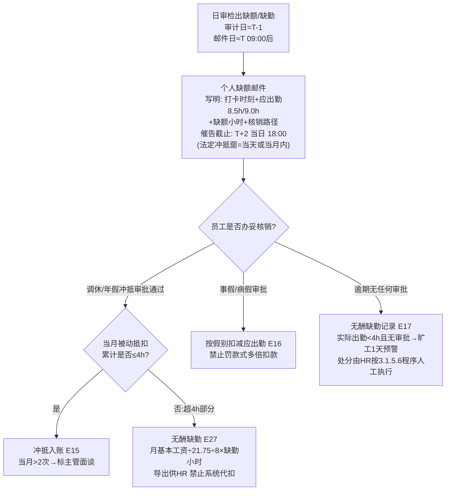

📖 **图解**：系统 9 点左右报昨天的工时缺额，邮件里写清公式明细；员工自主冲抵，引擎核算被动抵扣月 4 小时上限（超出部分按制度 3.2.4 公式导出）；系统只提醒、核算、导出，不代扣不处分。

### 4.7 金蝶差旅报销交叉审计 F15（一期：补助减半核对）

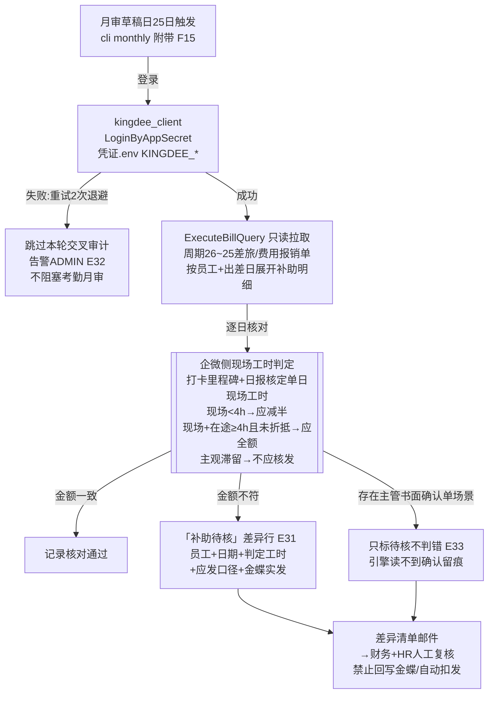

📖 **图解**：F15 只做一件事——把「企微打卡/日报判定的单日现场工时」和「金蝶报销单里补助实发金额」按制度 4.2.3 对表。引擎判定不了的（客观等待待命有主管书面确认的），一律只标待核，不判对错。金蝶侧永远只读；差异由财务在金蝶复核阶段人工修正。审核要点：`KFail` 路径必须不阻塞考勤主流程；`Send` 之后无任何写回操作。

**决策（2026-07-14，L2）**：§4.2 原图 16 节点/18 边超红线，拆出 4.2a（防作弊检测细节，用 ⬅入口/➡出口 接口节点与总图 📦 节点对应）；§4.5 原图 14 节点超红线，把「复合校验」3 个子步骤黑盒化为 1 个节点；§4.0/§4.7 两张纯参数清单（无关系、只有节点无实质连线）改写为速查表，图的额度留给真正有逻辑关系的流程。

**决策（2026-08-28，L1 v0.5）**：§4.2 判定主线由「数打卡条数折 0.5/1.0 天」改为「动态工时判定」黑盒（制度 3.1.1 公式）；§4.6 由「旷工折算」改为「缺额核销 + 被动抵扣 4h 上限」；新增 §4.7 F15 金蝶交叉审计。对应 Canvas（03_audit_rules / 03c_absence_appeal 及新增 03e_kingdee_cross_audit）**待同步导出**，列入 STATUS 待办。

**Canvas 人审对应**：

| Mermaid | Obsidian Canvas |
|---|---|
| §4.1 日审总流程 | `docs/canvas/03_audit_rules.canvas` |
| §4.2 日审单人判定总图 | `docs/canvas/03_audit_rules.canvas` |
| §4.2a 防作弊检测细节 | `docs/canvas/03a_daily_anti_fraud.canvas` |
| §4.3 外勤 GPS 围栏 | `docs/canvas/03b_gps_fence.canvas` |
| §4.4 加班转调休 + F11 催用 | `docs/canvas/03d_monthly_close_and_recall.canvas` |
| §4.5 月审与封账 | `docs/canvas/03d_monthly_close_and_recall.canvas` |
| §4.6 缺卡申诉与旷工 | `docs/canvas/03c_absence_appeal.canvas` |

---

## 5. 函数调用关系图

> 这张图回答「某个功能实际调了哪些函数」。拆为 **总图 + 3 张子图**。

### 5.0 总图：CLI 分发（鸟瞰）

```mermaid
flowchart TD
    cli_main["cli.main()"] -->|daily| run_daily["services.daily_audit.run_daily_audit()"]
    cli_main -->|weekly| run_weekly["services.weekly_audit.run_weekly_audit()"]
    cli_main -->|monthly| run_monthly["services.monthly_audit.run_monthly_audit()"]
    cli_main -->|check-expiry| check_exp["services.expiry_checker.check_compensatory_leave_expiry()"]
    cli_main -->|sync-roster| sync_roster["services.roster_sync.sync_employee_roster()"]
    cli_main -->|init-db| init_db["db.init_db()"]
```

📖 **图解**：`cli.main()` 是总入口，按子命令分发到 5 个 service 函数 + 1 个初始化函数。每条子命令完全独立，不存在交叉调用。

### 5.1 子图 A：日审调用链

```mermaid
flowchart TD
    run_daily["services.daily_audit.run_daily_audit()"] -->|同步花名册| sync_roster["services.roster_sync.sync_employee_roster()"]
    run_daily -->|拉取打卡| fetch_punches["wecom_api.WeComAPIClient.fetch_punches()"]
    run_daily -->|距离计算| haversine["geo.calculate_haversine_distance()"]
    run_daily -->|工作日判定| is_workday["holiday.is_workday_db()"]
    run_daily -->|渲染异常/日报邮件| render_mail["mail_sender.render_individual_anomaly_email()<br/>+ render_daily_summary_email()"]
    run_daily -->|发送邮件| send_mail["mail_sender.send_html_email()"]
    sync_roster -->|拉取通讯录| fetch_users["wecom_api.WeComAPIClient.fetch_users()"]
    sync_roster -->|读花名册| load_roster["roster.load_employee_roster()"]
    fetch_punches -->|指数退避| retry["wecom_api._retry_request()"]
    fetch_users --> retry
```

📖 **图解**：日审路径：先 `sync_employee_roster()` 确保花名册同步 → `fetch_punches()` 拉打卡 → 逐人做 `is_workday_db()` 工作日判定 + `calculate_haversine_distance()` 瞬移检测 → 渲染异常邮件/日报邮件 → `send_html_email()` 统一发送。所有企微 HTTP 调用通过 `_retry_request()` 做指数退避（1s→2s→4s，最多 3 次）。

### 5.2 子图 B：月审调用链

```mermaid
flowchart TD
    run_monthly["services.monthly_audit.run_monthly_audit()"] -->|获取周期范围| cycle_range["payroll_cycle.get_monthly_cycle_range()"]
    run_monthly -->|检查封账| check_lock["payroll_cycle.is_payroll_period_locked()"]
    run_monthly -->|终审复合校验| compound["monthly_audit._run_final_compound_checks()"]
    run_monthly -->|终审封账| lock_period["payroll_cycle.lock_payroll_period()"]
    run_monthly -->|渲染月报| render_monthly["mail_sender.render_monthly_finalized_email()"]
    run_monthly -->|发送邮件| send_mail["mail_sender.send_html_email()"]
    compound -->|调休决策| decide_comp["compensatory.decide_compensatory_accrual()"]
    compound -->|法定假判定| is_statutory["holiday.is_statutory_holiday()"]
    compound -->|工作日判定| is_workday["holiday.is_workday_db()"]
```

📖 **图解**：月审路径：先 `get_monthly_cycle_range()` 定周期 → `is_payroll_period_locked()` 查封账 → `_run_final_compound_checks()` 做加班+出差复核（内调 `decide_compensatory_accrual()` 和 `is_statutory_holiday()`）→ 汇总扣薪 → `lock_payroll_period()` 写封账 → `render_monthly_finalized_email()` 生成终审报表。

### 5.3 子图 C：周审 + 调休催用调用链

```mermaid
flowchart TD
    run_weekly["services.weekly_audit.run_weekly_audit()"] -->|获取周期起始| cycle_start["payroll_cycle.get_payroll_cycle_start()"]
    run_weekly -->|渲染周报| render_weekly["mail_sender.render_weekly_summary_email()"]
    run_weekly -->|发送邮件| send_mail["mail_sender.send_html_email()"]
    check_exp["services.expiry_checker.check_compensatory_leave_expiry()"] --> send_mail
```

📖 **图解**：周审只需 `get_payroll_cycle_start()` 算累计起点 → 渲染周报 → 发邮件。调休催用 `check_exp` 更简单——查库后直接调 `send_html_email()` 发催用邮件（**TO 仅孔紫初/王楠**；禁止发给或抄送被催员工）。

**Canvas 人审对应**：

| Mermaid | Obsidian Canvas |
|---|---|
| §5.0 总图 | `docs/canvas/04_function_calls.canvas` |
| §5.1 子图 A | `docs/canvas/04a_function_daily_chain.canvas` |
| §5.2 子图 B | `docs/canvas/04b_function_monthly_chain.canvas` |
| §5.3 子图 C | `docs/canvas/04c_function_weekly_expiry.canvas` |

---

## 6. 参数传递路径图

> 原单图混杂「配置流」与「数据流」两件不相关的事，拆为 6a/6b（框架总纲 3.3：一张图讲一件事）。

### 6a 配置参数流（.env → 各模块）

```mermaid
flowchart LR
    env[".env 文件<br/>敏感凭证"] -->|加载| settings["config.Settings<br/>Pydantic校验"]
    settings -->|"WECOM_*/SMTP_*/DATABASE_URL等<br/>按前缀分发,见下表"| targets[["WeComAPIClient / mail_sender /<br/>db / services层 / roster_sync<br/>📦见速查表8"]]
    cli_args["CLI参数<br/>--date/--final"] -->|解析| cli["cli.main()"]
    cli -->|"target_date/is_final传入"| targets
```

| Settings 字段 | 去向 |
|---|---|
| `WECOM_CORPID`/`SECRET` | `WeComAPIClient` |
| `SMTP_*` | `mail_sender` |
| `DATABASE_URL` | `db.get_db_connection()` |
| `ADMIN_EMAILS`/`PM_EMAILS`、`EXCLUDED_NAMES`/`USERIDS` | services 层 |
| `DEFAULT_COMPANY_A`/`B` | `roster_sync` |
| CLI `--date` → `target_date: date` | services 层 |
| CLI `--final` → `is_final: bool` | `monthly_audit` |

📖 **图解**：这张图回答「配置从哪来、到哪去」。敏感凭证（企微密钥、SMTP 密码）只在 `.env` 出现，代码零硬编码；`Settings` 统一校验后按字段前缀分发给各模块（详细去向见上表）。CLI 的 `--date`/`--final` 走另一条路径，传入 service 层控制审计目标日和月审类型。

### 6b 审计数据流（企微 JSON → 落库 → 邮件）

```mermaid
flowchart LR
    wecom_json["企微打卡JSON<br/>raw_payload<br/>⚠️外来数据不可信"] -->|入库| attendance_logs[("attendance_logs表")]
    attendance_logs -->|逐人勾稽| daily_att[("daily_attendance表")]
    daily_att --> is_anomaly{"is_anomaly?<br/>日审核心判定点"}
    is_anomaly -->|是| anomaly_mail["个人异常邮件"]
    daily_att -->|汇总| daily_report["公司日报邮件"]
    approval_json["企微审批JSON"] -->|入库| approvals[("approvals表")]
    approvals -->|覆盖判定| daily_att
    overtime_approval["加班审批"] -->|复核见4.4| comp_details[("compensatory_leave_details")]
    comp_details -->|余额入账| vac_bal[("vacation_balances")]
```

📖 **图解**：这张图回答「打卡/审批数据从进门到落地经过哪些加工和检查」。企微打卡 JSON（外来、不可信）先入 `attendance_logs`，逐人勾稽合成 `daily_attendance`；`is_anomaly?` 是日审核心判定点——异常发个人邮件，正常汇入公司日报。企微审批 JSON 入 `approvals` 后可覆盖判定 `daily_attendance`（如请假/出差覆盖缺卡告警）。加班审批经复核（见 4.4）后入 `compensatory_leave_details`，累加进 `vacation_balances` 余额表。审核要点：任何外来 JSON 必须先入库再参与判定，不允许绕过落库直接改状态。

**Canvas 人审对应**：

| Mermaid | Obsidian Canvas |
|---|---|
| §6a 配置参数流 | `docs/canvas/05a_param_config_flow.canvas` |
| §6b 审计数据流 | `docs/canvas/05b_param_audit_data_flow.canvas` |

---

## 7. 时序图（可选）

日审：Cron → cli → AuditEngine → WeComAPI → DB → MailSender → SMTP。

---

## 8. 关键类/函数速查表与术语对照

| 符号 | 文件 | 职责 |
|---|---|---|
| `AuditEngine` | `audit_engine.py` | 门面类（re-export 到独立 service） |
| `run_daily_audit` | `services/daily_audit.py` | 日审业务流程 |
| `run_weekly_audit` | `services/weekly_audit.py` | 周审业务流程 |
| `run_monthly_audit` | `services/monthly_audit.py` | 月审业务流程 |
| `check_compensatory_leave_expiry` | `services/expiry_checker.py` | 调休过期检查 |
| `sync_employee_roster` | `services/roster_sync.py` | 花名册同步 |
| `calculate_haversine_distance` | `geo.py` | Haversine 大圆距离 |
| `is_workday_db` / `is_statutory_holiday` | `holiday.py` | 节假日判定 |
| `get_monthly_cycle_range` / `lock_payroll_period` | `payroll_cycle.py` | 薪资周期与封账 |
| `decide_compensatory_accrual` | `compensatory.py` | 调休入账决策 |
| `WeComAPIClient` | `wecom_api.py` | 企微 HTTP + token + 指数退避重试 |
| `send_html_email` | `mail_sender.py` | 模板渲染与 SMTP |
| `WXBizMsgCrypt` | `wxbiz_msg_crypt.py` | 回调加解密 |
| `evaluate_outdoor_gps_distance` | `roster.py` | 外勤距离 ≤200m 有效 / >200m 无效 |
| `load_employee_roster` | `roster.py` | 读 JSON 花名册 |

### 领域术语对照表

| 中文 | 代码用名 |
|---|---|
| 打卡记录 | attendance_logs / checkin |
| 审批单 | approvals |
| 调休假 | compensatory_leave |
| 花名册 | roster / employees / employee_roster.json |
| 外勤围栏半径 | OUTDOOR_GPS_MAX_RADIUS_METERS = 200 |
| 封账 | finalize / lock |
| 日审/周审/月审 | run_daily_audit / run_weekly_audit / run_monthly_audit |

---

## 9. 异常处理策略声明

| 外部调用 | 策略 | 说明 |
|---|---|---|
| 企微 API | 重试（指数退避）+ 失败快速失败 | 不伪造成功；打 ERROR |
| SMTP | 有限重试 + 管理员告警 | TEST_MODE 拦截收件人 |
| PostgreSQL | 连接失败快速失败 | 事务回滚 |
| 花名册 JSON | 缺文件快速失败；单行匹配失败记待处理 | 路径见 `data/employee_roster.json` |
| Webhook 验签 | 快速失败拒绝 | 防伪造 |
| 金蝶 Web API（F15） | 重试 2 次（退避）→ **降级跳过**本轮交叉审计并告警 ADMIN | **只读**（LoginByAppSecret + ExecuteBillQuery）；失败不阻塞考勤日审/月审主流程；禁止 Save/Audit 等写接口 |

---

## 10. 无人值守与自愈

- 进程：Docker restart 策略；任务入口返回非 0 供 Cron 感知。
- 诊断：`python -m attendance_audit_integration.diagnostics` 导出日志与配置摘要（脱敏）。
- 幂等：重复跑同一日审不应重复产生矛盾扣薪（以 DB 唯一约束/状态机为准，重构时落实）。

---

## 11. 数据流向说明

企微原始打卡/审批 → 落库 → 日合成 `daily_attendance` → 异常邮件；月复合校验 → 调休流水/月报 → 封账。  
核心表：`employees`、`attendance_logs`、`approvals`、`daily_attendance`、`compensatory_leave_details`、`national_holidays`、以及日报/服务报告/审计日志等扩展表（见 archive SRS）。

---

## 12. 关键设计决策记录

| 日期 | 决策 | 理由 |
|---|---|---|
| 2026-07-13 | 原地叠 v2 骨架，不新建目录 | 用户选定方案 A/1 |
| 2026-07-13 | 月审周期 26–25，25/26 出报 | 与现网代码一致 |
| 2026-07-13 | archive 只留不删；专题并入 PRD | 防丢失与合规可追溯 |
| 2026-07-13 | 先伪代码后重构业务代码 | 框架铁律；用户要求一并重构 |
| 2026-07-14 | GPS >200m 无效；花名册改 JSON | 业务确认；去掉 500m 人工审带与运行时 xlsx |
| 2026-07-14 | ARCHITECTURE §4 补全审计规则 Mermaid | 人审需要；规则图与 PRD §4/6.6 对齐 |
| 2026-07-14 | audit_engine.py 拆分为 9 个文件 (L2) | 框架 4.9「1模块=1文件」铁律；原 1113 行→门面+4工具+5服务 |
| 2026-07-14 | wecom_api.py 添加指数退避重试 | ARCHITECTURE §9 / E20 声明的策略落地 |
| 2026-07-14 | 硬编码排除名单/公司名→配置项 | 可维护性；避免代码修改 |
| 2026-07-14 | 按 `code_dev_audit_framework_v2` 新约定（框架总纲 3.1/3.3）重排全部 Mermaid+Canvas：单图 ≤12 节点/≤15 边/单节点度 ≤6；总图黑盒化(`[[...]]`+📦)子系统并标注"详见 X.Y"；黑盒节点禁止合并多个 `.py` 文件名，避免溯源脚本误配对；§3 由 4 图拆为 9 图，§4.2/§4.5 拆出子图与黑盒节点，§4.0/§4.7 纯参数清单改表格，§6 拆为配置流/数据流两图 (L2) | 用户要求对齐脚手架新规范；真实依赖边数量不变，只是分散到更多小图，`tools/check_traceability.py` 逐图取并集对账不受影响 |
