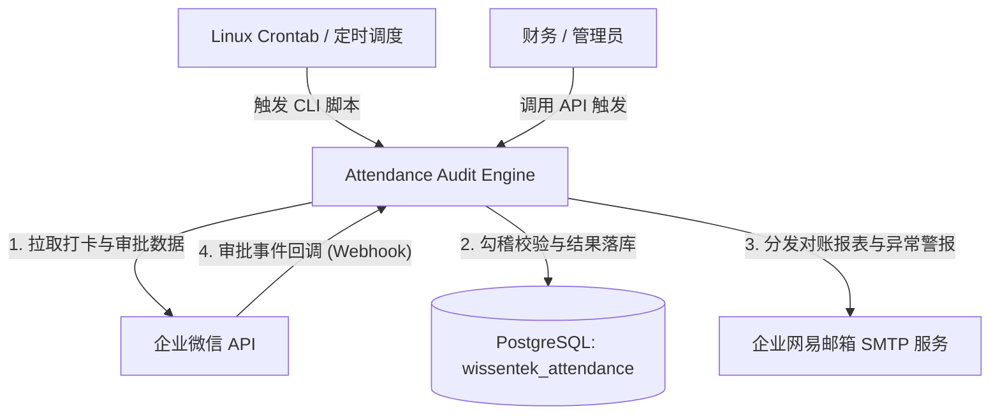
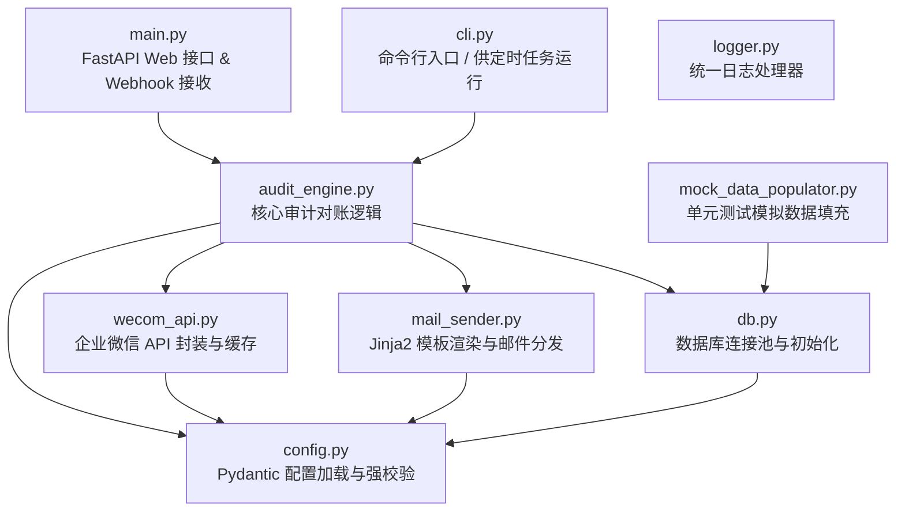
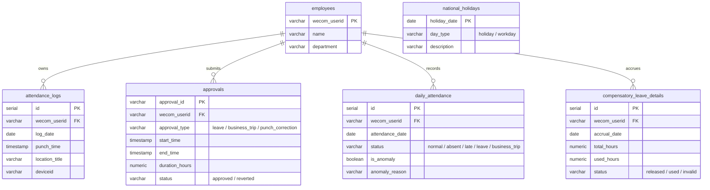

# 考勤审计集成项目架构说明 (ARCHITECTURE.md)

本文件详述了企业微信考勤审计对账系统的架构设计、调用模块与核心数据流程。

---

## 1. 系统一句话概述

本服务定时自动（或通过 API 手动）拉取企业微信的**打卡记录**与各类**假勤审批单**，与本地数据库维护的**中国法定节假日日历**进行对照对账，并联合校验**现场服务单**和**外勤出差日报**。对账结果通过邮件实时发送异常警报，并在每月 **25 号（草稿版）** 与 **26 号（终审版）** 自动生成并分发月度财务扣薪对账报表。

---

## 2. 系统上下文图 (System Context)

本程序（Attendance Audit Engine）作为一个独立的对账微服务运行在 Docker 容器中，它与外部系统的交互关系如下：

---

## 3. 模块结构图 (Module Architecture)

服务代码采用分层包结构设计，各模块之间的调用依赖关系如下：

---

## 4. 核心数据模型与表关系

系统基于 PostgreSQL 实现考勤数据持久化，主要包含以下核心表：

---

## 5. 核心审计对账逻辑流

### 5.1 每日对账流程 (Daily Audit)
每日凌晨自动运行，核对前一日（T-1）的考勤状况：
1. **工作日判断**：查询 `national_holidays` 表。如果为节假日且无加班审批，则跳过；如果是补班工作日或普通周一至周五，则设为应到工时。
2. **打卡异常判定**：无打卡记录且无合法请假/出差审批的判定为“旷工”；打卡时间不全或晚于 9:00 判定为“迟到”；设备或地理定位异常判定为“位置异常”。
3. **报警发送**：发现异常即刻渲染警报模板并单独向员工及抄送相关经理发送邮件。

### 5.2 月度考勤与扣薪审计流程 (Monthly Audit)
每月 **25 号下班前（草稿预估版）** 与 **26 号（最终锁定版）** 自动运行，结算过去一个对账周期（上月 26 号至本月 25 号）：
1. **获取对账区间**：`get_monthly_cycle_range(date)` 准确计算周期。
2. **应到/请假核算**：核算周期内每个员工的应到天数（自动排除“徐宏玮”与“杨丽丽”），并汇总各类假勤天数。
3. **周末加班与服务单勾稽校验**：
   - 检查周期内的周末加班记录。
   - 匹配当天是否关联了已签署的 `service_reports`。若有则释放调休余额（`compensatory_leave_details` 累加工时），若无服务单则判定为无效加班，拒绝发放调休。
4. **出差与日报环境照勾稽校验**：
   - 检查周期内的 `business_trip` 审批。
   - 检查对应的出差工作日内是否提交了带有水印环境照片的 `field_work_reports`。若缺报则标记为出差异常，扣除差旅补助。
5. **计算工资扣除**：按旷工扣 100%、迟到扣 50% 累计计算扣除天数，汇总成对账单发给总经理、财务总监与会计。
